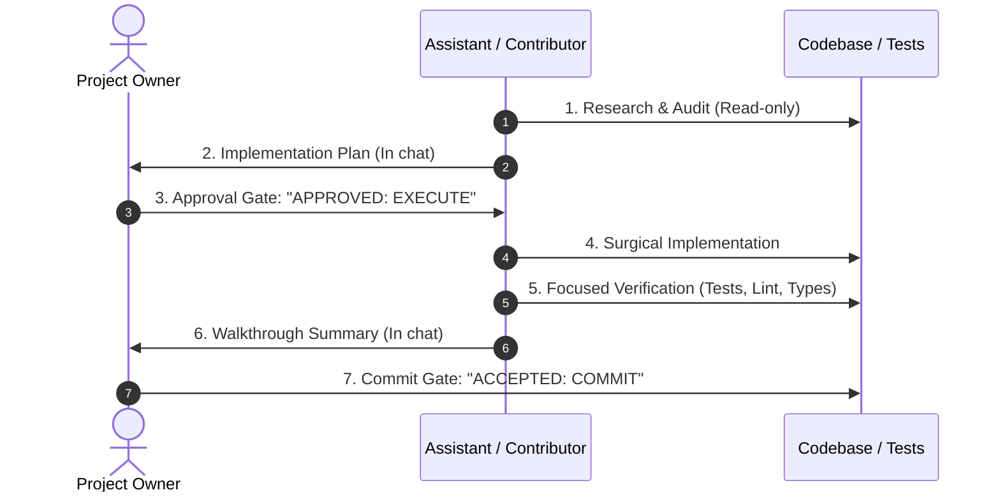

# HaruQuantAI Project Charter & Specification

**Status:** Active Clean-Room Reimplementation of StrategyQuant X (SQX-145).
**Baseline Roadmap:** [`docs/dev/full-reimplementation/`](dev/full-reimplementation/00-README.md).
**Current Milestone:** Phase 01 (AppCore) 100% complete; Phase 02 (AppHome) foundation operational; Phase 03 (AppDataManager) active.

---

## 1. Project Mission & Architectural Vision

**HaruQuantAI** is a high-performance, local-first quantitative research, algorithmic strategy engineering, and automated backtesting workstation engineered in modern Python and TypeScript.

The project executes an evidence-backed clean-room reimplementation of **StrategyQuant X (Build 145)**, replacing its legacy monolithic Java/Swing/Electron desktop architecture with a modern, high-throughput, cloud-ready stack:

1. **Pure Python 3.14 Async Core (`app/core/`):** Built on FastAPI, Uvicorn, and zero-copy columnar data structures (Apache Arrow, Polars, DuckDB) for ultra-fast time series analytics and backtest execution.
2. **Process-Isolated Compute:** Heavy computational workloads (genetic strategy building, multi-market backtesting, walk-forward analysis, Monte Carlo simulations) run across a native multiprocessing worker pool bypassing the Python GIL.
3. **Unified Web Shell (`app/web/`):** Modern React 19 + TypeScript + Vite single-page application served directly by the FastAPI backend (`install_web_build` in [`app/main.py`](../app/main.py)), eliminating Electron and Java desktop runtimes entirely.
4. **Strict Spatial Modularization:** Clean separation across Core, Domain Workspaces, Frontend Web Shell, and Dynamic Extensions following the Five Laws of Spatial Composability.

---

## 2. Governance & Authority

* **[AGENTS.md](../AGENTS.md) (Contributor Constitution):** Governs development workflows, owner approval gates (`APPROVED: EXECUTE`, `ACCEPTED: COMMIT`), coding standards, test coverage baselines, and architectural limits.
* **[docs/ARCHITECTURE.md](ARCHITECTURE.md):** Defines structural boundaries, tier layering, the 5 Laws of Spatial Composability, persistence isolation, and lifecycle contracts.
* **[`docs/dev/full-reimplementation/`](dev/full-reimplementation/00-README.md):** Canonical 20-phase clean-room reimplementation blueprint and work-order dispatch engine.
* **Donor Reference Authority (`DONOR_REFERENCE_ROOT` = `data\reference-donor`):** Preserves original StrategyQuant X build-145 sources (`internal/libs`, `internal/plugins`, `internal/extend`, `internal/ctemplate`, `internal/web`). Used exclusively as a behavioral reference, formula donor, and fixture source; no proprietary code is compiled or ported directly.

---

## 3. Product Personas & Target Journeys

### 3.1 Primary Personas
* **Quantitative Researchers:** Ingest, inspect, resample, and clean tick/bar market data; explore market regimes and custom indicators.
* **Strategy Engineers:** Author visual algorithmic rules in AlgoWizard or write native code in the Code Editor; generate strategies via genetic evolution.
* **Portfolio & Risk Managers:** Analyze multi-factor performance metrics, stress-test robustness via Monte Carlo and Walk-Forward Matrix, and construct balanced multi-asset portfolios.
* **Automation Operators:** Design directed acyclic graph (DAG) pipelines in Custom Projects for unattended data updates, generation, testing, and report generation.
* **System Reviewers & Auditors:** Verify data lineage, numerical precision, and parameter provenance with zero hidden assumptions.

### 3.2 End-to-End User Journey

```mermaid
flowchart LR
    A["1. Data Manager<br/>(Ingest & Clean)"] --> B["2. Authoring<br/>(AlgoWizard / Code)"]
    B --> C["3. Generation<br/>(Builder Genetic Search)"]
    C --> D["4. Simulation<br/>(Retester Backtest)"]
    D --> E["5. Robustness<br/>(Optimizer / Monte Carlo)"]
    E --> F["6. Curation<br/>(Results Databank)"]
    F --> G["7. Composition<br/>(Portfolio Master)"]
    G --> H["8. Automation<br/>(Custom Projects DAG)"]
    H --> I["9. Deployment<br/>(Export & Live Trading)"]
```

1. **Acquire & Ingest:** Ingest multi-asset tick and bar series via pluggable data feeds (Dukascopy, Darwinex, MT4/5, Parquet, CSV); clean, resample, and inspect quality.
2. **Author or Generate:** Formulate trading logic via visual rule blocks in AlgoWizard or Python/MQL in CodeEditor, or evolve strategy populations using the Builder genetic engine.
3. **Simulate & Retest:** Execute precise multi-timeframe historical backtests with explicit spread, slippage, and commission models.
4. **Validate & Stress-Test:** Apply Walk-Forward Optimization (WFO/WFM), Monte Carlo permutations, and parameter sensitivity matrices to challenge overfitting.
5. **Curate & Filter:** Aggregate candidates into databanks filtered by fitness functions, Sharpe ratio, max drawdown, and profit factor.
6. **Compose Portfolios:** Combine uncorrelated strategies, optimize asset weights, and evaluate aggregate portfolio risk.
7. **Automate & Export:** Orchestrate end-to-end pipelines in Custom Projects and export verified strategy code (MQL5, MQL4, EasyLanguage, cTrader C#, Python).

---

## 4. Full Product Scope: The 20 Domain Phases

The clean-room reimplementation is organized into 20 domain phases detailed in [`docs/dev/full-reimplementation/`](dev/full-reimplementation/):

| Phase | Phase Document | Domain Name | Scope & Capabilities | Current Status |
| :---: | :--- | :--- | :--- | :---: |
| **01** | [`01-AppCore.md`](dev/full-reimplementation/01-AppCore.md) | **AppCore** | Pure quant engine, time series, trading primitives, grid protocol, host lifecycle, persistence WAL, jobs, wizard code transforms. | **100% Complete** (34 WOs, 459 tests) |
| **02** | [`02-AppHome.md`](dev/full-reimplementation/02-AppHome.md) | **AppHome** | Central workstation hub, project registry, dashboard configuration, ATM visibility rules, settings, release notes. | **Foundation Complete** (HOM-M01, H01–H06) |
| **03** | [`03-AppDataManager.md`](dev/full-reimplementation/03-AppDataManager.md) | **AppDataManager** | Market data catalog, tick/bar storage, instrument specs, sessions, baskets, broker profiles, data quality review, bar transforms. | **Active Phase** (DM-M01 migrated) |
| **04** | [`04-AppCodeEditor.md`](dev/full-reimplementation/04-AppCodeEditor.md) | **AppCodeEditor** | Multi-language code editor, compilation hooks, syntax trees, algorithmic snippets, and template integration. | *Planned* |
| **05** | [`05-AppWizard.md`](dev/full-reimplementation/05-AppWizard.md) | **AppWizard** | AlgoWizard visual rule builder, conditions, indicators, actions, multi-timeframe logic, code generator backends. | *Core Transform Done* |
| **06** | [`06-AppResults.md`](dev/full-reimplementation/06-AppResults.md) | **AppResults** | High-capacity databanks, multi-metric performance evaluation, equity/drawdown charts, trade lists, PDF/HTML exports. | *Planned* |
| **07** | [`07-AppRetester.md`](dev/full-reimplementation/07-AppRetester.md) | **AppRetester** | High-precision historical simulation engine, tick-by-tick backtesting, multi-market execution, slippage/spread stress models. | *Planned* |
| **08** | [`08-AppBuilder.md`](dev/full-reimplementation/08-AppBuilder.md) | **AppBuilder** | Genetic programming engine, random generation, building block mutation/crossover, multi-objective fitness filtering. | *Planned* |
| **09** | [`09-AppOptimizer.md`](dev/full-reimplementation/09-AppOptimizer.md) | **AppOptimizer** | Parameter grid/genetic optimization, Walk-Forward Analysis & Matrix (WFA/WFM), Monte Carlo permutation testing. | *Planned* |
| **10** | [`10-AppPortfolioComposer.md`](dev/full-reimplementation/10-AppPortfolioComposer.md) | **AppPortfolioComposer** | Multi-strategy portfolio construction, correlation matrices, capital allocation, combined equity curves. | *Planned* |
| **11** | [`11-AppPortfolioMaster.md`](dev/full-reimplementation/11-AppPortfolioMaster.md) | **AppPortfolioMaster** | Enterprise master portfolio management, risk budgeting, correlation drift monitoring, portfolio version control. | *Planned* |
| **12** | [`12-AppTaskManager.md`](dev/full-reimplementation/12-AppTaskManager.md) | **AppTaskManager** | Custom Projects DAG workflow orchestrator, multi-step pipeline automation, scheduled unattended execution. | *Planned* |
| **13** | [`13-AppNeuralNetwork.md`](dev/full-reimplementation/13-AppNeuralNetwork.md) | **AppNeuralNetwork** | Deep learning models for market regime classification, feature engineering, model training, and strategy inference. | *Planned* |
| **14** | [`14-AppGridControl.md`](dev/full-reimplementation/14-AppGridControl.md) | **AppGridControl** | Distributed compute cluster management, remote worker registration, work unit slicing, and load balancing. | *Planned* |
| **15** | [`15-AppGridTest.md`](dev/full-reimplementation/15-AppGridTest.md) | **AppGridTest** | Cluster verification, latency benchmarking, and worker node diagnostics. | *Planned* |
| **16** | [`16-AppDebugConsole.md`](dev/full-reimplementation/16-AppDebugConsole.md) | **AppDebugConsole** | Interactive runtime diagnostics, real-time log inspector, memory/CPU monitors, and IPC probe. | *Planned* |
| **17** | [`17-AppMarketplace.md`](dev/full-reimplementation/17-AppMarketplace.md) | **AppMarketplace** | Ecosystem package manager: discovery, installation, and sharing of indicators, building blocks, and templates. | *Planned* |
| **18** | [`18-AppBusiness.md`](dev/full-reimplementation/18-AppBusiness.md) | **AppBusiness** | Commercial licensing validation, user tiers, analytics, and reporting compliance. | *Planned* |
| **19** | [`19-AppAI.md`](dev/full-reimplementation/19-AppAI.md) | **AppAI** | Autonomous AI quantitative research assistant (Q): natural language rule authoring, strategy code explanation, hypothesis testing. | *Planned* |
| **20** | [`20-AppLiveTrading.md`](dev/full-reimplementation/20-AppLiveTrading.md) | **AppLiveTrading** | Live broker execution bridges, FIX/REST/WebSocket order routing, position reconciliation, fail-closed risk guards. | *Planned* |

---

## 5. System Invariants & Non-Negotiable Rules

* **Deterministic Qualification:** Every simulation, generation run, and backtest pins input dataset revisions, parameter values, execution models, and random seeds. No hidden fallback or mocked success.
* **Zero Silent Failures:** No bare `except:`, no swallowed errors, no silent executions. Operations emit explicit requirement tags (`FR-*`) to structured logs.
* **Strict Persistence Boundary:** `sqlite3` must never be imported outside `app/core/host/persistence.py`. Domain code interacts exclusively through typed repository/persistence APIs.
* **Safe External Effects:** Live trading and irreversible mutations remain disabled by default. Tests run against temporary isolated directories and in-memory or throwaway stores.
* **Architectural Ratchet:** Every source file must remain $\le 1000$ physical lines. Top-of-file docstrings must remain $\le 100$ lines. Code must pass `mypy --strict` and `ruff` without warnings.
* **Coverage Standard:** Retained Python application source requires a minimum of 80% branch-aware pytest coverage before release.

---

## 6. Development & Verification Workflow

All code contributions adhere strictly to the **7-Step Workflow** defined in `AGENTS.md`:

1. **Research & Audit:** Inspect active code, documentation, and tests. No source edits.
2. **Implementation Plan:** Present a structured plan in chat matching `docs/templates/implementation-plan.md`.
3. **Owner Approval Gate:** Stop and wait for the owner to respond exactly `APPROVED: EXECUTE`.
4. **Surgical Implementation:** Modify only approved paths and approved interfaces.
5. **Focused Verification:** Run change-scoped tests, typechecks, and architectural linting.
6. **Walkthrough:** Present a summary matching `docs/templates/walkthrough.md` with git diff and proposed commit message.
7. **Owner Commit Gate:** Await explicit authorization before committing (`ACCEPTED: COMMIT`).
