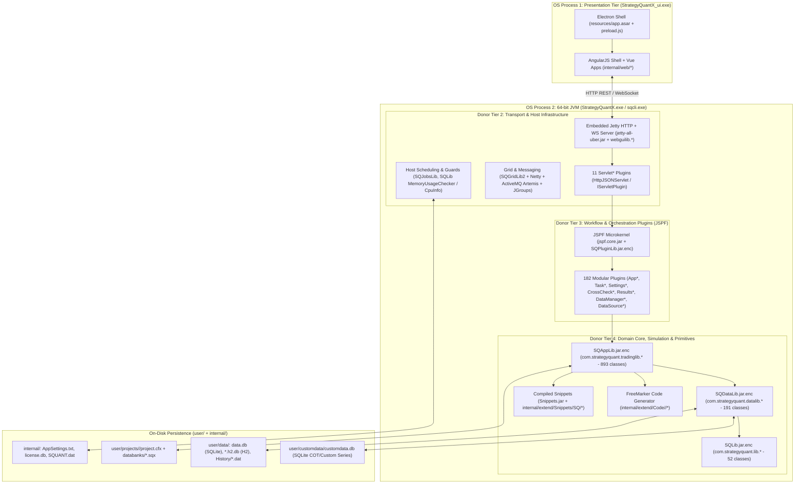
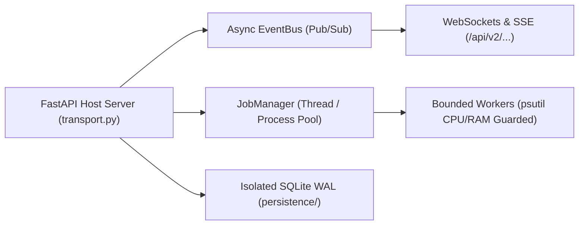
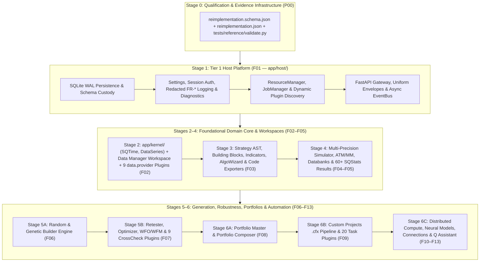

# StrategyQuant X (SQX-145) Architecture & HaruQuantAI Python Reimplementation Blueprint

- **Donor Reference Root:** `SQX_REFERENCE_ROOT` (Cohort: `SQX145 Dev 1 / 145.3039`)
- **Target Repository Root:** `HARUQUANTAI_ROOT`
- **Clean-Room Standard:** Donor informs; specification owns (`contains_proprietary_source: false`, `contains_sensitive_data: false`, `contains_personal_data: false`, `paraphrased_behavior_only: true`).
- **Authorities:** [`AGENTS.md`](../../AGENTS.md), [`docs/PROJECT.md`](../PROJECT.md), [`docs/ARCHITECTURE.md`](../ARCHITECTURE.md), [`docs/SQX/README.md`](README.md).

---

## 1. Direct Observations: SQX-145 System & Architecture (`observed`, `high`/`confirmed`)

### 1.1 Runtime Topology, Process Boundaries & Launchers

Inspection of `SQX_REFERENCE_ROOT` shows that StrategyQuant X is a **hybrid Java + embedded Jetty + Electron/Web + embedded Python** desktop and CLI system sharing a single installation root:

| Launcher / Binary | Config Artifact | Java Main Class & Flags | Role |
| :--- | :--- | :--- | :--- |
| `StrategyQuantX.exe` | `SQX_REFERENCE_ROOT/StrategyQuantX.config` | `com.strategyquant.strategyquant.SQStarter` (`-Xms4g`, `-XX:+UseParallelGC`, `--enable-native-access=ALL-UNNAMED`) | Full desktop workstation (starts embedded Jetty server + spawns Electron UI shell) |
| `sqcli.exe` | `SQX_REFERENCE_ROOT/sqcli.config` | `com.strategyquant.strategyquant.SQConsoleStarter` (`-Dsqx.console=true`) | Headless CLI (`SQConsole` / `QDMConsole`) for batch projects, databanks, and data jobs ([`cli/README.md`](cli/README.md)) |
| `CodeEditor.exe` | `SQX_REFERENCE_ROOT/CodeEditor.config` | `com.strategyquant.ce.CEStarter` (`-Dsqx.productcode=SQEDITOR`) | Standalone Java/FreeMarker snippet and building-block IDE |

#### Two-Process OS Execution Boundary (`observed`)
At runtime in desktop mode, SQX executes across **two distinct operating-system processes**:
1. **Presentation Process (`SQX_REFERENCE_ROOT/internal/electron/StrategyQuantX_ui.exe`):**
   - Packaged with a Chromium/V8 runtime, `SQX_REFERENCE_ROOT/internal/electron/resources/app.asar`, and `SQX_REFERENCE_ROOT/internal/electron/resources/preload.js` (plus `sq.ico` and `ce.ico` application icons).
   - Hosts the web frontend (`SQX_REFERENCE_ROOT/internal/web/*`), combining an AngularJS shell (`app/`, `HOME/`, `BUILDER/`, `RETESTER/`, `OPTIMIZER/`, `SQMANAGER/`, `TASKMANAGER/`, `PORTFOLIOMASTER/`, `PORTFOLIOCOMPOSER/`, `NEURALNETWORK/`, `GRIDCONTROL/`, `GRIDTEST/`, `MTANALYZER/`, `SQXBUSINESS/`, `MARKETPLACE/`, `DEBUGCONSOLE/`) with newer Vue/iframe applications (`AlgoWizard/`, `RESULTS2/`, `SQAI/`).
   - **Zero Quantitative Logic in UI:** Contains no backtesting, simulation, or indicator math; communicates with the JVM backend exclusively over HTTP REST and WebSockets (`ws://`).
2. **Backend JVM Process (`StrategyQuantX.exe` / `sqcli.exe` / `CodeEditor.exe` via `SQX_REFERENCE_ROOT/j64`):**
   - Embeds Eclipse Jetty (`SQX_REFERENCE_ROOT/internal/libs/jetty-all-uber.jar`; default port `5050` in `SQX_REFERENCE_ROOT/internal/AppSettings.txt`, user runtime port `8080` in `SQX_REFERENCE_ROOT/user/settings/settings.xml`).
   - Maintains host state files in `SQX_REFERENCE_ROOT/internal/` (`AppSettings.txt`, `license.db`, `SQUANT.dat`) and user state under `SQX_REFERENCE_ROOT/user/`.
   - Spawns an embedded Python sub-runtime (`SQX_REFERENCE_ROOT/internal/python/runtime`) executing `SQX_REFERENCE_ROOT/internal/python/scripts/mt5api.py` (with `mt5_symbol_overrides.json`) for low-level MetaTrader 5 terminal IPC.

#### Four-Tier Logical Execution Pipeline in Donor (`observed` + `inferred`)
Within those two OS processes, SQX enforces a 4-tier logical separation of concerns:

$$\text{Tier 1 (Electron/Web UI)} \xrightarrow{\text{HTTP / WS}} \text{Tier 2 (Jetty + Servlets + Host Services)} \xrightarrow{\text{JSPF Pipeline}} \text{Tier 3 (Workflow Tasks / Projects / Settings / Results)} \xrightarrow{\text{Direct Invocations}} \text{Tier 4 (Core Sim / DataSeries / Snippets / Math)}$$



---

### 1.2 Core Java Libraries & Third-Party Foundations (`SQX_REFERENCE_ROOT/internal/libs/`)

SQX packages its proprietary Java backend into **7 encrypted core JARs (`.jar.enc`)** and **1 compiled Snippets JAR (`Snippets.jar`)**:

> [!NOTE]
> **Packaging Clarification (`observed`):** There is no standalone file named `SQWebGUILib.jar` or `SQTradingLib.jar` in `SQX_REFERENCE_ROOT/internal/libs/`. Instead, both `com.strategyquant.tradinglib.*` and `com.strategyquant.webguilib.*` (`HttpJSONServlet`, `WebAppManager`, `BrowserGUI`, `AbstractUIWebServer`) are packaged inside `SQAppLib.jar.enc` (3,153,232 bytes).

| Artifact (`internal/libs/`) | Size | Package Root | Scope & Cataloged Structure |
| :--- | :--- | :--- | :--- |
| `SQLib.jar.enc` | 395,587 B | `com.strategyquant.lib.*` | **52 classes, 943 methods** ([`libs/SQLib.md`](libs/SQLib.md)) across `(root)`, `memory`, and `utils`: `SQTime` (financial timestamps, DST, session date/time arithmetic), `IRandomGenerator`, `MemoryInfo` & off-heap memory pools (`lib.memory`), hardware/memory probes (`CpuInfo`, `MemoryUsageChecker`), XML/settings maps (`SettingsMap`, `ValuesMap`), localization (`L`). |
| `SQDataLib.jar.enc` | 459,144 B | `com.strategyquant.datalib.*` | **191 classes, 3,136 methods** ([`libs/SQDataLib.md`](libs/SQDataLib.md)) across **18 subpackages**: `ChartDef`, `DataInfo`, `DataSeries` (off-heap double series with `IndyStartingBar` and `Shift`), `InstrumentInfo`, `bartype`, `basket`, `broker`, `consts`, `customData`, `darwinex`, `data`, `dataseries`, `historyData`, `indicators`, `instrument`, `metatrader4`, `session`, `ticksimulator`, `timeframe`, `timezone`, `validation`. |
| `SQAppLib.jar.enc` | 3,153,232 B | `com.strategyquant.tradinglib.*` & `com.strategyquant.webguilib.*` | **893 tradinglib classes, 14,063 methods** ([`libs/SQTradingLib.md`](libs/SQTradingLib.md)) across **89 subpackages** (`StrategyBase`, `ATM`, `ATMExit`, `backtest`, `backtestrunner`, `benchmark`, `blocks`, `build`, `charts`, `commissions`, `conditions`, `connection`, `correlation`, `cot`, `crosscheck`, `customanalysis`, `dailyEquity`, `databank`, `engine`, `equitychart`, `execution`, `exit`, `fitnessfunction`, `formulas`, `generator`, `gp`, `historyData`, `indicator`, `moneymanagement`, `montecarlo`, `optimization`, `options`, `order`, `portfolioMaster`, `project`, `quality`, `results`, `riskmanagement`, `robustnesstests`, `scaling`, `simulator`, `strategy`, `swap`, `talib`, `task`, `tradeanalysis`, `tradelist`, `wfo`, `whatif`) plus web GUI server classes (`webguilib.*`). |
| `SQPluginLib.jar.enc` | 17,851 B | `com.strategyquant.pluginlib.*` | JSPF-based plugin discovery, registration, and lifecycle contracts. |
| `SQJobsLib.jar.enc` | 9,968 B | `com.strategyquant.jobslib.*` | Multi-threaded background job and worker pool coordination. |
| `SQGridLib2.jar.enc` | 128,430 B | `com.strategyquant.gridlib.*` | Distributed grid node topology and remote backtest job dispatch. |
| `StrategyQuant.jar.enc` | 35,977 B | `com.strategyquant.strategyquant.*` | Application bootstrap (`SQStarter`, `SQConsoleStarter`). |
| `Snippets.jar` | 1,548,548 B | `SQ.*` | Compiled bytecode of all extensible Java snippets under `SQX_REFERENCE_ROOT/internal/extend/Snippets/SQ/`. |

#### Key Third-Party Runtime Libraries (`SQX_REFERENCE_ROOT/internal/libs/`)

| Category | Observed JAR Artifacts | Architectural Role in Donor |
| :--- | :--- | :--- |
| **Plugin Microkernel** | `jspf.core.jar` (327 KB), `jspf.remote.jar` (5 KB) | Java Simple Plugin Framework governing dynamic plugin discovery and classloader isolation. |
| **Web, Transport & Grid IPC** | `jetty-all-uber.jar`, `netty-all-4.1.5.Final.jar` (3.50 MB), `artemis-core-client-1.5.0.jar` (629 KB), `artemis-jms-client-1.5.0.jar` (178 KB), `artemis-commons-1.5.0.jar` (185 KB), `artemis-selector-1.5.0.jar` (105 KB), `jgroups-3.6.9.Final.jar`, `okhttp-jvm-5.3.2.jar` | Embedded HTTP/WS server, async network I/O, and ActiveMQ Artemis message queues for remote Grid compute nodes. |
| **Math, Collections & GP** | `commons-math3-3.6.1.jar` (2.21 MB), `fastutil-8.3.0.jar` (18.85 MB), `watchmaker-framework-0.7.1.jar` (90 KB), `uncommons-maths-1.2.2a.jar` (49 KB), `ta-lib-0.4.0.jar`, `fst-2.57.jar` | Statistical math, primitive type collections, evolutionary computation framework, technical indicators, and fast binary serialization. |
| **Persistence, XML & Code Gen** | `sqlite-jdbc-3.51.2.0.jar` (14.43 MB), `h2-1.3.149.jar`, `jdom-2.0.0.jar`, `xstream-1.4.9.jar`, `freemarker-2.3.28.jar`, `jackson-*-2.21.1.jar`, `zip4j-1.3.2.jar` | Embedded SQLite (`data.db`, `customdata.db`, `license.db`) and H2 (`*.h2.db`) engines, `.cfx`/`.sqx` ZIP/XML handling, and FreeMarker platform code generation. |
| **AI / MCP & Telemetry** | `mcp-0.17.2.jar`, `mcp-core-0.17.2.jar`, `mcp-json-jackson2-0.17.2.jar`, `logback-core-1.4.14.jar`, `logback-classic-1.4.14.jar`, `slf4j-api-2.0.17.jar`, `opentelemetry-*-1.61.0.jar`, `oshi-core-5.8.5.jar`, `WMI4Java-1.6.3.jar` | Model Context Protocol server/client for SQAI, structured logging, telemetry, and OS hardware/process inspection. |

---

### 1.3 Complete 182-Plugin Inventory (`SQX_REFERENCE_ROOT/internal/plugins/`)

Every directory in `SQX_REFERENCE_ROOT/internal/plugins/<PluginName>/` is a vertical slice bundling `<PluginName>.jar` with its frontend module (`module.js`, controllers/services, HTML templates, CSS) and default XML task configurations:

| Plugin Family | Count | Plugin Identifiers & Architectural Responsibility |
| :--- | :---: | :--- |
| **`App*`** | 18 | Top-level application workspaces: `AppBuilder`, `AppCodeEditor`, `AppDataManager`, `AppDebugConsole`, `AppGridControl`, `AppGridTest`, `AppMarketplace`, `AppNeuralNetwork`, `AppOptimizer`, `AppPortfolioComposer`, `AppPortfolioMaster`, `AppResults`, `AppRetester`, `AppSQXBusiness`, `AppSQXHome`, `AppStrategyQuant`, `AppTaskManager`, `AppWizard`. |
| **`Settings*`** | 32 | Composable task configuration tabs: `SettingsAdvancedTM`, `SettingsApplyMassConfig`, `SettingsAutomaticPortfolioBuilder`, `SettingsAutomaticRetest`, `SettingsAutoRetestData`, `SettingsBlocks`, `SettingsCallExternalScript`, `SettingsClearDatabanks`, `SettingsCreatePortfolio`, `SettingsCrossChecks`, `SettingsCustomAnalysis`, `SettingsData`, `SettingsDeleteFile`, `SettingsFiltering`, `SettingsGeneticOptions`, `SettingsGoToTask`, `SettingsLoadFromFiles`, `SettingsLogDatabankStats`, `SettingsMoneyManagement`, `SettingsNotes`, `SettingsNotification`, `SettingsOptimization`, `SettingsOptions`, `SettingsPanel`, `SettingsPartsToImprove`, `SettingsRankings`, `SettingsSaveToFiles`, `SettingsStopAndStart`, `SettingsUpdateData`, `SettingsWaitFor`, `SettingsWhatToBuild`, `SettingsWhatToRetest`. |
| **`Results*` & `EquityChart*`** | 28 | Per-strategy & portfolio analysis tabs: `ResultsChart`, `ResultsDatabankActions`, `ResultsDatabankViews`, `ResultsEquityChart`, `ResultsExplore`, `ResultsOptimizationProfile`, `ResultsOverview`, `ResultsPlugins`, `ResultsPortfolioComposerChart`, `ResultsPortfolioComposerLog`, `ResultsPortfolioCorrelation`, `ResultsProfileChart`, `ResultsReport`, `ResultsRobustnessTests`, `ResultsSequentialOptimization`, `ResultsSourceCode`, `ResultsSPOverview`, `ResultsStockpicker`, `ResultsStrategyConfig`, `ResultsSysParamPermutation`, `ResultsTradeAnalysis`, `ResultsTradeList`, `ResultsTradelistViews`, `ResultsWalkForward`, plus `EquityChartBenchmark`, `EquityChartDailyChart`, `EquityChartDrawdown`, `EquityChartVolatility`, `EquityChartVolume`. |
| **`Task*` & `TaskManager*`** | 22 | Pipeline task executors: `TaskApplyMassConfig`, `TaskAutomaticPortfolioBuilder`, `TaskAutomaticRetest`, `TaskBuild`, `TaskCallExternalScript`, `TaskClearDatabanks`, `TaskCreatePortfolio`, `TaskCustomAnalysis`, `TaskDeleteFile`, `TaskFiltering`, `TaskGoToTask`, `TaskLoadFromFiles`, `TaskLogDatabankStats`, `TaskNeuralNetworkTrainer`, `TaskNotification`, `TaskOptimize`, `TaskRetest`, `TaskSaveToFiles`, `TaskStopAndStart`, `TaskUpdateData`, `TaskWaitFor`, plus `TaskManagerProjects`, `TaskManagerTasks`. |
| **`DataSource*` & `CryptoExchange*`** | 15 | 9 market data feed plugins (`DataSourceCrypto`, `DataSourceDarwinex`, `DataSourceDukascopy`, `DataSourceFiles`, `DataSourceMt5Api`, `DataSourceSQEquityData`, `DataSourceSQFuturesData`, `DataSourceTD`, `DataSourceYahoo`) + 6 exchange adapters (`CryptoExchangeBinance`, `CryptoExchangeBinanceCoinM`, `CryptoExchangeBinanceUsdtM`, `CryptoExchangeBitfinex`, `CryptoExchangeCoinbasePro`, `CryptoExchangePoloniex`). |
| **`DataManager*`** | 11 | QuantDataManager (QDM) panels: `DataManagerActions`, `DataManagerBasket`, `DataManagerBroker`, `DataManagerConnections`, `DataManagerCustomData`, `DataManagerData`, `DataManagerHelp`, `DataManagerHome`, `DataManagerInstruments`, `DataManagerLog`, `DataManagerSessions`. |
| **`Servlet*`** | 11 | Jetty HTTP/WebSocket JSON bridges: `ServletAlgoCloud`, `ServletAlgoWizard`, `ServletBuilder`, `ServletCodeEditor`, `ServletConnection`, `ServletConstants`, `ServletGridControl`, `ServletProject`, `ServletRenameTool`, `ServletSQAI`, `ServletStrategy`. |
| **`CrossCheck*`** | 9 | Robustness & validation engines: `CrossCheckMonteCarloManipulation`, `CrossCheckMonteCarloRetest`, `CrossCheckOptProfileSysParamPermutation`, `CrossCheckRetestOnAdditionalMarkets`, `CrossCheckRetestWithHigherPrecision`, `CrossCheckSequentialOptimization`, `CrossCheckWalkForwardMatrix`, `CrossCheckWalkForwardOptimization`, `CrossCheckWhatIf`. |
| **`Project*`** | 9 | Project container views (`ProjectDatabanks`, `ProjectResources`, `ProjectResults`, `ProjectSettings`) + 5 `GoToTask` loop-condition plugins (`ProjectConditionCyclesCount`, `ProjectConditionGoToActivated`, `ProjectConditionGoToEvaluated`, `ProjectConditionResultsCount`, `ProjectConditionRunTime`). |
| **`Loader*` & `Saver*`** | 6 | Strategy & report serializers: `LoaderSQ3`, `LoaderSQ4`, `SaverHTML`, `SaverPDF`, `SaverSQ3`, `SaverStrategyTrades`. |
| **`FitnessMethod*`** | 3 | Fitness calculators: `FitnessMethodExistingPortfolio`, `FitnessMethodStrategyResult`, `FitnessMethodWFResult`. |
| **Other UI / Bridges** | 18 | `CodeEditorImportExport`, `CodeEditorIndicatorTester`, `ConnectionLiveTest`, `ConnectionMT4`, `ConnectionTest`, `CustomDatabankActions`, `CustomResultsPluginActions`, `DashboardPanel`, `DashboardResults`, `DatabankFilterByCorrelation`, `DatabankRename`, `EnginePanel`, `HomeAbout`, `PortfolioComposer`, `SkinDark`, `SkinLight`. |

#### 1.3.1 Full 11-Servlet HTTP/JSON Bridge Inventory (`SQX_REFERENCE_ROOT/internal/plugins/Servlet*`)

Each `Servlet*` plugin implements `IServletPlugin` and exposes JSON endpoints through Jetty's `HttpJSONServlet`:

| Donor Servlet Plugin | Functional Role |
| :--- | :--- |
| `ServletConnection` | Data provider connections, broker health checks, and latency ping/heartbeat. |
| `ServletConstants` | Exposes system enumerations, building-block catalogs, indicators, and UI type definitions. |
| `ServletStrategy` | Strategy inspection, XML/source serialization, and Databank result extraction. |
| `ServletBuilder` | Strategy generation engine controls, genetic progress, and candidate emission. |
| `ServletAlgoWizard` | Visual rule-tree editor serialization, validation, and code-generation bridge. |
| `ServletProject` | Custom Projects workflow engine (`config.xml` & task XML management, `.cfx` validation/import, databank routing, execution state). |
| `ServletCodeEditor` | Java snippet compilation, syntax checking, and CodeEditor filesystem operations. |
| `ServletGridControl` | Distributed grid compute manager, node registration, and remote task dispatch. |
| `ServletRenameTool` | Atomic cross-entity renaming (strategies, databanks, project tasks). |
| `ServletSQAI` | AI research assistant (`Q`) chat, MCP tool execution, and prompt routing. |
| `ServletAlgoCloud` | AlgoCloud synchronization and stockpicker/community strategy publishing. |

---

### 1.4 Core Object Model, Extensibility & Persistence Formats

1. **Unified Project Object Model ([`overview/object-model.md`](overview/object-model.md), [`custom-projects/project-config.md`](custom-projects/project-config.md)):**
   - Hierarchy: `App -> Projects (SQProject[]) -> { Tasks (AbstractTask[]), Databanks (Databank[]), Progress, Results }`.
   - Top-level navigation entries (`Builder`, `Retester`, `Optimizer`, `PortfolioMaster`, `PortfolioComposer`) are **single-task `SQProject` folders** stored in `SQX_REFERENCE_ROOT/user/projects/<Name>/` as peers to multi-task user Custom Projects.
   - Each project folder contains `project.cfx` ([`custom-projects/cfx-format.md`](custom-projects/cfx-format.md)): a flat DEFLATE ZIP archive with `config.xml` (`<Project>` root listing ordered `<Tasks>` and `<Databanks>`) and one `<TaskType>-Task<N>.xml` (`<Settings>` root) per task.
   - Databanks reside in `SQX_REFERENCE_ROOT/user/projects/<Name>/databanks/<DatabankName>/`, wiring tasks together via `<Databank name="Input|Output|Source|Target" value="..." />`.

2. **Three-Part Strategy & Block Extensibility (`internal/ctemplate/`, `internal/extend/`, `user/extend/`):**
   - **Block & Template Grammar (`SQX_REFERENCE_ROOT/internal/ctemplate/`):** `config.xml` and its entity includes (`actions.xml`, `advancedTypes.xml`, `colors.xml`, `comparisons.xml`, `conditions.xml`, `datasTimeframes.xml`, `events.xml`, `moneyManagement.xml`, `parameterSets.xml`, `talibs.xml`, `values.xml`, `wizard.xml`) define the XML AST for both **AlgoWizard** and **Builder** across three strategy styles (`sq4` dedicated signal rules, `sq4fuzzy` voting rules, `sq3` legacy rules; see [`custom-projects/strategy-styles.md`](custom-projects/strategy-styles.md)) and template placeholders (`RandomCondition`, `SameCondition`, `NegatedCondition`, `RandomAction`, `SameAction`, `OppositeAction`).
   - **Java Snippets (`SQX_REFERENCE_ROOT/internal/extend/Snippets/SQ/`):** 24 extensible snippet categories (`Blocks`, `Calculators`, `Checker`, `Columns`, `CorrelationOf`, `CustomAnalysis`, `EngineCharts`, `ExitMethods`, `Formulas`, `Functions`, `Internal`, `MoneyManagement`, `MonteCarlo`, `Negater`, `PortfolioMasterFitness`, `RiskManagement`, `Stats`, `Strategies`, `TALibIndicators`, `TradeAnalysis`, `Trading`, `TradingOptions`, `Utils`, `WhatIf`) compiled into `Snippets.jar`. Within `Blocks/`, 10 sub-families (`BarAndTime`, `CandlePatterns`, `Comparisons`, `Functions`, `Indicators`, `Order`, `Other`, `OtherActions`, `Price`, `StrategyControl`) cover 52+ indicator families and ~400 blocks.
   - **FreeMarker Code Export (`SQX_REFERENCE_ROOT/internal/extend/Code/<Engine>/` & `custom_indicators/`):** As documented in [`overview/export-engines/README.md`](overview/export-engines/README.md), every building block pairs its Java snippet with a `.tpl` template per target platform (`EasyLanguage`, `JForex`, `MetaTrader4`, `MetaTrader5`, `NinjaTrader`, `PseudoCode`, plus shared macros in `global/`), backed by platform-native custom indicators in `SQX_REFERENCE_ROOT/custom_indicators/` (`JForex`, `MetaTrader4`, `MetaTrader5`, `NinjaTrader`, `Tradestation`, and `BrokerProfileInstrumentsSessionsScripts`) and specialist packs (`SQX_REFERENCE_ROOT/VolumeProfile/`, `SQX_REFERENCE_ROOT/COT/`).

3. **Market & Custom Data Storage (`SQX_REFERENCE_ROOT/user/data/` & `user/customdata/`):**
   - `user/data/data.db` (SQLite metadata catalog), `data_futures.h2.db` and `data_stock.h2.db` (H2 databases), `user/customdata/customdata.db` (SQLite COT and custom series), and binary price series in `user/data/History/<Symbol>/<Symbol>_<TF>.dat`.

---

## 2. Bounded Inferences & Unresolved Gaps (`inferred` / `unverified`)

* **Encrypted Core JAR Internals (`inferred` / `unverified`):**
  - While public/protected class and method signatures of `SQLib`, `SQDataLib`, and `SQTradingLib` are cataloged in [`libs/SQLib.md`](libs/SQLib.md), [`libs/SQDataLib.md`](libs/SQDataLib.md), and [`libs/SQTradingLib.md`](libs/SQTradingLib.md), and all 24 snippet categories in `SQX_REFERENCE_ROOT/internal/extend/Snippets/SQ/*.java` and FreeMarker templates in `SQX_REFERENCE_ROOT/internal/extend/Code/*` are plain-text readable, exact internal tie-breaking inside encrypted classes (e.g., `com.strategyquant.tradinglib.simulator.*` same-bar order precedence, `gp.*` island migration edge cases, and `MainApp`/`AppSettings` host internals) requires targeted bytecode decryption/decompilation or runtime fixture verification before claiming SQX parity.
* **Binary `.dat` History & `.sqx` Serialization Details (`inferred`):**
  - `SQX_REFERENCE_ROOT/user/data/History/*/*.dat` binary layout and `.sqx` ZIP/XML payload details must be documented via atomic evidence records (`SQX145-EV-NNNNNN`) during `F02` (Market Data) and `F03`/`F05` (Strategies/Databanks) research prior to implementation.

---

## 3. Target-Project Mapping & Python Reimplementation Strategy (`normative`)

### 3.1 Current `HARUQUANTAI_ROOT` Baseline

Following the backend reset (`e2c72ab`), `HARUQUANTAI_ROOT` is at a clean **backend-reset baseline** ([`../PROJECT.md`](../PROJECT.md), [`../ARCHITECTURE.md`](../ARCHITECTURE.md)):
* **Retained Frontend (`HARUQUANTAI_ROOT/ui/`):** Complete React/TypeScript UI organized into `ui/app/host/`, `ui/app/workspace/<17 workspaces>`, and `ui/app/plugins/<4 families>`.
* **Ratified Architecture ([`../ARCHITECTURE.md`](../ARCHITECTURE.md)):** Enforces the **3-Tier Backend Architecture** (`app/host/`, `app/workspace/`, `app/plugins/`) plus shared mathematical primitives (`app/kernel/`) and the **Five Laws of Spatial Composability (`SC-01`–`SC-05`)**.
* **Registry & Evidence Gate:** Because `app/`, `tests/`, and `scripts/` were reset, domain `README.md` registries (`app/host/README.md`, `app/workspace/*/README.md`) and `reimplementation.json` records (`SQX145-EV-NNNNNN`) must be registered and approved per phase under [`AGENTS.md`](../../AGENTS.md) before implementation.

### 3.2 Reconciling Donor Logical Tiers with HaruQuantAI's Ratified Python Architecture

| Donor Logical Layer (`SQX_REFERENCE_ROOT`) | HaruQuantAI Target Layer (`HARUQUANTAI_ROOT`) | Architectural Responsibility ([`../ARCHITECTURE.md`](../ARCHITECTURE.md)) |
| :--- | :--- | :--- |
| **Donor Tier 1: Presentation** (`StrategyQuantX_ui.exe` + `internal/web/*`) | **UI Layer (`ui/app/`)** | React/TypeScript SPA (`ui/app/host/`, `ui/app/workspace/*`, `ui/app/plugins/*`, `ui/app/components/`). Pure presentation; communicates exclusively over REST and WebSocket/SSE. |
| **Donor Tier 2: Transport & Host** (`Jetty`, `webguilib.*`, `Servlet*`, `SQPluginLib`, `SQJobsLib`, `SQLib` guards) | **Backend Tier 1: Host Platform (`app/host/`)** | `bootstrap.py`, `discovery.py`, `persistence/` (isolated SQLite WAL), `resources.py`, `transport.py`, `response.py`, `jobs.py`, `settings.py`, `session.py`. Zero quantitative/trading logic. |
| **Donor Tier 3: JSPF Workflow & Orchestration** (`App*`, `DataManager*`, `Task*`, `Settings*`, `Results*`, `Project*` + `DataSource*`, `CrossCheck*`, `Snippets/SQ/*`, `extend/Code/*`) | **Backend Tier 2: Workspaces (`app/workspace/<domain>/`) + Backend Tier 3: Dynamic Plugins (`app/plugins/<slot>/<name>/`)** | Workspaces coordinate domain pipelines and mount `/api/v2/...` routers; Dynamic Plugins attach to workspaces via explicit typed slots (`SC-03`, e.g., `slot: "data.provider"`). |
| **Donor Tier 4: Domain Core & Math Primitives** (`SQLib.SQTime`, `IRandomGenerator`, `SQDataLib.DataSeries`, `commons-math3`, `fastutil`, `ta-lib`) | **Primitives (`app/kernel/`) + Domain Engines (`app/workspace/simulator/`, etc.)** | Reusable mathematical routines, financial timestamps (`SQTime`), seeded RNG, vectorized columnar series (`Polars`, `NumPy`, `PyArrow`, `DuckDB`), and indicator kernels. |

```mermaid
flowchart TD
    subgraph UI["Retained React Frontend (ui/app/*)"]
        UIHost["ui/app/host"]
        UIWS["ui/app/workspace/* (17 Workspaces)"]
        UIPlug["ui/app/plugins/*"]
    end

    subgraph Tier1["Tier 1: Host Platform (app/host/) — F01"]
        Boot["bootstrap.py / transport.py / response.py (FastAPI + WS/SSE)"]
        Disc["discovery.py (Manifest-driven importlib Plugin Loader)"]
        Persist["persistence/ (Isolated SQLite WAL + DuckDB/Parquet Custody)"]
        Jobs["jobs.py / resources.py / settings.py / session.py"]
    end

    subgraph Tier2["Tier 2: Domain Workspaces (app/workspace/) — F02..F13"]
        DM["data_manager/ (F02: 11 QDM modules)"]
        Strat["strategies/ & algowizard/ (F03: AST, Blocks, Code Export)"]
        Sim["simulator/ & results/ (F04-F05: Backtester, Databanks, Metrics)"]
        Gen["builder/ & retester/ & optimizer/ (F06-F07: GP, WFO/WFM, MC)"]
        Port["portfolio_master/ & portfolio_composer/ (F08)"]
        Proj["custom_projects/ (F09: .cfx Pipeline & Task Runner)"]
    end

    subgraph Tier3["Tier 3: Dynamic Plugins (app/plugins/<slot>/)"]
        PData["data_source/* (9 Providers: Dukascopy, Darwinex, MT5, Yahoo, Crypto...)"]
        PBlocks["blocks/* & indicators/* & mm/* & exits/* (Snippets/SQ equivalents)"]
        PCross["crosschecks/* (9 Robustness/MC/WFO/WhatIf plugins)"]
        PExport["exporters/* (Template generators: MT4, MT5, NT8, EL, JForex, PseudoCode)"]
    end

    subgraph Kernel["Mathematical & Time Primitives (app/kernel/)"]
        KTime["sq_time.py (SQTime parity) & rng.py (Seeded IRandomGenerator)"]
        KSeries["series.py (Polars/NumPy/PyArrow vectorized DataSeries)"]
        KInd["indicators.py (Vectorized TA-Lib / custom indicator kernels)"]
    end

    UI --> Tier1
    Tier1 --> Tier2
    Tier3 -.->|Attaches via Typed Slots (SC-03)| Tier2
    Tier2 --> Kernel
    Tier3 --> Kernel
```

| SQX Donor Layer | HaruQuantAI Python Target | Key Technical Design in Python (`>=3.14`) |
| :--- | :--- | :--- |
| `StrategyQuant.jar`, `SQPluginLib`, `SQJobsLib`, `Servlet*` | **Tier 1: `app/host/`** (`F01`) | `FastAPI` + `uvicorn` + `websockets`; `persistence/` owns all `sqlite3` WAL DDL (`schema.py`); `discovery.py` loads `plugin.json` manifests via `importlib`; `JobManager` coordinates bounded async/process jobs; zero quantitative logic. |
| `SQLib` (`SQTime`, `IRandomGenerator`), `SQDataLib` (`DataSeries`), `ta-lib` | **Primitives: `app/kernel/`** (`F02`–`F04`) | Pure, deterministic numerical primitives: `SQTime` calendar/session arithmetic, seeded `IRandomGenerator`, and `NumPy`/`Polars`/`PyArrow`-backed `DataSeries` replacing Java off-heap arrays with vectorized columnar buffers. |
| `DataManager*` (11 plugins) + `SQDataLib` | **Tier 2: `app/workspace/data_manager/`** (`F02`) | The 11 cohesive modules specified in [`../ARCHITECTURE.md`](../ARCHITECTURE.md) (`home`, `data`, `instruments`, `sessions`, `baskets`, `broker`, `connections`, `custom_data`, `log`, `help`, `actions/review`, `actions/transform`). |
| `DataSource*` & `CryptoExchange*` (15 plugins) | **Tier 3: `app/plugins/data_source/`** (`F02`) | 9 modular plugins declaring `slot: "data.provider"` (`dukascopy`, `darwinex`, `metatrader`, `sq_equity`, `sq_futures`, `crypto`, `files`, `yahoo`, `tick_downloader`). |
| `internal/ctemplate/*`, `AppWizard`, `AppCodeEditor`, `internal/extend/Code/*`, `Loader*`/`Saver*` | **Tier 2: `app/workspace/strategies/` + Tier 3: `app/plugins/blocks/` & `exporters/`** (`F03`) | Pydantic-typed immutable Strategy AST (`.sqx` XML/ZIP compatible); schema-driven block catalog (`SC-05`); template-driven source code exporters for MT4, MT5, NinjaTrader 8, EasyLanguage, JForex, and PseudoCode. |
| `SQTradingLib.simulator`, `engine`, `order`, `atm`, `moneymanagement`, `commissions`, `swap` | **Tier 2: `app/workspace/simulator/` + Tier 3: `app/plugins/money_management/`** (`F04`) | Multi-precision event/vector hybrid backtest engine (`Selected TF`, `1-minute`, `Real Tick`) supporting all 4 order types (`Market`, `Stop`, `Limit`, `ReverseAtMarket`), ATM exits, SL/PT/Trailing/SL2BE, and platform execution profiles (`MT4`, `MT5 Hedged/Netted`, `TS`, `NT8`, `Stockpicker`). |
| `SQTradingLib.databank`, `results`, `equitychart`, `tradelist`, `Snippets/SQ/Columns`, `Stats` | **Tier 2: `app/workspace/results/`** (`F05`) | Project-scoped `Databank` store with top-$N$ fitness ranking, view schemas, trade list, equity/drawdown series, and all 60+ `SQStats` metrics (`NetProfit`, `ProfitFactor`, `ReturnDD`, `Sharpe`, `Stability`, `SQN`, `Stagnation`, `Symmetry`). |
| `TaskBuild`, `SQTradingLib.generator`, `gp`, `Snippets/SQ/Negater` | **Tier 2: `app/workspace/builder/`** (`F06`) | Random & Genetic Programming generator (multi-island evolution, crossover, mutation, fresh-blood replacement, `OppositeBlock`/`Negater` symmetry, template placeholder expansion). |
| `TaskRetest`, `TaskOptimize`, `CrossCheck*` (9 plugins), `SQTradingLib.optimization`, `wfo`, `montecarlo`, `whatif` | **Tier 2: `app/workspace/retester/` & `optimizer/` + Tier 3: `app/plugins/crosschecks/`** (`F07`) | Simple/Brute-Force, Genetic, and Sequential parameter optimization; Walk-Forward Optimization (WFO) & Walk-Forward Matrix (WFM) 3D surface cluster evaluator; Trade-Manipulation & Retest Monte Carlo (confidence levels `50..100`); System Parameter Permutation (SPP); What-If trade filters. |
| `AppPortfolioMaster`, `AppPortfolioComposer`, `Snippets/SQ/PortfolioMasterFitness`, `CorrelationOf` | **Tier 2: `app/workspace/portfolio_master/` & `portfolio_composer/`** (`F08`) | Brute-force & genetic combination search with correlation/sector constraints (Master) + interactive per-strategy weighted, free-margin-aware daily simulation (Composer). |
| `AppTaskManager`, `Task*` (20 plugins), `ProjectCondition*` (5 plugins) | **Tier 2: `app/workspace/custom_projects/`** (`F09`) | `.cfx` ZIP reader/writer, `ProjectFileValidator` (`open -> config -> tasks -> templates -> settings`), and finite DAG/cyclic task pipeline executor supporting `GoToTask` loop guards. |
| `SQGridLib2`, `AppNeuralNetwork`, `Connection*`, `ServletAlgoCloud`, `ServletSQAI` | **Tier 2/3 Advanced Tracks** (`F10`–`F13`) | Remote worker compute contract (`F10`), bounded temporal neural model training (`F11`), broker/AlgoCloud/Marketplace adapters (`F12`), and bounded `Q` AI assistant via typed MCP tools (`F13`). |

---

### 3.3 Concrete Python Engineering Specifications by Tier (`normative`)

#### A. Foundational Domain Core & Primitives (`app/kernel/` & Domain Engines — `F02`–`F05`)
> **Constraint:** Pure headless financial math, time-series structures, and deterministic simulation loops; zero dependencies on FastAPI, SQLite, or UI state.

1. **Market Data Engine (`SQDataLib` Equivalent — `app/kernel/` + `app/workspace/data_manager/`):**
   - **Immutable Time-Series Records:**
     - `Bar`: Typed record containing timestamp (`int64` UTC/exchange milliseconds via `SQTime`), `open`, `high`, `low`, `close`, `volume`, and `spread`.
     - `Tick`: High-resolution record with `timestamp`, `bid`, `ask`, `last_price`, and `volume`.
     - `Timeframe`: Standard bar intervals (`M1`, `M5`, `M15`, `M30`, `H1`, `H4`, `D1`, `W1`, `MN1`) plus custom tick/range/volume bar types.
   - **Session Calendars & Instrument Specifications:**
     - `TradingSession` (`sessions.py`): Weekly day-of-week windows, Sunday open, daily session rollover, and NinjaTrader XML session import/export.
     - `InstrumentInfo` (`instruments.py`): `point_value`, `tick_size`, `pip_value`, `decimals`, `order_size_step`, `order_size_multiplier`, `min_distance`, initial margin, and commission/swap models.
   - **Columnar Storage & Feed Ingestion:**
     - **Apache Arrow / Parquet / Polars / DuckDB** for historical bar and tick storage alongside `.dat` compatibility.
     - Provider feed adapters (`app/plugins/data_source/*`, `slot: "data.provider"`): Dukascopy (`.bi5`), Darwinex, MetaTrader 4/5 (CSV/HST/FXT + MT5 terminal bridge), SQ Equity, SQ Futures, Crypto (Binance/Bitfinex/CoinbasePro/Poloniex), Local Files (CSV/Parquet/TSV), Yahoo Finance, and Tick Downloader.

2. **Backtesting & Execution Engine (`SQTradingLib.simulator` Equivalent — `app/workspace/simulator/`):**
   - **Order State Machine:**
     - Lifecycle states: `PENDING` $\to$ `OPEN` $\to$ `FILLED` $\to$ `PARTIALLY_FILLED` $\to$ `CLOSED` $\to$ `CANCELLED` / `EXPIRED` (`#BarsValid#`).
     - Order types: `EnterAtMarket`, `EnterAtStop`, `EnterAtLimit`, `EnterReverseAtMarket`, and parent-child OCO bracket/exit linkages (`StopLoss`, `ProfitTarget`, `MoveSL2BE` + `#SL2BEAddPips#`, `TrailingStop` + `#TrailingActivation#`, `ExitAfterBars`, and multi-exit `ATM` / `ATMExit`).
     - Fill & cost simulation: Intra-bar price-path resolution, broker spread/slippage models, commission tiers, and overnight rollover swaps.
   - **Deterministic Multi-Precision Simulation Loop:**
     - Single-pass event/vector hybrid loop supporting `Selected TF`, `1-minute`, and `Real Tick` intrabar precision to prevent lookahead bias.
     - `StrategyBase` execution hooks: evaluates `sq4` / `sq4fuzzy` signal rules first, then dispatches entry/exit actions and order events (`on_bar_update`, `on_order_event`).
   - **Performance & Statistics Engine (`app/workspace/results/`):**
     - Computes all 60+ `SQStats` metrics across In-Sample Training (`IST`), In-Sample Validation (`ISV`), and Out-of-Sample (`OOS`) segments: `NetProfit`, `ProfitInPips`, `ProfitFactor`, `ReturnDDRatio`, `MaxDrawdown` ($ and %), `SharpeRatio`, `CAGR`, `Stability` ($R^2$ linear regression), `SQN` / `SQNScore`, `WinPercentage`, `Expectancy` / `RExpectancy`, `Exposure`, `Stagnation` (days and %), `ZScore`, and Long/Short `Symmetry`.

3. **Strategy Building Blocks & Indicator Taxonomy (`Snippets.jar` Equivalent — `app/workspace/strategies/` & `app/plugins/blocks/`):**
   - **Vectorized Indicator Library:** `NumPy` / `Polars`-backed indicator kernels covering trend (`SMA`, `EMA`, `LWMA`, `SMMA`, `HullMA`, `KAMA`, `MACD`, `ParabolicSAR`, `SuperTrend`, `ADX`, `Aroon`, `Ichimoku`, `LinReg`, `GannHiLo`), momentum/oscillators (`RSI`, `LaguerreRSI`, `Stochastic`, `CCI`, `WilliamsPR`, `ROC`, `QQE`, `Reflex`, `STC`, `WaveTrend`, `DeMarker`, `AwesomeOscillator`), volatility (`ATR`, `MTATR`, `BollingerBands`, `KeltnerChannel`, `MTKeltnerChannel`, `StdDev`, `UlcerIndex`, `TrueRange`), and volume/orderflow (`AvgVolume`, `VWAP`, `AnchoredVWAP`, `VolumeProfile`, `TPOProfile`, `COT`).
   - **Declarative Strategy AST:** Immutable Pydantic/XML document representation of rules, conditions, `OppositeBlock`/`Negater` pairs, money management, trading options, and template placeholders (`RandomCondition`, `NegatedCondition`, `RandomAction`) compilable to vectorized evaluation and target-platform source templates (`MT4`, `MT5`, `NinjaTrader 8`, `EasyLanguage`, `JForex`, `PseudoCode`).

---

#### B. Tier 1: Host Platform & Transport Infrastructure (`app/host/` — `F01`)
> **Constraint:** Universal runtime, persistence isolation, plugin discovery, background multiprocessing/thread supervision, and API transport envelopes. Zero trading logic.



1. **Progressive Bootstrap State Machine (`app/host/bootstrap.py`):**
   - Ordered startup sequence with automatic reverse-order teardown on failure or shutdown:
     $$\text{CONFIGURING} \longrightarrow \text{PATHS} \longrightarrow \text{LOGGING} \longrightarrow \text{PERSISTENCE} \longrightarrow \text{SERVICES} \longrightarrow \text{ROUTES} \longrightarrow \text{READY}$$
2. **Persistence & Storage Custody (`app/host/persistence/`):**
   - Strict `sqlite3` import isolation (AST-guarded in tests; zero SQL outside `app/host/persistence/`).
   - Configured with `PRAGMA journal_mode=WAL`, `synchronous=NORMAL`, and `busy_timeout=5000`.
   - `schema.py` is the sole owner of DDL and compatibility checks (failing closed with `IncompatibleSchemaError` on unsupported versions).
   - Narrow CRUD stores (`SettingsStore`, `HostSessionStore`, job/workspace stores) with atomic revision checks.
3. **Telemetry, Redacted Logging & Diagnostics (`app/host/diagnostics.py`):**
   - Every operation logs its explicit `FR-*` capability label with zero silent failures.
   - Recursive secret redaction and path normalization; in-memory ring buffer (`collections.deque`) streaming live logs to the `DebugConsole` workspace.
4. **Resource Governance & Background Job Coordinator (`app/host/resources.py`, `app/host/jobs.py`):**
   - `psutil` hardware/memory probes, configurable worker allocation ($\text{workers} = \max(1, \text{cpu\_cores} - 2)$), memory cleanup/data-frame guards, and isolated per-job scratch directories.
   - `JobManager` managing `QUEUED`, `RUNNING`, `COMPLETED`, `FAILED`, and `CANCELLED` states with cooperative cancellation tokens and startup orphan-job recovery.
5. **Uniform Envelopes & Event Bus (`app/host/response.py`, `app/host/transport.py`):**
   - `ApiResponse[T]` (`data`, `error`, `timestamp`, `version`) and RFC 7807 `StandardError` schemas.
   - In-memory async `EventBus` distributing `jobs`, `system`, `logs`, `databanks`, and `settings.changed` events over WebSockets/SSE.

---

#### C. Tier 2 & Tier 3: Workflow Workspaces & Dynamic Plugins (`app/workspace/` & `app/plugins/` — `F06`–`F09`)

1. **Genetic Strategy Builder (`app/workspace/builder/` — `F06`):**
   - Supports **Random Generation** and **Genetic Evolution** (multi-island subpopulations evolving across worker processes with periodic migration, crossover of rule subtrees, mutation of blocks/parameters, initial-population decimation, fresh-blood replacement, and evolution restart management).
2. **Databanks & Filtering (`app/workspace/results/` — `F05`):**
   - Project-scoped `Databank` containers keeping top-$N$ strategies ranked by `FitnessMethod*` criteria and filtered by hard `<Conditions>` predicates, supporting configurable `syncType` and column views.
3. **Parameter Optimizer & Walk-Forward (`app/workspace/optimizer/` — `F07`):**
   - Simple brute-force grid search, genetic parameter optimization, Sequential one-parameter-at-a-time stability search, Walk-Forward Optimization (sliding/anchoring IS/OOS windows), and Walk-Forward Matrix (`WFM`) 3D surface cluster evaluation.
4. **Robustness & Cross-Check Suite (`app/workspace/retester/` & `app/plugins/crosschecks/` — `F07`):**
   - All 9 `CrossCheck*` plugins: Monte Carlo Trade Manipulation (trade shuffling, random skipping), Monte Carlo Retest (parameter jitter, history ATR perturbation, randomized starting bar across confidence levels `50, 60, 70, 80, 90, 92, 95, 97, 98, 99, 100`), Higher Precision retest, Additional Markets multi-market retest, WFO, WFM, Sequential Optimization, System Parameter Permutation (`SPP`), and `WhatIf` trade manipulation filters.
5. **Portfolio Master, Portfolio Composer & Custom Projects (`F08` & `F09`):**
   - **Portfolio Master:** Brute-force and genetic K-strategy combination search with correlation (`CorrelationOf`) and sector constraints.
   - **Portfolio Composer:** Per-strategy weight multipliers with daily account balance, leverage, and free-margin simulation + `Composer Log`.
   - **Custom Projects:** `.cfx` archive validator/loader and task pipeline runner executing all 20 `Task*` types with `GoToTask` conditional loops (`ProjectCondition*`).

---

### 3.4 Ratified Technology Stack (`HARUQUANTAI_ROOT/pyproject.toml` & `ui/package.json`)

| Subsystem | Ratified Technology | Role in HaruQuantAI |
| :--- | :--- | :--- |
| **Language & Typing** | Python `>=3.14`, `mypy --strict`, `ruff` | Modern type syntax, strict static verification, 88-char formatting, 5-section `FR-*` module docstrings. |
| **Data Validation & Schemas** | `pydantic>=2.11,<3`, `jsonschema>=4.26,<5` | Immutable domain models, strategy AST validation, `plugin.json` and `reimplementation.schema.json` verification. |
| **Columnar & Numerical Kernel** | `polars>=1.30,<2`, `pyarrow>=21,<24`, `duckdb>=1.3,<2`, `numpy>=2.5.3`, `pandas>=3.0.6` | High-speed vectorized `DataSeries`, indicator computation, and Parquet/Arrow/DuckDB market data storage. |
| **Host Web & Streaming Gateway** | `fastapi>=0.135,<1`, `uvicorn>=0.53.0,<1`, `websockets>=15,<18`, `httpx>=0.28,<1` | Asynchronous REST routers (`/api/v2/...`), uniform `ApiResponse[T]` envelopes, and WebSocket/SSE streaming. |
| **State Persistence** | Python `sqlite3` (WAL Mode) | Single-authority host/workspace metadata persistence isolated strictly inside `app/host/persistence/`. |
| **Process & Resource Governance** | `concurrent.futures`, `psutil>=7,<8`, `tzdata>=2025.2` | Multi-core backtest/GP worker pools, CPU/RAM guardrails, and IANA/exchange timezone normalization. |
| **Frontend Cockpit (`ui/`)** | React, TypeScript, Vite, Vitest, Playwright | Retained 17-workspace web frontend (`ui/app/host/`, `ui/app/workspace/`, `ui/app/plugins/`). |

---

### 3.5 Bottom-Up Dependency & Phased Reimplementation Sequence



Following the delivery order ratified in [`../PROJECT.md`](../PROJECT.md) (*"Deliver import -> author -> backtest -> inspect/export first, then generation, optimization/robustness, portfolios and projects"*), each stage below specifies **what is built in Python**, its **exact `SQX_REFERENCE_ROOT` donor sources**, its **connected `ui/app/` surface**, and its **verification gate**:

---

#### Stage 0 — Reference Qualification & Evidence Infrastructure (`P00`)

| Sub-Stage | Target Python Deliverables (`HARUQUANTAI_ROOT`) | Exact SQX-145 Donor Sources (`SQX_REFERENCE_ROOT` & `docs/SQX/`) | Connected UI / Verification Gate |
| :--- | :--- | :--- | :--- |
| **0A: Evidence Ledger & Schema** | `reimplementation.schema.json`, `reimplementation.json`, `docs/dev/evidence/README.md`, `docs/dev/evidence/p00-release-matrix.md` | All `SQX_REFERENCE_ROOT` artifacts (`StrategyQuantX.config`, `sqcli.config`, `CodeEditor.config`, `internal/libs/*.jar.enc`, `Snippets.jar`, `internal/plugins/*`, `internal/extend/*`) | `uv run python -m tests.reference.validate` (JSON syntax, schema compliance, monotonic `SQX145-EV-NNNNNN` IDs, SHA-256 fingerprints, clean-room flags). |
| **0B: CI & Architecture Guards** | `tests/reference/validate.py` (`--check-donor`), `scripts/ci_check.py`, `app/host/README.md` (`FEAT-*`, `FR-*`, `DEC-*` registration) | [`libs/SQLib.md`](libs/SQLib.md), [`libs/SQDataLib.md`](libs/SQDataLib.md), [`libs/SQTradingLib.md`](libs/SQTradingLib.md) | `uv run python scripts/ci_check.py` (Ruff, `mypy --strict`, `pytest` >=80% branch coverage, UI `typecheck`/`test`/`build`). |

---

#### Stage 1 — Tier 1: Host Platform & Transport Infrastructure (`F01` — `app/host/`)

| Sub-Stage | Target Python Deliverables (`HARUQUANTAI_ROOT`) | Exact SQX-145 Donor Sources (`SQX_REFERENCE_ROOT` & `docs/SQX/`) | Connected UI / Verification Gate |
| :--- | :--- | :--- | :--- |
| **1A: Isolated SQLite WAL Persistence** | `app/host/persistence/database.py`, `schema.py` (sole DDL owner, `IncompatibleSchemaError`), `settings_store.py` (`ensure_settings_schema`), `session_store.py` (`ensure_host_session_schema`), `job_store.py` | `SQX_REFERENCE_ROOT/internal/libs/sqlite-jdbc-3.51.2.0.jar`, `internal/license.db`, `internal/SQUANT.dat`, `com.strategyquant.lib.utils.SettingsMap` / `ValuesMap` ([`libs/SQLib.md`](libs/SQLib.md)) | AST architecture test enforcing zero `sqlite3` imports or raw SQL outside `app/host/persistence/`; WAL mode & atomic revision tests. |
| **1B: Host Settings & Session Auth** | `app/host/settings.py` (`HostSettings`, field catalogue, HTTP allowlist, recursive secret redaction, revision-checked atomic merge), `app/host/session.py` (`SessionManager`, 24h opaque token, password hashing, `/sessions/me`) | `SQX_REFERENCE_ROOT/internal/AppSettings.txt`, `user/settings/settings.xml` (`<WebServerPortUsed>`, `<BrowserToken>`, `<skin>`, `<language>`, `<gpuAccelerated>`), `com.strategyquant.lib.L` ([`libs/SQLib.md`](libs/SQLib.md)) | Connects `ui/app/host/HostConnection.tsx`, `GlobalSettingsMenu.tsx`, `HostSettingsPanels.tsx` (7-tab Configuration UI). |
| **1C: Telemetry, Redacted Logging & Diagnostics** | `app/host/logging.py` (multi-sink `app.log`/`access.log`/`errors.log`, secret redaction, path normalization, `collections.deque` ring buffer, mandatory `FR-*` tags), `app/host/diagnostics.py` (DB/workspace path & hardware probes) | `SQX_REFERENCE_ROOT/internal/libs/logback-core-1.4.14.jar`, `logback-classic-1.4.14.jar`, `slf4j-api-2.0.17.jar`, `opentelemetry-*-1.61.0.jar`, `internal/plugins/AppDebugConsole`, `user/log/*` | Connects `ui/app/workspace/DebugConsole/DebugConsoleWorkspace.tsx`; verifies zero silent executions and explicit `FR-*` log emission. |
| **1D: Resource Governance & Multiprocessing `JobManager`** | `app/host/resources.py` (`psutil` CPU/RAM monitor, $\text{workers} = \max(1, \text{cpu\_cores} - 2)$, data-frame/memory cleanup guards, per-job scratch sandboxes), `app/host/jobs.py` (`JobManager`, `QUEUED`/`RUNNING`/`COMPLETED`/`FAILED`/`CANCELLED`, cooperative cancellation, startup orphan-job recovery) | `SQX_REFERENCE_ROOT/internal/libs/SQJobsLib.jar.enc`, `oshi-core-5.8.5.jar`, `WMI4Java-1.6.3.jar`, `com.strategyquant.lib.MemoryInfo` & `lib.memory.*` (`CpuInfo`, `MemoryUsageChecker` in [`libs/SQLib.md`](libs/SQLib.md)), `com.strategyquant.tradinglib.jobs.*` | Connects background job progress bars & cancellation controls across `ui/app/host/` and workspace progress views. |
| **1E: Dynamic Plugin Discovery Engine** | `app/host/discovery.py` (`plugin.json` manifest validator, `importlib.util.spec_from_file_location` isolated loader, lazy thread-safe `get_instance` / `get_instances_for_slot` registry) | `SQX_REFERENCE_ROOT/internal/libs/SQPluginLib.jar.enc`, `jspf.core.jar`, `jspf.remote.jar`, `com.strategyquant.tradinglib.plugindef.*` ([`libs/SQTradingLib.md`](libs/SQTradingLib.md)) | Verifies `SC-02` (Orthogonality) & `SC-03` (Explicit Typed Slots): adding/removing a plugin requires zero host/peer edits. |
| **1F: FastAPI Gateway, Envelopes & Async `EventBus`** | `app/host/response.py` (`ApiResponse[T]`, RFC 7807 `StandardError`), `app/host/transport.py` (FastAPI app, WebSocket `/ws` & SSE `/events`, `EventBus` channels: `jobs`, `system`, `logs`, `databanks`, `settings.changed`) | `SQX_REFERENCE_ROOT/internal/libs/jetty-all-uber.jar`, `com.strategyquant.webguilib.*` (`HttpJSONServlet`, `WebAppManager`, `AbstractUIWebServer` in `SQAppLib.jar.enc`), `internal/plugins/ServletConstants`, `ServletRenameTool` | Connects `ui/app/host/transport.ts`, `router.tsx`, `HeaderApplications.tsx`, `ui/app/workspace/Home/HomeScreen.tsx`. |
| **1G: Progressive 7-Stage Bootstrap & CLI** | `app/host/bootstrap.py` (`CONFIGURING -> PATHS -> LOGGING -> PERSISTENCE -> SERVICES -> ROUTES -> READY` + reverse-order teardown), `app/main.py` (`haruquantai` CLI entrypoint) | `SQX_REFERENCE_ROOT/StrategyQuantX.config`, `sqcli.config`, `CodeEditor.config`, `StrategyQuant.jar.enc` (`SQStarter`, `SQConsoleStarter`), [`cli/README.md`](cli/README.md) | Full startup/teardown lifecycle integration test and headless CLI smoke test. |

---

#### Stage 2 — Mathematical Kernel & Market Data (`F02` — `app/kernel/` + `app/workspace/data_manager/` + `app/plugins/data_source/`)

| Sub-Stage | Target Python Deliverables (`HARUQUANTAI_ROOT`) | Exact SQX-145 Donor Sources (`SQX_REFERENCE_ROOT` & `docs/SQX/`) | Connected UI / Verification Gate |
| :--- | :--- | :--- | :--- |
| **2A: Time, Seeded RNG & Columnar `DataSeries` Kernel** | `app/kernel/sq_time.py` (`SQTime` date/time/DOW/DST/session arithmetic), `app/kernel/rng.py` (`IRandomGenerator` deterministic seeded RNG), `app/kernel/series.py` (`Bar`, `Tick`, `Timeframe`, `Polars`/`PyArrow`/`NumPy` `DataSeries` with `IndyStartingBar` & `Shift`) | `com.strategyquant.lib.SQTime`, `IRandomGenerator` ([`libs/SQLib.md`](libs/SQLib.md)); `com.strategyquant.datalib.DataSeries`, `ChartDef`, `DataInfo`, `dataseries.*`, `timeframe.*`, `timezone.*`, `bartype.*`, `ticksimulator.*` ([`libs/SQDataLib.md`](libs/SQDataLib.md)) | Unit & property tests verifying `SQTime` timestamp conversions, DST boundaries, and zero-copy `DataSeries` indexing. |
| **2B: Authoritative Data Manager Workspace (11 Modules)** | `app/workspace/data_manager/`: `home.py`, `data.py` (Parquet/DuckDB/`.dat` catalog & ingestion), `instruments.py` (`InstrumentInfo`), `sessions.py` (`TradingSession`, NinjaTrader XML), `baskets.py`, `broker.py`, `connections.py` (`ProviderManager`), `custom_data.py` (`COT`), `log.py`, `help.py`, `actions/review/quality.py` (`DataQualityInspector`), `actions/transform/transforms.py` (`SeriesTransformer`), `routes.py` (`/api/v2/data/...`) | `SQX_REFERENCE_ROOT/internal/plugins/DataManager*` (all 11 plugins: `DataManagerHome`, `DataManagerData`, `DataManagerInstruments`, `DataManagerSessions`, `DataManagerBasket`, `DataManagerBroker`, `DataManagerConnections`, `DataManagerCustomData`, `DataManagerActions`, `DataManagerLog`, `DataManagerHelp`), `ServletConnection`, `user/data/data.db`, `user/data/History/*/*.dat`, `com.strategyquant.datalib.instrument.*`, `session.*`, `basket.*`, `broker.*`, `validation.*` ([`libs/SQDataLib.md`](libs/SQDataLib.md)), [`cli/qdmcli.md`](cli/qdmcli.md) | Connects `ui/app/workspace/DataManager/DataManager.tsx`, `DataManagerHome.tsx`, `dataManagerLogClient.ts`, and `ui/app/plugins/data_source/*`. |
| **2C: Dynamic Market Data Provider Plugins (`slot: "data.provider"`)** | `app/plugins/data_source/`: `dukascopy` (`.bi5`), `darwinex`, `metatrader` (MT4/MT5 CSV/HST/FXT + MT5 bridge), `sq_equity`, `sq_futures`, `crypto` (Binance/Bitfinex/CoinbasePro/Poloniex), `files` (CSV/Parquet/TSV), `yahoo`, `tick_downloader` | `SQX_REFERENCE_ROOT/internal/plugins/DataSource*` (9 plugins) + `CryptoExchange*` (6 plugins), `internal/python/scripts/mt5api.py`, `mt5_symbol_overrides.json`, `user/data/data_futures.h2.db`, `data_stock.h2.db`, `user/customdata/customdata.db`, `COT/*`, `com.strategyquant.datalib.customData.*`, `metatrader4.*`, `darwinex.*` ([`libs/SQDataLib.md`](libs/SQDataLib.md)), `com.strategyquant.tradinglib.dukascopy.*`, `yahoo.*`, `mt4.*`, `mt5api.*`, `crypto.*`, `cot.*` ([`libs/SQTradingLib.md`](libs/SQTradingLib.md)) | Independent feed parser & round-trip export verification (CSV, Parquet, HST/FXT) + provider removal fallback test (`SC-02`). |

---

#### Stage 3 — Strategy Model, Building Blocks, Indicators & Code Exporters (`F03` — `app/workspace/strategies/` + `app/plugins/blocks/` & `exporters/`)

| Sub-Stage | Target Python Deliverables (`HARUQUANTAI_ROOT`) | Exact SQX-145 Donor Sources (`SQX_REFERENCE_ROOT` & `docs/SQX/`) | Connected UI / Verification Gate |
| :--- | :--- | :--- | :--- |
| **3A: Vectorized Indicator Kernels & Specialist Indicators** | `app/kernel/indicators.py` & `app/plugins/indicators/`: 52+ indicator families (`SMA`, `EMA`, `LWMA`, `SMMA`, `HullMA`, `KAMA`, `ADX`, `Aroon`, `ATR`, `MTATR`, `BollingerBands`, `KeltnerChannel`, `CCI`, `RSI`, `LaguerreRSI`, `Stochastic`, `MACD`, `Ichimoku`, `ParabolicSAR`, `SuperTrend`, `LinReg`, `QQE`, `Reflex`, `STC`, `UlcerIndex`, `Vortex`, `VWAP`, `AnchoredVWAP`, `WaveTrend`, `VolumeProfile`, `TPOProfile`, `COT`, `CandlePattern`, `Fibo`, `Fractal`, `Pivots`, `SessionOHLC`, `HeikenAshi`) | `SQX_REFERENCE_ROOT/internal/libs/ta-lib-0.4.0.jar`, `internal/ctemplate/talibs.xml`, `internal/extend/Snippets/SQ/Blocks/Indicators/*`, `Snippets/SQ/TALibIndicators/*`, `Snippets/SQ/Calculators/*`, `custom_indicators/MetaTrader4/Indicators/*.mq4`, `custom_indicators/MetaTrader5/Indicators/*.mq5`, `custom_indicators/NinjaTrader/Indicators/*.cs`, `custom_indicators/Tradestation/*`, `VolumeProfile/*`, `COT/*`, `com.strategyquant.tradinglib.talib.*`, `indicator.*` ([`libs/SQTradingLib.md`](libs/SQTradingLib.md)) | Numerical parity tests comparing Python indicator series against decrypted Java snippet / MQL5 / C# reference formulas (`SqCalculators`, `SqATR`, `SqRSI`, etc.). |
| **3B: Strategy AST, Building Blocks, `Negater` & AlgoWizard / CodeEditor** | `app/workspace/strategies/` (`ast.py`, `loader.py` for `.sqx` / `.str`, `validator.py`, `algowizard_routes.py`, `code_editor_routes.py`), `app/plugins/blocks/` (`BarAndTime`, `CandlePatterns`, `Comparisons`, `Functions`, `Indicators`, `Order`, `Other`, `OtherActions`, `Price`, `StrategyControl`), `Negater` symmetry engine (`OppositeBlocks`) | `SQX_REFERENCE_ROOT/internal/ctemplate/*.xml` (`config.xml`, `conditions.xml`, `values.xml`, `actions.xml`, `comparisons.xml`, `events.xml`, `wizard.xml`), `internal/extend/Snippets/SQ/Blocks/*`, `Snippets/SQ/Negater/*.java`, `Snippets/SQ/Formulas/*`, `Snippets/SQ/Functions/*`, `Snippets/SQ/Internal/XmlStrategy.java`, `user/settings/OppositeBlocks_example.csv`, `internal/plugins/AppWizard`, `ServletAlgoWizard`, `AppCodeEditor`, `ServletCodeEditor`, `CodeEditorImportExport`, `CodeEditorIndicatorTester`, `LoaderSQ3`, `LoaderSQ4`, `SaverSQ3` | Connects `ui/app/workspace/AlgoWizard/*`, `ui/app/workspace/CodeEditor/*`; validates `.sqx` round-trip serialization and `OppositeBlock` negation symmetry. |
| **3C: Template-Driven Platform Source Exporters (`slot: "export.platform"`)** | `app/plugins/exporters/`: `metatrader4` (`.mq4`), `metatrader5` (`.mq5`), `ninjatrader8` (`.cs`), `easylanguage` (`.el`), `jforex` (`.java`), `pseudocode` (`.txt`), plus shared macros (`cotCollectSymbols`, `printBlockChild`) | `SQX_REFERENCE_ROOT/internal/extend/Code/global/*`, `Code/MetaTrader4/*`, `Code/MetaTrader5/*`, `Code/NinjaTrader/*`, `Code/EasyLanguage/*`, `Code/JForex/*`, `Code/PseudoCode/*`, `internal/libs/freemarker-2.3.28.jar`, [`overview/export-engines/README.md`](overview/export-engines/README.md) | Connects `ui/app/workspace/AlgoWizard/StrategyCodeExportModal.tsx` and `ui/app/plugins/project/ResultsSourceCode`; verifies syntax-valid code generation across all 6 target platforms. |

---

#### Stage 4 — Simulation Engine, Databanks & Results (`F04` & `F05` — `app/workspace/simulator/` & `app/workspace/results/`)

| Sub-Stage | Target Python Deliverables (`HARUQUANTAI_ROOT`) | Exact SQX-145 Donor Sources (`SQX_REFERENCE_ROOT` & `docs/SQX/`) | Connected UI / Verification Gate |
| :--- | :--- | :--- | :--- |
| **4A: Order State Machine, Exit Methods, ATM & Money Management** | `app/workspace/simulator/orders.py` (`Market`, `Stop`, `Limit`, `ReverseAtMarket`, `#BarsValid#`, `#ReplaceExisting#`, `#MagicNumber#`, `#AllowDuplicateTrades#`), `exits.py` (`StopLoss`, `ProfitTarget`, `MoveSL2BE`, `TrailingStop`, `ExitAfterBars`, `_ExitRule_`), `atm.py` (`ATM`, `ATMExit`), `app/plugins/money_management/` (`FixedSize`, `FixedAmount`, `RiskFixedBalancePct`, `RiskFixedPctOfAccount`, `ATRRiskBasedSizing`, `SimpleMartingaleMM`, `StocksSizeByPrice`, `Crypto*`, `Picker*`), `trading_options/` (`ExitAtEndOfDay`, `ExitOnFriday`, `LimitTimeRange`, `MaxTradesPerDay`, `MinMaxSLPT`, `DontTradeOnWeekends`), `costs.py` (spread, slippage, commissions, swap) | `SQX_REFERENCE_ROOT/internal/extend/Snippets/SQ/MoneyManagement/*.java`, `Snippets/SQ/ExitMethods/*`, `Snippets/SQ/TradingOptions/*.java`, `Snippets/SQ/Trading/Commissions/*`, `Snippets/SQ/Trading/Scaling/*`, `Snippets/SQ/RiskManagement/*`, `com.strategyquant.tradinglib.ATM`, `ATMExit`, `atm.*`, `order.*`, `exit.*`, `moneymanagement.*`, `options.*`, `commissions.*`, `swap.*`, `scaling.*` ([`libs/SQTradingLib.md`](libs/SQTradingLib.md)), [`custom-projects/strategy-styles.md`](custom-projects/strategy-styles.md) | Connects `ui/app/plugins/project/SettingsMoneyManagement`, `SettingsOptions`, `SettingsAdvancedTM`; unit tests for every MM sizing formula, ATM partial exit, and SL/PT/Trailing transition. |
| **4B: Multi-Precision Deterministic Simulation Loop & Execution Profiles** | `app/workspace/simulator/engine.py` (`Selected TF`, `1-minute`, and `Real Tick` intrabar simulation loop), execution profile adapters (`MT4`, `MT5 Hedged`, `MT5 Netted`, `TradeStation`, `NinjaTrader 8`, `JForex`, `Stockpicker`), `ServletStrategy` backtest runner routes | `com.strategyquant.tradinglib.StrategyBase`, `simulator.*` (18 classes), `engine.*` (48 classes), `execution.*`, `backtest.*` (38 classes), `backtestrunner.*` (7 classes), `algocloud.*` ([`libs/SQTradingLib.md`](libs/SQTradingLib.md)), `SQX_REFERENCE_ROOT/internal/extend/Snippets/SQ/Strategies/*.java` (`TestStrategyAskBid.java`, `CompleteStrategySample.java`, etc.) | Connects `ui/app/workspace/Chart/ChartWorkspace.tsx` and `ui/app/plugins/project/EnginePanel`; verifies deterministic trade lists on donor test strategies (`Snippets/SQ/Strategies/`). |
| **4C: Databanks, 60+ `SQStats` Metrics & Results Analysis Views** | `app/workspace/results/databank.py` (top-$N$ heap/table, `IST`/`ISV`/`OOS` split stats, column views, `syncType`, `.sqx`/CSV/HTML/PDF export), `metrics.py` (all 60+ `DatabankColumn` calculators), `equity_chart.py`, `trade_analysis.py`, `routes.py` | `SQX_REFERENCE_ROOT/internal/extend/Snippets/SQ/Columns/Databanks/*.java`, `Snippets/SQ/Stats/Overview/*.java`, `Snippets/SQ/TradeAnalysis/*.java`, `Snippets/SQ/EngineCharts/*`, `Snippets/SQ/Checker/*`, `internal/plugins/AppResults`, `Results*` (23 plugins), `EquityChart*` (5 plugins), `DatabankFilterByCorrelation`, `DatabankRename`, `SaverHTML`, `SaverPDF`, `SaverStrategyTrades`, `FitnessMethod*` (3 plugins), `com.strategyquant.tradinglib.databank.*`, `results.*`, `equitychart.*`, `tradelist.*`, `tradeanalysis.*` ([`libs/SQTradingLib.md`](libs/SQTradingLib.md)), [`overview/stats-metrics.md`](overview/stats-metrics.md) | Connects `ui/app/workspace/Results/*`, `ui/app/plugins/databank/*`, and `ui/app/plugins/project/Results*`; verifies metric formulas (`NetProfit`, `ProfitFactor`, `ReturnDD`, `Sharpe`, `SQN`, `Stability`, `Stagnation`, `Symmetry`) against decrypted `Snippets/SQ/Columns/` & `Stats/`. |

---

#### Stage 5 — Strategy Generation, Optimization & Robustness Validation (`F06` & `F07` — `app/workspace/builder/`, `optimizer/`, `retester/` + `app/plugins/crosschecks/`)

| Sub-Stage | Target Python Deliverables (`HARUQUANTAI_ROOT`) | Exact SQX-145 Donor Sources (`SQX_REFERENCE_ROOT` & `docs/SQX/`) | Connected UI / Verification Gate |
| :--- | :--- | :--- | :--- |
| **5A: Random & Genetic Programming Builder Engine (`F06`)** | `app/workspace/builder/`: `random_generator.py` (template/placeholder expansion, weighted block sampling, complexity constraints), `gp_engine.py` (multi-island evolution, tournament/roulette selection, subtree crossover, block/parameter mutation, initial population decimation, fresh-blood duplicate/weakest replacement, evolution restart management), `routes.py` | `SQX_REFERENCE_ROOT/internal/plugins/AppBuilder`, `TaskBuild` (`task_forex.xml`, `task_futures.xml`, `task_stockpicker.xml`, `indicatorsCalibration`), `ServletBuilder`, `SettingsWhatToBuild`, `SettingsBlocks`, `SettingsGeneticOptions`, `SettingsPartsToImprove`, `SettingsRankings`, `internal/web/BUILDER/simpleTemplates/*`, `internal/libs/watchmaker-framework-0.7.1.jar`, `com.strategyquant.tradinglib.build.*`, `generator.*` (25 classes), `gp.*` (43 classes), `blocks.*` ([`libs/SQTradingLib.md`](libs/SQTradingLib.md)), [`overview/builder.md`](overview/builder.md) | Connects `ui/app/workspace/Builder/*` (`BuilderWorkspace.tsx`, `FullSettingsView.tsx`, `ProgressDashboard.tsx`, `FitnessEvolutionModal.tsx`); verifies seeded reproducibility and `Last generation` / `Results` databank population. |
| **5B: Parameter Optimizer & Walk-Forward Matrix (`F07`)** | `app/workspace/optimizer/`: `simple_optimizer.py` (brute-force grid & genetic parameter search), `sequential_optimizer.py` (1D parameter stability search), `walk_forward.py` (sliding & anchored WFO), `wf_matrix.py` (`WFM` Start/Stop/Increment grid across runs $\times$ OOS%, 3D score surface, $3\times 3$ cluster pass/fail evaluator), `sys_param_permutation.py` (`SPP`), `routes.py` | `SQX_REFERENCE_ROOT/internal/plugins/AppOptimizer`, `TaskOptimize`, `SettingsOptimization`, `CrossCheckWalkForwardOptimization`, `CrossCheckWalkForwardMatrix`, `CrossCheckSequentialOptimization`, `CrossCheckOptProfileSysParamPermutation`, `ResultsWalkForward`, `ResultsOptimizationProfile`, `ResultsSequentialOptimization`, `ResultsSysParamPermutation`, `FitnessMethodWFResult`, `com.strategyquant.tradinglib.optimization.*` (50 classes), `wfo.*` (4 classes) ([`libs/SQTradingLib.md`](libs/SQTradingLib.md)), [`overview/optimizer.md`](overview/optimizer.md) | Connects `ui/app/workspace/Optimizer/*` (`OptimizerWorkspace.tsx`, `OptimizationParameters.tsx`, `WalkForwardMatrixView.tsx`) and `ui/app/plugins/optimization/*`. |
| **5C: Retester & 9 `CrossCheck*` Robustness / Monte Carlo / What-If Plugins (`F07`)** | `app/workspace/retester/` (`retester.py`, `auto_retest.py`, `routes.py`) + `app/plugins/crosschecks/` (`slot: "validation.crosscheck"`): `mc_manipulation` (`RandomizeTradesOrder`, `SkipTradesRandomly`), `mc_retest` (`RandomizeStrategyParameters`, `RandomizeHistoryData`, `RandomizeStartingBar` at confidence levels `50..100`), `higher_precision`, `additional_markets`, `wfo`, `wfm`, `sequential_opt`, `spp`, `whatif` (14 `WhatIf` trade filters: `ByDays`, `ByHours`, `ByMonths`, `ExcludePctTradesWithBiggestPl`, `ExcludeShortTrades`, `ExludeOverlappingTrades`, `TakeMaxTradesPerDay`, `UseFixedLots`, etc.) | `SQX_REFERENCE_ROOT/internal/plugins/AppRetester`, `TaskRetest`, `TaskAutomaticRetest`, `SettingsWhatToRetest`, `SettingsAutoRetestData`, `SettingsCrossChecks`, `CrossCheck*` (all 9 plugins), `ResultsRobustnessTests`, `internal/extend/Snippets/SQ/MonteCarlo/Manipulation/*.java`, `Snippets/SQ/MonteCarlo/Retest/*.java`, `Snippets/SQ/WhatIf/*.java`, `com.strategyquant.tradinglib.crosscheck.*` (10 classes), `robustnesstests.*` (9 classes), `montecarlo.*`, `whatif.*` ([`libs/SQTradingLib.md`](libs/SQTradingLib.md)), [`overview/retester.md`](overview/retester.md) | Connects `ui/app/workspace/Retester/*` and `ui/app/plugins/project/SettingsCrossChecks`, `ResultsRobustnessTests`; verifies exact MC confidence-percentile interpolation (`50, 60, 70, 80, 90, 92, 95, 97, 98, 99, 100`) and `WhatIf` trade filtering against donor Java snippets. |

---

#### Stage 6 — Portfolios & Custom Projects Automation (`F08` & `F09` — `app/workspace/portfolio_master/`, `portfolio_composer/`, `custom_projects/`)

| Sub-Stage | Target Python Deliverables (`HARUQUANTAI_ROOT`) | Exact SQX-145 Donor Sources (`SQX_REFERENCE_ROOT` & `docs/SQX/`) | Connected UI / Verification Gate |
| :--- | :--- | :--- | :--- |
| **6A: Portfolio Master & Portfolio Composer (`F08`)** | `app/workspace/portfolio_master/` (brute-force & genetic K-strategy combination search, pairwise correlation filter via `CorrelationOf`, sector/market caps, `PortfolioMasterFitness`), `app/workspace/portfolio_composer/` (interactive per-strategy weight multiplier, account balance/leverage/free-margin daily simulation, `Composer Log`) | `SQX_REFERENCE_ROOT/internal/plugins/AppPortfolioMaster`, `TaskAutomaticPortfolioBuilder`, `TaskCreatePortfolio`, `SettingsAutomaticPortfolioBuilder`, `SettingsCreatePortfolio`, `AppPortfolioComposer`, `PortfolioComposer`, `ResultsPortfolioCorrelation`, `ResultsPortfolioComposerChart`, `ResultsPortfolioComposerLog`, `FitnessMethodExistingPortfolio`, `internal/extend/Snippets/SQ/PortfolioMasterFitness/*.java` (`NetProfit.java`, `PctStagnation.java`, `ReturnDD.java`), `Snippets/SQ/CorrelationOf/*.java`, `com.strategyquant.tradinglib.portfolioMaster.*`, `correlation.*` ([`libs/SQTradingLib.md`](libs/SQTradingLib.md)), [`overview/portfolio-master.md`](overview/portfolio-master.md), [`overview/portfolio-composer.md`](overview/portfolio-composer.md) | Connects `ui/app/workspace/PortfolioMaster/*` and `ui/app/workspace/PortfolioComposer/*`; verifies correlation matrix math and margin-constrained daily order skipping log. |
| **6B: Custom Projects `.cfx` Engine, 20 `Task*` & 5 `ProjectCondition*` Plugins (`F09`)** | `app/workspace/custom_projects/`: `cfx.py` (`.cfx` Flavour A project & Flavour B template ZIP reader/writer, `project_backup.cfx` atomic save), `validator.py` (`ProjectFileValidator`: `open -> config -> tasks -> templates -> settings`), `runner.py` (sequential/loop task pipeline, `from-first` / `from-here` / `this-task-only`, `GoToTask` reachability & cycle counters), plus all 20 `Task*` plugins (`Build`, `Retest`, `AutomaticRetest`, `Optimize`, `AutomaticPortfolioBuilder`, `CreatePortfolio`, `Filtering`, `ClearDatabanks`, `LoadFromFiles`, `SaveToFiles`, `DeleteFile`, `ApplyMassConfig`, `CustomAnalysis`, `LogDatabankStats`, `UpdateData`, `CallExternalScript`, `Notification`, `StopAndStart`, `WaitFor`, `GoToTask`) & 5 `ProjectCondition*` plugins | `SQX_REFERENCE_ROOT/internal/plugins/AppTaskManager`, `TaskManagerProjects`, `TaskManagerTasks`, `ServletProject`, `ProjectDatabanks`, `ProjectResources`, `ProjectResults`, `ProjectSettings`, `ProjectCondition*` (5 plugins), `Task*` (20 plugins), `Settings*` (task-specific tabs), `internal/extend/Snippets/SQ/CustomAnalysis/*`, `user/projects/*/project.cfx`, `com.strategyquant.tradinglib.project.*` (83 classes), `task.*` (20 classes), `taskImpl.*`, `tasks.*`, `file.SQFileManager` ([`libs/SQTradingLib.md`](libs/SQTradingLib.md)), [`custom-projects/cfx-format.md`](custom-projects/cfx-format.md), [`custom-projects/project-config.md`](custom-projects/project-config.md) | Connects `ui/app/workspace/CustomProjects/*` and `ui/app/plugins/project/ProjectWorkbench`; validates loading and executing real donor `.cfx` archives from `SQX_REFERENCE_ROOT/user/projects/`. |

---

#### Stage 7 — Advanced Ecosystem Tracks (`F10`–`F13`)

| Sub-Stage | Target Python Deliverables (`HARUQUANTAI_ROOT`) | Exact SQX-145 Donor Sources (`SQX_REFERENCE_ROOT` & `docs/SQX/`) | Connected UI / Verification Gate |
| :--- | :--- | :--- | :--- |
| **7A: Distributed Compute Grid (`F10`)** | `app/workspace/grid_control/` & remote worker agent using identical `JobManager` task contracts | `SQX_REFERENCE_ROOT/internal/libs/SQGridLib2.jar.enc`, `netty-all-4.1.5.Final.jar`, `artemis-*-1.5.0.jar`, `internal/plugins/AppGridControl`, `AppGridTest`, `ServletGridControl`, `com.strategyquant.tradinglib.simplegrid.*` | Connects `ui/app/workspace/GridControl/GridControlWorkspace.tsx` and `ui/app/workspace/GridTest/GridTestWorkspace.tsx`. |
| **7B: Neural Network Trainer (`F11`)** | `app/workspace/neural_network/` (bounded temporal feature preprocessing, walk-forward model training, retained artifact inference) | `SQX_REFERENCE_ROOT/internal/plugins/AppNeuralNetwork`, `TaskNeuralNetworkTrainer`, `docs/SQX/custom-projects/task-settings/neural-network-trainer.md` | Connects `ui/app/workspace/NeuralNetwork/NeuralNetworkTrainer.tsx`. |
| **7C: Connections, MTAnalyzer, AlgoCloud & Business (`F12`)** | `app/workspace/trading/`, `app/workspace/mt_analyzer/`, `app/workspace/business/`, `app/plugins/brokers/` (live mutations disabled by default; requires separate authorization) | `SQX_REFERENCE_ROOT/internal/plugins/ConnectionMT4`, `ConnectionLiveTest`, `ConnectionTest`, `AppSQXBusiness`, `AppMarketplace`, `ServletAlgoCloud`, `internal/web/MTANALYZER`, `docs/SQX/algocloud/*`, `com.strategyquant.tradinglib.connection.*` | Connects `ui/app/workspace/Trading/*`, `ui/app/workspace/MTAnalyzer/*`, `ui/app/workspace/Business/*`. |
| **7D: Bounded `Q` AI Research Assistant & MCP Tools (`F13`)** | `app/workspace/sqai/` (typed read/validation/project MCP tools, isolated scratchpad, zero autonomous live trading authority) | `SQX_REFERENCE_ROOT/internal/plugins/ServletSQAI`, `internal/libs/mcp-0.17.2.jar`, `internal/web/SQAI`, `user/extend/AIPlugins/*`, `com.strategyquant.tradinglib.AITool.*` ([`libs/SQTradingLib.md`](libs/SQTradingLib.md)) | Connects `ui/app/workspace/AlgoWizard/AlgoWizardAI.tsx` and `ui/app/workspace/Business/ConfigureMcpModal.tsx`. |
