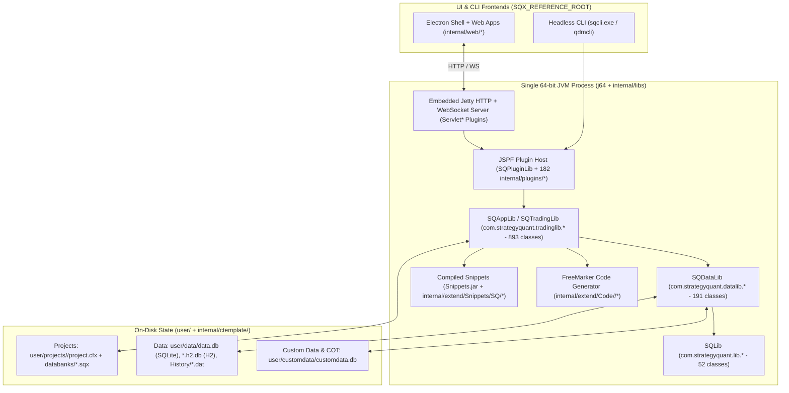

# StrategyQuant X (SQX-145) Architecture & HaruQuantAI Python Reimplementation Blueprint

- **Donor Reference Root:** `SQX_REFERENCE_ROOT` (Cohort: `SQX145 Dev 1 / 145.3039`)
- **Target Repository Root:** `HARUQUANTAI_ROOT`
- **Clean-Room Standard:** Donor informs; specification owns (`contains_proprietary_source: false`, `contains_sensitive_data: false`, `contains_personal_data: false`, `paraphrased_behavior_only: true`).
- **Authorities:** [`AGENTS.md`](../../AGENTS.md), [`docs/PROJECT.md`](../PROJECT.md), [`docs/ARCHITECTURE.md`](../ARCHITECTURE.md), [`docs/SQX/README.md`](README.md).

---

## 1. Direct Observations: SQX-145 System & Architecture (`observed`, `high`/`confirmed`)

### 1.1 Runtime Topology & Process Launchers

Inspection of `SQX_REFERENCE_ROOT` shows that StrategyQuant X is a **hybrid Java + embedded Jetty + Electron/Web + embedded Python** desktop and CLI system sharing a single installation root:

| Launcher / Binary | Config Artifact | Java Main Class & Flags | Role |
| :--- | :--- | :--- | :--- |
| `StrategyQuantX.exe` | `SQX_REFERENCE_ROOT/StrategyQuantX.config` | `com.strategyquant.strategyquant.SQStarter` (`-Xms4g`, `-XX:+UseParallelGC`, `--enable-native-access=ALL-UNNAMED`) | Full desktop workstation (starts embedded Jetty server + Electron UI shell) |
| `sqcli.exe` | `SQX_REFERENCE_ROOT/sqcli.config` | `com.strategyquant.strategyquant.SQConsoleStarter` (`-Dsqx.console=true`) | Headless CLI (`SQConsole` / `QDMConsole`) for batch projects, databanks, and data jobs ([`cli/README.md`](cli/README.md)) |
| `CodeEditor.exe` | `SQX_REFERENCE_ROOT/CodeEditor.config` | `com.strategyquant.ce.CEStarter` (`-Dsqx.productcode=SQEDITOR`) | Standalone Java/FreeMarker snippet and building-block IDE |

* **Embedded Web Server & UI Bridge:** One 64-bit JVM (`SQX_REFERENCE_ROOT/j64`) embeds a **Jetty** HTTP + WebSocket server (`SQX_REFERENCE_ROOT/internal/libs/jetty-all-uber.jar`; default port `5050` in `SQX_REFERENCE_ROOT/internal/AppSettings.txt`, user runtime port `8080` in `SQX_REFERENCE_ROOT/user/settings/settings.xml`). The GUI (`SQX_REFERENCE_ROOT/internal/electron` + `SQX_REFERENCE_ROOT/internal/web/*`) renders AngularJS workspaces (`BUILDER`, `RETESTER`, `OPTIMIZER`, `SQMANAGER`, `TASKMANAGER`, `PORTFOLIOMASTER`, `PORTFOLIOCOMPOSER`, `NEURALNETWORK`, `GRIDCONTROL`, `GRIDTEST`, `MTANALYZER`, `SQXBUSINESS`, `MARKETPLACE`, `DEBUGCONSOLE`) alongside newer Vue/iframe applications (`AlgoWizard`, `RESULTS2`, `SQAI`).
* **Embedded Python Sub-Runtime:** `SQX_REFERENCE_ROOT/internal/python/runtime` ships an embedded Python interpreter used by `SQX_REFERENCE_ROOT/internal/python/scripts/mt5api.py` and `mt5_symbol_overrides.json` to bridge MetaTrader 5 terminal data imports.



---

### 1.2 Core Java Libraries (`SQX_REFERENCE_ROOT/internal/libs/`)

SQX separates its Java backend into **7 encrypted core JARs (`.jar.enc`)**, **1 compiled Snippets JAR (`Snippets.jar`)**, and third-party libraries (`ta-lib-0.4.0.jar`, `watchmaker-framework-0.7.1.jar`, `uncommons-maths-1.2.2a.jar`, `fastutil-8.3.0.jar`, `freemarker-2.3.28.jar`, `jdom-2.0.0.jar`, `sqlite-jdbc-3.51.2.0.jar`, `h2-1.3.149.jar`, `jspf.core.jar`, `mcp-0.17.2.jar`):

| Artifact (`internal/libs/`) | Size | Package Root | Scope & Cataloged Structure |
| :--- | :--- | :--- | :--- |
| `SQLib.jar.enc` | 395,587 B | `com.strategyquant.lib.*` | **52 classes, 943 methods** ([`libs/SQLib.md`](libs/SQLib.md)) across `(root)`, `memory`, and `utils`: `SQTime` (financial timestamps, DST, session date/time arithmetic), `IRandomGenerator`, `MemoryInfo` & off-heap memory pools (`lib.memory`), XML/settings maps (`SettingsMap`, `ValuesMap`), localization (`L`). |
| `SQDataLib.jar.enc` | 459,144 B | `com.strategyquant.datalib.*` | **191 classes, 3,136 methods** ([`libs/SQDataLib.md`](libs/SQDataLib.md)) across **18 subpackages**: `ChartDef`, `DataInfo`, `DataSeries` (off-heap double series with `IndyStartingBar` and `Shift`), `InstrumentInfo`, `bartype`, `basket`, `broker`, `consts`, `customData`, `darwinex`, `data`, `dataseries`, `historyData`, `indicators`, `instrument`, `metatrader4`, `session`, `ticksimulator`, `timeframe`, `timezone`, `validation`. |
| `SQAppLib.jar.enc` | 3,153,232 B | `com.strategyquant.tradinglib.*` | **893 classes, 14,063 methods** ([`libs/SQTradingLib.md`](libs/SQTradingLib.md)) across **89 subpackages**: `StrategyBase`, `ATM`, `ATMExit`, `backtest`, `backtestrunner`, `benchmark`, `blocks`, `build`, `charts`, `commissions`, `conditions`, `connection`, `correlation`, `cot`, `crosscheck`, `customanalysis`, `dailyEquity`, `databank`, `engine`, `equitychart`, `execution`, `exit`, `fitnessfunction`, `formulas`, `generator`, `gp` (genetic programming), `historyData`, `indicator`, `moneymanagement`, `montecarlo`, `optimization`, `options`, `order`, `portfolioMaster`, `project`, `quality`, `results`, `riskmanagement`, `robustnesstests`, `scaling`, `simulator`, `strategy`, `swap`, `talib`, `task`, `tradeanalysis`, `tradelist`, `wfo`, `whatif`. |
| `SQPluginLib.jar.enc` | 17,851 B | `com.strategyquant.pluginlib.*` | JSPF-based plugin discovery, registration, and lifecycle contracts. |
| `SQJobsLib.jar.enc` | 9,968 B | `com.strategyquant.jobslib.*` | Multi-threaded background job and worker pool coordination. |
| `SQGridLib2.jar.enc` | 128,430 B | `com.strategyquant.gridlib.*` | Distributed grid node topology and remote backtest job dispatch. |
| `StrategyQuant.jar.enc` | 35,977 B | `com.strategyquant.strategyquant.*` | Application bootstrap (`SQStarter`, `SQConsoleStarter`). |
| `Snippets.jar` | 1,548,548 B | `SQ.*` | Compiled bytecode of all extensible Java snippets under `SQX_REFERENCE_ROOT/internal/extend/Snippets/SQ/`. |

---

### 1.3 Complete 182-Plugin Inventory (`SQX_REFERENCE_ROOT/internal/plugins/`)

Every directory in `SQX_REFERENCE_ROOT/internal/plugins/<PluginName>/` is a vertical slice bundling `<PluginName>.jar` with its frontend module (`module.js`, controllers/services, HTML templates, CSS) and default XML task configurations:

| Plugin Family | Count | Plugin Identifiers & Architectural Responsibility |
| :--- | :---: | :--- |
| **`App*`** | 18 | Top-level application workspaces: `AppBuilder`, `AppCodeEditor`, `AppDataManager`, `AppDebugConsole`, `AppGridControl`, `AppGridTest`, `AppMarketplace`, `AppNeuralNetwork`, `AppOptimizer`, `AppPortfolioComposer`, `AppPortfolioMaster`, `AppResults`, `AppRetester`, `AppSQXBusiness`, `AppSQXHome`, `AppStrategyQuant`, `AppTaskManager`, `AppWizard`. |
| **`Settings*`** | 32 | Composable task configuration tabs: `SettingsAdvancedTM`, `SettingsApplyMassConfig`, `SettingsAutomaticPortfolioBuilder`, `SettingsAutomaticRetest`, `SettingsAutoRetestData`, `SettingsBlocks`, `SettingsCallExternalScript`, `SettingsClearDatabanks`, `SettingsCreatePortfolio`, `SettingsCrossChecks`, `SettingsCustomAnalysis`, `SettingsData`, `SettingsDeleteFile`, `SettingsFiltering`, `SettingsGeneticOptions`, `SettingsGoToTask`, `SettingsLoadFromFiles`, `SettingsLogDatabankStats`, `SettingsMoneyManagement`, `SettingsNotes`, `SettingsNotification`, `SettingsOptimization`, `SettingsOptions`, `SettingsPanel`, `SettingsPartsToImprove`, `SettingsRankings`, `SettingsSaveToFiles`, `SettingsStopAndStart`, `SettingsUpdateData`, `SettingsWaitFor`, `SettingsWhatToBuild`, `SettingsWhatToRetest`. |
| **`Results*` & `EquityChart*`** | 28 | Per-strategy & portfolio analysis tabs: `ResultsChart`, `ResultsDatabankActions`, `ResultsDatabankViews`, `ResultsEquityChart`, `ResultsExplore`, `ResultsOptimizationProfile`, `ResultsOverview`, `ResultsPlugins`, `ResultsPortfolioComposerChart`, `ResultsPortfolioComposerLog`, `ResultsPortfolioCorrelation`, `ResultsProfileChart`, `ResultsReport`, `ResultsRobustnessTests`, `ResultsSequentialOptimization`, `ResultsSourceCode`, `ResultsSPOverview`, `ResultsStockpicker`, `ResultsStrategyConfig`, `ResultsSysParamPermutation`, `ResultsTradeAnalysis`, `ResultsTradeList`, `ResultsTradelistViews`, `ResultsWalkForward`, plus `EquityChartBenchmark`, `EquityChartDailyChart`, `EquityChartDrawdown`, `EquityChartVolatility`, `EquityChartVolume`. |
| **`Task*` & `TaskManager*`** | 22 | Pipeline task executors: `TaskApplyMassConfig`, `TaskAutomaticPortfolioBuilder`, `TaskAutomaticRetest`, `TaskBuild`, `TaskCallExternalScript`, `TaskClearDatabanks`, `TaskCreatePortfolio`, `TaskCustomAnalysis`, `TaskDeleteFile`, `TaskFiltering`, `TaskGoToTask`, `TaskLoadFromFiles`, `TaskLogDatabankStats`, `TaskNeuralNetworkTrainer`, `TaskNotification`, `TaskOptimize`, `TaskRetest`, `TaskSaveToFiles`, `TaskStopAndStart`, `TaskUpdateData`, `TaskWaitFor`, plus `TaskManagerProjects`, `TaskManagerTasks`. |
| **`DataSource*` & `CryptoExchange*`** | 15 | 9 market data feed plugins (`DataSourceCrypto`, `DataSourceDarwinex`, `DataSourceDukascopy`, `DataSourceFiles`, `DataSourceMt5Api`, `DataSourceSQEquityData`, `DataSourceSQFuturesData`, `DataSourceTD`, `DataSourceYahoo`) + 6 exchange adapters (`CryptoExchangeBinance`, `CryptoExchangeBinanceCoinM`, `CryptoExchangeBinanceUsdtM`, `CryptoExchangeBitfinex`, `CryptoExchangeCoinbasePro`, `CryptoExchangePoloniex`). |
| **`DataManager*`** | 11 | QuantDataManager (QDM) panels: `DataManagerActions`, `DataManagerBasket`, `DataManagerBroker`, `DataManagerConnections`, `DataManagerCustomData`, `DataManagerData`, `DataManagerHelp`, `DataManagerHome`, `DataManagerInstruments`, `DataManagerLog`, `DataManagerSessions`. |
| **`Servlet*`** | 11 | Jetty HTTP/WebSocket endpoints: `ServletAlgoCloud`, `ServletAlgoWizard`, `ServletBuilder`, `ServletCodeEditor`, `ServletConnection`, `ServletConstants`, `ServletGridControl`, `ServletProject`, `ServletRenameTool`, `ServletSQAI`, `ServletStrategy`. |
| **`CrossCheck*`** | 9 | Robustness & validation engines: `CrossCheckMonteCarloManipulation`, `CrossCheckMonteCarloRetest`, `CrossCheckOptProfileSysParamPermutation`, `CrossCheckRetestOnAdditionalMarkets`, `CrossCheckRetestWithHigherPrecision`, `CrossCheckSequentialOptimization`, `CrossCheckWalkForwardMatrix`, `CrossCheckWalkForwardOptimization`, `CrossCheckWhatIf`. |
| **`Project*`** | 9 | Project container views (`ProjectDatabanks`, `ProjectResources`, `ProjectResults`, `ProjectSettings`) + 5 `GoToTask` loop-condition plugins (`ProjectConditionCyclesCount`, `ProjectConditionGoToActivated`, `ProjectConditionGoToEvaluated`, `ProjectConditionResultsCount`, `ProjectConditionRunTime`). |
| **`Loader*` & `Saver*`** | 6 | Strategy & report serializers: `LoaderSQ3`, `LoaderSQ4`, `SaverHTML`, `SaverPDF`, `SaverSQ3`, `SaverStrategyTrades`. |
| **`FitnessMethod*`** | 3 | Fitness calculators: `FitnessMethodExistingPortfolio`, `FitnessMethodStrategyResult`, `FitnessMethodWFResult`. |
| **Other UI / Bridges** | 18 | `CodeEditorImportExport`, `CodeEditorIndicatorTester`, `ConnectionLiveTest`, `ConnectionMT4`, `ConnectionTest`, `CustomDatabankActions`, `CustomResultsPluginActions`, `DashboardPanel`, `DashboardResults`, `DatabankFilterByCorrelation`, `DatabankRename`, `EnginePanel`, `HomeAbout`, `PortfolioComposer`, `SkinDark`, `SkinLight`. |

---

### 1.4 Core Object Model, Extensibility & Persistence Formats

1. **Unified Project Object Model ([`overview/object-model.md`](overview/object-model.md), [`custom-projects/project-config.md`](custom-projects/project-config.md)):**
   - Hierarchy: `App -> Projects (SQProject[]) -> { Tasks (AbstractTask[]), Databanks (Databank[]), Progress, Results }`.
   - Top-level navigation entries (`Builder`, `Retester`, `Optimizer`, `PortfolioMaster`, `PortfolioComposer`) are **single-task `SQProject` folders** stored in `SQX_REFERENCE_ROOT/user/projects/<Name>/` as peers to multi-task user Custom Projects.
   - Each project folder contains `project.cfx` ([`custom-projects/cfx-format.md`](custom-projects/cfx-format.md)): a flat DEFLATE ZIP archive with `config.xml` (`<Project>` root listing ordered `<Tasks>` and `<Databanks>`) and one `<TaskType>-Task<N>.xml` (`<Settings>` root) per task.
   - Databanks reside in `SQX_REFERENCE_ROOT/user/projects/<Name>/databanks/<DatabankName>/`, wiring tasks together via `<Databank name="Input|Output|Source|Target" value="..." />`.

2. **Three-Part Strategy & Block Extensibility (`internal/ctemplate/`, `internal/extend/`, `user/extend/`):**
   - **Block & Template Grammar (`SQX_REFERENCE_ROOT/internal/ctemplate/`):** `config.xml` and its entity includes (`actions.xml`, `advancedTypes.xml`, `colors.xml`, `comparisons.xml`, `conditions.xml`, `datasTimeframes.xml`, `events.xml`, `moneyManagement.xml`, `parameterSets.xml`, `talibs.xml`, `values.xml`, `wizard.xml`) define the XML AST for both **AlgoWizard** and **Builder** across three strategy styles (`sq4` dedicated signal rules, `sq4fuzzy` voting rules, `sq3` legacy rules; see [`custom-projects/strategy-styles.md`](custom-projects/strategy-styles.md)) and template placeholders (`RandomCondition`, `SameCondition`, `NegatedCondition`, `RandomAction`, `SameAction`, `OppositeAction`).
   - **Java Snippets (`SQX_REFERENCE_ROOT/internal/extend/Snippets/SQ/`):** 24 extensible snippet categories (`Blocks`, `Calculators`, `Checker`, `Columns`, `CorrelationOf`, `CustomAnalysis`, `EngineCharts`, `ExitMethods`, `Formulas`, `Functions`, `Internal`, `MoneyManagement`, `MonteCarlo`, `Negater`, `PortfolioMasterFitness`, `RiskManagement`, `Stats`, `Strategies`, `TALibIndicators`, `TradeAnalysis`, `Trading`, `TradingOptions`, `Utils`, `WhatIf`) compiled into `Snippets.jar`. Within `Blocks/`, 10 sub-families (`BarAndTime`, `CandlePatterns`, `Comparisons`, `Functions`, `Indicators`, `Order`, `Other`, `OtherActions`, `Price`, `StrategyControl`) cover 52+ indicator families and ~400 blocks.
   - **FreeMarker Code Export (`SQX_REFERENCE_ROOT/internal/extend/Code/<Engine>/` & `custom_indicators/`):** As documented in [`overview/export-engines/README.md`](overview/export-engines/README.md), every building block pairs its Java snippet with a `.tpl` template per target platform (`EasyLanguage`, `JForex`, `MetaTrader4`, `MetaTrader5`, `NinjaTrader`, `PseudoCode`, plus shared macros in `global/`), backed by platform-native custom indicators in `SQX_REFERENCE_ROOT/custom_indicators/` (`JForex`, `MetaTrader4`, `MetaTrader5`, `NinjaTrader`, `Tradestation`, and `BrokerProfileInstrumentsSessionsScripts`) and specialist packs (`SQX_REFERENCE_ROOT/VolumeProfile/`, `SQX_REFERENCE_ROOT/COT/`).

3. **Market & Custom Data Storage (`SQX_REFERENCE_ROOT/user/data/` & `user/customdata/`):**
   - `user/data/data.db` (SQLite metadata catalog), `data_futures.h2.db` and `data_stock.h2.db` (H2 databases), `user/customdata/customdata.db` (SQLite COT and custom series), and binary price series in `user/data/History/<Symbol>/<Symbol>_<TF>.dat`.

---

## 2. Bounded Inferences & Unresolved Gaps (`inferred` / `unverified`)

* **Encrypted Core JAR Internals (`inferred` / `unverified`):**
  - While public/protected class and method signatures of `SQLib`, `SQDataLib`, and `SQTradingLib` are cataloged in [`libs/SQLib.md`](libs/SQLib.md), [`libs/SQDataLib.md`](libs/SQDataLib.md), and [`libs/SQTradingLib.md`](libs/SQTradingLib.md), and all 24 snippet categories in `SQX_REFERENCE_ROOT/internal/extend/Snippets/SQ/*.java` and FreeMarker templates in `SQX_REFERENCE_ROOT/internal/extend/Code/*` are plain-text readable, exact internal tie-breaking inside encrypted classes (e.g., `com.strategyquant.tradinglib.simulator.*` same-bar order precedence, `gp.*` island migration edge cases, and `MainApp`/`AppSettings` host internals) requires targeted bytecode decryption/decompilation or runtime fixture verification before claiming SQX parity.
* **Binary `.dat` History & `.sqx` Serialization Details (`inferred`):**
  - `SQX_REFERENCE_ROOT/user/data/History/*/*.dat` binary layout and `.sqx` ZIP/XML payload details must be documented via atomic evidence records (`SQX145-EV-NNNNNN`) during `F02` (Market Data) and `F03`/`F05` (Strategies/Databanks) research prior to implementation.

---

## 3. Target-Project Mapping & Python Reimplementation Strategy (`normative`)

### 3.1 Current `HARUQUANTAI_ROOT` Baseline

Following the backend reset (`e2c72ab`), `HARUQUANTAI_ROOT` is at a clean **backend-reset baseline** ([`../PROJECT.md`](../PROJECT.md), [`../ARCHITECTURE.md`](../ARCHITECTURE.md)):
* **Retained Frontend (`HARUQUANTAI_ROOT/ui/`):** Complete React/TypeScript UI organized into `ui/app/host/`, `ui/app/workspace/<17 workspaces>`, and `ui/app/plugins/<4 families>`.
* **Ratified Architecture ([`../ARCHITECTURE.md`](../ARCHITECTURE.md)):** Enforces the **3-Tier Architecture** (`app/host/`, `app/workspace/`, `app/plugins/`) plus shared mathematical primitives (`app/kernel/`) and the **Five Laws of Spatial Composability (`SC-01`–`SC-05`)**.
* **Registry & Evidence Gate:** Because `app/`, `tests/`, and `scripts/` were reset, domain `README.md` registries (`app/host/README.md`, `app/workspace/*/README.md`) and `reimplementation.json` records (`SQX145-EV-NNNNNN`) must be registered and approved per phase under [`AGENTS.md`](../../AGENTS.md) before implementation.

### 3.2 Mapping SQX Subsystems to HaruQuantAI Python Tiers

```mermaid
flowchart TD
    subgraph UI["Retained React Frontend (ui/app/*)"]
        UIHost["ui/app/host"]
        UIWS["ui/app/workspace/* (17 Workspaces)"]
        UIPlug["ui/app/plugins/*"]
    end

    subgraph Tier1["Tier 1: Host Platform (app/host/) — F01"]
        Boot["bootstrap.py / transport.py / response.py (FastAPI + WS/SSE)"]
        Disc["discovery.py (Manifest-driven importlib Plugin Loader)"]
        Persist["persistence/ (Isolated SQLite WAL + DuckDB/Parquet Custody)"]
        Jobs["jobs.py / resources.py / settings.py / session.py"]
    end

    subgraph Tier2["Tier 2: Domain Workspaces (app/workspace/) — F02..F13"]
        DM["data_manager/ (F02: 11 QDM modules)"]
        Strat["strategies/ & algowizard/ (F03: AST, Blocks, Code Export)"]
        Sim["simulator/ & results/ (F04-F05: Backtester, Databanks, Metrics)"]
        Gen["builder/ & retester/ & optimizer/ (F06-F07: GP, WFO/WFM, MC)"]
        Port["portfolio_master/ & portfolio_composer/ (F08)"]
        Proj["custom_projects/ (F09: .cfx Pipeline & Task Runner)"]
    end

    subgraph Tier3["Tier 3: Dynamic Plugins (app/plugins/<slot>/)"]
        PData["data_source/* (9 Providers: Dukascopy, Darwinex, MT5, Yahoo, Crypto...)"]
        PBlocks["blocks/* & indicators/* & mm/* & exits/* (Snippets/SQ equivalents)"]
        PCross["crosschecks/* (9 Robustness/MC/WFO/WhatIf plugins)"]
        PExport["exporters/* (Template generators: MT4, MT5, NT8, EL, JForex, PseudoCode)"]
    end

    subgraph Kernel["Mathematical & Time Primitives (app/kernel/)"]
        KTime["sq_time.py (SQTime parity) & rng.py (Seeded IRandomGenerator)"]
        KSeries["series.py (Polars/NumPy/PyArrow vectorized DataSeries)"]
        KInd["indicators.py (Vectorized TA-Lib / custom indicator kernels)"]
    end

    UI --> Tier1
    Tier1 --> Tier2
    Tier3 -.->|Attaches via Typed Slots (SC-03)| Tier2
    Tier2 --> Kernel
    Tier3 --> Kernel
```

| SQX Donor Layer | HaruQuantAI Python Target | Key Technical Design in Python (`>=3.14`) |
| :--- | :--- | :--- |
| `StrategyQuant.jar`, `SQPluginLib`, `SQJobsLib`, `Servlet*` | **Tier 1: `app/host/`** (`F01`) | `FastAPI` + `uvicorn` + `websockets`; `persistence/` owns all `sqlite3` WAL DDL (`schema.py`); `discovery.py` loads `plugin.json` manifests via `importlib`; `JobManager` coordinates bounded async/process jobs; zero quantitative logic. |
| `SQLib` (`SQTime`, `IRandomGenerator`), `SQDataLib` (`DataSeries`), `ta-lib` | **Primitives: `app/kernel/`** (`F02`–`F04`) | Pure, deterministic numerical primitives: `SQTime` calendar/session arithmetic, seeded `IRandomGenerator`, and `NumPy`/`Polars`/`PyArrow`-backed `DataSeries` replacing Java off-heap arrays with vectorized columnar buffers. |
| `DataManager*` (11 plugins) + `SQDataLib` | **Tier 2: `app/workspace/data_manager/`** (`F02`) | The 11 cohesive modules specified in [`../ARCHITECTURE.md`](../ARCHITECTURE.md) (`home`, `data`, `instruments`, `sessions`, `baskets`, `broker`, `connections`, `custom_data`, `log`, `help`, `actions/review`, `actions/transform`). |
| `DataSource*` & `CryptoExchange*` (15 plugins) | **Tier 3: `app/plugins/data_source/`** (`F02`) | 9 modular plugins declaring `slot: "data.provider"` (`dukascopy`, `darwinex`, `metatrader`, `sq_equity`, `sq_futures`, `crypto`, `files`, `yahoo`, `tick_downloader`). |
| `internal/ctemplate/*`, `AppWizard`, `AppCodeEditor`, `internal/extend/Code/*`, `Loader*`/`Saver*` | **Tier 2: `app/workspace/strategies/` + Tier 3: `app/plugins/blocks/` & `exporters/`** (`F03`) | Pydantic-typed immutable Strategy AST (`.sqx` XML/ZIP compatible); schema-driven block catalog (`SC-05`); template-driven source code exporters for MT4, MT5, NinjaTrader 8, EasyLanguage, JForex, and PseudoCode. |
| `SQTradingLib.simulator`, `engine`, `order`, `atm`, `moneymanagement`, `commissions`, `swap` | **Tier 2: `app/workspace/simulator/` + Tier 3: `app/plugins/money_management/`** (`F04`) | Multi-precision event/vector hybrid backtest engine (`Selected TF`, `1-minute`, `Real Tick`) supporting all 4 order types (`Market`, `Stop`, `Limit`, `ReverseAtMarket`), ATM exits, SL/PT/Trailing/SL2BE, and platform execution profiles (`MT4`, `MT5 Hedged/Netted`, `TS`, `NT8`, `Stockpicker`). |
| `SQTradingLib.databank`, `results`, `equitychart`, `tradelist`, `Snippets/SQ/Columns`, `Stats` | **Tier 2: `app/workspace/results/`** (`F05`) | Project-scoped `Databank` store with top-$N$ fitness ranking, view schemas, trade list, equity/drawdown series, and all 60+ `SQStats` metrics (`NetProfit`, `ProfitFactor`, `ReturnDD`, `Sharpe`, `Stability`, `SQN`, `Stagnation`, `Symmetry`). |
| `TaskBuild`, `SQTradingLib.generator`, `gp`, `Snippets/SQ/Negater` | **Tier 2: `app/workspace/builder/`** (`F06`) | Random & Genetic Programming generator (multi-island evolution, crossover, mutation, fresh-blood replacement, `OppositeBlock`/`Negater` symmetry, template placeholder expansion). |
| `TaskRetest`, `TaskOptimize`, `CrossCheck*` (9 plugins), `SQTradingLib.optimization`, `wfo`, `montecarlo`, `whatif` | **Tier 2: `app/workspace/retester/` & `optimizer/` + Tier 3: `app/plugins/crosschecks/`** (`F07`) | Simple/Brute-Force, Genetic, and Sequential parameter optimization; Walk-Forward Optimization (WFO) & Walk-Forward Matrix (WFM) 3D surface cluster evaluator; Trade-Manipulation & Retest Monte Carlo (confidence levels `50..100`); System Parameter Permutation (SPP); What-If trade filters. |
| `AppPortfolioMaster`, `AppPortfolioComposer`, `Snippets/SQ/PortfolioMasterFitness`, `CorrelationOf` | **Tier 2: `app/workspace/portfolio_master/` & `portfolio_composer/`** (`F08`) | Brute-force & genetic combination search with correlation/sector constraints (Master) + interactive per-strategy weighted, free-margin-aware daily simulation (Composer). |
| `AppTaskManager`, `Task*` (20 plugins), `ProjectCondition*` (5 plugins) | **Tier 2: `app/workspace/custom_projects/`** (`F09`) | `.cfx` ZIP reader/writer, `ProjectFileValidator` (`open -> config -> tasks -> templates -> settings`), and finite DAG/cyclic task pipeline executor supporting `GoToTask` loop guards. |
| `SQGridLib2`, `AppNeuralNetwork`, `Connection*`, `ServletAlgoCloud`, `ServletSQAI` | **Tier 2/3 Advanced Tracks** (`F10`–`F13`) | Remote worker compute contract (`F10`), bounded temporal neural model training (`F11`), broker/AlgoCloud/Marketplace adapters (`F12`), and bounded `Q` AI assistant via typed MCP tools (`F13`). |

---

### 3.3 Phased Reimplementation Sequence

Following the delivery order ratified in [`../PROJECT.md`](../PROJECT.md) (*"Deliver import -> author -> backtest -> inspect/export first, then generation, optimization/robustness, portfolios and projects"*):

1. **Stage 0 — Evidence & Qualification Foundation (`P00`):**
   - Establish `reimplementation.schema.json`, `reimplementation.json`, `docs/dev/evidence/`, `tests/reference/validate.py`, and `scripts/ci_check.py`.
2. **Stage 1 — Tier 1 Host Platform (`F01` — `app/host/`):**
   - Implement `persistence/` (SQLite WAL isolation, `schema.py`, `SettingsStore`, `HostSessionStore`), `settings.py`, `session.py`, `resources.py`, `jobs.py`, `discovery.py`, `transport.py`, `response.py`, and `bootstrap.py`, reconnecting the retained `ui/app/host/` shell.
3. **Stage 2 — Mathematical Kernel & Market Data (`F02` — `app/kernel/` + `app/workspace/data_manager/` + `app/plugins/data_source/`):**
   - Build `SQTime`, `DataSeries`, `InstrumentInfo`, session calendars, `.dat`/Parquet/DuckDB bar & tick storage, the 11 Data Manager workspace modules, and the 9 `data.provider` plugins.
4. **Stage 3 — Strategy Model, Building Blocks, AlgoWizard & Exporters (`F03` — `app/workspace/strategies/`):**
   - Implement the canonical Strategy AST (`.sqx` & `ctemplate` compatible), indicator kernels (`ta-lib` + custom SQ indicators such as `SqATR`, `SqKAMA`, `SqIchimoku`, `SqSuperTrend`, `SqVolumeProfile`, `SqCOT`), building blocks, `Negater` rules, AlgoWizard backend routes, and template-based code exporters (`MT4`, `MT5`, `NT8`, `EasyLanguage`, `JForex`, `PseudoCode`).
5. **Stage 4 — Simulation Engine, Databanks & Results (`F04` & `F05` — `app/workspace/simulator/` & `app/workspace/results/`):**
   - Build the backtest execution engine (bar & tick precision, order types, SL/PT/Trailing/SL2BE, ATM, Money Management, commissions/swap), Databank storage/ranking, and the 60+ `SQStats` calculators + Results views.
6. **Stage 5 — Builder, Retester & Optimizer (`F06` & `F07` — `app/workspace/builder/`, `retester/`, `optimizer/`):**
   - Implement Random and Genetic Programming strategy generation, followed by the 9 CrossCheck plugins (Monte Carlo trade manipulation & retest, Higher Precision, Multi-Market, WFO, WFM, Sequential Optimization, SPP, What-If).
7. **Stage 6 — Portfolios, Custom Projects & Advanced Ecosystem (`F08`–`F13`):**
   - Deliver Portfolio Master, Portfolio Composer, Custom Projects (`.cfx` pipeline engine & 20 task plugins), and optional `F10`–`F13` extensions.
