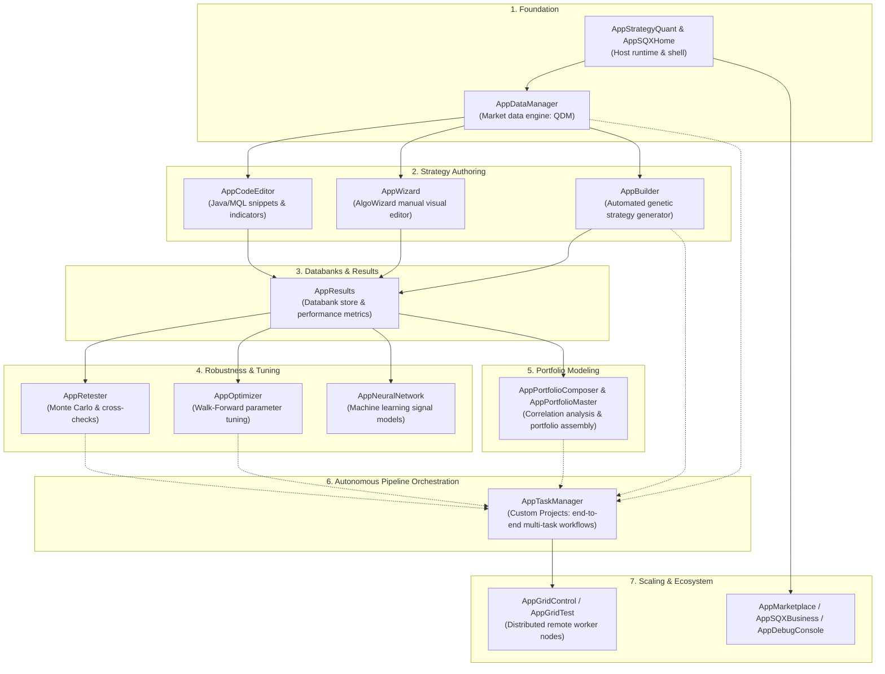
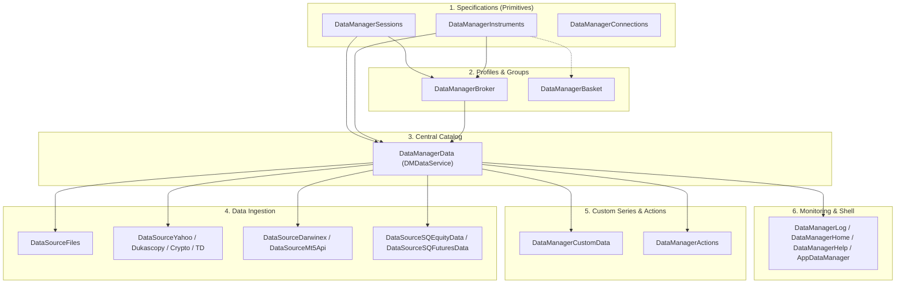
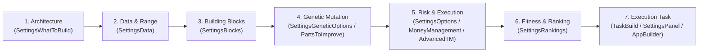
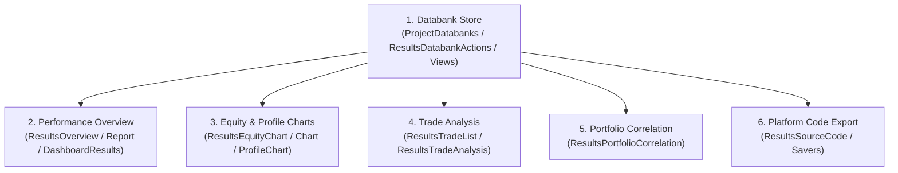
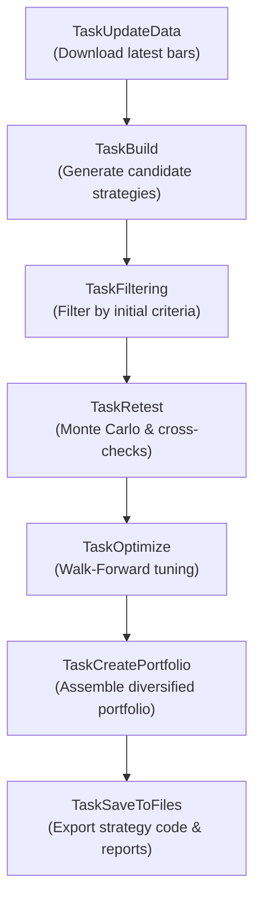

# StrategyQuant X — Master Workspaces & Reimplementation Blueprint

This document unites the **complete system architecture**, the **workspace-by-workspace implementation order**, and the **detailed feature specifications** into a single cohesive reference for reimplementing StrategyQuant X.

# TARGET STACK (the reimplementation must use this)
- Frontend: React + TypeScript + Vite + Tailwind CSS
- Workspace: Dockview (dockable panels, tabs, resizable layouts)
- Tables/Charts: TanStack Table + TanStack Virtual + Lightweight Charts
- Desktop (optional): Tauri with packaged Python sidecar
- Backend API: Python + FastAPI + Pydantic + Uvicorn
- Domain layer: framework-independent Python feature modules
- Numerics: NumPy + Numba
- Background work: Python worker processes + SQLite-backed job ledger and scheduler
- Realtime: FastAPI WebSocket (optional SSE for one-way streams)
- Messaging/cache: in-memory maps, bounded queues, local IPC (no Redis)
- Persistence: SQLite (WAL, coordinated writes)
- Bulk data: Parquet + PyArrow (Zstandard)
- Brokers: MetaTrader 5 Python adapter + cTrader Open API adapter
- Platform: Windows first

---

## High-Level System Architecture & Strategy Lifecycle

---

## 1. AppStrategyQuant — Host Application Runtime & Shared Services

- **Primary Role**: The root host application container. Bootstraps the embedded web server, dependency injection container, plugin registry, and global event bus. All other workspaces and plugins load into this runtime.
- **Dependencies**: None (Root Host)
- **Outputs / Downstream Role**: Core application container, event bus, database, and connection manager.

### Phase 1.1: Core Application Container

#### `AppStrategyQuant`
*Feature:* Host application lifecycle, dependency injection, and event bus runtime
*Functional Requirements:*
- bootstrap FastAPI backend application with CORS, security headers, and Uvicorn server
- initialize SQLite database with WAL mode and coordinated write locks
- register and initialize all domain feature modules and background worker processes
- provide global in-memory event bus and WebSocket broadcast channel
- manage application graceful shutdown, process termination, and resource cleanup
*Functions to Create:*
- AppHost.startup()
- AppHost.initialize_db()
- AppHost.register_modules()
- AppHost.broadcast_event()
- AppHost.shutdown()

### Phase 1.2: Platform & Broker Connectivity

#### `ConnectionTest`
*Feature:* Endpoint ping and network connectivity validation utility
*Functional Requirements:*
- ping remote and local server endpoints to verify network connectivity
- measure round-trip latency and report packet loss
- diagnose DNS resolution and socket connection failures
*Functions to Create:*
- ConnectionTest.ping_endpoint()
- ConnectionTest.check_latency()
- ConnectionTest.diagnose_network()

#### `ConnectionLiveTest`
*Feature:* Live trading account authentication and latency verification
*Functional Requirements:*
- validate live broker credentials and API tokens against broker gateways
- measure order placement and quote streaming round-trip latency
- verify account trading permissions and margin currency settings
*Functions to Create:*
- LiveTest.validate_credentials()
- LiveTest.measure_trading_latency()
- LiveTest.verify_trading_permissions()

#### `ConnectionMT4`
*Feature:* MetaTrader terminal bridge adapter (Target Stack: MetaTrader 5 Python adapter)
*Functional Requirements:*
- initialize connection to local MetaTrader 5 terminal via official MetaTrader5 Python package
- query account balance, equity, leverage, server time, and broker specifications
- stream live tick and bar price feeds into memory queues
- dispatch trading orders (buy, sell, modify, close) to MetaTrader terminal
*Functions to Create:*
- ConnectionMT5.initialize()
- ConnectionMT5.get_account_info()
- ConnectionMT5.stream_ticks()
- ConnectionMT5.send_order()
- ConnectionMT5.shutdown()

### Phase 1.3: Cryptocurrency Exchange Adapters

#### `CryptoExchangeBinance`
*Feature:* Binance Spot exchange REST and WebSocket client
*Functional Requirements:*
- fetch Binance spot exchange info, tradable symbols, and price filters
- stream live ticker, depth, and 1-minute Kline bars over Binance WebSocket
- download historical Kline bar archives for backtesting
- execute spot limit and market orders with HMAC SHA256 signature authentication
*Functions to Create:*
- BinanceSpot.get_exchange_info()
- BinanceSpot.stream_klines()
- BinanceSpot.download_historical_bars()
- BinanceSpot.place_order()

#### `CryptoExchangeBinanceCoinM`
*Feature:* Binance Coin-Margined Delivery and Perpetual Futures adapter
*Functional Requirements:*
- fetch Coin-M contract specifications, index prices, and funding rates
- stream real-time futures mark price and order book depth
- manage Coin-M positions, leverage brackets, and margin types
*Functions to Create:*
- BinanceCoinM.get_contracts()
- BinanceCoinM.get_funding_rate()
- BinanceCoinM.stream_mark_price()
- BinanceCoinM.set_leverage()

#### `CryptoExchangeBinanceUsdtM`
*Feature:* Binance USDT-Margined Perpetual Futures adapter
*Functional Requirements:*
- fetch USDT-M contract rules, tick sizes, step sizes, and funding intervals
- stream real-time USDT-M Kline bars and aggregated trade events
- place and cancel futures limit, stop-market, and trailing stop orders
*Functions to Create:*
- BinanceUsdtM.get_exchange_info()
- BinanceUsdtM.stream_trades()
- BinanceUsdtM.download_futures_klines()
- BinanceUsdtM.send_futures_order()

#### `CryptoExchangeBitfinex`
*Feature:* Bitfinex exchange REST and WebSocket market data adapter
*Functional Requirements:*
- fetch Bitfinex currency pairs, symbols, and minimum order sizes
- stream real-time raw book and candle feeds over WebSocket
- query historical candle archives for backtesting
*Functions to Create:*
- Bitfinex.get_symbols()
- Bitfinex.stream_candles()
- Bitfinex.fetch_candles()

#### `CryptoExchangeCoinbasePro`
*Feature:* Coinbase Advanced Trade REST and WebSocket client
*Functional Requirements:*
- fetch Coinbase product catalog, base/quote currencies, and increments
- stream live market trades and heartbeats via Coinbase WebSocket
- download historical candle data chunks and save to Parquet
*Functions to Create:*
- Coinbase.get_products()
- Coinbase.stream_market_data()
- Coinbase.download_candles()

#### `CryptoExchangePoloniex`
*Feature:* Poloniex exchange market data connector
*Functional Requirements:*
- query Poloniex market definitions and trading rules
- fetch historical candlestick records for crypto asset pairs
*Functions to Create:*
- Poloniex.get_markets()
- Poloniex.get_candles()

### Phase 1.4: Core Infrastructure Servlets & Theming

#### `ServletConnection`
*Feature:* FastAPI REST router for broker and exchange connections CRUD
*Functional Requirements:*
- create, read, update, and delete broker/exchange connection credentials in SQLite
- test connection credentials and report latency status to frontend
- provide active connection list to trading and data ingestion modules
*Functions to Create:*
- ServletConnection.list_connections()
- ServletConnection.save_connection()
- ServletConnection.delete_connection()
- ServletConnection.test_connection()

#### `ServletConstants`
*Feature:* System constants, environment paths, and runtime metadata endpoints
*Functional Requirements:*
- expose application version, build timestamp, and runtime environment paths
- provide default platform constants (supported timeframes, bar types, currencies)
- serve system resource limits and hardware concurrency specs
*Functions to Create:*
- ServletConstants.get_constants()
- ServletConstants.get_system_specs()

#### `ServletProject`
*Feature:* FastAPI project manifest persistence router
*Functional Requirements:*
- save and load project definitions, task configurations, and pipelines to SQLite
- list existing projects with last-modified timestamps and execution statuses
- clone or delete projects and their associated task configurations
*Functions to Create:*
- ServletProject.list_projects()
- ServletProject.load_project()
- ServletProject.save_project()
- ServletProject.delete_project()

#### `ServletRenameTool`
*Feature:* Bulk renaming and alias management API
*Functional Requirements:*
- apply regex and template pattern replacements across symbol, databank, and strategy names
- validate proposed renamed entities for naming collisions and illegal characters
*Functions to Create:*
- ServletRenameTool.batch_rename()
- ServletRenameTool.validate_names()

#### `ServletGridControl`
*Feature:* FastAPI WebSocket and IPC router for distributed worker nodes
*Functional Requirements:*
- authenticate and accept remote worker node WebSocket connections
- route calculation jobs (backtests, optimizations, Monte Carlo) to idle workers
- stream worker health metrics and heartbeats to frontend Dockview panel
*Functions to Create:*
- ServletGridControl.register_worker()
- ServletGridControl.stream_worker_status()
- ServletGridControl.cancel_task()

#### `ServletAlgoCloud`
*Feature:* Cloud synchronization and strategy sharing endpoints
*Functional Requirements:*
- synchronize strategies and databanks with AlgoCloud cloud platform
- authenticate cloud user account and fetch plan quotas and subscription limits
- download pre-built shared strategy templates and market data packages
*Functions to Create:*
- ServletAlgoCloud.sync_strategies()
- ServletAlgoCloud.get_user_plan()
- ServletAlgoCloud.download_package()

#### `ServletSQAI`
*Feature:* Built-in AI Assistant streaming endpoints (SSE / WebSocket)
*Functional Requirements:*
- accept natural language user queries regarding strategy development and codebase
- stream AI assistant reasoning and code responses over Server-Sent Events (SSE) or WebSocket
- inject strategy rules, backtest statistics, and logs as context into LLM prompt
*Functions to Create:*
- ServletSQAI.send_message()
- ServletSQAI.stream_response()
- ServletSQAI.clear_history()

#### `SkinDark`
*Feature:* Tailwind CSS dark theme tokens and appearance state management
*Functional Requirements:*
- provide dark mode color variables, background shades, and high-contrast typography tokens
- persist dark theme user preference in SQLite settings and browser local storage
- apply dark theme class to root HTML element and style Dockview headers
*Functions to Create:*
- Theme.set_dark()
- Theme.get_tokens()

#### `SkinLight`
*Feature:* Tailwind CSS light theme tokens and palette definitions
*Functional Requirements:*
- provide light mode color variables, clean white/gray surfaces, and contrast borders
- apply light theme styling to Dockview panels, TanStack tables, and charts
*Functions to Create:*
- Theme.set_light()
- Theme.get_light_tokens()

---

## 2. AppSQXHome — Getting Started & Shell Landing

- **Primary Role**: The default welcome landing workspace. Provides onboarding tutorials, recent project shortcuts, release version information, and offline documentation fallback.
- **Dependencies**: AppStrategyQuant
- **Outputs / Downstream Role**: User onboarding, navigation entry points, and version inspection.

### Phase 2.1: Welcome & Landing Interface

#### `AppSQXHome`
*Feature:* Main getting started dashboard and offline onboarding interface
*Functional Requirements:*
- display welcome home view with quick-start action shortcuts
- render offline onboarding flow and tutorial cards when disconnected
- fetch and show latest release changelog and version updates
*Functions to Create:*
- SQXHome.index()
- SQXHome.get_recent_projects()
- SQXHome.check_updates()

#### `HomeAbout`
*Feature:* Application version information and diagnostic metadata dialog
*Functional Requirements:*
- display StrategyQuant X version, build timestamp, and license details
- display JVM/Python environment runtime details and installed extension list
*Functions to Create:*
- About.about()
- About.get_system_info()

---

## 3. AppDataManager — Market Data Engine (QuantDataManager)

- **Primary Role**: The historical market data repository. Manages instrument specifications, trading sessions, broker profiles, and central price bar data (M1, H1, D1, Tick). Every strategy backtesting, generation, and optimization workspace depends directly on this engine.
- **Dependencies**: AppStrategyQuant
- **Outputs / Downstream Role**: Historical price bars, instrument specifications, and trading sessions for backtesting.

### Phase 3.1: Foundational Specifications (No Dependencies)

#### `DataManagerInstruments`
*Feature:* Financial instrument specifications and symbol definition manager
*Functional Requirements:*
- list all configured instruments with point/pip sizes, contract sizes, and margins
- add new instrument specifications to SQLite database
- edit one or more existing instrument definitions in bulk
- clone an existing instrument to create a new specification
*Functions to Create:*
- Instruments.instruments()
- Instruments.add_instrument()
- Instruments.mass_edit_instruments()
- Instruments.clone_instrument()

#### `DataManagerSessions`
*Feature:* Trading session profiles and market hours scheduler
*Functional Requirements:*
- list all trading session profiles and holiday calendars
- create, clone, and delete trading sessions with timezone shifts
- add and configure session time intervals (daily open, close, lunch pauses)
- configure and save reusable session templates
*Functions to Create:*
- Sessions.sessions()
- Sessions.clone_session()
- Sessions.session_element()
- Sessions.session_template()

#### `DataManagerConnections`
*Feature:* Data feed and broker account connection manager
*Functional Requirements:*
- manage connection credentials for external market data providers
- test real-time connectivity and authenticate data subscription feeds
*Functions to Create:*
- Connections.list_connections()
- Connections.add_connection()
- Connections.test_feed_connection()

### Phase 3.2: Profiles & Grouping Aggregators

#### `DataManagerBroker`
*Feature:* Broker profile manager combining instruments, sessions, and commissions
*Functional Requirements:*
- list all broker profiles configured in the system
- add or edit broker profiles with custom spread and commission models
- edit stock symbols assigned to a broker profile
- import instrument definitions from external XML/JSON files
- import trading session definitions from external XML/JSON files
*Functions to Create:*
- Broker.brokers()
- Broker.add_broker()
- Broker.edit_stocks()
- Broker.import_instruments()
- Broker.import_sessions()

#### `DataManagerBasket`
*Feature:* Stock basket and symbol grouping watchlist manager
*Functional Requirements:*
- list all stock baskets and symbol groupings
- create new stock basket groups (e.g. S&P 500, Tech, Forex Majors)
- edit and maintain symbol membership in selected baskets
*Functions to Create:*
- Basket.baskets()
- Basket.add_basket()
- Basket.edit_stocks()

### Phase 3.3: Central Data Hub & Catalog Engine

#### `DataManagerData`
*Feature:* Central price data catalog and timeframe storage manager
*Functional Requirements:*
- list all imported price data symbols with timeframes, date ranges, and bar counts
- edit symbol properties, associated broker profile, and session template
- confirm and delete selected price data symbols and clear cached bar files
- add BMF futures data symbols to the database
*Functions to Create:*
- Data.data()
- Data.data_edit()
- Data.data_delete_confirm()
- Data.add_br()

### Phase 3.4: Data Ingestion (Data Sources)

#### `DataSourceFiles`
*Feature:* Local CSV, TXT, and archive file historical data importer
*Functional Requirements:*
- add new symbol definition from local historical data file
- import price data from local files into Parquet storage
- import price data directly from external trading applications
- define and save custom text/CSV file delimiter and column formats
- perform bulk mass import of multiple data files across directories
*Functions to Create:*
- Files.add()
- Files.import_data()
- Files.app_import()
- Files.new_format()
- Files.mass_import()

#### `DataSourceYahoo`
*Feature:* Yahoo Finance historical daily and weekly data downloader
*Functional Requirements:*
- add Yahoo Finance data symbols to the database
- download historical OHLCV price bars from Yahoo Finance
*Functions to Create:*
- Yahoo.add()
- Yahoo.download()

#### `DataSourceDukascopy`
*Feature:* Dukascopy high-precision forex and CFD data downloader
*Functional Requirements:*
- add Dukascopy data symbols to the database
- identify and select instruments for Dukascopy data
- display StrategyQuant CDN data disclaimer
- display Dukascopy data disclaimer
- download and import Dukascopy tick and minute price data
*Functions to Create:*
- Dukascopy.add()
- Dukascopy.select_instruments()
- Dukascopy.cdn_disclaimer()
- Dukascopy.disclaimer()
- Dukascopy.import_data()

#### `DataSourceCrypto`
*Feature:* Cryptocurrency exchange historical price data downloader
*Functional Requirements:*
- add cryptocurrency data symbols and exchange pairs to database
- download and import historical crypto candlestick data
*Functions to Create:*
- Crypto.add()
- Crypto.import_data()

#### `DataSourceTD`
*Feature:* TickDownloader historical data importer
*Functional Requirements:*
- import historical tick and minute price data generated by TickDownloader
- validate timestamp formatting and gapless bar continuity
*Functions to Create:*
- TD.import_data()

#### `DataSourceDarwinex`
*Feature:* Darwinex broker tick/minute data bridge
*Functional Requirements:*
- add Darwinex data symbols to the database
- display Darwinex data disclaimer
- download data from Darwinex
- import data downloaded from Darwinex
- identify and select instruments for Darwinex data
*Functions to Create:*
- Darwinex.add()
- Darwinex.darwinex_disclaimer()
- Darwinex.download()
- Darwinex.import_data()
- Darwinex.select_instruments()

#### `DataSourceMt5Api`
*Feature:* MetaTrader 5 API direct historical data importer
*Functional Requirements:*
- import price data directly from MetaTrader 5 terminal via Python API
- select terminal instance, symbol, timeframe, and date range
*Functions to Create:*
- Mt5Api.import_data()

#### `DataSourceSQEquityData`
*Feature:* StrategyQuant US Equities subscription historical data client
*Functional Requirements:*
- add StrategyQuant equity data symbols to database
- display StrategyQuant data usage terms and conditions
- update existing equity historical data with latest trading sessions
*Functions to Create:*
- SQEquityData.add()
- SQEquityData.data_usage_conditions()
- SQEquityData.update()

#### `DataSourceSQFuturesData`
*Feature:* StrategyQuant Futures & BMF subscription historical data client
*Functional Requirements:*
- add StrategyQuant futures data symbols to database
- display StrategyQuant futures data usage conditions
- update existing futures historical data with latest session bars
*Functions to Create:*
- SQFuturesData.add()
- SQFuturesData.data_usage_conditions()
- SQFuturesData.update()

### Phase 3.5: Custom & Auxiliary Data Series

#### `DataManagerCustomData`
*Feature:* Macroeconomic and non-price custom time-series data manager
*Functional Requirements:*
- list all custom and external data series
- add external indicators and non-price custom data to database
- update Commitments of Traders (COT) historical data reports
- import custom indicator and macro series from files
- create new data format definitions for custom data import
- recognize custom data structure and delimiters automatically from file
- view custom data records in table and interactive chart
- confirm deletion of custom data series
*Functions to Create:*
- CustomData.custom_data()
- CustomData.custom_data_add()
- CustomData.custom_data_cot()
- CustomData.custom_data_import()
- CustomData.custom_data_new_format()
- CustomData.custom_data_recognize()
- CustomData.custom_data_view()
- CustomData.custom_data_delete_confirm()

### Phase 3.6: Post-Processing, Transformations & Exports

#### `DataManagerActions`
*Feature:* Historical data export, timezone transformation, and quality audit actions
*Functional Requirements:*
- clone price data to a specified timezone offset with bar timestamp shifts
- export price data to CSV format with custom headers and delimiters
- create new CSV export format configurations
- export price data to MetaTrader 4 FXT and HST files
- export price data to MetaTrader 5 format
- open data review modal to view data details and summary statistics
- display interactive candlestick price chart in data review
- display raw bar table in data review
- perform data quality audit and gap analysis across timeframes
*Functions to Create:*
- Actions.clone_to_timezone()
- Actions.export_to_csv()
- Actions.new_format()
- Actions.export_to_mt4()
- Actions.export_to_mt5()
- Actions.review()
- Actions.review_chart()
- Actions.review_data()
- Actions.quality()

### Phase 3.7: Monitoring, Shell & UI Support

#### `AppDataManager`
*Feature:* Data Manager workspace Dockview container
*Functional Requirements:*
- host dockable tabs for Instruments, Sessions, Brokers, Data, and Custom Data
- coordinate active symbol selections and synchronize data tables with charts
*Functions to Create:*
- AppDataManager.init_workspace()
- AppDataManager.open_tab()

#### `DataManagerLog`
*Feature:* Real-time WebSocket log viewer for data operations
*Functional Requirements:*
- stream live data download, import, and export logs via WebSocket
- display progress bars, error highlights, and cancellation controls
*Functions to Create:*
- DataLog.data_log()
- DataLog.clear_log()

#### `DataManagerHome`
*Feature:* Data Manager landing dashboard and storage overview
*Functional Requirements:*
- display Data Manager overview with disk storage usage and symbol counts
- provide offline fallback view when internet connectivity is lost
*Functions to Create:*
- DMHome.home()
- DMHome.index()

#### `DataManagerHelp`
*Feature:* Built-in documentation and user guide for Data Manager
*Functional Requirements:*
- display contextual documentation and tutorials for data management operations
*Functions to Create:*
- DMHelp.help()

---

## 4. AppCodeEditor — Code IDE & Extension Development Workspace

- **Primary Role**: Embedded code development environment. Used to develop custom Java building blocks, technical indicators, money management algorithms, and custom databank analysis snippets.
- **Dependencies**: AppDataManager (for indicator testing on market data)
- **Outputs / Downstream Role**: Custom indicators, trading rules, and snippet extensions used by AlgoWizard, Builder, and Results.

### Phase 4.1: Core IDE Shell & File Navigation

#### `AppCodeEditor`
*Feature:* Code Editor workspace Dockview container
*Functional Requirements:*
- host dockable editor panels, file navigators, and bottom log panes
- manage active open code documents and syntax highlighting mode
*Functions to Create:*
- AppCodeEditor.init_workspace()
- AppCodeEditor.open_file_tab()

#### `ServletCodeEditor`
*Feature:* Monaco code editor, virtual file system, and project file CRUD
*Functional Requirements:*
- display code editor main menu, toolbar, and build actions
- manage open editor document tabs
- list open editor files with dirty/unsaved indicators
- display file system directory tree and code symbol navigator
- display right sidebar tabs container
- display bottom tabs container for compilation logs and search results
- display compilation, error, and build output log pane
- display find-in-files search results pane
- create a new source code file
- create a new directory in the code workspace
- create a new custom indicator, snippet, or class template
- clone an existing code file or snippet
- rename a source file or directory
- search for text patterns across project files
*Functions to Create:*
- CodeEditor.menu()
- CodeEditor.maintabs()
- CodeEditor.editors()
- CodeEditor.navigator()
- CodeEditor.righttabs()
- CodeEditor.bottomtabs()
- CodeEditor.logpane()
- CodeEditor.searchpane()
- CodeEditor.new_file()
- CodeEditor.new_dir()
- CodeEditor.create_new()
- CodeEditor.clone()
- CodeEditor.rename_file()
- CodeEditor.find_in_files()

### Phase 4.2: Extensions Import / Export

#### `CodeEditorImportExport`
*Feature:* Code editor snippet package import and export manager
*Functional Requirements:*
- export code editor extensions, indicators, or snippets to zip packages
- display list of imported files and compilation verification status
- confirm overwriting existing code files during import
*Functions to Create:*
- ImportExport.export()
- ImportExport.imported_files()
- ImportExport.overwrite_confirm()

### Phase 4.3: Indicator Testing & Verification

#### `CodeEditorIndicatorTester`
*Feature:* Indicator test runner and Lightweight Charts visualizer
*Functional Requirements:*
- open indicator tester dialog to execute indicator logic over market data
- modify indicator input parameters and re-run calculation on the fly
- display compilation and runtime error logs encountered during indicator execution
- create a new indicator test configuration with target symbol and timeframe
*Functions to Create:*
- IndicatorTester.indicator_tester()
- IndicatorTester.edit_indy_params()
- IndicatorTester.indicator_tester_error()
- IndicatorTester.new_indy_test()

---

## 5. AppWizard — AlgoWizard Visual Strategy Authoring Workspace

- **Primary Role**: Visual rule-based strategy editor. Allows traders to manually design strategies by combining indicators, entry/exit rules, order types, and money management without writing code.
- **Dependencies**: AppDataManager, AppCodeEditor (for building blocks and indicators)
- **Outputs / Downstream Role**: Concrete strategy logic (.str files) ready for immediate backtesting in Results.

### Phase 5.1: Visual Rule Editor & Bridge Servlets

#### `AppWizard`
*Feature:* AlgoWizard visual strategy authoring workspace container
*Functional Requirements:*
- host dockable canvas panels for visual rule-based strategy editing
- manage active strategy manifest and synchronize with Results databank
*Functions to Create:*
- AppWizard.init_workspace()
- AppWizard.load_strategy()

#### `ServletAlgoWizard`
*Feature:* AlgoWizard visual rule builder canvas API
*Functional Requirements:*
- render visual drag-and-drop rule canvas for trading conditions and actions
- validate condition node connectivity, operator types, and signal logic
*Functions to Create:*
- AlgoWizard.render_canvas()
- AlgoWizard.validate_rules()
- AlgoWizard.get_rule_tree()

#### `ServletBuilder`
*Feature:* Visual condition tree compiler and strategy structure builder
*Functional Requirements:*
- compile visual rule trees into executable Python/Numba strategy functions
- generate entry, exit, stop loss, and trailing stop logic structures
*Functions to Create:*
- BuilderServlet.compile_rules()
- BuilderServlet.generate_code()

#### `ServletStrategy`
*Feature:* Strategy serialization and XML/JSON strategy definition bridge
*Functional Requirements:*
- serialize strategy objects into portable XML/JSON strategy manifests
- parse and deserialize external strategy files into memory structures
*Functions to Create:*
- StrategyServlet.serialize_strategy()
- StrategyServlet.deserialize_strategy()

---

## 6. AppBuilder — Strategy Generation & Genetic Builder Workspace

- **Primary Role**: Automated strategy generation engine. Uses genetic programming and random search to construct and backtest thousands of candidate strategies against historical market data.
- **Dependencies**: AppDataManager (price data), AppCodeEditor (building blocks & indicator library)
- **Outputs / Downstream Role**: Generated strategies deposited into Results databanks.

### Phase 6.1: Strategy Architecture & Target Style

#### `SettingsWhatToBuild`
*Feature:* Strategy architecture, build mode, and target style configuration
*Functional Requirements:*
- display strategy architecture and build requirements overview
- configure strategy generation mode (genetic programming, random search)
- configure strategy style and architecture (momentum, mean reversion, breakout)
- configure trading conditions and timeframe periods
- configure profit target rules and allowable ranges
- configure stop loss rules and allowable ranges
- configure allowed trading directions (long only, short only, both)
- configure additional strategy build settings and constraints
*Functions to Create:*
- WhatToBuild.what_to_build()
- WhatToBuild.build_mode()
- WhatToBuild.strategy_architecture()
- WhatToBuild.conditions_and_periods()
- WhatToBuild.profit_target()
- WhatToBuild.stop_loss()
- WhatToBuild.trading_directions()
- WhatToBuild.additional_config()

### Phase 6.2: Backtest Environment & Symbol Configuration

#### `SettingsData`
*Feature:* Backtest data environment and symbol timeframe configuration
*Functional Requirements:*
- configure backtest symbols, primary timeframe, and secondary confirmation timeframes
- configure in-sample and out-of-sample date ranges
- configure broker commission models, spread buffers, and slippage simulation
*Functions to Create:*
- DataSettings.data()

### Phase 6.3: Building Blocks & Indicator Selection

#### `SettingsBlocks`
*Feature:* Building block indicator library, operators, and parameter bounds
*Functional Requirements:*
- configure allowable building blocks (technical indicators, price patterns, order types)
- edit parameter ranges and step increments for individual building blocks
- edit possible values and discrete options for building blocks
*Functions to Create:*
- Blocks.blocks()
- Blocks.block_parameters()
- Blocks.possible_options()

### Phase 6.4: Genetic Evolution & Mutation Controls

#### `SettingsGeneticOptions`
*Feature:* Genetic evolution algorithm and population parameters
*Functional Requirements:*
- configure genetic algorithm parameters: population size, generations, island models
- configure crossover probability, mutation rates, and tournament selection pressure
*Functions to Create:*
- GeneticOptions.genetic_options()

#### `SettingsPartsToImprove`
*Feature:* Selective genetic mutation and improvement component picker
*Functional Requirements:*
- select which strategy components to evolve or mutate (entry rules, exit rules, stops)
*Functions to Create:*
- PartsToImprove.parts_to_improve()

### Phase 6.5: Trade Execution, Money Management & Advanced Exits

#### `SettingsOptions`
*Feature:* Trade execution constraints and strategy filtering options
*Functional Requirements:*
- configure trade execution constraints (max simultaneous trades, min trades, trading hours filter, weekend exit)
*Functions to Create:*
- BuildOptions.options()

#### `SettingsAdvancedTM`
*Feature:* Advanced Trade Management scale-out and multi-exit configuration
*Functional Requirements:*
- configure Advanced Trade Management scale-out and multiple partial exits
- add or modify an exit target in Advanced Trade Management
*Functions to Create:*
- AdvancedTM.advanced_tm()
- AdvancedTM.add_new_exit()

#### `SettingsMoneyManagement`
*Feature:* Capital allocation, lot sizing, and risk per trade configuration
*Functional Requirements:*
- configure initial capital, margin currency, and position sizing models (fixed lot, % equity risk, volatility sizing)
*Functions to Create:*
- MoneyManagement.money_management()

### Phase 6.6: Fitness Function, Ranking & Auto-Dismissal

#### `SettingsRankings`
*Feature:* Fitness function ranking, auto-dismissal rules, and databank caps
*Functional Requirements:*
- configure databank ranking criteria and maximum strategy storage limits
- configure strategy ranking fitness function weighted criteria (Net Profit, Sharpe, Drawdown)
- configure automatic dismissal conditions for poorly performing candidate strategies
- configure portfolio correlation limits during generation ranking
*Functions to Create:*
- Rankings.ranking()
- Rankings.fitness_function()
- Rankings.auto_dismissal()
- Rankings.fit_portfolio_correlation()

### Phase 6.7: Builder Container & Task Execution

#### `AppBuilder`
*Feature:* Builder workspace Dockview container
*Functional Requirements:*
- host dockable builder tabs, execution progress bars, and live generation statistics
*Functions to Create:*
- AppBuilder.init_workspace()
- AppBuilder.start_generation()
- AppBuilder.stop_generation()

#### `SettingsPanel`
*Feature:* Dockview builder settings host container
*Functional Requirements:*
- display container panel for strategy builder and retester settings
- save, load, and switch between build configuration presets
*Functions to Create:*
- SettingsPanel.settings()

#### `TaskBuild`
*Feature:* Worker process executing genetic strategy generation and calibration
*Functional Requirements:*
- configure simple settings for strategy build task
- calibrate indicator parameter ranges for strategy building based on target volatility
*Functions to Create:*
- BuildTask.simple_settings()
- BuildTask.indicators_calibration()

---

## 7. AppResults — Strategy Databanks & Results Analysis Workspace

- **Primary Role**: Central databank repository and strategy inspection workspace. Displays detailed backtest reports, equity curves, trade logs, and performance metrics, and exports strategy code for trading platforms.
- **Dependencies**: Strategies generated by AppBuilder or authored in AppWizard
- **Outputs / Downstream Role**: Strategy evaluation, portfolio candidates, and compiled platform code (MT4, MT5, EasyLanguage).

### Phase 7.1: Databank Storage & Strategy Management

#### `AppResults`
*Feature:* Results workspace Dockview container
*Functional Requirements:*
- host dockable databank tables, performance overview, equity charts, and trade logs
*Functions to Create:*
- AppResults.init_workspace()
- AppResults.select_strategy()

#### `ProjectDatabanks`
*Feature:* SQLite databank collection manager and strategy table view
*Functional Requirements:*
- display all databanks and databank management toolbar
- display single databank table with strategy candidates and metrics
*Functions to Create:*
- Databanks.databanks()
- Databanks.databank()

#### `ResultsDatabankViews`
*Feature:* Custom column configurations and metric visibility presets
*Functional Requirements:*
- manage databank column views and customized table layouts
*Functions to Create:*
- DatabankViews.databank_views()

#### `ResultsDatabankActions`
*Feature:* Databank command actions and strategy manipulation
*Functional Requirements:*
- create a new databank in SQLite database
- load strategies into databank from external files
- save strategies from databank to disk
- merge selected strategies into a portfolio strategy
- compare settings and parameters of two selected strategies side-by-side
- edit trading parameters of strategy directly in databank
- copy selected strategies to Retester workspace
- run custom analysis script over databank strategies
- set rich-text note for selected strategies
*Functions to Create:*
- DatabankActions.new_databank()
- DatabankActions.load()
- DatabankActions.save()
- DatabankActions.merge_strategies()
- DatabankActions.compare_strategies()
- DatabankActions.edit_parameters()
- DatabankActions.retest()
- DatabankActions.run_ca()
- DatabankActions.set_note()

#### `DatabankRename`
*Feature:* Bulk strategy renaming utility
*Functional Requirements:*
- rename selected strategies in databank using pattern templates
*Functions to Create:*
- DatabankRename.databank_rename()

#### `DatabankFilterByCorrelation`
*Feature:* Correlation-based strategy databank filtering
*Functional Requirements:*
- filter strategies in databank by return correlation threshold
*Functions to Create:*
- DatabankFilter.databank_filter_by_correlation()

#### `CustomDatabankActions`
*Feature:* Custom databank action hook registry
*Functional Requirements:*
- rename a databank and update references in SQLite
*Functions to Create:*
- CustomDatabank.rename_databank()

#### `CustomResultsPluginActions`
*Feature:* Custom results analysis plugin manager
*Functional Requirements:*
- rename a custom analysis plugin tab
*Functions to Create:*
- CustomResults.rename_results_plugin()

### Phase 7.2: Strategy Overview & Performance Reports

#### `ProjectResults`
*Feature:* Results tab container and custom plugin creator
*Functional Requirements:*
- display strategy test results and analysis tabs
- create a new custom result analysis plugin
*Functions to Create:*
- ProjectResults.results()
- ProjectResults.new_custom_plugin()

#### `ResultsOverview`
*Feature:* Executive strategy performance summary and template renderer
*Functional Requirements:*
- display strategy overview and key performance summary
- render strategy overview with StrategyQuant default HTML template
- render strategy overview with TradeStation report template
- render strategy overview with AlgoWizard shared template
*Functions to Create:*
- Overview.overview()
- Overview.sqdefault_template()
- Overview.ts_template()
- Overview.awshareddefault_template()

#### `ResultsReport`
*Feature:* Comprehensive backtest performance metrics report
*Functional Requirements:*
- display comprehensive strategy performance report: Sharpe, Sortino, Drawdown, Profit Factor, Win Rate, CAGR
*Functions to Create:*
- Report.report()

#### `ResultsStrategyConfig`
*Feature:* Strategy build manifest and parameter inspector
*Functional Requirements:*
- display full strategy build configuration, trading rules, and indicator parameters
*Functions to Create:*
- StrategyConfig.strategyconfig()

#### `DashboardPanel`
*Feature:* Top-level KPI performance dashboard panel
*Functional Requirements:*
- display the main dashboard overview panel with aggregate system statistics
*Functions to Create:*
- Dashboard.dashboard()

#### `DashboardResults`
*Feature:* Strategy result summary card and quick-inspect widget
*Functional Requirements:*
- display project results overview on the dashboard
- display individual result summary panel widget
*Functions to Create:*
- DashboardResults.dashboard_results()
- DashboardResults.result_panel()

### Phase 7.3: Equity & Drawdown Charting

#### `ResultsEquityChart`
*Feature:* Lightweight Charts equity curve, drawdown underwater chart, and benchmark overlay
*Functional Requirements:*
- display equity curve and drawdown chart using Lightweight Charts
- configure and display benchmark equity overlay on chart
*Functions to Create:*
- EquityChart.equity_chart()
- EquityChart.benchmark()

#### `ResultsChart`
*Feature:* Interactive price chart with trade entry and exit markers
*Functional Requirements:*
- display strategy performance chart with price bars and trade executions
*Functions to Create:*
- Chart.chart()

#### `ResultsProfileChart`
*Feature:* 2D/3D strategy parameter sensitivity profile chart
*Functional Requirements:*
- display strategy parameter profile chart
*Functions to Create:*
- ProfileChart.profile_chart()

#### `EquityChartBenchmark`
*Feature:* Benchmark equity curve calculation and alignment engine
*Functional Requirements:*
- calculate normalized benchmark equity curve (e.g. S&P 500, Buy & Hold)
- align benchmark timestamps with strategy trade timestamps
*Functions to Create:*
- BenchmarkEngine.calculate_benchmark()
- BenchmarkEngine.align_series()

#### `EquityChartDailyChart`
*Feature:* Daily PnL bar chart calculation engine
*Functional Requirements:*
- aggregate trade profits into daily PnL buckets and render bar charts
*Functions to Create:*
- DailyChartEngine.aggregate_daily_pnl()

#### `EquityChartDrawdown`
*Feature:* Peak-to-trough percentage drawdown calculator
*Functional Requirements:*
- compute underwater drawdown percentage series from equity curve
*Functions to Create:*
- DrawdownEngine.calculate_drawdown_series()

#### `EquityChartVolatility`
*Feature:* Rolling equity volatility calculator
*Functional Requirements:*
- calculate rolling 30-day and 90-day annualized equity volatility
*Functions to Create:*
- VolatilityEngine.calculate_rolling_volatility()

#### `EquityChartVolume`
*Feature:* Traded volume distribution analysis engine
*Functional Requirements:*
- analyze volume distribution per trade, instrument, and time session
*Functions to Create:*
- VolumeEngine.calculate_volume_distribution()

### Phase 7.4: Trade Execution & Trade Analysis

#### `ResultsTradeList`
*Feature:* Virtualized trade log table (TanStack Virtual)
*Functional Requirements:*
- list all trades executed by strategy with entry/exit times, prices, and profits
*Functions to Create:*
- TradeList.trade_list()

#### `ResultsTradelistViews`
*Feature:* Custom column filter presets and trade view manager
*Functional Requirements:*
- manage custom column views and filtering presets for trade list
*Functions to Create:*
- TradelistViews.tradelist_views()

#### `ResultsTradeAnalysis`
*Feature:* Periodic trade breakdown by hour, day of week, and duration
*Functional Requirements:*
- display trade analysis breakdown by periods, days of week, and hours
- display trade analysis charts panel
*Functions to Create:*
- TradeAnalysis.trade_analysis()
- TradeAnalysis.trade_analysis_panel()

### Phase 7.5: Portfolio & Correlation Analysis in Results

#### `ResultsPortfolioCorrelation`
*Feature:* Portfolio correlation matrix heatmap and overlapping trade analysis
*Functional Requirements:*
- display portfolio correlation analysis
- display strategy correlation matrix table
- display correlation detail between two selected strategies
- display overlapping trades matrix
- display overlapping trades detail between strategies
*Functions to Create:*
- PortfolioCorrelation.portfolio_correlation()
- PortfolioCorrelation.correlation_matrix()
- PortfolioCorrelation.correlation_matrix_detail()
- PortfolioCorrelation.overlapping_trades()
- PortfolioCorrelation.overlapping_trades_detail()

#### `ResultsPortfolioComposerChart`
*Feature:* Blended portfolio performance chart in Results
*Functional Requirements:*
- display portfolio composer performance chart
*Functions to Create:*
- PortfolioComposerChart.portfolio_composer_chart()

#### `ResultsPortfolioComposerLog`
*Feature:* Portfolio backtest calculation log in Results
*Functional Requirements:*
- display calculation log for portfolio composer
*Functions to Create:*
- PortfolioComposerLog.portfolio_composer_log()

### Phase 7.6: Advanced Exploration & Stock Picking

#### `ResultsExplore`
*Feature:* Parameter space exploration viewer
*Functional Requirements:*
- display strategy exploration and parameter spaces
*Functions to Create:*
- Explore.explore()

#### `ResultsSPOverview`
*Feature:* Stock picker overview: universe list, stats, and treemap
*Functional Requirements:*
- display stock picker overview dashboard
- display stock picker list view
- display stock picker performance statistics
- display top performing stocks chart
- display stocks treemap visualization
*Functions to Create:*
- SPOverview.sp_overview()
- SPOverview.sp_overview_list()
- SPOverview.sp_overview_stats()
- SPOverview.sp_overview_top_chart()
- SPOverview.sp_overview_tree_map()

#### `ResultsStockpicker`
*Feature:* Stock picker strategy execution results
*Functional Requirements:*
- display stock picker strategy execution results and rebalance dates
*Functions to Create:*
- Stockpicker.stockpicker()

#### `FitnessMethodExistingPortfolio`
*Feature:* Fitness calculation against existing portfolio
*Functional Requirements:*
- configures fitness calculation against existing portfolio
*Functions to Create:*
- FitnessPortfolio.fitness_method_existing_portfolio()

#### `FitnessMethodStrategyResult`
*Feature:* Fitness calculation based on strategy backtest result
*Functional Requirements:*
- configures fitness calculation based on strategy backtest result
*Functions to Create:*
- FitnessStrategy.fitness_method_strategy_result()

#### `FitnessMethodWFResult`
*Feature:* Fitness calculation from Walk-Forward optimization results
*Functional Requirements:*
- evaluate Walk-Forward efficiency index and consistency score
*Functions to Create:*
- FitnessWF.calculate_wf_fitness()

### Phase 7.7: Source Code Generation, Savers & Loaders

#### `ResultsSourceCode`
*Feature:* Multi-language code generator (Python, MQL4, MQL5, EasyLanguage)
*Functional Requirements:*
- display strategy generated source code
- guide importing StrategyQuant custom indicators to target trading platform
- configure target trading platform terminal path
*Functions to Create:*
- SourceCode.source_code()
- SourceCode.custom_indicators()
- SourceCode.terminal_config()

#### `ResultsPlugins`
*Feature:* Custom analysis plugin iframe sandbox
*Functional Requirements:*
- display external custom analysis plugin in sandboxed iframe
*Functions to Create:*
- Plugins.plugin_iframe()

#### `SaverHTML`
*Feature:* Export backtest report to standalone HTML file
*Functional Requirements:*
- save report using AlgoWizard shared HTML template
- save report using StrategyQuant default HTML template
- save report using TradeStation HTML template
*Functions to Create:*
- SaverHTML.awshareddefault_template()
- SaverHTML.sqdefault_template()
- SaverHTML.ts_template()

#### `SaverPDF`
*Feature:* Export strategy backtest reports to PDF format
*Functional Requirements:*
- render performance metrics, equity curves, and drawdowns into PDF document
- generate printable executive tear-sheets with Sharpe, Sortino, and trade logs
*Functions to Create:*
- SaverPDF.generate_pdf()
- SaverPDF.render_tearsheet()

#### `SaverSQ3`
*Feature:* Legacy StrategyQuant 3 file exporter
*Functional Requirements:*
- export strategies into legacy StrategyQuant 3 binary file format
*Functions to Create:*
- SaverSQ3.export_sq3()

#### `SaverStrategyTrades`
*Feature:* Export strategy trade history to Parquet and CSV files
*Functional Requirements:*
- serialize trade list to PyArrow table and write compressed Parquet file
- export trade records to standard CSV file format
*Functions to Create:*
- SaverTrades.to_parquet()
- SaverTrades.to_csv()

#### `LoaderSQ3`
*Feature:* Parser and importer for legacy StrategyQuant 3 files
*Functional Requirements:*
- parse and deserialize StrategyQuant 3 strategy files into memory
*Functions to Create:*
- LoaderSQ3.load_sq3()

#### `LoaderSQ4`
*Feature:* Parser and importer for StrategyQuant 4 files
*Functional Requirements:*
- parse and deserialize StrategyQuant 4 strategy files into memory
*Functions to Create:*
- LoaderSQ4.load_sq4()

---

## 8. AppRetester — Robustness Verification & Stress-Testing Workspace

- **Primary Role**: Strategy robustness testing workspace. Stress-tests candidate strategies from the databank against curve-fitting using Monte Carlo permutations, higher precision data, and out-of-sample markets.
- **Dependencies**: AppDataManager (price data), AppResults (candidate strategies from databanks)
- **Outputs / Downstream Role**: Verified robust strategies filtered and ranked for optimization.

### Phase 8.1: Target Selection & Setup

#### `AppRetester`
*Feature:* Retester workspace Dockview container
*Functional Requirements:*
- host dockable retest settings, cross-check cards, and robustness dashboards
*Functions to Create:*
- AppRetester.init_workspace()
- AppRetester.start_retest()

#### `SettingsWhatToRetest`
*Feature:* Databank strategy selection for robustness retesting
*Functional Requirements:*
- configure which strategies from databanks to retest
*Functions to Create:*
- WhatToRetest.what_to_retest()

#### `SettingsAutomaticRetest`
*Feature:* Automated background retesting trigger configuration
*Functional Requirements:*
- configure automatic retest triggers and target databanks
*Functions to Create:*
- AutomaticRetest.automatic_retest()

### Phase 8.2: Cross-Checks Framework & Acceptance Criteria

#### `SettingsCrossChecks`
*Feature:* Robustness cross-check test manager and acceptance thresholds
*Functional Requirements:*
- display and toggle available robustness cross checks
- display individual cross-check configuration row
- configure acceptance criteria and thresholds for cross checks
- configure specific cross-check test options
*Functions to Create:*
- CrossChecks.cross_checks()
- CrossChecks.cross_check()
- CrossChecks.cross_check_acceptance_settings()
- CrossChecks.cross_check_settings()

### Phase 8.3: Robustness & Cross-Check Verification Modules

#### `CrossCheckMonteCarloManipulation`
*Feature:* Monte Carlo trade manipulation stress-testing
*Functional Requirements:*
- configure Monte Carlo data/trades manipulation settings (skip trades, shuffle trades, permute slippage)
- configure fitness function for Monte Carlo manipulation
*Functions to Create:*
- MonteCarloManipulation.settings()
- MonteCarloManipulation.mc_manipulation_fitness()

#### `CrossCheckMonteCarloRetest`
*Feature:* Monte Carlo price bar randomization test
*Functional Requirements:*
- configure Monte Carlo retest settings across randomized historical bar data
- configure fitness function for Monte Carlo retest
*Functions to Create:*
- MonteCarloRetest.settings()
- MonteCarloRetest.mc_retest_fitness()

#### `CrossCheckRetestWithHigherPrecision`
*Feature:* High-resolution 1-minute and tick data verification
*Functional Requirements:*
- configure retest with higher precision settings
- configure fitness function for higher precision cross-check
*Functions to Create:*
- HigherPrecision.settings()
- HigherPrecision.cc_higher_precision()

#### `CrossCheckRetestOnAdditionalMarkets`
*Feature:* Multi-market universality test across uncorrelated symbols
*Functional Requirements:*
- configure additional backtest markets and timeframes
- configure filtering conditions for additional markets retest
- configure portfolio fitness function for additional markets
*Functions to Create:*
- AdditionalMarkets.settings()
- AdditionalMarkets.filtering()
- AdditionalMarkets.portfolio_fitness()

#### `CrossCheckOptProfileSysParamPermutation`
*Feature:* System Parameter Permutation (SPP) plateau stability test
*Functional Requirements:*
- configure parameter permutation cross-check settings
- configure filtering conditions for Optimization Profile / SPP
*Functions to Create:*
- SPPCheck.settings()
- SPPCheck.filtering()

#### `CrossCheckSequentialOptimization`
*Feature:* Sequential parameter optimization robustness test
*Functional Requirements:*
- configure sequential optimization parameters
- configure filtering conditions for sequential optimization
*Functions to Create:*
- SequentialOptCheck.settings()
- SequentialOptCheck.filtering()

#### `CrossCheckWalkForwardMatrix`
*Feature:* Walk-Forward matrix robustness test
*Functional Requirements:*
- configure walk-forward matrix cross-check settings across window variations
- configure filtering conditions for walk-forward matrix
*Functions to Create:*
- WFMatrixCheck.settings()
- WFMatrixCheck.filtering()

#### `CrossCheckWalkForwardOptimization`
*Feature:* Standard Walk-Forward Optimization robustness test
*Functional Requirements:*
- configure walk-forward optimization cross-check settings
- configure filtering conditions for walk-forward optimization
*Functions to Create:*
- WFOptCheck.settings()
- WFOptCheck.filtering()

#### `CrossCheckWhatIf`
*Feature:* What-If stress scenario simulator
*Functional Requirements:*
- configure What-If scenarios cross-check settings (skip worst trades, high spread periods, trading hours)
*Functions to Create:*
- WhatIf.settings()

### Phase 8.4: Verification Results Views

#### `ResultsRobustnessTests`
*Feature:* Robustness test summary dashboard and confidence interval metrics
*Functional Requirements:*
- display strategy robustness tests dashboard
- manage views for robustness tests
- display detailed robustness analysis metrics and pass rates
*Functions to Create:*
- RobustnessTests.robustness_tests()
- RobustnessTests.manageviews()
- RobustnessTests.robustness_analysis()

#### `ResultsSysParamPermutation`
*Feature:* System Parameter Permutation (SPP) results view and 3D surface
*Functional Requirements:*
- display System Parameter Permutation (SPP) results
- display System Parameter Permutation chart panel
*Functions to Create:*
- SysParamPermutation.sys_param_permutation()
- SysParamPermutation.spp_panel()

#### `ResultsSequentialOptimization`
*Feature:* Sequential optimization results table and parameter chart
*Functional Requirements:*
- display sequential optimization results
- display sequential parameter change chart
*Functions to Create:*
- SequentialOptimization.sequential_optimization()
- SequentialOptimization.sequential_param_chart()

#### `ResultsWalkForward`
*Feature:* Walk-Forward optimization matrix grid and consistency score
*Functional Requirements:*
- display walk-forward optimization matrix and test results
- manage views for walk-forward results
*Functions to Create:*
- WalkForward.wfresults()
- WalkForward.manageviews()

### Phase 8.5: Retest Task Execution

#### `TaskRetest`
*Feature:* Worker process executing strategy robustness retests
*Functional Requirements:*
- configure simple settings for strategy retest task
*Functions to Create:*
- RetestTask.simple_settings()

#### `TaskAutomaticRetest`
*Feature:* Worker process for automatic background retesting
*Functional Requirements:*
- configure simple settings for automatic retest task
*Functions to Create:*
- AutoRetestTask.simple_settings()

---

## 9. AppOptimizer — Parameter Optimization & Walk-Forward Workspace

- **Primary Role**: Strategy parameter optimization engine. Discovers optimal parameter combinations using Grid Search, Genetic Optimization, and Walk-Forward Optimization to maximize risk-adjusted returns.
- **Dependencies**: AppDataManager (historical data), AppResults (strategies from databanks)
- **Outputs / Downstream Role**: Optimized strategy parameters and Walk-Forward stability analysis.

### Phase 9.1: Optimization Setup & Parameter Ranges

#### `AppOptimizer`
*Feature:* Optimizer workspace Dockview container
*Functional Requirements:*
- host dockable optimizer setup panels, parameter distribution inputs, and 3D surface charts
*Functions to Create:*
- AppOptimizer.init_workspace()
- AppOptimizer.start_optimization()

#### `SettingsOptimization`
*Feature:* Optimization algorithm, parameter ranges, and auto-presets
*Functional Requirements:*
- configure optimization algorithm (Grid, Simple Genetic, Walk-Forward), parameters, and ranges
- auto-preset parameter distribution ranges for optimization
*Functions to Create:*
- Optimization.optimization()
- Optimization.auto_preset()

### Phase 9.2: Optimization Profile Surface Visualization

#### `ResultsOptimizationProfile`
*Feature:* 2D/3D parameter surface chart showing robust parameter plateaus
*Functional Requirements:*
- display strategy optimization profile surface
- configure 2D/3D optimization profile levels
- manages views for optimization profile
*Functions to Create:*
- OptimizationProfile.optimization_profile()
- OptimizationProfile.optim_profile_levels()
- OptimizationProfile.manageviews()

### Phase 9.3: Optimization Task Execution

#### `TaskOptimize`
*Feature:* Worker process executing parameter optimization runs
*Functional Requirements:*
- configure simple settings for strategy optimization task
*Functions to Create:*
- OptimizeTask.simple_settings()

---

## 10. AppNeuralNetwork — Neural Network Trainer Workspace

- **Primary Role**: Machine learning modeling environment. Trains neural networks and deep learning models to predict market direction or filter trading strategy entry signals.
- **Dependencies**: AppDataManager (training data), AppResults (strategy data)
- **Outputs / Downstream Role**: Trained neural network models embedded into strategy rules.

### Phase 10.1: Neural Network Training Engine

#### `AppNeuralNetwork`
*Feature:* Neural Network Trainer workspace Dockview container
*Functional Requirements:*
- host neural network training parameter panels, loss curves, and prediction accuracy views
*Functions to Create:*
- AppNeuralNetwork.init_workspace()
- AppNeuralNetwork.start_training()

#### `TaskNeuralNetworkTrainer`
*Feature:* Feature matrix preparation, model training, and validation worker
*Functional Requirements:*
- prepare feature matrix from historical prices and technical indicators
- train neural network model with PyTorch/Numba and validate out-of-sample accuracy
- export trained model weights into strategy rule conditions
*Functions to Create:*
- NNTrainer.prepare_features()
- NNTrainer.train_model()
- NNTrainer.evaluate_accuracy()
- NNTrainer.export_model()

---

## 11. AppPortfolioComposer & AppPortfolioMaster — Portfolio Assembly Workspaces

- **Primary Role**: Multi-strategy portfolio modeling workspaces. AppPortfolioComposer allows interactive strategy weighting, correlation auditing, and portfolio equity curve blending. AppPortfolioMaster automates the search for optimal, uncorrelated strategy combinations.
- **Dependencies**: AppResults (requires multiple validated, robust strategies in databanks)
- **Outputs / Downstream Role**: Diversified multi-strategy portfolios ready for deployment.

### Phase 11.1: Interactive Portfolio Composition

#### `AppPortfolioComposer`
*Feature:* Interactive Portfolio Composer workspace Dockview container
*Functional Requirements:*
- host dockable portfolio strategy list, weight allocation sliders, and combined equity curves
*Functions to Create:*
- AppPortfolioComposer.init_workspace()
- AppPortfolioComposer.compute_portfolio()

#### `PortfolioComposer`
*Feature:* Interactive portfolio canvas, weight allocator, and benchmark comparison
*Functional Requirements:*
- display Portfolio Composer main view
- display portfolio backtest results and metrics
- configure portfolio composition settings
- configure automatic recomputation of portfolio upon weight modification
- configure portfolio strategy weights and selection
- configure portfolio calculation parameters
- add Buy and Hold benchmark strategy to portfolio
*Functions to Create:*
- Composer.portfolio_composer()
- Composer.results()
- Composer.settings()
- Composer.autocomputation()
- Composer.composition()
- Composer.configuration()
- Composer.add_buy_hold_str()

#### `SettingsCreatePortfolio`
*Feature:* Strategy selection and capital weighting for portfolio creation
*Functional Requirements:*
- configure strategy selection and weighting for portfolio creation
*Functions to Create:*
- CreatePortfolio.settings_create_portfolio()

#### `TaskCreatePortfolio`
*Feature:* Worker process computing blended portfolio equity curves
*Functional Requirements:*
- configure simple settings for portfolio creation task
*Functions to Create:*
- CreatePortfolioTask.simple_settings()

### Phase 11.2: Automated Portfolio Combination Search (Portfolio Master)

#### `AppPortfolioMaster`
*Feature:* Portfolio Master workspace Dockview container
*Functional Requirements:*
- host automated portfolio discovery controls and Pareto frontier visualizations
*Functions to Create:*
- AppPortfolioMaster.init_workspace()
- AppPortfolioMaster.start_search()

#### `SettingsAutomaticPortfolioBuilder`
*Feature:* Genetic portfolio search parameters and correlation constraints
*Functional Requirements:*
- configure automatic portfolio builder search and sizing
- configure portfolio correlation limits and thresholds
- configure genetic algorithm parameters for portfolio evolution
*Functions to Create:*
- AutoPortfolioBuilder.automatic_portfolio_builder()
- AutoPortfolioBuilder.correlation_settings()
- AutoPortfolioBuilder.genetic_settings()

#### `TaskAutomaticPortfolioBuilder`
*Feature:* Worker process evolving optimal combinations of uncorrelated strategies
*Functional Requirements:*
- configure simple settings for automatic portfolio builder task
*Functions to Create:*
- AutoPortfolioTask.simple_settings()

---

## 12. AppTaskManager — Custom Projects Workflow Orchestration Workspace

- **Primary Role**: The workflow pipeline super-orchestrator. Chains together data updates, strategy generation, robustness retesting, optimization, filtering, and portfolio creation into unattended, automated end-to-end pipelines.
- **Dependencies**: Workspaces 3–11 (AppDataManager, AppBuilder, AppRetester, AppOptimizer, AppPortfolioComposer)
- **Outputs / Downstream Role**: Autonomous quantitative research pipelines that run end-to-end without manual intervention.

### Phase 12.1: Project & Task Hierarchy Management

#### `AppTaskManager`
*Feature:* Custom Projects pipeline orchestrator workspace Dockview container
*Functional Requirements:*
- host dockable project explorer, visual task pipeline DAG canvas, and execution console
*Functions to Create:*
- AppTaskManager.init_workspace()
- AppTaskManager.run_project()

#### `TaskManagerProjects`
*Feature:* Project CRUD, bulk symbol modification, and execution controls
*Functional Requirements:*
- list all custom projects
- create a new custom project
- rename a custom project
- modify custom project symbols in bulk across all tasks
- provide control actions (run, pause, stop) for a project
*Functions to Create:*
- TMProjects.projects()
- TMProjects.new_project()
- TMProjects.rename_project()
- TMProjects.modify_symbols()
- TMProjects.tm_project_control()

#### `TaskManagerTasks`
*Feature:* Task CRUD, task reordering, configuration copying, and card UI
*Functional Requirements:*
- list and reorder tasks in a project
- create a new task within a project
- rename an existing task
- copy configuration from an existing task
- copy configuration to one or more tasks
- display individual task item card in task manager
*Functions to Create:*
- TMTasks.tasks()
- TMTasks.new_task()
- TMTasks.rename_task()
- TMTasks.copy_from_task()
- TMTasks.copy_to_tasks()
- TMTasks.tmtask()

#### `ProjectResources`
*Feature:* Symbol and indicator dependency resolver for project pipelines
*Functional Requirements:*
- display newly added project resources
- display symbol differences between strategies and project
- resolve custom indicator/data resources for project
- resolve missing symbols and data resources for project
*Functions to Create:*
- Resources.added_resources()
- Resources.diff_resources()
- Resources.resolve_custom_resources()
- Resources.resolve_resources()

#### `ProjectSettings`
*Feature:* Project metadata and default databank assignments
*Functional Requirements:*
- display project settings overview panel
*Functions to Create:*
- PMSettings.settings()

#### `EnginePanel`
*Feature:* Live execution monitor: engine state, accepted/dismissed counters, DAG flow, real-time log
*Functional Requirements:*
- display engine control and execution overview
- display strategy acceptance statistics
- display strategy dismissal statistics
- display total execution times per engine stage
- display help on configuring project flow
- display text execution log for project
- display visual project flow and execution steps
- display live generation charts panel
- display fitness evolution chart
*Functions to Create:*
- Engine.engine()
- Engine.accepted_stats()
- Engine.dismissal_stats()
- Engine.duration_stats()
- Engine.project_config_help()
- Engine.text_log()
- Engine.visual_log()
- Engine.engine_chart_panel()
- Engine.fitness_evolution()

### Phase 12.2: Flow Control, Branching & Alerts

#### `TaskGoToTask`
*Feature:* Conditional branching and loop jump task runner
*Functional Requirements:*
- configure simple settings for task flow jump/goto task
*Functions to Create:*
- GoToTask.simple_settings()

#### `SettingsGoToTask`
*Feature:* Conditional jump logic and target task configuration
*Functional Requirements:*
- configure conditional branching and jump to another task
*Functions to Create:*
- GoToSettings.settings_go_to_task()

#### `TaskWaitFor`
*Feature:* Delay timer and file availability wait runner
*Functional Requirements:*
- configure simple settings for wait task
*Functions to Create:*
- WaitForTask.simple_settings()

#### `SettingsWaitFor`
*Feature:* Delay time and file condition configuration
*Functional Requirements:*
- configure wait condition (delay time or file presence)
*Functions to Create:*
- WaitForSettings.settings_wait_for()

#### `TaskStopAndStart`
*Feature:* Process lifecycle and external command runner
*Functional Requirements:*
- configure simple settings for stopping and starting tasks
*Functions to Create:*
- StopAndStartTask.simple_settings()

#### `SettingsStopAndStart`
*Feature:* External task start/stop configuration
*Functional Requirements:*
- configure stopping and starting external tasks or programs
*Functions to Create:*
- StopAndStartSettings.settings_stop_and_start()

#### `TaskNotification`
*Feature:* System, audio, and email alert runner
*Functional Requirements:*
- configure simple settings for notification task
*Functions to Create:*
- NotificationTask.simple_settings()

#### `SettingsNotification`
*Feature:* Notification alerts and execution pause configuration
*Functional Requirements:*
- configure email/audio notifications and pause on task completion
*Functions to Create:*
- NotificationSettings.settings_notification()

#### `SettingsNotes`
*Feature:* Rich-text documentation and project notes storage
*Functional Requirements:*
- display and edit notes for project or task
*Functions to Create:*
- Notes.notes()

#### `ProjectConditionCyclesCount`
*Feature:* Condition evaluator: triggers based on engine cycle count
*Functional Requirements:*
- evaluate whether engine cycle count reaches defined target threshold
*Functions to Create:*
- CyclesCondition.evaluate()

#### `ProjectConditionGoToActivated`
*Feature:* Condition evaluator: tracks GoTo jump activations
*Functional Requirements:*
- monitor whether target GoTo jump condition has been activated
*Functions to Create:*
- GoToActivatedCondition.evaluate()

#### `ProjectConditionGoToEvaluated`
*Feature:* Condition evaluator: monitors conditional branch evaluations
*Functional Requirements:*
- evaluate result of conditional expression in project DAG
*Functions to Create:*
- GoToEvaluatedCondition.evaluate()

#### `ProjectConditionResultsCount`
*Feature:* Condition evaluator: triggers when databank strategy count threshold is met
*Functional Requirements:*
- evaluate whether databank contains sufficient number of accepted strategies
*Functions to Create:*
- ResultsCountCondition.evaluate()

#### `ProjectConditionRunTime`
*Feature:* Condition evaluator: triggers based on elapsed task execution time
*Functional Requirements:*
- evaluate whether task execution duration exceeds time limit
*Functions to Create:*
- RunTimeCondition.evaluate()

### Phase 12.3: Data & Databank Pipeline Steps

#### `TaskUpdateData`
*Feature:* Automated market data update task runner
*Functional Requirements:*
- configure simple settings for data updating task
*Functions to Create:*
- UpdateDataTask.simple_settings()

#### `SettingsUpdateData`
*Feature:* Automated historical data update settings
*Functional Requirements:*
- configure automated historical data updates
*Functions to Create:*
- UpdateDataSettings.settings_update_data()

#### `SettingsAutoRetestData`
*Feature:* Market data and commission profile assigner for automated retesting
*Functional Requirements:*
- configure data and commissions for automatic retesting
*Functions to Create:*
- AutoRetestData.auto_retest_data()

#### `TaskLoadFromFiles`
*Feature:* External strategy file importer task runner
*Functional Requirements:*
- configure simple settings for loading strategies task
*Functions to Create:*
- LoadFromFilesTask.simple_settings()

#### `SettingsLoadFromFiles`
*Feature:* File paths and filters for strategy loading settings
*Functional Requirements:*
- configure loading strategies from files into databank
*Functions to Create:*
- LoadFromFilesSettings.settings_load_from_files()

#### `TaskClearDatabanks`
*Feature:* Databank clearing task runner
*Functional Requirements:*
- configure simple settings for clearing databanks task
*Functions to Create:*
- ClearDatabanksTask.simple_settings()

#### `SettingsClearDatabanks`
*Feature:* Databank clearing selection settings
*Functional Requirements:*
- configure which databanks to clear during task execution
*Functions to Create:*
- ClearDatabanksSettings.clear_databanks()

#### `TaskFiltering`
*Feature:* Databank strategy filter and ranking task runner
*Functional Requirements:*
- configure simple settings for filtering task
*Functions to Create:*
- FilteringTask.simple_settings()

#### `SettingsFiltering`
*Feature:* Databank filtering conditions and actions settings
*Functional Requirements:*
- configure databank filtering conditions and actions
*Functions to Create:*
- FilteringSettings.settings_filtering()

#### `TaskLogDatabankStats`
*Feature:* Statistical metric logger for databanks task runner
*Functional Requirements:*
- configure simple settings for logging databank statistics task
*Functions to Create:*
- LogDatabankStatsTask.simple_settings()

#### `SettingsLogDatabankStats`
*Feature:* Databank statistical logging conditions settings
*Functional Requirements:*
- configure logging of databank statistics
- add a new databank statistics logging rule
- configure databank stat calculation type and conditions
*Functions to Create:*
- LogStatsSettings.log_databank_stats()
- LogStatsSettings.new_log_databank_stats()
- LogStatsSettings.log_databank_stats_type()

#### `TaskSaveToFiles`
*Feature:* Strategy file exporter (.str, platform code) task runner
*Functional Requirements:*
- configure simple settings for saving strategies task
*Functions to Create:*
- SaveToFilesTask.simple_settings()

#### `SettingsSaveToFiles`
*Feature:* Strategy file save destinations and formats settings
*Functional Requirements:*
- configure saving databank strategies to disk
*Functions to Create:*
- SaveToFilesSettings.settings_save_to_files()

#### `TaskDeleteFile`
*Feature:* Temporary file cleanup task runner
*Functional Requirements:*
- configure simple settings for file deletion task
*Functions to Create:*
- DeleteFileTask.simple_settings()

#### `SettingsDeleteFile`
*Feature:* File deletion paths and patterns settings
*Functional Requirements:*
- configure file deletion paths and patterns
*Functions to Create:*
- DeleteFileSettings.settings_delete_file()

### Phase 12.4: Integration & Batch Configuration

#### `TaskCallExternalScript`
*Feature:* External Python/Shell script task runner
*Functional Requirements:*
- configure simple settings for external script execution task
*Functions to Create:*
- CallScriptTask.simple_settings()

#### `SettingsCallExternalScript`
*Feature:* External executable path and command-line arguments settings
*Functional Requirements:*
- configure external script/executable call settings
*Functions to Create:*
- CallScriptSettings.settings_call_external_script()

#### `TaskCustomAnalysis`
*Feature:* Custom databank analysis task runner
*Functional Requirements:*
- configure simple settings for custom analysis task
*Functions to Create:*
- CustomAnalysisTask.simple_settings()

#### `SettingsCustomAnalysis`
*Feature:* Custom analysis script and databank targets settings
*Functional Requirements:*
- configure custom analysis script and databank targets
*Functions to Create:*
- CustomAnalysisSettings.settings_custom_analysis()

#### `TaskApplyMassConfig`
*Feature:* Mass configuration template applier task runner
*Functional Requirements:*
- configure simple settings for mass configuration task
*Functions to Create:*
- ApplyMassConfigTask.simple_settings()

#### `SettingsApplyMassConfig`
*Feature:* Mass configuration parameters settings
*Functional Requirements:*
- configure mass settings application across multiple tasks
*Functions to Create:*
- ApplyMassConfigSettings.apply_mass_config()

---

## 13. AppGridControl & AppGridTest — Distributed Grid Computing Workspaces

- **Primary Role**: Distributed computation management. Connects local StrategyQuant X instances to remote grid worker nodes to scale heavy genetic builds, Walk-Forward optimizations, and Monte Carlo simulations across clusters of machines.
- **Dependencies**: AppTaskManager, AppBuilder, AppOptimizer
- **Outputs / Downstream Role**: Distributed computing cluster management and worker node validation.

### Phase 13.1: Grid Controller & Worker Diagnostics

#### `AppGridControl`
*Feature:* Distributed worker node connection pool and job dispatch coordinator
*Functional Requirements:*
- maintain connection pool to remote Python worker nodes over WebSocket / local IPC
- partition and dispatch heavy backtest, optimization, and Monte Carlo batches across cluster
- aggregate remote worker result batches into local SQLite job ledger
- monitor worker node CPU utilization, memory pressure, and heartbeat latency
*Functions to Create:*
- GridControl.connect_worker()
- GridControl.dispatch_batch()
- GridControl.collect_results()
- GridControl.get_cluster_status()

#### `AppGridTest`
*Feature:* Grid worker node connectivity and throughput test suite
*Functional Requirements:*
- send benchmark calculation jobs to remote workers and verify throughput
- measure round-trip latency and report worker node execution errors
*Functions to Create:*
- GridTest.run_benchmark()
- GridTest.verify_worker()

---

## 14. AppMarketplace — Community Extensions & Marketplace Workspace

- **Primary Role**: Ecosystem repository for discovering, downloading, and sharing custom indicators, building blocks, presets, and strategy templates.
- **Dependencies**: AppCodeEditor, AppStrategyQuant
- **Outputs / Downstream Role**: Installed community extensions and presets.

### Phase 14.1: Marketplace Client

#### `AppMarketplace`
*Feature:* Community extensions, indicator presets, and strategy template marketplace client
*Functional Requirements:*
- browse and search marketplace catalog for community indicators and snippets
- download and install verified extension packages into local workspace
- publish custom user indicators or strategy presets to marketplace
*Functions to Create:*
- Marketplace.browse_catalog()
- Marketplace.install_package()
- Marketplace.publish_item()

---

## 15. AppSQXBusiness — Enterprise & Institutional Features Workspace

- **Primary Role**: Commercial and B2B workspace offering white-labeling, institutional analytics, and enterprise multi-account licensing management.
- **Dependencies**: AppStrategyQuant
- **Outputs / Downstream Role**: Enterprise management features.

### Phase 15.1: Commercial Client

#### `AppSQXBusiness`
*Feature:* Enterprise multi-account licensing and institutional features
*Functional Requirements:*
- manage institutional enterprise licenses and multi-account permissions
- export white-label executive strategy fact-sheets and compliance reports
*Functions to Create:*
- SQXBusiness.manage_licenses()
- SQXBusiness.generate_audit_report()

---

## 16. AppDebugConsole — Diagnostic Logging & Memory Monitor Workspace

- **Primary Role**: Developer diagnostic workspace. Provides real-time JVM memory usage graphs, active thread monitoring, garbage collection triggers, and system error log inspection.
- **Dependencies**: AppStrategyQuant
- **Outputs / Downstream Role**: System health metrics and debugging telemetry.

### Phase 16.1: Diagnostic Tools

#### `AppDebugConsole`
*Feature:* Real-time system diagnostics, memory monitoring, and WebSocket logging console
*Functional Requirements:*
- display live CPU, RAM, and background worker thread telemetry
- stream system warning and error logs over WebSocket to Dockview console
- trigger manual garbage collection and memory cache cleanup
*Functions to Create:*
- DebugConsole.get_telemetry()
- DebugConsole.stream_system_logs()
- DebugConsole.clear_caches()

---
