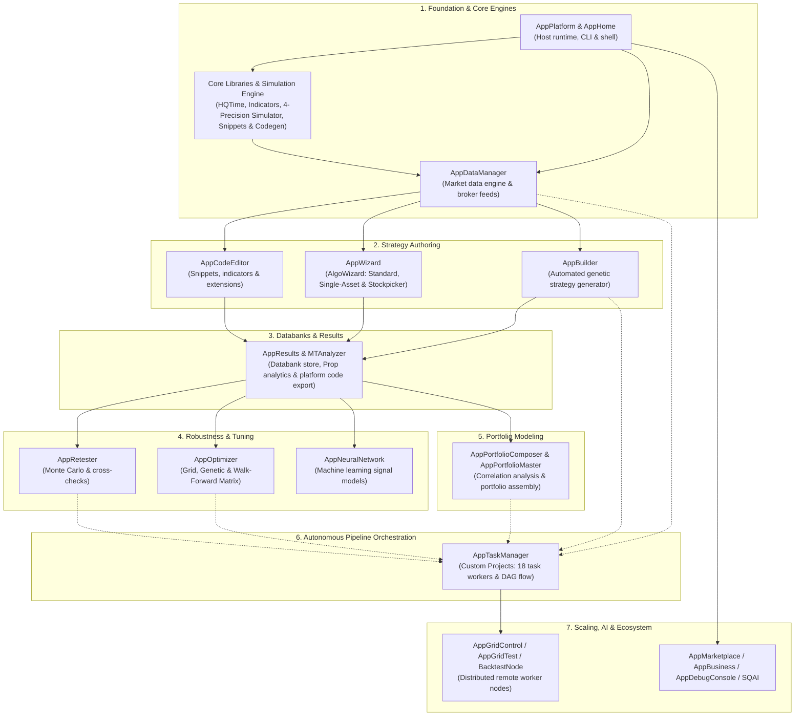
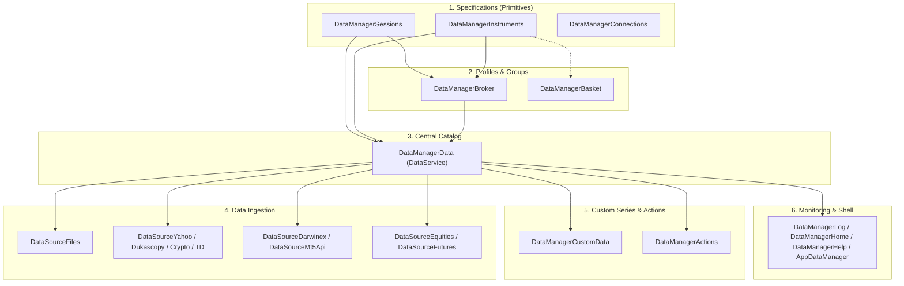
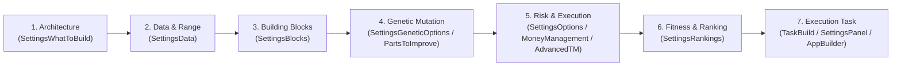
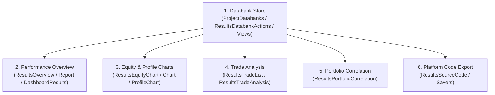
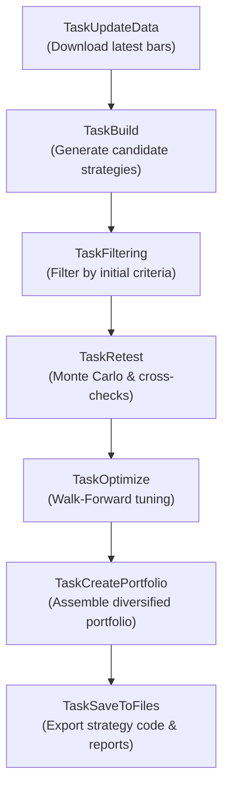

# Quantitative Workstation — Master Workspaces & Clean Room Architecture Blueprint

This document unites the **complete system architecture**, the **workspace-by-workspace implementation order**, the **HaruQuantAI file and project structure**, and the **detailed functional specifications with code implementation mappings** into a single cohesive reference for clean room reimplementation of the quantitative trading workstation.

## TARGET STACK (the reimplementation must use this)

- Frontend: React + TypeScript + Vite + Tailwind CSS
- Workspace: Dockview (dockable panels, tabs, resizable layouts)
- Tables/Charts: TanStack Table + TanStack Virtual + Lightweight Charts
- Desktop (optional): Tauri with packaged Python sidecar
- Backend API: Python + FastAPI + Pydantic + Uvicorn
- Domain layer: framework-independent Python feature modules
- Numerics: NumPy + Numba
- Background work: Python worker processes + SQLite-backed job ledger and scheduler
- Realtime: FastAPI WebSocket (optional SSE for one-way streams)
- Messaging/cache: in-memory maps, bounded queues, local IPC (no Redis)
- Persistence: SQLite (WAL, coordinated writes)
- Bulk data: Parquet + PyArrow (Zstandard)
- Brokers: MetaTrader 5 Python adapter + cTrader Open API adapter
- Platform: Windows first

---

## High-Level System Architecture & Strategy Lifecycle



---

## HaruQuantAI Project & File Structure

The reimplementation strictly follows the **3-Tier Spatial Architecture** defined in `HaruQuantAI`:

1. **Tier 1: Host Platform (`app/host/` & `ui/app/host/`)** — Pure universal platform foundation (lifecycle, settings, SQLite WAL persistence, atomic batch transactions, multi-sink logging, ProcessPool background jobs, response envelopes, transports, and dynamic plugin discovery). Zero domain or quantitative logic.
2. **Tier 2: Domain Workspaces (`app/workspace/` & `ui/app/workspace/`)** — Autonomous operational centers encapsulating business logic, calculation pipelines, and FastAPI REST/WebSocket routers (Data Manager, Code Editor, AlgoWizard, Strategy Builder, Results/Databank, Retester, Optimizer, Neural Network, Portfolio Composer/Master, Custom Projects, Grid Control/Test, Marketplace, Business, Debug Console, Home, Chart, and MTAnalyzer).
3. **Tier 3: Dynamic Plugins (`app/plugins/` & `ui/app/plugins/`)** — Decoupled add-on packages declaring typed extension slots (e.g. `data.provider`, `builder.candidate`, `results.plugin`, `ai.agent`), scanned and attached dynamically at runtime.
4. **Domain Services & Primitives (`app/services/` & `ui/app/components/`)** — Core temporal/random/data primitives (`include/`), 69 mathematical indicators (`indicators/`), backtest simulation & order execution kernel (`engine/`), extensible snippet registries (`snippets/`), target-platform code generators (`codegen/`), unified broker/feed bridges (`brokers/`), and reusable UI components.

```text
HaruQuantAI/
├── app/                                    # Python Backend (FastAPI, Pydantic, SQLite WAL, NumPy/Numba)
│   ├── main.py                             # Uvicorn / desktop sidecar entrypoint
│   ├── cli.py                              # Headless CLI runner (sqcli.config / SQConsoleStarter parity)
│   ├── host/                               # Tier 1: Platform Host (Lifecycle, persistence, jobs, transports)
│   │   ├── persistence.py                  # SQLite WAL database CRUD & atomic batch transactions (HostPersistence)
│   │   ├── bootstrap.py                    # Multi-stage startup & LIFO teardown
│   │   ├── discovery.py                    # Dynamic plugin scanner & manifest loader
│   │   ├── jobs.py                         # Multiprocessing job coordinator & ProcessPoolExecutor
│   │   ├── logging.py                      # Multi-sink asynchronous telemetry & secret redaction
│   │   ├── resources.py                    # Hardware inspection & memory watchdog
│   │   ├── response.py                     # Standardized API response & error envelopes
│   │   ├── session.py                      # Ephemeral authentication & scope guards
│   │   ├── settings.py                     # Central configuration & revision-tracked batch saves
│   │   └── transport.py                    # FastAPI gateway, REST routes, WebSocket event bus
│   ├── workspace/                          # Tier 2: Domain Workspaces (Cohesive business workflows)
│   │   ├── data_manager/                   # Central market data catalog, instruments, sessions, baskets, broker profiles
│   │   ├── code_editor/                    # Monaco-backed snippet and extension development
│   │   ├── algo_wizard/                    # Visual rule authoring (Standard, Single-Asset, Stockpicker), Custom Blocks
│   │   ├── builder/                        # Genetic strategy generation, candidate engines, ranking models
│   │   ├── results/                        # Databank storage, strategy comparison, performance reports, equity charts
│   │   ├── retesting/                      # Multi-market cross-checks, Monte Carlo, SPP, Walk-Forward
│   │   ├── optimizer/                      # Grid/genetic parameter tuning, Walk-Forward Matrix, 3D surface charts
│   │   ├── neural_network/                 # Feature extraction, PyTorch/Numba model training, signal classifiers
│   │   ├── portfolio/                      # Portfolio Composer (interactive) & Portfolio Master (genetic search)
│   │   ├── custom_projects/                # Automated 18-task pipeline DAG engine (Custom Projects)
│   │   ├── grid_control/                   # Distributed computing worker pool, BacktestNode & NodeUpdater coordinator
│   │   ├── grid_test/                      # Cluster benchmark test suite & latency probes
│   │   ├── marketplace/                    # Community extension package repository client
│   │   ├── business/                       # Multi-account licensing & institutional compliance reporting
│   │   ├── debug_console/                  # Live system telemetry & memory diagnostics
│   │   ├── home/                           # Landing dashboard & system overview
│   │   ├── chart/                          # Standalone charting engine & visual analytics
│   │   └── mt_analyzer/                    # Standalone MetaTrader report & portfolio analyzer (MTANALYZER)
│   ├── services/                           # Shared Domain Primitives, Engines & Adapters
│   │   ├── include/                        # Core time, RNG, bar series, contracts & signal building blocks (SQLib / SQDataLib)
│   │   │   ├── time.py                     # HQTime calendar, timezone & session math
│   │   │   ├── bar_time.py                 # Bar boundary alignment & timeframe intervals
│   │   │   ├── generators.py               # Deterministic PRNG (RandomGenerator / XorShift / SplitMix)
│   │   │   ├── contracts.py                # Shared immutable domain DTOs & value objects
│   │   │   ├── enums.py                    # Order types, timeframes, precision modes, execution platforms
│   │   │   ├── data.py                     # Columnar OHLCV/tick series kernel & history containers
│   │   │   ├── trading.py                  # Core order, position, trade & execution records
│   │   │   ├── actions.py                  # Side-effect action blocks, variable assignments & annotations
│   │   │   ├── comparisons.py              # Fuzzy/epsilon comparisons, crossovers & trend conditions
│   │   │   ├── functions.py                # Arithmetic/math operations, rolling ranks & pip conversions
│   │   │   ├── price.py                    # BarPrice, QuotePrice, MTFPrice, SessionPrice, HeikenAshi
│   │   │   └── types.py                    # Generic Variable container, typed variables & constants
│   │   ├── brokers/                        # Unified BrokerClient / TradingClient data feeds & execution bridges
│   │   │   ├── base.py                     # Abstract BrokerClient (data) & TradingClient (execution) contracts
│   │   │   ├── _http.py                    # Bounded retry, rate-limiting & redacted HTTP transport
│   │   │   ├── _file_history.py            # Local CSV/TXT/archive history loader
│   │   │   ├── _native_history.py          # Binary tick/bar history decoder
│   │   │   ├── ctrader.py                  # CTraderClient (cTrader Open API data & live trading adapter)
│   │   │   ├── simulator.py                # SimulatorClient (deterministic paper/backtest broker execution)
│   │   │   ├── metatrader.py               # MetaTrader 5 Python terminal adapter & FXT/HST exporter
│   │   │   ├── dukascopy.py                # Dukascopy bi5 tick & minute CDN downloader
│   │   │   ├── darwinex.py                 # Darwinex tick/minute data bridge
│   │   │   ├── yahoo.py                    # Yahoo Finance historical OHLCV downloader
│   │   │   ├── tick_downloader.py          # TickDownloader repository importer
│   │   │   ├── sq_equity.py                # US Equities subscription historical data client
│   │   │   ├── sq_futures.py               # Futures & Commodities subscription historical data client
│   │   │   └── crypto.py                   # Consolidated crypto exchange clients (Binance Spot/CoinM/UsdtM, Bitfinex, CoinbasePro, Poloniex)
│   │   ├── indicators/                     # 69 mathematical indicators (base + momentum, price_action, regime, trend, volatility, volume)
│   │   ├── engine/                         # Core Backtest & Simulation Kernel (SQAppLib / SQTradingLib parity)
│   │   │   ├── simulator.py                # Event-driven & vectorized bar/tick simulation engine
│   │   │   ├── precision.py                # 4 precision modes (Selected TF, 1M Tick Sim, Real Tick Custom/Real Spread, Open Prices)
│   │   │   ├── platforms.py                # 7 execution platform profiles (MT4, MT5 Hedged/Netted, TS, MC, NT, JForex, Stockpicker)
│   │   │   ├── orders.py                   # Order state machine & intrabar SL/PT/Trailing/MoveSL2BE/ATM precedence
│   │   │   ├── accounting.py               # Commission, swap rollover, margin & cross-currency conversion
│   │   │   └── formats.py                  # .cfx project ZIP, .sqx/.sq4/.sq3 strategy archive, and .dat/Parquet codecs
│   │   ├── snippets/                       # 24 Extensible Snippet Categories & 12 XML Catalogs (internal/extend/Snippets/SQ)
│   │   │   ├── blocks.py                   # 569 strategy building blocks & internal/ctemplate/*.xml registries
│   │   │   ├── money_management.py         # 12 position sizing algorithms (Fixed, Risk%, ATR, Martingale, Stocks, Crypto, Picker)
│   │   │   ├── exit_methods.py             # 5 exit method snippets
│   │   │   ├── trading_options.py          # 8 session/intraday/weekend/distance trading option constraints
│   │   │   ├── monte_carlo.py              # 5 MC manipulation & 9 MC retest perturbation algorithms
│   │   │   ├── what_if.py                  # 15 post-backtest trade filtering & equity control scenarios
│   │   │   ├── columns.py                  # ~120 Databank columns, 30 Trade columns & 8 Walk-Forward columns
│   │   │   ├── charts.py                   # 27 TradeAnalysis charts & 14 EngineCharts generators
│   │   │   ├── correlation.py              # 6 CorrelationOf series extractors (Profit/Loss by Hour/Day/Week/Month, Drawdown, Open Trade)
│   │   │   ├── fitness.py                  # 3 PortfolioMasterFitness functions & multi-objective weighting
│   │   │   ├── formulas.py                 # 19 neural/ranking/statistical formula evaluators
│   │   │   ├── negaters.py                 # 15 opposite-block signal negation mappings
│   │   │   └── checkers_calculators.py     # 3 acceptance checkers, 7 statistical calculators, Alerts, PosSizing & AITool
│   │   └── codegen/                        # Target-Platform Strategy Code Exporters (internal/extend/Code)
│   │       ├── template_engine.py          # AST-to-target code generator & macro renderer
│   │       ├── easylanguage.py             # TradeStation / MultiCharts EasyLanguage (.eld / .pla / .txt) exporter
│   │       ├── jforex.py                   # Dukascopy JForex (.java) exporter
│   │       ├── metatrader4.py              # MetaTrader 4 MQL4 (.mq4) exporter
│   │       ├── metatrader5.py              # MetaTrader 5 MQL5 Hedged/Netted (.mq5) exporter
│   │       ├── ninjatrader.py              # NinjaTrader 8 NinjaScript (.cs) exporter
│   │       ├── pseudocode.py               # Human-readable PseudoCode (.txt) exporter
│   │       └── custom_indicators.py        # Companion platform indicator packages (custom_indicators/, COT/, VolumeProfile/)
│   └── plugins/                            # Tier 3: Dynamic Add-on Packages (Loaded dynamically via manifests)
│       ├── data_source/                    # Modular data provider extensions
│       ├── results_plugins/                # User results extensions (Prop analytics, Prop Monte Carlo)
│       └── ai_plugins/                     # User AI agent & skill extensions (user/extend/AIPlugins)
├── ui/                                     # React Frontend (TypeScript, Vite, Tailwind CSS, Dockview)
│   └── app/
│       ├── host/                           # Platform UI (Connection modals, settings, top header, status bar)
│       ├── components/                     # Reusable UI primitives (buttons, modals, tables, charts, dockview wrappers)
│       ├── plugins/                        # Plugin UI widgets & dialogs
│       │   ├── databank/                   # Databank tables, toolbars, view filters, comparison modal
│       │   ├── data_source/                # Data provider import modals (Dukascopy, Darwinex, MT5, Yahoo, Catalogs)
│       │   ├── optimization/               # Optimization 3D surface visualizers
│       │   └── project/                    # Project task workbench & DAG canvas
│       └── workspace/                      # Domain Workspace Views (Dockview panel views)
│           ├── DataManager/                # Data catalog & symbol explorer
│           ├── CodeEditor/                 # Code editor workspace & extension modals
│           ├── AlgoWizard/                 # Drag-and-drop strategy rule canvas (Standard, Single-Asset, Stockpicker)
│           ├── Builder/                    # Strategy builder dashboard, engine panel, settings tabs
│           ├── Results/                    # Strategy databanks, trade analysis, equity charts, Prop analytics
│           ├── Retester/                   # Retesting workspace, cross-check modals, progress monitors
│           ├── Optimizer/                  # Parameter optimization workspace & Walk-Forward Matrix view
│           ├── NeuralNetwork/              # Model training curves & confusion matrix views
│           ├── PortfolioComposer/          # Interactive portfolio allocation & correlation matrix
│           ├── PortfolioMaster/            # Automated genetic portfolio search workbench
│           ├── CustomProjects/             # Task pipeline orchestrator & task modals
│           ├── GridControl/                # Worker node management panel, BacktestNode & NodeUpdater
│           ├── GridTest/                   # Cluster benchmark runner
│           ├── Business/                   # Enterprise license management
│           ├── DebugConsole/               # Live telemetry & log streaming console
│           ├── Home/                       # Welcome screen & quick-action cards
│           ├── Chart/                      # Advanced multi-timeframe interactive charting engine
│           ├── MTAnalyzer/                 # Standalone MetaTrader trade-report & portfolio analyzer
│           ├── AI/                         # Built-in Q AI assistant chat, MCP tool runner & agent selector
│           └── Trading/                    # Live trade monitoring dashboard
└── docs/                                   # Architectural specifications & guides
```

---

## 1. AppPlatform — Host Application Runtime & Shared Services

- **Primary Role**: The root host application container. Bootstraps the embedded web server, dependency injection container, plugin registry, and global event bus. All other workspaces and plugins load into this runtime.
- **Dependencies**: None (Root Host)
- **Outputs / Downstream Role**: Core application container, event bus, database, and connection manager.

### Phase 1.1: Core Application Container & Stage 1 Host Foundation

#### `AppPlatform`

_Feature:_ Host application lifecycle, dependency injection, and event bus runtime
_Implementation Files:_

- **Backend:** `app/host/bootstrap.py`, `app/main.py`
- **Frontend:** `ui/app/host/HostConnectionModal.tsx`
  _Functional Requirements & Implementation:_
- [x] bootstrap FastAPI backend application with CORS, security headers, and Uvicorn server -> `AppHost.startup()`
- [x] initialize SQLite database with WAL mode and coordinated write locks -> `AppHost.initialize_db()`
- [x] register and initialize all domain feature modules and background worker processes -> `AppHost.register_modules()`
- [x] provide global in-memory event bus and WebSocket broadcast channel -> `AppHost.broadcast_event()`
- [x] manage application graceful shutdown, process termination, and resource cleanup -> `AppHost.shutdown()`

#### `HostPersistence`

_Feature:_ SQLite WAL persistence layer, parameterized CRUD, and atomic batch transactions
_Implementation Files:_

- **Backend:** `app/host/persistence.py`
- **Frontend:** `ui/app/host/HostSettingsModal.tsx`
  _Functional Requirements & Implementation:_
- [x] execute parameterized single-row and entity creation in SQLite WAL -> `create_record()` / `create_entity()`
- [x] execute parameterized queries, filtering, and cursor pagination -> `read_records()` / `read_entity()`
- [x] execute parameterized updates and optimistic revision compare-and-set -> `update_record()` / `update_entity()`
- [x] execute parameterized deletion with foreign-key reference guards -> `delete_record()` / `delete_entity()`
- [x] execute atomic multi-row batch writes with all-or-nothing rollback -> `apply_batch()`

#### `HostFoundationServices`

_Feature:_ Plugin discovery, multiprocessing job ledger, telemetry logging, hardware watchdog, session auth, settings, response envelopes, and headless CLI (`sqcli.config` / `SQConsoleStarter`)
_Implementation Files:_

- **Backend:** `app/host/discovery.py`, `app/host/jobs.py`, `app/host/logging.py`, `app/host/resources.py`, `app/host/session.py`, `app/host/settings.py`, `app/host/response.py`, `app/cli.py`
- **Frontend:** `ui/app/host/HostSettingsModal.tsx`
  _Functional Requirements & Implementation:_
- [x] scan and validate dynamic plugin manifests and extension slots at startup -> `PluginDiscovery.discover_plugins()`
- [x] schedule, track, cancel, and persist background worker tasks in SQLite job ledger -> `JobManager.submit_job()` / `JobManager.cancel_job()`
- [x] route structured logs across console/file/WebSocket sinks with secret redaction -> `TelemetryLogger.emit()`
- [x] monitor CPU, RAM, disk quotas, and memory pressure thresholds -> `ResourceMonitor.inspect_resources()`
- [x] issue ephemeral session tokens and enforce route scope authorization -> `SessionManager.verify_session()`
- [x] persist revision-tracked application settings and workspace layouts -> `SettingsManager.save_settings()`
- [x] wrap REST and WebSocket payloads in deterministic typed envelopes -> `ApiResponse.ok()` / `ApiResponse.error()`
- [x] execute headless CLI workflows, project pipelines, and diagnostics (`sqcli.config` parity) -> `run_cli()`

### Phase 1.2: Platform & Broker Connectivity

#### `ConnectionTest`

_Feature:_ Endpoint ping and network connectivity validation utility
_Implementation Files:_

- **Backend:** `app/host/transport.py`
- **Frontend:** `ui/app/host/HostConnectionModal.tsx`
  _Functional Requirements & Implementation:_
- [x] ping remote and local server endpoints to verify network connectivity -> `ConnectionTest.ping_endpoint()`
- [x] measure round-trip latency and report packet loss -> `ConnectionTest.check_latency()`
- [x] diagnose DNS resolution and socket connection failures -> `ConnectionTest.diagnose_network()`

#### `ConnectionLiveTest`

_Feature:_ Live trading account authentication and latency verification
_Implementation Files:_

- **Backend:** `app/services/brokers/registry.py`
- **Frontend:** `ui/app/workspace/Trading/TradingDashboard.tsx`
  _Functional Requirements & Implementation:_
- [ ] validate live broker credentials and API tokens against broker gateways -> `LiveTest.validate_credentials()`
- [ ] measure order placement and quote streaming round-trip latency -> `LiveTest.measure_trading_latency()`
- [ ] verify account trading permissions and margin currency settings -> `LiveTest.verify_trading_permissions()`

#### `ConnectionMT4`

_Feature:_ MetaTrader terminal bridge adapter (Target Stack: MetaTrader 5 Python adapter)
_Implementation Files:_

- **Backend:** `app/services/brokers/metatrader.py`
- **Frontend:** `ui/app/plugins/data_source/Catalogs/BrokerProfiles/BrokerProfilesModal.tsx`
  _Functional Requirements & Implementation:_
- [x] initialize connection to local MetaTrader 5 terminal via official MetaTrader5 Python package -> `ConnectionMT5.initialize()`
- [x] query account balance, equity, leverage, server time, and broker specifications -> `ConnectionMT5.get_account_info()`
- [x] stream live tick and bar price feeds into memory queues -> `ConnectionMT5.stream_ticks()`
- [x] dispatch trading orders (buy, sell, modify, close) to MetaTrader terminal -> `ConnectionMT5.send_order()`
- [x] terminate terminal connection session and release resources -> `ConnectionMT5.shutdown()`

#### `ConnectionCTrader`

_Feature:_ cTrader Open API historical data and live execution adapter (`CTraderClient`)
_Implementation Files:_

- **Backend:** `app/services/brokers/ctrader.py`
- **Frontend:** `ui/app/plugins/data_source/Catalogs/BrokerProfiles/BrokerProfilesModal.tsx`
  _Functional Requirements & Implementation:_
- [x] authenticate cTrader Open API session and resolve tradable symbol catalog -> `CTraderClient.connect()` / `CTraderClient.get_symbols()`
- [x] download historical OHLCV bars and tick quotes from cTrader servers -> `CTraderClient.get_bars()` / `CTraderClient.get_ticks()`
- [x] submit, modify, and close market/limit/stop orders via cTrader Open API -> `CTraderClient.place_order()` / `CTraderClient.close_position()`

#### `ConnectionSimulator`

_Feature:_ Deterministic paper and backtest broker execution bridge (`SimulatorClient`)
_Implementation Files:_

- **Backend:** `app/services/brokers/simulator.py`
- **Frontend:** `ui/app/workspace/Trading/TradingDashboard.tsx`
  _Functional Requirements & Implementation:_
- [x] simulate broker account state, balances, open positions, and pending orders in memory -> `SimulatorClient.get_account_info()`
- [x] execute deterministic market, limit, and stop orders against historical or replayed feeds -> `SimulatorClient.place_order()`

### Phase 1.3: Cryptocurrency Exchange Adapters

#### `CryptoExchangeBinance`

_Feature:_ Binance Spot exchange REST and WebSocket client
_Implementation Files:_

- **Backend:** `app/services/brokers/crypto.py`
- **Frontend:** `ui/app/plugins/data_source/Crypto/CryptoModal.tsx`
  _Functional Requirements & Implementation:_
- [x] fetch Binance spot exchange info, tradable symbols, and price filters -> `BinanceSpot.get_exchange_info()`
- [x] stream live ticker, depth, and 1-minute Kline bars over Binance WebSocket -> `BinanceSpot.stream_klines()`
- [x] download historical Kline bar archives for backtesting -> `BinanceSpot.download_historical_bars()`
- [x] execute spot limit and market orders with HMAC SHA256 signature authentication -> `BinanceSpot.place_order()`

#### `CryptoExchangeBinanceCoinM`

_Feature:_ Binance Coin-Margined Delivery and Perpetual Futures adapter
_Implementation Files:_

- **Backend:** `app/services/brokers/crypto.py`
- **Frontend:** `ui/app/plugins/data_source/Crypto/CryptoModal.tsx`
  _Functional Requirements & Implementation:_
- [x] fetch Coin-M contract specifications and index prices -> `BinanceCoinM.get_contracts()`
- [x] fetch Coin-M funding rates and historical intervals -> `BinanceCoinM.get_funding_rate()`
- [x] stream real-time futures mark price and order book depth -> `BinanceCoinM.stream_mark_price()`
- [x] manage Coin-M positions, leverage brackets, and margin types -> `BinanceCoinM.set_leverage()`

#### `CryptoExchangeBinanceUsdtM`

_Feature:_ Binance USDT-Margined Perpetual Futures adapter
_Implementation Files:_

- **Backend:** `app/services/brokers/crypto.py`
- **Frontend:** `ui/app/plugins/data_source/Crypto/CryptoModal.tsx`
  _Functional Requirements & Implementation:_
- [x] fetch USDT-M contract rules, tick sizes, step sizes, and funding intervals -> `BinanceUsdtM.get_exchange_info()`
- [x] stream real-time USDT-M Kline bars and aggregated trade events -> `BinanceUsdtM.stream_trades()`
- [x] download historical USDT-M futures Kline bar archives -> `BinanceUsdtM.download_futures_klines()`
- [x] place and cancel futures limit, stop-market, and trailing stop orders -> `BinanceUsdtM.send_futures_order()`

#### `CryptoExchangeBitfinex`

_Feature:_ Bitfinex exchange REST and WebSocket market data adapter
_Implementation Files:_

- **Backend:** `app/services/brokers/crypto.py`
- **Frontend:** `ui/app/plugins/data_source/Crypto/CryptoModal.tsx`
  _Functional Requirements & Implementation:_
- [x] fetch Bitfinex currency pairs, symbols, and minimum order sizes -> `Bitfinex.get_symbols()`
- [x] stream real-time raw book and candle feeds over WebSocket -> `Bitfinex.stream_candles()`
- [x] query historical candle archives for backtesting -> `Bitfinex.fetch_candles()`

#### `CryptoExchangeCoinbasePro`

_Feature:_ Coinbase Advanced Trade REST and WebSocket client
_Implementation Files:_

- **Backend:** `app/services/brokers/crypto.py`
- **Frontend:** `ui/app/plugins/data_source/Crypto/CryptoModal.tsx`
  _Functional Requirements & Implementation:_
- [x] fetch Coinbase product catalog, base/quote currencies, and increments -> `Coinbase.get_products()`
- [x] stream live market trades and heartbeats via Coinbase WebSocket -> `Coinbase.stream_market_data()`
- [x] download historical candle data chunks and save to Parquet -> `Coinbase.download_candles()`

#### `CryptoExchangePoloniex`

_Feature:_ Poloniex exchange market data connector
_Implementation Files:_

- **Backend:** `app/services/brokers/crypto.py`
- **Frontend:** `ui/app/plugins/data_source/Crypto/CryptoModal.tsx`
  _Functional Requirements & Implementation:_
- [x] query Poloniex market definitions and trading rules -> `Poloniex.get_markets()`
- [x] fetch historical candlestick records for crypto asset pairs -> `Poloniex.get_candles()`

### Phase 1.4: Core Infrastructure Servlets & Theming

#### `ServletConnection`

_Feature:_ FastAPI REST router for broker and exchange connections CRUD
_Implementation Files:_

- **Backend:** `app/host/transport.py`
- **Frontend:** `ui/app/host/HostConnectionModal.tsx`
  _Functional Requirements & Implementation:_
- [x] list existing broker and exchange connections -> `ServletConnection.list_connections()`
- [x] save or update connection credentials in SQLite -> `ServletConnection.save_connection()`
- [x] delete connection configuration and cached tokens -> `ServletConnection.delete_connection()`
- [x] test connection credentials and report latency status to frontend -> `ServletConnection.test_connection()`

#### `ServletConstants`

_Feature:_ System constants, environment paths, and runtime metadata endpoints
_Implementation Files:_

- **Backend:** `app/host/transport.py`
- **Frontend:** `ui/app/host/HostSettingsModal.tsx`
  _Functional Requirements & Implementation:_
- [x] expose application version, build timestamp, and runtime environment paths -> `ServletConstants.get_constants()`
- [x] serve system resource limits, hardware concurrency specs, and supported timeframes -> `ServletConstants.get_system_specs()`

#### `ServletProject`

_Feature:_ FastAPI project manifest persistence router
_Implementation Files:_

- **Backend:** `app/workspace/custom_projects/routes.py`
- **Frontend:** `ui/app/workspace/CustomProjects/projectClient.ts`
  _Functional Requirements & Implementation:_
- [ ] list existing projects with last-modified timestamps and execution statuses -> `ServletProject.list_projects()`
- [ ] load project definition, task configuration, and workflow pipeline -> `ServletProject.load_project()`
- [ ] save or update project definitions and task DAG to SQLite -> `ServletProject.save_project()`
- [ ] delete project configuration and associated temporary artifacts -> `ServletProject.delete_project()`

#### `ServletRenameTool`

_Feature:_ Bulk renaming and alias management API
_Implementation Files:_

- **Backend:** `app/workspace/results/databank/rename.py`
- **Frontend:** `ui/app/plugins/databank/DatabankRenameController.tsx`
  _Functional Requirements & Implementation:_
- [ ] apply regex and template pattern replacements across symbol, databank, and strategy names -> `ServletRenameTool.batch_rename()`
- [ ] validate proposed renamed entities for naming collisions and illegal characters -> `ServletRenameTool.validate_names()`

#### `ServletGridControl`

_Feature:_ FastAPI WebSocket and IPC router for distributed worker nodes
_Implementation Files:_

- **Backend:** `app/workspace/grid_control/routes.py`
- **Frontend:** `ui/app/workspace/GridControl/GridControlWorkspace.tsx`
  _Functional Requirements & Implementation:_
- [ ] authenticate and accept remote worker node WebSocket connections -> `ServletGridControl.register_worker()`
- [ ] route calculation jobs (backtests, optimizations, Monte Carlo) to idle workers -> `ServletGridControl.stream_worker_status()`
- [ ] stream worker health metrics and heartbeats to frontend Dockview panel -> `ServletGridControl.cancel_task()`

#### `ServletAlgoCloud`

_Feature:_ Cloud synchronization and strategy sharing endpoints
_Implementation Files:_

- **Backend:** `app/workspace/marketplace/routes.py`
- **Frontend:** `ui/app/workspace/Marketplace/MarketplaceWorkspace.tsx`
  _Functional Requirements & Implementation:_
- [ ] synchronize strategies and databanks with AlgoCloud cloud platform -> `ServletAlgoCloud.sync_strategies()`
- [ ] authenticate cloud user account and fetch plan quotas and subscription limits -> `ServletAlgoCloud.get_user_plan()`
- [ ] download pre-built shared strategy templates and market data packages -> `ServletAlgoCloud.download_package()`

#### `ServletAI`

_Feature:_ AI assistant chat streaming, MCP tool execution, and custom agent/skill gateway (`internal/web/SQAI` & `user/extend/AIPlugins`)
_Implementation Files:_

- **Backend:** `app/workspace/neural_network/routes.py`, `app/services/snippets/checkers_calculators.py`
- **Frontend:** `ui/app/workspace/AI/AIWorkspace.tsx`, `ui/app/workspace/NeuralNetwork/neuralNetStore.ts`
  _Functional Requirements & Implementation:_
- [ ] accept natural language user queries regarding strategy development and codebase -> `ServletAI.send_message()`
- [ ] stream AI assistant reasoning and code responses over Server-Sent Events (SSE) or WebSocket -> `ServletAI.stream_response()`
- [ ] inject strategy rules, backtest statistics, and logs as context into LLM prompt -> `ServletAI.clear_history()`
- [ ] discover and invoke extensible `AITool` snippets and user-defined MCP tools (`user/extend/AIPlugins/mcp.json`) -> `ServletAI.invoke_ai_tool()`
- [ ] load custom AI agent personas and Markdown skill definitions (`user/extend/AIPlugins/agents/`, `skills/`) -> `ServletAI.load_agents_and_skills()`

#### `SkinDark`

_Feature:_ Tailwind CSS dark theme tokens and appearance state management
_Implementation Files:_

- **Backend:** `app/host/settings.py`
- **Frontend:** `ui/app/components/ThemeToggle.tsx`
  _Functional Requirements & Implementation:_
- [x] apply dark theme class to root HTML element and style Dockview headers -> `Theme.set_dark()`
- [x] provide dark mode color variables, background shades, and typography tokens -> `Theme.get_tokens()`

#### `SkinLight`

_Feature:_ Tailwind CSS light theme tokens and palette definitions
_Implementation Files:_

- **Backend:** `app/host/settings.py`
- **Frontend:** `ui/app/components/ThemeToggle.tsx`
  _Functional Requirements & Implementation:_
- [x] provide light mode color variables, clean white/gray surfaces, and contrast borders -> `Theme.set_light()`
- [x] apply light theme styling to Dockview panels, TanStack tables, and charts -> `Theme.get_light_tokens()`

---

## 1A. Core Libraries, Indicators & Backtest Simulation Engine (`internal/libs/` -> `app/services/`)

- **Primary Role**: The foundational non-UI quantitative libraries corresponding to `SQLib.jar.enc` (151 classes), `SQDataLib.jar.enc` (191 classes), and `SQAppLib.jar.enc` / `SQTradingLib` (893 classes, 14,063 methods). Provides temporal math, deterministic RNG, columnar bar/tick series, 69 technical indicators, signal utilities, the 4-precision / 7-platform backtest simulation kernel, and binary/ZIP persistence codecs.
- **Dependencies**: AppPlatform
- **Outputs / Downstream Role**: Consumed by every domain workspace (`AppDataManager`, `AppCodeEditor`, `AppWizard`, `AppBuilder`, `AppResults`, `AppRetester`, `AppOptimizer`, `AppPortfolioComposer`, `AppPortfolioMaster`, `AppTaskManager`).

### Phase 1A.1: Core Primitives, Data Contracts & Signal Building Blocks (`app/services/include/`)

#### `CoreIncludePrimitives`

_Feature:_ Deterministic time (`HQTime`), bar boundary alignment, PRNG (`RandomGenerator`), and columnar data/trading structures (`SQLib` & `SQDataLib` parity)
_Implementation Files:_

- **Backend:** `app/services/include/time.py`, `app/services/include/bar_time.py`, `app/services/include/generators.py`, `app/services/include/contracts.py`, `app/services/include/enums.py`, `app/services/include/data.py`, `app/services/include/trading.py`
  _Functional Requirements & Implementation:_
- [x] perform microsecond-exact timestamp arithmetic, timezone shifts, and session boundary checks -> `HQTime` (`time.py`)
- [x] align intraday, daily, weekly, and monthly bar open/close boundaries -> `BarTime` (`bar_time.py`)
- [x] generate reproducible pseudo-random streams (`XorShift` / `SplitMix`) for genetic evolution and Monte Carlo permutations -> `RandomGenerator` (`generators.py`)
- [x] provide zero-copy NumPy/PyArrow columnar OHLCV bar series, derived series, and tick buffers -> `DataSeries` / `HistoryDataLoader` (`data.py`)
- [x] define immutable order, fill, position, trade, and execution contracts -> `OrderRecord` / `TradeRecord` (`trading.py`, `contracts.py`, `enums.py`)

#### `CoreSignalAndMathInclude`

_Feature:_ Strategy action helpers, fuzzy/epsilon comparisons, mathematical functions, price blocks, and typed variables
_Implementation Files:_

- **Backend:** `app/services/include/actions.py`, `app/services/include/comparisons.py`, `app/services/include/functions.py`, `app/services/include/price.py`, `app/services/include/types.py`
  _Functional Requirements & Implementation:_
- [x] evaluate tick-size-aware equality, crossovers (`crosses_above`, `crosses_below`), and directional comparisons -> `comparisons.py`
- [x] execute bar-window statistical aggregations, linear regression slopes, and safe division -> `functions.py`
- [x] normalize prices and order sizes to instrument tick steps, pip sizes, and lot increments -> `price.py` / `actions.py`
- [x] manage generic mutable variables, typed containers, and boolean formula evaluation -> `types.py`

### Phase 1A.2: Technical Indicator Library (`app/services/indicators/`)

#### `CoreIndicatorLibrary`

_Feature:_ 69 vectorized/Numba-compiled technical indicator modules across 6 categories (`SQTradingLib` indicator parity)
_Implementation Files:_

- **Backend:** `app/services/indicators/base.py`, `app/services/indicators/momentum/`, `app/services/indicators/price_action/`, `app/services/indicators/regime/`, `app/services/indicators/trend/`, `app/services/indicators/volatility/`, `app/services/indicators/volume/`
  _Functional Requirements & Implementation:_
- [x] compute momentum oscillators (`RSI`, `CCI`, `Stochastic`, `Momentum`, `WilliamsR`, `MACD`, `DeMarker`, `ROC`, `Reflex`, `Trendflex`, `LaguerreRSI`, `QQE`, `BearsPower`, `BullsPower`, `AwesomeOscillator`, `AcceleratorOscillator`, `TSI`, `UltimateOscillator`) -> `app/services/indicators/momentum/`
- [x] compute price-action & structural levels (`Fractals`, `HeikenAshi`, `Highest`, `Lowest`, `Pivots`, `FibPivots`, `CamarillaPivots`, `SessionOhlc`, `Ichimoku`, `ZigZag`, `PriceChannel`) -> `app/services/indicators/price_action/`
- [x] compute market regime & directional filters (`ADX`, `ADXR`, `Aroon`, `ChopIndex`, `hurst`, `MarketFacilitationIndex`, `Vortex`, `GannHiLo`, `EfficiencyRatio`) -> `app/services/indicators/regime/`
- [x] compute trend moving averages & envelopes (`SMA`, `EMA`, `SMMA`, `LWMA`, `TEMA`, `DEMA`, `HullMA`, `KAMA`, `ALMA`, `SuperTrend`, `ParabolicSAR`, `LinearRegression`, `Alligator`, `GatorOscillator`) -> `app/services/indicators/trend/`
- [x] compute volatility bands & range measures (`ATR`, `TrueRange`, `BollingerBands`, `KeltnerChannel`, `DonchianChannel`, `StandardDeviation`, `UlcerIndex`, `BBWidthRatio`, `ChaikinVolatility`) -> `app/services/indicators/volatility/`
- [x] compute volume & money-flow indicators (`OBV`, `MFI`, `ChaikinMoneyFlow`, `AccumulationDistribution`, `ForceIndex`, `EaseOfMovement`, `VolumeOscillator`, `VWAP`, `TickVolume`) -> `app/services/indicators/volume/`

### Phase 1A.3: Backtest Simulation & Order Execution Kernel (`app/services/engine/`)

#### `BacktestSimulationEngine`

_Feature:_ Multi-precision, multi-platform strategy backtesting and order state machine (`SQAppLib` / `SQTradingLib` parity)
_Implementation Files:_

- **Backend:** `app/services/engine/simulator.py`, `app/services/engine/precision.py`, `app/services/engine/platforms.py`, `app/services/engine/orders.py`, `app/services/engine/accounting.py`
  _Functional Requirements & Implementation:_
- [ ] simulate strategy execution across all **4 Precision Modes + Open Prices**: (1) `Selected Timeframe (Main TF only)`, (2) `1-Minute Data Tick Simulation`, (3) `Real Tick — Custom Spread`, (4) `Real Tick — Real Spread`, and `Open Prices` (4-tick synthetic bar generator: Open -> High/Low -> Low/High -> Close) -> `PrecisionSynthesizer.generate_ticks()`
- [ ] enforce target **7 Execution Platform Profiles** + `Stockpicker`: `MetaTrader 4`, `MetaTrader 5 Hedged`, `MetaTrader 5 Netted`, `TradeStation`, `MultiCharts`, `NinjaTrader`, `JForex`, and cross-sectional `Stockpicker` portfolio rebalance engine -> `PlatformExecutionProfile.validate_and_route()`
- [ ] manage full **Order State Machine**: `Market`, `Stop`, `Limit`, `StopLimit` (MT5/NinjaTrader/JForex), `ReverseAtMarket`, `BarsValid` expiration, `ReplaceExisting`, `MagicNumber`, `AllowDuplicateTrades`, and min-stop-distance (`FreezeLevel` / `StopsLevel`) enforcement -> `OrderStateMachine.process_bar_or_tick()`
- [ ] evaluate deterministic **Intrabar Exit Precedence**: `StopLoss`, `ProfitTarget`, `TrailingStop` (with activation threshold), `MoveSL2BE` (with offset pips), `ExitAfterBars`, and `AdvancedTradeManagement` (ATM partial scale-outs) with pessimistic/optimistic tie-breaking when both SL and PT are touched within the same bar -> `OrderStateMachine.evaluate_intrabar_exits()`
- [ ] compute **Cost, Swap, Margin & Currency Accounting**: commission models (per-lot, percentage, per-trade), overnight swap rollover (including triple-swap weekday), initial/maintenance margin checks, point-value scaling, and cross-currency PnL conversion -> `AccountLedger.settle_trade()`

#### `CorePersistenceFormats`

_Feature:_ Clean-room readers and writers for `.cfx`, `.sqx`, `.sq4`, `.sq3`, and `.dat` / Parquet archives
_Implementation Files:_

- **Backend:** `app/services/engine/formats.py`
  _Functional Requirements & Implementation:_
- [ ] read and write `.cfx` Custom Project / Template ZIP archives (`config.xml` + `<TaskType>-Task<N>.xml` manifests) -> `ProjectArchiveCodec.load_cfx()` / `save_cfx()`
- [ ] read and write `.sqx` Strategy ZIP archives (`strategy.xml` AST, `sourceCode.txt`, and compressed backtest trade/equity payloads), `.sq4` XML strategies, and `.sq3` legacy binary strategies -> `StrategyArchiveCodec.load_sqx()` / `save_sqx()`
- [ ] transcode binary `.dat` tick/bar archives to and from Zstandard-compressed PyArrow Parquet datasets -> `MarketDataFormatCodec.transcode_dat_parquet()`

---

## 1B. Extensible Snippet System, XML Catalogs & Target-Platform Code Exporters (`internal/extend/` & `internal/ctemplate/` -> `app/services/snippets/` & `app/services/codegen/`)

- **Primary Role**: Reimplements the 24 extensible snippet categories in `internal/extend/Snippets/SQ/` (1,049 Java classes), the 12 XML block/parameter catalogs in `internal/ctemplate/`, and the 6 FreeMarker target-platform code generation engines in `internal/extend/Code/`.
- **Dependencies**: Core Libraries & Simulation Engine (`Section 1A`)
- **Outputs / Downstream Role**: Supplies building blocks, position sizing, exit rules, Monte Carlo perturbations, What-If filters, databank/trade columns, fitness formulas, and platform source-code generators to `AppCodeEditor`, `AppWizard`, `AppBuilder`, `AppResults`, `AppRetester`, `AppOptimizer`, and `AppPortfolioMaster`.

### Phase 1B.1: Strategy Building Blocks, Sizing & Execution Snippets (`app/services/snippets/`)

#### `SnippetBuildingBlocksAndCatalogs`

_Feature:_ 569 strategy building blocks across 10 categories and 12 XML block/template registries (`Snippets/SQ/Blocks/*` & `internal/ctemplate/*.xml`)
_Implementation Files:_

- **Backend:** `app/services/snippets/blocks.py`
  _Functional Requirements & Implementation:_
- [ ] register all 10 building block families: `Indicators` (52 indicator families, ~400 signal/value blocks), `Price` (30 OHLC/range/daily/session blocks), `BarAndTime` (37 hour/day/month/session blocks), `Comparisons` (27 cross/fuzzy/threshold blocks), `StrategyControl` (25 trade/position/profit inspection blocks), `Functions` (18 math/statistical blocks), `Order` & `OtherActions` (20 order entry/modification/close blocks), `CandlePatterns` (7 candlestick formations), and `Variables` (5 typed strategy variables) -> `BlockRegistry.load_all_blocks()`
- [ ] parse and serve the 12 block/template catalogs (`config.xml`, `conditions.xml`, `values.xml`, `actions.xml`, `comparisons.xml`, `events.xml`, `talibs.xml`, `wizard.xml`, `moneyManagement.xml`, `parameterSets.xml`, `datasTimeframes.xml`, `advancedTypes.xml`) and build rule templates (`build/sq4/*`, `build/sq3/*`, `build/sp/*`) -> `CatalogTemplateLoader.load_catalogs()`

#### `SnippetMoneyManagement`

_Feature:_ 12 position sizing and capital allocation schemes (`Snippets/SQ/MoneyManagement/*`)
_Implementation Files:_

- **Backend:** `app/services/snippets/money_management.py`
  _Functional Requirements & Implementation:_
- [ ] compute trade order size for all 12 money management models: `FixedSize`, `FixedAmount`, `RiskFixedPctOfAccount`, `RiskFixedBalancePct`, `ATRRiskBasedSizing`, `SimpleMartingaleMM`, `StocksSizeByPrice`, `CryptoSizeByPrice`, `CryptoRiskFixedPctOfAccount`, `CryptoRiskFixedBalancePct`, `PickerFixedAmount`, and `PickerRiskFixedPctOfAccount` -> `MoneyManagementEngine.compute_lots()`

#### `SnippetExitMethodsAndTradingOptions`

_Feature:_ 5 Exit Methods (`Snippets/SQ/ExitMethods/*`) and 8 Trading Options (`Snippets/SQ/TradingOptions/*`)
_Implementation Files:_

- **Backend:** `app/services/snippets/exit_methods.py`, `app/services/snippets/trading_options.py`
  _Functional Requirements & Implementation:_
- [ ] evaluate modular exit methods (`StopLoss`, `ProfitTarget`, `TrailingStop`, `MoveSL2BE`, `ExitAfterBars`) per open trade -> `ExitMethodEvaluator.apply_exits()`
- [ ] enforce the 8 session and risk trading options (`DontTradeOnWeekends`, `ExitAtEndOfDay`, `ExitOnFriday`, `LimitTimeRange`, `MaxDistanceFromMarket`, `MaxTradesPerDay`, `MinMaxSLPT`, `UseInitialSLPT`) -> `TradingOptionEnforcer.enforce_options()`

### Phase 1B.2: Robustness, What-If, Databank Columns, Charts & Formulas (`app/services/snippets/`)

#### `SnippetMonteCarloAndWhatIf`

_Feature:_ 14 Monte Carlo perturbation methods (`Snippets/SQ/MonteCarlo/*`) and 15 What-If trade filter scenarios (`Snippets/SQ/WhatIf/*`)
_Implementation Files:_

- **Backend:** `app/services/snippets/monte_carlo.py`, `app/services/snippets/what_if.py`
  _Functional Requirements & Implementation:_
- [ ] execute the 5 fast trade-manipulation Monte Carlo methods (`RandomizeTradesOrder` [Exact & Resampling], `RandomizeSkipTrades`, `RandomizeStartDate`, `RandomizeHistoryData`, `RandomizeCommon`) -> `MonteCarloManipulator.run_simulation()`
- [ ] execute the 9 full-retest Monte Carlo perturbation methods (`RandomizeStrategyParameters`, `RandomizeSlippage`, `RandomizeSpread`, `RandomizeMinDistance`, `RandomizeIndicatorParameters`, `RandomizeBacktestStart`, `RandomizeHistoryData` volatility/noise) -> `MonteCarloRetester.run_retest_simulation()`
- [ ] apply all 15 post-backtest What-If trade filters and equity controls (`TakeOnlyLong`, `TakeOnlyShort`, `TradesByDays`, `TradesByHours`, `SkipTradesByDuration`, `MaxTradesPerDay`, `ExcludePercentBiggestProfitable`, `ExcludePercentBiggestLosing`, `SetFixedSpread`, `EquityPctControl`, `MovingAverageControl`, `LinearRegressionControl`, `DelayedRepeatingEntries`, `UseMoneyManagement`, `RecomputeUseAvailableMoney`) -> `WhatIfSimulator.apply_scenario()`

#### `SnippetColumnsChartsAndFormulas`

_Feature:_ ~120 Databank columns, 30 Trade columns, 8 Walk-Forward columns, 27 TradeAnalysis charts, 14 EngineCharts, 6 CorrelationOf series, 3 PortfolioMasterFitness functions, 19 Formulas, 15 Negaters, 3 Checkers & 7 Calculators
_Implementation Files:_

- **Backend:** `app/services/snippets/columns.py`, `app/services/snippets/charts.py`, `app/services/snippets/correlation.py`, `app/services/snippets/fitness.py`, `app/services/snippets/formulas.py`, `app/services/snippets/negaters.py`, `app/services/snippets/checkers_calculators.py`
  _Functional Requirements & Implementation:_
- [ ] compute all ~120 Databank performance metrics (`NetProfit`, `RetDD`, `SharpeRatio`, `SortinoRatio`, `SQN`, `ProfitFactor`, `Stability`, `Stagnation`, `UlcerPerformanceIndex`, `WinLossRatio`, `CAGR`, `RExpectancy`, `MaxDD`, `AvgWin`, `AvgLoss`, `Fitness`, etc.), 30 per-trade columns (`MAE`, `MFE`, `Efficiency`, `Duration`, `Commission`, `Swap`, etc.), and 8 Walk-Forward columns -> `ColumnRegistry.evaluate_columns()`
- [ ] generate data series for all 27 TradeAnalysis charts and 14 live EngineCharts -> `ChartSnippetRegistry.build_chart_series()`
- [ ] extract the 6 `CorrelationOf` time series (`ProfitLossByHour`, `ProfitLossByDay`, `ProfitLossByWeek`, `ProfitLossByMonth`, `Drawdown`, `OpenTrade`) and compute the 3 `PortfolioMasterFitness` scores (`NetProfit`, `PctStagnation`, `ReturnDD`) -> `CorrelationAndFitnessRegistry.evaluate()`
- [ ] evaluate the 19 `Formulas` (ranking/neural/regression expressions), 15 `Negater` opposite-block mappings (for genetic rule inversion), 3 acceptance `Checkers`, and 7 statistical `Calculators` (`Duration`, `MAE/MFE`, `Money`, `Pips`, `Pct`, `Sqn`, `Stagnation`) -> `FormulaAndNegaterRegistry.apply()`

### Phase 1B.3: Target-Platform Strategy Code Exporters (`internal/extend/Code/` -> `app/services/codegen/`)

#### `PlatformCodeExporters`

_Feature:_ AST-to-platform source code generators for 6 target platforms plus companion custom indicators (`internal/extend/Code/*`, `custom_indicators/`, `COT/`, `VolumeProfile/`)
_Implementation Files:_

- **Backend:** `app/services/codegen/template_engine.py`, `app/services/codegen/easylanguage.py`, `app/services/codegen/jforex.py`, `app/services/codegen/metatrader4.py`, `app/services/codegen/metatrader5.py`, `app/services/codegen/ninjatrader.py`, `app/services/codegen/pseudocode.py`, `app/services/codegen/custom_indicators.py`
  _Functional Requirements & Implementation:_
- [ ] render strategy ASTs into **MetaTrader 4 (`MQL4` `.mq4`)** and **MetaTrader 5 (`MQL5` `.mq5` Hedged & Netted)** expert advisors with full order management, custom indicator calls, and magic number handling -> `MetaTrader4Exporter.render()` / `MetaTrader5Exporter.render()`
- [ ] render strategy ASTs into **TradeStation / MultiCharts (`EasyLanguage` `.txt` / `.eld` / `.pla`)** and **Stockpicker** multi-symbol scripts -> `EasyLanguageExporter.render()`
- [ ] render strategy ASTs into **NinjaTrader 8 (`NinjaScript` `.cs`)** and **Dukascopy (`JForex` `.java`)** strategy classes -> `NinjaTraderExporter.render()` / `JForexExporter.render()`
- [ ] render human-readable **PseudoCode (`.txt`)** descriptions of all strategy signals, blocks, stops, and money management -> `PseudoCodeExporter.render()`
- [ ] package companion platform indicator source files (`custom_indicators/` for MT4/MT5/TS/NT8, `COT/`, and `VolumeProfile/`) alongside exported strategies -> `CustomIndicatorPackager.bundle_indicators()`

---

## 2. AppHome — Getting Started & Shell Landing

- **Primary Role**: The default welcome landing workspace. Provides onboarding tutorials, recent project shortcuts, release version information, and offline documentation fallback.
- **Dependencies**: AppPlatform
- **Outputs / Downstream Role**: User onboarding, navigation entry points, and version inspection.

### Phase 2.1: Welcome & Landing Interface

#### `AppHome`

_Feature:_ Home dashboard, onboarding flow, and navigation launcher
_Implementation Files:_

- **Backend:** `app/workspace/home/routes.py`
- **Frontend:** `ui/app/workspace/Home/HomeScreen.tsx`
  _Functional Requirements & Implementation:_
- [ ] display welcome home view with quick-start action shortcuts -> `Home.index()`
- [ ] render offline onboarding flow and tutorial cards when disconnected -> `Home.get_recent_projects()`
- [ ] fetch and show latest release changelog and version updates -> `Home.check_updates()`

#### `HomeAbout`

_Feature:_ Application release metadata, system build specifications, and about dialog
_Implementation Files:_

- **Backend:** `app/workspace/home/routes.py`
- **Frontend:** `ui/app/workspace/Home/HomeScreen.tsx`
  _Functional Requirements & Implementation:_
- [ ] display platform version, build timestamp, and license details -> `About.about()`
- [ ] show active system directory paths, database status, and memory stats -> `About.diagnostics()`

---

## 3. AppDataManager — Market Data Engine

- **Primary Role**: The historical market data repository. Manages instrument specifications, trading sessions, broker profiles, and central price bar data (M1, H1, D1, Tick). Every strategy backtesting, generation, and optimization workspace depends directly on this engine.
- **Dependencies**: AppPlatform
- **Outputs / Downstream Role**: Historical price bars, instrument specifications, and trading sessions for backtesting.



### Phase 3.1: Foundational Specifications (No Dependencies)

#### `DataManagerInstruments`

_Feature:_ Financial instrument specifications and symbol definition manager
_Implementation Files:_

- **Backend:** `app/workspace/data_manager/instruments.py`
- **Frontend:** `ui/app/plugins/data_source/Catalogs/Instruments/InstrumentsModal.tsx`
  _Functional Requirements & Implementation:_
- [ ] list all configured instruments with point/pip sizes, contract sizes, and margins -> `Instruments.instruments()`
- [ ] add new instrument specifications to SQLite database -> `Instruments.add_instrument()`
- [ ] edit one or more existing instrument definitions in bulk -> `Instruments.mass_edit_instruments()`
- [ ] clone an existing instrument to create a new specification -> `Instruments.clone_instrument()`

#### `DataManagerSessions`

_Feature:_ Trading session profiles and market hours scheduler
_Implementation Files:_

- **Backend:** `app/workspace/data_manager/sessions.py`
- **Frontend:** `ui/app/plugins/data_source/Catalogs/Sessions/SessionsModal.tsx`
  _Functional Requirements & Implementation:_
- [ ] list all trading session profiles and holiday calendars -> `Sessions.sessions()`
- [ ] create, clone, and delete trading sessions with timezone shifts -> `Sessions.clone_session()`
- [ ] add and configure session time intervals (daily open, close, lunch pauses) -> `Sessions.session_element()`
- [ ] configure and save reusable session templates -> `Sessions.session_template()`

#### `DataManagerConnections`

_Feature:_ Data feed and broker account connection manager
_Implementation Files:_

- **Backend:** `app/workspace/data_manager/connections.py`
- **Frontend:** `ui/app/plugins/data_source/Common/DataSourceRibbon.tsx`
  _Functional Requirements & Implementation:_
- [ ] list all external market data provider connections -> `Connections.list_connections()`
- [ ] add or edit external market data provider credentials -> `Connections.add_connection()`
- [ ] test real-time connectivity and authenticate data subscription feeds -> `Connections.test_feed_connection()`

### Phase 3.2: Profiles & Grouping Aggregators

#### `DataManagerBroker`

_Feature:_ Broker profile manager combining instruments, sessions, and commissions
_Implementation Files:_

- **Backend:** `app/workspace/data_manager/broker.py`
- **Frontend:** `ui/app/plugins/data_source/Catalogs/BrokerProfiles/BrokerProfilesModal.tsx`
  _Functional Requirements & Implementation:_
- [ ] list all broker profiles configured in the system -> `Broker.brokers()`
- [ ] add or edit broker profiles with custom spread and commission models -> `Broker.add_broker()`
- [ ] edit stock symbols assigned to a broker profile -> `Broker.edit_stocks()`
- [ ] import instrument definitions from external XML/JSON files -> `Broker.import_instruments()`
- [ ] import trading session definitions from external XML/JSON files -> `Broker.import_sessions()`

#### `DataManagerBasket`

_Feature:_ Stock basket and symbol grouping watchlist manager
_Implementation Files:_

- **Backend:** `app/workspace/data_manager/baskets.py`
- **Frontend:** `ui/app/plugins/data_source/Catalogs/StockGroups/StockGroupsModal.tsx`
  _Functional Requirements & Implementation:_
- [ ] list all stock baskets and symbol groupings -> `Basket.baskets()`
- [ ] create new stock basket groups (e.g. S&P 500, Tech, Forex Majors) -> `Basket.add_basket()`
- [ ] edit and maintain symbol membership in selected baskets -> `Basket.edit_stocks()`

### Phase 3.3: Central Data Hub & Catalog Engine

#### `DataManagerData`

_Feature:_ Central price data catalog and timeframe storage manager
_Implementation Files:_

- **Backend:** `app/workspace/data_manager/data.py`
- **Frontend:** `ui/app/workspace/DataManager/DataManager.tsx`
  _Functional Requirements & Implementation:_
- [ ] list all imported price data symbols with timeframes, date ranges, and bar counts -> `Data.data()`
- [ ] edit symbol properties, associated broker profile, and session template -> `Data.data_edit()`
- [ ] confirm and delete selected price data symbols and clear cached bar files -> `Data.data_delete_confirm()`
- [ ] add BMF futures data symbols to the database -> `Data.add_br()`

### Phase 3.4: Data Ingestion (Data Sources)

#### `DataSourceFiles`

_Feature:_ Local CSV, TXT, and archive file historical data importer
_Implementation Files:_

- **Backend:** `app/services/brokers/files.py`
- **Frontend:** `ui/app/plugins/data_source/FileImport/FileImportModal.tsx`
  _Functional Requirements & Implementation:_
- [ ] add new symbol definition from local historical data file -> `Files.add()`
- [ ] import price data from local files into Parquet storage -> `Files.import_data()`
- [ ] import price data directly from external trading applications -> `Files.app_import()`
- [ ] define and save custom text/CSV file delimiter and column formats -> `Files.new_format()`
- [ ] perform bulk mass import of multiple data files across directories -> `Files.mass_import()`

#### `DataSourceYahoo`

_Feature:_ Yahoo Finance historical daily and weekly data downloader
_Implementation Files:_

- **Backend:** `app/services/brokers/yahoo.py`
- **Frontend:** `ui/app/plugins/data_source/Yahoo/YahooModal.tsx`
  _Functional Requirements & Implementation:_
- [ ] add Yahoo Finance data symbols to the database -> `Yahoo.add()`
- [ ] download historical OHLCV price bars from Yahoo Finance -> `Yahoo.download()`

#### `DataSourceDukascopy`

_Feature:_ Dukascopy high-precision forex and CFD data downloader
_Implementation Files:_

- **Backend:** `app/services/brokers/dukascopy.py`
- **Frontend:** `ui/app/plugins/data_source/Dukascopy/DukascopyModal.tsx`
  _Functional Requirements & Implementation:_
- [ ] add Dukascopy data symbols to the database -> `Dukascopy.add()`
- [ ] identify and select instruments for Dukascopy data -> `Dukascopy.select_instruments()`
- [ ] display provider CDN data disclaimer -> `Dukascopy.cdn_disclaimer()`
- [ ] display Dukascopy data disclaimer -> `Dukascopy.disclaimer()`
- [ ] download and import Dukascopy tick and minute price data -> `Dukascopy.import_data()`

#### `DataSourceCrypto`

_Feature:_ Cryptocurrency exchange historical price data downloader
_Implementation Files:_

- **Backend:** `app/services/brokers/crypto.py`
- **Frontend:** `ui/app/plugins/data_source/Crypto/CryptoModal.tsx`
  _Functional Requirements & Implementation:_
- [ ] add cryptocurrency data symbols and exchange pairs to database -> `Crypto.add()`
- [ ] download and import historical crypto candlestick data -> `Crypto.import_data()`

#### `DataSourceTD`

_Feature:_ TickDownloader historical data importer
_Implementation Files:_

- **Backend:** `app/services/brokers/tick_downloader.py`
- **Frontend:** `ui/app/plugins/data_source/TickDownloader/TickDownloaderModal.tsx`
  _Functional Requirements & Implementation:_
- [ ] import historical tick and minute price data generated by TickDownloader -> `TD.import_data()`

#### `DataSourceDarwinex`

_Feature:_ Darwinex broker tick/minute data bridge
_Implementation Files:_

- **Backend:** `app/services/brokers/darwinex.py`
- **Frontend:** `ui/app/plugins/data_source/Darwinex/DarwinexModal.tsx`
  _Functional Requirements & Implementation:_
- [ ] add Darwinex data symbols to the database -> `Darwinex.add()`
- [ ] display Darwinex data disclaimer -> `Darwinex.darwinex_disclaimer()`
- [ ] download data from Darwinex -> `Darwinex.download()`
- [ ] import data downloaded from Darwinex -> `Darwinex.import_data()`
- [ ] identify and select instruments for Darwinex data -> `Darwinex.select_instruments()`

#### `DataSourceMt5Api`

_Feature:_ MetaTrader 5 API direct historical data importer
_Implementation Files:_

- **Backend:** `app/services/brokers/metatrader.py`
- **Frontend:** `ui/app/plugins/data_source/MetaTrader/Mt5ImportModal.tsx`
  _Functional Requirements & Implementation:_
- [ ] import price data directly from MetaTrader 5 terminal via Python API -> `Mt5Api.import_data()`

#### `DataSourceEquities`

_Feature:_ US Equities subscription historical data client
_Implementation Files:_

- **Backend:** `app/services/brokers/sq_equity.py`
- **Frontend:** `ui/app/plugins/data_source/Equities/EquitiesModal.tsx`
  _Functional Requirements & Implementation:_
- [x] add US equities data symbols to database -> `EquitiesData.add()`
- [x] display equities data usage terms and conditions -> `EquitiesData.data_usage_conditions()`
- [x] update existing equity historical data with latest trading sessions -> `EquitiesData.update()`

#### `DataSourceFutures`

_Feature:_ Futures & Commodities subscription historical data client
_Implementation Files:_

- **Backend:** `app/services/brokers/sq_futures.py`
- **Frontend:** `ui/app/plugins/data_source/Futures/FuturesModal.tsx`
  _Functional Requirements & Implementation:_
- [x] add futures data symbols to database -> `FuturesData.add()`
- [x] display futures data usage conditions -> `FuturesData.data_usage_conditions()`
- [x] update existing futures historical data with latest session bars -> `FuturesData.update()`

### Phase 3.5: Custom & Auxiliary Data Series

#### `DataManagerCustomData`

_Feature:_ Macroeconomic and non-price custom time-series data manager
_Implementation Files:_

- **Backend:** `app/workspace/data_manager/custom_data.py`
- **Frontend:** `ui/app/plugins/data_source/Tools/CustomDataModal.tsx`
  _Functional Requirements & Implementation:_
- [ ] list all custom and external data series -> `CustomData.custom_data()`
- [ ] add external indicators and non-price custom data to database -> `CustomData.custom_data_add()`
- [ ] update Commitments of Traders (COT) historical data reports -> `CustomData.custom_data_cot()`
- [ ] import custom indicator and macro series from files -> `CustomData.custom_data_import()`
- [ ] create new data format definitions for custom data import -> `CustomData.custom_data_new_format()`
- [ ] recognize custom data structure and delimiters automatically from file -> `CustomData.custom_data_recognize()`
- [ ] view custom data records in table and interactive chart -> `CustomData.custom_data_view()`
- [ ] confirm deletion of custom data series -> `CustomData.custom_data_delete_confirm()`

### Phase 3.6: Post-Processing, Transformations & Exports

#### `DataManagerActions`

_Feature:_ Historical data export, timezone transformation, timeframe resampling, batch feed updates, and quality audit actions
_Implementation Files:_

- **Backend:** `app/workspace/data_manager/actions/review/quality.py`, `app/workspace/data_manager/actions/transform/transforms.py`
- **Frontend:** `ui/app/plugins/data_source/Tools/DataToolsModal.tsx`
  _Functional Requirements & Implementation:_
- [ ] clone price data to a specified timezone offset with bar timestamp shifts -> `Actions.clone_to_timezone()`
- [ ] resample and aggregate lower-timeframe tick/minute series into higher OHLCV timeframes -> `Actions.resample_timeframe()`
- [ ] export price data to CSV format with custom headers and delimiters -> `Actions.export_to_csv()`
- [ ] create new CSV export format configurations -> `Actions.new_format()`
- [ ] export price data to MetaTrader 4 FXT and HST files -> `Actions.export_to_mt4()`
- [ ] export price data to MetaTrader 5 format -> `Actions.export_to_mt5()`
- [ ] open data review modal to view data details and summary statistics -> `Actions.review()`
- [ ] display interactive candlestick price chart in data review -> `Actions.review_chart()`
- [ ] display raw bar table in data review -> `Actions.review_data()`
- [ ] perform data quality audit and gap analysis across timeframes -> `Actions.quality()`
- [ ] delete selected symbol datasets, load/save `.dat`/Parquet archives, and trigger batch `update_all()` / `update_selected()` / `br_data_update()` feed refreshes (`DataManagerActions/{delete,load,save,updateAll,updateSelected,brData,brDataUpdate}/module.js`) -> `Actions.batch_manage_data()`

### Phase 3.7: Monitoring, Shell & UI Support

#### `AppDataManager`

_Feature:_ Data Manager workspace Dockview container
_Implementation Files:_

- **Backend:** `app/workspace/data_manager/routes.py`
- **Frontend:** `ui/app/workspace/DataManager/DataManager.tsx`
  _Functional Requirements & Implementation:_
- [ ] host dockable tabs for Instruments, Sessions, Brokers, Data, and Custom Data -> `AppDataManager.init_workspace()`
- [ ] coordinate active symbol selections and synchronize data tables with charts -> `AppDataManager.open_tab()`

#### `DataManagerLog`

_Feature:_ Real-time WebSocket log viewer for data operations
_Implementation Files:_

- **Backend:** `app/workspace/data_manager/log.py`
- **Frontend:** `ui/app/workspace/DataManager/dataManagerLogClient.ts`
  _Functional Requirements & Implementation:_
- [ ] stream live data download, import, and export logs via WebSocket -> `DataLog.data_log()`
- [ ] display progress bars, error highlights, and cancellation controls -> `DataLog.clear_log()`

#### `DataManagerHome`

_Feature:_ Data Manager landing dashboard and storage overview
_Implementation Files:_

- **Backend:** `app/workspace/data_manager/home.py`
- **Frontend:** `ui/app/workspace/DataManager/DataManagerHome.tsx`
  _Functional Requirements & Implementation:_
- [ ] display Data Manager overview with disk storage usage and symbol counts -> `DMHome.home()`
- [ ] provide offline fallback view when internet connectivity is lost -> `DMHome.index()`

#### `DataManagerHelp`

_Feature:_ Built-in documentation and user guide for Data Manager
_Implementation Files:_

- **Backend:** `app/workspace/data_manager/help.py`
- **Frontend:** `ui/app/components/HelpTooltip.tsx`
  _Functional Requirements & Implementation:_
- [ ] display contextual documentation and tutorials for data management operations -> `DMHelp.help()`

---

## 4. AppCodeEditor — Code IDE & Extension Development Workspace

- **Primary Role**: Embedded code development environment. Used to develop custom Java building blocks, technical indicators, money management algorithms, and custom databank analysis snippets.
- **Dependencies**: AppDataManager (for indicator testing on market data)
- **Outputs / Downstream Role**: Custom indicators, trading rules, and snippet extensions used by AlgoWizard, Builder, and Results.

### Phase 4.1: Core IDE Shell & File Navigation

#### `AppCodeEditor`

_Feature:_ Code Editor workspace Dockview container
_Implementation Files:_

- **Backend:** `app/workspace/code_editor/editor.py`
- **Frontend:** `ui/app/workspace/CodeEditor/CodeEditorWorkspace.tsx`
  _Functional Requirements & Implementation:_
- [ ] host dockable editor panels, file navigators, and bottom log panes -> `AppCodeEditor.init_workspace()`
- [ ] manage active open code documents and syntax highlighting mode -> `AppCodeEditor.open_file_tab()`

#### `ServletCodeEditor`

_Feature:_ Monaco code editor, virtual file system, and project file CRUD
_Implementation Files:_

- **Backend:** `app/workspace/code_editor/routes.py`
- **Frontend:** `ui/app/workspace/CodeEditor/codeEditorClient.ts`
  _Functional Requirements & Implementation:_
- [ ] display code editor main menu, toolbar, and build actions -> `CodeEditor.menu()`
- [ ] manage open editor document tabs -> `CodeEditor.maintabs()`
- [ ] list open editor files with dirty/unsaved indicators -> `CodeEditor.editors()`
- [ ] display file system directory tree and code symbol navigator -> `CodeEditor.navigator()`
- [ ] display right sidebar tabs container -> `CodeEditor.righttabs()`
- [ ] display bottom tabs container for compilation logs and search results -> `CodeEditor.bottomtabs()`
- [ ] display compilation, error, and build output log pane -> `CodeEditor.logpane()`
- [ ] display find-in-files search results pane -> `CodeEditor.searchpane()`
- [ ] create a new source code file -> `CodeEditor.new_file()`
- [ ] create a new directory in the code workspace -> `CodeEditor.new_dir()`
- [ ] create a new custom indicator, snippet, or class template -> `CodeEditor.create_new()`
- [ ] clone an existing code file or snippet -> `CodeEditor.clone()`
- [ ] rename a source file or directory -> `CodeEditor.rename_file()`
- [ ] search for text patterns across project files -> `CodeEditor.find_in_files()`

### Phase 4.2: Extensions Import / Export

#### `CodeEditorImportExport`

_Feature:_ Code editor snippet package import and export manager
_Implementation Files:_

- **Backend:** `app/workspace/code_editor/import_export.py`
- **Frontend:** `ui/app/workspace/CodeEditor/CodeEditorWorkspace.tsx`
  _Functional Requirements & Implementation:_
- [ ] export code editor extensions, indicators, or snippets to zip packages -> `ImportExport.export()`
- [ ] display list of imported files and compilation verification status -> `ImportExport.imported_files()`
- [ ] confirm overwriting existing code files during import -> `ImportExport.overwrite_confirm()`

### Phase 4.3: Indicator Testing & Verification

#### `CodeEditorIndicatorTester`

_Feature:_ Indicator test runner and Lightweight Charts visualizer
_Implementation Files:_

- **Backend:** `app/workspace/code_editor/indicator_tester.py`
- **Frontend:** `ui/app/workspace/CodeEditor/IndicatorTesterModal.tsx`
  _Functional Requirements & Implementation:_
- [ ] open indicator tester dialog to execute indicator logic over market data -> `IndicatorTester.indicator_tester()`
- [ ] modify indicator input parameters and re-run calculation on the fly -> `IndicatorTester.edit_indy_params()`
- [ ] display compilation and runtime error logs encountered during indicator execution -> `IndicatorTester.indicator_tester_error()`
- [ ] create a new indicator test configuration with target symbol and timeframe -> `IndicatorTester.new_indy_test()`

---

## 5. AppWizard — AlgoWizard Visual Strategy Authoring Workspace

- **Primary Role**: Visual rule-based strategy editor. Allows traders to manually design strategies by combining indicators, entry/exit rules, order types, and money management without writing code.
- **Dependencies**: AppDataManager, AppCodeEditor (for building blocks and indicators)
- **Outputs / Downstream Role**: Concrete strategy logic (.str files) ready for immediate backtesting in Results.

### Phase 5.1: Visual Rule Editor & Bridge Servlets

#### `AppWizard`

_Feature:_ AlgoWizard visual strategy authoring workspace container
_Implementation Files:_

- **Backend:** `app/workspace/algo_wizard/wizard.py`
- **Frontend:** `ui/app/workspace/AlgoWizard/AlgoWizardWorkspace.tsx`
  _Functional Requirements & Implementation:_
- [ ] host dockable canvas panels for visual rule-based strategy editing -> `AppWizard.init_workspace()`
- [ ] manage active strategy manifest and synchronize with Results databank -> `AppWizard.load_strategy()`

#### `ServletAlgoWizard`

_Feature:_ AlgoWizard visual rule builder canvas API, 3 editor engines (`internal/web/AlgoWizard`), Custom Blocks (`user/extend/Blocks`), Random Groups, and strategy sharing widget (`internal/web/awShareWidget`)
_Implementation Files:_

- **Backend:** `app/workspace/algo_wizard/routes.py`
- **Frontend:** `ui/app/workspace/AlgoWizard/AlgoWizardToolbar.tsx`
  _Functional Requirements & Implementation:_
- [ ] render visual drag-and-drop rule canvas across all 3 editor modes: **Standard** (multi-tab signals & order routing), **Single-Asset** (streamlined single-chart editor), and **Stockpicker** (cross-sectional universe ranking & rebalance rules) -> `AlgoWizard.render_canvas()`
- [ ] validate condition node connectivity, operator types, and signal logic -> `AlgoWizard.validate_rules()`
- [ ] retrieve abstract syntax tree of trading rules for compilation -> `AlgoWizard.get_rule_tree()`
- [ ] author, save, and reuse user **Custom Blocks** (`user/extend/Blocks`) and **Random Groups** (template placeholders for Builder generation) -> `AlgoWizard.manage_custom_blocks()`
- [ ] transform legacy/versioned XML strategy rule trees via XSLT bridges and export read-only embeddable strategy rule views (`awShareWidget`) -> `AlgoWizard.export_share_widget()`

#### `ServletBuilder`

_Feature:_ Visual condition tree compiler and strategy structure builder
_Implementation Files:_

- **Backend:** `app/workspace/builder/routes.py`
- **Frontend:** `ui/app/workspace/Builder/builderClient.ts`
  _Functional Requirements & Implementation:_
- [ ] compile visual rule trees into executable Python/Numba strategy functions -> `BuilderServlet.compile_rules()`
- [ ] generate entry, exit, stop loss, and trailing stop logic structures -> `BuilderServlet.generate_code()`

#### `ServletStrategy`

_Feature:_ Strategy serialization and XML/JSON strategy definition bridge
_Implementation Files:_

- **Backend:** `app/workspace/builder/strategy_servlet.py`
- **Frontend:** `ui/app/workspace/Builder/resultsModel.ts`
  _Functional Requirements & Implementation:_
- [ ] serialize strategy objects into portable XML/JSON strategy manifests -> `StrategyServlet.serialize_strategy()`
- [ ] parse and deserialize external strategy files into memory structures -> `StrategyServlet.deserialize_strategy()`

---

## 6. AppBuilder — Strategy Generation & Genetic Builder Workspace

- **Primary Role**: Automated strategy generation engine. Uses genetic programming and random search to construct and backtest thousands of candidate strategies against historical market data.
- **Dependencies**: AppDataManager (price data), AppCodeEditor (building blocks & indicator library)
- **Outputs / Downstream Role**: Generated strategies deposited into Results databanks.



### Phase 6.1: Strategy Architecture & Target Style

#### `SettingsWhatToBuild`

_Feature:_ Strategy architecture, build mode, and target style configuration
_Implementation Files:_

- **Backend:** `app/workspace/builder/settings/what_to_build.py`
- **Frontend:** `ui/app/workspace/Builder/settings/WhatToBuildTab.tsx`
  _Functional Requirements & Implementation:_
- [ ] display strategy architecture and build requirements overview -> `WhatToBuild.what_to_build()`
- [ ] configure strategy generation mode (genetic programming, random search) -> `WhatToBuild.build_mode()`
- [ ] configure strategy style and architecture (momentum, mean reversion, breakout) -> `WhatToBuild.strategy_architecture()`
- [ ] configure trading conditions and timeframe periods -> `WhatToBuild.conditions_and_periods()`
- [ ] configure profit target rules and allowable ranges -> `WhatToBuild.profit_target()`
- [ ] configure stop loss rules and allowable ranges -> `WhatToBuild.stop_loss()`
- [ ] configure allowed trading directions (long only, short only, both) -> `WhatToBuild.trading_directions()`
- [ ] configure additional strategy build settings and constraints -> `WhatToBuild.additional_config()`

### Phase 6.2: Backtest Environment & Symbol Configuration

#### `SettingsData`

_Feature:_ Backtest data environment and symbol timeframe configuration
_Implementation Files:_

- **Backend:** `app/workspace/builder/settings/data_setup.py`
- **Frontend:** `ui/app/workspace/Builder/settings/DataTab.tsx`
  _Functional Requirements & Implementation:_
- [ ] configure backtest symbols, primary/secondary timeframes, and date ranges -> `DataSettings.data()`

### Phase 6.3: Building Blocks & Indicator Selection

#### `SettingsBlocks`

_Feature:_ Building block indicator library, operators, and parameter bounds
_Implementation Files:_

- **Backend:** `app/workspace/builder/settings/blocks.py`
- **Frontend:** `ui/app/workspace/Builder/settings/BuildingBlocksTab.tsx`
  _Functional Requirements & Implementation:_
- [ ] configure allowable building blocks (technical indicators, price patterns, order types) -> `Blocks.blocks()`
- [ ] edit parameter ranges and step increments for individual building blocks -> `Blocks.block_parameters()`
- [ ] edit possible values and discrete options for building blocks -> `Blocks.possible_options()`

### Phase 6.4: Genetic Evolution & Mutation Controls

#### `SettingsGeneticOptions`

_Feature:_ Genetic evolution algorithm and population parameters
_Implementation Files:_

- **Backend:** `app/workspace/builder/settings/genetic_options.py`
- **Frontend:** `ui/app/workspace/Builder/settings/GeneticOptionsTab.tsx`
  _Functional Requirements & Implementation:_
- [ ] configure genetic algorithm parameters, population, mutation, and crossover -> `GeneticOptions.genetic_options()`

#### `SettingsPartsToImprove`

_Feature:_ Selective genetic mutation and improvement component picker
_Implementation Files:_

- **Backend:** `app/workspace/builder/settings/parts_to_improve.py`
- **Frontend:** `ui/app/workspace/Builder/settings/PartsToImproveTab.tsx`
  _Functional Requirements & Implementation:_
- [ ] select which strategy components to evolve or mutate (entry rules, exit rules, stops) -> `PartsToImprove.parts_to_improve()`

### Phase 6.5: Trade Execution, Money Management & Advanced Exits

#### `SettingsOptions`

_Feature:_ Trade execution constraints and strategy filtering options
_Implementation Files:_

- **Backend:** `app/workspace/builder/settings/options.py`
- **Frontend:** `ui/app/workspace/Builder/settings/TradingOptionsTab.tsx`
  _Functional Requirements & Implementation:_
- [ ] configure trade execution constraints (max simultaneous trades, min trades, trading hours filter, weekend exit) -> `BuildOptions.options()`

#### `SettingsAdvancedTM`

_Feature:_ Advanced Trade Management scale-out and multi-exit configuration
_Implementation Files:_

- **Backend:** `app/workspace/builder/settings/advanced_tm.py`
- **Frontend:** `ui/app/workspace/Builder/settings/MoneyManagementTab.tsx`
  _Functional Requirements & Implementation:_
- [ ] configure Advanced Trade Management scale-out and multiple partial exits -> `AdvancedTM.advanced_tm()`
- [ ] add or modify an exit target in Advanced Trade Management -> `AdvancedTM.add_new_exit()`

#### `SettingsMoneyManagement`

_Feature:_ Capital allocation, lot sizing, and risk per trade configuration
_Implementation Files:_

- **Backend:** `app/workspace/builder/settings/money_management.py`
- **Frontend:** `ui/app/workspace/Builder/settings/MoneyManagementTab.tsx`
  _Functional Requirements & Implementation:_
- [ ] configure initial capital, margin currency, and position sizing models (fixed lot, % equity risk, volatility sizing) -> `MoneyManagement.money_management()`

### Phase 6.6: Fitness Function, Ranking & Auto-Dismissal

#### `SettingsRankings`

_Feature:_ Fitness function ranking, auto-dismissal rules, and databank caps
_Implementation Files:_

- **Backend:** `app/workspace/builder/settings/rankings.py`
- **Frontend:** `ui/app/workspace/Builder/settings/RankingTab.tsx`
  _Functional Requirements & Implementation:_
- [ ] configure databank ranking criteria and maximum strategy storage limits -> `Rankings.ranking()`
- [ ] configure strategy ranking fitness function weighted criteria (Net Profit, Sharpe, Drawdown) -> `Rankings.fitness_function()`
- [ ] configure automatic dismissal conditions for poorly performing candidate strategies -> `Rankings.auto_dismissal()`
- [ ] configure portfolio correlation limits during generation ranking -> `Rankings.fit_portfolio_correlation()`

### Phase 6.7: Builder Container & Task Execution

#### `AppBuilder`

_Feature:_ Builder workspace Dockview container
_Implementation Files:_

- **Backend:** `app/workspace/builder/builder.py`
- **Frontend:** `ui/app/workspace/Builder/BuilderWorkspace.tsx`
  _Functional Requirements & Implementation:_
- [ ] host dockable builder tabs, execution progress bars, and live generation statistics -> `AppBuilder.init_workspace()`
- [ ] trigger autonomous genetic strategy generation pipeline -> `AppBuilder.start_generation()`
- [ ] abort or pause active genetic generation run -> `AppBuilder.stop_generation()`

#### `SettingsPanel`

_Feature:_ Dockview builder settings host container
_Implementation Files:_

- **Backend:** `app/workspace/builder/settings/controls.py`
- **Frontend:** `ui/app/workspace/Builder/settings/SettingsControls.tsx`
  _Functional Requirements & Implementation:_
- [ ] display container panel for strategy builder and retester settings -> `SettingsPanel.settings()`

#### `TaskBuild`

_Feature:_ Worker process executing genetic strategy generation and calibration
_Implementation Files:_

- **Backend:** `app/workspace/builder/engine/build_task.py`
- **Frontend:** `ui/app/workspace/Builder/EnginePanel.tsx`
  _Functional Requirements & Implementation:_
- [ ] configure simple settings for strategy build task -> `BuildTask.simple_settings()`
- [ ] calibrate indicator parameter ranges for strategy building based on target volatility -> `BuildTask.indicators_calibration()`
- [ ] execute genetic programming & random strategy generation worker loop across multi-island populations (`population`, `crossover`, `mutation`, `elitism`, `fresh_blood`, `island_migration`, `restart_stagnant`) -> `BuildTask.execute_build()`
- [ ] evaluate initial backtest, IS/OOS split, and sequential cross-check filter gates before depositing accepted candidates into target databank -> `BuildTask.evaluate_candidate_pipeline()`

---

## 7. AppResults — Strategy Databanks & Results Analysis Workspace

- **Primary Role**: Central databank repository and strategy inspection workspace. Displays detailed backtest reports, equity curves, trade logs, and performance metrics, and exports strategy code for trading platforms.
- **Dependencies**: Strategies generated by AppBuilder or authored in AppWizard
- **Outputs / Downstream Role**: Strategy evaluation, portfolio candidates, and compiled platform code (MT4, MT5, EasyLanguage).



### Phase 7.1: Databank Storage & Strategy Management

#### `AppResults`

_Feature:_ Results workspace Dockview container
_Implementation Files:_

- **Backend:** `app/workspace/results/results.py`
- **Frontend:** `ui/app/workspace/Results/ResultsWorkspace.tsx`
  _Functional Requirements & Implementation:_
- [ ] host dockable databank tables, performance overview, equity charts, and trade logs -> `AppResults.init_workspace()`
- [ ] select active strategy and load comprehensive performance metrics -> `AppResults.select_strategy()`

#### `ProjectDatabanks`

_Feature:_ SQLite databank collection manager and strategy table view
_Implementation Files:_

- **Backend:** `app/workspace/builder/project_databanks.py`
- **Frontend:** `ui/app/workspace/Builder/ResultsColumn.tsx`
  _Functional Requirements & Implementation:_
- [ ] display all databanks and databank management toolbar -> `Databanks.databanks()`
- [ ] display single databank table with strategy candidates and metrics -> `Databanks.databank()`

#### `ResultsDatabankViews`

_Feature:_ Custom column configurations and metric visibility presets
_Implementation Files:_

- **Backend:** `app/workspace/results/reports/results_databank_views.py`
- **Frontend:** `ui/app/workspace/Results/views/ResultsDatabankViewsView.tsx`
  _Functional Requirements & Implementation:_
- [ ] manage databank column views and customized table layouts -> `DatabankViews.databank_views()`

#### `ResultsDatabankActions`

_Feature:_ Databank command actions, portfolio routing, synchronization, and batch source-code export
_Implementation Files:_

- **Backend:** `app/workspace/results/reports/results_databank_actions.py`
- **Frontend:** `ui/app/workspace/Results/views/ResultsDatabankActionsView.tsx`
  _Functional Requirements & Implementation:_
- [ ] create a new databank in SQLite database -> `DatabankActions.new_databank()`
- [ ] load strategies into databank from external files -> `DatabankActions.load()`
- [ ] save strategies from databank to disk -> `DatabankActions.save()`
- [ ] merge selected strategies into a portfolio strategy -> `DatabankActions.merge_strategies()`
- [ ] compare settings and parameters of two selected strategies side-by-side -> `DatabankActions.compare_strategies()`
- [ ] edit trading parameters of strategy directly in databank -> `DatabankActions.edit_parameters()`
- [ ] copy selected strategies to Retester workspace -> `DatabankActions.retest()`
- [ ] run custom analysis script over databank strategies -> `DatabankActions.run_ca()`
- [ ] set rich-text note for selected strategies -> `DatabankActions.set_note()`
- [ ] merge Walk-Forward periods (`portfolio/mergeWF`), split portfolio into constituent strategies (`portfolio/split`), or route selected strategies to Portfolio Composer (`portfolio/moveToPC`) and Portfolio Master (`portfolio/moveToPM`) -> `DatabankActions.portfolio_actions()`
- [ ] open selected strategy in AlgoWizard for visual rule editing (`tools/edit/editStrategy`), select passed/failed strategies (`tools/select/{passed,failed}`), refresh databank, and synchronize folder-backed databanks (`sync/DatabankSyncService.js`) -> `DatabankActions.sync_and_tools()`
- [ ] batch export databank table to CSV (`save/exportCSV`), save `.sqx` archives (`save/saveToSQ4`), and batch export target-platform source code (`save/sourceCode/{jforex,mc,mt4,mt5,mt5br,ninjaTrader,pseudoCode,xmlStrategy}`) -> `DatabankActions.batch_export_source_code()`

#### `DatabankRename`

_Feature:_ Bulk strategy renaming utility
_Implementation Files:_

- **Backend:** `app/workspace/results/databank/databank_rename.py`
- **Frontend:** `ui/app/plugins/databank/DatabankRename.tsx`
  _Functional Requirements & Implementation:_
- [ ] rename selected strategies in databank using pattern templates -> `DatabankRename.databank_rename()`

#### `DatabankFilterByCorrelation`

_Feature:_ Correlation-based strategy databank filtering
_Implementation Files:_

- **Backend:** `app/workspace/results/databank/databank_filter_by_correlation.py`
- **Frontend:** `ui/app/plugins/databank/DatabankFilterByCorrelation.tsx`
  _Functional Requirements & Implementation:_
- [ ] filter strategies in databank by return correlation threshold -> `DatabankFilter.databank_filter_by_correlation()`

#### `CustomDatabankActions`

_Feature:_ Custom databank action hook registry
_Implementation Files:_

- **Backend:** `app/workspace/results/databank/custom_databank_actions.py`
- **Frontend:** `ui/app/plugins/databank/CustomDatabankActions.tsx`
  _Functional Requirements & Implementation:_
- [ ] rename a databank and update references in SQLite -> `CustomDatabank.rename_databank()`

#### `CustomResultsPluginActions`

_Feature:_ Custom results analysis plugin manager
_Implementation Files:_

- **Backend:** `app/workspace/results/reports/custom_results_plugin_actions.py`
- **Frontend:** `ui/app/workspace/Results/views/CustomResultsPluginActionsView.tsx`
  _Functional Requirements & Implementation:_
- [ ] rename a custom analysis plugin tab -> `CustomResults.rename_results_plugin()`

### Phase 7.2: Strategy Overview & Performance Reports

#### `ProjectResults`

_Feature:_ Results tab container and custom plugin creator
_Implementation Files:_

- **Backend:** `app/workspace/builder/project_results.py`
- **Frontend:** `ui/app/workspace/Builder/ResultsView.tsx`
  _Functional Requirements & Implementation:_
- [ ] display strategy test results and analysis tabs -> `ProjectResults.results()`
- [ ] create a new custom result analysis plugin -> `ProjectResults.new_custom_plugin()`

#### `ResultsOverview`

_Feature:_ Comprehensive backtest summary statistics, profit metrics, and drawdowns
_Implementation Files:_

- **Backend:** `app/workspace/results/reports/overview.py`
- **Frontend:** `ui/app/workspace/Builder/results/tabs/OverviewTab.tsx`
  _Functional Requirements & Implementation:_
- [ ] render strategy overview with default HTML template -> `Overview.default_template()`
- [ ] calculate total net profit, profit factor, Sharpe/Sortino ratios, and return/drawdown -> `Overview.calculate_metrics()`
- [ ] display annualized returns, winning percentage, and average trade expectancy -> `Overview.annualized_stats()`
- [ ] export performance summary report to JSON and CSV -> `Overview.export_report()`

#### `ResultsReport`

_Feature:_ Comprehensive backtest performance metrics report
_Implementation Files:_

- **Backend:** `app/workspace/results/reports/results_report.py`
- **Frontend:** `ui/app/workspace/Results/views/ResultsReportView.tsx`
  _Functional Requirements & Implementation:_
- [ ] display comprehensive strategy performance report: Sharpe, Sortino, Drawdown, Profit Factor, Win Rate, CAGR -> `Report.report()`

#### `ResultsStrategyConfig`

_Feature:_ Strategy build manifest and parameter inspector
_Implementation Files:_

- **Backend:** `app/workspace/results/reports/results_strategy_config.py`
- **Frontend:** `ui/app/workspace/Results/views/ResultsStrategyConfigView.tsx`
  _Functional Requirements & Implementation:_
- [ ] display full strategy build configuration, trading rules, and indicator parameters -> `StrategyConfig.strategyconfig()`

#### `DashboardPanel`

_Feature:_ Top-level KPI performance dashboard panel
_Implementation Files:_

- **Backend:** `app/workspace/builder/dashboard_panel.py`
- **Frontend:** `ui/app/workspace/Builder/ProgressDashboard.tsx`
  _Functional Requirements & Implementation:_
- [ ] display the main dashboard overview panel with aggregate system statistics -> `Dashboard.dashboard()`

#### `DashboardResults`

_Feature:_ Strategy result summary card and quick-inspect widget
_Implementation Files:_

- **Backend:** `app/workspace/builder/dashboard_results.py`
- **Frontend:** `ui/app/workspace/Builder/results/ResultsCharts.tsx`
  _Functional Requirements & Implementation:_
- [ ] display project results overview on the dashboard -> `DashboardResults.dashboard_results()`
- [ ] display individual result summary panel widget -> `DashboardResults.result_panel()`

### Phase 7.3: Equity & Drawdown Charting

#### `ResultsEquityChart`

_Feature:_ Lightweight Charts equity curve, drawdown underwater chart, and benchmark overlay
_Implementation Files:_

- **Backend:** `app/workspace/results/reports/equity_chart.py`
- **Frontend:** `ui/app/workspace/Builder/results/tabs/EquityChartTab.tsx`
  _Functional Requirements & Implementation:_
- [ ] display equity curve and drawdown chart using Lightweight Charts -> `EquityChart.equity_chart()`
- [ ] configure and display benchmark equity overlay on chart -> `EquityChart.benchmark()`

#### `ResultsChart`

_Feature:_ Interactive price chart with trade entry and exit markers
_Implementation Files:_

- **Backend:** `app/workspace/results/reports/results_chart.py`
- **Frontend:** `ui/app/workspace/Results/views/ResultsChartView.tsx`
  _Functional Requirements & Implementation:_
- [ ] display strategy performance chart with price bars and trade executions -> `Chart.chart()`

#### `ResultsProfileChart`

_Feature:_ 2D/3D strategy parameter sensitivity profile chart
_Implementation Files:_

- **Backend:** `app/workspace/results/reports/results_profile_chart.py`
- **Frontend:** `ui/app/workspace/Results/views/ResultsProfileChartView.tsx`
  _Functional Requirements & Implementation:_
- [ ] display strategy parameter profile chart -> `ProfileChart.profile_chart()`

#### `EquityChartBenchmark`

_Feature:_ Benchmark equity curve calculation and alignment engine
_Implementation Files:_

- **Backend:** `app/workspace/results/charts/benchmark.py`
- **Frontend:** `ui/app/workspace/Results/EquityChart.tsx`
  _Functional Requirements & Implementation:_
- [ ] calculate normalized benchmark equity curve (e.g. S&P 500, Buy & Hold) -> `BenchmarkEngine.calculate_benchmark()`
- [ ] align benchmark timestamps with strategy trade timestamps -> `BenchmarkEngine.align_series()`

#### `EquityChartDailyChart`

_Feature:_ Daily PnL bar chart calculation engine
_Implementation Files:_

- **Backend:** `app/workspace/results/charts/daily_chart.py`
- **Frontend:** `ui/app/workspace/Results/EquityChart.tsx`
  _Functional Requirements & Implementation:_
- [ ] aggregate trade profits into daily PnL buckets and render bar charts -> `DailyChartEngine.aggregate_daily_pnl()`

#### `EquityChartDrawdown`

_Feature:_ Peak-to-trough percentage drawdown calculator
_Implementation Files:_

- **Backend:** `app/workspace/results/charts/drawdown.py`
- **Frontend:** `ui/app/workspace/Results/EquityChart.tsx`
  _Functional Requirements & Implementation:_
- [ ] compute underwater drawdown percentage series from equity curve -> `DrawdownEngine.calculate_drawdown_series()`

#### `EquityChartVolatility`

_Feature:_ Rolling equity volatility calculator
_Implementation Files:_

- **Backend:** `app/workspace/results/charts/volatility.py`
- **Frontend:** `ui/app/workspace/Results/EquityChart.tsx`
  _Functional Requirements & Implementation:_
- [ ] calculate rolling 30-day and 90-day annualized equity volatility -> `VolatilityEngine.calculate_rolling_volatility()`

#### `EquityChartVolume`

_Feature:_ Traded volume distribution analysis engine
_Implementation Files:_

- **Backend:** `app/workspace/results/charts/volume.py`
- **Frontend:** `ui/app/workspace/Results/EquityChart.tsx`
  _Functional Requirements & Implementation:_
- [ ] analyze volume distribution per trade, instrument, and time session -> `VolumeEngine.calculate_volume_distribution()`

### Phase 7.4: Trade Execution & Trade Analysis

#### `ResultsTradeList`

_Feature:_ Virtualized trade log table (TanStack Virtual)
_Implementation Files:_

- **Backend:** `app/workspace/results/reports/trade_list.py`
- **Frontend:** `ui/app/workspace/Builder/results/tabs/TradeListTab.tsx`
  _Functional Requirements & Implementation:_
- [ ] list all trades executed by strategy with entry/exit times, prices, and profits -> `TradeList.trade_list()`

#### `ResultsTradelistViews`

_Feature:_ Custom column filter presets and trade view manager
_Implementation Files:_

- **Backend:** `app/workspace/results/reports/results_tradelist_views.py`
- **Frontend:** `ui/app/workspace/Results/views/ResultsTradelistViewsView.tsx`
  _Functional Requirements & Implementation:_
- [ ] manage custom column views and filtering presets for trade list -> `TradelistViews.tradelist_views()`

#### `ResultsTradeAnalysis`

_Feature:_ Periodic trade breakdown by hour, day of week, and duration
_Implementation Files:_

- **Backend:** `app/workspace/results/reports/trade_analysis.py`
- **Frontend:** `ui/app/workspace/Results/views/TradeAnalysisView.tsx`
  _Functional Requirements & Implementation:_
- [ ] display trade analysis breakdown by periods, days of week, and hours -> `TradeAnalysis.trade_analysis()`
- [ ] display trade analysis charts panel -> `TradeAnalysis.trade_analysis_panel()`

### Phase 7.5: Portfolio & Correlation Analysis in Results

#### `ResultsPortfolioCorrelation`

_Feature:_ Portfolio correlation matrix heatmap and overlapping trade analysis
_Implementation Files:_

- **Backend:** `app/workspace/results/reports/portfolio_correlation.py`
- **Frontend:** `ui/app/workspace/Results/views/PortfolioCorrelationView.tsx`
  _Functional Requirements & Implementation:_
- [ ] display portfolio correlation analysis -> `PortfolioCorrelation.portfolio_correlation()`
- [ ] display strategy correlation matrix table -> `PortfolioCorrelation.correlation_matrix()`
- [ ] display correlation detail between two selected strategies -> `PortfolioCorrelation.correlation_matrix_detail()`
- [ ] display overlapping trades matrix -> `PortfolioCorrelation.overlapping_trades()`
- [ ] display overlapping trades detail between strategies -> `PortfolioCorrelation.overlapping_trades_detail()`

#### `ResultsPortfolioComposerChart`

_Feature:_ Blended portfolio performance chart in Results
_Implementation Files:_

- **Backend:** `app/workspace/results/reports/results_portfolio_composer_chart.py`
- **Frontend:** `ui/app/workspace/Results/views/ResultsPortfolioComposerChartView.tsx`
  _Functional Requirements & Implementation:_
- [ ] display portfolio composer performance chart -> `PortfolioComposerChart.portfolio_composer_chart()`

#### `ResultsPortfolioComposerLog`

_Feature:_ Portfolio backtest calculation log in Results
_Implementation Files:_

- **Backend:** `app/workspace/results/reports/results_portfolio_composer_log.py`
- **Frontend:** `ui/app/workspace/Results/views/ResultsPortfolioComposerLogView.tsx`
  _Functional Requirements & Implementation:_
- [ ] display calculation log for portfolio composer -> `PortfolioComposerLog.portfolio_composer_log()`

### Phase 7.6: Advanced Exploration & Stock Picking

#### `ResultsExplore`

_Feature:_ Parameter space exploration viewer
_Implementation Files:_

- **Backend:** `app/workspace/results/reports/results_explore.py`
- **Frontend:** `ui/app/workspace/Results/views/ResultsExploreView.tsx`
  _Functional Requirements & Implementation:_
- [ ] display strategy exploration and parameter spaces -> `Explore.explore()`

#### `ResultsSPOverview`

_Feature:_ Stock picker overview: universe list, stats, and treemap
_Implementation Files:_

- **Backend:** `app/workspace/results/reports/results_sp_overview.py`
- **Frontend:** `ui/app/workspace/Results/views/ResultsSPOverviewView.tsx`
  _Functional Requirements & Implementation:_
- [ ] display stock picker overview dashboard -> `SPOverview.sp_overview()`
- [ ] display stock picker list view -> `SPOverview.sp_overview_list()`
- [ ] display stock picker performance statistics -> `SPOverview.sp_overview_stats()`
- [ ] display top performing stocks chart -> `SPOverview.sp_overview_top_chart()`
- [ ] display stocks treemap visualization -> `SPOverview.sp_overview_tree_map()`

#### `ResultsStockpicker`

_Feature:_ Stock picker strategy execution results
_Implementation Files:_

- **Backend:** `app/workspace/results/reports/results_stockpicker.py`
- **Frontend:** `ui/app/workspace/Results/views/ResultsStockpickerView.tsx`
  _Functional Requirements & Implementation:_
- [ ] display stock picker strategy execution results and rebalance dates -> `Stockpicker.stockpicker()`

#### `FitnessMethodExistingPortfolio`

_Feature:_ Fitness calculation against existing portfolio
_Implementation Files:_

- **Backend:** `app/workspace/results/fitness/existing_portfolio.py`
- **Frontend:** `ui/app/workspace/Builder/FitnessEvolutionModal.tsx`
  _Functional Requirements & Implementation:_
- [ ] configures fitness calculation against existing portfolio -> `FitnessPortfolio.fitness_method_existing_portfolio()`

#### `FitnessMethodStrategyResult`

_Feature:_ Fitness calculation based on strategy backtest result
_Implementation Files:_

- **Backend:** `app/workspace/results/fitness/strategy_result.py`
- **Frontend:** `ui/app/workspace/Builder/FitnessEvolutionModal.tsx`
  _Functional Requirements & Implementation:_
- [ ] configures fitness calculation based on strategy backtest result -> `FitnessStrategy.fitness_method_strategy_result()`

#### `FitnessMethodWFResult`

_Feature:_ Fitness calculation from Walk-Forward optimization results
_Implementation Files:_

- **Backend:** `app/workspace/results/fitness/wf_result.py`
- **Frontend:** `ui/app/workspace/Builder/FitnessEvolutionModal.tsx`
  _Functional Requirements & Implementation:_
- [ ] evaluate Walk-Forward efficiency index and consistency score -> `FitnessWF.calculate_wf_fitness()`

### Phase 7.7: Source Code Generation, Savers & Loaders

#### `ResultsSourceCode`

_Feature:_ Multi-platform strategy trading code generator, terminal compiler config, and export viewer
_Implementation Files:_

- **Backend:** `app/workspace/results/reports/source_code.py`
- **Frontend:** `ui/app/workspace/Builder/results/tabs/SourceCodeTab.tsx`
  _Functional Requirements & Implementation:_
- [ ] display generated strategy source code for selected platform -> `SourceCode.source_code()`
- [ ] guide importing custom indicators to target trading platform -> `SourceCode.custom_indicators()`
- [ ] configure local MetaTrader 4 / MetaTrader 5 / TradeStation terminal installation paths for direct compilation and deployment (`terminalConfigPopup.html`) -> `SourceCode.terminal_config_popup()`
- [ ] copy generated source code to clipboard -> `SourceCode.copy_clipboard()`
- [ ] save strategy code directly to disk (.mq4, .mq5, .cs, .py) -> `SourceCode.save_code()`

#### `ResultsPlugins`

_Feature:_ Custom analysis plugin sandbox (`internal/web/RESULTS2`) and built-in Prop-Firm user plugins (`user/extend/ResultsPlugins`: `Prop analytics`, `Prop Monte Carlo`)
_Implementation Files:_

- **Backend:** `app/workspace/results/reports/results_plugins.py`, `app/plugins/results_plugins/`
- **Frontend:** `ui/app/workspace/Results/views/ResultsPluginsView.tsx`
  _Functional Requirements & Implementation:_
- [ ] display external custom analysis plugin in sandboxed iframe (`internal/web/RESULTS2`) -> `Plugins.plugin_iframe()`
- [ ] evaluate prop-firm challenge rules (daily drawdown limit, max trailing/static drawdown, profit target, minimum trading days, consistency score) via `Prop analytics` (`user/extend/ResultsPlugins/Prop analytics`) -> `Plugins.run_prop_analytics()`
- [ ] simulate prop-firm challenge pass/fail probabilities and payout expectancy across Monte Carlo trade permutations via `Prop Monte Carlo` (`user/extend/ResultsPlugins/Prop Monte Carlo`) -> `Plugins.run_prop_monte_carlo()`

#### `SaverHTML`

_Feature:_ Interactive HTML report exporter with embedded charts and metrics
_Implementation Files:_

- **Backend:** `app/workspace/results/exporters/saver_html.py`
- **Frontend:** `ui/app/plugins/databank/DatabankSaveExports.tsx`
  _Functional Requirements & Implementation:_
- [ ] save report using default HTML template -> `SaverHTML.default_template()`
- [ ] export performance overview, trade list, and equity curve into self-contained HTML file -> `SaverHTML.export_html()`

#### `SaverPDF`

_Feature:_ Export strategy backtest reports to PDF format
_Implementation Files:_

- **Backend:** `app/workspace/results/exporters/saver_pdf.py`
- **Frontend:** `ui/app/plugins/databank/DatabankSaveExports.tsx`
  _Functional Requirements & Implementation:_
- [ ] render performance metrics, equity curves, and drawdowns into PDF document -> `SaverPDF.generate_pdf()`
- [ ] generate printable executive tear-sheets with Sharpe, Sortino, and trade logs -> `SaverPDF.render_tearsheet()`

#### `SaverLegacyV3`

_Feature:_ Legacy binary strategy file exporter
_Implementation Files:_

- **Backend:** `app/workspace/results/exporters/saver_legacy_v3.py`
- **Frontend:** `ui/app/plugins/databank/DatabankSaveExports.tsx`
  _Functional Requirements & Implementation:_
- [ ] export strategies into legacy binary file format -> `LegacySaver.export_legacy_v3()`

#### `SaverStrategyTrades`

_Feature:_ Export strategy trade history to Parquet and CSV files
_Implementation Files:_

- **Backend:** `app/workspace/results/exporters/saver_trades.py`
- **Frontend:** `ui/app/plugins/databank/DatabankSaveExports.tsx`
  _Functional Requirements & Implementation:_
- [ ] serialize trade list to PyArrow table and write compressed Parquet file -> `SaverTrades.to_parquet()`
- [ ] export trade records to standard CSV file format -> `SaverTrades.to_csv()`

#### `LoaderLegacyV3`

_Feature:_ Parser and importer for legacy v3 strategy files
_Implementation Files:_

- **Backend:** `app/workspace/results/loaders/loader_legacy_v3.py`
- **Frontend:** `ui/app/plugins/databank/DatabankToolbar.tsx`
  _Functional Requirements & Implementation:_
- [ ] parse and deserialize legacy v3 strategy files into memory -> `LegacyLoader.load_legacy_v3()`

#### `LoaderLegacyV4`

_Feature:_ Parser and importer for legacy v4 strategy files
_Implementation Files:_

- **Backend:** `app/workspace/results/loaders/loader_legacy_v4.py`
- **Frontend:** `ui/app/plugins/databank/DatabankToolbar.tsx`
  _Functional Requirements & Implementation:_
- [ ] parse and deserialize legacy v4 strategy files into memory -> `LegacyLoader.load_legacy_v4()`

---

## 8. AppRetester — Robustness Verification & Stress-Testing Workspace

- **Primary Role**: Strategy robustness testing workspace. Stress-tests candidate strategies from the databank against curve-fitting using Monte Carlo permutations, higher precision data, and out-of-sample markets.
- **Dependencies**: AppDataManager (price data), AppResults (candidate strategies from databanks)
- **Outputs / Downstream Role**: Verified robust strategies filtered and ranked for optimization.

### Phase 8.1: Target Selection & Setup

#### `AppRetester`

_Feature:_ Retester workspace Dockview container
_Implementation Files:_

- **Backend:** `app/workspace/retester/retester.py`
- **Frontend:** `ui/app/workspace/Retester/RetesterWorkspace.tsx`
  _Functional Requirements & Implementation:_
- [ ] host dockable retest settings, cross-check cards, and robustness dashboards -> `AppRetester.init_workspace()`
- [ ] trigger multi-market robustness retesting across selected strategies -> `AppRetester.start_retest()`

#### `SettingsWhatToRetest`

_Feature:_ Databank strategy selection for robustness retesting
_Implementation Files:_

- **Backend:** `app/workspace/retester/settings/what_to_retest.py`
- **Frontend:** `ui/app/workspace/Retester/RetesterSettings.tsx`
  _Functional Requirements & Implementation:_
- [ ] configure which strategies from databanks to retest -> `WhatToRetest.what_to_retest()`

#### `SettingsAutomaticRetest`

_Feature:_ Automated background retesting trigger configuration
_Implementation Files:_

- **Backend:** `app/workspace/retester/settings/automatic_retest.py`
- **Frontend:** `ui/app/workspace/Retester/RetesterSettings.tsx`
  _Functional Requirements & Implementation:_
- [ ] configure automatic retest triggers and target databanks -> `AutomaticRetest.automatic_retest()`

### Phase 8.2: Cross-Checks Framework & Acceptance Criteria

#### `SettingsCrossChecks`

_Feature:_ Robustness cross-check test manager and acceptance thresholds
_Implementation Files:_

- **Backend:** `app/workspace/builder/settings/cross_checks.py`
- **Frontend:** `ui/app/workspace/Builder/settings/CrossChecksTab.tsx`
  _Functional Requirements & Implementation:_
- [ ] display and toggle available robustness cross checks -> `CrossChecks.cross_checks()`
- [ ] display individual cross-check configuration row -> `CrossChecks.cross_check()`
- [ ] configure acceptance criteria and thresholds for cross checks -> `CrossChecks.cross_check_acceptance_settings()`
- [ ] configure specific cross-check test options -> `CrossChecks.cross_check_settings()`

### Phase 8.3: Robustness & Cross-Check Verification Modules

#### `CrossCheckMonteCarloManipulation`

_Feature:_ Monte Carlo trade manipulation stress-testing
_Implementation Files:_

- **Backend:** `app/workspace/retester/cross_checks/cross_check_monte_carlo_manipulation.py`
- **Frontend:** `ui/app/workspace/Retester/views/CrossCheckMonteCarloManipulationModal.tsx`
  _Functional Requirements & Implementation:_
- [ ] configure Monte Carlo data/trades manipulation settings (skip trades, shuffle trades, permute slippage) -> `MonteCarloManipulation.settings()`
- [ ] configure fitness function for Monte Carlo manipulation -> `MonteCarloManipulation.mc_manipulation_fitness()`

#### `CrossCheckMonteCarloRetest`

_Feature:_ Monte Carlo price bar randomization test
_Implementation Files:_

- **Backend:** `app/workspace/retester/cross_checks/cross_check_monte_carlo_retest.py`
- **Frontend:** `ui/app/workspace/Retester/views/CrossCheckMonteCarloRetestModal.tsx`
  _Functional Requirements & Implementation:_
- [ ] configure Monte Carlo retest settings across randomized historical bar data -> `MonteCarloRetest.settings()`
- [ ] configure fitness function for Monte Carlo retest -> `MonteCarloRetest.mc_retest_fitness()`

#### `CrossCheckRetestWithHigherPrecision`

_Feature:_ High-resolution 1-minute and tick data verification
_Implementation Files:_

- **Backend:** `app/workspace/retester/cross_checks/cross_check_retest_with_higher_precision.py`
- **Frontend:** `ui/app/workspace/Retester/views/CrossCheckRetestWithHigherPrecisionModal.tsx`
  _Functional Requirements & Implementation:_
- [ ] configure retest with higher precision settings -> `HigherPrecision.settings()`
- [ ] configure fitness function for higher precision cross-check -> `HigherPrecision.cc_higher_precision()`

#### `CrossCheckRetestOnAdditionalMarkets`

_Feature:_ Multi-market universality test across uncorrelated symbols
_Implementation Files:_

- **Backend:** `app/workspace/retester/cross_checks/cross_check_retest_on_additional_markets.py`
- **Frontend:** `ui/app/workspace/Retester/views/CrossCheckRetestOnAdditionalMarketsModal.tsx`
  _Functional Requirements & Implementation:_
- [ ] configure additional backtest markets and timeframes -> `AdditionalMarkets.settings()`
- [ ] configure filtering conditions for additional markets retest -> `AdditionalMarkets.filtering()`
- [ ] configure portfolio fitness function for additional markets -> `AdditionalMarkets.portfolio_fitness()`

#### `CrossCheckOptProfileSysParamPermutation`

_Feature:_ System Parameter Permutation (SPP) plateau stability test
_Implementation Files:_

- **Backend:** `app/workspace/retester/cross_checks/cross_check_opt_profile_sys_param_permutation.py`
- **Frontend:** `ui/app/workspace/Retester/views/CrossCheckOptProfileSysParamPermutationModal.tsx`
  _Functional Requirements & Implementation:_
- [ ] configure parameter permutation cross-check settings -> `SPPCheck.settings()`
- [ ] configure filtering conditions for Optimization Profile / SPP -> `SPPCheck.filtering()`

#### `CrossCheckSequentialOptimization`

_Feature:_ Sequential parameter optimization robustness test
_Implementation Files:_

- **Backend:** `app/workspace/retester/cross_checks/cross_check_sequential_optimization.py`
- **Frontend:** `ui/app/workspace/Retester/views/CrossCheckSequentialOptimizationModal.tsx`
  _Functional Requirements & Implementation:_
- [ ] configure sequential optimization parameters -> `SequentialOptCheck.settings()`
- [ ] configure filtering conditions for sequential optimization -> `SequentialOptCheck.filtering()`

#### `CrossCheckWalkForwardMatrix`

_Feature:_ Walk-Forward matrix robustness test
_Implementation Files:_

- **Backend:** `app/workspace/retester/cross_checks/cross_check_walk_forward_matrix.py`
- **Frontend:** `ui/app/workspace/Retester/views/CrossCheckWalkForwardMatrixModal.tsx`
  _Functional Requirements & Implementation:_
- [ ] configure walk-forward matrix cross-check settings across window variations -> `WFMatrixCheck.settings()`
- [ ] configure filtering conditions for walk-forward matrix -> `WFMatrixCheck.filtering()`

#### `CrossCheckWalkForwardOptimization`

_Feature:_ Standard Walk-Forward Optimization robustness test
_Implementation Files:_

- **Backend:** `app/workspace/retester/cross_checks/cross_check_walk_forward_optimization.py`
- **Frontend:** `ui/app/workspace/Retester/views/CrossCheckWalkForwardOptimizationModal.tsx`
  _Functional Requirements & Implementation:_
- [ ] configure walk-forward optimization cross-check settings -> `WFOptCheck.settings()`
- [ ] configure filtering conditions for walk-forward optimization -> `WFOptCheck.filtering()`

#### `CrossCheckWhatIf`

_Feature:_ What-If stress scenario simulator
_Implementation Files:_

- **Backend:** `app/workspace/retester/cross_checks/what_if.py`
- **Frontend:** `ui/app/workspace/Retester/views/WhatIfModal.tsx`
  _Functional Requirements & Implementation:_
- [ ] configure What-If scenarios cross-check settings (skip worst trades, high spread periods, trading hours) -> `WhatIf.settings()`

### Phase 8.4: Verification Results Views

#### `ResultsRobustnessTests`

_Feature:_ Robustness test summary dashboard and confidence interval metrics
_Implementation Files:_

- **Backend:** `app/workspace/results/reports/results_robustness_tests.py`
- **Frontend:** `ui/app/workspace/Results/views/ResultsRobustnessTestsView.tsx`
  _Functional Requirements & Implementation:_
- [ ] display strategy robustness tests dashboard -> `RobustnessTests.robustness_tests()`
- [ ] manage views for robustness tests -> `RobustnessTests.manageviews()`
- [ ] display detailed robustness analysis metrics and pass rates -> `RobustnessTests.robustness_analysis()`

#### `ResultsSysParamPermutation`

_Feature:_ System Parameter Permutation (SPP) results view and 3D surface
_Implementation Files:_

- **Backend:** `app/workspace/results/reports/results_sys_param_permutation.py`
- **Frontend:** `ui/app/workspace/Results/views/ResultsSysParamPermutationView.tsx`
  _Functional Requirements & Implementation:_
- [ ] display System Parameter Permutation (SPP) results -> `SysParamPermutation.sys_param_permutation()`
- [ ] display System Parameter Permutation chart panel -> `SysParamPermutation.spp_panel()`

#### `ResultsSequentialOptimization`

_Feature:_ Sequential optimization results table and parameter chart
_Implementation Files:_

- **Backend:** `app/workspace/results/reports/results_sequential_optimization.py`
- **Frontend:** `ui/app/workspace/Results/views/ResultsSequentialOptimizationView.tsx`
  _Functional Requirements & Implementation:_
- [ ] display sequential optimization results -> `SequentialOptimization.sequential_optimization()`
- [ ] display sequential parameter change chart -> `SequentialOptimization.sequential_param_chart()`

#### `ResultsWalkForward`

_Feature:_ Walk-Forward optimization matrix grid and consistency score
_Implementation Files:_

- **Backend:** `app/workspace/results/reports/results_walk_forward.py`
- **Frontend:** `ui/app/workspace/Results/views/ResultsWalkForwardView.tsx`
  _Functional Requirements & Implementation:_
- [ ] display walk-forward optimization matrix and test results -> `WalkForward.wfresults()`
- [ ] manage views for walk-forward results -> `WalkForward.manageviews()`

### Phase 8.5: Retest Task Execution

#### `TaskRetest`

_Feature:_ Worker process executing strategy robustness retests
_Implementation Files:_

- **Backend:** `app/workspace/retester/engine/retest_task.py`
- **Frontend:** `ui/app/workspace/Retester/retesterClient.ts`
  _Functional Requirements & Implementation:_
- [ ] configure simple settings for strategy retest task -> `RetestTask.simple_settings()`
- [ ] execute primary backtest and ordered cross-check pipeline (What-If -> Higher Precision -> Additional Markets -> Monte Carlo Manipulation -> Monte Carlo Retest -> SPP -> Walk-Forward -> Walk-Forward Matrix -> Sequential Optimization) with early-exit on failed acceptance gate -> `RetestTask.execute_retest()`

#### `TaskAutomaticRetest`

_Feature:_ Worker process for automatic background retesting
_Implementation Files:_

- **Backend:** `app/workspace/custom_projects/tasks/auto_retest.py`
- **Frontend:** `ui/app/workspace/Retester/RetesterSettings.tsx`
  _Functional Requirements & Implementation:_
- [ ] configure simple settings for automatic retest task -> `AutoRetestTask.simple_settings()`
- [ ] execute automated multi-databank retest sweep with assigned market data and commission profiles -> `AutoRetestTask.execute_auto_retest()`

---

## 9. AppOptimizer — Parameter Optimization & Walk-Forward Workspace

- **Primary Role**: Strategy parameter optimization engine. Discovers optimal parameter combinations using Grid Search, Genetic Optimization, and Walk-Forward Optimization to maximize risk-adjusted returns.
- **Dependencies**: AppDataManager (historical data), AppResults (strategies from databanks)
- **Outputs / Downstream Role**: Optimized strategy parameters and Walk-Forward stability analysis.

### Phase 9.1: Optimization Setup & Parameter Ranges

#### `AppOptimizer`

_Feature:_ Optimizer workspace Dockview container
_Implementation Files:_

- **Backend:** `app/workspace/optimizer/optimizer.py`
- **Frontend:** `ui/app/workspace/Optimizer/OptimizerWorkspace.tsx`
  _Functional Requirements & Implementation:_
- [ ] host dockable optimizer setup panels, parameter distribution inputs, and 3D surface charts -> `AppOptimizer.init_workspace()`
- [ ] trigger parameter grid or genetic optimization run -> `AppOptimizer.start_optimization()`

#### `SettingsOptimization`

_Feature:_ Optimization algorithm, parameter ranges, and auto-presets
_Implementation Files:_

- **Backend:** `app/workspace/optimizer/settings/optimization_settings.py`
- **Frontend:** `ui/app/workspace/Optimizer/OptimizerSettings.tsx`
  _Functional Requirements & Implementation:_
- [ ] configure optimization algorithm (Grid, Simple Genetic, Walk-Forward), parameters, and ranges -> `Optimization.optimization()`
- [ ] auto-preset parameter distribution ranges for optimization -> `Optimization.auto_preset()`

### Phase 9.2: Optimization Profile Surface Visualization

#### `ResultsOptimizationProfile`

_Feature:_ 2D/3D parameter surface chart showing robust parameter plateaus
_Implementation Files:_

- **Backend:** `app/workspace/results/reports/results_optimization_profile.py`
- **Frontend:** `ui/app/workspace/Results/views/ResultsOptimizationProfileView.tsx`
  _Functional Requirements & Implementation:_
- [ ] display strategy optimization profile surface -> `OptimizationProfile.optimization_profile()`
- [ ] configure 2D/3D optimization profile levels -> `OptimizationProfile.optim_profile_levels()`
- [ ] manages views for optimization profile -> `OptimizationProfile.manageviews()`

### Phase 9.3: Optimization Task Execution

#### `TaskOptimize`

_Feature:_ Worker process executing parameter optimization runs
_Implementation Files:_

- **Backend:** `app/workspace/optimizer/engine/optimize_task.py`
- **Frontend:** `ui/app/workspace/Optimizer/optimizerClient.ts`
  _Functional Requirements & Implementation:_
- [ ] configure simple settings for strategy optimization task -> `OptimizeTask.simple_settings()`
- [ ] execute brute-force Grid search, Genetic optimization, Walk-Forward Optimization (anchored & rolling IS/OOS windows), and Walk-Forward Matrix (`WFM`) 3D neighbourhood robustness evaluation -> `OptimizeTask.execute_optimization()`

---

## 10. AppNeuralNetwork — Neural Network Trainer Workspace

- **Primary Role**: Machine learning modeling environment. Trains neural networks and deep learning models to predict market direction or filter trading strategy entry signals.
- **Dependencies**: AppDataManager (training data), AppResults (strategy data)
- **Outputs / Downstream Role**: Trained neural network models embedded into strategy rules.

### Phase 10.1: Neural Network Training Engine

#### `AppNeuralNetwork`

_Feature:_ Neural Network Trainer workspace Dockview container
_Implementation Files:_

- **Backend:** `app/workspace/neural_network/neural_net.py`
- **Frontend:** `ui/app/workspace/NeuralNetwork/NeuralNetworkTrainer.tsx`
  _Functional Requirements & Implementation:_
- [ ] host neural network training parameter panels, loss curves, and prediction accuracy views -> `AppNeuralNetwork.init_workspace()`
- [ ] trigger neural network training and validation pipeline -> `AppNeuralNetwork.start_training()`

#### `TaskNeuralNetworkTrainer`

_Feature:_ Feature matrix preparation, model training, and validation worker (`internal/plugins/TaskNeuralNetworkTrainer`)
_Implementation Files:_

- **Backend:** `app/workspace/neural_network/trainer.py`
- **Frontend:** `ui/app/workspace/NeuralNetwork/neuralNetStore.ts`
  _Functional Requirements & Implementation:_
- [ ] configure neural network architecture, feature inputs, epochs, and validation splits -> `NNTrainer.simple_settings()`
- [ ] prepare feature matrix from historical prices and technical indicators -> `NNTrainer.prepare_features()`
- [ ] train neural network model with PyTorch/Numba -> `NNTrainer.train_model()`
- [ ] validate out-of-sample prediction accuracy and confusion matrix -> `NNTrainer.evaluate_accuracy()`
- [ ] export trained model weights into strategy rule conditions -> `NNTrainer.export_model()`

---

## 11. AppPortfolioComposer & AppPortfolioMaster — Portfolio Assembly Workspaces

- **Primary Role**: Multi-strategy portfolio modeling workspaces. AppPortfolioComposer allows interactive strategy weighting, correlation auditing, and portfolio equity curve blending. AppPortfolioMaster automates the search for optimal, uncorrelated strategy combinations.
- **Dependencies**: AppResults (requires multiple validated, robust strategies in databanks)
- **Outputs / Downstream Role**: Diversified multi-strategy portfolios ready for deployment.

### Phase 11.1: Interactive Portfolio Composition

#### `AppPortfolioComposer`

_Feature:_ Interactive Portfolio Composer workspace Dockview container
_Implementation Files:_

- **Backend:** `app/workspace/portfolio/composer.py`
- **Frontend:** `ui/app/workspace/PortfolioComposer/PortfolioComposerWorkspace.tsx`
  _Functional Requirements & Implementation:_
- [ ] host dockable portfolio strategy list, weight allocation sliders, and combined equity curves -> `AppPortfolioComposer.init_workspace()`
- [ ] compute portfolio metrics, correlation matrix, and aggregate drawdown -> `AppPortfolioComposer.compute_portfolio()`

#### `PortfolioComposer`

_Feature:_ Interactive portfolio canvas, weight allocator, and benchmark comparison
_Implementation Files:_

- **Backend:** `app/workspace/portfolio/composer.py`
- **Frontend:** `ui/app/workspace/PortfolioComposer/PortfolioComposerWorkspace.tsx`
  _Functional Requirements & Implementation:_
- [ ] display Portfolio Composer main view -> `Composer.portfolio_composer()`
- [ ] display portfolio backtest results and metrics -> `Composer.results()`
- [ ] configure portfolio composition settings -> `Composer.settings()`
- [ ] configure automatic recomputation of portfolio upon weight modification -> `Composer.autocomputation()`
- [ ] configure portfolio strategy weights and selection -> `Composer.composition()`
- [ ] configure portfolio calculation parameters -> `Composer.configuration()`
- [ ] add Buy and Hold benchmark strategy to portfolio -> `Composer.add_buy_hold_str()`

#### `SettingsCreatePortfolio`

_Feature:_ Strategy selection and capital weighting for portfolio creation
_Implementation Files:_

- **Backend:** `app/workspace/portfolio/settings/create_portfolio.py`
- **Frontend:** `ui/app/workspace/PortfolioComposer/PortfolioConfiguration.tsx`
  _Functional Requirements & Implementation:_
- [ ] configure strategy selection and weighting for portfolio creation -> `CreatePortfolio.settings_create_portfolio()`

#### `TaskCreatePortfolio`

_Feature:_ Worker process computing blended portfolio equity curves
_Implementation Files:_

- **Backend:** `app/workspace/custom_projects/tasks/create_portfolio.py`
- **Frontend:** `ui/app/workspace/PortfolioComposer/PortfolioConfiguration.tsx`
  _Functional Requirements & Implementation:_
- [ ] configure simple settings for portfolio creation task -> `CreatePortfolioTask.simple_settings()`
- [ ] execute trade list merging, weight scaling, correlation matrix calculation, and blended portfolio equity curve synthesis -> `CreatePortfolioTask.execute_create_portfolio()`

### Phase 11.2: Automated Portfolio Combination Search (Portfolio Master)

#### `AppPortfolioMaster`

_Feature:_ Portfolio Master workspace Dockview container
_Implementation Files:_

- **Backend:** `app/workspace/portfolio/master.py`
- **Frontend:** `ui/app/workspace/PortfolioMaster/PortfolioMasterWorkspace.tsx`
  _Functional Requirements & Implementation:_
- [ ] host automated portfolio discovery controls and Pareto frontier visualizations -> `AppPortfolioMaster.init_workspace()`
- [ ] trigger genetic portfolio search across databank candidate pools -> `AppPortfolioMaster.start_search()`

#### `SettingsAutomaticPortfolioBuilder`

_Feature:_ Genetic portfolio search parameters and correlation constraints
_Implementation Files:_

- **Backend:** `app/workspace/portfolio/settings/auto_builder.py`
- **Frontend:** `ui/app/workspace/PortfolioMaster/PortfolioMasterSettings.tsx`
  _Functional Requirements & Implementation:_
- [ ] configure automatic portfolio builder search and sizing -> `AutoPortfolioBuilder.automatic_portfolio_builder()`
- [ ] configure portfolio correlation limits and thresholds -> `AutoPortfolioBuilder.correlation_settings()`
- [ ] configure genetic algorithm parameters for portfolio evolution -> `AutoPortfolioBuilder.genetic_settings()`

#### `TaskAutomaticPortfolioBuilder`

_Feature:_ Worker process evolving optimal combinations of uncorrelated strategies
_Implementation Files:_

- **Backend:** `app/workspace/portfolio/master_task.py`
- **Frontend:** `ui/app/workspace/PortfolioMaster/portfolioMasterModel.ts`
  _Functional Requirements & Implementation:_
- [ ] configure simple settings for automatic portfolio builder task -> `AutoPortfolioTask.simple_settings()`
- [ ] execute brute-force or genetic portfolio combination search enforcing `CorrelationOf` thresholds, sector/symbol diversification caps, and `PortfolioMasterFitness` ranking -> `AutoPortfolioTask.execute_portfolio_search()`

---

## 12. AppTaskManager — Custom Projects Workflow Orchestration Workspace

- **Primary Role**: The workflow pipeline super-orchestrator. Chains together data updates, strategy generation, robustness retesting, optimization, filtering, and portfolio creation into unattended, automated end-to-end pipelines.
- **Dependencies**: Workspaces 3–11 (AppDataManager, AppBuilder, AppRetester, AppOptimizer, AppPortfolioComposer)
- **Outputs / Downstream Role**: Autonomous quantitative research pipelines that run end-to-end without manual intervention.



### Phase 12.1: Project & Task Hierarchy Management

#### `AppTaskManager`

_Feature:_ Custom Projects pipeline orchestrator workspace Dockview container
_Implementation Files:_

- **Backend:** `app/workspace/custom_projects/projects.py`
- **Frontend:** `ui/app/workspace/CustomProjects/CustomProjectsWorkspace.tsx`
  _Functional Requirements & Implementation:_
- [ ] host dockable project explorer, visual task pipeline DAG canvas, and execution console -> `AppTaskManager.init_workspace()`
- [ ] execute automated multi-task custom project pipeline -> `AppTaskManager.run_project()`

#### `TaskManagerProjects`

_Feature:_ Project CRUD, bulk symbol modification, and execution controls
_Implementation Files:_

- **Backend:** `app/workspace/custom_projects/projects_manager.py`
- **Frontend:** `ui/app/workspace/CustomProjects/CustomProjectsWorkspace.tsx`
  _Functional Requirements & Implementation:_
- [ ] list all custom projects -> `TMProjects.projects()`
- [ ] create a new custom project -> `TMProjects.new_project()`
- [ ] rename a custom project -> `TMProjects.rename_project()`
- [ ] modify custom project symbols in bulk across all tasks -> `TMProjects.modify_symbols()`
- [ ] provide control actions (run, pause, stop) for a project -> `TMProjects.tm_project_control()`

#### `TaskManagerTasks`

_Feature:_ Task CRUD, task reordering, configuration copying, and card UI
_Implementation Files:_

- **Backend:** `app/workspace/custom_projects/tasks_manager.py`
- **Frontend:** `ui/app/workspace/CustomProjects/CustomProjectsWorkspace.tsx`
  _Functional Requirements & Implementation:_
- [ ] list and reorder tasks in a project -> `TMTasks.tasks()`
- [ ] create a new task within a project -> `TMTasks.new_task()`
- [ ] rename an existing task -> `TMTasks.rename_task()`
- [ ] copy configuration from an existing task -> `TMTasks.copy_from_task()`
- [ ] copy configuration to one or more tasks -> `TMTasks.copy_to_tasks()`
- [ ] display individual task item card in task manager -> `TMTasks.tmtask()`

#### `ProjectResources`

_Feature:_ Symbol and indicator dependency resolver for project pipelines
_Implementation Files:_

- **Backend:** `app/workspace/custom_projects/project_resources.py`
- **Frontend:** `ui/app/plugins/project/ProjectWorkbench.tsx`
  _Functional Requirements & Implementation:_
- [ ] display newly added project resources -> `Resources.added_resources()`
- [ ] display symbol differences between strategies and project -> `Resources.diff_resources()`
- [ ] resolve custom indicator/data resources for project -> `Resources.resolve_custom_resources()`
- [ ] resolve missing symbols and data resources for project -> `Resources.resolve_resources()`

#### `ProjectSettings`

_Feature:_ Project metadata and default databank assignments
_Implementation Files:_

- **Backend:** `app/workspace/custom_projects/project_settings.py`
- **Frontend:** `ui/app/plugins/project/ProjectWorkbench.tsx`
  _Functional Requirements & Implementation:_
- [ ] display project settings overview panel -> `PMSettings.settings()`

#### `EnginePanel`

_Feature:_ Live execution monitor: engine state, accepted/dismissed counters, DAG flow, real-time log
_Implementation Files:_

- **Backend:** `app/workspace/custom_projects/engine_panel.py`
- **Frontend:** `ui/app/workspace/Builder/EnginePanel.tsx`
  _Functional Requirements & Implementation:_
- [ ] display engine control and execution overview -> `Engine.engine()`
- [ ] display strategy acceptance statistics -> `Engine.accepted_stats()`
- [ ] display strategy dismissal statistics -> `Engine.dismissal_stats()`
- [ ] display total execution times per engine stage -> `Engine.duration_stats()`
- [ ] display help on configuring project flow -> `Engine.project_config_help()`
- [ ] display text execution log for project -> `Engine.text_log()`
- [ ] display visual project flow and execution steps -> `Engine.visual_log()`
- [ ] display live generation charts panel -> `Engine.engine_chart_panel()`
- [ ] display fitness evolution chart -> `Engine.fitness_evolution()`

### Phase 12.2: Flow Control, Branching & Alerts

#### `TaskGoToTask`

_Feature:_ Conditional branching and loop jump task runner
_Implementation Files:_

- **Backend:** `app/workspace/custom_projects/tasks/goto.py`
- **Frontend:** `ui/app/workspace/CustomProjects/tasks/GoToTaskModal.tsx`
  _Functional Requirements & Implementation:_
- [ ] configure simple settings for task flow jump/goto task -> `GoToTask.simple_settings()`
- [ ] evaluate branch conditions (`ProjectCondition*`) and mutate active DAG execution pointer with bounded loop counter -> `GoToTask.execute_goto()`

#### `SettingsGoToTask`

_Feature:_ Conditional jump logic and target task configuration
_Implementation Files:_

- **Backend:** `app/workspace/custom_projects/tasks/settings/goto.py`
- **Frontend:** `ui/app/workspace/CustomProjects/tasks/GoToTaskModal.tsx`
  _Functional Requirements & Implementation:_
- [ ] configure conditional branching and jump to another task -> `GoToSettings.settings_go_to_task()`

#### `TaskWaitFor`

_Feature:_ Delay timer and file availability wait runner
_Implementation Files:_

- **Backend:** `app/workspace/custom_projects/tasks/wait.py`
- **Frontend:** `ui/app/workspace/CustomProjects/tasks/WaitTaskModal.tsx`
  _Functional Requirements & Implementation:_
- [ ] configure simple settings for wait task -> `WaitForTask.simple_settings()`
- [ ] suspend pipeline execution until timer elapses, scheduled clock time is reached, or target file condition is satisfied -> `WaitForTask.execute_wait()`

#### `SettingsWaitFor`

_Feature:_ Delay time and file condition configuration
_Implementation Files:_

- **Backend:** `app/workspace/custom_projects/tasks/settings/wait.py`
- **Frontend:** `ui/app/workspace/CustomProjects/tasks/WaitTaskModal.tsx`
  _Functional Requirements & Implementation:_
- [ ] configure wait condition (delay time or file presence) -> `WaitForSettings.settings_wait_for()`

#### `TaskStopAndStart`

_Feature:_ Process lifecycle and external command runner
_Implementation Files:_

- **Backend:** `app/workspace/custom_projects/tasks/stop_start.py`
- **Frontend:** `ui/app/workspace/CustomProjects/tasks/StopStartTaskModal.tsx`
  _Functional Requirements & Implementation:_
- [ ] configure simple settings for stopping and starting tasks -> `StopAndStartTask.simple_settings()`
- [ ] stop or start designated project tasks and external processes with lifecycle verification -> `StopAndStartTask.execute_stop_start()`

#### `SettingsStopAndStart`

_Feature:_ External task start/stop configuration
_Implementation Files:_

- **Backend:** `app/workspace/custom_projects/tasks/settings/stop_start.py`
- **Frontend:** `ui/app/workspace/CustomProjects/tasks/StopStartTaskModal.tsx`
  _Functional Requirements & Implementation:_
- [ ] configure stopping and starting external tasks or programs -> `StopAndStartSettings.settings_stop_and_start()`

#### `TaskNotification`

_Feature:_ System, audio, and email alert runner
_Implementation Files:_

- **Backend:** `app/workspace/custom_projects/tasks/notify.py`
- **Frontend:** `ui/app/workspace/CustomProjects/tasks/NotifyTaskModal.tsx`
  _Functional Requirements & Implementation:_
- [ ] configure simple settings for notification task -> `NotificationTask.simple_settings()`
- [ ] dispatch email, sound, and UI alerts (`Snippets/SQ/Alerts/*`) and optionally pause project pipeline -> `NotificationTask.execute_notification()`

#### `SettingsNotification`

_Feature:_ Notification alerts and execution pause configuration
_Implementation Files:_

- **Backend:** `app/workspace/custom_projects/tasks/settings/notification.py`
- **Frontend:** `ui/app/workspace/CustomProjects/tasks/NotifyTaskModal.tsx`
  _Functional Requirements & Implementation:_
- [ ] configure email/audio notifications and pause on task completion -> `NotificationSettings.settings_notification()`

#### `SettingsNotes`

_Feature:_ Rich-text documentation and project notes storage
_Implementation Files:_

- **Backend:** `app/workspace/builder/settings/notes.py`
- **Frontend:** `ui/app/workspace/Builder/settings/NotesTab.tsx`
  _Functional Requirements & Implementation:_
- [ ] display and edit notes for project or task -> `Notes.notes()`

#### `ProjectConditionCyclesCount`

_Feature:_ Condition evaluator: triggers based on engine cycle count
_Implementation Files:_

- **Backend:** `app/workspace/custom_projects/conditions/cycles_count.py`
- **Frontend:** `ui/app/plugins/project/ProjectWorkbench.tsx`
  _Functional Requirements & Implementation:_
- [ ] evaluate whether engine cycle count reaches defined target threshold -> `CyclesCondition.evaluate()`

#### `ProjectConditionGoToActivated`

_Feature:_ Condition evaluator: tracks GoTo jump activations
_Implementation Files:_

- **Backend:** `app/workspace/custom_projects/conditions/goto_activated.py`
- **Frontend:** `ui/app/plugins/project/ProjectWorkbench.tsx`
  _Functional Requirements & Implementation:_
- [ ] monitor whether target GoTo jump condition has been activated -> `GoToActivatedCondition.evaluate()`

#### `ProjectConditionGoToEvaluated`

_Feature:_ Condition evaluator: monitors conditional branch evaluations
_Implementation Files:_

- **Backend:** `app/workspace/custom_projects/conditions/goto_evaluated.py`
- **Frontend:** `ui/app/plugins/project/ProjectWorkbench.tsx`
  _Functional Requirements & Implementation:_
- [ ] evaluate result of conditional expression in project DAG -> `GoToEvaluatedCondition.evaluate()`

#### `ProjectConditionResultsCount`

_Feature:_ Condition evaluator: triggers when databank strategy count threshold is met
_Implementation Files:_

- **Backend:** `app/workspace/custom_projects/conditions/results_count.py`
- **Frontend:** `ui/app/plugins/project/ProjectWorkbench.tsx`
  _Functional Requirements & Implementation:_
- [ ] evaluate whether databank contains sufficient number of accepted strategies -> `ResultsCountCondition.evaluate()`

#### `ProjectConditionRunTime`

_Feature:_ Condition evaluator: triggers based on elapsed task execution time
_Implementation Files:_

- **Backend:** `app/workspace/custom_projects/conditions/run_time.py`
- **Frontend:** `ui/app/plugins/project/ProjectWorkbench.tsx`
  _Functional Requirements & Implementation:_
- [ ] evaluate whether task execution duration exceeds time limit -> `RunTimeCondition.evaluate()`

### Phase 12.3: Data & Databank Pipeline Steps

#### `TaskUpdateData`

_Feature:_ Automated market data update task runner
_Implementation Files:_

- **Backend:** `app/workspace/custom_projects/tasks/data_update.py`
- **Frontend:** `ui/app/workspace/CustomProjects/tasks/DataUpdateTaskModal.tsx`
  _Functional Requirements & Implementation:_
- [ ] configure simple settings for data updating task -> `UpdateDataTask.simple_settings()`
- [ ] execute incremental historical bar/tick downloads across configured data providers and refresh Parquet symbol catalogs -> `UpdateDataTask.execute_update_data()`

#### `SettingsUpdateData`

_Feature:_ Automated historical data update settings
_Implementation Files:_

- **Backend:** `app/workspace/custom_projects/tasks/settings/update_data.py`
- **Frontend:** `ui/app/workspace/CustomProjects/tasks/DataUpdateTaskModal.tsx`
  _Functional Requirements & Implementation:_
- [ ] configure automated historical data updates -> `UpdateDataSettings.settings_update_data()`

#### `SettingsAutoRetestData`

_Feature:_ Market data and commission profile assigner for automated retesting
_Implementation Files:_

- **Backend:** `app/workspace/custom_projects/tasks/settings/auto_retest.py`
- **Frontend:** `ui/app/workspace/Retester/RetesterSettings.tsx`
  _Functional Requirements & Implementation:_
- [ ] configure data and commissions for automatic retesting -> `AutoRetestData.auto_retest_data()`

#### `TaskLoadFromFiles`

_Feature:_ External strategy file importer task runner
_Implementation Files:_

- **Backend:** `app/workspace/custom_projects/tasks/load_files.py`
- **Frontend:** `ui/app/plugins/databank/DatabankToolbar.tsx`
  _Functional Requirements & Implementation:_
- [ ] configure simple settings for loading strategies task -> `LoadFromFilesTask.simple_settings()`
- [ ] batch parse and import `.sqx`, `.sq4`, and `.sq3` strategy archives from disk into target databank -> `LoadFromFilesTask.execute_load_files()`

#### `SettingsLoadFromFiles`

_Feature:_ File paths and filters for strategy loading settings
_Implementation Files:_

- **Backend:** `app/workspace/custom_projects/tasks/settings/load_files.py`
- **Frontend:** `ui/app/plugins/databank/DatabankToolbar.tsx`
  _Functional Requirements & Implementation:_
- [ ] configure loading strategies from files into databank -> `LoadFromFilesSettings.settings_load_from_files()`

#### `TaskClearDatabanks`

_Feature:_ Databank clearing task runner
_Implementation Files:_

- **Backend:** `app/workspace/custom_projects/tasks/databank_clear.py`
- **Frontend:** `ui/app/workspace/CustomProjects/tasks/DatabankClearTaskModal.tsx`
  _Functional Requirements & Implementation:_
- [ ] configure simple settings for clearing databanks task -> `ClearDatabanksTask.simple_settings()`
- [ ] purge strategies from selected project databanks atomically -> `ClearDatabanksTask.execute_clear_databanks()`

#### `SettingsClearDatabanks`

_Feature:_ Databank clearing selection settings
_Implementation Files:_

- **Backend:** `app/workspace/custom_projects/tasks/settings/clear_databanks.py`
- **Frontend:** `ui/app/workspace/CustomProjects/tasks/DatabankClearTaskModal.tsx`
  _Functional Requirements & Implementation:_
- [ ] configure which databanks to clear during task execution -> `ClearDatabanksSettings.clear_databanks()`

#### `TaskFiltering`

_Feature:_ Databank strategy filter and ranking task runner
_Implementation Files:_

- **Backend:** `app/workspace/custom_projects/tasks/filtering.py`
- **Frontend:** `ui/app/plugins/databank/DatabankViews.tsx`
  _Functional Requirements & Implementation:_
- [ ] configure simple settings for filtering task -> `FilteringTask.simple_settings()`
- [ ] evaluate metric filter conditions, correlation thresholds, and top-N ranking caps to copy/move/delete strategies between databanks -> `FilteringTask.execute_filtering()`

#### `SettingsFiltering`

_Feature:_ Databank filtering conditions and actions settings
_Implementation Files:_

- **Backend:** `app/workspace/custom_projects/tasks/settings/filtering.py`
- **Frontend:** `ui/app/plugins/databank/DatabankViews.tsx`
  _Functional Requirements & Implementation:_
- [ ] configure databank filtering conditions and actions -> `FilteringSettings.settings_filtering()`

#### `TaskLogDatabankStats`

_Feature:_ Statistical metric logger for databanks task runner
_Implementation Files:_

- **Backend:** `app/workspace/custom_projects/tasks/log_stats.py`
- **Frontend:** `ui/app/plugins/databank/DatabankToolbar.tsx`
  _Functional Requirements & Implementation:_
- [ ] configure simple settings for logging databank statistics task -> `LogDatabankStatsTask.simple_settings()`
- [ ] compute summary quantiles/means across databank columns and append structured records to project log / CSV -> `LogDatabankStatsTask.execute_log_stats()`

#### `SettingsLogDatabankStats`

_Feature:_ Databank statistical logging conditions settings
_Implementation Files:_

- **Backend:** `app/workspace/custom_projects/tasks/settings/log_stats.py`
- **Frontend:** `ui/app/plugins/databank/DatabankToolbar.tsx`
  _Functional Requirements & Implementation:_
- [ ] configure logging of databank statistics -> `LogStatsSettings.log_databank_stats()`
- [ ] add a new databank statistics logging rule -> `LogStatsSettings.new_log_databank_stats()`
- [ ] configure databank stat calculation type and conditions -> `LogStatsSettings.log_databank_stats_type()`

#### `TaskSaveToFiles`

_Feature:_ Strategy file exporter (.str, platform code) task runner
_Implementation Files:_

- **Backend:** `app/workspace/custom_projects/tasks/save_files.py`
- **Frontend:** `ui/app/plugins/databank/DatabankSaveExports.tsx`
  _Functional Requirements & Implementation:_
- [ ] configure simple settings for saving strategies task -> `SaveToFilesTask.simple_settings()`
- [ ] batch export databank strategies to `.sqx` archives, target-platform source code (`.mq4`, `.mq5`, `.txt`, `.cs`, `.java`), and HTML/PDF/CSV reports -> `SaveToFilesTask.execute_save_files()`

#### `SettingsSaveToFiles`

_Feature:_ Strategy file save destinations and formats settings
_Implementation Files:_

- **Backend:** `app/workspace/custom_projects/tasks/settings/save_files.py`
- **Frontend:** `ui/app/plugins/databank/DatabankSaveExports.tsx`
  _Functional Requirements & Implementation:_
- [ ] configure saving databank strategies to disk -> `SaveToFilesSettings.settings_save_to_files()`

#### `TaskDeleteFile`

_Feature:_ Temporary file cleanup task runner
_Implementation Files:_

- **Backend:** `app/workspace/custom_projects/tasks/delete_file.py`
- **Frontend:** `ui/app/workspace/CustomProjects/tasks/DeleteFileTaskModal.tsx`
  _Functional Requirements & Implementation:_
- [ ] configure simple settings for file deletion task -> `DeleteFileTask.simple_settings()`
- [ ] delete matching temporary export or strategy files within authorized workspace directories -> `DeleteFileTask.execute_delete_file()`

#### `SettingsDeleteFile`

_Feature:_ File deletion paths and patterns settings
_Implementation Files:_

- **Backend:** `app/workspace/custom_projects/tasks/settings/delete_file.py`
- **Frontend:** `ui/app/workspace/CustomProjects/tasks/DeleteFileTaskModal.tsx`
  _Functional Requirements & Implementation:_
- [ ] configure file deletion paths and patterns -> `DeleteFileSettings.settings_delete_file()`

### Phase 12.4: Integration & Batch Configuration

#### `TaskCallExternalScript`

_Feature:_ External Python/Shell script task runner
_Implementation Files:_

- **Backend:** `app/workspace/custom_projects/tasks/external_script.py`
- **Frontend:** `ui/app/workspace/CustomProjects/tasks/ExternalScriptTaskModal.tsx`
  _Functional Requirements & Implementation:_
- [ ] configure simple settings for external script execution task -> `CallScriptTask.simple_settings()`
- [ ] invoke external script/executable with bounded timeout, environment redaction, and exit-code verification -> `CallScriptTask.execute_external_script()`

#### `SettingsCallExternalScript`

_Feature:_ External executable path and command-line arguments settings
_Implementation Files:_

- **Backend:** `app/workspace/custom_projects/tasks/settings/external_script.py`
- **Frontend:** `ui/app/workspace/CustomProjects/tasks/ExternalScriptTaskModal.tsx`
  _Functional Requirements & Implementation:_
- [ ] configure external script/executable call settings -> `CallScriptSettings.settings_call_external_script()`

#### `TaskCustomAnalysis`

_Feature:_ Custom databank analysis task runner
_Implementation Files:_

- **Backend:** `app/workspace/custom_projects/tasks/custom_analysis.py`
- **Frontend:** `ui/app/workspace/Builder/settings/CustomAnalysisTab.tsx`
  _Functional Requirements & Implementation:_
- [ ] configure simple settings for custom analysis task -> `CustomAnalysisTask.simple_settings()`
- [ ] execute registered `CustomAnalysis` snippet (`Snippets/SQ/CustomAnalysis/*`) over target databank strategies and filter by returned pass/fail flag -> `CustomAnalysisTask.execute_custom_analysis()`

#### `SettingsCustomAnalysis`

_Feature:_ Custom analysis script and databank targets settings
_Implementation Files:_

- **Backend:** `app/workspace/builder/settings/custom_analysis.py`
- **Frontend:** `ui/app/workspace/Builder/settings/CustomAnalysisTab.tsx`
  _Functional Requirements & Implementation:_
- [ ] configure custom analysis script and databank targets -> `CustomAnalysisSettings.settings_custom_analysis()`

#### `TaskApplyMassConfig`

_Feature:_ Mass configuration template applier task runner
_Implementation Files:_

- **Backend:** `app/workspace/custom_projects/tasks/mass_config.py`
- **Frontend:** `ui/app/workspace/CustomProjects/tasks/MassConfigTaskModal.tsx`
  _Functional Requirements & Implementation:_
- [ ] configure simple settings for mass configuration task -> `ApplyMassConfigTask.simple_settings()`
- [ ] apply shared symbol, timeframe, date-range, spread, commission, or cross-check settings across multiple target tasks in the project -> `ApplyMassConfigTask.execute_mass_config()`

#### `SettingsApplyMassConfig`

_Feature:_ Mass configuration parameters settings
_Implementation Files:_

- **Backend:** `app/workspace/custom_projects/tasks/settings/mass_config.py`
- **Frontend:** `ui/app/workspace/CustomProjects/tasks/MassConfigTaskModal.tsx`
  _Functional Requirements & Implementation:_
- [ ] configure mass settings application across multiple tasks -> `ApplyMassConfigSettings.apply_mass_config()`

---

## 13. AppGridControl & AppGridTest — Distributed Grid Computing Workspaces

- **Primary Role**: Distributed computation management. Connects local platform instances to remote grid worker nodes (`internal/web/BACKTESTNODE` & `internal/web/NODEUPDATER`) to scale heavy genetic builds, Walk-Forward optimizations, and Monte Carlo simulations across clusters of machines.
- **Dependencies**: AppTaskManager, AppBuilder, AppOptimizer
- **Outputs / Downstream Role**: Distributed computing cluster management and worker node validation.

### Phase 13.1: Grid Controller, BacktestNode Daemon & Worker Diagnostics

#### `AppGridControl`

_Feature:_ Distributed worker node connection pool, job dispatch coordinator, and remote `BacktestNode` / `NodeUpdater` management (`internal/web/BACKTESTNODE`, `internal/web/NODEUPDATER`)
_Implementation Files:_

- **Backend:** `app/workspace/grid_control/grid_control.py`
- **Frontend:** `ui/app/workspace/GridControl/GridControlWorkspace.tsx`
  _Functional Requirements & Implementation:_
- [ ] maintain connection pool to remote Python worker nodes over WebSocket / local IPC -> `GridControl.connect_worker()`
- [ ] partition and dispatch heavy backtest, optimization, and Monte Carlo batches across cluster -> `GridControl.dispatch_batch()`
- [ ] aggregate remote worker result batches into local SQLite job ledger -> `GridControl.collect_results()`
- [ ] monitor worker node CPU utilization, memory pressure, and heartbeat latency -> `GridControl.get_cluster_status()`
- [ ] run standalone headless/UI `BacktestNode` worker daemon (`internal/web/BACKTESTNODE`) and synchronize node runtime/snippet versions via `NodeUpdater` (`internal/web/NODEUPDATER`) -> `GridControl.manage_backtest_node()`

#### `AppGridTest`

_Feature:_ Grid worker node connectivity and throughput test suite
_Implementation Files:_

- **Backend:** `app/workspace/grid_test/grid_test.py`
- **Frontend:** `ui/app/workspace/GridTest/GridTestWorkspace.tsx`
  _Functional Requirements & Implementation:_
- [ ] send benchmark calculation jobs to remote workers and verify throughput -> `GridTest.run_benchmark()`
- [ ] measure round-trip latency and report worker node execution errors -> `GridTest.verify_worker()`

---

## 14. AppMarketplace — Community Extensions & Marketplace Workspace

- **Primary Role**: Ecosystem repository for discovering, downloading, and sharing custom indicators, building blocks, presets, and strategy templates.
- **Dependencies**: AppCodeEditor, AppPlatform
- **Outputs / Downstream Role**: Installed community extensions and presets.

### Phase 14.1: Marketplace Client

#### `AppMarketplace`

_Feature:_ Community extensions, indicator presets, and strategy template marketplace client
_Implementation Files:_

- **Backend:** `app/workspace/marketplace/marketplace.py`
- **Frontend:** `ui/app/workspace/Marketplace/MarketplaceWorkspace.tsx`
  _Functional Requirements & Implementation:_
- [ ] browse and search marketplace catalog for community indicators and snippets -> `Marketplace.browse_catalog()`
- [ ] download and install verified extension packages into local workspace -> `Marketplace.install_package()`
- [ ] publish custom user indicators or strategy presets to marketplace -> `Marketplace.publish_item()`

---

## 15. AppBusiness — Enterprise & Institutional Features Workspace

- **Primary Role**: Commercial and B2B workspace offering white-labeling, institutional analytics, and enterprise multi-account licensing management.
- **Dependencies**: AppPlatform
- **Outputs / Downstream Role**: Enterprise management features.

### Phase 15.1: Commercial Client

#### `AppBusiness`

_Feature:_ Enterprise multi-account licensing and institutional features
_Implementation Files:_

- **Backend:** `app/workspace/business/business.py`
- **Frontend:** `ui/app/workspace/Business/BusinessWorkspace.tsx`
  _Functional Requirements & Implementation:_
- [ ] manage institutional enterprise licenses and multi-account permissions -> `Business.manage_licenses()`
- [ ] export white-label executive strategy fact-sheets and compliance reports -> `Business.generate_audit_report()`

---

## 16. AppDebugConsole — Diagnostic Logging & Memory Monitor Workspace

- **Primary Role**: Developer diagnostic workspace. Provides real-time JVM memory usage graphs, active thread monitoring, garbage collection triggers, and system error log inspection.
- **Dependencies**: AppPlatform
- **Outputs / Downstream Role**: System health metrics and debugging telemetry.

### Phase 16.1: Diagnostic Tools

#### `AppDebugConsole`

_Feature:_ Real-time system diagnostics, memory monitoring, and WebSocket logging console
_Implementation Files:_

- **Backend:** `app/workspace/debug_console/debug_console.py`
- **Frontend:** `ui/app/workspace/DebugConsole/DebugConsoleWorkspace.tsx`
  _Functional Requirements & Implementation:_
- [ ] display live CPU, RAM, and background worker thread telemetry -> `DebugConsole.get_telemetry()`
- [ ] stream system warning and error logs over WebSocket to Dockview console -> `DebugConsole.stream_system_logs()`
- [ ] trigger manual garbage collection and memory cache cleanup -> `DebugConsole.clear_caches()`

---

## 17. MTAnalyzer — Standalone MetaTrader Trade Report & Portfolio Analyzer (`internal/web/MTANALYZER`)

- **Primary Role**: Standalone trade-report analysis, money management simulation, portfolio correlation, and Monte Carlo stress-testing application (`internal/web/MTANALYZER`) for external MetaTrader 4 / MetaTrader 5 HTML/CSV account statements and `.sqx` strategy results.
- **Dependencies**: AppPlatform, Core Libraries & Snippet System (`Sections 1A & 1B`)
- **Outputs / Downstream Role**: Post-trade account statement diagnostics, position-sizing what-if simulations, and multi-report portfolio blending.

### Phase 17.1: Trade Report Ingestion, Money Management Simulation & Portfolio Analysis

#### `MTAnalyzer`

_Feature:_ External MetaTrader 4 / MetaTrader 5 statement parser, equity/drawdown analytics, money management simulator, and Monte Carlo stress tester (`internal/web/MTANALYZER`)
_Implementation Files:_

- **Backend:** `app/workspace/mt_analyzer/analyzer.py`
- **Frontend:** `ui/app/workspace/MTAnalyzer/MTAnalyzerWorkspace.tsx`
  _Functional Requirements & Implementation:_
- [ ] import and parse MetaTrader 4 / MetaTrader 5 HTML and CSV account history reports into normalized `TradeRecord` tables -> `MTAnalyzer.import_mt_report()`
- [ ] compute comprehensive performance overview, equity/underwater drawdown curves, monthly/hourly/weekday PnL heatmaps, and MAE/MFE scatter charts -> `MTAnalyzer.analyze_report()`
- [ ] simulate alternative position-sizing models (Fixed Lot, Fixed Amount, % Equity Risk, Ryan Jones Fixed Ratio, Kelly Criterion) over imported trade histories -> `MTAnalyzer.simulate_money_management()`
- [ ] run Monte Carlo trade-order/skip permutations and What-If time/day filters with confidence-level drawdown tables -> `MTAnalyzer.run_monte_carlo()`
- [ ] combine multiple imported MT4/MT5 reports into a blended portfolio and compute return/drawdown correlation matrices -> `MTAnalyzer.compose_portfolio()`

---
