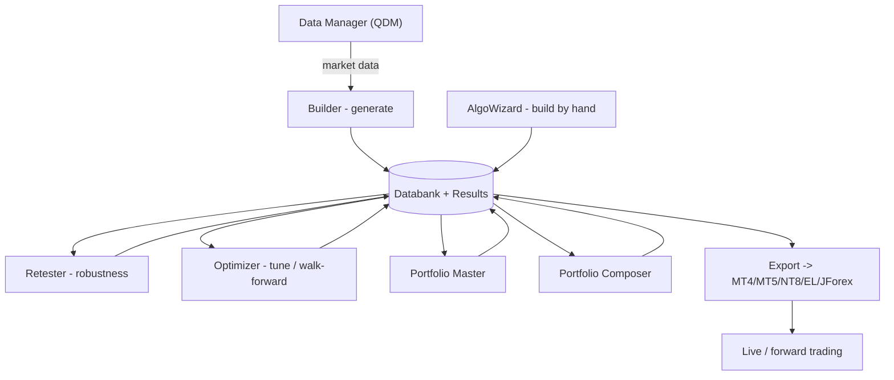

# Functional Overview

StrategyQuant X as a product: what each part does, what you can do, how parts relate.
Code/architecture: [`../onboard/`](../onboard/README.md).

## Lifecycle

1. Get data: historical market data via Data Manager / QDM.
2. Generate: the Builder creates thousands of candidate strategies (random or genetic evolution) and backtests them.
3. Store and inspect: accepted strategies land in a Databank; Results shows equity curves and metrics.
4. Validate: the Retester stress-tests them (cross-checks, robustness tests, Monte Carlo) against curve-fit / fragile ones.
5. Tune: the Optimizer searches parameter values, walk-forward against overfitting.
6. Combine: Portfolio Master / Composer assemble a diversified portfolio.
7. Deploy: [Export](export-engines/README.md) to platform code (MT4/MT5, JForex, EasyLanguage, PseudoCode) for live/forward trading.

AlgoWizard instead builds/edits a strategy visually by hand. Custom Projects chain these steps
into an automated task pipeline.

## Modules

| Module | Does | Page |
|---|---|---|
| Concepts | Vocabulary: strategy, backtest, walk-forward, Monte Carlo, cross-checks, robustness, databank | [concepts.md](concepts.md) |
| Custom Projects, tasks | Project = chain of tasks; Builder/Optimizer/Retester are single-task projects | [custom-projects.md](custom-projects.md) |
| Builder | Generates (random / genetic) and backtests strategies | [builder.md](builder.md) |
| Retester | Robustness re-tests (cross-checks, Monte Carlo, WFO) | [retester.md](retester.md) |
| Optimizer | Parameter optimization: simple / walk-forward / WF matrix | [optimizer.md](optimizer.md) |
| Results, Databank | Stores strategies, shows performance metrics | [results-databank.md](results-databank.md) |
| Portfolio Master | Finds good strategy combinations | [portfolio-master.md](portfolio-master.md) |
| Portfolio Composer | Composes and weights strategies into a portfolio | [portfolio-composer.md](portfolio-composer.md) |
| Data Manager (QDM) | Downloads, cleans, manages market data | [data-manager.md](data-manager.md) |
| AlgoWizard | Visual/manual strategy editor | [algowizard.md](algowizard.md) |

Reading order: concepts, builder, results-databank, retester + optimizer, portfolio-master /
portfolio-composer, data-manager + algowizard.

Drill-down: [Object model](object-model.md) (App -> Projects -> Tasks -> Settings),
[Tasks](tasks/README.md), [Settings tabs](settings/README.md) (shared vs task-specific),
[Results tabs](results-tabs/README.md), [Data sources](data-sources/README.md),
[Robustness tests / cross-checks](robustness-tests/README.md),
[AlgoWizard](algowizard/README.md) (engines, templates, config.xml, XML generation),
[Export engines](export-engines/README.md) (MT4/MT5/JForex/EasyLanguage/PseudoCode).

Catalogs (open only for the exact list): [Snippets hub](snippets/README.md) (building blocks,
money management, exit methods, trading options, What-If, Monte Carlo, formulas, engine charts,
...), [Stats metrics](stats-metrics.md) (every Databank column / metric),
[Trade Analysis charts](results-tabs/trade-analysis-charts.md) (every chart on that tab).

The Neural Network Trainer is in the UI navigation but not a shipped feature
(experimental/roadmap), so not documented as a module.
