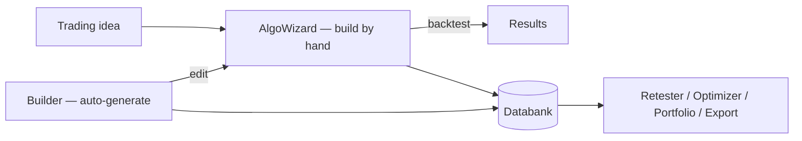

# AlgoWizard — Functional Overview
> A visual editor for building or editing a trading strategy by hand — the manual alternative to auto-generating strategies with the Builder.

## What it is

AlgoWizard is StrategyQuant X's visual strategy editor. Instead of letting the Builder
generate trading logic automatically (randomly/genetically), AlgoWizard lets a user
**assemble a strategy by hand** — laying out entry and exit rules, conditions, indicator
blocks, and money-management settings in a visual editor. It is the tool you reach for
when you already have a trading idea and want to express it directly, rather than
discovering ideas through mass generation.

Crucially, AlgoWizard and the Builder are **two paths to the same strategy** — they share
the same internal strategy model and the same building-block definitions. A strategy hand-built
in AlgoWizard is indistinguishable, once created, from one the Builder produced: it lives in
the same XML strategy format, runs through the same backtest engine, and lands in the same
Databank. This means you can freely move between the two — build by hand in AlgoWizard, or
open a Builder-generated strategy in AlgoWizard to inspect and tweak it.

## What you can do here

- **Create a strategy from scratch**, visually, by placing and connecting blocks and rules.
- **Open and edit an existing strategy** — including one generated by the Builder — to refine its logic.
- **Define entry and exit conditions** — the rules and signal logic that open and close trades.
- **Compose blocks** (indicators, price/value comparisons, logical operators) into complete conditions.
- **Set money management** — position sizing, stops/targets and related order settings.
- **Backtest the strategy on demand** directly from the editor and watch progress and results.
- **Send the strategy to the Databank** (Retester databank) or save it as a `.sqx` file for later use, retesting or optimization.

## Key concepts

- **Manual strategy building** — you define the trading logic yourself, block by block, instead of having it generated. This gives full control at the cost of doing the design work by hand.
- **Rules / conditions** — a strategy is expressed as entry and exit rules; each rule is a condition assembled from blocks (e.g. "indicator crosses value", combined with logical AND/OR).
- **Strategy blocks** — the same building blocks the Builder draws on. Both AlgoWizard and the Builder read their block definitions from the same shared configuration, so the vocabulary of available indicators, operators and parameters is identical in both tools.
- **Shared strategy model** — what you build is materialized into StrategyQuant's standard XML strategy format and executed by the same runtime strategy engine used across the app.

These terms are shared across modules — see [concepts.md](concepts.md) for the common vocabulary.

## How it relates to other modules

- **Shared model with the Builder:** AlgoWizard and the Builder produce the *same* kind of strategy from the *same* building blocks. The difference is only in how blocks are assembled — by hand (AlgoWizard) vs. automatically (Builder).
- **Feeds the Databank:** strategies created or edited in AlgoWizard can be sent into the **Databank**, exactly like Builder output — from there they behave like any other strategy.
- **Re-test and optimize downstream:** because an AlgoWizard strategy shares the standard model, it can be handed to the **Retester** for robustness tests and to the **Optimizer** for parameter tuning.
- **Results view:** a backtest launched from AlgoWizard reports into the same **Results** view used elsewhere in the app.
- **Hand-off to the Builder:** an AlgoWizard strategy can also serve as a template/starting point that the Builder then expands through generation.

## Typical workflow

1. Open AlgoWizard, starting either from an empty strategy template or by loading an existing strategy (including a Builder-generated one).
2. Choose the market/data and basic strategy settings the strategy will be tested on.
3. Build the **entry rules** — assemble the conditions (indicator/price blocks combined with operators) that open a trade.
4. Build the **exit rules** — the conditions that close a trade, plus stops and profit targets.
5. Configure **money management** — position sizing and related order settings.
6. **Backtest** the strategy from the editor and review the results in the Results view.
7. Iterate — adjust rules and re-test until the strategy behaves as intended.
8. **Save** the strategy (as a `.sqx` file) and/or **send it to the Databank**, where it can later be retested, optimized, or exported.

## Go deeper

- **AlgoWizard in detail** — engines, editor modes, template tabs, config.xml, XML generation: [algowizard/](algowizard/README.md)
- Concepts: [concepts.md](concepts.md)
- Developer/architecture: [../onboard/07-algowizard/](../onboard/07-algowizard/README.md)
