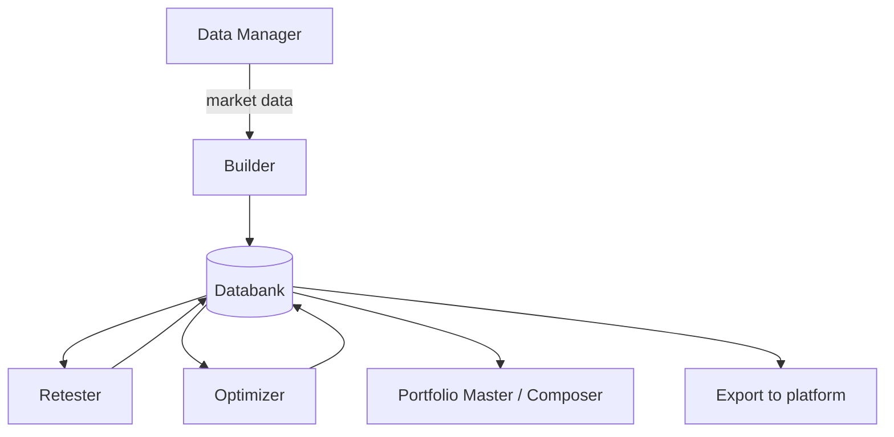

# Builder — Functional Overview
> The core of StrategyQuant X: it generates trading strategies (randomly or by genetic evolution), backtests them, and stores the best in a databank.

## What it is

Builder is the central module of StrategyQuant X — the place where new trading
strategies are created. You describe *what* you want (strategy type, allowed building
blocks, trading rules), *where* to test it (symbol, timeframe, date range), and *how* to
generate it (random generation or genetic evolution), then start the process. Builder then
constructs candidate strategies by combining building blocks — technical indicators, price
patterns, comparisons, order types and exits — into entry and exit rules, backtests each
one, and keeps the top performers.

Because the building process is automated, Builder can produce and test thousands of new
strategies per hour out of the trillions of possible combinations. The best candidates are
stored continuously in the **Databank** at the bottom of the screen, where you (and the
downstream modules) can review and reuse them. Every generated strategy can be viewed as
pseudo-code or exported to a trading platform (MetaTrader, NinjaTrader, EasyLanguage, etc.).

## What you can do here

- **Choose what to build** — a simple single-chart strategy, a multi-timeframe/multi-symbol
  strategy, a strategy from a custom template, or improve part of an existing strategy.
- **Pick the strategy style** — SQ3 (old) rules, SQ X new-style signal rules, or SQ X with
  fuzzy logic; set trading direction (long/short/both) and symmetrical vs. non-symmetrical rules.
- **Select building blocks** — check the indicators, signals, price values, operators, order
  types and exit types the generator may use, and weight them so favorites are chosen more often.
- **Configure rule complexity** — min/max number of conditions per rule, indicator period
  ranges, and shift (lookback) ranges; set mandatory Stop Loss / Profit Target and their ranges.
- **Set data and periods** — the trading engine, symbol(s), timeframe(s), and date range, plus
  splitting history into In-Sample Training / Validation / Out-of-Sample / No-Trade parts.
- **Choose the build mode** — Random generation (runs until stopped) or Genetic evolution.
- **Configure genetic options** (genetic mode only) — generations, population size, islands,
  crossover/mutation probability, initial population, fresh-blood and restart management.
- **Set trading options** — session, time-range limits, exit-at-end-of-day/Friday, max trades
  per day, SL/PT caps, realistic gaps handling, and whether to store chart data.
- **Set money management** — fixed size, fixed amount, risk % of account/balance, stocks/crypto
  size by price, or Martingale.
- **Define ranking / fitness** — the criteria used to score strategies and decide which ones
  enter and stay in the databank (and, for genetic mode, drive evolution).
- **Start / pause / stop** generation, **watch progress** (log, performance and memory charts,
  settings overview), and **view results** — top-3 result previews plus the full Databank.

## Key concepts

- **Building block** — a reusable component (indicator, signal, price value, comparison
  operator, order type, exit type) combined to form rules. SQ X ships 250+ blocks and lets you
  create your own. See also [concepts.md](concepts.md).
- **Signal rule (SQ X style)** — a rule that evaluates all trading conditions into named
  signals (LongEntrySignal, ShortExitSignal, …); separate entry/exit rules then act on those
  signals, avoiding the conflicts of the older SQ3 IF-THEN style.
- **Fuzzy logic** — a signal is valid when a chosen percentage of its sub-conditions are true,
  useful only when signals contain many (3+) conditions.
- **Strategy template / placeholder** — a strategy skeleton with `RandomCondition` /
  `NegatedCondition` placeholders that Builder fills with randomly generated blocks; custom
  templates let you generate non-standard architectures.
- **Random placeholder** — the marker in a template that the generator replaces using your
  selected building blocks and period/shift/condition ranges.
- **Shift (lookback)** — how many bars back a condition looks (0 = current bar).
- **Data parts** — In-Sample Training (IST, used for fitness), In-Sample Validation (ISV),
  Out-of-Sample (OOS), and No-Trade sections of the history. See [concepts.md](concepts.md).
- **Island / population / generation** — genetic-evolution structures; islands evolve
  independently with occasional migration of individuals between them.
- **Databank** — the store of accepted top strategies; the primary output of Builder. See
  [results-databank.md](results-databank.md) and [concepts.md](concepts.md).
- **Fitness / ranking** — the performance criteria that score strategies and select the fittest.

## Settings panels

Full settings are shown as tabs across the top; a project configuration can be saved to and
loaded from a file. The main tabs are:

- **What to build** — strategy type (simple / multi-TF / multi-symbol / from template /
  improve existing), trading direction and symmetry, strategy style pop-up, build mode
  (random/genetic), number of conditions, period and shift ranges, and Stop Loss / Profit
  Target options. For multi-chart strategies these ranges can be set per chart.
- **Building blocks** — four panels: Signals / Indicators / Stop-Limit entry blocks (left),
  Order types, Exit types, and Custom data indicators. Each block can be checked, weighted, or
  have its parameters (ranges, fixed values, parameter sets, indicator value ranges) edited;
  advanced indicator calibration is available.
- **Data** — trading (backtesting) engine, symbol/timeframe/date range (per chart for
  multi-chart), test precision (Selected TF / 1-minute / real-tick), spread, slippage, min
  distance, commissions, and the data-range parts (IST / ISV / OOS / No-Trade).
- **Genetic options** — visible only in genetic mode: max generations, population size,
  crossover/mutation probability, island count and migration, initial-population source and
  decimation, initial-population filter, evolution restart management, and "fresh blood"
  (replace duplicate/weakest strategies).
- **Trading options** — exit at end of day/Friday, limited time range, max trades per day,
  min/max SL & PT caps, session, reserved bars, realistic gaps handling (MT4), and store chart data.
- **Money management** — position-sizing method: fixed size, fixed amount, risk % of account
  or balance, stocks/crypto size by price, or simple Martingale.
- **Ranking** — the fitness/ranking criteria used to score generated strategies and decide
  which ones are kept in the databank (and drive genetic selection).

## How it relates to other modules

Builder consumes historical **market data** managed by the **Data Manager (QDM)** and
produces **strategies** into the project **Databank**. Downstream modules — **Retester**
(robustness), **Optimizer** (parameter tuning / walk-forward), and **Portfolio Master /
Composer** (combining strategies) — read strategies from that databank, and can write
improved variants back. Strategies can also be exported to trading platforms for live use.
**Custom Projects** chain Builder with these steps into an automated pipeline (e.g. random
generation feeding a genetic-evolution stage).

## Typical workflow

1. In **What to build**, choose the strategy type and style, set trading direction, and pick
   the build mode (random or genetic).
2. In **Building blocks**, select and weight the indicators, signals, operators, order types
   and exit types the generator may use; adjust block parameters if needed.
3. In **Data**, choose the trading engine, symbol(s), timeframe(s), date range and test
   precision, and split the history into IST / ISV / OOS parts.
4. Set **Trading options** and **Money management** to match how the strategy should trade.
5. If using genetic evolution, tune the **Genetic options** (generations, population, islands).
6. Set the **Ranking / fitness** criteria that define a "good" strategy.
7. Optionally save the project configuration to a file.
8. **Start** the build on the Progress tab and watch the log, performance/memory charts, and
   the top-3 result previews.
9. Review accepted strategies in the **Databank**; open one for full **Results** (metrics,
   equity chart, trades on chart if chart data was stored).
10. **Stop** the build (or let genetic evolution finish), then pass promising strategies to the
    Retester, Optimizer, or Portfolio modules, or export them.

## Go deeper

- Settings panels in detail: [settings/](settings/README.md) — one page per panel
- Concepts: [concepts.md](concepts.md)
- Developer/architecture: [../onboard/04-builder/](../onboard/04-builder/README.md)
