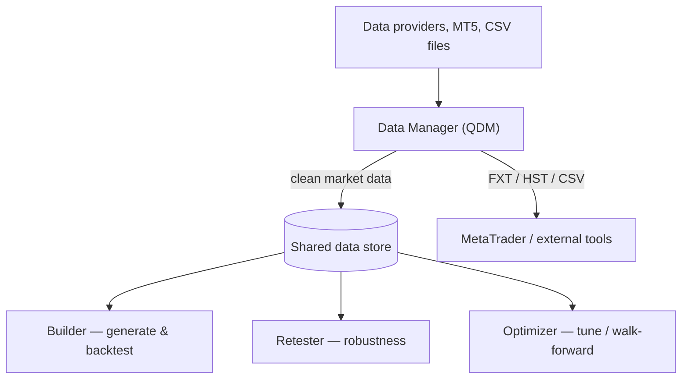

# Data Manager (QDM) — Functional Overview

> The data foundation of StrategyQuant X: download, import, clean and manage the historical market data that every strategy is built and tested on.

## What it is

**QuantDataManager (QDM)** — also called the **Data Manager** — is the tool that acquires
and maintains the historical market data StrategyQuant X uses. Strategies are only as good
as the data they are backtested on, so QDM's job is to get that data (from data providers, a
broker's MetaTrader terminal, or plain CSV files), store it in a consistent internal format,
and keep it clean and up to date.

QDM has a dual nature. It is a **standalone application** (its own program, its own window)
dedicated to data work, and it is also **integrated into StrategyQuant X**. Both share the
same working directory and the same on-disk data files, so anything you download or import in
QDM is immediately available to the Builder, Retester, and Optimizer for backtesting — there
is no separate export/import step between them.

## What you can do here

- **Download data from providers** — pull historical bars/ticks from built-in sources such
  as Dukascopy, Yahoo, Darwinex, SQ's own equity/futures data feeds, and cryptocurrency
  exchanges (Binance, Bitfinex, Coinbase Pro, Poloniex, etc.).
- **Import data** — bring in history from a local **MetaTrader 5** installation (the fastest
  way to get broker-accurate forex/CFD/index/stock/futures data), or import from **CSV/text
  files** with a flexible column-mapping importer that auto-detects the timeframe.
- **Clean & adjust data** — merge newly downloaded data with what you already have, shift
  data into a different timezone (handling DST), and keep symbols current with incremental
  updates.
- **Manage symbols & timeframes** — organize instruments and their specifications (tick
  size/value, commissions, exchange/sector), trading sessions (market hours), and brokers.
- **Export data** — write data back out to MetaTrader formats (**FXT/HST** for MT4, plus MT5
  export) and to configurable **CSV** files for use elsewhere.

## Key concepts

- **Instrument / symbol** — the tradable market (e.g. `EURUSD`, `AAPL`), together with its
  specification: tick size, tick value, commissions, and the exchange/session it belongs to.
- **Timeframe** — the bar interval the data is stored/tested at (M1, M5, H1, D1, …). A single
  symbol can hold data at several timeframes.
- **Tick data vs. bar data** — *tick* data records individual bid/ask price changes and gives
  the most precise backtests; *bar* (OHLC) data aggregates ticks into fixed intervals and is
  faster but less granular. The testing-precision setting in SQX chooses how finely this data
  is replayed during a backtest.
- **Data quality** — how complete, gap-free, and broker-accurate the history is; it directly
  determines how trustworthy a backtest result is.

See the cross-cutting vocabulary in [concepts.md](concepts.md) (strategy, backtest,
walk-forward, robustness, databank).

## How it relates to other modules

QDM sits at the **start** of the StrategyQuant X lifecycle. Its output — clean, consistent
market data stored in the shared working directory — is the **input** consumed by every
module that runs a backtest. The Builder replays this data to generate and evaluate
strategies; the Retester and Optimizer replay the same data to validate and tune them.
Because the data files are shared on disk, there is no explicit hand-off: QDM produces and
manages the data, and SQX simply reads it when a backtest asks for a given symbol/timeframe.

The SQX **Settings → Data** screen is where a strategy chooses *which* of these symbols,
timeframes, and date ranges to test on, and at what testing precision (see the
[Data settings panel](settings/data.md)).

## Typical workflow

1. **Add a data source / connection** — pick a provider (Dukascopy, Yahoo, a crypto exchange,
   an MT5 terminal, etc.) or choose CSV/file import.
2. **Select symbols and timeframes** — choose the instrument(s) and interval(s) you want.
3. **Download or import** — fetch the history from the provider, or import from MT5/CSV; QDM
   merges it with any existing data and writes it to the internal store.
4. **Verify and clean** — check date ranges and row counts, adjust the timezone if needed, and
   keep the symbol updated with incremental downloads over time.
5. **Use it in SQX** — switch to StrategyQuant X and, in Settings → Data, select the symbol,
   timeframe, date range, and testing precision for your strategy build or test.
6. *(Optional)* **Export** — write the data out to MT4/MT5 (FXT/HST) or CSV for other tools.

## Go deeper

- **Available data sources in detail:** [data-sources/](data-sources/README.md) — one page per source (Dukascopy, Yahoo, Darwinex, crypto, MT5 import, CSV, …).
- **Concepts:** [concepts.md](concepts.md).
- **Developer / architecture:** [../onboard/02-qdm/](../onboard/02-qdm/README.md).
