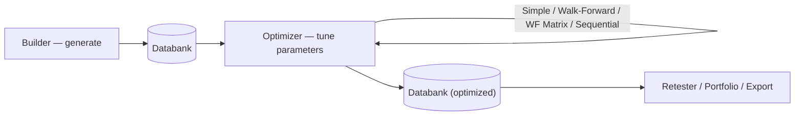

# Optimizer — Functional Overview
> Searches a strategy's parameter values for the best-performing settings, using walk-forward analysis to guard against overfitting.

## What it is

The Optimizer takes an existing strategy — typically one produced by the Builder and stored
in a **Databank** — and searches for better values of its parameters. Almost every strategy
has tunable parameters (indicator periods, comparison constants, stops, and even strategy
options such as trades-per-day or trading time ranges). Optimization means testing the
strategy with many different combinations of these values to find the ones that give the
best result (highest profit, best Return/Drawdown ratio, or another chosen criterion).

Optimizing only tells you what worked best *in the past*, so the central danger is **curve
fitting** — parameters that fit the history perfectly but fail on future data. To manage
this, the Optimizer offers **Walk-Forward** analysis, which repeatedly re-optimizes on one
segment of data and then trades forward on the next unseen segment, simulating how you would
periodically re-tune a strategy in real trading. This shows whether a strategy is genuinely
robust and whether it actually benefits from re-optimization.

## What you can do here

- Load a strategy from a **Databank** (or a single `.sqx`/`.str` file); it is added as the
  *Original* strategy so you can compare optimized results against it.
- Choose an **optimization type** — Simple, Walk-Forward, Walk-Forward Matrix, or Sequential.
- Set **parameter ranges** — pick which parameters to optimize and give each a Start, Stop,
  and Step (automatically generated around the original value, or set manually).
- Optionally optimize **strategy options** (trades per day, trading time range, indicator
  shifts), not just indicator parameters.
- Pick the **optimization criterion / fitness** used to rank results, and configure a
  customizable **Robustness score** for walk-forward passes/fails.
- **Run** the optimization and watch progress; choose to store all results or keep only the
  best in the databank.
- **View results** — sort the databank by any metric, inspect equity charts, and read the
  **robustness of parameters** across periods and reoptimization settings.

## Key concepts

- **Optimization** — trying different values of a strategy's input parameters to find the
  best-performing combination on historical data.
- **Walk-Forward** — repeatedly optimize on an in-sample segment, then test forward on the
  following out-of-sample segment, to check robustness and the value of re-optimization.
- **Walk-Forward Matrix** — a grid of walk-forward runs across different reoptimization
  frequencies and out-of-sample sizes, used to prove robustness and find the ideal
  reoptimization period.
- **Overfitting / curve fitting** — parameters tuned so tightly to past data that they fail
  on future data; the main risk optimization must guard against.

These terms are shared across modules — see [concepts.md](concepts.md) for the common
vocabulary.

## Optimization types

**Simple optimization** — Iterates the selected parameters over their Start/Stop/Step ranges
and backtests each combination on the chosen data, storing the results in the databank. When
the number of combinations is large, the engine can search **genetically** instead of testing
every combination by brute force. The result is a set of parameter values that performed best
on the historical data — useful, but exposed to curve fitting.

**Walk-Forward optimization** — A special backtest composed of many smaller optimizations.
The data is split into a configurable number of periods; each period has an optimization (in
sample) part and a run (out of sample) part. The engine optimizes on the in-sample part, then
trades the run part with those values, then slides forward and re-optimizes for the next
period. It is configured with an **Out-of-Sample %** and a number of **Walk-Forward runs**,
and tells you whether the strategy is robust and whether periodic re-optimization improves it.

**Walk-Forward Matrix** — A set of walk-forward optimizations run across a grid of different
run counts and Out-of-Sample percentages (using Start/Stop/Increment). It serves two goals:
verify robustness (a strategy that survives many combinations adapts to a wide range of
market conditions) and find the **optimal reoptimization period**. Results are shown as a
table plus a 3D chart (surface / bar / heatmap) of scores; robust strategies show gradual
rather than abrupt changes. It is very time-consuming, so a faster **Simulation** mode is
available. A configurable cluster rule (e.g. a 3×3 group where at least 7 of 9 runs pass)
detects robustness automatically.

**Sequential optimization** — Optimizes one parameter at a time, searching for a **stable
region** of values rather than a single peak, which favors robustness over a fragile
best-single-point result.

## How it relates to other modules

- **Input:** a strategy from the **Databank** (produced by the Builder, AlgoWizard, or an
  import), or a single strategy file.
- **Output:** optimized strategy variants and parameter values written back to a Databank —
  ready for the Retester, Portfolio, or Export. Walk-Forward runs produce a single
  Walk-Forward (or WF Matrix) result alongside the Original.
- **Shared UI:** the Optimizer uses the same **Progress / Settings / Results** interface as
  the Builder and Retester, so configuring runs and viewing results feels identical.
- **Custom Project task:** the Optimizer can run as an automated *Optimize strategies* step
  inside a pipeline, doing simple or walk-forward optimization.

## Typical workflow

1. Switch to the Optimizer and load the strategy to optimize; it appears as the *Original*
   in the results databank.
2. Choose the **optimization type** (Simple, Walk-Forward, WF Matrix, or Sequential).
3. In **Settings → Parameters**, select which parameters to optimize and set each Start,
   Stop, and Step (auto or manual); check the *Total Combinations / Number of tests*.
4. Choose the **data** (symbol and timeframe) and the optimization criterion / fitness.
5. For walk-forward: set the **Out-of-Sample %** and number of **Walk-Forward runs** (for a
   Matrix, the Start/Stop/Increment grid of runs and OOS %); tune the **Robustness score**.
6. Decide how results are stored (all optimizations vs. only the best) and click **Start**.
7. Watch the shared **Progress** view; walk-forward and especially Matrix runs take much
   longer than a simple optimization.
8. Review **Results** — sort the databank by a metric, inspect equity charts (reoptimized
   vs. original), read per-period pass/fail and, for a Matrix, the 3D score chart and the
   suggested optimal reoptimization period.
9. Keep the robust, best-performing variant; hand it on to the Retester, Portfolio, or Export.

## Go deeper

- Concepts: [concepts.md](concepts.md)
- Developer/architecture: [../onboard/06-optimizer/](../onboard/06-optimizer/README.md)
