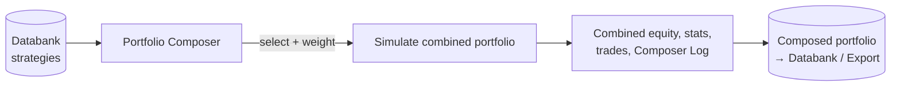

# Portfolio Composer — Functional Overview

> Manually assemble strategies into a portfolio, tune how much money each one trades, and simulate the combined result.

## What it is

Portfolio Composer is a StrategyQuant X module (introduced in Build 141) for building a
portfolio out of strategies you already have and finding the best way to combine them. It
answers a very practical trader question: *"Given a broker account of a certain size and a
set of strategies, which strategies should I trade — and with how much weight — to get the
best combined result?"*

Unlike a simple merge, the Composer does not just decide *which* strategies belong in the
portfolio. It also lets you set a **weight** per strategy — how much money (position size /
risk) to assign to each — and then re-simulates the portfolio with those weights applied. It
recomputes each strategy's position sizing according to its weight, taking your configured
account balance, leverage, and available free margin into account. The result is a single
combined portfolio whose equity, statistics, and trade list you can inspect.

## What you can do here

- **Load candidate strategies** — bring the strategies you are considering into the grid on
  the left panel (from a databank / source strategies).
- **Select which strategies to include** in the portfolio.
- **Set a weight per strategy** — e.g. `100%` = original money management, `200%` = double
  the position size / risk, `50%` = half. Weights scale each strategy's money management.
- **Configure account settings** — portfolio account balance and leverage (e.g. `$10,000`
  with leverage `2` gives effective buying power of `$20,000`).
- **Recompute the portfolio** — run the simulation with your chosen strategies and weights.
- **View the combined result** — Overview statistics, list of trades, and the combined
  equity chart on the right panel.
- **Inspect the Composer Log** — a special log showing exactly what the Composer did each
  day: which orders it took, how it adjusted trade sizes, and which orders it skipped because
  free margin was insufficient.
- **Iterate** — adjust weights/selection and recompute to compare compositions.

## Key concepts

- **Portfolio** — a combined result assembled from several source strategies, with its own
  equity curve and performance statistics. The input strategies remain visible as
  sub-results within the combined portfolio.
- **Weight** — a per-strategy multiplier on money management. It rescales that strategy's
  position size / risk (e.g. weight `250%` risks 2.5× the original per trade). Weighting is
  what distinguishes the Composer from a plain merge.
- **Account balance, leverage & free margin** — the simulation respects your account size and
  leverage, and, most importantly, only opens as many trades on a given day as free margin
  allows. If higher weights mean bigger orders, some days a strategy may be unable to open
  new orders (not enough free margin), and the next strategy in the portfolio is considered
  instead.
- **Combined equity** — the equity curve produced by merging all included strategies at their
  chosen weights; this is the primary output you evaluate.

See shared vocabulary (strategy, backtest, databank, equity) in [concepts.md](concepts.md).

## Portfolio Composer vs Portfolio Master

Both modules simulate portfolios of strategies, but they answer different questions.
**Portfolio Master** searches for the optimal *composition* — *which* strategies to combine —
using a brute-force or genetic approach that ranks many candidate combinations. **Portfolio
Composer** goes a step further on a set you choose yourself: it optimizes not only which
strategies are included but also their **weight** — how much money to assign to each — and
re-simulates position sizing, account balance, leverage, and free margin accordingly. In
short: Portfolio Master finds good combinations automatically; Portfolio Composer lets you
compose and fine-tune weights interactively. See [portfolio-master.md](portfolio-master.md).

## How it relates to other modules

- **Input** — strategies come from a **Databank** (typically Builder / Retester / Optimizer
  output). You load candidate strategies into the Composer grid.
- **Output** — a composed, weighted portfolio whose result (equity, stats, trades) you can
  review, save back to a databank, and export.

## Typical workflow

1. Open the Portfolio Composer module in StrategyQuant X.
2. Load the strategies you are considering into the grid on the left panel.
3. Configure the portfolio account settings — balance and leverage.
4. Select which strategies to include in the portfolio.
5. Set a weight for each selected strategy (100% = original money management).
6. Click **Recompute portfolio** to run the simulation.
7. Review the results on the right panel — Overview, List of trades, and Equity chart.
8. Open the Portfolio Composer Log to see the day-by-day actions (orders taken, size
   adjustments, orders skipped for low free margin).
9. Adjust the selection and weights and recompute to compare, then save/export the portfolio
   you are happy with.

## Go deeper

- Concepts: [concepts.md](concepts.md)
- Developer/architecture: [../onboard/09-portfolio/](../onboard/09-portfolio/README.md)
