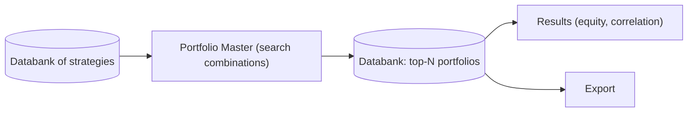

# Portfolio Master — Functional Overview
> Automatically searches for good combinations of your existing strategies and assembles them into a diversified portfolio.

## What it is

Portfolio Master is StrategyQuant X's **automatic portfolio builder**. Instead of
generating new strategies, it takes a pool of strategies you have already produced
(from the Builder, Retester, or Optimizer) and searches for the best *combinations*
of them — the subset of strategies that, traded together, form the strongest,
most diversified portfolio. It was ported into SQX (from version 138) from the
QuantAnalyzer "Portfolio Master — Automatic Portfolio Builder" feature.

The core idea is that a portfolio is more than the sum of its parts: two individually
good strategies that lose money at the same time add little diversification, while
strategies whose drawdowns are uncorrelated smooth the combined equity curve. Portfolio
Master evaluates many candidate combinations, filters out those that are too correlated
or violate your constraints, scores the rest with portfolio-level fitness, and returns
the best portfolios as results you can save and export.

## What you can do here

- **Load a set of strategies** — feed a source Databank of candidate strategies into
  the search (at least two strategies are required).
- **Search for combinations** — choose the search algorithm:
  - **Brute-force** — evaluates every K-strategy combination (used automatically when
    the number of possible combinations is small, e.g. under ~500).
  - **Genetic** — a genetic algorithm evolves promising combinations when the search
    space is too large to enumerate exhaustively.
- **Set correlation and portfolio constraints** — cap the maximum pairwise correlation
  allowed between strategies in a portfolio, limit how many strategies may come from the
  same market/sector, and set the number of strategies per portfolio.
- **Evaluate portfolio metrics** — score each candidate with portfolio-level fitness
  (e.g. Net Profit, Return/Drawdown, % time in stagnation) computed on the merged equity.
- **Create / save a portfolio** — the best (top-N) portfolios are written back to an
  output Databank as portfolio results, ready to inspect, correlate, and export.

The simpler **Create Portfolio** task is also available: it just merges the last N
strategies from a source databank into a single simulated portfolio without searching.

## Key concepts

- **Portfolio** — a merged result combining the trades of several strategies into one
  shared equity curve and one set of statistics; the source strategies remain visible
  as sub-results inside it.
- **Correlation** — a measure of how similarly two strategies' profits/losses move over
  time; low correlation is what makes a combination diversifying.
- **Diversification** — spreading risk across strategies whose gains and losses are not
  synchronized, so the portfolio is steadier than any single strategy.

These are shared across modules — see [concepts.md](concepts.md) for the full vocabulary.

## Portfolio Master vs Portfolio Composer

The two modules answer different questions. **Portfolio Master** answers *which*
strategies to combine — it searches (brute-force or genetically) over combinations of
strategies, filters by correlation and sector limits, and returns top-N portfolios.
**Portfolio Composer** answers *with what weights* to mix a set of strategies you have
already chosen — you pick the strategies and it tunes their allocation (via Monte Carlo
weight simulation and an efficient-frontier view). Use Portfolio Master to discover a
good subset, then optionally use Composer to fine-tune the weights. See
[portfolio-composer.md](portfolio-composer.md).

## How it relates to other modules

- **Input** — a Databank of candidate strategies (outputs of the Builder / Retester /
  Optimizer).
- **Output** — the best portfolios, each itself a strategy-like result, written back to
  a Databank where they can be inspected in Results and sent to Export.

## Typical workflow

1. Build or collect a pool of candidate strategies into a source Databank.
2. Open Portfolio Master and select that source Databank as input.
3. Choose the portfolio size (number of strategies per portfolio) and the search
   algorithm (brute-force or genetic — the app picks brute-force automatically for small
   search spaces).
4. Set constraints: maximum pairwise correlation, maximum strategies per sector/market,
   and the fitness/ranking metric to optimize.
5. Run the search — Portfolio Master evaluates combinations, filters those that breach
   constraints, and ranks the survivors by portfolio fitness.
6. Review the resulting top-N portfolios (equity curve, statistics, correlation matrix).
7. Save the chosen portfolio(s) to the output Databank; from there, export or optionally
   refine weights in Portfolio Composer.

## Go deeper

- Concepts: [concepts.md](concepts.md)
- Developer / architecture: [../onboard/09-portfolio/](../onboard/09-portfolio/README.md)
