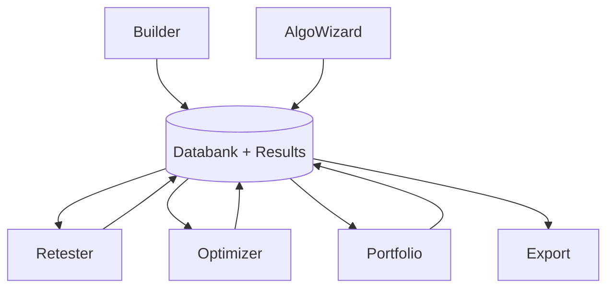

# Results & Databank — Functional Overview

> The shared storage and inspection hub: every strategy the app produces lands in a Databank, and the Results view shows one strategy's equity curve, trades, and performance metrics.

## What it is

The **Databank** is a storage place where generated and tested strategies are kept together with their backtest results. Every row in a databank is one strategy, and its key results — number of trades, total profit/loss, fitness score, drawdown, and so on — are shown in the table columns. You can have more than one databank in a project, and each module (Builder, Retester, Optimizer) keeps its own independent databanks. To conserve memory a databank does not store an unlimited number of strategies; it keeps only the top N (e.g. top 100 or top 1000), ranked and sorted according to the project's **Ranking options** settings.

The **Results** view is the detailed report for a single strategy — the one currently selected (double-clicked) in the databank. It computes and displays statistics from the backtest data: an **Overview** of headline metrics, the equity chart, the list of trades, and various analysis tabs. The databank sits at the bottom of the screen and can be minimized or opened; double-clicking a row opens that strategy's full Results window.

## What you can do here

- **Browse, sort, and filter** the databank table — sort by any column (profit, drawdown, fitness, etc.) to find the best candidates.
- **Open a strategy's results** — double-click a row to see its Overview, equity chart, trade list, and analysis tabs.
- **Read performance metrics and charts** — inspect the full set of computed statistics for the selected strategy.
- **Load and save strategies** — load `.sqx` files into the databank; save good strategies to StrategyQuant's `.sqx` format (or other supported formats) so you can work with them later.
- **Delete / clear** selected or all strategies from a databank.
- **Retest** (Builder only) — copy selected strategies to the Retester together with their exact backtest configuration.
- **Edit** a strategy's parameters or trading rules in the built-in AlgoWizard editor.
- **Portfolio** — combine selected strategies into a portfolio report for combined analysis.
- **Run the Filter strategies task** — a Custom Project task that deletes, copies, or moves strategies from one databank to another, optionally applying a filter so the operation only affects strategies meeting specific conditions.
- **Manage multiple databanks / files** and **configure views** — switch between column views or create your own with the columns that matter to you.
- **Export** — export the whole databank table to CSV or XLS, or export a strategy to platform source code (e.g. MQL) for MetaTrader.

## Key concepts

- **Databank** — the container that holds strategies plus their results; the shared hub through which all modes exchange strategies. See [concepts.md](concepts.md).
- **Results** — the detailed per-strategy report (metrics, equity curve, trades) for the selected strategy.
- **Performance metrics** — the statistics computed from a backtest and used to rank, filter, and judge strategies.
- **Ranking options** — project settings that decide how many strategies a databank keeps and how they are sorted.
- **Views** — configurable column layouts for the databank table.

For cross-cutting vocabulary (strategy, backtest, walk-forward, robustness, Monte Carlo), see [concepts.md](concepts.md).

## Key performance metrics

Selected metrics shown in the Results Overview (full list in the manual):

- **Total Profit** — net profit of the strategy over the backtest.
- **Profit In Pips** — profit expressed in pips.
- **Yearly AVG Profit / Yearly AVG % Return** — average profit and percentage return per year.
- **CAGR** — compound annual growth rate (appreciation % per annum).
- **Sharpe Ratio** — return earned in excess of the risk-free rate per unit of volatility (return vs. risk).
- **Profit Factor** — gross profit divided by gross loss; typically require 1.3 or higher.
- **Return/DD ratio** — return relative to drawdown (a common risk-adjusted measure).
- **Draw Down / % Draw Down** — the biggest downswing of equity, absolute and as a percentage.
- **Annual% / Max DD%** — annual return relative to maximum drawdown.
- **Winning Percentage** — share of winning trades (often 40–60%).
- **Average Trade** — average profit per trade.
- **R Expectancy / R Expectancy Score** — average trade adjusted for risk (max potential loss), the score also weighting trades per year.
- **STR Quality Number (SQN) / SQN Score** — Van Tharp's system-quality measure; the score variant also accounts for period length and trade count.
- **Stability** — proprietary linear-regression measure of how straight the equity curve is (1 = a straight rising line).
- **# Trades / Max Consec Wins / Max Consec Losses** — trade counts and streaks.
- **Payout ratio / Wins-Losses ratio** — how many times the average win exceeds the average loss.
- **Exposure** — percentage of time in the market.
- **Stagnation (Days / %)** — longest period without making a new equity high.
- **Z-Score / Z-Probability, Expectancy, Deviation, AHPR** — additional statistical measures.
- **Symmetry / Trades Symmetry / NSymmetry** — long-vs-short balance of profit and trade counts.

> All metrics are derived from a backtest and do not guarantee live results — proper robustness testing is still required.

## How it relates to other modules

The Databank is the shared hub of the whole application. **Builder** and **AlgoWizard** write strategies into it; the **Retester**, **Optimizer**, and **Portfolio** tools both read strategies from it and write their processed results back; and **Export** reads from it to produce platform code. Because every mode exchanges strategies through databanks, the Results & Databank subsystem is what ties the strategy lifecycle together.

## Typical workflow

1. A module (Builder, Retester, or Optimizer) generates or processes strategies; accepted ones are stored in that module's databank, ranked per the Ranking options.
2. Sort and filter the databank table to surface the most promising strategies.
3. Double-click a strategy to open its Results view; inspect the Overview metrics, equity chart, and trade list.
4. Save good strategies to `.sqx` so you can reload and work with them later.
5. Act on selected strategies — Retest them, Edit their rules/parameters, or combine them into a Portfolio.
6. Use the Filter strategies task to move, copy, or prune strategies between databanks based on conditions.
7. Export the databank table (CSV/XLS) for reporting, or export a strategy to platform source code for live/forward trading.

## Go deeper

- Results tabs in detail: [results-tabs/](results-tabs/README.md) — one page per tab
- Concepts: [concepts.md](concepts.md)
- Developer/architecture: [../onboard/08-results/](../onboard/08-results/README.md)
