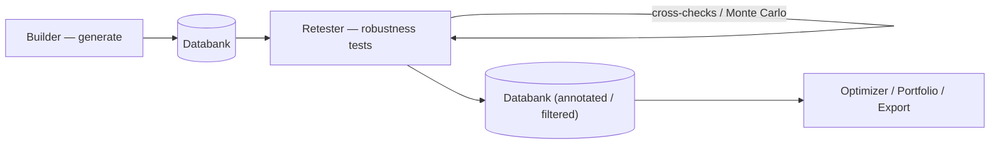

# Retester — Functional Overview
> Re-runs already-generated strategies through robustness and cross-check tests to prove they are resilient, not curve-fit.

## What it is

The Retester takes strategies that already exist — typically produced by the Builder and
stored in a **Databank** — and re-tests them to verify how robust they are. It does not
create new trading logic; it subjects existing strategies to additional, more demanding
scrutiny so you can tell a genuinely resilient strategy from one that only looks good
because it was over-optimized (curve-fit) to the historical data it was built on.

The core idea is the same set of **cross-checks / robustness tests** that the Builder can
apply during generation, but run separately and on demand. In the Builder these tests act
as *filters* that drop weak strategies immediately; in the Retester they can be run purely
to *annotate* strategies with additional results (or still filter, if you choose). This
lets you build strategies quickly with few or no cross-checks, then apply the slower,
heavier robustness tests afterwards on a smaller, pre-filtered set.

## What you can do here

- Load strategies from a **Databank** (the output of the Builder) to re-test.
- Run **cross-checks / robustness tests** on them (the same test types available in the Builder).
- Apply **Monte Carlo** methods — both fast trade-manipulation and full retest-based simulations.
- **Retest on different data, period, or settings** — additional markets/timeframes, higher backtest precision, different date ranges.
- Run an **Automatic Retest** that first updates historical data to the latest days, then re-tests using each strategy's most recent build/retest settings.
- Store the re-tested strategies (with their new results) into another Databank.
- Review **pass/fail** outcomes and the added robustness metrics for each strategy.

## Key concepts

- **Cross-check** — an optional, additional robustness test applied to a strategy after it exists. In build mode it can filter strategies out; in the Retester it can simply add results.
- **Robustness test** — any method that checks whether a strategy copes with changing conditions (unknown data, missed trades, slightly changed parameters or data, different markets).
- **Monte Carlo** — statistical method that runs many randomized simulations to estimate the range of possible outcomes and expose luck-based results.

These terms are shared across modules — see [concepts.md](concepts.md) for the common vocabulary.

## Robustness / cross-check test types

- **In-Sample / Out-of-Sample (IS/OOS)** — compares performance on the data used to build the strategy against unseen data; the most basic robustness check against overfitting.
- **OOS/IS Ratios** — expresses how much the strategy deteriorates in the out-of-sample period relative to in-sample; a measure of overfitting.
- **Retest with higher precision** — re-runs the backtest at finer precision (minute or real-tick) to confirm the original, faster backtest was reliable.
- **Multi-Market test (additional markets)** — re-tests the strategy on other instruments/timeframes; a strategy that survives many markets is less likely to be curve-fit.
- **Monte Carlo — trade manipulation** — fast; reuses the existing trades without new backtests. Includes:
  - *Randomize trades order* — shuffles trade order (net profit unchanged) to study drawdown variation.
  - *Skip trades randomly* — omits trades with some probability to model missed executions.
- **Monte Carlo — retest methods** — slow; each simulation is a full backtest with randomized inputs. Includes:
  - *Randomize strategy parameters* — varies indicator periods/constants within a max % change to test parameter sensitivity.
  - *Randomize history data* — perturbs OHLC prices (relative to ATR) to test dependence on exact historical data.
  - *Randomize starting bar* — starts the test on a different bar; a good strategy should not depend on the start point.
- **Walk-Forward Optimization / Matrix** — can also be used as cross-checks to verify robustness under periodic re-optimization.

> Note: Monte Carlo retest methods only produce results at these confidence levels: 50, 60, 70, 80, 90, 92, 95, 97, 98, 99, 100.

## How it relates to other modules

- **Input:** strategies come from the **Databank**, which is populated by the **Builder** (or by AlgoWizard / imports).
- **Output:** re-tested strategies — now annotated with extra robustness results and optionally filtered — are written back to a Databank.
- **Shared UI:** the Retester uses the same **Progress / Settings / Results** interface as the Builder and Optimizer, so its configuration and result-viewing flows feel identical.
- **Custom Project tasks:** *Retest strategies* and *Automatic retest* let the Retester run as an automated step inside a pipeline.

## Typical workflow

1. Open the Retester and select the source **Databank** containing the strategies to re-test.
2. Choose the **cross-checks / robustness tests** to apply (e.g. higher precision, additional markets, Monte Carlo methods).
3. Configure each test — parameters, data range, confidence level, number of simulations, and whether it filters or only annotates.
4. Set the destination Databank for the results.
5. Run the retest and watch the shared **Progress** view; heavier tests (full-backtest Monte Carlo) can be much slower than the original generation.
6. Review each strategy's **pass/fail** outcome and added robustness metrics in the **Results** view.
7. Keep the strategies that survive; optionally schedule an **Automatic Retest** to periodically update data and re-verify them.

## Go deeper

- Robustness tests / cross-checks in detail: [robustness-tests/](robustness-tests/README.md) — one page per test
- Cross-check settings tab: [settings/cross-checks.md](settings/cross-checks.md)
- Concepts: [concepts.md](concepts.md)
- Developer/architecture: [../onboard/05-retester/](../onboard/05-retester/README.md)
