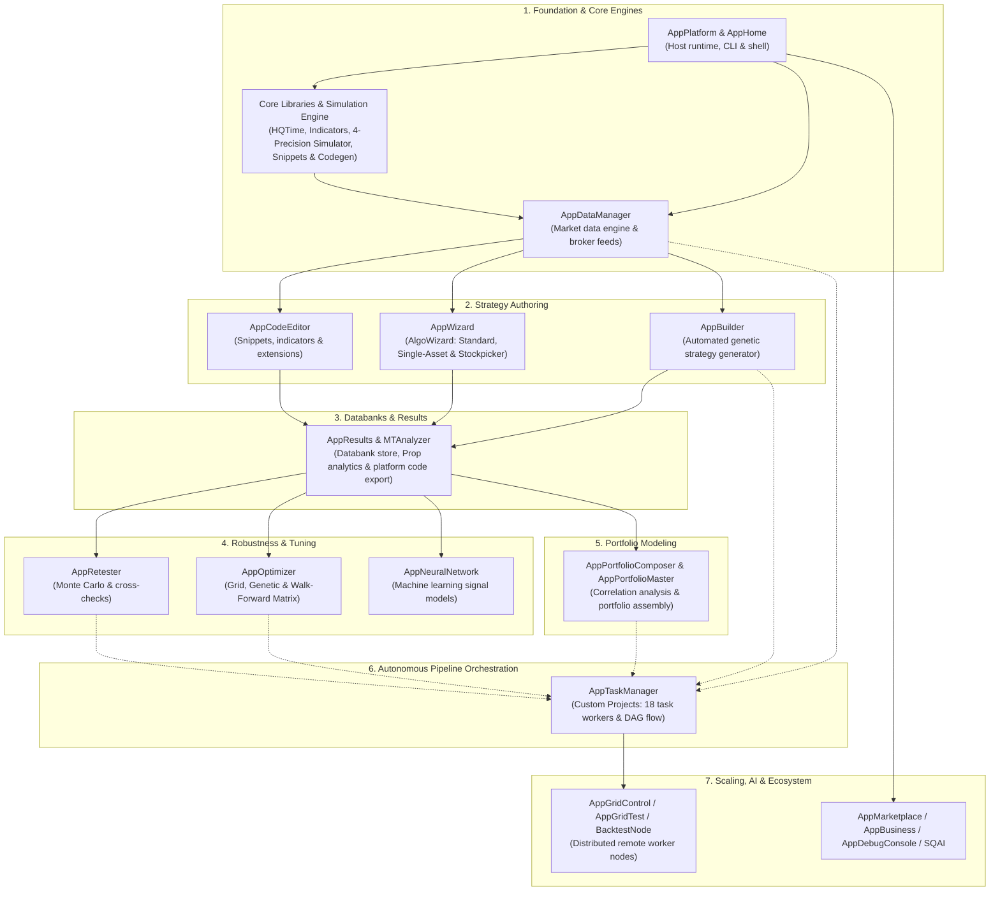

# Quantitative Workstation — Greenfield Clean-Room Architecture & Reimplementation Blueprint

This document is the **authoritative greenfield clean-room master blueprint** for reimplementing the quantitative trading workstation from scratch. It unites:

1. **Section 0 — Greenfield Engineering Guardrails, Line-Count Budgets & DRY Rules** (`<= 100` line docstrings, `1,000` line hard file cutoff, zero backward-compatibility aliases, AI-tool-ready methods, and repository-wide DRY deduplication).
2. **Complete 3-Tier Spatial Project & File Structure** (`app/host/`, `app/services/`, `app/workspace/`, `app/plugins/`, `ui/app/`).
3. **Donor / Backend / Frontend Alignment Tables** mapping every component to its **Donor Path** (`docs/SQX/...`), **Backend Target File**, **Frontend Target File**, and **DRY Shared Dependencies**.
4. **Upfront `FR-*` & Exact Method Signatures Per File** (`ClassName.method_name(args: Type) -> ReturnType`) so agents never invent unapproved functions, aliases, or spaghetti logic.

---

## TARGET STACK (the reimplementation must use this)

- **Frontend:** React + TypeScript + Vite + Tailwind CSS
- **Workspace:** Dockview (dockable panels, tabs, resizable layouts)
- **Tables/Charts:** TanStack Table + TanStack Virtual + Lightweight Charts
- **Desktop (optional):** Tauri with packaged Python sidecar
- **Backend API:** Python + FastAPI + Pydantic + Uvicorn
- **Domain layer:** Framework-independent Python feature modules
- **Numerics:** NumPy + Numba
- **Background work:** Python worker processes + SQLite-backed job ledger and scheduler
- **Realtime:** FastAPI WebSocket (optional SSE for one-way streams)
- **Messaging/cache:** In-memory maps, bounded queues, local IPC (no Redis)
- **Persistence:** SQLite (WAL, coordinated writes, centralized in `app/host/persistence.py`)
- **Bulk data:** Parquet + PyArrow (Zstandard)
- **Brokers:** MetaTrader 5 Python adapter + cTrader Open API adapter
- **Platform:** Windows first

---

## 0. Greenfield Clean-Room Engineering Guardrails & DRY Architecture Rules

Every file created in the greenfield reimplementation MUST obey the following four constitutional rules without exception.

### 0.1 Top-of-File Docstring Rule ($\le 100$ Lines Hard Maximum)

- The top-of-file docstring (`Description:`, `Purpose:`, `Key Capabilities:`, `Python API Usage:`, `CLI Usage:`) must be **brief, dense, and compact** — the fewer lines the better.
- **Hard Cutoff:** Strictly **$\le 100$ lines maximum** (target `25–50` lines).
- Format each `FR-*` entry under `Key Capabilities:` as a single compact bullet containing the `FR-*` identifier, brief summary, associated `[ClassName.method_name()]`, and explicit log level (`INFO`, `WARNING`, `ERROR`, `DEBUG`).

### 0.2 File Line-Count Cutoff Rule (1,000 Lines Hard Maximum)

No source file may exceed **1,000 lines**. Every module is evaluated against this rubric:

| Line Count    | Status            | Engineering Guideline                                                                                                                        |
| ------------- | ----------------- | -------------------------------------------------------------------------------------------------------------------------------------------- |
| `< 200`       | 🟢 **Ideal**      | Highly focused, easy to test, and perfectly readable.                                                                                        |
| `200 – 500`   | 🟡 **Sweet Spot** | Standard for modules with a few closely related classes or complex logic.                                                                    |
| `500 – 1,000` | 🟠 **Warning**    | Starting to push boundaries. Evaluate if the file violates the Single Responsibility Principle.                                              |
| `1,000+`      | 🔴 **Refactor**   | Too large. Refactor internally; if you cannot internally refactor, extract shared logic to `<domain>/_common.py` or `app/services/include/`. |

**Exceptions to the 1,000-Line Rule:**

1. **Generated Files** (auto-generated schemas, protocol buffers, or compiled artifacts).
2. **Configuration & Assets** (modules containing large static dictionaries, catalog mappings, or SQL DDL lookup tables).
3. **Monolithic GUI Logic** (complex UI layout components where splitting would cause fragmented, hard-to-follow event chains).

### 0.3 Upfront `FR-*` & Exact Method Signature Contract (AI-Tool Ready, Zero Aliases)

1. **Strict 1:1 `FR-*` Mapping:** A file may have several functional requirements (`FR-*`). All `FR-*` identifiers and the **exact typed method signature (`ClassName.method_name(args: Type) -> ReturnType`)** that handles each `FR-*` are specified beforehand in this blueprint and in the task's `implementation-plan.md`.
2. **No Invented Public Methods:** If a file declares $N$ functional requirements, its service class exposes **only those $N$ public methods**. Helper methods must be private (`_helper_name()`).
3. **Zero Backward-Compatibility Shims or Aliases:** Never create alias methods, deprecated wrappers, or duplicate module-level functions that wrap class methods.
4. **AI-Agent Tool Readiness:** Every public `FR-*` method accepts explicit, typed parameters (primitives, `Mapping[str, Any]`, or typed dataclasses) and returns a deterministic `dict[str, Any]` or typed contract so it can be registered directly as an AI Agent / MCP tool without wrapper glue.
5. **Non-Silent Logging:** Every `FR-*` method must emit a structured log entry via `logger = get_logger(__name__)` (`app/host/logging.py`).

### 0.4 Repository-Wide DRY Deduplication Hierarchy

To eliminate duplication and maintain strict modular boundaries across the codebase:

1. **Centralized Database Persistence (`HostPersistence` only):**
   - Only `app/host/persistence.py` (`HostPersistence`) may resolve database paths, open SQLite connections, or execute SQL/migrations.
   - All other files (`app/host/*`, `app/workspace/*`, `app/services/*`) are **strictly forbidden** from defining `resolved_db_path()`, `_get_connection()`, or calling `sqlite3.connect()`. They must exclusively call `HostPersistence.create_record()`, `read_records()`, `update_record()`, `delete_record()`, `create_entity()`, `read_entity()`, `update_entity()`, `delete_entity()`, or `apply_batch()`.
2. **Indicator Base Inheritance (`BaseIndicator`):**
   - All 8 universal indicator condition methods (`is_rising`, `is_falling`, `crosses_above`, `crosses_below`, `is_higher`, `is_lower`, `changes_up`, `changes_down`) and parameter validation live **once** on `BaseIndicator` in `app/services/indicators/base.py`.
   - Individual indicator modules (`app/services/indicators/<category>/<name>.py`) subclass `BaseIndicator` and implement only `calculate()` (plus multi-buffer accessors where applicable), keeping every indicator file `< 150` lines (`🟢 Ideal`).
3. **Broker Transport & History Parsers (`app/services/brokers/`):**
   - Shared HTTP retry/rate-limiting/redaction lives in `app/services/brokers/_http.py`.
   - Shared CSV/TXT/archive history parsing lives in `app/services/brokers/_file_history.py`.
   - Shared binary tick/bar decoding (`.bi5`, `.fxt`, `.hst`, `.dat`) lives in `app/services/brokers/_native_history.py`.
4. **Domain-Scoped vs Cross-Domain Helpers:**
   - Logic shared across 2+ files within the same workspace/domain folder $\rightarrow$ `<domain>/_common.py`.
   - Logic shared across 2+ different workspaces/domains $\rightarrow$ `app/services/include/`.

---

## High-Level System Architecture & Strategy Lifecycle



---

## HaruQuantAI Project & File Structure

```text
HaruQuantAI/
├── app/                                    # Greenfield Python Backend (FastAPI, Pydantic, SQLite WAL, NumPy/Numba)
│   ├── host/                               # Tier 1: Platform Host (Ordered bottom-up by dependency)
│   │   ├── logging.py                      # 1. Multi-sink asynchronous telemetry & secret redaction (TelemetryLogger, get_logger)
│   │   ├── persistence.py                  # 2. SQLite WAL database CRUD & atomic batch transactions (HostPersistence)
│   │   ├── response.py                     # 3. Standardized API response & error envelopes (ApiResponse)
│   │   ├── resources.py                    # 4. Hardware inspection & memory watchdog (ResourceMonitor)
│   │   ├── settings.py                     # 5. Central configuration & theme tokens (SettingsManager, Theme)
│   │   ├── session.py                      # 6. Ephemeral authentication & scope guards (SessionManager)
│   │   ├── discovery.py                    # 7. Dynamic plugin scanner & manifest loader (PluginDiscovery)
│   │   ├── jobs.py                         # 8. Multiprocessing job coordinator & ProcessPoolExecutor (JobManager)
│   │   ├── bootstrap.py                    # 9. Multi-stage startup & LIFO teardown (AppHost)
│   │   └── transport.py                    # 11. FastAPI gateway, connection & constants servlets (ConnectionTest, ServletConnection, ServletConstants)
│   ├── main.py                             # 9b. Uvicorn / desktop sidecar entrypoint
│   ├── cli.py                              # 10. Headless CLI runner (sqcli.config / SQConsoleStarter parity)
│   ├── workspace/                          # Tier 2: Domain Workspaces (Cohesive business workflows)
│   │   ├── home/                           # Landing dashboard & system overview (Home, About)
│   │   ├── data_manager/                   # Central market data catalog, instruments, sessions, baskets, broker profiles
│   │   ├── code_editor/                    # Monaco-backed snippet and extension development
│   │   ├── algo_wizard/                    # Visual rule authoring (Standard, Single-Asset, Stockpicker), Custom Blocks
│   │   ├── builder/                        # Genetic strategy generation, candidate engines, ranking models
│   │   ├── results/                        # Databank storage, strategy comparison, performance reports, equity charts
│   │   ├── retester/                       # Multi-market cross-checks, Monte Carlo, SPP, Walk-Forward
│   │   ├── optimizer/                      # Grid/genetic parameter tuning, Walk-Forward Matrix, 3D surface charts
│   │   ├── neural_network/                 # Feature extraction, PyTorch/Numba model training, signal classifiers
│   │   ├── portfolio/                      # Portfolio Composer (interactive) & Portfolio Master (genetic search)
│   │   ├── custom_projects/                # Automated 18-task pipeline DAG engine (Custom Projects)
│   │   ├── grid_control/                   # Distributed computing worker pool, BacktestNode & NodeUpdater coordinator
│   │   ├── grid_test/                      # Cluster benchmark test suite & latency probes
│   │   ├── marketplace/                    # Community extension package repository client
│   │   ├── business/                       # Multi-account licensing & institutional compliance reporting
│   │   ├── debug_console/                  # Live system telemetry & memory diagnostics
│   │   ├── chart/                          # Standalone charting engine & visual analytics
│   │   └── mt_analyzer/                    # Standalone MetaTrader report & portfolio analyzer (MTAnalyzer)
│   ├── services/                           # Shared Domain Primitives, Engines & Adapters
│   │   ├── include/                        # Core time, RNG, bar series, contracts & signal building blocks
│   │   ├── brokers/                        # Unified BrokerClient / TradingClient data feeds & execution bridges
│   │   ├── indicators/                     # 69 mathematical indicators inheriting from BaseIndicator
│   │   ├── engine/                         # Core Backtest & Simulation Kernel (4 precision modes, 7 platforms, codecs)
│   │   ├── snippets/                       # 24 Extensible Snippet Categories & 12 XML Catalogs
│   │   └── codegen/                        # Target-Platform Strategy Code Exporters (MQL4, MQL5, EasyLanguage, NinjaScript, JForex, PseudoCode)
│   └── plugins/                            # Tier 3: Dynamic Add-on Packages (data_source, results_plugins, ai_plugins)
├── ui/                                     # Greenfield React Frontend (TypeScript, Vite, Tailwind CSS, Dockview)
│   └── app/
│       ├── host/                           # Platform UI (HostConnectionModal, HostSettingsModal)
│       ├── components/                     # Reusable UI primitives (ThemeToggle, HelpTooltip, tables, charts)
│       ├── plugins/                        # Plugin UI widgets & dialogs (databank, data_source, optimization, project)
│       └── workspace/                      # Domain Workspace Views (Dockview panel views)
├── tests/                                  # Greenfield unit & integration test suites (>=80% branch coverage)
└── docs/                                   # Architectural specifications & templates
```

---

## 1. AppPlatform — Host Application Runtime & Shared Services

- **Primary Role:** Root host application container. Bootstraps telemetry logging, the SQLite WAL persistence engine, response envelopes, hardware monitor, settings, session guard, plugin registry, multiprocessing job ledger, embedded web server, and broker/exchange connectivity bridges in strict bottom-up dependency order.
- **Dependencies:** None (Root Host)
- **Outputs / Downstream Role:** Core application container, `get_logger()` telemetry API, centralized `HostPersistence` database API, event bus, and broker connection adapters.

### Phase 1.1 – 1.4 Master Donor / Backend / Frontend Alignment Table (Bottom-Up Build Order)

| Build Order & Component                                           | Donor Path (`docs/SQX/...`)                                                                                                                                      | Backend Target File (Line Budget)                                   | Frontend Target File                                                         | DRY Shared Dependencies                                       |
| ----------------------------------------------------------------- | ---------------------------------------------------------------------------------------------------------------------------------------------------------------- | ------------------------------------------------------------------- | ---------------------------------------------------------------------------- | ------------------------------------------------------------- |
| **1. `TelemetryLogger`**                                          | [`docs/SQX/libs/SQLib.md`](file:///c:/Users/rharu/AppDev/HaruQuantAI/docs/SQX/libs/SQLib.md) (`SQLog`)                                                           | `app/host/logging.py` (`🟡 200–350L`)                               | `ui/app/host/HostSettingsModal.tsx`                                          | Zero `app.*` imports (Root dependency for all files)          |
| **2. `HostPersistence`**                                          | [`docs/SQX/libs/SQDataLib.md`](file:///c:/Users/rharu/AppDev/HaruQuantAI/docs/SQX/libs/SQDataLib.md) (`SQDataLib` WAL)                                           | `app/host/persistence.py` (`🟠 700–900L`, DDL asset table)          | `ui/app/host/HostSettingsModal.tsx`                                          | `TelemetryLogger`; single source of truth for all SQLite CRUD |
| **3. `ApiResponse`**                                              | [`docs/SQX/overview/object-model.md`](file:///c:/Users/rharu/AppDev/HaruQuantAI/docs/SQX/overview/object-model.md) (Servlet Envelopes)                           | `app/host/response.py` (`🟢 <150L`)                                 | `ui/app/host/HostSettingsModal.tsx`                                          | `TelemetryLogger`; standard REST/WS envelope                  |
| **4. `ResourceMonitor`**                                          | [`docs/SQX/libs/SQLib.md`](file:///c:/Users/rharu/AppDev/HaruQuantAI/docs/SQX/libs/SQLib.md) (`MemoryMonitor`)                                                   | `app/host/resources.py` (`🟢 <200L`)                                | `ui/app/host/HostSettingsModal.tsx`                                          | `TelemetryLogger`                                             |
| **5. `SettingsManager` & `SkinDark`/`SkinLight`**                 | [`docs/SQX/overview/settings/README.md`](file:///c:/Users/rharu/AppDev/HaruQuantAI/docs/SQX/overview/settings/README.md) (`Settings`)                            | `app/host/settings.py` (`🟡 200–350L`)                              | `ui/app/host/HostSettingsModal.tsx`, `ui/app/components/ThemeToggle.tsx`     | `TelemetryLogger`, `HostPersistence` (`settings` table)       |
| **6. `SessionManager`**                                           | [`docs/SQX/overview/object-model.md`](file:///c:/Users/rharu/AppDev/HaruQuantAI/docs/SQX/overview/object-model.md) (`SessionAuth`)                               | `app/host/session.py` (`🟢 <200L`)                                  | `ui/app/host/HostSettingsModal.tsx`                                          | `TelemetryLogger`, `HostPersistence` (`sessions` table)       |
| **7. `PluginDiscovery`**                                          | [`docs/SQX/overview/object-model.md`](file:///c:/Users/rharu/AppDev/HaruQuantAI/docs/SQX/overview/object-model.md) (`PluginManager`)                             | `app/host/discovery.py` (`🟡 200–350L`)                             | `ui/app/host/HostSettingsModal.tsx`                                          | `TelemetryLogger`, `HostPersistence`                          |
| **8. `JobManager`**                                               | [`docs/SQX/overview/custom-projects.md`](file:///c:/Users/rharu/AppDev/HaruQuantAI/docs/SQX/overview/custom-projects.md) (`TaskManager`)                         | `app/host/jobs.py` (`🟡 250–400L`)                                  | `ui/app/host/HostSettingsModal.tsx`                                          | `TelemetryLogger`, `HostPersistence` (`jobs` table)           |
| **9. `AppPlatform` (`AppHost`)**                                  | [`docs/SQX/overview/README.md`](file:///c:/Users/rharu/AppDev/HaruQuantAI/docs/SQX/overview/README.md) (`SQApp`)                                                 | `app/host/bootstrap.py` (`🟡 250–450L`), `app/main.py` (`🟢 <150L`) | `ui/app/host/HostConnectionModal.tsx`                                        | `TelemetryLogger`, `HostPersistence`, all Phase 1.1 services  |
| **10. `HeadlessCLI`**                                             | [`docs/SQX/cli/sqcli.md`](file:///c:/Users/rharu/AppDev/HaruQuantAI/docs/SQX/cli/sqcli.md) (`sqcli.config`)                                                      | `app/cli.py` (`🟡 200–350L`)                                        | N/A (Headless CLI)                                                           | `TelemetryLogger`, `AppHost`, `HostPersistence`               |
| **11. `ConnectionTest`, `ServletConnection`, `ServletConstants`** | [`docs/SQX/overview/object-model.md`](file:///c:/Users/rharu/AppDev/HaruQuantAI/docs/SQX/overview/object-model.md) (`Connection*`)                               | `app/host/transport.py` (`🟡 300–480L`)                             | `ui/app/host/HostConnectionModal.tsx`, `ui/app/host/HostSettingsModal.tsx`   | `TelemetryLogger`, `HostPersistence`, `ApiResponse`           |
| **12. `ConnectionLiveTest`**                                      | [`docs/SQX/overview/object-model.md`](file:///c:/Users/rharu/AppDev/HaruQuantAI/docs/SQX/overview/object-model.md) (`ConnectionLiveTest`)                        | `app/services/brokers/registry.py` (`🟢 <200L`)                     | `ui/app/workspace/Trading/TradingDashboard.tsx`                              | `BaseBrokerClient`                                            |
| **13. `ConnectionMT4` (`ConnectionMT5`)**                         | [`docs/SQX/overview/data-sources/mt5-import.md`](file:///c:/Users/rharu/AppDev/HaruQuantAI/docs/SQX/overview/data-sources/mt5-import.md) (`ConnectionMT4`/MT5)   | `app/services/brokers/metatrader.py` (`🟡 250–400L`)                | `ui/app/plugins/data_source/Catalogs/BrokerProfiles/BrokerProfilesModal.tsx` | `BaseBrokerClient`, `_native_history.py`                      |
| **14. `ConnectionCTrader`**                                       | [`docs/SQX/overview/data-sources/README.md`](file:///c:/Users/rharu/AppDev/HaruQuantAI/docs/SQX/overview/data-sources/README.md) (`ConnectionCTrader`)           | `app/services/brokers/ctrader.py` (`🟡 250–400L`)                   | `ui/app/plugins/data_source/Catalogs/BrokerProfiles/BrokerProfilesModal.tsx` | `BaseBrokerClient`, `_http.py`                                |
| **15. `ConnectionSimulator`**                                     | [`docs/SQX/libs/SQTradingLib.md`](file:///c:/Users/rharu/AppDev/HaruQuantAI/docs/SQX/libs/SQTradingLib.md) (`ConnectionSimulator`)                               | `app/services/brokers/simulator.py` (`🟡 200–350L`)                 | `ui/app/workspace/Trading/TradingDashboard.tsx`                              | `BaseBrokerClient`                                            |
| **16. `CryptoExchange*` (6 Exchanges)**                           | [`docs/SQX/overview/data-sources/crypto-exchanges.md`](file:///c:/Users/rharu/AppDev/HaruQuantAI/docs/SQX/overview/data-sources/crypto-exchanges.md) (`Crypto*`) | `app/services/brokers/crypto.py` (`🟡 350–500L`)                    | `ui/app/plugins/data_source/Crypto/CryptoModal.tsx`                          | `BaseBrokerClient`, `_http.py`                                |

---

### Phase 1.1: Core Application Container & Stage 1 Host Foundation (Ordered Bottom-Up)

#### 1. `app/host/logging.py` — `TelemetryLogger`, `BoundLogger`, `TelemetryEngine` & `LogRingBuffer` (`FEAT-HOST-LOGGING`)

- **Donor Path:** [`docs/SQX/libs/SQLib.md`](file:///c:/Users/rharu/AppDev/HaruQuantAI/docs/SQX/libs/SQLib.md) (`SQLog` / Logback Sinks)
- **Backend Target:** `app/host/logging.py` (`🟠 500–995L`, Docstring `<=45L`)
- **Frontend Target:** `ui/app/host/HostSettingsModal.tsx`
- **Classes:** `TelemetryLogger` (`BoundLogger` alias), `TelemetryEngine`, `LogRingBuffer`, `WindowsSafeRotatingFileHandler`, `LogEventFormatter` (plus `get_logger`, `get_access_logger`, `setup_logging`, `flush_logs`, `shutdown_logging`, `TelemetryLoggerCLI`)
- **DRY Rule:** Zero internal `app.*` imports. Every other file in the repository imports `from app.host.logging import get_logger`.
- **Functional Requirements & Exact Method Signatures:**
  - [x] `FR-HOST-LOGGING-WORKER`: Asynchronous non-blocking `QueueHandler`/`QueueListener` engine (`TelemetryEngine`), `setup_logging()`, `flush_logs()`, and `shutdown_logging()`
  - [x] `FR-HOST-LOGGING-REDACTION`: Deterministic SHA-256 secret fingerprinting (`fingerprint_secret`), workspace/home path normalization (`normalize_path`), `redact_value`, `redact_mapping`, and `TelemetryLogger.redact_secrets()`
  - [x] `FR-HOST-LOGGING-ERROR-BOUNDARY`: Safe formatting and handler error boundary (`[LOGGING-ERROR-BOUNDARY]`) ensuring logging never raises into caller execution
  - [x] `FR-HOST-LOGGING-FORMATTING`: `LogEventFormatter` with millisecond timestamps (`YYYY-MM-DD HH:MM:SS.mmm | LEVEL | module:func:line - msg`), ANSI console colors, and scrubbed tracebacks
  - [x] `FR-HOST-LOGGING-SINKS`: `WindowsSafeRotatingFileHandler` (10 MB / 30 backups with Windows lock retry) across 3 split files (`app.log`, `errors.log` at `WARNING+`, `access.log` via `get_access_logger()`)
  - [x] `FR-HOST-LOGGING-RING-BUFFER`: Bounded thread-safe `LogRingBuffer` (`append`, `query`, `clear`, `get_ring_buffer()`) + WebSocket broadcast sinks (`TelemetryLogger.register_ws_sink`)
  - [x] `FR-HOST-LOGGING-BOUND-LOGGER`: Contextual `BoundLogger` / `TelemetryLogger` (`bind(**kwargs)`, `emit`, `info`, `warning`, `error`, `critical`, `exception`, `debug`, `log`)
  - [x] `FR-HOST-LOGGING-CORRELATION`: `contextvars.ContextVar` request correlation propagation (`get_correlation_id`, `set_correlation_id`, `reset_correlation_id`)
  - [x] `FR-HOST-LOGGING-EXPORTS`: Public factory exports (`get_logger`, `get_access_logger`, `get_ring_buffer`) and `TelemetryLoggerCLI` (`--verify`)

#### 2. `app/host/persistence.py` — `HostPersistence` (`FEAT-HOST-PERSISTENCE`)

- **Donor Path:** [`docs/SQX/libs/SQDataLib.md`](file:///c:/Users/rharu/AppDev/HaruQuantAI/docs/SQX/libs/SQDataLib.md) (`SQDataLib` SQLite WAL Persistence)
- **Backend Target:** `app/host/persistence.py` (`🟠 500–900L`, Docstring `<=60L`)
- **Frontend Target:** `ui/app/host/HostSettingsModal.tsx`
- **Class:** `HostPersistence` (plus `HostPersistenceCLI`)
- **DRY Rule:** Depends only on `app/host/logging.py`. All SQLite path resolution, connection pooling, schema bootstrapping, and parameterized SQL live exclusively inside `HostPersistence`. No other module may import `sqlite3` or resolve DB paths.
- **Functional Requirements & Exact Method Signatures:**
  - [x] `FR-HOST-PERSISTENCE-CREATE`: Execute parameterized single-row and domain-entity creation in SQLite WAL $\rightarrow$ `HostPersistence.create_record(table: str, values: Mapping[str, Any]) -> dict[str, Any]` & `HostPersistence.create_entity(entity: str, values: Mapping[str, Any]) -> dict[str, Any]`
  - [x] `FR-HOST-PERSISTENCE-READ`: Execute parameterized queries, filtering, and cursor pagination $\rightarrow$ `HostPersistence.read_records(table: str, filters: Mapping[str, Any] | None = None, *, limit: int = 100, offset: int = 0, order_by: str | None = None) -> list[dict[str, Any]]` & `HostPersistence.read_entity(entity: str, entity_id: str | None = None, filters: Mapping[str, Any] | None = None, *, limit: int = 100, offset: int = 0) -> list[dict[str, Any]]`
  - [x] `FR-HOST-PERSISTENCE-UPDATE`: Execute parameterized updates and optimistic revision compare-and-set $\rightarrow$ `HostPersistence.update_record(table: str, key_columns: Mapping[str, Any], updates: Mapping[str, Any], *, expected_revision: int | None = None) -> dict[str, Any]` & `HostPersistence.update_entity(entity: str, entity_id: str, updates: Mapping[str, Any], *, expected_revision: int | None = None) -> dict[str, Any]`
  - [x] `FR-HOST-PERSISTENCE-DELETE`: Execute parameterized deletion with foreign-key reference guards $\rightarrow$ `HostPersistence.delete_record(table: str, key_columns: Mapping[str, Any]) -> dict[str, Any]` & `HostPersistence.delete_entity(entity: str, entity_id: str) -> dict[str, Any]`
  - [x] `FR-HOST-PERSISTENCE-BATCH`: Execute atomic multi-row batch writes with all-or-nothing rollback $\rightarrow$ `HostPersistence.apply_batch(operations: Sequence[Mapping[str, Any]]) -> dict[str, Any]`

#### 3. `app/host/response.py` — `StandardResponse`, `StandardError`, `ResponseMetadata` & `ApiResponse` (`FEAT-HOST-RESPONSE`)

- **Donor Path:** [`docs/SQX/overview/object-model.md`](file:///c:/Users/rharu/AppDev/HaruQuantAI/docs/SQX/overview/object-model.md) (Servlet JSON Response Envelopes)
- **Backend Target:** `app/host/response.py` (`🟡 200–495L`, Docstring `<=45L`)
- **Frontend Target:** `ui/app/host/HostSettingsModal.tsx`
- **Classes:** `StandardResponse[T]`, `StandardError`, `ResponseMetadata`, `ApiResponse` (plus `ApiResponseCLI`)
- **Functional Requirements & Exact Method Signatures:**
  - [x] `FR-HOST-RESPONSE-SUCCESS-ENVELOPE`: Construct validated immutable success envelopes and HTTP/CLI dicts $\rightarrow$ `StandardResponse.success(...) -> StandardResponse[V]` & `ApiResponse.ok(data: Any = None, *, meta: Mapping[str, Any] | None = None, request_id: str | None = None) -> dict[str, Any]`
  - [x] `FR-HOST-RESPONSE-ERROR-ENVELOPE`: Construct validated `StandardError` taxonomy and error envelopes with `unwrap()` / `__bool__()` $\rightarrow$ `StandardResponse.failure(...) -> StandardResponse[V]` & `ApiResponse.error(code: str, message: str, *, details: Mapping[str, Any] | None = None, status_code: int = 400, request_id: str | None = None) -> dict[str, Any]`
  - [x] `FR-HOST-RESPONSE-SERIALIZATION`: Serialize `StandardResponse[T]` envelopes to JSON-compatible dictionaries $\rightarrow$ `StandardResponse.to_dict() -> dict[str, Any]`

#### 4. `app/host/resources.py` — `ResourceMonitor` (`FEAT-HOST-RESOURCES`)

- **Donor Path:** [`docs/SQX/libs/SQLib.md`](file:///c:/Users/rharu/AppDev/HaruQuantAI/docs/SQX/libs/SQLib.md) (`com.strategyquant.lib.memory.MemoryMonitor`)
- **Backend Target:** `app/host/resources.py` (`🟢 <200L`, Docstring `<=45L`)
- **Frontend Target:** `ui/app/host/HostSettingsModal.tsx`
- **Class:** `ResourceMonitor` (plus `ResourceMonitorCLI`)
- **Functional Requirements & Exact Method Signatures:**
  - [x] `FR-HOST-RESOURCES-INSPECT`: Monitor CPU cores, RAM utilization, disk quotas, and memory pressure thresholds $\rightarrow$ `ResourceMonitor.inspect_resources(workspace_path: Path | str | None = None) -> dict[str, Any]`

#### 5. `app/host/settings.py` — `SettingsManager` & `Theme` (`FEAT-HOST-SETTINGS`)

- **Donor Path:** [`docs/SQX/overview/settings/README.md`](file:///c:/Users/rharu/AppDev/HaruQuantAI/docs/SQX/overview/settings/README.md) (`Settings`, `SkinDark`, `SkinLight`)
- **Backend Target:** `app/host/settings.py` (`🟡 200–350L`, Docstring `<=55L`)
- **Frontend Target:** `ui/app/host/HostSettingsModal.tsx`, `ui/app/components/ThemeToggle.tsx`
- **Classes:** `SettingsManager`, `Theme` (plus `SettingsManagerCLI`)
- **Functional Requirements & Exact Method Signatures:**
  - [x] `FR-HOST-SETTINGS-SAVE`: Persist revision-tracked application settings and workspace layouts via `HostPersistence` $\rightarrow$ `SettingsManager.save_settings(settings: Mapping[str, Any], *, namespace: str = "global") -> dict[str, Any]`
  - [x] `FR-HOST-THEME-SET-DARK`: Apply dark theme configuration and persist active theme state $\rightarrow$ `Theme.set_dark() -> dict[str, Any]`
  - [x] `FR-HOST-THEME-DARK-TOKENS`: Provide dark mode color variables, background shades, and typography tokens $\rightarrow$ `Theme.get_tokens() -> dict[str, Any]`
  - [x] `FR-HOST-THEME-SET-LIGHT`: Apply light mode configuration and persist active theme state $\rightarrow$ `Theme.set_light() -> dict[str, Any]`
  - [x] `FR-HOST-THEME-LIGHT-TOKENS`: Provide light theme styling tokens for Dockview panels, tables, and charts $\rightarrow$ `Theme.get_light_tokens() -> dict[str, Any]`

#### 6. `app/host/session.py` — `SessionManager` (`FEAT-HOST-SESSION`)

- **Donor Path:** [`docs/SQX/overview/object-model.md`](file:///c:/Users/rharu/AppDev/HaruQuantAI/docs/SQX/overview/object-model.md) (`SessionAuth` / Token Guard)
- **Backend Target:** `app/host/session.py` (`🟢 <200L`, Docstring `<=45L`)
- **Frontend Target:** `ui/app/host/HostSettingsModal.tsx`
- **Class:** `SessionManager` (plus `SessionManagerCLI`)
- **Functional Requirements & Exact Method Signatures:**
  - [x] `FR-HOST-SESSION-VERIFY`: Issue ephemeral session tokens and enforce route scope authorization against `HostPersistence` $\rightarrow$ `SessionManager.verify_session(token: str | None = None, *, required_scope: str = "read", issue_if_none: bool = False) -> dict[str, Any]`

#### 7. `app/host/discovery.py` — `PluginDiscovery` (`FEAT-HOST-DISCOVERY`)

- **Donor Path:** [`docs/SQX/overview/object-model.md`](file:///c:/Users/rharu/AppDev/HaruQuantAI/docs/SQX/overview/object-model.md) (`internal/plugins/PluginManager`)
- **Backend Target:** `app/host/discovery.py` (`🟡 200–350L`, Docstring `<=45L`)
- **Frontend Target:** `ui/app/host/HostSettingsModal.tsx`
- **Class:** `PluginDiscovery` (plus `PluginDiscoveryCLI`)
- **Functional Requirements & Exact Method Signatures:**
  - [x] `FR-HOST-DISCOVERY-SCAN`: Scan and validate dynamic plugin manifests and extension slots at startup and persist registry state via `HostPersistence` $\rightarrow$ `PluginDiscovery.discover_plugins(plugin_dirs: Sequence[Path | str] | None = None) -> dict[str, Any]`

#### 8. `app/host/jobs.py` — `JobManager` (`FEAT-HOST-JOBS`)

- **Donor Path:** [`docs/SQX/overview/custom-projects.md`](file:///c:/Users/rharu/AppDev/HaruQuantAI/docs/SQX/overview/custom-projects.md) (`TaskManager` / Worker Pool)
- **Backend Target:** `app/host/jobs.py` (`🟡 250–400L`, Docstring `<=50L`)
- **Frontend Target:** `ui/app/host/HostSettingsModal.tsx`
- **Class:** `JobManager` (plus `JobManagerCLI`)
- **Functional Requirements & Exact Method Signatures:**
  - [x] `FR-HOST-JOBS-SUBMIT`: Schedule, track, and persist background worker tasks in the SQLite job ledger via `HostPersistence` $\rightarrow$ `JobManager.submit_job(job_type: str, payload: Mapping[str, Any], *, priority: int = 0) -> dict[str, Any]`
  - [x] `FR-HOST-JOBS-CANCEL`: Cancel queued or running background worker tasks and record terminal state in SQLite $\rightarrow$ `JobManager.cancel_job(job_id: str, *, reason: str = "user_cancelled") -> dict[str, Any]`

#### 9. `app/host/bootstrap.py` & `app/main.py` — `AppPlatform` (`FEAT-HOST-BOOTSTRAP`)

- **Donor Path:** [`docs/SQX/overview/README.md`](file:///c:/Users/rharu/AppDev/HaruQuantAI/docs/SQX/overview/README.md) (`SQApp` / Embedded Jetty Bootstrap)
- **Backend Target:** `app/host/bootstrap.py` (`🟡 250–450L`, Docstring `<=50L`), `app/main.py` (`🟢 <150L`, Docstring `<=40L`)
- **Frontend Target:** `ui/app/host/HostConnectionModal.tsx`
- **Class:** `AppHost` (plus `AppHostCLI`)
- **Functional Requirements & Exact Method Signatures:**
  - [x] `FR-HOST-BOOTSTRAP-STARTUP`: Bootstrap FastAPI backend application with CORS, security headers, and Uvicorn runtime state $\rightarrow$ `AppHost.startup(host: str = "127.0.0.1", port: int = 8000) -> dict[str, Any]`
  - [x] `FR-HOST-BOOTSTRAP-INIT-DB`: Initialize SQLite database with WAL mode and coordinated write locks via `HostPersistence` $\rightarrow$ `AppHost.initialize_db(db_path: Path | str | None = None) -> dict[str, Any]`
  - [x] `FR-HOST-BOOTSTRAP-REGISTER-MODULES`: Register and initialize all domain feature modules and background worker processes $\rightarrow$ `AppHost.register_modules(module_names: Sequence[str] | None = None) -> dict[str, Any]`
  - [x] `FR-HOST-BOOTSTRAP-BROADCAST`: Broadcast structured events across the global in-memory event bus and WebSocket channel $\rightarrow$ `AppHost.broadcast_event(topic: str, payload: Mapping[str, Any]) -> dict[str, Any]`
  - [x] `FR-HOST-BOOTSTRAP-SHUTDOWN`: Manage graceful LIFO shutdown, worker process termination, and resource cleanup $\rightarrow$ `AppHost.shutdown(reason: str = "normal") -> dict[str, Any]`

#### 10. `app/cli.py` — Headless CLI Runner (`FEAT-HOST-CLI`)

- **Donor Path:** [`docs/SQX/cli/sqcli.md`](file:///c:/Users/rharu/AppDev/HaruQuantAI/docs/SQX/cli/sqcli.md) (`sqcli.config` / `SQConsoleStarter`)
- **Backend Target:** `app/cli.py` (`🟡 200–350L`, Docstring `<=45L`)
- **Class / Function:** `HeadlessCLI` & `run_cli`
- **Functional Requirements & Exact Method Signatures:**
  - [x] `FR-HOST-CLI-RUN`: Execute headless CLI workflows, project pipelines, and system diagnostics (`sqcli.config` parity) $\rightarrow$ `run_cli(argv: Sequence[str] | None = None) -> dict[str, Any]`

---

### Phase 1.2: Platform & Broker Connectivity

#### 11. `app/host/transport.py` — `ConnectionTest`, `ServletConnection` & `ServletConstants` (`FEAT-HOST-TRANSPORT`)

- **Donor Path:** [`docs/SQX/overview/object-model.md`](file:///c:/Users/rharu/AppDev/HaruQuantAI/docs/SQX/overview/object-model.md) (`ConnectionTest`, `ServletConnection`, `ServletConstants`)
- **Backend Target:** `app/host/transport.py` (`🟡 300–480L`, Docstring `<=65L`)
- **Frontend Target:** `ui/app/host/HostConnectionModal.tsx`, `ui/app/host/HostSettingsModal.tsx`
- **Classes:** `ConnectionTest`, `ServletConnection`, `ServletConstants` (plus `TransportCLI`)
- **Functional Requirements & Exact Method Signatures:**
  - [ ] `FR-HOST-TRANSPORT-PING`: Ping remote and local server endpoints to verify network connectivity $\rightarrow$ `ConnectionTest.ping_endpoint(url: str, *, timeout_seconds: float = 5.0) -> dict[str, Any]`
  - [ ] `FR-HOST-TRANSPORT-LATENCY`: Measure round-trip latency and report packet loss across probes $\rightarrow$ `ConnectionTest.check_latency(host: str, *, port: int = 443, samples: int = 3) -> dict[str, Any]`
  - [ ] `FR-HOST-TRANSPORT-DIAGNOSE`: Diagnose DNS resolution and socket connection failures $\rightarrow$ `ConnectionTest.diagnose_network(target: str) -> dict[str, Any]`
  - [ ] `FR-HOST-SERVLET-CONN-LIST`: List existing broker and exchange connections from `HostPersistence` $\rightarrow$ `ServletConnection.list_connections(provider: str | None = None) -> list[dict[str, Any]]`
  - [ ] `FR-HOST-SERVLET-CONN-SAVE`: Save or update connection credentials in SQLite via `HostPersistence` $\rightarrow$ `ServletConnection.save_connection(connection: Mapping[str, Any]) -> dict[str, Any]`
  - [ ] `FR-HOST-SERVLET-CONN-DELETE`: Delete connection configuration and cached tokens via `HostPersistence` $\rightarrow$ `ServletConnection.delete_connection(connection_id: str) -> dict[str, Any]`
  - [ ] `FR-HOST-SERVLET-CONN-TEST`: Test saved or inline connection credentials and report latency status $\rightarrow$ `ServletConnection.test_connection(connection_id_or_config: str | Mapping[str, Any]) -> dict[str, Any]`
  - [ ] `FR-HOST-SERVLET-CONSTANTS`: Expose application version, build timestamp, and runtime environment paths $\rightarrow$ `ServletConstants.get_constants() -> dict[str, Any]`
  - [ ] `FR-HOST-SERVLET-SPECS`: Serve system resource limits, hardware concurrency specs, and supported timeframes $\rightarrow$ `ServletConstants.get_system_specs() -> dict[str, Any]`

#### 12. `app/services/brokers/registry.py` — `ConnectionLiveTest` (`FEAT-BROKER-LIVETEST`)

- **Donor Path:** [`docs/SQX/overview/object-model.md`](file:///c:/Users/rharu/AppDev/HaruQuantAI/docs/SQX/overview/object-model.md) (`ConnectionLiveTest`)
- **Backend Target:** `app/services/brokers/registry.py` (`🟢 <200L`, Docstring `<=45L`)
- **Frontend Target:** `ui/app/workspace/Trading/TradingDashboard.tsx`
- **Class:** `LiveTest` (plus `LiveTestCLI`)
- **Functional Requirements & Exact Method Signatures:**
  - [ ] `FR-BROKER-LIVETEST-CREDENTIALS`: Validate live broker credentials and API tokens against broker gateways $\rightarrow$ `LiveTest.validate_credentials(provider: str, credentials: Mapping[str, Any]) -> dict[str, Any]`
  - [ ] `FR-BROKER-LIVETEST-LATENCY`: Measure order placement and quote streaming round-trip latency $\rightarrow$ `LiveTest.measure_trading_latency(provider: str, symbol: str = "EURUSD") -> dict[str, Any]`
  - [ ] `FR-BROKER-LIVETEST-PERMISSIONS`: Verify account trading permissions and margin currency settings $\rightarrow$ `LiveTest.verify_trading_permissions(provider: str, account_id: str) -> dict[str, Any]`

#### 13. `app/services/brokers/metatrader.py` — `ConnectionMT4` / `ConnectionMT5` & `DataSourceMt5Api` (`FEAT-BROKER-MT5`)

- **Donor Path:** [`docs/SQX/overview/data-sources/mt5-import.md`](file:///c:/Users/rharu/AppDev/HaruQuantAI/docs/SQX/overview/data-sources/mt5-import.md) (`ConnectionMT4`, `DataSourceMt5Api`)
- **Backend Target:** `app/services/brokers/metatrader.py` (`🟡 250–400L`, Docstring `<=55L`)
- **Frontend Target:** `ui/app/plugins/data_source/Catalogs/BrokerProfiles/BrokerProfilesModal.tsx`, `ui/app/plugins/data_source/MetaTrader/Mt5ImportModal.tsx`
- **Classes:** `ConnectionMT5`, `Mt5Api` (inheriting shared transport from `BaseBrokerClient` in `base.py`)
- **Functional Requirements & Exact Method Signatures:**
  - [ ] `FR-BROKER-MT5-INIT`: Initialize connection to local MetaTrader 5 terminal via official MetaTrader5 Python adapter $\rightarrow$ `ConnectionMT5.initialize(terminal_path: str | None = None, login: int | None = None, server: str | None = None) -> dict[str, Any]`
  - [ ] `FR-BROKER-MT5-ACCOUNT`: Query account balance, equity, leverage, server time, and broker specifications $\rightarrow$ `ConnectionMT5.get_account_info() -> dict[str, Any]`
  - [ ] `FR-BROKER-MT5-STREAM`: Stream live tick and bar price feeds into bounded memory queues $\rightarrow$ `ConnectionMT5.stream_ticks(symbol: str, *, max_ticks: int = 100) -> dict[str, Any]`
  - [ ] `FR-BROKER-MT5-ORDER`: Dispatch trading orders (buy, sell, modify, close) to MetaTrader terminal $\rightarrow$ `ConnectionMT5.send_order(order_request: Mapping[str, Any]) -> dict[str, Any]`
  - [ ] `FR-BROKER-MT5-SHUTDOWN`: Terminate terminal connection session and release resources $\rightarrow$ `ConnectionMT5.shutdown() -> dict[str, Any]`
  - [ ] `FR-DATASRC-MT5-IMPORT`: Import historical price data directly from MetaTrader 5 terminal via Python API into Parquet storage $\rightarrow$ `Mt5Api.import_data(symbol: str, timeframe: str, start_date: str, end_date: str) -> dict[str, Any]`

#### 14. `app/services/brokers/ctrader.py` — `ConnectionCTrader` (`FEAT-BROKER-CTRADER`)

- **Donor Path:** [`docs/SQX/overview/data-sources/README.md`](file:///c:/Users/rharu/AppDev/HaruQuantAI/docs/SQX/overview/data-sources/README.md) (`ConnectionCTrader`)
- **Backend Target:** `app/services/brokers/ctrader.py` (`🟡 250–400L`, Docstring `<=55L`)
- **Frontend Target:** `ui/app/plugins/data_source/Catalogs/BrokerProfiles/BrokerProfilesModal.tsx`
- **Class:** `CTraderClient` (plus `CTraderClientCLI`)
- **Functional Requirements & Exact Method Signatures:**
  - [ ] `FR-BROKER-CTRADER-CONNECT`: Authenticate cTrader Open API session and resolve tradable symbol catalog $\rightarrow$ `CTraderClient.connect(credentials: Mapping[str, Any]) -> dict[str, Any]` & `CTraderClient.get_symbols() -> list[dict[str, Any]]`
  - [ ] `FR-BROKER-CTRADER-HISTORY`: Download historical OHLCV bars and tick quotes from cTrader servers $\rightarrow$ `CTraderClient.get_bars(symbol: str, timeframe: str, start_ts: int, end_ts: int) -> dict[str, Any]` & `CTraderClient.get_ticks(symbol: str, start_ts: int, end_ts: int) -> dict[str, Any]`
  - [ ] `FR-BROKER-CTRADER-TRADING`: Submit, modify, and close market/limit/stop orders via cTrader Open API $\rightarrow$ `CTraderClient.place_order(order_request: Mapping[str, Any]) -> dict[str, Any]` & `CTraderClient.close_position(position_id: str, volume: float | None = None) -> dict[str, Any]`

#### 15. `app/services/brokers/simulator.py` — `ConnectionSimulator` (`FEAT-BROKER-SIMULATOR`)

- **Donor Path:** [`docs/SQX/libs/SQTradingLib.md`](file:///c:/Users/rharu/AppDev/HaruQuantAI/docs/SQX/libs/SQTradingLib.md) (`ConnectionSimulator`)
- **Backend Target:** `app/services/brokers/simulator.py` (`🟡 200–350L`, Docstring `<=45L`)
- **Frontend Target:** `ui/app/workspace/Trading/TradingDashboard.tsx`
- **Class:** `SimulatorClient` (plus `SimulatorClientCLI`)
- **Functional Requirements & Exact Method Signatures:**
  - [ ] `FR-BROKER-SIM-ACCOUNT`: Simulate broker account state, balances, open positions, and pending orders in memory $\rightarrow$ `SimulatorClient.get_account_info() -> dict[str, Any]`
  - [ ] `FR-BROKER-SIM-ORDER`: Execute deterministic market, limit, and stop orders against historical or replayed feeds $\rightarrow$ `SimulatorClient.place_order(order_request: Mapping[str, Any]) -> dict[str, Any]`

---

### Phase 1.3: Cryptocurrency Exchange Adapters

#### 16. `app/services/brokers/crypto.py` — Consolidated Crypto Exchange Clients & `DataSourceCrypto` (`FEAT-BROKER-CRYPTO`)

- **Donor Path:** [`docs/SQX/overview/data-sources/crypto-exchanges.md`](file:///c:/Users/rharu/AppDev/HaruQuantAI/docs/SQX/overview/data-sources/crypto-exchanges.md) (`CryptoExchangeBinance*`, `Bitfinex`, `CoinbasePro`, `Poloniex`, `DataSourceCrypto`)
- **Backend Target:** `app/services/brokers/crypto.py` (`🟡 350–500L`, Docstring `<=75L`)
- **Frontend Target:** `ui/app/plugins/data_source/Crypto/CryptoModal.tsx`
- **DRY Rule:** All 6 exchange classes inherit shared REST pagination, rate-limiting, and Parquet persistence from `_CryptoBaseClient` + `app/services/brokers/_http.py`.
- **Classes:** `BinanceSpot`, `BinanceCoinM`, `BinanceUsdtM`, `Bitfinex`, `Coinbase`, `Poloniex`, `Crypto` (plus `CryptoCLI`)
- **Functional Requirements & Exact Method Signatures:**
  - [ ] `FR-CRYPTO-BINANCE-INFO`: Fetch Binance spot exchange info, tradable symbols, and price filters $\rightarrow$ `BinanceSpot.get_exchange_info() -> dict[str, Any]`
  - [ ] `FR-CRYPTO-BINANCE-STREAM`: Stream live ticker, depth, and 1-minute Kline bars over Binance WebSocket $\rightarrow$ `BinanceSpot.stream_klines(symbol: str, interval: str = "1m") -> dict[str, Any]`
  - [ ] `FR-CRYPTO-BINANCE-HISTORY`: Download historical Kline bar archives for backtesting $\rightarrow$ `BinanceSpot.download_historical_bars(symbol: str, interval: str, start_ts: int, end_ts: int) -> dict[str, Any]`
  - [ ] `FR-CRYPTO-BINANCE-ORDER`: Execute spot limit and market orders with HMAC SHA256 signature authentication $\rightarrow$ `BinanceSpot.place_order(order_request: Mapping[str, Any]) -> dict[str, Any]`
  - [ ] `FR-CRYPTO-COINM-CONTRACTS`: Fetch Coin-M contract specifications and index prices $\rightarrow$ `BinanceCoinM.get_contracts() -> dict[str, Any]`
  - [ ] `FR-CRYPTO-COINM-FUNDING`: Fetch Coin-M funding rates and historical intervals $\rightarrow$ `BinanceCoinM.get_funding_rate(symbol: str) -> dict[str, Any]`
  - [ ] `FR-CRYPTO-COINM-STREAM`: Stream real-time futures mark price and order book depth $\rightarrow$ `BinanceCoinM.stream_mark_price(symbol: str) -> dict[str, Any]`
  - [ ] `FR-CRYPTO-COINM-LEVERAGE`: Manage Coin-M positions, leverage brackets, and margin types $\rightarrow$ `BinanceCoinM.set_leverage(symbol: str, leverage: int) -> dict[str, Any]`
  - [ ] `FR-CRYPTO-USDTM-INFO`: Fetch USDT-M contract rules, tick sizes, step sizes, and funding intervals $\rightarrow$ `BinanceUsdtM.get_exchange_info() -> dict[str, Any]`
  - [ ] `FR-CRYPTO-USDTM-STREAM`: Stream real-time USDT-M Kline bars and aggregated trade events $\rightarrow$ `BinanceUsdtM.stream_trades(symbol: str) -> dict[str, Any]`
  - [ ] `FR-CRYPTO-USDTM-HISTORY`: Download historical USDT-M futures Kline bar archives $\rightarrow$ `BinanceUsdtM.download_futures_klines(symbol: str, interval: str, start_ts: int, end_ts: int) -> dict[str, Any]`
  - [ ] `FR-CRYPTO-USDTM-ORDER`: Place and cancel futures limit, stop-market, and trailing stop orders $\rightarrow$ `BinanceUsdtM.send_futures_order(order_request: Mapping[str, Any]) -> dict[str, Any]`
  - [ ] `FR-CRYPTO-BITFINEX-SYMBOLS`: Fetch Bitfinex currency pairs, symbols, and minimum order sizes $\rightarrow$ `Bitfinex.get_symbols() -> dict[str, Any]`
  - [ ] `FR-CRYPTO-BITFINEX-STREAM`: Stream real-time raw book and candle feeds over WebSocket $\rightarrow$ `Bitfinex.stream_candles(symbol: str, timeframe: str = "1m") -> dict[str, Any]`
  - [ ] `FR-CRYPTO-BITFINEX-HISTORY`: Query historical candle archives for backtesting $\rightarrow$ `Bitfinex.fetch_candles(symbol: str, timeframe: str, start_ts: int, end_ts: int) -> dict[str, Any]`
  - [ ] `FR-CRYPTO-COINBASE-PRODUCTS`: Fetch Coinbase product catalog, base/quote currencies, and increments $\rightarrow$ `Coinbase.get_products() -> dict[str, Any]`
  - [ ] `FR-CRYPTO-COINBASE-STREAM`: Stream live market trades and heartbeats via Coinbase WebSocket $\rightarrow$ `Coinbase.stream_market_data(product_id: str) -> dict[str, Any]`
  - [ ] `FR-CRYPTO-COINBASE-HISTORY`: Download historical candle data chunks and save to Parquet $\rightarrow$ `Coinbase.download_candles(product_id: str, granularity: int, start_ts: int, end_ts: int) -> dict[str, Any]`
  - [ ] `FR-CRYPTO-POLONIEX-MARKETS`: Query Poloniex market definitions and trading rules $\rightarrow$ `Poloniex.get_markets() -> dict[str, Any]`
  - [ ] `FR-CRYPTO-POLONIEX-HISTORY`: Fetch historical candlestick records for crypto asset pairs $\rightarrow$ `Poloniex.get_candles(symbol: str, interval: str, start_ts: int, end_ts: int) -> dict[str, Any]`
  - [ ] `FR-DATASRC-CRYPTO-ADD`: Add cryptocurrency data symbols and exchange pairs to SQLite via `HostPersistence` $\rightarrow$ `Crypto.add(symbol_config: Mapping[str, Any]) -> dict[str, Any]`
  - [ ] `FR-DATASRC-CRYPTO-IMPORT`: Download and import historical crypto candlestick data into Parquet catalog $\rightarrow$ `Crypto.import_data(exchange: str, symbol: str, timeframe: str, start_date: str, end_date: str) -> dict[str, Any]`

---

## 1A. Core Libraries, Indicators & Backtest Simulation Engine (`internal/libs/` $\rightarrow$ `app/services/`)

- **Primary Role:** Foundational non-UI quantitative libraries corresponding to `SQLib.jar.enc`, `SQDataLib.jar.enc`, and `SQAppLib.jar.enc` / `SQTradingLib`. Provides temporal math, deterministic RNG, columnar bar/tick series, 69 technical indicators, signal utilities, the 4-precision / 7-platform backtest simulation kernel, and `.cfx`/`.sqx`/Parquet persistence codecs.
- **Dependencies:** `AppPlatform` (`Section 1`)
- **Outputs / Downstream Role:** Consumed by every domain workspace (`Sections 2–17`).

### Phase 1A.1 – 1A.3 Master Donor / Backend / Frontend Alignment Table

| Component                       | Donor Path (`docs/SQX/...`)                                        | Backend Target File (Line Budget)                                                                        | Frontend Target File                                   | DRY Shared Dependencies                                                                   |
| ------------------------------- | ------------------------------------------------------------------ | -------------------------------------------------------------------------------------------------------- | ------------------------------------------------------ | ----------------------------------------------------------------------------------------- |
| `HQTime`                        | `SQLib` `SQTime`                                                   | `app/services/include/time.py` (`🟡 200–350L`)                                                           | N/A                                                    | Microsecond UTC/timezone calendar                                                         |
| `BarTime`                       | `SQDataLib` `BarTime`                                              | `app/services/include/bar_time.py` (`🟢 <200L`)                                                          | N/A                                                    | `HQTime`                                                                                  |
| `RandomGenerator`               | `SQLib` `RandomGenerator`                                          | `app/services/include/generators.py` (`🟢 <200L`)                                                        | N/A                                                    | Deterministic `SplitMix64` / `XorShift128+`                                               |
| `Contracts` & `Enums`           | `SQTradingLib` DTOs & Enums                                        | `app/services/include/contracts.py` (`🟢 <200L`), `enums.py` (`🟢 <200L`), `trading.py` (`🟡 200–350L`)  | N/A                                                    | Immutable frozen dataclasses                                                              |
| `DataSeries`                    | `SQDataLib` `DataSeries` / `HistoryDataLoader`                     | `app/services/include/data.py` (`🟡 250–400L`)                                                           | N/A                                                    | NumPy / PyArrow zero-copy buffers                                                         |
| `SignalInclude`                 | `SQTradingLib` Actions, Comparisons, Functions, Price, Types       | `app/services/include/{actions,comparisons,functions,price,types}.py` (each `🟢 <200L` to `🟡 200–350L`) | N/A                                                    | Single class per module (zero duplicate top-level wrappers)                               |
| `BaseIndicator` + 69 Indicators | `SQTradingLib` Indicators (69 classes)                             | `app/services/indicators/base.py` (`🟡 200–300L`) + 69 files (`🟢 <150L` each)                           | `ui/app/workspace/CodeEditor/IndicatorTesterModal.tsx` | All 8 condition methods (`is_rising`, `crosses_above`, etc.) live once on `BaseIndicator` |
| `BacktestSimulationEngine`      | `SQTradingLib` Simulator, Precision, Platforms, Orders, Accounting | `app/services/engine/{simulator,precision,platforms,orders,accounting}.py` (each `🟡 200–400L`)          | N/A                                                    | `DataSeries`, `OrderRecord`, `TradeRecord`                                                |
| `CorePersistenceFormats`        | `.cfx`, `.sqx`, `.sq4`, `.sq3`, `.dat` Codecs (`custom-projects/`) | `app/services/engine/formats.py` (`🟡 250–400L`)                                                         | N/A                                                    | PyArrow Parquet + `zipfile` XML AST codecs                                                |

---

### Phase 1A.1: Core Primitives, Data Contracts & Signal Building Blocks (`app/services/include/`)

#### 1. `app/services/include/time.py` — `HQTime` (`FEAT-INCLUDE-TIME`)

- **Donor Path:** [`docs/SQX/libs/SQLib.md`](file:///c:/Users/rharu/AppDev/HaruQuantAI/docs/SQX/libs/SQLib.md) (`com.strategyquant.lib.SQTime`)
- **Backend Target:** `app/services/include/time.py` (`🟡 200–350L`, Docstring `<=45L`)
- **Class:** `HQTime`
- **Functional Requirements & Exact Method Signatures:**
  - [ ] `FR-INCLUDE-TIME-ARITHMETIC`: Perform microsecond-exact timestamp arithmetic, timezone shifts, and session boundary checks $\rightarrow$ `HQTime.convert_timezone(timestamp_us: int, from_tz: str, to_tz: str) -> int`, `HQTime.add_interval(timestamp_us: int, unit: str, amount: int) -> int`, `HQTime.is_within_session(timestamp_us: int, session_open_min: int, session_close_min: int) -> bool`

#### 2. `app/services/include/bar_time.py` — `BarTime` (`FEAT-INCLUDE-BARTIME`)

- **Donor Path:** [`docs/SQX/libs/SQDataLib.md`](file:///c:/Users/rharu/AppDev/HaruQuantAI/docs/SQX/libs/SQDataLib.md) (`com.strategyquant.datalib.BarTime`)
- **Backend Target:** `app/services/include/bar_time.py` (`🟢 <200L`, Docstring `<=45L`)
- **Class:** `BarTime`
- **Functional Requirements & Exact Method Signatures:**
  - [ ] `FR-INCLUDE-BARTIME-ALIGN`: Align intraday, daily, weekly, and monthly bar open/close boundaries $\rightarrow$ `BarTime.floor_bar_time(timestamp_us: int, timeframe: str) -> int`, `BarTime.ceil_bar_time(timestamp_us: int, timeframe: str) -> int`, `BarTime.timeframe_seconds(timeframe: str) -> int`

#### 3. `app/services/include/generators.py` — `RandomGenerator` (`FEAT-INCLUDE-RNG`)

- **Donor Path:** [`docs/SQX/libs/SQLib.md`](file:///c:/Users/rharu/AppDev/HaruQuantAI/docs/SQX/libs/SQLib.md) (`com.strategyquant.lib.RandomGenerator`)
- **Backend Target:** `app/services/include/generators.py` (`🟢 <200L`, Docstring `<=45L`)
- **Class:** `RandomGenerator`
- **Functional Requirements & Exact Method Signatures:**
  - [ ] `FR-INCLUDE-RNG-STREAM`: Generate reproducible pseudo-random streams (`XorShift128+` / `SplitMix64`) for genetic evolution and Monte Carlo permutations $\rightarrow$ `RandomGenerator.next_float(low: float = 0.0, high: float = 1.0) -> float`, `RandomGenerator.next_int(low: int, high: int) -> int`, `RandomGenerator.permutation(length: int) -> np.ndarray`

#### 4. `app/services/include/data.py` — `DataSeries` & `HistoryDataLoader` (`FEAT-INCLUDE-DATA`)

- **Donor Path:** [`docs/SQX/libs/SQDataLib.md`](file:///c:/Users/rharu/AppDev/HaruQuantAI/docs/SQX/libs/SQDataLib.md) (`com.strategyquant.datalib.DataSeries`, `HistoryDataLoader`)
- **Backend Target:** `app/services/include/data.py` (`🟡 250–400L`, Docstring `<=50L`)
- **Classes:** `DataSeries`, `HistoryDataLoader`
- **Functional Requirements & Exact Method Signatures:**
  - [ ] `FR-INCLUDE-DATA-SERIES`: Provide zero-copy NumPy/PyArrow columnar OHLCV bar series, reverse-indexed shift access, and tick buffers $\rightarrow$ `DataSeries.from_arrays(timestamps: np.ndarray, opens: np.ndarray, highs: np.ndarray, lows: np.ndarray, closes: np.ndarray, volumes: np.ndarray, *, symbol: str = "", timeframe: str = "H1") -> DataSeries` & `HistoryDataLoader.load_parquet(file_path: Path | str) -> DataSeries`

#### 5. `app/services/include/contracts.py`, `enums.py`, `trading.py` — Domain Contracts (`FEAT-INCLUDE-TRADING`)

- **Donor Path:** [`docs/SQX/libs/SQTradingLib.md`](file:///c:/Users/rharu/AppDev/HaruQuantAI/docs/SQX/libs/SQTradingLib.md) (`SQTradingLib` Order/Trade DTOs and Enums)
- **Backend Targets:** `contracts.py` (`🟢 <200L`), `enums.py` (`🟢 <200L`), `trading.py` (`🟡 200–350L`)
- **Classes:** `OrderRecord`, `TradeRecord`, `PositionState`, `ExecutionReport`
- **Functional Requirements & Exact Method Signatures:**
  - [ ] `FR-INCLUDE-TRADING-CONTRACTS`: Construct and validate immutable order, fill, position, trade, and execution records $\rightarrow$ `OrderRecord.create(symbol: str, direction: str, order_type: str, lots: float, price: float, *, stop_loss: float = 0.0, profit_target: float = 0.0, magic_number: int = 0, comment: str = "") -> OrderRecord` & `TradeRecord.from_closed_order(order: OrderRecord, close_time_us: int, close_price: float, gross_pnl: float, commission: float, swap: float) -> TradeRecord`

#### 6. `app/services/include/{comparisons,functions,price,actions,types}.py` — `CoreSignalAndMathInclude` (`FEAT-INCLUDE-SIGNAL`)

- **Donor Path:** [`docs/SQX/libs/SQTradingLib.md`](file:///c:/Users/rharu/AppDev/HaruQuantAI/docs/SQX/libs/SQTradingLib.md) (`SQTradingLib` Actions, Comparisons, Functions, Price, Types)
- **Backend Targets:** Each file `🟢 <200L` to `🟡 200–350L` (zero module-level duplicate functions; single class per file)
- **Classes:** `Comparisons`, `Functions`, `Price`, `Actions`, `Types`
- **Functional Requirements & Exact Method Signatures:**
  - [ ] `FR-INCLUDE-COMPARISONS`: Evaluate tick-size-aware equality, crossovers, and directional conditions (`comparisons.py`) $\rightarrow$ `Comparisons.crosses_above(series_a: np.ndarray, series_b: np.ndarray | float, shift: int = 0) -> bool`, `Comparisons.crosses_below(series_a: np.ndarray, series_b: np.ndarray | float, shift: int = 0) -> bool`, `Comparisons.is_equal_fuzzy(val_a: float, val_b: float, tick_size: float = 1e-5) -> bool`
  - [ ] `FR-INCLUDE-FUNCTIONS`: Execute bar-window statistical aggregations, linear regression slopes, and safe division (`functions.py`) $\rightarrow$ `Functions.highest_in_range(series: np.ndarray, period: int, shift: int = 0) -> float`, `Functions.lowest_in_range(series: np.ndarray, period: int, shift: int = 0) -> float`, `Functions.linreg_slope(series: np.ndarray, period: int, shift: int = 0) -> float`, `Functions.safe_divide(numerator: float, denominator: float, fallback: float = 0.0) -> float`
  - [ ] `FR-INCLUDE-PRICE`: Compute derived bar prices (`BarPrice`, `QuotePrice`, `MTFPrice`, `SessionPrice`, `HeikenAshi`) and normalize tick steps (`price.py`) $\rightarrow$ `Price.compute_series(bars: DataSeries, price_type: str = "typical") -> np.ndarray`, `Price.round_to_tick(price: float, tick_size: float) -> float`
  - [ ] `FR-INCLUDE-ACTIONS`: Execute strategy side-effect action blocks, lot normalization, and variable assignments (`actions.py`) $\rightarrow$ `Actions.normalize_lots(lots: float, min_lot: float = 0.01, max_lot: float = 100.0, lot_step: float = 0.01) -> float`, `Actions.assign_variable(store: dict[str, Any], name: str, value: Any) -> dict[str, Any]`
  - [ ] `FR-INCLUDE-TYPES`: Manage generic mutable strategy variables, typed containers, and boolean formula evaluation (`types.py`) $\rightarrow$ `Types.define_variable(name: str, var_type: str, default_value: Any) -> dict[str, Any]`, `Types.evaluate_formula(expression: str, context: Mapping[str, Any]) -> Any`

---

### Phase 1A.2: Technical Indicator Library (`app/services/indicators/`)

#### 7. `app/services/indicators/base.py` & 6 Category Packages — `CoreIndicatorLibrary` (`FEAT-INDICATORS`)

- **Donor Path:** [`docs/SQX/libs/SQTradingLib.md`](file:///c:/Users/rharu/AppDev/HaruQuantAI/docs/SQX/libs/SQTradingLib.md) & [`docs/SQX/overview/snippets/building-blocks/indicators.md`](file:///c:/Users/rharu/AppDev/HaruQuantAI/docs/SQX/overview/snippets/building-blocks/indicators.md) (69 Indicators)
- **Backend Targets:**
  - `app/services/indicators/base.py` (`🟡 200–300L`): `BaseIndicator`
  - `app/services/indicators/momentum/` (18 files, each `🟢 <150L`): `RSI`, `CCI`, `Stochastic`, `Momentum`, `WilliamsR`, `MACD`, `DeMarker`, `ROC`, `Reflex`, `Trendflex`, `LaguerreRSI`, `QQE`, `BearsPower`, `BullsPower`, `AwesomeOscillator`, `AcceleratorOscillator`, `TSI`, `UltimateOscillator`
  - `app/services/indicators/price_action/` (11 files, each `🟢 <150L`): `Fractals`, `HeikenAshi`, `Highest`, `Lowest`, `Pivots`, `FibPivots`, `CamarillaPivots`, `SessionOhlc`, `Ichimoku`, `ZigZag`, `PriceChannel`
  - `app/services/indicators/regime/` (9 files, each `🟢 <150L`): `ADX`, `ADXR`, `Aroon`, `ChopIndex`, `Hurst`, `MarketFacilitationIndex`, `Vortex`, `GannHiLo`, `EfficiencyRatio`
  - `app/services/indicators/trend/` (14 files, each `🟢 <150L`): `SMA`, `EMA`, `SMMA`, `LWMA`, `TEMA`, `DEMA`, `HullMA`, `KAMA`, `ALMA`, `SuperTrend`, `ParabolicSAR`, `LinearRegression`, `Alligator`, `GatorOscillator`
  - `app/services/indicators/volatility/` (9 files, each `🟢 <150L`): `ATR`, `TrueRange`, `BollingerBands`, `KeltnerChannel`, `DonchianChannel`, `StandardDeviation`, `UlcerIndex`, `BBWidthRatio`, `ChaikinVolatility`
  - `app/services/indicators/volume/` (9 files, each `🟢 <150L`): `OBV`, `MFI`, `ChaikinMoneyFlow`, `AccumulationDistribution`, `ForceIndex`, `EaseOfMovement`, `VolumeOscillator`, `VWAP`, `TickVolume`
- **DRY Rule:** `BaseIndicator` implements the 8 shared signal condition methods (`is_rising`, `is_falling`, `crosses_above`, `crosses_below`, `is_higher`, `is_lower`, `changes_up`, `changes_down`) once. Concrete indicator classes implement `calculate(cls, data: DataSeries | np.ndarray, **params: Any) -> np.ndarray | dict[str, np.ndarray]` and inherit the 8 condition methods automatically.
- **Functional Requirements & Exact Method Signatures:**
  - [ ] `FR-IND-BASE-CONDITIONS`: Evaluate universal indicator signal conditions on any calculated indicator buffer $\rightarrow$ `BaseIndicator.is_rising(buffer: np.ndarray, shift: int = 0, bars: int = 1) -> bool`, `BaseIndicator.is_falling(buffer: np.ndarray, shift: int = 0, bars: int = 1) -> bool`, `BaseIndicator.crosses_above(buffer: np.ndarray, target: np.ndarray | float, shift: int = 0) -> bool`, `BaseIndicator.crosses_below(buffer: np.ndarray, target: np.ndarray | float, shift: int = 0) -> bool`, `BaseIndicator.is_higher(buffer: np.ndarray, target: np.ndarray | float, shift: int = 0) -> bool`, `BaseIndicator.is_lower(buffer: np.ndarray, target: np.ndarray | float, shift: int = 0) -> bool`, `BaseIndicator.changes_up(buffer: np.ndarray, shift: int = 0) -> bool`, `BaseIndicator.changes_down(buffer: np.ndarray, shift: int = 0) -> bool`
  - [ ] `FR-IND-MOMENTUM`: Compute all 18 momentum oscillators $\rightarrow$ `<IndicatorClass>.calculate(data: DataSeries | np.ndarray, **params: Any) -> np.ndarray | dict[str, np.ndarray]`
  - [ ] `FR-IND-PRICE-ACTION`: Compute all 11 price-action & structural level indicators $\rightarrow$ `<IndicatorClass>.calculate(data: DataSeries | np.ndarray, **params: Any) -> np.ndarray | dict[str, np.ndarray]`
  - [ ] `FR-IND-REGIME`: Compute all 9 market regime & directional filters $\rightarrow$ `<IndicatorClass>.calculate(data: DataSeries | np.ndarray, **params: Any) -> np.ndarray | dict[str, np.ndarray]`
  - [ ] `FR-IND-TREND`: Compute all 14 trend moving averages & envelopes $\rightarrow$ `<IndicatorClass>.calculate(data: DataSeries | np.ndarray, **params: Any) -> np.ndarray | dict[str, np.ndarray]`
  - [ ] `FR-IND-VOLATILITY`: Compute all 9 volatility bands & range measures $\rightarrow$ `<IndicatorClass>.calculate(data: DataSeries | np.ndarray, **params: Any) -> np.ndarray | dict[str, np.ndarray]`
  - [ ] `FR-IND-VOLUME`: Compute all 9 volume & money-flow indicators $\rightarrow$ `<IndicatorClass>.calculate(data: DataSeries | np.ndarray, **params: Any) -> np.ndarray | dict[str, np.ndarray]`

---

### Phase 1A.3: Backtest Simulation & Order Execution Kernel (`app/services/engine/`)

#### 8. `app/services/engine/{simulator,precision,platforms,orders,accounting}.py` — `BacktestSimulationEngine` (`FEAT-ENGINE-SIM`)

- **Donor Path:** [`docs/SQX/libs/SQTradingLib.md`](file:///c:/Users/rharu/AppDev/HaruQuantAI/docs/SQX/libs/SQTradingLib.md) & [`docs/SQX/trading/workflow.md`](file:///c:/Users/rharu/AppDev/HaruQuantAI/docs/SQX/trading/workflow.md) (Backtest Simulation Kernel)
- **Backend Targets:**
  - `app/services/engine/precision.py` (`🟡 200–350L`): `PrecisionSynthesizer`
  - `app/services/engine/platforms.py` (`🟡 200–350L`): `PlatformExecutionProfile`
  - `app/services/engine/orders.py` (`🟡 250–400L`): `OrderStateMachine`
  - `app/services/engine/accounting.py` (`🟡 200–350L`): `AccountLedger`
  - `app/services/engine/simulator.py` (`🟡 250–400L`): `BacktestSimulator`
- **Functional Requirements & Exact Method Signatures:**
  - [ ] `FR-ENGINE-PRECISION-TICKS`: Generate synthetic or real tick sequences across all 4 Precision Modes + Open Prices (`Selected TF`, `1M Data Tick Sim`, `Real Tick Custom Spread`, `Real Tick Real Spread`, `Open Prices`) $\rightarrow$ `PrecisionSynthesizer.generate_ticks(bars: DataSeries, mode: str, *, custom_spread_pips: float = 1.0, minute_bars: DataSeries | None = None, real_ticks: DataSeries | None = None) -> dict[str, np.ndarray]`
  - [ ] `FR-ENGINE-PLATFORMS-ROUTE`: Validate and route orders under all 7 Execution Platform Profiles (`MT4`, `MT5_HEDGED`, `MT5_NETTED`, `TRADESTATION`, `MULTICHARTS`, `NINJATRADER`, `JFOREX`) + `STOCKPICKER` $\rightarrow$ `PlatformExecutionProfile.validate_and_route(order: OrderRecord, platform: str, open_positions: Sequence[OrderRecord], *, stops_level_pips: float = 0.0, freeze_level_pips: float = 0.0) -> dict[str, Any]`
  - [ ] `FR-ENGINE-ORDERS-STEP`: Advance order state machine (`Market`, `Stop`, `Limit`, `StopLimit`, `ReverseAtMarket`, `BarsValid`, `ReplaceExisting`, `MagicNumber`, `AllowDuplicateTrades`) on bar or tick $\rightarrow$ `OrderStateMachine.process_bar_or_tick(orders: Sequence[OrderRecord], tick_or_bar: Mapping[str, float]) -> dict[str, Any]`
  - [ ] `FR-ENGINE-ORDERS-INTRABAR`: Evaluate deterministic intrabar exit precedence (`StopLoss`, `ProfitTarget`, `TrailingStop`, `MoveSL2BE`, `ExitAfterBars`, `ATM` partial scale-outs) with pessimistic/optimistic tie-breaking $\rightarrow$ `OrderStateMachine.evaluate_intrabar_exits(open_order: OrderRecord, bar: Mapping[str, float], *, tie_breaker: str = "pessimistic") -> dict[str, Any]`
  - [ ] `FR-ENGINE-ACCOUNTING-SETTLE`: Compute commission models, overnight swap rollover (with triple-swap weekday), margin checks, and cross-currency PnL conversion $\rightarrow$ `AccountLedger.settle_trade(order: OrderRecord, close_price: float, close_time_us: int, instrument_spec: Mapping[str, Any]) -> TradeRecord`
  - [ ] `FR-ENGINE-SIMULATOR-RUN`: Orchestrate end-to-end strategy backtest over historical data using precision synthesizer, platform profile, order state machine, and account ledger $\rightarrow$ `BacktestSimulator.run_backtest(strategy_spec: Mapping[str, Any], data: DataSeries, config: Mapping[str, Any]) -> dict[str, Any]`

#### 9. `app/services/engine/formats.py` — `CorePersistenceFormats` (`FEAT-ENGINE-FORMATS`)

- **Donor Path:** [`docs/SQX/custom-projects/cfx-format.md`](file:///c:/Users/rharu/AppDev/HaruQuantAI/docs/SQX/custom-projects/cfx-format.md) & [`docs/SQX/overview/data-sources/export-formats.md`](file:///c:/Users/rharu/AppDev/HaruQuantAI/docs/SQX/overview/data-sources/export-formats.md) (`.cfx`, `.sqx`, `.sq4`, `.sq3`, `.dat` Codecs)
- **Backend Target:** `app/services/engine/formats.py` (`🟡 250–400L`, Docstring `<=55L`)
- **Classes:** `ProjectArchiveCodec`, `StrategyArchiveCodec`, `MarketDataFormatCodec`
- **Functional Requirements & Exact Method Signatures:**
  - [ ] `FR-ENGINE-FORMATS-CFX`: Read and write `.cfx` Custom Project / Template ZIP archives (`config.xml` + `<TaskType>-Task<N>.xml` manifests) $\rightarrow$ `ProjectArchiveCodec.load_cfx(file_path: Path | str) -> dict[str, Any]` & `ProjectArchiveCodec.save_cfx(file_path: Path | str, project_manifest: Mapping[str, Any]) -> dict[str, Any]`
  - [ ] `FR-ENGINE-FORMATS-SQX`: Read and write `.sqx` Strategy ZIP archives (`strategy.xml`, `sourceCode.txt`, backtest payloads), `.sq4` XML strategies, and `.sq3` legacy binary strategies $\rightarrow$ `StrategyArchiveCodec.load_sqx(file_path: Path | str) -> dict[str, Any]` & `StrategyArchiveCodec.save_sqx(file_path: Path | str, strategy_payload: Mapping[str, Any]) -> dict[str, Any]`
  - [ ] `FR-ENGINE-FORMATS-DAT`: Transcode binary `.dat` tick/bar archives to and from Zstandard-compressed PyArrow Parquet datasets $\rightarrow$ `MarketDataFormatCodec.transcode_dat_parquet(source_path: Path | str, target_path: Path | str, *, direction: str = "dat_to_parquet") -> dict[str, Any]`

---

## 1B. Extensible Snippet System, XML Catalogs & Target-Platform Code Exporters (`internal/extend/` & `internal/ctemplate/` $\rightarrow$ `app/services/snippets/` & `app/services/codegen/`)

- **Primary Role:** Reimplements the 24 extensible snippet categories (`1,049` Java classes), the 12 XML block/parameter catalogs in `internal/ctemplate/`, and the 6 target-platform code generation engines in `internal/extend/Code/`.
- **Dependencies:** Core Libraries & Simulation Engine (`Section 1A`)
- **Outputs / Downstream Role:** Supplies building blocks, position sizing, exit rules, Monte Carlo perturbations, What-If filters, databank/trade columns, fitness formulas, and platform source-code generators to all workspaces.

### Phase 1B.1 – 1B.3 Master Donor / Backend / Frontend Alignment Table

| Component                             | Donor Path (`docs/SQX/...`)                                                                                                                                  | Backend Target File (Line Budget)                                                                                                                                   | Frontend Target File                                       | DRY Shared Dependencies                            |
| ------------------------------------- | ------------------------------------------------------------------------------------------------------------------------------------------------------------ | ------------------------------------------------------------------------------------------------------------------------------------------------------------------- | ---------------------------------------------------------- | -------------------------------------------------- |
| `SnippetBuildingBlocksAndCatalogs`    | `Snippets/SQ/Blocks/*`, `internal/ctemplate/*.xml`                                                                                                           | `app/services/snippets/blocks.py` (`🟡 300–450L`)                                                                                                                   | `ui/app/workspace/Builder/settings/BuildingBlocksTab.tsx`  | `CoreIndicatorLibrary`, `CoreSignalAndMathInclude` |
| `SnippetMoneyManagement`              | `Snippets/SQ/MoneyManagement/*` (12 models)                                                                                                                  | `app/services/snippets/money_management.py` (`🟡 200–350L`)                                                                                                         | `ui/app/workspace/Builder/settings/MoneyManagementTab.tsx` | `Actions.normalize_lots`                           |
| `SnippetExitMethodsAndTradingOptions` | `Snippets/SQ/ExitMethods/*` (5), `TradingOptions/*` (8)                                                                                                      | `app/services/snippets/exit_methods.py` (`🟢 <200L`), `app/services/snippets/trading_options.py` (`🟡 200–300L`)                                                    | `ui/app/workspace/Builder/settings/TradingOptionsTab.tsx`  | `OrderStateMachine`, `HQTime`                      |
| `SnippetMonteCarloAndWhatIf`          | `Snippets/SQ/MonteCarlo/*` (14), `WhatIf/*` (15)                                                                                                             | `app/services/snippets/monte_carlo.py` (`🟡 250–400L`), `app/services/snippets/what_if.py` (`🟡 250–400L`)                                                          | `ui/app/workspace/Retester/views/WhatIfModal.tsx`          | `RandomGenerator`, `BacktestSimulator`             |
| `SnippetColumnsChartsAndFormulas`     | `Snippets/SQ/Columns/*` (~158), `Charts/*` (41), `CorrelationOf/*` (6), `Fitness/*` (3), `Formulas/*` (19), `Negaters/*` (15), `Checkers`/`Calculators` (10) | `app/services/snippets/{columns,charts,correlation,fitness,formulas,negaters,checkers_calculators}.py` (each `🟢 <200L` to `🟡 250–450L`)                           | `ui/app/workspace/Results/ResultsWorkspace.tsx`            | NumPy vectorized metric calculators                |
| `PlatformCodeExporters`               | `internal/extend/Code/*` (MQL4, MQL5, EasyLanguage, NinjaScript, JForex, PseudoCode, CustomIndicators)                                                       | `app/services/codegen/{template_engine,easylanguage,jforex,metatrader4,metatrader5,ninjatrader,pseudocode,custom_indicators}.py` (each `🟢 <200L` to `🟡 200–350L`) | `ui/app/workspace/Builder/results/tabs/SourceCodeTab.tsx`  | Shared AST walker in `template_engine.py`          |

---

### Phase 1B.1: Strategy Building Blocks, Sizing & Execution Snippets (`app/services/snippets/`)

#### 1. `app/services/snippets/blocks.py` — `SnippetBuildingBlocksAndCatalogs` (`FEAT-SNIPPETS-BLOCKS`)

- **Backend Target:** `app/services/snippets/blocks.py` (`🟡 300–450L`, Docstring `<=50L`)
- **Classes:** `BlockRegistry`, `CatalogTemplateLoader`
- **Functional Requirements & Exact Method Signatures:**
  - [ ] `FR-SNIPPETS-BLOCKS-REGISTER`: Register all 10 building block families (`Indicators`, `Price`, `BarAndTime`, `Comparisons`, `StrategyControl`, `Functions`, `Order`, `OtherActions`, `CandlePatterns`, `Variables`) $\rightarrow$ `BlockRegistry.load_all_blocks(category: str | None = None) -> dict[str, Any]`
  - [ ] `FR-SNIPPETS-BLOCKS-CATALOGS`: Parse and serve the 12 block/template catalogs (`config`, `conditions`, `values`, `actions`, `comparisons`, `events`, `talibs`, `wizard`, `moneyManagement`, `parameterSets`, `datasTimeframes`, `advancedTypes`) and build rule templates $\rightarrow$ `CatalogTemplateLoader.load_catalogs(catalog_name: str | None = None) -> dict[str, Any]`

#### 2. `app/services/snippets/money_management.py` — `SnippetMoneyManagement` (`FEAT-SNIPPETS-MM`)

- **Backend Target:** `app/services/snippets/money_management.py` (`🟡 200–350L`, Docstring `<=45L`)
- **Class:** `MoneyManagementEngine`
- **Functional Requirements & Exact Method Signatures:**
  - [ ] `FR-SNIPPETS-MM-COMPUTE`: Compute trade order size across all 12 money management models (`FixedSize`, `FixedAmount`, `RiskFixedPctOfAccount`, `RiskFixedBalancePct`, `ATRRiskBasedSizing`, `SimpleMartingaleMM`, `StocksSizeByPrice`, `CryptoSizeByPrice`, `CryptoRiskFixedPctOfAccount`, `CryptoRiskFixedBalancePct`, `PickerFixedAmount`, `PickerRiskFixedPctOfAccount`) $\rightarrow$ `MoneyManagementEngine.compute_lots(model: str, account_state: Mapping[str, float], trade_params: Mapping[str, float]) -> dict[str, Any]`

#### 3. `app/services/snippets/exit_methods.py` & `trading_options.py` — `SnippetExitMethodsAndTradingOptions` (`FEAT-SNIPPETS-EXITS`)

- **Backend Targets:** `exit_methods.py` (`🟢 <200L`), `trading_options.py` (`🟡 200–300L`)
- **Classes:** `ExitMethodEvaluator`, `TradingOptionEnforcer`
- **Functional Requirements & Exact Method Signatures:**
  - [ ] `FR-SNIPPETS-EXITS-APPLY`: Evaluate modular exit methods (`StopLoss`, `ProfitTarget`, `TrailingStop`, `MoveSL2BE`, `ExitAfterBars`) per open trade $\rightarrow$ `ExitMethodEvaluator.apply_exits(open_trade: Mapping[str, Any], bar: Mapping[str, float], exit_config: Mapping[str, Any]) -> dict[str, Any]`
  - [ ] `FR-SNIPPETS-OPTIONS-ENFORCE`: Enforce the 8 session and risk trading options (`DontTradeOnWeekends`, `ExitAtEndOfDay`, `ExitOnFriday`, `LimitTimeRange`, `MaxDistanceFromMarket`, `MaxTradesPerDay`, `MinMaxSLPT`, `UseInitialSLPT`) $\rightarrow$ `TradingOptionEnforcer.enforce_options(timestamp_us: int, open_trades: Sequence[Mapping[str, Any]], candidate_order: Mapping[str, Any] | None, options_config: Mapping[str, Any]) -> dict[str, Any]`

---

### Phase 1B.2: Robustness, What-If, Databank Columns, Charts & Formulas (`app/services/snippets/`)

#### 4. `app/services/snippets/monte_carlo.py` & `what_if.py` — `SnippetMonteCarloAndWhatIf` (`FEAT-SNIPPETS-MC-WHATIF`)

- **Backend Targets:** `monte_carlo.py` (`🟡 250–400L`), `what_if.py` (`🟡 250–400L`)
- **Classes:** `MonteCarloManipulator`, `MonteCarloRetester`, `WhatIfSimulator`
- **Functional Requirements & Exact Method Signatures:**
  - [ ] `FR-SNIPPETS-MC-MANIPULATE`: Execute the 5 fast trade-manipulation Monte Carlo methods (`RandomizeTradesOrder`, `RandomizeSkipTrades`, `RandomizeStartDate`, `RandomizeHistoryData`, `RandomizeCommon`) $\rightarrow$ `MonteCarloManipulator.run_simulation(trades: Sequence[Mapping[str, Any]], method: str, iterations: int = 100, *, seed: int = 42, params: Mapping[str, Any] | None = None) -> dict[str, Any]`
  - [ ] `FR-SNIPPETS-MC-RETEST`: Execute the 9 full-retest Monte Carlo perturbation methods (`RandomizeStrategyParameters`, `RandomizeSlippage`, `RandomizeSpread`, `RandomizeMinDistance`, `RandomizeIndicatorParameters`, `RandomizeBacktestStart`, `RandomizeHistoryData` volatility/noise) $\rightarrow$ `MonteCarloRetester.run_retest_simulation(strategy_spec: Mapping[str, Any], bars: DataSeries, method: str, iterations: int = 50, *, seed: int = 42, params: Mapping[str, Any] | None = None) -> dict[str, Any]`
  - [ ] `FR-SNIPPETS-WHATIF-APPLY`: Apply all 15 post-backtest What-If trade filters and equity controls $\rightarrow$ `WhatIfSimulator.apply_scenario(trades: Sequence[Mapping[str, Any]], scenario: str, params: Mapping[str, Any] | None = None) -> dict[str, Any]`

#### 5. `app/services/snippets/{columns,charts,correlation,fitness,formulas,negaters,checkers_calculators}.py` — `SnippetColumnsChartsAndFormulas` (`FEAT-SNIPPETS-METRICS`)

- **Backend Targets:** 7 focused modules (`🟢 <200L` to `🟡 250–450L` each)
- **Classes:** `ColumnRegistry`, `ChartSnippetRegistry`, `CorrelationAndFitnessRegistry`, `FormulaAndNegaterRegistry`
- **Functional Requirements & Exact Method Signatures:**
  - [ ] `FR-SNIPPETS-COLUMNS-EVAL`: Compute all ~120 Databank performance metrics, 30 per-trade columns, and 8 Walk-Forward columns (`columns.py`) $\rightarrow$ `ColumnRegistry.evaluate_columns(trades: Sequence[Mapping[str, Any]], *, initial_capital: float = 10000.0, columns: Sequence[str] | None = None) -> dict[str, Any]`
  - [ ] `FR-SNIPPETS-CHARTS-SERIES`: Generate data series for all 27 TradeAnalysis charts and 14 live EngineCharts (`charts.py`) $\rightarrow$ `ChartSnippetRegistry.build_chart_series(trades: Sequence[Mapping[str, Any]], chart_type: str = "equity") -> dict[str, Any]`
  - [ ] `FR-SNIPPETS-CORR-FITNESS`: Extract the 6 `CorrelationOf` time series and compute the 3 `PortfolioMasterFitness` scores (`correlation.py`, `fitness.py`) $\rightarrow$ `CorrelationAndFitnessRegistry.evaluate(strategy_trades_map: Mapping[str, Sequence[Mapping[str, Any]]], *, mode: str = "ProfitLossByDay", fitness_type: str = "ReturnDD") -> dict[str, Any]`
  - [ ] `FR-SNIPPETS-FORMULAS-NEGATERS`: Evaluate the 19 `Formulas`, 15 `Negater` opposite-block mappings, 3 acceptance `Checkers`, and 7 statistical `Calculators` (`formulas.py`, `negaters.py`, `checkers_calculators.py`) $\rightarrow$ `FormulaAndNegaterRegistry.apply(operation: str, payload: Mapping[str, Any]) -> dict[str, Any]`

---

### Phase 1B.3: Target-Platform Strategy Code Exporters (`internal/extend/Code/` $\rightarrow$ `app/services/codegen/`)

#### 6. `app/services/codegen/{template_engine,easylanguage,jforex,metatrader4,metatrader5,ninjatrader,pseudocode,custom_indicators}.py` — `PlatformCodeExporters` (`FEAT-CODEGEN`)

- **Backend Targets:** 8 focused modules (`🟢 <200L` to `🟡 200–350L` each), sharing `CodegenTemplateEngine` in `template_engine.py`
- **Classes:** `CodegenTemplateEngine`, `MetaTrader4Exporter`, `MetaTrader5Exporter`, `EasyLanguageExporter`, `NinjaTraderExporter`, `JForexExporter`, `PseudoCodeExporter`, `CustomIndicatorPackager`
- **Functional Requirements & Exact Method Signatures:**
  - [ ] `FR-CODEGEN-TEMPLATE`: Normalize strategy AST into canonical intermediate representation for target platform rendering (`template_engine.py`) $\rightarrow$ `CodegenTemplateEngine.render_ast(strategy_ast: Mapping[str, Any], target_platform: str) -> dict[str, Any]`
  - [ ] `FR-CODEGEN-MT4-MT5`: Render strategy ASTs into MetaTrader 4 (`MQL4` `.mq4`) and MetaTrader 5 (`MQL5` `.mq5` Hedged & Netted) expert advisors (`metatrader4.py`, `metatrader5.py`) $\rightarrow$ `MetaTrader4Exporter.render(strategy_ast: Mapping[str, Any]) -> dict[str, Any]` & `MetaTrader5Exporter.render(strategy_ast: Mapping[str, Any], *, account_mode: str = "hedged") -> dict[str, Any]`
  - [ ] `FR-CODEGEN-EASYLANGUAGE`: Render strategy ASTs into TradeStation / MultiCharts (`EasyLanguage` `.txt` / `.eld` / `.pla`) and Stockpicker multi-symbol scripts (`easylanguage.py`) $\rightarrow$ `EasyLanguageExporter.render(strategy_ast: Mapping[str, Any], *, target: str = "tradestation") -> dict[str, Any]`
  - [ ] `FR-CODEGEN-NINJA-JFOREX`: Render strategy ASTs into NinjaTrader 8 (`NinjaScript` `.cs`) and Dukascopy (`JForex` `.java`) strategy classes (`ninjatrader.py`, `jforex.py`) $\rightarrow$ `NinjaTraderExporter.render(strategy_ast: Mapping[str, Any]) -> dict[str, Any]` & `JForexExporter.render(strategy_ast: Mapping[str, Any]) -> dict[str, Any]`
  - [ ] `FR-CODEGEN-PSEUDOCODE`: Render human-readable PseudoCode (`.txt`) descriptions of all strategy signals, blocks, stops, and money management (`pseudocode.py`) $\rightarrow$ `PseudoCodeExporter.render(strategy_ast: Mapping[str, Any]) -> dict[str, Any]`
  - [ ] `FR-CODEGEN-CUSTOM-IND`: Package companion platform indicator source files (`custom_indicators/` for MT4/MT5/TS/NT8, `COT/`, `VolumeProfile/`) alongside exported strategies (`custom_indicators.py`) $\rightarrow$ `CustomIndicatorPackager.bundle_indicators(indicators: Sequence[str], target_platform: str) -> dict[str, Any]`

---

## 2. AppHome — Getting Started & Shell Landing

- **Primary Role:** Default welcome landing workspace providing onboarding tutorials, recent project shortcuts, release version metadata, and offline documentation fallback.
- **Dependencies:** `AppPlatform` (`Section 1`)
- **Outputs / Downstream Role:** User onboarding, navigation entry points, and version inspection.

### Phase 2.1 Master Donor / Backend / Frontend Alignment Table

| Component               | Donor Path (`docs/SQX/...`)          | Backend Target File (Line Budget)           | Frontend Target File                   | DRY Shared Dependencies                                  |
| ----------------------- | ------------------------------------ | ------------------------------------------- | -------------------------------------- | -------------------------------------------------------- |
| `AppHome` & `HomeAbout` | `AppHome`, `HomeAbout` (`overview/`) | `app/workspace/home/routes.py` (`🟢 <200L`) | `ui/app/workspace/Home/HomeScreen.tsx` | `HostPersistence`, `ResourceMonitor`, `ServletConstants` |

#### 1. `app/workspace/home/routes.py` — `AppHome` & `HomeAbout` (`FEAT-HOME-DASHBOARD`)

- **Donor Path:** [`docs/SQX/overview/README.md`](file:///c:/Users/rharu/AppDev/HaruQuantAI/docs/SQX/overview/README.md) (`AppHome`, `HomeAbout`)
- **Backend Target:** `app/workspace/home/routes.py` (`🟢 <200L`, Docstring `<=45L`)
- **Frontend Target:** `ui/app/workspace/Home/HomeScreen.tsx`
- **Classes:** `Home`, `About` (plus `HomeCLI`)
- **Functional Requirements & Exact Method Signatures:**
  - [ ] `FR-HOME-INDEX`: Display welcome home view with quick-start action shortcuts $\rightarrow$ `Home.index() -> dict[str, Any]`
  - [ ] `FR-HOME-RECENT`: Render offline onboarding flow, tutorial cards, and recent projects from `HostPersistence` $\rightarrow$ `Home.get_recent_projects(limit: int = 10) -> list[dict[str, Any]]`
  - [ ] `FR-HOME-UPDATES`: Fetch and show latest release changelog and version updates $\rightarrow$ `Home.check_updates() -> dict[str, Any]`
  - [ ] `FR-HOME-ABOUT`: Display platform version, build timestamp, and license details $\rightarrow$ `About.about() -> dict[str, Any]`
  - [ ] `FR-HOME-DIAGNOSTICS`: Show active system directory paths, database status, and memory stats via `ResourceMonitor` $\rightarrow$ `About.diagnostics() -> dict[str, Any]`

---

## 3. AppDataManager — Market Data Engine

- **Primary Role:** Historical market data repository. Manages instrument specifications, trading sessions, broker profiles, symbol baskets, and central price bar data (`M1`, `H1`, `D1`, `Tick`). Every strategy backtesting, generation, and optimization workspace depends directly on this engine.
- **Dependencies:** `AppPlatform` (`Section 1`), `CoreIncludePrimitives` (`Section 1A.1`)
- **Outputs / Downstream Role:** Historical price bars, instrument specifications, and trading sessions for backtesting.

### Phase 3.1 – 3.7 Master Donor / Backend / Frontend Alignment Table

| Component                                                                | Donor Path (`docs/SQX/...`)                                              | Backend Target File (Line Budget)                                                                                                                    | Frontend Target File                                                                                  | DRY Shared Dependencies                                             |
| ------------------------------------------------------------------------ | ------------------------------------------------------------------------ | ---------------------------------------------------------------------------------------------------------------------------------------------------- | ----------------------------------------------------------------------------------------------------- | ------------------------------------------------------------------- |
| `DataManagerInstruments`                                                 | `DataManagerInstruments`                                                 | `app/workspace/data_manager/instruments.py` (`🟡 200–350L`)                                                                                          | `ui/app/plugins/data_source/Catalogs/Instruments/InstrumentsModal.tsx`                                | `HostPersistence` (`instruments` entity), `data_manager/_common.py` |
| `DataManagerSessions`                                                    | `DataManagerSessions`                                                    | `app/workspace/data_manager/sessions.py` (`🟡 200–350L`)                                                                                             | `ui/app/plugins/data_source/Catalogs/Sessions/SessionsModal.tsx`                                      | `HostPersistence` (`sessions_catalog` entity), `HQTime`             |
| `DataManagerConnections`                                                 | `DataManagerConnections`                                                 | `app/workspace/data_manager/connections.py` (`🟢 <200L`)                                                                                             | `ui/app/plugins/data_source/Common/DataSourceRibbon.tsx`                                              | `ServletConnection`, `HostPersistence`                              |
| `DataManagerBroker`                                                      | `DataManagerBroker`                                                      | `app/workspace/data_manager/broker.py` (`🟡 200–350L`)                                                                                               | `ui/app/plugins/data_source/Catalogs/BrokerProfiles/BrokerProfilesModal.tsx`                          | `HostPersistence` (`brokers` entity)                                |
| `DataManagerBasket`                                                      | `DataManagerBasket`                                                      | `app/workspace/data_manager/baskets.py` (`🟢 <200L`)                                                                                                 | `ui/app/plugins/data_source/Catalogs/StockGroups/StockGroupsModal.tsx`                                | `HostPersistence` (`baskets` entity)                                |
| `DataManagerData`                                                        | `DataManagerData`                                                        | `app/workspace/data_manager/data.py` (`🟡 200–350L`)                                                                                                 | `ui/app/workspace/DataManager/DataManager.tsx`                                                        | `HostPersistence` (`market_data` entity), `DataSeries`              |
| `DataSourceFiles`                                                        | `DataSourceFiles`                                                        | `app/services/brokers/files.py` (`🟡 200–350L`)                                                                                                      | `ui/app/plugins/data_source/FileImport/FileImportModal.tsx`                                           | `app/services/brokers/_file_history.py`, `HostPersistence`          |
| `DataSourceYahoo`                                                        | `DataSourceYahoo`                                                        | `app/services/brokers/yahoo.py` (`🟢 <200L`)                                                                                                         | `ui/app/plugins/data_source/Yahoo/YahooModal.tsx`                                                     | `app/services/brokers/_http.py`, `HostPersistence`                  |
| `DataSourceDukascopy`                                                    | `DataSourceDukascopy`                                                    | `app/services/brokers/dukascopy.py` (`🟡 200–350L`)                                                                                                  | `ui/app/plugins/data_source/Dukascopy/DukascopyModal.tsx`                                             | `_http.py`, `_native_history.py` (`.bi5` decoder)                   |
| `DataSourceTD`                                                           | `DataSourceTD`                                                           | `app/services/brokers/tick_downloader.py` (`🟢 <200L`)                                                                                               | `ui/app/plugins/data_source/TickDownloader/TickDownloaderModal.tsx`                                   | `_file_history.py`, `HostPersistence`                               |
| `DataSourceDarwinex`                                                     | `DataSourceDarwinex`                                                     | `app/services/brokers/darwinex.py` (`🟡 200–350L`)                                                                                                   | `ui/app/plugins/data_source/Darwinex/DarwinexModal.tsx`                                               | `_http.py`, `_file_history.py`                                      |
| `DataSourceEquities`                                                     | `DataSourceEquities`                                                     | `app/services/brokers/sq_equity.py` (`🟢 <200L`)                                                                                                     | `ui/app/plugins/data_source/Equities/EquitiesModal.tsx`                                               | `_http.py`, `HostPersistence`                                       |
| `DataSourceFutures`                                                      | `DataSourceFutures`                                                      | `app/services/brokers/sq_futures.py` (`🟢 <200L`)                                                                                                    | `ui/app/plugins/data_source/Futures/FuturesModal.tsx`                                                 | `_http.py`, `HostPersistence`                                       |
| `DataManagerCustomData`                                                  | `DataManagerCustomData`                                                  | `app/workspace/data_manager/custom_data.py` (`🟡 250–400L`)                                                                                          | `ui/app/plugins/data_source/Tools/CustomDataModal.tsx`                                                | `HostPersistence` (`custom_data` entity), `_file_history.py`        |
| `DataManagerActions`                                                     | `DataManagerActions`                                                     | `app/workspace/data_manager/actions/review/quality.py` (`🟡 200–350L`), `app/workspace/data_manager/actions/transform/transforms.py` (`🟡 250–400L`) | `ui/app/plugins/data_source/Tools/DataToolsModal.tsx`                                                 | `HQTime`, `BarTime`, `DataSeries`, `_native_history.py`             |
| `AppDataManager`, `DataManagerLog`, `DataManagerHome`, `DataManagerHelp` | `AppDataManager`, `DataManagerLog`, `DataManagerHome`, `DataManagerHelp` | `app/workspace/data_manager/{routes,log,home,help}.py` (each `🟢 <200L`)                                                                             | `ui/app/workspace/DataManager/{DataManager,DataManagerHome}.tsx`, `ui/app/components/HelpTooltip.tsx` | `HostPersistence`, `TelemetryLogger`                                |

---

### Phase 3.1: Foundational Specifications

#### 1. `app/workspace/data_manager/instruments.py` — `DataManagerInstruments` (`FEAT-DATAMGR-INSTRUMENTS`)

- **Backend Target:** `app/workspace/data_manager/instruments.py` (`🟡 200–350L`, Docstring `<=45L`)
- **Class:** `Instruments` (plus `InstrumentsCLI`)
- **Functional Requirements & Exact Method Signatures:**
  - [ ] `FR-DATAMGR-INSTR-LIST`: List all configured instruments with point/pip sizes, contract sizes, and margins $\rightarrow$ `Instruments.instruments(filters: Mapping[str, Any] | None = None) -> list[dict[str, Any]]`
  - [ ] `FR-DATAMGR-INSTR-ADD`: Add new instrument specifications to SQLite via `HostPersistence` $\rightarrow$ `Instruments.add_instrument(instrument: Mapping[str, Any]) -> dict[str, Any]`
  - [ ] `FR-DATAMGR-INSTR-MASS-EDIT`: Edit one or more existing instrument definitions in bulk via `HostPersistence.apply_batch()` $\rightarrow$ `Instruments.mass_edit_instruments(instrument_ids: Sequence[str], updates: Mapping[str, Any]) -> dict[str, Any]`
  - [ ] `FR-DATAMGR-INSTR-CLONE`: Clone an existing instrument to create a new specification $\rightarrow$ `Instruments.clone_instrument(source_id: str, new_symbol: str) -> dict[str, Any]`

#### 2. `app/workspace/data_manager/sessions.py` — `DataManagerSessions` (`FEAT-DATAMGR-SESSIONS`)

- **Backend Target:** `app/workspace/data_manager/sessions.py` (`🟡 200–350L`, Docstring `<=45L`)
- **Class:** `Sessions` (plus `SessionsCLI`)
- **Functional Requirements & Exact Method Signatures:**
  - [ ] `FR-DATAMGR-SESS-LIST`: List all trading session profiles and holiday calendars $\rightarrow$ `Sessions.sessions(filters: Mapping[str, Any] | None = None) -> list[dict[str, Any]]`
  - [ ] `FR-DATAMGR-SESS-CLONE`: Create, clone, and delete trading sessions with timezone shifts $\rightarrow$ `Sessions.clone_session(session_id: str, new_name: str, *, timezone_offset: int = 0, delete: bool = False) -> dict[str, Any]`
  - [ ] `FR-DATAMGR-SESS-ELEMENT`: Add and configure session time intervals (daily open, close, lunch pauses) $\rightarrow$ `Sessions.session_element(session_id: str, element: Mapping[str, Any]) -> dict[str, Any]`
  - [ ] `FR-DATAMGR-SESS-TEMPLATE`: Configure and save reusable session templates $\rightarrow$ `Sessions.session_template(template: Mapping[str, Any]) -> dict[str, Any]`

#### 3. `app/workspace/data_manager/connections.py` — `DataManagerConnections` (`FEAT-DATAMGR-CONNECTIONS`)

- **Backend Target:** `app/workspace/data_manager/connections.py` (`🟢 <200L`, Docstring `<=45L`)
- **Class:** `Connections` (plus `ConnectionsCLI`)
- **Functional Requirements & Exact Method Signatures:**
  - [ ] `FR-DATAMGR-CONN-LIST`: List all external market data provider connections $\rightarrow$ `Connections.list_connections() -> list[dict[str, Any]]`
  - [ ] `FR-DATAMGR-CONN-ADD`: Add or edit external market data provider credentials $\rightarrow$ `Connections.add_connection(connection: Mapping[str, Any]) -> dict[str, Any]`
  - [ ] `FR-DATAMGR-CONN-TEST`: Test real-time connectivity and authenticate data subscription feeds $\rightarrow$ `Connections.test_feed_connection(connection_id: str) -> dict[str, Any]`

---

### Phase 3.2: Profiles & Grouping Aggregators

#### 4. `app/workspace/data_manager/broker.py` — `DataManagerBroker` (`FEAT-DATAMGR-BROKER`)

- **Backend Target:** `app/workspace/data_manager/broker.py` (`🟡 200–350L`, Docstring `<=50L`)
- **Class:** `Broker` (plus `BrokerCLI`)
- **Functional Requirements & Exact Method Signatures:**
  - [ ] `FR-DATAMGR-BROKER-LIST`: List all broker profiles configured in the system $\rightarrow$ `Broker.brokers() -> list[dict[str, Any]]`
  - [ ] `FR-DATAMGR-BROKER-ADD`: Add or edit broker profiles with custom spread and commission models $\rightarrow$ `Broker.add_broker(profile: Mapping[str, Any]) -> dict[str, Any]`
  - [ ] `FR-DATAMGR-BROKER-STOCKS`: Edit stock symbols assigned to a broker profile $\rightarrow$ `Broker.edit_stocks(broker_id: str, symbols: Sequence[str]) -> dict[str, Any]`
  - [ ] `FR-DATAMGR-BROKER-IMPORT-INSTR`: Import instrument definitions from external XML/JSON files $\rightarrow$ `Broker.import_instruments(broker_id: str, payload: Sequence[Mapping[str, Any]] | str) -> dict[str, Any]`
  - [ ] `FR-DATAMGR-BROKER-IMPORT-SESS`: Import trading session definitions from external XML/JSON files $\rightarrow$ `Broker.import_sessions(broker_id: str, payload: Sequence[Mapping[str, Any]] | str) -> dict[str, Any]`

#### 5. `app/workspace/data_manager/baskets.py` — `DataManagerBasket` (`FEAT-DATAMGR-BASKET`)

- **Backend Target:** `app/workspace/data_manager/baskets.py` (`🟢 <200L`, Docstring `<=45L`)
- **Class:** `Basket` (plus `BasketCLI`)
- **Functional Requirements & Exact Method Signatures:**
  - [ ] `FR-DATAMGR-BASKET-LIST`: List all stock baskets and symbol groupings $\rightarrow$ `Basket.baskets() -> list[dict[str, Any]]`
  - [ ] `FR-DATAMGR-BASKET-ADD`: Create new stock basket groups (e.g., S&P 500, Tech, Forex Majors) $\rightarrow$ `Basket.add_basket(basket: Mapping[str, Any]) -> dict[str, Any]`
  - [ ] `FR-DATAMGR-BASKET-EDIT`: Edit and maintain symbol membership in selected baskets $\rightarrow$ `Basket.edit_stocks(basket_id: str, symbols: Sequence[str]) -> dict[str, Any]`

---

### Phase 3.3: Central Data Hub & Catalog Engine

#### 6. `app/workspace/data_manager/data.py` — `DataManagerData` (`FEAT-DATAMGR-DATA`)

- **Backend Target:** `app/workspace/data_manager/data.py` (`🟡 200–350L`, Docstring `<=45L`)
- **Class:** `Data` (plus `DataCLI`)
- **Functional Requirements & Exact Method Signatures:**
  - [ ] `FR-DATAMGR-DATA-LIST`: List all imported price data symbols with timeframes, date ranges, and bar counts $\rightarrow$ `Data.data(filters: Mapping[str, Any] | None = None) -> list[dict[str, Any]]`
  - [ ] `FR-DATAMGR-DATA-EDIT`: Edit symbol properties, associated broker profile, and session template $\rightarrow$ `Data.data_edit(symbol_id: str, updates: Mapping[str, Any]) -> dict[str, Any]`
  - [ ] `FR-DATAMGR-DATA-DELETE`: Confirm and delete selected price data symbols and clear cached bar files $\rightarrow$ `Data.data_delete_confirm(symbol_ids: Sequence[str]) -> dict[str, Any]`
  - [ ] `FR-DATAMGR-DATA-ADD-BR`: Add BMF futures data symbols to the database $\rightarrow$ `Data.add_br(symbol_config: Mapping[str, Any]) -> dict[str, Any]`

---

### Phase 3.4: Data Ingestion (Data Sources)

#### 7. `app/services/brokers/files.py` — `DataSourceFiles` (`FEAT-DATASRC-FILES`)

- **Backend Target:** `app/services/brokers/files.py` (`🟡 200–350L`, Docstring `<=50L`)
- **Class:** `Files` (plus `FilesCLI`)
- **Functional Requirements & Exact Method Signatures:**
  - [ ] `FR-DATASRC-FILES-ADD`: Add new symbol definition from local historical data file $\rightarrow$ `Files.add(symbol_config: Mapping[str, Any]) -> dict[str, Any]`
  - [ ] `FR-DATASRC-FILES-IMPORT`: Import price data from local files into Parquet storage $\rightarrow$ `Files.import_data(symbol: str, file_path: Path | str, format_spec: Mapping[str, Any] | None = None) -> dict[str, Any]`
  - [ ] `FR-DATASRC-FILES-APP-IMPORT`: Import price data directly from external trading applications $\rightarrow$ `Files.app_import(app_name: str, source_dir: Path | str, symbols: Sequence[str]) -> dict[str, Any]`
  - [ ] `FR-DATASRC-FILES-FORMAT`: Define and save custom text/CSV file delimiter and column formats $\rightarrow$ `Files.new_format(format_spec: Mapping[str, Any]) -> dict[str, Any]`
  - [ ] `FR-DATASRC-FILES-MASS-IMPORT`: Perform bulk mass import of multiple data files across directories $\rightarrow$ `Files.mass_import(directory: Path | str, format_name: str = "standard_csv") -> dict[str, Any]`

#### 8. `app/services/brokers/yahoo.py` — `DataSourceYahoo` (`FEAT-DATASRC-YAHOO`)

- **Backend Target:** `app/services/brokers/yahoo.py` (`🟢 <200L`, Docstring `<=40L`)
- **Class:** `Yahoo` (plus `YahooCLI`)
- **Functional Requirements & Exact Method Signatures:**
  - [ ] `FR-DATASRC-YAHOO-ADD`: Add Yahoo Finance data symbols to the database $\rightarrow$ `Yahoo.add(symbol_config: Mapping[str, Any]) -> dict[str, Any]`
  - [ ] `FR-DATASRC-YAHOO-DOWNLOAD`: Download historical OHLCV price bars from Yahoo Finance $\rightarrow$ `Yahoo.download(symbol: str, start_date: str, end_date: str, interval: str = "1d") -> dict[str, Any]`

#### 9. `app/services/brokers/dukascopy.py` — `DataSourceDukascopy` (`FEAT-DATASRC-DUKASCOPY`)

- **Backend Target:** `app/services/brokers/dukascopy.py` (`🟡 200–350L`, Docstring `<=50L`)
- **Class:** `Dukascopy` (plus `DukascopyCLI`)
- **Functional Requirements & Exact Method Signatures:**
  - [ ] `FR-DATASRC-DUKA-ADD`: Add Dukascopy data symbols to the database $\rightarrow$ `Dukascopy.add(symbol_config: Mapping[str, Any]) -> dict[str, Any]`
  - [ ] `FR-DATASRC-DUKA-SELECT`: Identify and select instruments for Dukascopy data $\rightarrow$ `Dukascopy.select_instruments(category: str | None = None) -> list[dict[str, Any]]`
  - [ ] `FR-DATASRC-DUKA-CDN-DISC`: Display provider CDN data disclaimer $\rightarrow$ `Dukascopy.cdn_disclaimer() -> dict[str, Any]`
  - [ ] `FR-DATASRC-DUKA-DISC`: Display Dukascopy data disclaimer $\rightarrow$ `Dukascopy.disclaimer() -> dict[str, Any]`
  - [ ] `FR-DATASRC-DUKA-IMPORT`: Download and import Dukascopy tick and minute price data $\rightarrow$ `Dukascopy.import_data(symbol: str, start_date: str, end_date: str, timeframe: str = "M1") -> dict[str, Any]`

#### 10. `app/services/brokers/tick_downloader.py` — `DataSourceTD` (`FEAT-DATASRC-TD`)

- **Backend Target:** `app/services/brokers/tick_downloader.py` (`🟢 <200L`, Docstring `<=40L`)
- **Class:** `TD` (plus `TDCLI`)
- **Functional Requirements & Exact Method Signatures:**
  - [ ] `FR-DATASRC-TD-IMPORT`: Import historical tick and minute price data generated by TickDownloader $\rightarrow$ `TD.import_data(source_path: Path | str, symbols: Sequence[str] | None = None) -> dict[str, Any]`

#### 11. `app/services/brokers/darwinex.py` — `DataSourceDarwinex` (`FEAT-DATASRC-DARWINEX`)

- **Backend Target:** `app/services/brokers/darwinex.py` (`🟡 200–350L`, Docstring `<=50L`)
- **Class:** `Darwinex` (plus `DarwinexCLI`)
- **Functional Requirements & Exact Method Signatures:**
  - [ ] `FR-DATASRC-DARWINEX-ADD`: Add Darwinex data symbols to the database $\rightarrow$ `Darwinex.add(symbol_config: Mapping[str, Any]) -> dict[str, Any]`
  - [ ] `FR-DATASRC-DARWINEX-DISC`: Display Darwinex data disclaimer $\rightarrow$ `Darwinex.darwinex_disclaimer() -> dict[str, Any]`
  - [ ] `FR-DATASRC-DARWINEX-DOWNLOAD`: Download data from Darwinex $\rightarrow$ `Darwinex.download(symbol: str, start_date: str, end_date: str) -> dict[str, Any]`
  - [ ] `FR-DATASRC-DARWINEX-IMPORT`: Import data downloaded from Darwinex $\rightarrow$ `Darwinex.import_data(symbol: str, archive_path: Path | str) -> dict[str, Any]`
  - [ ] `FR-DATASRC-DARWINEX-SELECT`: Identify and select instruments for Darwinex data $\rightarrow$ `Darwinex.select_instruments() -> list[dict[str, Any]]`

#### 12. `app/services/brokers/sq_equity.py` & `sq_futures.py` — `DataSourceEquities` & `DataSourceFutures` (`FEAT-DATASRC-SUB`)

- **Backend Targets:** `sq_equity.py` (`🟢 <200L`), `sq_futures.py` (`🟢 <200L`)
- **Classes:** `EquitiesData`, `FuturesData`
- **Functional Requirements & Exact Method Signatures:**
  - [ ] `FR-DATASRC-EQUITIES-ADD`: Add US equities data symbols to database $\rightarrow$ `EquitiesData.add(symbol_config: Mapping[str, Any]) -> dict[str, Any]`
  - [ ] `FR-DATASRC-EQUITIES-TERMS`: Display equities data usage terms and conditions $\rightarrow$ `EquitiesData.data_usage_conditions() -> dict[str, Any]`
  - [ ] `FR-DATASRC-EQUITIES-UPDATE`: Update existing equity historical data with latest trading sessions $\rightarrow$ `EquitiesData.update(symbols: Sequence[str] | None = None) -> dict[str, Any]`
  - [ ] `FR-DATASRC-FUTURES-ADD`: Add futures data symbols to database $\rightarrow$ `FuturesData.add(symbol_config: Mapping[str, Any]) -> dict[str, Any]`
  - [ ] `FR-DATASRC-FUTURES-TERMS`: Display futures data usage conditions $\rightarrow$ `FuturesData.data_usage_conditions() -> dict[str, Any]`
  - [ ] `FR-DATASRC-FUTURES-UPDATE`: Update existing futures historical data with latest session bars $\rightarrow$ `FuturesData.update(symbols: Sequence[str] | None = None) -> dict[str, Any]`

---

### Phase 3.5: Custom & Auxiliary Data Series

#### 13. `app/workspace/data_manager/custom_data.py` — `DataManagerCustomData` (`FEAT-DATAMGR-CUSTOMDATA`)

- **Backend Target:** `app/workspace/data_manager/custom_data.py` (`🟡 250–400L`, Docstring `<=60L`)
- **Class:** `CustomData` (plus `CustomDataCLI`)
- **Functional Requirements & Exact Method Signatures:**
  - [ ] `FR-DATAMGR-CUSTOM-LIST`: List all custom and external data series $\rightarrow$ `CustomData.custom_data() -> list[dict[str, Any]]`
  - [ ] `FR-DATAMGR-CUSTOM-ADD`: Add external indicators and non-price custom data to database $\rightarrow$ `CustomData.custom_data_add(series_config: Mapping[str, Any]) -> dict[str, Any]`
  - [ ] `FR-DATAMGR-CUSTOM-COT`: Update Commitments of Traders (COT) historical data reports $\rightarrow$ `CustomData.custom_data_cot(symbols: Sequence[str] | None = None) -> dict[str, Any]`
  - [ ] `FR-DATAMGR-CUSTOM-IMPORT`: Import custom indicator and macro series from files $\rightarrow$ `CustomData.custom_data_import(series_id: str, file_path: Path | str, format_name: str = "auto") -> dict[str, Any]`
  - [ ] `FR-DATAMGR-CUSTOM-FORMAT`: Create new data format definitions for custom data import $\rightarrow$ `CustomData.custom_data_new_format(format_spec: Mapping[str, Any]) -> dict[str, Any]`
  - [ ] `FR-DATAMGR-CUSTOM-RECOGNIZE`: Recognize custom data structure and delimiters automatically from file $\rightarrow$ `CustomData.custom_data_recognize(sample_path: Path | str) -> dict[str, Any]`
  - [ ] `FR-DATAMGR-CUSTOM-VIEW`: View custom data records in table and interactive chart $\rightarrow$ `CustomData.custom_data_view(series_id: str, *, limit: int = 500) -> dict[str, Any]`
  - [ ] `FR-DATAMGR-CUSTOM-DELETE`: Confirm deletion of custom data series $\rightarrow$ `CustomData.custom_data_delete_confirm(series_ids: Sequence[str]) -> dict[str, Any]`

---

### Phase 3.6: Post-Processing, Transformations & Exports

#### 14. `app/workspace/data_manager/actions/review/quality.py` & `actions/transform/transforms.py` — `DataManagerActions` (`FEAT-DATAMGR-ACTIONS`)

- **Backend Targets:** `quality.py` (`🟡 200–350L`), `transforms.py` (`🟡 250–400L`)
- **Class:** `Actions` (exposed cleanly across `quality.py` and `transforms.py`)
- **Functional Requirements & Exact Method Signatures:**
  - [ ] `FR-DATAMGR-ACT-CLONE-TZ`: Clone price data to a specified timezone offset with bar timestamp shifts (`transforms.py`) $\rightarrow$ `Actions.clone_to_timezone(symbol_id: str, target_timezone: str, new_symbol: str | None = None) -> dict[str, Any]`
  - [ ] `FR-DATAMGR-ACT-RESAMPLE`: Resample and aggregate lower-timeframe tick/minute series into higher OHLCV timeframes (`transforms.py`) $\rightarrow$ `Actions.resample_timeframe(symbol_id: str, target_timeframe: str) -> dict[str, Any]`
  - [ ] `FR-DATAMGR-ACT-EXPORT-CSV`: Export price data to CSV format with custom headers and delimiters (`transforms.py`) $\rightarrow$ `Actions.export_to_csv(symbol_id: str, output_path: Path | str, format_spec: Mapping[str, Any] | None = None) -> dict[str, Any]`
  - [ ] `FR-DATAMGR-ACT-NEW-FORMAT`: Create new CSV export format configurations (`transforms.py`) $\rightarrow$ `Actions.new_format(format_spec: Mapping[str, Any]) -> dict[str, Any]`
  - [ ] `FR-DATAMGR-ACT-EXPORT-MT4`: Export price data to MetaTrader 4 FXT and HST files (`transforms.py`) $\rightarrow$ `Actions.export_to_mt4(symbol_id: str, output_dir: Path | str) -> dict[str, Any]`
  - [ ] `FR-DATAMGR-ACT-EXPORT-MT5`: Export price data to MetaTrader 5 format (`transforms.py`) $\rightarrow$ `Actions.export_to_mt5(symbol_id: str, output_dir: Path | str) -> dict[str, Any]`
  - [ ] `FR-DATAMGR-ACT-BATCH`: Delete selected symbol datasets, load/save `.dat`/Parquet archives, and trigger batch `update_all`/`update_selected`/`br_data_update` feed refreshes (`transforms.py`) $\rightarrow$ `Actions.batch_manage_data(action: str, symbol_ids: Sequence[str], *, options: Mapping[str, Any] | None = None) -> dict[str, Any]`
  - [ ] `FR-DATAMGR-ACT-REVIEW`: Open data review modal to view data details and summary statistics (`quality.py`) $\rightarrow$ `Actions.review(symbol_id: str) -> dict[str, Any]`
  - [ ] `FR-DATAMGR-ACT-REVIEW-CHART`: Display interactive candlestick price chart series in data review (`quality.py`) $\rightarrow$ `Actions.review_chart(symbol_id: str, *, timeframe: str = "H1", limit: int = 500) -> dict[str, Any]`
  - [ ] `FR-DATAMGR-ACT-REVIEW-DATA`: Display raw bar table in data review (`quality.py`) $\rightarrow$ `Actions.review_data(symbol_id: str, *, offset: int = 0, limit: int = 100) -> dict[str, Any]`
  - [ ] `FR-DATAMGR-ACT-QUALITY`: Perform data quality audit and gap analysis across timeframes (`quality.py`) $\rightarrow$ `Actions.quality(symbol_id: str, *, max_gap_minutes: int = 60) -> dict[str, Any]`

---

### Phase 3.7: Monitoring, Shell & UI Support

#### 15. `app/workspace/data_manager/{routes,log,home,help}.py` — Shell, Log, Home & Help (`FEAT-DATAMGR-SHELL`)

- **Backend Targets:** `routes.py` (`🟢 <200L`), `log.py` (`🟢 <150L`), `home.py` (`🟢 <150L`), `help.py` (`🟢 <150L`)
- **Classes:** `AppDataManager` (`routes.py`), `DataLog` (`log.py`), `DMHome` (`home.py`), `DMHelp` (`help.py`)
- **Functional Requirements & Exact Method Signatures:**
  - [ ] `FR-DATAMGR-SHELL-INIT`: Host dockable tabs for Instruments, Sessions, Brokers, Data, and Custom Data $\rightarrow$ `AppDataManager.init_workspace() -> dict[str, Any]`
  - [ ] `FR-DATAMGR-SHELL-TAB`: Coordinate active symbol selections and synchronize data tables with charts $\rightarrow$ `AppDataManager.open_tab(tab_id: str, context: Mapping[str, Any] | None = None) -> dict[str, Any]`
  - [ ] `FR-DATAMGR-LOG-STREAM`: Stream live data download, import, and export logs via WebSocket $\rightarrow$ `DataLog.data_log(limit: int = 100) -> list[dict[str, Any]]`
  - [ ] `FR-DATAMGR-LOG-CLEAR`: Clear data operation logs and reset progress state $\rightarrow$ `DataLog.clear_log() -> dict[str, Any]`
  - [ ] `FR-DATAMGR-HOME-OVERVIEW`: Display Data Manager overview with disk storage usage and symbol counts $\rightarrow$ `DMHome.home() -> dict[str, Any]`
  - [ ] `FR-DATAMGR-HOME-INDEX`: Provide offline fallback view when internet connectivity is lost $\rightarrow$ `DMHome.index() -> dict[str, Any]`
  - [ ] `FR-DATAMGR-HELP-GUIDE`: Display contextual documentation and tutorials for data management operations $\rightarrow$ `DMHelp.help(topic: str = "overview") -> dict[str, Any]`

---

## 4. AppCodeEditor — Code IDE & Extension Development Workspace

- **Primary Role:** Embedded code development environment for authoring custom building blocks, technical indicators, money management algorithms, and custom databank analysis snippets.
- **Dependencies:** `AppDataManager` (`Section 3`), `CoreIndicatorLibrary` (`Section 1A.2`)
- **Outputs / Downstream Role:** Custom indicators, trading rules, and snippet extensions consumed by `AppWizard`, `AppBuilder`, and `AppResults`.

### Phase 4.1 – 4.3 Master Donor / Backend / Frontend Alignment Table

| Component                   | Donor Path (`docs/SQX/...`)          | Backend Target File (Line Budget)                               | Frontend Target File                                   | DRY Shared Dependencies                     |
| --------------------------- | ------------------------------------ | --------------------------------------------------------------- | ------------------------------------------------------ | ------------------------------------------- |
| `AppCodeEditor`             | `AppCodeEditor` (`overview/`)        | `app/workspace/code_editor/editor.py` (`🟢 <200L`)              | `ui/app/workspace/CodeEditor/CodeEditorWorkspace.tsx`  | `HostPersistence`                           |
| `ServletCodeEditor`         | `ServletCodeEditor` (14 IDE actions) | `app/workspace/code_editor/routes.py` (`🟡 250–400L`)           | `ui/app/workspace/CodeEditor/codeEditorClient.ts`      | `HostPersistence`, `code_editor/_common.py` |
| `CodeEditorImportExport`    | `CodeEditorImportExport`             | `app/workspace/code_editor/import_export.py` (`🟢 <200L`)       | `ui/app/workspace/CodeEditor/CodeEditorWorkspace.tsx`  | `zipfile`, `HostPersistence`                |
| `CodeEditorIndicatorTester` | `CodeEditorIndicatorTester`          | `app/workspace/code_editor/indicator_tester.py` (`🟡 200–300L`) | `ui/app/workspace/CodeEditor/IndicatorTesterModal.tsx` | `CoreIndicatorLibrary`, `DataSeries`        |

#### 1. `app/workspace/code_editor/editor.py` — `AppCodeEditor` (`FEAT-CODEEDITOR-WORKSPACE`)

- **Backend Target:** `app/workspace/code_editor/editor.py` (`🟢 <200L`, Docstring `<=40L`)
- **Class:** `AppCodeEditor`
- **Functional Requirements & Exact Method Signatures:**
  - [ ] `FR-CODEEDITOR-INIT`: Host dockable editor panels, file navigators, and bottom log panes $\rightarrow$ `AppCodeEditor.init_workspace() -> dict[str, Any]`
  - [ ] `FR-CODEEDITOR-OPEN-TAB`: Manage active open code documents and syntax highlighting mode $\rightarrow$ `AppCodeEditor.open_file_tab(file_path: str, *, mode: str = "python") -> dict[str, Any]`

#### 2. `app/workspace/code_editor/routes.py` — `ServletCodeEditor` (`FEAT-CODEEDITOR-SERVLET`)

- **Backend Target:** `app/workspace/code_editor/routes.py` (`🟡 250–400L`, Docstring `<=70L`)
- **Class:** `CodeEditor` (plus `CodeEditorCLI`)
- **Functional Requirements & Exact Method Signatures:**
  - [ ] `FR-CODEEDITOR-MENU`: Display code editor main menu, toolbar, and build actions $\rightarrow$ `CodeEditor.menu() -> dict[str, Any]`
  - [ ] `FR-CODEEDITOR-MAINTABS`: Manage open editor document tabs $\rightarrow$ `CodeEditor.maintabs() -> list[dict[str, Any]]`
  - [ ] `FR-CODEEDITOR-EDITORS`: List open editor files with dirty/unsaved indicators $\rightarrow$ `CodeEditor.editors() -> list[dict[str, Any]]`
  - [ ] `FR-CODEEDITOR-NAVIGATOR`: Display file system directory tree and code symbol navigator $\rightarrow$ `CodeEditor.navigator(root_dir: str | None = None) -> dict[str, Any]`
  - [ ] `FR-CODEEDITOR-RIGHTTABS`: Display right sidebar tabs container $\rightarrow$ `CodeEditor.righttabs() -> dict[str, Any]`
  - [ ] `FR-CODEEDITOR-BOTTOMTABS`: Display bottom tabs container for compilation logs and search results $\rightarrow$ `CodeEditor.bottomtabs() -> dict[str, Any]`
  - [ ] `FR-CODEEDITOR-LOGPANE`: Display compilation, error, and build output log pane $\rightarrow$ `CodeEditor.logpane() -> list[dict[str, Any]]`
  - [ ] `FR-CODEEDITOR-SEARCHPANE`: Display find-in-files search results pane $\rightarrow$ `CodeEditor.searchpane() -> list[dict[str, Any]]`
  - [ ] `FR-CODEEDITOR-NEW-FILE`: Create a new source code file $\rightarrow$ `CodeEditor.new_file(file_path: str, content: str = "") -> dict[str, Any]`
  - [ ] `FR-CODEEDITOR-NEW-DIR`: Create a new directory in the code workspace $\rightarrow$ `CodeEditor.new_dir(dir_path: str) -> dict[str, Any]`
  - [ ] `FR-CODEEDITOR-CREATE-NEW`: Create a new custom indicator, snippet, or class template $\rightarrow$ `CodeEditor.create_new(template_type: str, name: str, category: str = "custom") -> dict[str, Any]`
  - [ ] `FR-CODEEDITOR-CLONE`: Clone an existing code file or snippet $\rightarrow$ `CodeEditor.clone(source_path: str, target_path: str) -> dict[str, Any]`
  - [ ] `FR-CODEEDITOR-RENAME`: Rename a source file or directory $\rightarrow$ `CodeEditor.rename_file(old_path: str, new_path: str) -> dict[str, Any]`
  - [ ] `FR-CODEEDITOR-FIND`: Search for text patterns across project files $\rightarrow$ `CodeEditor.find_in_files(query: str, *, case_sensitive: bool = False) -> list[dict[str, Any]]`

#### 3. `app/workspace/code_editor/import_export.py` — `CodeEditorImportExport` (`FEAT-CODEEDITOR-IMPEXP`)

- **Backend Target:** `app/workspace/code_editor/import_export.py` (`🟢 <200L`, Docstring `<=45L`)
- **Class:** `ImportExport`
- **Functional Requirements & Exact Method Signatures:**
  - [ ] `FR-CODEEDITOR-EXPORT`: Export code editor extensions, indicators, or snippets to zip packages $\rightarrow$ `ImportExport.export(file_paths: Sequence[str], archive_path: Path | str) -> dict[str, Any]`
  - [ ] `FR-CODEEDITOR-IMPORTED`: Display list of imported files and compilation verification status $\rightarrow$ `ImportExport.imported_files(archive_path: Path | str | None = None) -> list[dict[str, Any]]`
  - [ ] `FR-CODEEDITOR-OVERWRITE`: Confirm overwriting existing code files during import $\rightarrow$ `ImportExport.overwrite_confirm(file_paths: Sequence[str], *, confirm: bool = True) -> dict[str, Any]`

#### 4. `app/workspace/code_editor/indicator_tester.py` — `CodeEditorIndicatorTester` (`FEAT-CODEEDITOR-INDTEST`)

- **Backend Target:** `app/workspace/code_editor/indicator_tester.py` (`🟡 200–300L`, Docstring `<=45L`)
- **Class:** `IndicatorTester`
- **Functional Requirements & Exact Method Signatures:**
  - [ ] `FR-CODEEDITOR-INDTEST-RUN`: Open indicator tester and execute indicator logic over market data $\rightarrow$ `IndicatorTester.indicator_tester(indicator_name: str, symbol: str = "EURUSD", timeframe: str = "H1", params: Mapping[str, Any] | None = None) -> dict[str, Any]`
  - [ ] `FR-CODEEDITOR-INDTEST-PARAMS`: Modify indicator input parameters and re-run calculation on the fly $\rightarrow$ `IndicatorTester.edit_indy_params(test_id: str, params: Mapping[str, Any]) -> dict[str, Any]`
  - [ ] `FR-CODEEDITOR-INDTEST-ERROR`: Display compilation and runtime error logs encountered during indicator execution $\rightarrow$ `IndicatorTester.indicator_tester_error(test_id: str | None = None) -> list[dict[str, Any]]`
  - [ ] `FR-CODEEDITOR-INDTEST-NEW`: Create a new indicator test configuration with target symbol and timeframe $\rightarrow$ `IndicatorTester.new_indy_test(indicator_name: str, symbol: str, timeframe: str) -> dict[str, Any]`

---

## 5. AppWizard — AlgoWizard Visual Strategy Authoring Workspace

- **Primary Role:** Visual rule-based strategy editor across 3 editor modes (`Standard`, `Single-Asset`, `Stockpicker`), supporting Custom Blocks, Random Groups, and embeddable share widgets.
- **Dependencies:** `AppDataManager`, `AppCodeEditor`, `SnippetBuildingBlocksAndCatalogs` (`Section 1B.1`)
- **Outputs / Downstream Role:** Concrete strategy ASTs and `.sqx` manifests ready for backtesting or code export.

### Phase 5.1 Master Donor / Backend / Frontend Alignment Table

| Component           | Donor Path (`docs/SQX/...`)                                      | Backend Target File (Line Budget)                        | Frontend Target File                                  | DRY Shared Dependencies               |
| ------------------- | ---------------------------------------------------------------- | -------------------------------------------------------- | ----------------------------------------------------- | ------------------------------------- |
| `AppWizard`         | `AppWizard` (`overview/`)                                        | `app/workspace/algo_wizard/wizard.py` (`🟢 <200L`)       | `ui/app/workspace/AlgoWizard/AlgoWizardWorkspace.tsx` | `HostPersistence`                     |
| `ServletAlgoWizard` | `ServletAlgoWizard`, `awShareWidget` (`algowizard-integration/`) | `app/workspace/algo_wizard/routes.py` (`🟡 250–400L`)    | `ui/app/workspace/AlgoWizard/AlgoWizardToolbar.tsx`   | `BlockRegistry`, `HostPersistence`    |
| `ServletBuilder`    | `ServletBuilder`                                                 | `app/workspace/builder/routes.py` (`🟢 <200L`)           | `ui/app/workspace/Builder/builderClient.ts`           | `CodegenTemplateEngine`               |
| `ServletStrategy`   | `ServletStrategy`                                                | `app/workspace/builder/strategy_servlet.py` (`🟢 <200L`) | `ui/app/workspace/Builder/resultsModel.ts`            | `StrategyArchiveCodec` (`formats.py`) |

#### 1. `app/workspace/algo_wizard/wizard.py` — `AppWizard` (`FEAT-WIZARD-WORKSPACE`)

- **Backend Target:** `app/workspace/algo_wizard/wizard.py` (`🟢 <200L`, Docstring `<=40L`)
- **Class:** `AppWizard`
- **Functional Requirements & Exact Method Signatures:**
  - [ ] `FR-WIZARD-INIT`: Host dockable canvas panels for visual rule-based strategy editing $\rightarrow$ `AppWizard.init_workspace(editor_mode: str = "standard") -> dict[str, Any]`
  - [ ] `FR-WIZARD-LOAD`: Manage active strategy manifest and synchronize with Results databank $\rightarrow$ `AppWizard.load_strategy(strategy_id: str) -> dict[str, Any]`

#### 2. `app/workspace/algo_wizard/routes.py` — `ServletAlgoWizard` (`FEAT-WIZARD-SERVLET`)

- **Backend Target:** `app/workspace/algo_wizard/routes.py` (`🟡 250–400L`, Docstring `<=50L`)
- **Class:** `AlgoWizard`
- **Functional Requirements & Exact Method Signatures:**
  - [ ] `FR-WIZARD-CANVAS`: Render visual drag-and-drop rule canvas across all 3 editor modes (`standard`, `single_asset`, `stockpicker`) $\rightarrow$ `AlgoWizard.render_canvas(mode: str = "standard", strategy_id: str | None = None) -> dict[str, Any]`
  - [ ] `FR-WIZARD-VALIDATE`: Validate condition node connectivity, operator types, and signal logic $\rightarrow$ `AlgoWizard.validate_rules(rule_tree: Mapping[str, Any]) -> dict[str, Any]`
  - [ ] `FR-WIZARD-RULE-TREE`: Retrieve abstract syntax tree of trading rules for compilation $\rightarrow$ `AlgoWizard.get_rule_tree(strategy_id: str) -> dict[str, Any]`
  - [ ] `FR-WIZARD-CUSTOM-BLOCKS`: Author, save, and reuse user Custom Blocks (`user/extend/Blocks`) and Random Groups $\rightarrow$ `AlgoWizard.manage_custom_blocks(action: str, block_payload: Mapping[str, Any]) -> dict[str, Any]`
  - [ ] `FR-WIZARD-SHARE-WIDGET`: Transform versioned XML strategy rule trees and export read-only embeddable strategy rule views (`awShareWidget`) $\rightarrow$ `AlgoWizard.export_share_widget(strategy_id: str) -> dict[str, Any]`

#### 3. `app/workspace/builder/routes.py` & `strategy_servlet.py` — `ServletBuilder` & `ServletStrategy` (`FEAT-WIZARD-COMPILER`)

- **Backend Targets:** `routes.py` (`🟢 <200L`), `strategy_servlet.py` (`🟢 <200L`)
- **Classes:** `BuilderServlet`, `StrategyServlet`
- **Functional Requirements & Exact Method Signatures:**
  - [ ] `FR-BUILDER-SERVLET-COMPILE`: Compile visual rule trees into executable Python/Numba strategy functions $\rightarrow$ `BuilderServlet.compile_rules(rule_tree: Mapping[str, Any]) -> dict[str, Any]`
  - [ ] `FR-BUILDER-SERVLET-CODEGEN`: Generate entry, exit, stop loss, and trailing stop logic structures $\rightarrow$ `BuilderServlet.generate_code(rule_tree: Mapping[str, Any], target_platform: str = "pseudocode") -> dict[str, Any]`
  - [ ] `FR-STRATEGY-SERVLET-SERIALIZE`: Serialize strategy objects into portable XML/JSON strategy manifests $\rightarrow$ `StrategyServlet.serialize_strategy(strategy: Mapping[str, Any], format_type: str = "json") -> dict[str, Any]`
  - [ ] `FR-STRATEGY-SERVLET-DESERIALIZE`: Parse and deserialize external strategy files into memory structures $\rightarrow$ `StrategyServlet.deserialize_strategy(payload: str | bytes, format_type: str = "json") -> dict[str, Any]`

---

## 6. AppBuilder — Strategy Generation & Genetic Builder Workspace

- **Primary Role:** Automated strategy generation engine using genetic programming and random search across multi-island populations to construct, filter, and backtest candidate strategies.
- **Dependencies:** `AppDataManager`, `CoreIndicatorLibrary`, `BacktestSimulationEngine`, `SnippetBuildingBlocksAndCatalogs`
- **Outputs / Downstream Role:** Accepted candidate strategies deposited into `AppResults` databanks.

### Phase 6.1 – 6.7 Master Donor / Backend / Frontend Alignment Table

| Component                                                          | Donor Path (`docs/SQX/...`)                                        | Backend Target File (Line Budget)                                                                                            | Frontend Target File                                                                    | DRY Shared Dependencies                              |
| ------------------------------------------------------------------ | ------------------------------------------------------------------ | ---------------------------------------------------------------------------------------------------------------------------- | --------------------------------------------------------------------------------------- | ---------------------------------------------------- |
| `SettingsWhatToBuild`                                              | `SettingsWhatToBuild`                                              | `app/workspace/builder/settings/what_to_build.py` (`🟡 200–350L`)                                                            | `ui/app/workspace/Builder/settings/WhatToBuildTab.tsx`                                  | `builder/_common.py`, `HostPersistence`              |
| `SettingsData`                                                     | `SettingsData`                                                     | `app/workspace/builder/settings/data_setup.py` (`🟢 <200L`)                                                                  | `ui/app/workspace/Builder/settings/DataTab.tsx`                                         | `Data` (`data_manager/data.py`)                      |
| `SettingsBlocks`                                                   | `SettingsBlocks`                                                   | `app/workspace/builder/settings/blocks.py` (`🟡 200–300L`)                                                                   | `ui/app/workspace/Builder/settings/BuildingBlocksTab.tsx`                               | `BlockRegistry` (`snippets/blocks.py`)               |
| `SettingsGeneticOptions` & `SettingsPartsToImprove`                | `SettingsGeneticOptions`, `SettingsPartsToImprove`                 | `app/workspace/builder/settings/genetic_options.py` (`🟢 <200L`), `parts_to_improve.py` (`🟢 <200L`)                         | `ui/app/workspace/Builder/settings/{GeneticOptionsTab,PartsToImproveTab}.tsx`           | `builder/_common.py`                                 |
| `SettingsOptions`, `SettingsAdvancedTM`, `SettingsMoneyManagement` | `SettingsOptions`, `SettingsAdvancedTM`, `SettingsMoneyManagement` | `app/workspace/builder/settings/{options,advanced_tm,money_management}.py` (each `🟢 <200L`)                                 | `ui/app/workspace/Builder/settings/{TradingOptionsTab,MoneyManagementTab}.tsx`          | `TradingOptionEnforcer`, `MoneyManagementEngine`     |
| `SettingsRankings`                                                 | `SettingsRankings`                                                 | `app/workspace/builder/settings/rankings.py` (`🟡 200–300L`)                                                                 | `ui/app/workspace/Builder/settings/RankingTab.tsx`                                      | `ColumnRegistry`, `CorrelationAndFitnessRegistry`    |
| `AppBuilder`, `SettingsPanel`, `TaskBuild`                         | `AppBuilder`, `SettingsPanel`, `TaskBuild`                         | `app/workspace/builder/builder.py` (`🟢 <200L`), `settings/controls.py` (`🟢 <150L`), `engine/build_task.py` (`🟡 250–400L`) | `ui/app/workspace/Builder/{BuilderWorkspace,EnginePanel,settings/SettingsControls}.tsx` | `JobManager`, `BacktestSimulator`, `RandomGenerator` |

---

### Phase 6.1 – 6.6: Strategy Builder Settings Modules (`app/workspace/builder/settings/`)

#### 1. `app/workspace/builder/settings/what_to_build.py` — `SettingsWhatToBuild` (`FEAT-BUILDER-WHATTOBUILD`)

- **Backend Target:** `app/workspace/builder/settings/what_to_build.py` (`🟡 200–350L`, Docstring `<=55L`)
- **Class:** `WhatToBuild`
- **Functional Requirements & Exact Method Signatures:**
  - [ ] `FR-BUILDER-WTB-OVERVIEW`: Display strategy architecture and build requirements overview $\rightarrow$ `WhatToBuild.what_to_build() -> dict[str, Any]`
  - [ ] `FR-BUILDER-WTB-MODE`: Configure strategy generation mode (`genetic`, `random`) $\rightarrow$ `WhatToBuild.build_mode(mode_config: Mapping[str, Any]) -> dict[str, Any]`
  - [ ] `FR-BUILDER-WTB-ARCH`: Configure strategy style and architecture (`momentum`, `mean_reversion`, `breakout`) $\rightarrow$ `WhatToBuild.strategy_architecture(arch_config: Mapping[str, Any]) -> dict[str, Any]`
  - [ ] `FR-BUILDER-WTB-CONDITIONS`: Configure trading conditions and timeframe periods $\rightarrow$ `WhatToBuild.conditions_and_periods(config: Mapping[str, Any]) -> dict[str, Any]`
  - [ ] `FR-BUILDER-WTB-PT`: Configure profit target rules and allowable ranges $\rightarrow$ `WhatToBuild.profit_target(pt_config: Mapping[str, Any]) -> dict[str, Any]`
  - [ ] `FR-BUILDER-WTB-SL`: Configure stop loss rules and allowable ranges $\rightarrow$ `WhatToBuild.stop_loss(sl_config: Mapping[str, Any]) -> dict[str, Any]`
  - [ ] `FR-BUILDER-WTB-DIRECTIONS`: Configure allowed trading directions (`long_only`, `short_only`, `both`) $\rightarrow$ `WhatToBuild.trading_directions(direction_config: Mapping[str, Any]) -> dict[str, Any]`
  - [ ] `FR-BUILDER-WTB-ADDITIONAL`: Configure additional strategy build settings and constraints $\rightarrow$ `WhatToBuild.additional_config(extra_config: Mapping[str, Any]) -> dict[str, Any]`

#### 2. `app/workspace/builder/settings/{data_setup,blocks,genetic_options,parts_to_improve,options,advanced_tm,money_management,rankings}.py` (`FEAT-BUILDER-SETTINGS`)

- **Backend Targets:** 8 focused settings modules (`🟢 <200L` to `🟡 200–300L` each)
- **Classes:** `DataSettings` (`data_setup.py`), `Blocks` (`blocks.py`), `GeneticOptions` (`genetic_options.py`), `PartsToImprove` (`parts_to_improve.py`), `BuildOptions` (`options.py`), `AdvancedTM` (`advanced_tm.py`), `MoneyManagement` (`money_management.py`), `Rankings` (`rankings.py`)
- **Functional Requirements & Exact Method Signatures:**
  - [ ] `FR-BUILDER-DATA-SETUP`: Configure backtest symbols, primary/secondary timeframes, and date ranges (`data_setup.py`) $\rightarrow$ `DataSettings.data(config: Mapping[str, Any] | None = None) -> dict[str, Any]`
  - [ ] `FR-BUILDER-BLOCKS-LIST`: Configure allowable building blocks (`blocks.py`) $\rightarrow$ `Blocks.blocks(selected_blocks: Sequence[str] | None = None) -> dict[str, Any]`
  - [ ] `FR-BUILDER-BLOCKS-PARAMS`: Edit parameter ranges and step increments for individual building blocks (`blocks.py`) $\rightarrow$ `Blocks.block_parameters(block_id: str, params: Mapping[str, Any]) -> dict[str, Any]`
  - [ ] `FR-BUILDER-BLOCKS-OPTIONS`: Edit possible values and discrete options for building blocks (`blocks.py`) $\rightarrow$ `Blocks.possible_options(block_id: str, options: Sequence[Any]) -> dict[str, Any]`
  - [ ] `FR-BUILDER-GENETIC-OPTS`: Configure genetic algorithm parameters, population, mutation, and crossover (`genetic_options.py`) $\rightarrow$ `GeneticOptions.genetic_options(config: Mapping[str, Any] | None = None) -> dict[str, Any]`
  - [ ] `FR-BUILDER-PARTS-IMPROVE`: Select which strategy components to evolve or mutate (`parts_to_improve.py`) $\rightarrow$ `PartsToImprove.parts_to_improve(parts: Mapping[str, Any] | None = None) -> dict[str, Any]`
  - [ ] `FR-BUILDER-TRADING-OPTS`: Configure trade execution constraints (`options.py`) $\rightarrow$ `BuildOptions.options(config: Mapping[str, Any] | None = None) -> dict[str, Any]`
  - [ ] `FR-BUILDER-ATM-CONFIG`: Configure Advanced Trade Management scale-out and multiple partial exits (`advanced_tm.py`) $\rightarrow$ `AdvancedTM.advanced_tm(config: Mapping[str, Any] | None = None) -> dict[str, Any]`
  - [ ] `FR-BUILDER-ATM-ADD-EXIT`: Add or modify an exit target in Advanced Trade Management (`advanced_tm.py`) $\rightarrow$ `AdvancedTM.add_new_exit(exit_rule: Mapping[str, Any]) -> dict[str, Any]`
  - [ ] `FR-BUILDER-MM-CONFIG`: Configure initial capital, margin currency, and position sizing models (`money_management.py`) $\rightarrow$ `MoneyManagement.money_management(config: Mapping[str, Any] | None = None) -> dict[str, Any]`
  - [ ] `FR-BUILDER-RANK-LIMITS`: Configure databank ranking criteria and maximum strategy storage limits (`rankings.py`) $\rightarrow$ `Rankings.ranking(config: Mapping[str, Any] | None = None) -> dict[str, Any]`
  - [ ] `FR-BUILDER-RANK-FITNESS`: Configure strategy ranking fitness function weighted criteria (`rankings.py`) $\rightarrow$ `Rankings.fitness_function(criteria: Mapping[str, Any]) -> dict[str, Any]`
  - [ ] `FR-BUILDER-RANK-DISMISSAL`: Configure automatic dismissal conditions for candidate strategies (`rankings.py`) $\rightarrow$ `Rankings.auto_dismissal(rules: Sequence[Mapping[str, Any]]) -> dict[str, Any]`
  - [ ] `FR-BUILDER-RANK-CORR`: Configure portfolio correlation limits during generation ranking (`rankings.py`) $\rightarrow$ `Rankings.fit_portfolio_correlation(config: Mapping[str, Any]) -> dict[str, Any]`

---

### Phase 6.7: Builder Container & Task Execution

#### 3. `app/workspace/builder/builder.py`, `settings/controls.py` & `engine/build_task.py` (`FEAT-BUILDER-ENGINE`)

- **Backend Targets:** `builder.py` (`🟢 <200L`), `settings/controls.py` (`🟢 <150L`), `engine/build_task.py` (`🟡 250–400L`)
- **Classes:** `AppBuilder` (`builder.py`), `SettingsPanel` (`settings/controls.py`), `BuildTask` (`engine/build_task.py`)
- **Functional Requirements & Exact Method Signatures:**
  - [ ] `FR-BUILDER-WORKSPACE-INIT`: Host dockable builder tabs, execution progress bars, and live generation statistics $\rightarrow$ `AppBuilder.init_workspace() -> dict[str, Any]`
  - [ ] `FR-BUILDER-WORKSPACE-START`: Trigger autonomous genetic strategy generation pipeline via `JobManager` $\rightarrow$ `AppBuilder.start_generation(config: Mapping[str, Any] | None = None) -> dict[str, Any]`
  - [ ] `FR-BUILDER-WORKSPACE-STOP`: Abort or pause active genetic generation run $\rightarrow$ `AppBuilder.stop_generation(job_id: str | None = None) -> dict[str, Any]`
  - [ ] `FR-BUILDER-SETTINGS-PANEL`: Display container panel for strategy builder and retester settings $\rightarrow$ `SettingsPanel.settings(mode: str = "builder") -> dict[str, Any]`
  - [ ] `FR-BUILDER-TASK-SIMPLE`: Configure simple settings for strategy build task $\rightarrow$ `BuildTask.simple_settings(config: Mapping[str, Any] | None = None) -> dict[str, Any]`
  - [ ] `FR-BUILDER-TASK-CALIBRATE`: Calibrate indicator parameter ranges for strategy building based on target volatility $\rightarrow$ `BuildTask.indicators_calibration(symbol: str, timeframe: str) -> dict[str, Any]`
  - [ ] `FR-BUILDER-TASK-EXECUTE`: Execute genetic programming & random strategy generation worker loop across multi-island populations $\rightarrow$ `BuildTask.execute_build(build_config: Mapping[str, Any]) -> dict[str, Any]`
  - [ ] `FR-BUILDER-TASK-EVALUATE`: Evaluate initial backtest, IS/OOS split, and sequential cross-check filter gates before depositing accepted candidates into target databank $\rightarrow$ `BuildTask.evaluate_candidate_pipeline(candidate: Mapping[str, Any], pipeline_config: Mapping[str, Any]) -> dict[str, Any]`

---

## 7. AppResults — Strategy Databanks & Results Analysis Workspace

- **Primary Role:** Central databank repository and strategy inspection workspace. Displays detailed backtest reports, equity curves, trade logs, portfolio correlations, stockpicker analytics, and prop-firm challenge simulations, and exports strategy code for trading platforms.
- **Dependencies:** `AppBuilder`, `AppWizard`, `SnippetColumnsChartsAndFormulas`, `PlatformCodeExporters`
- **Outputs / Downstream Role:** Strategy evaluation, portfolio candidates, HTML/PDF/CSV/Parquet reports, and compiled platform code.

### Phase 7.1 – 7.7 Master Donor / Backend / Frontend Alignment Table

| Component                                                                                                                   | Donor Path (`docs/SQX/...`)                                                                         | Backend Target File (Line Budget)                                                                                                                                                  | Frontend Target File                                                                                                                                         | DRY Shared Dependencies                                            |
| --------------------------------------------------------------------------------------------------------------------------- | --------------------------------------------------------------------------------------------------- | ---------------------------------------------------------------------------------------------------------------------------------------------------------------------------------- | ------------------------------------------------------------------------------------------------------------------------------------------------------------ | ------------------------------------------------------------------ |
| `AppResults`, `ProjectDatabanks`, `ProjectResults`, `DashboardPanel`, `DashboardResults`                                    | `AppResults`, `ProjectDatabanks`, `ProjectResults`, `DashboardPanel`, `DashboardResults`            | `app/workspace/results/results.py` (`🟢 <200L`), `app/workspace/builder/{project_databanks,project_results,dashboard_panel,dashboard_results}.py` (each `🟢 <200L`)                | `ui/app/workspace/Results/ResultsWorkspace.tsx`, `ui/app/workspace/Builder/{ResultsColumn,ResultsView,ProgressDashboard}.tsx`                                | `HostPersistence` (`databanks`, `strategies` entities)             |
| `ResultsDatabankActions` & `ResultsDatabankViews`                                                                           | `ResultsDatabankActions`, `ResultsDatabankViews`                                                    | `app/workspace/results/reports/results_databank_actions.py` (`🟡 300–450L`), `results_databank_views.py` (`🟢 <200L`)                                                              | `ui/app/workspace/Results/views/{ResultsDatabankActionsView,ResultsDatabankViewsView}.tsx`                                                                   | `HostPersistence`, `PlatformCodeExporters`, `StrategyArchiveCodec` |
| `DatabankRename`, `ServletRenameTool`, `DatabankFilterByCorrelation`, `CustomDatabankActions`, `CustomResultsPluginActions` | `DatabankRename`, `ServletRenameTool`, `DatabankFilterByCorrelation`, `Custom*Actions`              | `app/workspace/results/databank/{rename,databank_rename,databank_filter_by_correlation,custom_databank_actions}.py` & `reports/custom_results_plugin_actions.py` (each `🟢 <180L`) | `ui/app/plugins/databank/{DatabankRenameController,DatabankRename,DatabankFilterByCorrelation,CustomDatabankActions}.tsx`                                    | `HostPersistence`, `CorrelationAndFitnessRegistry`                 |
| `ResultsOverview`, `ResultsReport`, `ResultsStrategyConfig`                                                                 | `ResultsOverview`, `ResultsReport`, `ResultsStrategyConfig`                                         | `app/workspace/results/reports/{overview,results_report,results_strategy_config}.py` (each `🟢 <200L`)                                                                             | `ui/app/workspace/Builder/results/tabs/OverviewTab.tsx`, `ui/app/workspace/Results/views/{ResultsReportView,ResultsStrategyConfigView}.tsx`                  | `ColumnRegistry` (`snippets/columns.py`)                           |
| `ResultsEquityChart`, `ResultsChart`, `ResultsProfileChart` & `EquityChart*` (5 Engines)                                    | `ResultsEquityChart`, `ResultsChart`, `ResultsProfileChart`, `EquityChart*`                         | `app/workspace/results/reports/{equity_chart,results_chart,results_profile_chart}.py` & `charts/{benchmark,daily_chart,drawdown,volatility,volume}.py` (each `🟢 <180L`)           | `ui/app/workspace/Results/EquityChart.tsx`, `ui/app/workspace/Results/views/{ResultsChartView,ResultsProfileChartView}.tsx`                                  | `ChartSnippetRegistry` (`snippets/charts.py`)                      |
| `ResultsTradeList`, `ResultsTradelistViews`, `ResultsTradeAnalysis`                                                         | `ResultsTradeList`, `ResultsTradelistViews`, `ResultsTradeAnalysis`                                 | `app/workspace/results/reports/{trade_list,results_tradelist_views,trade_analysis}.py` (each `🟢 <200L`)                                                                           | `ui/app/workspace/Builder/results/tabs/TradeListTab.tsx`, `ui/app/workspace/Results/views/{ResultsTradelistViewsView,TradeAnalysisView}.tsx`                 | `ColumnRegistry`, `ChartSnippetRegistry`                           |
| `ResultsPortfolioCorrelation`, `ResultsPortfolioComposerChart`, `ResultsPortfolioComposerLog`                               | `ResultsPortfolioCorrelation`, `ResultsPortfolioComposer*`                                          | `app/workspace/results/reports/{portfolio_correlation,results_portfolio_composer_chart,results_portfolio_composer_log}.py` (each `🟢 <200L`)                                       | `ui/app/workspace/Results/views/{PortfolioCorrelationView,ResultsPortfolioComposerChartView,ResultsPortfolioComposerLogView}.tsx`                            | `CorrelationAndFitnessRegistry`                                    |
| `ResultsExplore`, `ResultsSPOverview`, `ResultsStockpicker`, `FitnessMethod*` (3)                                           | `ResultsExplore`, `ResultsSPOverview`, `ResultsStockpicker`, `FitnessMethod*`                       | `app/workspace/results/reports/{results_explore,results_sp_overview,results_stockpicker}.py` & `fitness/{existing_portfolio,strategy_result,wf_result}.py` (each `🟢 <200L`)       | `ui/app/workspace/Results/views/{ResultsExploreView,ResultsSPOverviewView,ResultsStockpickerView}.tsx`, `ui/app/workspace/Builder/FitnessEvolutionModal.tsx` | `ColumnRegistry`, `CorrelationAndFitnessRegistry`                  |
| `ResultsSourceCode` & `ResultsPlugins`                                                                                      | `ResultsSourceCode`, `ResultsPlugins` (`RESULTS2`, `Prop analytics`, `Prop Monte Carlo`)            | `app/workspace/results/reports/source_code.py` (`🟡 200–300L`), `results_plugins.py` (`🟡 200–300L`)                                                                               | `ui/app/workspace/Builder/results/tabs/SourceCodeTab.tsx`, `ui/app/workspace/Results/views/ResultsPluginsView.tsx`                                           | `PlatformCodeExporters`, `MonteCarloManipulator`                   |
| `Saver*` (4) & `Loader*` (2)                                                                                                | `SaverHTML`, `SaverPDF`, `SaverLegacyV3`, `SaverStrategyTrades`, `LoaderLegacyV3`, `LoaderLegacyV4` | `app/workspace/results/exporters/{saver_html,saver_pdf,saver_legacy_v3,saver_trades}.py` & `loaders/{loader_legacy_v3,loader_legacy_v4}.py` (each `🟢 <180L`)                      | `ui/app/plugins/databank/{DatabankSaveExports,DatabankToolbar}.tsx`                                                                                          | `StrategyArchiveCodec` (`formats.py`)                              |

---

### Phase 7.1: Databank Storage & Strategy Management

#### 1. `app/workspace/results/results.py` & `app/workspace/builder/project_databanks.py` (`FEAT-RESULTS-DATABANKS`)

- **Backend Targets:** `results.py` (`🟢 <200L`), `project_databanks.py` (`🟢 <200L`)
- **Classes:** `AppResults`, `Databanks`
- **Functional Requirements & Exact Method Signatures:**
  - [ ] `FR-RESULTS-INIT`: Host dockable databank tables, performance overview, equity charts, and trade logs $\rightarrow$ `AppResults.init_workspace() -> dict[str, Any]`
  - [ ] `FR-RESULTS-SELECT`: Select active strategy and load comprehensive performance metrics $\rightarrow$ `AppResults.select_strategy(strategy_id: str) -> dict[str, Any]`
  - [ ] `FR-DATABANKS-LIST`: Display all databanks and databank management toolbar $\rightarrow$ `Databanks.databanks() -> list[dict[str, Any]]`
  - [ ] `FR-DATABANKS-GET`: Display single databank table with strategy candidates and metrics $\rightarrow$ `Databanks.databank(databank_id: str, *, limit: int = 100, offset: int = 0) -> dict[str, Any]`

#### 2. `app/workspace/results/reports/results_databank_views.py` & `results_databank_actions.py` (`FEAT-RESULTS-DB-ACTIONS`)

- **Backend Targets:** `results_databank_views.py` (`🟢 <200L`), `results_databank_actions.py` (`🟡 300–450L`)
- **Classes:** `DatabankViews`, `DatabankActions`
- **Functional Requirements & Exact Method Signatures:**
  - [ ] `FR-RESULTS-DB-VIEWS`: Manage databank column views and customized table layouts $\rightarrow$ `DatabankViews.databank_views(view_config: Mapping[str, Any] | None = None) -> dict[str, Any]`
  - [ ] `FR-RESULTS-DB-NEW`: Create a new databank in SQLite via `HostPersistence` $\rightarrow$ `DatabankActions.new_databank(name: str, capacity: int = 1000) -> dict[str, Any]`
  - [ ] `FR-RESULTS-DB-LOAD`: Load strategies into databank from external files $\rightarrow$ `DatabankActions.load(databank_id: str, file_paths: Sequence[str]) -> dict[str, Any]`
  - [ ] `FR-RESULTS-DB-SAVE`: Save strategies from databank to disk $\rightarrow$ `DatabankActions.save(databank_id: str, strategy_ids: Sequence[str], output_dir: str) -> dict[str, Any]`
  - [ ] `FR-RESULTS-DB-MERGE`: Merge selected strategies into a portfolio strategy $\rightarrow$ `DatabankActions.merge_strategies(strategy_ids: Sequence[str], portfolio_name: str) -> dict[str, Any]`
  - [ ] `FR-RESULTS-DB-COMPARE`: Compare settings and parameters of two selected strategies side-by-side $\rightarrow$ `DatabankActions.compare_strategies(strategy_id_a: str, strategy_id_b: str) -> dict[str, Any]`
  - [ ] `FR-RESULTS-DB-EDIT-PARAMS`: Edit trading parameters of strategy directly in databank $\rightarrow$ `DatabankActions.edit_parameters(strategy_id: str, parameters: Mapping[str, Any]) -> dict[str, Any]`
  - [ ] `FR-RESULTS-DB-RETEST`: Copy selected strategies to Retester workspace $\rightarrow$ `DatabankActions.retest(strategy_ids: Sequence[str]) -> dict[str, Any]`
  - [ ] `FR-RESULTS-DB-RUN-CA`: Run custom analysis script over databank strategies $\rightarrow$ `DatabankActions.run_ca(databank_id: str, script_name: str) -> dict[str, Any]`
  - [ ] `FR-RESULTS-DB-SET-NOTE`: Set rich-text note for selected strategies $\rightarrow$ `DatabankActions.set_note(strategy_id: str, note: str) -> dict[str, Any]`
  - [ ] `FR-RESULTS-DB-PORTFOLIO-ACT`: Merge Walk-Forward periods (`merge_wf`), split portfolio (`split`), or route selected strategies to Portfolio Composer (`move_to_pc`) and Portfolio Master (`move_to_pm`) $\rightarrow$ `DatabankActions.portfolio_actions(action: str, strategy_ids: Sequence[str]) -> dict[str, Any]`
  - [ ] `FR-RESULTS-DB-SYNC-TOOLS`: Open strategy in AlgoWizard, select passed/failed strategies, refresh databank, and synchronize folder-backed databanks $\rightarrow$ `DatabankActions.sync_and_tools(action: str, databank_id: str, *, payload: Mapping[str, Any] | None = None) -> dict[str, Any]`
  - [ ] `FR-RESULTS-DB-BATCH-EXPORT`: Batch export databank table to CSV, save `.sqx` archives, and batch export target-platform source code $\rightarrow$ `DatabankActions.batch_export_source_code(databank_id: str, target_format: str, output_dir: str) -> dict[str, Any]`

#### 3. `app/workspace/results/databank/{rename,databank_rename,databank_filter_by_correlation,custom_databank_actions}.py` & `reports/custom_results_plugin_actions.py` (`FEAT-RESULTS-DB-UTILS`)

- **Backend Targets:** 5 focused modules (each `🟢 <180L`)
- **Classes:** `ServletRenameTool` (`rename.py`), `DatabankRename` (`databank_rename.py`), `DatabankFilter` (`databank_filter_by_correlation.py`), `CustomDatabank` (`custom_databank_actions.py`), `CustomResults` (`custom_results_plugin_actions.py`)
- **Functional Requirements & Exact Method Signatures:**
  - [ ] `FR-RESULTS-SERVLET-RENAME-BATCH`: Apply regex and template pattern replacements across symbol, databank, and strategy names (`rename.py`) $\rightarrow$ `ServletRenameTool.batch_rename(items: Sequence[str], pattern: str, replacement: str) -> dict[str, Any]`
  - [ ] `FR-RESULTS-SERVLET-RENAME-VALIDATE`: Validate proposed renamed entities for naming collisions and illegal characters (`rename.py`) $\rightarrow$ `ServletRenameTool.validate_names(names: Sequence[str]) -> dict[str, Any]`
  - [ ] `FR-RESULTS-DB-RENAME`: Rename selected strategies in databank using pattern templates (`databank_rename.py`) $\rightarrow$ `DatabankRename.databank_rename(databank_id: str, template: str, strategy_ids: Sequence[str] | None = None) -> dict[str, Any]`
  - [ ] `FR-RESULTS-DB-FILTER-CORR`: Filter strategies in databank by return correlation threshold (`databank_filter_by_correlation.py`) $\rightarrow$ `DatabankFilter.databank_filter_by_correlation(databank_id: str, max_correlation: float = 0.5, mode: str = "ProfitLossByDay") -> dict[str, Any]`
  - [ ] `FR-RESULTS-CUSTOM-DB-RENAME`: Rename a databank and update references in SQLite (`custom_databank_actions.py`) $\rightarrow$ `CustomDatabank.rename_databank(databank_id: str, new_name: str) -> dict[str, Any]`
  - [ ] `FR-RESULTS-CUSTOM-PLUGIN-RENAME`: Rename a custom analysis plugin tab (`custom_results_plugin_actions.py`) $\rightarrow$ `CustomResults.rename_results_plugin(plugin_id: str, new_name: str) -> dict[str, Any]`

---

### Phase 7.2 – 7.7: Strategy Reports, Charts, Trade Lists, Correlation, Stockpicker & Exporters

#### 4. `app/workspace/builder/{project_results,dashboard_panel,dashboard_results}.py` & `app/workspace/results/reports/{overview,results_report,results_strategy_config}.py` (`FEAT-RESULTS-OVERVIEW`)

- **Backend Targets:** 6 focused modules (each `🟢 <200L`)
- **Classes:** `ProjectResults`, `Dashboard`, `DashboardResults`, `Overview`, `Report`, `StrategyConfig`
- **Functional Requirements & Exact Method Signatures:**
  - [ ] `FR-RESULTS-PROJ-TABS`: Display strategy test results and analysis tabs $\rightarrow$ `ProjectResults.results(strategy_id: str | None = None) -> dict[str, Any]`
  - [ ] `FR-RESULTS-PROJ-NEW-PLUGIN`: Create a new custom result analysis plugin $\rightarrow$ `ProjectResults.new_custom_plugin(name: str, template: str = "default") -> dict[str, Any]`
  - [ ] `FR-RESULTS-OVERVIEW-TEMPLATE`: Render strategy overview with default HTML template $\rightarrow$ `Overview.default_template(strategy_id: str) -> dict[str, Any]`
  - [ ] `FR-RESULTS-OVERVIEW-METRICS`: Calculate total net profit, profit factor, Sharpe/Sortino ratios, and return/drawdown $\rightarrow$ `Overview.calculate_metrics(trades: Sequence[Mapping[str, Any]], *, initial_capital: float = 10000.0) -> dict[str, Any]`
  - [ ] `FR-RESULTS-OVERVIEW-ANNUAL`: Display annualized returns, winning percentage, and average trade expectancy $\rightarrow$ `Overview.annualized_stats(trades: Sequence[Mapping[str, Any]], *, years: float = 1.0) -> dict[str, Any]`
  - [ ] `FR-RESULTS-OVERVIEW-EXPORT`: Export performance summary report to JSON and CSV $\rightarrow$ `Overview.export_report(strategy_id: str, format_type: str = "json") -> dict[str, Any]`
  - [ ] `FR-RESULTS-REPORT-VIEW`: Display comprehensive strategy performance report $\rightarrow$ `Report.report(strategy_id: str) -> dict[str, Any]`
  - [ ] `FR-RESULTS-STRATEGY-CONFIG`: Display full strategy build configuration, trading rules, and indicator parameters $\rightarrow$ `StrategyConfig.strategyconfig(strategy_id: str) -> dict[str, Any]`
  - [ ] `FR-RESULTS-DASHBOARD-PANEL`: Display main dashboard overview panel with aggregate system statistics $\rightarrow$ `Dashboard.dashboard() -> dict[str, Any]`
  - [ ] `FR-RESULTS-DASHBOARD-RESULTS`: Display project results overview and individual result summary panel widget $\rightarrow$ `DashboardResults.dashboard_results(project_id: str | None = None) -> dict[str, Any]` & `DashboardResults.result_panel(strategy_id: str) -> dict[str, Any]`

#### 5. `app/workspace/results/reports/{equity_chart,results_chart,results_profile_chart}.py` & `charts/{benchmark,daily_chart,drawdown,volatility,volume}.py` (`FEAT-RESULTS-CHARTS`)

- **Backend Targets:** 8 focused modules (each `🟢 <180L`)
- **Classes:** `EquityChart`, `Chart`, `ProfileChart`, `BenchmarkEngine`, `DailyChartEngine`, `DrawdownEngine`, `VolatilityEngine`, `VolumeEngine`
- **Functional Requirements & Exact Method Signatures:**
  - [ ] `FR-RESULTS-EQ-CHART`: Display equity curve and drawdown chart series $\rightarrow$ `EquityChart.equity_chart(strategy_id: str) -> dict[str, Any]`
  - [ ] `FR-RESULTS-EQ-BENCHMARK`: Configure and display benchmark equity overlay on chart $\rightarrow$ `EquityChart.benchmark(strategy_id: str, benchmark_symbol: str = "SPY") -> dict[str, Any]`
  - [ ] `FR-RESULTS-PRICE-CHART`: Display strategy performance chart with price bars and trade executions $\rightarrow$ `Chart.chart(strategy_id: str, *, limit: int = 500) -> dict[str, Any]`
  - [ ] `FR-RESULTS-PROFILE-CHART`: Display strategy parameter profile chart $\rightarrow$ `ProfileChart.profile_chart(strategy_id: str) -> dict[str, Any]`
  - [ ] `FR-RESULTS-BENCHMARK-CALC`: Calculate normalized benchmark equity curve and align timestamps (`benchmark.py`) $\rightarrow$ `BenchmarkEngine.calculate_benchmark(prices: Sequence[float], initial_capital: float = 10000.0) -> list[float]` & `BenchmarkEngine.align_series(strategy_timestamps: Sequence[int], benchmark_series: Mapping[int, float]) -> list[dict[str, Any]]`
  - [ ] `FR-RESULTS-DAILY-PNL`: Aggregate trade profits into daily PnL buckets (`daily_chart.py`) $\rightarrow$ `DailyChartEngine.aggregate_daily_pnl(trades: Sequence[Mapping[str, Any]]) -> list[dict[str, Any]]`
  - [ ] `FR-RESULTS-DRAWDOWN-CALC`: Compute underwater drawdown percentage series from equity curve (`drawdown.py`) $\rightarrow$ `DrawdownEngine.calculate_drawdown_series(equity_curve: Sequence[float]) -> list[float]`
  - [ ] `FR-RESULTS-VOLATILITY-CALC`: Calculate rolling 30-day and 90-day annualized equity volatility (`volatility.py`) $\rightarrow$ `VolatilityEngine.calculate_rolling_volatility(daily_returns: Sequence[float], window: int = 30) -> list[float]`
  - [ ] `FR-RESULTS-VOLUME-DIST`: Analyze volume distribution per trade, instrument, and time session (`volume.py`) $\rightarrow$ `VolumeEngine.calculate_volume_distribution(trades: Sequence[Mapping[str, Any]]) -> dict[str, Any]`

#### 6. `app/workspace/results/reports/{trade_list,results_tradelist_views,trade_analysis,portfolio_correlation,results_portfolio_composer_chart,results_portfolio_composer_log,results_explore,results_sp_overview,results_stockpicker}.py` & `fitness/{existing_portfolio,strategy_result,wf_result}.py` (`FEAT-RESULTS-ANALYSIS`)

- **Backend Targets:** 12 focused modules (each `🟢 <200L`)
- **Classes:** `TradeList`, `TradelistViews`, `TradeAnalysis`, `PortfolioCorrelation`, `PortfolioComposerChart`, `PortfolioComposerLog`, `Explore`, `SPOverview`, `Stockpicker`, `FitnessPortfolio`, `FitnessStrategy`, `FitnessWF`
- **Functional Requirements & Exact Method Signatures:**
  - [ ] `FR-RESULTS-TRADELIST`: List all trades executed by strategy with entry/exit times, prices, and profits $\rightarrow$ `TradeList.trade_list(strategy_id: str, *, limit: int = 500, offset: int = 0) -> list[dict[str, Any]]`
  - [ ] `FR-RESULTS-TRADELIST-VIEWS`: Manage custom column views and filtering presets for trade list $\rightarrow$ `TradelistViews.tradelist_views(view_config: Mapping[str, Any] | None = None) -> dict[str, Any]`
  - [ ] `FR-RESULTS-TRADE-ANALYSIS`: Display trade analysis breakdown by periods, days of week, and hours, plus charts panel $\rightarrow$ `TradeAnalysis.trade_analysis(strategy_id: str) -> dict[str, Any]` & `TradeAnalysis.trade_analysis_panel(strategy_id: str) -> dict[str, Any]`
  - [ ] `FR-RESULTS-PORT-CORR`: Display portfolio correlation analysis, matrix, detail, and overlapping trades $\rightarrow$ `PortfolioCorrelation.portfolio_correlation(strategy_ids: Sequence[str]) -> dict[str, Any]`, `PortfolioCorrelation.correlation_matrix(strategy_ids: Sequence[str], mode: str = "ProfitLossByDay") -> dict[str, Any]`, `PortfolioCorrelation.correlation_matrix_detail(strategy_a: str, strategy_b: str) -> dict[str, Any]`, `PortfolioCorrelation.overlapping_trades(strategy_ids: Sequence[str]) -> dict[str, Any]`, `PortfolioCorrelation.overlapping_trades_detail(strategy_a: str, strategy_b: str) -> dict[str, Any]`
  - [ ] `FR-RESULTS-PC-CHART-LOG`: Display portfolio composer performance chart and calculation log $\rightarrow$ `PortfolioComposerChart.portfolio_composer_chart(portfolio_id: str) -> dict[str, Any]` & `PortfolioComposerLog.portfolio_composer_log(portfolio_id: str) -> list[dict[str, Any]]`
  - [ ] `FR-RESULTS-EXPLORE`: Display strategy exploration and parameter spaces $\rightarrow$ `Explore.explore(strategy_id: str) -> dict[str, Any]`
  - [ ] `FR-RESULTS-SP-OVERVIEW`: Display stock picker overview dashboard, list view, stats, top chart, and treemap $\rightarrow$ `SPOverview.sp_overview(strategy_id: str) -> dict[str, Any]`, `SPOverview.sp_overview_list(strategy_id: str) -> list[dict[str, Any]]`, `SPOverview.sp_overview_stats(strategy_id: str) -> dict[str, Any]`, `SPOverview.sp_overview_top_chart(strategy_id: str) -> dict[str, Any]`, `SPOverview.sp_overview_tree_map(strategy_id: str) -> dict[str, Any]`
  - [ ] `FR-RESULTS-STOCKPICKER`: Display stock picker strategy execution results and rebalance dates $\rightarrow$ `Stockpicker.stockpicker(strategy_id: str) -> dict[str, Any]`
  - [ ] `FR-RESULTS-FITNESS-METHODS`: Configure fitness calculation against existing portfolio, strategy result, and Walk-Forward efficiency $\rightarrow$ `FitnessPortfolio.fitness_method_existing_portfolio(config: Mapping[str, Any]) -> dict[str, Any]`, `FitnessStrategy.fitness_method_strategy_result(config: Mapping[str, Any]) -> dict[str, Any]`, `FitnessWF.calculate_wf_fitness(wf_metrics: Mapping[str, Any]) -> dict[str, Any]`

#### 7. `app/workspace/results/reports/{source_code,results_plugins}.py`, `exporters/{saver_html,saver_pdf,saver_legacy_v3,saver_trades}.py`, `loaders/{loader_legacy_v3,loader_legacy_v4}.py` (`FEAT-RESULTS-EXPORTERS`)

- **Backend Targets:** 8 focused modules (`🟢 <200L` to `🟡 200–300L` each)
- **Classes:** `SourceCode`, `Plugins`, `SaverHTML`, `SaverPDF`, `LegacySaver`, `SaverTrades`, `LegacyLoader`
- **Functional Requirements & Exact Method Signatures:**
  - [ ] `FR-RESULTS-SRCCODE`: Display generated strategy source code, custom indicator guide, terminal compiler popup, clipboard copy, and disk save (`source_code.py`) $\rightarrow$ `SourceCode.source_code(strategy_id: str, platform: str = "mt5") -> dict[str, Any]`, `SourceCode.custom_indicators(platform: str = "mt5") -> dict[str, Any]`, `SourceCode.terminal_config_popup(config: Mapping[str, Any] | None = None) -> dict[str, Any]`, `SourceCode.copy_clipboard(strategy_id: str, platform: str = "mt5") -> dict[str, Any]`, `SourceCode.save_code(strategy_id: str, platform: str, output_path: Path | str) -> dict[str, Any]`
  - [ ] `FR-RESULTS-PLUGINS`: Render sandboxed plugin iframe, run Prop Analytics, and run Prop Monte Carlo simulations (`results_plugins.py`) $\rightarrow$ `Plugins.plugin_iframe(plugin_id: str) -> dict[str, Any]`, `Plugins.run_prop_analytics(trades: Sequence[Mapping[str, Any]], rules: Mapping[str, Any]) -> dict[str, Any]`, `Plugins.run_prop_monte_carlo(trades: Sequence[Mapping[str, Any]], rules: Mapping[str, Any], iterations: int = 500) -> dict[str, Any]`
  - [ ] `FR-RESULTS-SAVERS`: Export HTML reports (`SaverHTML.default_template()`, `SaverHTML.export_html()`), PDF reports (`SaverPDF.generate_pdf()`, `SaverPDF.render_tearsheet()`), legacy v3 archives (`LegacySaver.export_legacy_v3()`), and Parquet/CSV trade histories (`SaverTrades.to_parquet()`, `SaverTrades.to_csv()`)
  - [ ] `FR-RESULTS-LOADERS`: Parse and deserialize legacy v3 (`LegacyLoader.load_legacy_v3(file_path: Path | str) -> dict[str, Any]`) and legacy v4 (`LegacyLoader.load_legacy_v4(file_path: Path | str) -> dict[str, Any]`) strategy files

---

## 8. AppRetester — Robustness Verification & Stress-Testing Workspace

- **Primary Role:** Strategy robustness testing workspace. Stress-tests candidate strategies from databanks against curve-fitting using Monte Carlo permutations, higher precision data, additional markets, SPP, Walk-Forward, and What-If scenarios.
- **Dependencies:** `AppDataManager`, `AppResults`, `SnippetMonteCarloAndWhatIf`, `BacktestSimulationEngine`
- **Outputs / Downstream Role:** Verified robust strategies filtered and ranked for optimization or portfolio assembly.

### Phase 8.1 – 8.5 Master Donor / Backend / Frontend Alignment Table

| Component                                                                                                     | Donor Path (`docs/SQX/...`)                                                                                                                                                                                         | Backend Target File (Line Budget)                                                                                                                                                   | Frontend Target File                                                                                                                                      | DRY Shared Dependencies                                                                 |
| ------------------------------------------------------------------------------------------------------------- | ------------------------------------------------------------------------------------------------------------------------------------------------------------------------------------------------------------------- | ----------------------------------------------------------------------------------------------------------------------------------------------------------------------------------- | --------------------------------------------------------------------------------------------------------------------------------------------------------- | --------------------------------------------------------------------------------------- |
| `AppRetester`, `SettingsWhatToRetest`, `SettingsAutomaticRetest`, `SettingsCrossChecks`                       | `AppRetester`, `SettingsWhatToRetest`, `SettingsAutomaticRetest`, `SettingsCrossChecks`                                                                                                                             | `app/workspace/retester/retester.py` (`🟢 <200L`), `settings/{what_to_retest,automatic_retest}.py` (each `🟢 <150L`), `app/workspace/builder/settings/cross_checks.py` (`🟢 <200L`) | `ui/app/workspace/Retester/{RetesterWorkspace,RetesterSettings}.tsx`, `ui/app/workspace/Builder/settings/CrossChecksTab.tsx`                              | `HostPersistence`, `JobManager`                                                         |
| `CrossCheck*` (9 Modules)                                                                                     | `CrossCheckMonteCarloManipulation`, `MonteCarloRetest`, `HigherPrecision`, `AdditionalMarkets`, `OptProfileSysParamPermutation`, `SequentialOptimization`, `WalkForwardMatrix`, `WalkForwardOptimization`, `WhatIf` | `app/workspace/retester/cross_checks/` (9 files, each `🟢 <180L`)                                                                                                                   | `ui/app/workspace/Retester/views/*Modal.tsx`                                                                                                              | `MonteCarloManipulator`, `MonteCarloRetester`, `WhatIfSimulator`, `retester/_common.py` |
| `ResultsRobustnessTests`, `ResultsSysParamPermutation`, `ResultsSequentialOptimization`, `ResultsWalkForward` | `ResultsRobustnessTests`, `ResultsSysParamPermutation`, `ResultsSequentialOptimization`, `ResultsWalkForward`                                                                                                       | `app/workspace/results/reports/{results_robustness_tests,results_sys_param_permutation,results_sequential_optimization,results_walk_forward}.py` (each `🟢 <200L`)                  | `ui/app/workspace/Results/views/{ResultsRobustnessTestsView,ResultsSysParamPermutationView,ResultsSequentialOptimizationView,ResultsWalkForwardView}.tsx` | `ColumnRegistry`                                                                        |
| `TaskRetest` & `TaskAutomaticRetest`                                                                          | `TaskRetest`, `TaskAutomaticRetest`                                                                                                                                                                                 | `app/workspace/retester/engine/retest_task.py` (`🟡 200–350L`), `app/workspace/custom_projects/tasks/auto_retest.py` (`🟢 <200L`)                                                   | `ui/app/workspace/Retester/{retesterClient.ts,RetesterSettings.tsx}`                                                                                      | `BacktestSimulator`, `MonteCarloManipulator`, `WhatIfSimulator`                         |

#### 1. Phase 8.1 – 8.5 Exact Classes & Method Signatures

- **`app/workspace/retester/retester.py` (`AppRetester`):**
  - [ ] `FR-RETESTER-INIT` $\rightarrow$ `AppRetester.init_workspace() -> dict[str, Any]`
  - [ ] `FR-RETESTER-START` $\rightarrow$ `AppRetester.start_retest(config: Mapping[str, Any]) -> dict[str, Any]`
- **`app/workspace/retester/settings/{what_to_retest,automatic_retest}.py` & `app/workspace/builder/settings/cross_checks.py`:**
  - [ ] `FR-RETESTER-WHAT` $\rightarrow$ `WhatToRetest.what_to_retest(config: Mapping[str, Any] | None = None) -> dict[str, Any]`
  - [ ] `FR-RETESTER-AUTO` $\rightarrow$ `AutomaticRetest.automatic_retest(config: Mapping[str, Any] | None = None) -> dict[str, Any]`
  - [ ] `FR-RETESTER-CROSSCHECKS` $\rightarrow$ `CrossChecks.cross_checks() -> list[dict[str, Any]]`, `CrossChecks.cross_check(check_id: str) -> dict[str, Any]`, `CrossChecks.cross_check_acceptance_settings(check_id: str, criteria: Mapping[str, Any]) -> dict[str, Any]`, `CrossChecks.cross_check_settings(check_id: str, settings: Mapping[str, Any]) -> dict[str, Any]`
- **`app/workspace/retester/cross_checks/` (9 Modules):**
  - [ ] `FR-RETESTER-CC-MC-MANIP` (`cross_check_monte_carlo_manipulation.py`) $\rightarrow$ `MonteCarloManipulation.settings(config: Mapping[str, Any] | None = None) -> dict[str, Any]`, `MonteCarloManipulation.mc_manipulation_fitness(config: Mapping[str, Any]) -> dict[str, Any]`
  - [ ] `FR-RETESTER-CC-MC-RETEST` (`cross_check_monte_carlo_retest.py`) $\rightarrow$ `MonteCarloRetest.settings(config: Mapping[str, Any] | None = None) -> dict[str, Any]`, `MonteCarloRetest.mc_retest_fitness(config: Mapping[str, Any]) -> dict[str, Any]`
  - [ ] `FR-RETESTER-CC-HIGHER-PREC` (`cross_check_retest_with_higher_precision.py`) $\rightarrow$ `HigherPrecision.settings(config: Mapping[str, Any] | None = None) -> dict[str, Any]`, `HigherPrecision.cc_higher_precision(config: Mapping[str, Any]) -> dict[str, Any]`
  - [ ] `FR-RETESTER-CC-ADD-MARKETS` (`cross_check_retest_on_additional_markets.py`) $\rightarrow$ `AdditionalMarkets.settings(config: Mapping[str, Any] | None = None) -> dict[str, Any]`, `AdditionalMarkets.filtering(rules: Sequence[Mapping[str, Any]]) -> dict[str, Any]`, `AdditionalMarkets.portfolio_fitness(config: Mapping[str, Any]) -> dict[str, Any]`
  - [ ] `FR-RETESTER-CC-SPP` (`cross_check_opt_profile_sys_param_permutation.py`) $\rightarrow$ `SPPCheck.settings(config: Mapping[str, Any] | None = None) -> dict[str, Any]`, `SPPCheck.filtering(rules: Sequence[Mapping[str, Any]]) -> dict[str, Any]`
  - [ ] `FR-RETESTER-CC-SEQ-OPT` (`cross_check_sequential_optimization.py`) $\rightarrow$ `SequentialOptCheck.settings(config: Mapping[str, Any] | None = None) -> dict[str, Any]`, `SequentialOptCheck.filtering(rules: Sequence[Mapping[str, Any]]) -> dict[str, Any]`
  - [ ] `FR-RETESTER-CC-WFM` (`cross_check_walk_forward_matrix.py`) $\rightarrow$ `WFMatrixCheck.settings(config: Mapping[str, Any] | None = None) -> dict[str, Any]`, `WFMatrixCheck.filtering(rules: Sequence[Mapping[str, Any]]) -> dict[str, Any]`
  - [ ] `FR-RETESTER-CC-WFO` (`cross_check_walk_forward_optimization.py`) $\rightarrow$ `WFOptCheck.settings(config: Mapping[str, Any] | None = None) -> dict[str, Any]`, `WFOptCheck.filtering(rules: Sequence[Mapping[str, Any]]) -> dict[str, Any]`
  - [ ] `FR-RETESTER-CC-WHATIF` (`what_if.py`) $\rightarrow$ `WhatIf.settings(config: Mapping[str, Any] | None = None) -> dict[str, Any]`
- **`app/workspace/results/reports/{results_robustness_tests,results_sys_param_permutation,results_sequential_optimization,results_walk_forward}.py`:**
  - [ ] `FR-RETESTER-RES-ROBUSTNESS` $\rightarrow$ `RobustnessTests.robustness_tests(strategy_id: str) -> dict[str, Any]`, `RobustnessTests.manageviews(view_config: Mapping[str, Any] | None = None) -> dict[str, Any]`, `RobustnessTests.robustness_analysis(strategy_id: str) -> dict[str, Any]`
  - [ ] `FR-RETESTER-RES-SPP` $\rightarrow$ `SysParamPermutation.sys_param_permutation(strategy_id: str) -> dict[str, Any]`, `SysParamPermutation.spp_panel(strategy_id: str) -> dict[str, Any]`
  - [ ] `FR-RETESTER-RES-SEQ-OPT` $\rightarrow$ `SequentialOptimization.sequential_optimization(strategy_id: str) -> dict[str, Any]`, `SequentialOptimization.sequential_param_chart(strategy_id: str) -> dict[str, Any]`
  - [ ] `FR-RETESTER-RES-WF` $\rightarrow$ `WalkForward.wfresults(strategy_id: str) -> dict[str, Any]`, `WalkForward.manageviews(view_config: Mapping[str, Any] | None = None) -> dict[str, Any]`
- **`app/workspace/retester/engine/retest_task.py` & `app/workspace/custom_projects/tasks/auto_retest.py`:**
  - [ ] `FR-RETESTER-TASK-EXECUTE` $\rightarrow$ `RetestTask.simple_settings(config: Mapping[str, Any] | None = None) -> dict[str, Any]` & `RetestTask.execute_retest(strategy_ids: Sequence[str], pipeline_config: Mapping[str, Any]) -> dict[str, Any]`
  - [ ] `FR-RETESTER-AUTOTASK-EXECUTE` $\rightarrow$ `AutoRetestTask.simple_settings(config: Mapping[str, Any] | None = None) -> dict[str, Any]` & `AutoRetestTask.execute_auto_retest(databank_ids: Sequence[str], retest_config: Mapping[str, Any]) -> dict[str, Any]`

---

## 9. AppOptimizer — Parameter Optimization & Walk-Forward Workspace

- **Primary Role:** Strategy parameter optimization engine discovering optimal parameter plateaus via Grid Search, Genetic Optimization, Walk-Forward Optimization, and Walk-Forward Matrix (`WFM`) 3D neighbourhood evaluation.
- **Dependencies:** `AppDataManager`, `AppResults`, `BacktestSimulationEngine`
- **Outputs / Downstream Role:** Optimized strategy parameters and Walk-Forward stability matrices.

### Phase 9.1 – 9.3 Master Donor / Backend / Frontend Alignment Table

| Component                    | Donor Path (`docs/SQX/...`)  | Backend Target File (Line Budget)                                            | Frontend Target File                                                | DRY Shared Dependencies                |
| ---------------------------- | ---------------------------- | ---------------------------------------------------------------------------- | ------------------------------------------------------------------- | -------------------------------------- |
| `AppOptimizer`               | `AppOptimizer`               | `app/workspace/optimizer/optimizer.py` (`🟢 <200L`)                          | `ui/app/workspace/Optimizer/OptimizerWorkspace.tsx`                 | `JobManager`, `HostPersistence`        |
| `SettingsOptimization`       | `SettingsOptimization`       | `app/workspace/optimizer/settings/optimization_settings.py` (`🟢 <200L`)     | `ui/app/workspace/Optimizer/OptimizerSettings.tsx`                  | `optimizer/_common.py`                 |
| `ResultsOptimizationProfile` | `ResultsOptimizationProfile` | `app/workspace/results/reports/results_optimization_profile.py` (`🟢 <200L`) | `ui/app/workspace/Results/views/ResultsOptimizationProfileView.tsx` | `ColumnRegistry`                       |
| `TaskOptimize`               | `TaskOptimize`               | `app/workspace/optimizer/engine/optimize_task.py` (`🟡 250–400L`)            | `ui/app/workspace/Optimizer/optimizerClient.ts`                     | `BacktestSimulator`, `RandomGenerator` |

#### 1. Phase 9.1 – 9.3 Exact Classes & Method Signatures

- **`app/workspace/optimizer/optimizer.py` (`AppOptimizer`):**
  - [ ] `FR-OPTIMIZER-INIT` $\rightarrow$ `AppOptimizer.init_workspace() -> dict[str, Any]`
  - [ ] `FR-OPTIMIZER-START` $\rightarrow$ `AppOptimizer.start_optimization(config: Mapping[str, Any]) -> dict[str, Any]`
- **`app/workspace/optimizer/settings/optimization_settings.py` (`Optimization`):**
  - [ ] `FR-OPTIMIZER-SETTINGS` $\rightarrow$ `Optimization.optimization(config: Mapping[str, Any] | None = None) -> dict[str, Any]`
  - [ ] `FR-OPTIMIZER-AUTOPRESET` $\rightarrow$ `Optimization.auto_preset(strategy_id: str) -> dict[str, Any]`
- **`app/workspace/results/reports/results_optimization_profile.py` (`OptimizationProfile`):**
  - [ ] `FR-OPTIMIZER-PROFILE-VIEW` $\rightarrow$ `OptimizationProfile.optimization_profile(strategy_id: str) -> dict[str, Any]`
  - [ ] `FR-OPTIMIZER-PROFILE-LEVELS` $\rightarrow$ `OptimizationProfile.optim_profile_levels(levels_config: Mapping[str, Any]) -> dict[str, Any]`
  - [ ] `FR-OPTIMIZER-PROFILE-MANAGE` $\rightarrow$ `OptimizationProfile.manageviews(view_config: Mapping[str, Any] | None = None) -> dict[str, Any]`
- **`app/workspace/optimizer/engine/optimize_task.py` (`OptimizeTask`):**
  - [ ] `FR-OPTIMIZER-TASK-SIMPLE` $\rightarrow$ `OptimizeTask.simple_settings(config: Mapping[str, Any] | None = None) -> dict[str, Any]`
  - [ ] `FR-OPTIMIZER-TASK-EXECUTE` $\rightarrow$ `OptimizeTask.execute_optimization(strategy_spec: Mapping[str, Any], opt_config: Mapping[str, Any]) -> dict[str, Any]`

---

## 10. AppNeuralNetwork — Neural Network Trainer Workspace & Built-in AI (`ServletAI`)

- **Primary Role:** Machine learning modeling environment and built-in AI assistant gateway (`ServletAI` / `SQAI`). Trains neural network classifiers to filter strategy signals and exposes MCP/AI tools and custom agent personas.
- **Dependencies:** `AppDataManager`, `AppResults`, `CoreIndicatorLibrary`
- **Outputs / Downstream Role:** Trained neural network models embedded into strategy rules and interactive AI copilot actions.

### Phase 10.1 Master Donor / Backend / Frontend Alignment Table

| Component                  | Donor Path (`docs/SQX/...`)      | Backend Target File (Line Budget)                         | Frontend Target File                                      | DRY Shared Dependencies                        |
| -------------------------- | -------------------------------- | --------------------------------------------------------- | --------------------------------------------------------- | ---------------------------------------------- |
| `AppNeuralNetwork`         | `AppNeuralNetwork`               | `app/workspace/neural_network/neural_net.py` (`🟢 <200L`) | `ui/app/workspace/NeuralNetwork/NeuralNetworkTrainer.tsx` | `JobManager`, `HostPersistence`                |
| `TaskNeuralNetworkTrainer` | `TaskNeuralNetworkTrainer`       | `app/workspace/neural_network/trainer.py` (`🟡 200–350L`) | `ui/app/workspace/NeuralNetwork/neuralNetStore.ts`        | `CoreIndicatorLibrary`, `DataSeries`           |
| `ServletAI`                | `ServletAI`, `SQAI`, `AIPlugins` | `app/workspace/neural_network/routes.py` (`🟡 200–350L`)  | `ui/app/workspace/AI/AIWorkspace.tsx`                     | `HostPersistence`, `FormulaAndNegaterRegistry` |

#### 1. Phase 10.1 Exact Classes & Method Signatures

- **`app/workspace/neural_network/neural_net.py` (`AppNeuralNetwork`):**
  - [ ] `FR-NN-WORKSPACE-INIT` $\rightarrow$ `AppNeuralNetwork.init_workspace() -> dict[str, Any]`
  - [ ] `FR-NN-WORKSPACE-START` $\rightarrow$ `AppNeuralNetwork.start_training(config: Mapping[str, Any]) -> dict[str, Any]`
- **`app/workspace/neural_network/trainer.py` (`NNTrainer`):**
  - [ ] `FR-NN-TRAINER-SIMPLE` $\rightarrow$ `NNTrainer.simple_settings(config: Mapping[str, Any] | None = None) -> dict[str, Any]`
  - [ ] `FR-NN-TRAINER-FEATURES` $\rightarrow$ `NNTrainer.prepare_features(symbol: str, timeframe: str, indicators: Sequence[str]) -> dict[str, Any]`
  - [ ] `FR-NN-TRAINER-TRAIN` $\rightarrow$ `NNTrainer.train_model(feature_matrix: Mapping[str, Any], hyperparams: Mapping[str, Any]) -> dict[str, Any]`
  - [ ] `FR-NN-TRAINER-EVAL` $\rightarrow$ `NNTrainer.evaluate_accuracy(model_id: str, validation_data: Mapping[str, Any]) -> dict[str, Any]`
  - [ ] `FR-NN-TRAINER-EXPORT` $\rightarrow$ `NNTrainer.export_model(model_id: str, output_path: Path | str | None = None) -> dict[str, Any]`
- **`app/workspace/neural_network/routes.py` (`ServletAI`):**
  - [ ] `FR-AI-SEND-MSG` $\rightarrow$ `ServletAI.send_message(prompt: str, *, session_id: str = "default", context: Mapping[str, Any] | None = None) -> dict[str, Any]`
  - [ ] `FR-AI-STREAM-RESP` $\rightarrow$ `ServletAI.stream_response(session_id: str = "default") -> dict[str, Any]`
  - [ ] `FR-AI-CLEAR-HIST` $\rightarrow$ `ServletAI.clear_history(session_id: str = "default") -> dict[str, Any]`
  - [ ] `FR-AI-INVOKE-TOOL` $\rightarrow$ `ServletAI.invoke_ai_tool(tool_name: str, arguments: Mapping[str, Any]) -> dict[str, Any]`
  - [ ] `FR-AI-LOAD-AGENTS` $\rightarrow$ `ServletAI.load_agents_and_skills(plugin_dir: Path | str | None = None) -> dict[str, Any]`

---

## 11. AppPortfolioComposer & AppPortfolioMaster — Portfolio Assembly Workspaces

- **Primary Role:** Multi-strategy portfolio modeling workspaces. `AppPortfolioComposer` enables interactive strategy weighting, correlation auditing, and equity curve blending. `AppPortfolioMaster` automates the genetic/brute-force search for optimal uncorrelated strategy combinations.
- **Dependencies:** `AppResults`, `SnippetColumnsChartsAndFormulas` (`CorrelationAndFitnessRegistry`)
- **Outputs / Downstream Role:** Diversified multi-strategy portfolios ready for live deployment or code export.

### Phase 11.1 – 11.2 Master Donor / Backend / Frontend Alignment Table

| Component                                                                                  | Donor Path (`docs/SQX/...`)                                                                | Backend Target File (Line Budget)                                                                                                           | Frontend Target File                                                                                           | DRY Shared Dependencies                            |
| ------------------------------------------------------------------------------------------ | ------------------------------------------------------------------------------------------ | ------------------------------------------------------------------------------------------------------------------------------------------- | -------------------------------------------------------------------------------------------------------------- | -------------------------------------------------- |
| `AppPortfolioComposer` & `PortfolioComposer`                                               | `AppPortfolioComposer`, `PortfolioComposer`                                                | `app/workspace/portfolio/composer.py` (`🟡 250–380L`)                                                                                       | `ui/app/workspace/PortfolioComposer/PortfolioComposerWorkspace.tsx`                                            | `CorrelationAndFitnessRegistry`, `ColumnRegistry`  |
| `SettingsCreatePortfolio` & `TaskCreatePortfolio`                                          | `SettingsCreatePortfolio`, `TaskCreatePortfolio`                                           | `app/workspace/portfolio/settings/create_portfolio.py` (`🟢 <150L`), `app/workspace/custom_projects/tasks/create_portfolio.py` (`🟢 <200L`) | `ui/app/workspace/PortfolioComposer/PortfolioConfiguration.tsx`                                                | `CorrelationAndFitnessRegistry`, `HostPersistence` |
| `AppPortfolioMaster`, `SettingsAutomaticPortfolioBuilder`, `TaskAutomaticPortfolioBuilder` | `AppPortfolioMaster`, `SettingsAutomaticPortfolioBuilder`, `TaskAutomaticPortfolioBuilder` | `app/workspace/portfolio/master.py` (`🟢 <200L`), `settings/auto_builder.py` (`🟢 <200L`), `master_task.py` (`🟡 200–350L`)                 | `ui/app/workspace/PortfolioMaster/{PortfolioMasterWorkspace,PortfolioMasterSettings,portfolioMasterModel}.tsx` | `CorrelationAndFitnessRegistry`, `RandomGenerator` |

#### 1. Phase 11.1 – 11.2 Exact Classes & Method Signatures

- **`app/workspace/portfolio/composer.py` (`AppPortfolioComposer` & `Composer`):**
  - [ ] `FR-PORTFOLIO-COMP-INIT` $\rightarrow$ `AppPortfolioComposer.init_workspace() -> dict[str, Any]`
  - [ ] `FR-PORTFOLIO-COMP-COMPUTE` $\rightarrow$ `AppPortfolioComposer.compute_portfolio(strategy_ids: Sequence[str], weights: Mapping[str, float] | None = None) -> dict[str, Any]`
  - [ ] `FR-PORTFOLIO-COMP-VIEW` $\rightarrow$ `Composer.portfolio_composer(portfolio_id: str | None = None) -> dict[str, Any]`
  - [ ] `FR-PORTFOLIO-COMP-RESULTS` $\rightarrow$ `Composer.results(portfolio_id: str) -> dict[str, Any]`
  - [ ] `FR-PORTFOLIO-COMP-SETTINGS` $\rightarrow$ `Composer.settings(config: Mapping[str, Any] | None = None) -> dict[str, Any]`
  - [ ] `FR-PORTFOLIO-COMP-AUTOCOMP` $\rightarrow$ `Composer.autocomputation(enabled: bool = True) -> dict[str, Any]`
  - [ ] `FR-PORTFOLIO-COMP-WEIGHTS` $\rightarrow$ `Composer.composition(weights: Mapping[str, float]) -> dict[str, Any]`
  - [ ] `FR-PORTFOLIO-COMP-CONFIG` $\rightarrow$ `Composer.configuration(params: Mapping[str, Any]) -> dict[str, Any]`
  - [ ] `FR-PORTFOLIO-COMP-BUYHOLD` $\rightarrow$ `Composer.add_buy_hold_str(symbol: str, timeframe: str = "D1") -> dict[str, Any]`
- **`app/workspace/portfolio/settings/create_portfolio.py` & `app/workspace/custom_projects/tasks/create_portfolio.py`:**
  - [ ] `FR-PORTFOLIO-CREATE-SETTINGS` $\rightarrow$ `CreatePortfolio.settings_create_portfolio(config: Mapping[str, Any] | None = None) -> dict[str, Any]`
  - [ ] `FR-PORTFOLIO-CREATE-TASK` $\rightarrow$ `CreatePortfolioTask.simple_settings(config: Mapping[str, Any] | None = None) -> dict[str, Any]` & `CreatePortfolioTask.execute_create_portfolio(strategy_ids: Sequence[str], weights: Mapping[str, float] | None = None) -> dict[str, Any]`
- **`app/workspace/portfolio/{master,settings/auto_builder,master_task}.py`:**
  - [ ] `FR-PORTFOLIO-MASTER-INIT` $\rightarrow$ `AppPortfolioMaster.init_workspace() -> dict[str, Any]` & `AppPortfolioMaster.start_search(config: Mapping[str, Any]) -> dict[str, Any]`
  - [ ] `FR-PORTFOLIO-AUTO-SETTINGS` $\rightarrow$ `AutoPortfolioBuilder.automatic_portfolio_builder(config: Mapping[str, Any] | None = None) -> dict[str, Any]`, `AutoPortfolioBuilder.correlation_settings(config: Mapping[str, Any]) -> dict[str, Any]`, `AutoPortfolioBuilder.genetic_settings(config: Mapping[str, Any]) -> dict[str, Any]`
  - [ ] `FR-PORTFOLIO-AUTO-TASK` $\rightarrow$ `AutoPortfolioTask.simple_settings(config: Mapping[str, Any] | None = None) -> dict[str, Any]` & `AutoPortfolioTask.execute_portfolio_search(databank_id: str, search_config: Mapping[str, Any]) -> dict[str, Any]`

---

## 12. AppTaskManager — Custom Projects Workflow Orchestration Workspace

- **Primary Role:** Workflow pipeline super-orchestrator (`Custom Projects`). Chains together data updates, strategy generation, robustness retesting, optimization, filtering, and portfolio creation into unattended end-to-end DAG pipelines.
- **Dependencies:** Workspaces 3–11 (`AppDataManager`, `AppBuilder`, `AppRetester`, `AppOptimizer`, `AppPortfolioComposer`)
- **Outputs / Downstream Role:** Autonomous quantitative research pipelines running end-to-end without manual intervention.

### Phase 12.1 – 12.4 Master Donor / Backend / Frontend Alignment Table

| Component                                                                                                                                                                              | Donor Path (`docs/SQX/...`)                                                                                                               | Backend Target File (Line Budget)                                                                                                                                                                                                   | Frontend Target File                                                                                                                                                          | DRY Shared Dependencies                                                             |
| -------------------------------------------------------------------------------------------------------------------------------------------------------------------------------------- | ----------------------------------------------------------------------------------------------------------------------------------------- | ----------------------------------------------------------------------------------------------------------------------------------------------------------------------------------------------------------------------------------- | ----------------------------------------------------------------------------------------------------------------------------------------------------------------------------- | ----------------------------------------------------------------------------------- |
| `AppTaskManager`, `ServletProject`, `TaskManagerProjects`, `TaskManagerTasks`, `ProjectResources`, `ProjectSettings`, `EnginePanel`, `SettingsNotes`                                   | `AppTaskManager`, `ServletProject`, `TaskManager*`, `ProjectResources`, `ProjectSettings`, `EnginePanel`, `SettingsNotes`                 | `app/workspace/custom_projects/{projects,routes,projects_manager,tasks_manager,project_resources,project_settings}.py` (each `🟢 <200L`), `engine_panel.py` (`🟡 200–350L`), `app/workspace/builder/settings/notes.py` (`🟢 <150L`) | `ui/app/workspace/CustomProjects/{CustomProjectsWorkspace,projectClient}.tsx`, `ui/app/plugins/project/ProjectWorkbench.tsx`, `ui/app/workspace/Builder/EnginePanel.tsx`      | `HostPersistence` (`projects` entity), `JobManager`, `ProjectArchiveCodec` (`.cfx`) |
| `Task*` & `Settings*` Flow Control (`GoTo`, `WaitFor`, `StopAndStart`, `Notification`) + 5 `ProjectCondition*` Evaluators                                                              | `TaskGoToTask`, `TaskWaitFor`, `TaskStopAndStart`, `TaskNotification`, `ProjectCondition*`                                                | `app/workspace/custom_projects/tasks/{goto,wait,stop_start,notify}.py`, `tasks/settings/{goto,wait,stop_start,notification}.py`, `conditions/*.py` (each `🟢 <180L`)                                                                | `ui/app/workspace/CustomProjects/tasks/{GoTo,Wait,StopStart,Notify}TaskModal.tsx`                                                                                             | `custom_projects/_common.py`, `HostPersistence`                                     |
| `Task*` & `Settings*` Data & Databank Pipeline Steps (`UpdateData`, `AutoRetestData`, `LoadFromFiles`, `ClearDatabanks`, `Filtering`, `LogDatabankStats`, `SaveToFiles`, `DeleteFile`) | `TaskUpdateData`, `TaskLoadFromFiles`, `TaskClearDatabanks`, `TaskFiltering`, `TaskLogDatabankStats`, `TaskSaveToFiles`, `TaskDeleteFile` | `app/workspace/custom_projects/tasks/{data_update,load_files,databank_clear,filtering,log_stats,save_files,delete_file}.py` & `tasks/settings/*.py` (each `🟢 <200L`)                                                               | `ui/app/workspace/CustomProjects/tasks/{DataUpdate,DatabankClear,DeleteFile}TaskModal.tsx`, `ui/app/plugins/databank/{DatabankToolbar,DatabankViews,DatabankSaveExports}.tsx` | `HostPersistence`, `StrategyArchiveCodec`, `PlatformCodeExporters`                  |
| `Task*` & `Settings*` Integration & Batch Config (`CallExternalScript`, `CustomAnalysis`, `ApplyMassConfig`)                                                                           | `TaskCallExternalScript`, `TaskCustomAnalysis`, `TaskApplyMassConfig`                                                                     | `app/workspace/custom_projects/tasks/{external_script,custom_analysis,mass_config}.py` & settings files (each `🟢 <180L`)                                                                                                           | `ui/app/workspace/CustomProjects/tasks/{ExternalScript,MassConfig}TaskModal.tsx`, `ui/app/workspace/Builder/settings/CustomAnalysisTab.tsx`                                   | `HostPersistence`, `FormulaAndNegaterRegistry`                                      |

---

### Phase 12.1: Project & Task Hierarchy Management

#### 1. `app/workspace/custom_projects/{projects,routes,projects_manager,tasks_manager,project_resources,project_settings,engine_panel}.py` & `app/workspace/builder/settings/notes.py` (`FEAT-PROJECTS-ORCHESTRATOR`)

- **Backend Targets:** 8 focused modules (`🟢 <200L` each, `engine_panel.py` `🟡 200–350L`)
- **Classes:** `AppTaskManager` (`projects.py`), `ServletProject` (`routes.py`), `TMProjects` (`projects_manager.py`), `TMTasks` (`tasks_manager.py`), `Resources` (`project_resources.py`), `PMSettings` (`project_settings.py`), `Engine` (`engine_panel.py`), `Notes` (`notes.py`)
- **Functional Requirements & Exact Method Signatures:**
  - **`AppTaskManager` (`projects.py`):**
    - [ ] `FR-PROJECTS-INIT` $\rightarrow$ `AppTaskManager.init_workspace() -> dict[str, Any]`
    - [ ] `FR-PROJECTS-RUN` $\rightarrow$ `AppTaskManager.run_project(project_id: str) -> dict[str, Any]`
  - **`ServletProject` (`routes.py`):**
    - [ ] `FR-PROJECTS-SERVLET-LIST` $\rightarrow$ `ServletProject.list_projects() -> list[dict[str, Any]]`
    - [ ] `FR-PROJECTS-SERVLET-LOAD` $\rightarrow$ `ServletProject.load_project(project_id: str) -> dict[str, Any]`
    - [ ] `FR-PROJECTS-SERVLET-SAVE` $\rightarrow$ `ServletProject.save_project(project: Mapping[str, Any]) -> dict[str, Any]`
    - [ ] `FR-PROJECTS-SERVLET-DELETE` $\rightarrow$ `ServletProject.delete_project(project_id: str) -> dict[str, Any]`
  - **`TMProjects` (`projects_manager.py`):**
    - [ ] `FR-PROJECTS-TM-LIST` $\rightarrow$ `TMProjects.projects() -> list[dict[str, Any]]`
    - [ ] `FR-PROJECTS-TM-NEW` $\rightarrow$ `TMProjects.new_project(name: str, config: Mapping[str, Any] | None = None) -> dict[str, Any]`
    - [ ] `FR-PROJECTS-TM-RENAME` $\rightarrow$ `TMProjects.rename_project(project_id: str, new_name: str) -> dict[str, Any]`
    - [ ] `FR-PROJECTS-TM-SYMBOLS` $\rightarrow$ `TMProjects.modify_symbols(project_id: str, symbol_map: Mapping[str, str]) -> dict[str, Any]`
    - [ ] `FR-PROJECTS-TM-CONTROL` $\rightarrow$ `TMProjects.tm_project_control(project_id: str, action: str) -> dict[str, Any]`
  - **`TMTasks` (`tasks_manager.py`):**
    - [ ] `FR-PROJECTS-TASKS-LIST` $\rightarrow$ `TMTasks.tasks(project_id: str, order: Sequence[str] | None = None) -> list[dict[str, Any]]`
    - [ ] `FR-PROJECTS-TASKS-NEW` $\rightarrow$ `TMTasks.new_task(project_id: str, task_type: str, name: str) -> dict[str, Any]`
    - [ ] `FR-PROJECTS-TASKS-RENAME` $\rightarrow$ `TMTasks.rename_task(task_id: str, new_name: str) -> dict[str, Any]`
    - [ ] `FR-PROJECTS-TASKS-COPY-FROM` $\rightarrow$ `TMTasks.copy_from_task(target_task_id: str, source_task_id: str) -> dict[str, Any]`
    - [ ] `FR-PROJECTS-TASKS-COPY-TO` $\rightarrow$ `TMTasks.copy_to_tasks(source_task_id: str, target_task_ids: Sequence[str]) -> dict[str, Any]`
    - [ ] `FR-PROJECTS-TASKS-CARD` $\rightarrow$ `TMTasks.tmtask(task_id: str) -> dict[str, Any]`
  - **`Resources` (`project_resources.py`) & `PMSettings` (`project_settings.py`) & `Notes` (`notes.py`):**
    - [ ] `FR-PROJECTS-RES-ADDED` $\rightarrow$ `Resources.added_resources(project_id: str) -> list[dict[str, Any]]`
    - [ ] `FR-PROJECTS-RES-DIFF` $\rightarrow$ `Resources.diff_resources(project_id: str) -> dict[str, Any]`
    - [ ] `FR-PROJECTS-RES-CUSTOM` $\rightarrow$ `Resources.resolve_custom_resources(project_id: str) -> dict[str, Any]`
    - [ ] `FR-PROJECTS-RES-RESOLVE` $\rightarrow$ `Resources.resolve_resources(project_id: str) -> dict[str, Any]`
    - [ ] `FR-PROJECTS-SETTINGS` $\rightarrow$ `PMSettings.settings(project_id: str, updates: Mapping[str, Any] | None = None) -> dict[str, Any]`
    - [ ] `FR-PROJECTS-NOTES` $\rightarrow$ `Notes.notes(entity_id: str, content: str | None = None) -> dict[str, Any]`
  - **`Engine` (`engine_panel.py`):**
    - [ ] `FR-PROJECTS-ENGINE-PANEL`: `Engine.engine(project_id: str) -> dict[str, Any]`, `Engine.accepted_stats(project_id: str) -> dict[str, Any]`, `Engine.dismissal_stats(project_id: str) -> dict[str, Any]`, `Engine.duration_stats(project_id: str) -> dict[str, Any]`, `Engine.project_config_help() -> dict[str, Any]`, `Engine.text_log(project_id: str) -> list[dict[str, Any]]`, `Engine.visual_log(project_id: str) -> dict[str, Any]`, `Engine.engine_chart_panel(project_id: str) -> dict[str, Any]`, `Engine.fitness_evolution(project_id: str) -> dict[str, Any]`

---

### Phase 12.2 – 12.4: Custom Project Task Runners, Settings & DAG Condition Evaluators

#### 2. Flow Control Tasks & Conditions (`app/workspace/custom_projects/tasks/` & `conditions/`)

- [ ] `FR-PROJECTS-TASK-GOTO` (`goto.py` & `settings/goto.py`) $\rightarrow$ `GoToTask.simple_settings(config: Mapping[str, Any] | None = None) -> dict[str, Any]`, `GoToTask.execute_goto(dag_state: Mapping[str, Any], config: Mapping[str, Any]) -> dict[str, Any]`, `GoToSettings.settings_go_to_task(config: Mapping[str, Any] | None = None) -> dict[str, Any]`
- [ ] `FR-PROJECTS-TASK-WAIT` (`wait.py` & `settings/wait.py`) $\rightarrow$ `WaitForTask.simple_settings(config: Mapping[str, Any] | None = None) -> dict[str, Any]`, `WaitForTask.execute_wait(config: Mapping[str, Any]) -> dict[str, Any]`, `WaitForSettings.settings_wait_for(config: Mapping[str, Any] | None = None) -> dict[str, Any]`
- [ ] `FR-PROJECTS-TASK-STOP-START` (`stop_start.py` & `settings/stop_start.py`) $\rightarrow$ `StopAndStartTask.simple_settings(config: Mapping[str, Any] | None = None) -> dict[str, Any]`, `StopAndStartTask.execute_stop_start(config: Mapping[str, Any]) -> dict[str, Any]`, `StopAndStartSettings.settings_stop_and_start(config: Mapping[str, Any] | None = None) -> dict[str, Any]`
- [ ] `FR-PROJECTS-TASK-NOTIFY` (`notify.py` & `settings/notification.py`) $\rightarrow$ `NotificationTask.simple_settings(config: Mapping[str, Any] | None = None) -> dict[str, Any]`, `NotificationTask.execute_notification(config: Mapping[str, Any]) -> dict[str, Any]`, `NotificationSettings.settings_notification(config: Mapping[str, Any] | None = None) -> dict[str, Any]`
- **5 Condition Evaluators (`conditions/{cycles_count,goto_activated,goto_evaluated,results_count,run_time}.py`):**
  - [ ] `FR-PROJECTS-COND-CYCLES` $\rightarrow$ `CyclesCondition.evaluate(context: Mapping[str, Any]) -> bool`
  - [ ] `FR-PROJECTS-COND-GOTO-ACTIVATED` $\rightarrow$ `GoToActivatedCondition.evaluate(context: Mapping[str, Any]) -> bool`
  - [ ] `FR-PROJECTS-COND-GOTO-EVALUATED` $\rightarrow$ `GoToEvaluatedCondition.evaluate(context: Mapping[str, Any]) -> bool`
  - [ ] `FR-PROJECTS-COND-RESULTS-COUNT` $\rightarrow$ `ResultsCountCondition.evaluate(context: Mapping[str, Any]) -> bool`
  - [ ] `FR-PROJECTS-COND-RUN-TIME` $\rightarrow$ `RunTimeCondition.evaluate(context: Mapping[str, Any]) -> bool`

#### 3. Data, Databank, Script & Mass-Config Tasks (`app/workspace/custom_projects/tasks/` & `settings/`)

- **`data_update.py`, `settings/update_data.py`, `settings/auto_retest.py`:**
  - [ ] `FR-PROJECTS-TASK-UPDATE-DATA` $\rightarrow$ `UpdateDataTask.simple_settings(config: Mapping[str, Any] | None = None) -> dict[str, Any]` & `UpdateDataTask.execute_update_data(config: Mapping[str, Any]) -> dict[str, Any]`
  - [ ] `FR-PROJECTS-SETTINGS-UPDATE-DATA` $\rightarrow$ `UpdateDataSettings.settings_update_data(config: Mapping[str, Any] | None = None) -> dict[str, Any]`
  - [ ] `FR-PROJECTS-SETTINGS-AUTO-RETEST` $\rightarrow$ `AutoRetestData.auto_retest_data(config: Mapping[str, Any] | None = None) -> dict[str, Any]`
- **`load_files.py` & `settings/load_files.py`:**
  - [ ] `FR-PROJECTS-TASK-LOAD-FILES` $\rightarrow$ `LoadFromFilesTask.simple_settings(config: Mapping[str, Any] | None = None) -> dict[str, Any]` & `LoadFromFilesTask.execute_load_files(config: Mapping[str, Any]) -> dict[str, Any]`
  - [ ] `FR-PROJECTS-SETTINGS-LOAD-FILES` $\rightarrow$ `LoadFromFilesSettings.settings_load_from_files(config: Mapping[str, Any] | None = None) -> dict[str, Any]`
- **`databank_clear.py` & `settings/clear_databanks.py`:**
  - [ ] `FR-PROJECTS-TASK-CLEAR-DB` $\rightarrow$ `ClearDatabanksTask.simple_settings(config: Mapping[str, Any] | None = None) -> dict[str, Any]` & `ClearDatabanksTask.execute_clear_databanks(databank_ids: Sequence[str]) -> dict[str, Any]`
  - [ ] `FR-PROJECTS-SETTINGS-CLEAR-DB` $\rightarrow$ `ClearDatabanksSettings.clear_databanks(config: Mapping[str, Any] | None = None) -> dict[str, Any]`
- **`filtering.py` & `settings/filtering.py`:**
  - [ ] `FR-PROJECTS-TASK-FILTERING` $\rightarrow$ `FilteringTask.simple_settings(config: Mapping[str, Any] | None = None) -> dict[str, Any]` & `FilteringTask.execute_filtering(config: Mapping[str, Any]) -> dict[str, Any]`
  - [ ] `FR-PROJECTS-SETTINGS-FILTERING` $\rightarrow$ `FilteringSettings.settings_filtering(config: Mapping[str, Any] | None = None) -> dict[str, Any]`
- **`log_stats.py` & `settings/log_stats.py`:**
  - [ ] `FR-PROJECTS-TASK-LOG-STATS` $\rightarrow$ `LogDatabankStatsTask.simple_settings(config: Mapping[str, Any] | None = None) -> dict[str, Any]` & `LogDatabankStatsTask.execute_log_stats(config: Mapping[str, Any]) -> dict[str, Any]`
  - [ ] `FR-PROJECTS-SETTINGS-LOG-STATS` $\rightarrow$ `LogStatsSettings.log_databank_stats(config: Mapping[str, Any] | None = None) -> dict[str, Any]`, `LogStatsSettings.new_log_databank_stats(rule: Mapping[str, Any]) -> dict[str, Any]`, `LogStatsSettings.log_databank_stats_type(stat_type: str) -> dict[str, Any]`
- **`save_files.py` & `settings/save_files.py`:**
  - [ ] `FR-PROJECTS-TASK-SAVE-FILES` $\rightarrow$ `SaveToFilesTask.simple_settings(config: Mapping[str, Any] | None = None) -> dict[str, Any]` & `SaveToFilesTask.execute_save_files(config: Mapping[str, Any]) -> dict[str, Any]`
  - [ ] `FR-PROJECTS-SETTINGS-SAVE-FILES` $\rightarrow$ `SaveToFilesSettings.settings_save_to_files(config: Mapping[str, Any] | None = None) -> dict[str, Any]`
- **`delete_file.py` & `settings/delete_file.py`:**
  - [ ] `FR-PROJECTS-TASK-DELETE-FILE` $\rightarrow$ `DeleteFileTask.simple_settings(config: Mapping[str, Any] | None = None) -> dict[str, Any]` & `DeleteFileTask.execute_delete_file(config: Mapping[str, Any]) -> dict[str, Any]`
  - [ ] `FR-PROJECTS-SETTINGS-DELETE-FILE` $\rightarrow$ `DeleteFileSettings.settings_delete_file(config: Mapping[str, Any] | None = None) -> dict[str, Any]`
- **`external_script.py` & `settings/external_script.py`:**
  - [ ] `FR-PROJECTS-TASK-EXT-SCRIPT` $\rightarrow$ `CallScriptTask.simple_settings(config: Mapping[str, Any] | None = None) -> dict[str, Any]` & `CallScriptTask.execute_external_script(config: Mapping[str, Any]) -> dict[str, Any]`
  - [ ] `FR-PROJECTS-SETTINGS-EXT-SCRIPT` $\rightarrow$ `CallScriptSettings.settings_call_external_script(config: Mapping[str, Any] | None = None) -> dict[str, Any]`
- **`custom_analysis.py` & `app/workspace/builder/settings/custom_analysis.py`:**
  - [ ] `FR-PROJECTS-TASK-CUSTOM-ANALYSIS` $\rightarrow$ `CustomAnalysisTask.simple_settings(config: Mapping[str, Any] | None = None) -> dict[str, Any]` & `CustomAnalysisTask.execute_custom_analysis(config: Mapping[str, Any]) -> dict[str, Any]`
  - [ ] `FR-PROJECTS-SETTINGS-CUSTOM-ANALYSIS` $\rightarrow$ `CustomAnalysisSettings.settings_custom_analysis(config: Mapping[str, Any] | None = None) -> dict[str, Any]`
- **`mass_config.py` & `settings/mass_config.py`:**
  - [ ] `FR-PROJECTS-TASK-MASS-CONFIG` $\rightarrow$ `ApplyMassConfigTask.simple_settings(config: Mapping[str, Any] | None = None) -> dict[str, Any]` & `ApplyMassConfigTask.execute_mass_config(config: Mapping[str, Any]) -> dict[str, Any]`
  - [ ] `FR-PROJECTS-SETTINGS-MASS-CONFIG` $\rightarrow$ `ApplyMassConfigSettings.apply_mass_config(config: Mapping[str, Any] | None = None) -> dict[str, Any]`

---

## 13. AppGridControl & AppGridTest — Distributed Grid Computing Workspaces

- **Primary Role:** Distributed computation management connecting local platform instances to remote grid worker nodes (`BacktestNode` & `NodeUpdater`) to scale genetic builds, Walk-Forward optimizations, and Monte Carlo simulations across clusters.
- **Dependencies:** `AppTaskManager`, `AppBuilder`, `AppOptimizer`, `JobManager`
- **Outputs / Downstream Role:** Distributed computing cluster management and worker node validation.

### Phase 13.1 Master Donor / Backend / Frontend Alignment Table

| Component            | Donor Path (`docs/SQX/...`)                     | Backend Target File (Line Budget)                            | Frontend Target File                                    | DRY Shared Dependencies         |
| -------------------- | ----------------------------------------------- | ------------------------------------------------------------ | ------------------------------------------------------- | ------------------------------- |
| `ServletGridControl` | `ServletGridControl`                            | `app/workspace/grid_control/routes.py` (`🟢 <200L`)          | `ui/app/workspace/GridControl/GridControlWorkspace.tsx` | `HostPersistence`, `JobManager` |
| `AppGridControl`     | `AppGridControl`, `BACKTESTNODE`, `NODEUPDATER` | `app/workspace/grid_control/grid_control.py` (`🟡 200–350L`) | `ui/app/workspace/GridControl/GridControlWorkspace.tsx` | `HostPersistence`, `JobManager` |
| `AppGridTest`        | `AppGridTest`                                   | `app/workspace/grid_test/grid_test.py` (`🟢 <200L`)          | `ui/app/workspace/GridTest/GridTestWorkspace.tsx`       | `GridControl`                   |

#### 1. Phase 13.1 Exact Classes & Method Signatures

- **`app/workspace/grid_control/routes.py` (`ServletGridControl`):**
  - [ ] `FR-GRID-SERVLET-REGISTER`: Authenticate and accept remote worker node WebSocket connections $\rightarrow$ `ServletGridControl.register_worker(worker_info: Mapping[str, Any]) -> dict[str, Any]`
  - [ ] `FR-GRID-SERVLET-STATUS`: Route calculation jobs to idle workers and stream worker status $\rightarrow$ `ServletGridControl.stream_worker_status(worker_id: str | None = None) -> dict[str, Any]`
  - [ ] `FR-GRID-SERVLET-CANCEL`: Cancel remote task and stream health metrics $\rightarrow$ `ServletGridControl.cancel_task(task_id: str) -> dict[str, Any]`
- **`app/workspace/grid_control/grid_control.py` (`GridControl`):**
  - [ ] `FR-GRID-CONNECT`: Maintain connection pool to remote Python worker nodes over WebSocket / local IPC $\rightarrow$ `GridControl.connect_worker(endpoint: str, credentials: Mapping[str, Any] | None = None) -> dict[str, Any]`
  - [ ] `FR-GRID-DISPATCH`: Partition and dispatch heavy backtest, optimization, and Monte Carlo batches across cluster $\rightarrow$ `GridControl.dispatch_batch(job_type: str, batch_payload: Sequence[Mapping[str, Any]]) -> dict[str, Any]`
  - [ ] `FR-GRID-COLLECT`: Aggregate remote worker result batches into local SQLite job ledger via `HostPersistence` $\rightarrow$ `GridControl.collect_results(batch_id: str) -> dict[str, Any]`
  - [ ] `FR-GRID-STATUS`: Monitor worker node CPU utilization, memory pressure, and heartbeat latency $\rightarrow$ `GridControl.get_cluster_status() -> dict[str, Any]`
  - [ ] `FR-GRID-NODE`: Run standalone headless/UI `BacktestNode` worker daemon and synchronize node runtime/snippet versions via `NodeUpdater` $\rightarrow$ `GridControl.manage_backtest_node(action: str, node_config: Mapping[str, Any] | None = None) -> dict[str, Any]`
- **`app/workspace/grid_test/grid_test.py` (`GridTest`):**
  - [ ] `FR-GRIDTEST-BENCHMARK`: Send benchmark calculation jobs to remote workers and verify throughput $\rightarrow$ `GridTest.run_benchmark(worker_id: str, iterations: int = 100) -> dict[str, Any]`
  - [ ] `FR-GRIDTEST-VERIFY`: Measure round-trip latency and report worker node execution errors $\rightarrow$ `GridTest.verify_worker(worker_id: str) -> dict[str, Any]`

---

## 14. AppMarketplace — Community Extensions & Marketplace Workspace (`ServletAlgoCloud` & `AppMarketplace`)

- **Primary Role:** Ecosystem repository client for discovering, downloading, and sharing custom indicators, building blocks, presets, strategy templates, and cloud synchronization (`ServletAlgoCloud`).
- **Dependencies:** `AppCodeEditor`, `AppPlatform`
- **Outputs / Downstream Role:** Installed community extensions, presets, and synchronized cloud packages.

### Phase 14.1 Master Donor / Backend / Frontend Alignment Table

| Component          | Donor Path (`docs/SQX/...`) | Backend Target File (Line Budget)                       | Frontend Target File                                    | DRY Shared Dependencies |
| ------------------ | --------------------------- | ------------------------------------------------------- | ------------------------------------------------------- | ----------------------- |
| `ServletAlgoCloud` | `ServletAlgoCloud`          | `app/workspace/marketplace/routes.py` (`🟢 <200L`)      | `ui/app/workspace/Marketplace/MarketplaceWorkspace.tsx` | `HostPersistence`       |
| `AppMarketplace`   | `AppMarketplace`            | `app/workspace/marketplace/marketplace.py` (`🟢 <200L`) | `ui/app/workspace/Marketplace/MarketplaceWorkspace.tsx` | `HostPersistence`       |

#### 1. Phase 14.1 Exact Classes & Method Signatures

- **`app/workspace/marketplace/routes.py` (`ServletAlgoCloud`):**
  - [ ] `FR-ALGOCLOUD-SYNC`: Synchronize strategies and databanks with cloud platform $\rightarrow$ `ServletAlgoCloud.sync_strategies(databank_id: str) -> dict[str, Any]`
  - [ ] `FR-ALGOCLOUD-PLAN`: Authenticate cloud user account and fetch plan quotas and subscription limits $\rightarrow$ `ServletAlgoCloud.get_user_plan(account_id: str | None = None) -> dict[str, Any]`
  - [ ] `FR-ALGOCLOUD-DOWNLOAD`: Download pre-built shared strategy templates and market data packages $\rightarrow$ `ServletAlgoCloud.download_package(package_id: str) -> dict[str, Any]`
- **`app/workspace/marketplace/marketplace.py` (`Marketplace`):**
  - [ ] `FR-MARKETPLACE-BROWSE`: Browse and search marketplace catalog for community indicators and snippets $\rightarrow$ `Marketplace.browse_catalog(query: str = "", category: str | None = None) -> list[dict[str, Any]]`
  - [ ] `FR-MARKETPLACE-INSTALL`: Download and install verified extension packages into local workspace $\rightarrow$ `Marketplace.install_package(package_id: str) -> dict[str, Any]`
  - [ ] `FR-MARKETPLACE-PUBLISH`: Publish custom user indicators or strategy presets to marketplace $\rightarrow$ `Marketplace.publish_item(item_manifest: Mapping[str, Any]) -> dict[str, Any]`

---

## 15. AppBusiness — Enterprise & Institutional Features Workspace

- **Primary Role:** Commercial and B2B workspace offering white-labeling, institutional analytics, and enterprise multi-account licensing management.
- **Dependencies:** `AppPlatform`
- **Outputs / Downstream Role:** Enterprise license management and institutional audit tear-sheets.

### Phase 15.1 Master Donor / Backend / Frontend Alignment Table

| Component     | Donor Path (`docs/SQX/...`) | Backend Target File (Line Budget)                 | Frontend Target File                              | DRY Shared Dependencies |
| ------------- | --------------------------- | ------------------------------------------------- | ------------------------------------------------- | ----------------------- |
| `AppBusiness` | `AppBusiness`               | `app/workspace/business/business.py` (`🟢 <200L`) | `ui/app/workspace/Business/BusinessWorkspace.tsx` | `HostPersistence`       |

#### 1. `app/workspace/business/business.py` — `AppBusiness` (`FEAT-BUSINESS-ENTERPRISE`)

- **Backend Target:** `app/workspace/business/business.py` (`🟢 <200L`, Docstring `<=40L`)
- **Class:** `Business`
- **Functional Requirements & Exact Method Signatures:**
  - [ ] `FR-BUSINESS-LICENSES`: Manage institutional enterprise licenses and multi-account permissions $\rightarrow$ `Business.manage_licenses(action: str = "list", license_payload: Mapping[str, Any] | None = None) -> dict[str, Any]`
  - [ ] `FR-BUSINESS-AUDIT-REPORT`: Export white-label executive strategy fact-sheets and compliance reports $\rightarrow$ `Business.generate_audit_report(strategy_id: str, branding: Mapping[str, Any] | None = None) -> dict[str, Any]`

---

## 16. AppDebugConsole — Diagnostic Logging & Memory Monitor Workspace

- **Primary Role:** Developer diagnostic workspace providing real-time CPU/RAM telemetry, active worker thread monitoring, garbage collection triggers, and system error log inspection.
- **Dependencies:** `AppPlatform` (`ResourceMonitor`, `TelemetryLogger`)
- **Outputs / Downstream Role:** System health metrics and debugging telemetry.

### Phase 16.1 Master Donor / Backend / Frontend Alignment Table

| Component         | Donor Path (`docs/SQX/...`) | Backend Target File (Line Budget)                           | Frontend Target File                                      | DRY Shared Dependencies              |
| ----------------- | --------------------------- | ----------------------------------------------------------- | --------------------------------------------------------- | ------------------------------------ |
| `AppDebugConsole` | `AppDebugConsole`           | `app/workspace/debug_console/debug_console.py` (`🟢 <200L`) | `ui/app/workspace/DebugConsole/DebugConsoleWorkspace.tsx` | `ResourceMonitor`, `TelemetryLogger` |

#### 1. `app/workspace/debug_console/debug_console.py` — `AppDebugConsole` (`FEAT-DEBUG-CONSOLE`)

- **Backend Target:** `app/workspace/debug_console/debug_console.py` (`🟢 <200L`, Docstring `<=40L`)
- **Class:** `DebugConsole`
- **Functional Requirements & Exact Method Signatures:**
  - [ ] `FR-DEBUG-TELEMETRY`: Display live CPU, RAM, and background worker thread telemetry via `ResourceMonitor` $\rightarrow$ `DebugConsole.get_telemetry() -> dict[str, Any]`
  - [ ] `FR-DEBUG-STREAM-LOGS`: Stream system warning and error logs over WebSocket to Dockview console $\rightarrow$ `DebugConsole.stream_system_logs(level: str = "INFO", limit: int = 100) -> list[dict[str, Any]]`
  - [ ] `FR-DEBUG-CLEAR-CACHES`: Trigger manual garbage collection and memory cache cleanup $\rightarrow$ `DebugConsole.clear_caches() -> dict[str, Any]`

---

## 17. MTAnalyzer — Standalone MetaTrader Trade Report & Portfolio Analyzer (`internal/web/MTANALYZER`)

- **Primary Role:** Standalone trade-report analysis, money management simulation, portfolio correlation, and Monte Carlo stress-testing application (`MTANALYZER`) for external MetaTrader 4 / MetaTrader 5 HTML/CSV account statements and `.sqx` strategy results.
- **Dependencies:** `AppPlatform`, `CoreIncludePrimitives` (`Section 1A`), `ExtensibleSnippetSystem` (`Section 1B`)
- **Outputs / Downstream Role:** Post-trade account statement diagnostics, position-sizing what-if simulations, and multi-report portfolio blending.

### Phase 17.1 Master Donor / Backend / Frontend Alignment Table

| Component    | Donor Path (`docs/SQX/...`)              | Backend Target File (Line Budget)                       | Frontend Target File                                  | DRY Shared Dependencies                                                                             |
| ------------ | ---------------------------------------- | ------------------------------------------------------- | ----------------------------------------------------- | --------------------------------------------------------------------------------------------------- |
| `MTAnalyzer` | `MTANALYZER` (`internal/web/MTANALYZER`) | `app/workspace/mt_analyzer/analyzer.py` (`🟡 250–400L`) | `ui/app/workspace/MTAnalyzer/MTAnalyzerWorkspace.tsx` | `ColumnRegistry`, `MoneyManagementEngine`, `MonteCarloManipulator`, `CorrelationAndFitnessRegistry` |

#### 1. `app/workspace/mt_analyzer/analyzer.py` — `MTAnalyzer` (`FEAT-MTANALYZER`)

- **Backend Target:** `app/workspace/mt_analyzer/analyzer.py` (`🟡 250–400L`, Docstring `<=50L`)
- **Class:** `MTAnalyzer` (plus `MTAnalyzerCLI`)
- **Functional Requirements & Exact Method Signatures:**
  - [ ] `FR-MTANALYZER-IMPORT`: Import and parse MetaTrader 4 / MetaTrader 5 HTML and CSV account history reports into normalized `TradeRecord` tables $\rightarrow$ `MTAnalyzer.import_mt_report(file_path: Path | str, *, format_type: str = "auto") -> dict[str, Any]`
  - [ ] `FR-MTANALYZER-ANALYZE`: Compute comprehensive performance overview, equity/underwater drawdown curves, monthly/hourly/weekday PnL heatmaps, and MAE/MFE scatter charts $\rightarrow$ `MTAnalyzer.analyze_report(trades: Sequence[Mapping[str, Any]], *, initial_capital: float = 10000.0) -> dict[str, Any]`
  - [ ] `FR-MTANALYZER-SIMULATE-MM`: Simulate alternative position-sizing models (`FixedSize`, `FixedAmount`, `RiskFixedPctOfAccount`, `FixedRatio`, `KellyCriterion`) over imported trade histories $\rightarrow$ `MTAnalyzer.simulate_money_management(trades: Sequence[Mapping[str, Any]], model: str, params: Mapping[str, float]) -> dict[str, Any]`
  - [ ] `FR-MTANALYZER-MONTE-CARLO`: Run Monte Carlo trade-order/skip permutations and What-If time/day filters with confidence-level drawdown tables $\rightarrow$ `MTAnalyzer.run_monte_carlo(trades: Sequence[Mapping[str, Any]], *, iterations: int = 200, method: str = "RandomizeTradesOrder") -> dict[str, Any]`
  - [ ] `FR-MTANALYZER-PORTFOLIO`: Combine multiple imported MT4/MT5 reports into a blended portfolio and compute return/drawdown correlation matrices $\rightarrow$ `MTAnalyzer.compose_portfolio(report_trades_map: Mapping[str, Sequence[Mapping[str, Any]]], *, weights: Mapping[str, float] | None = None) -> dict[str, Any]`
