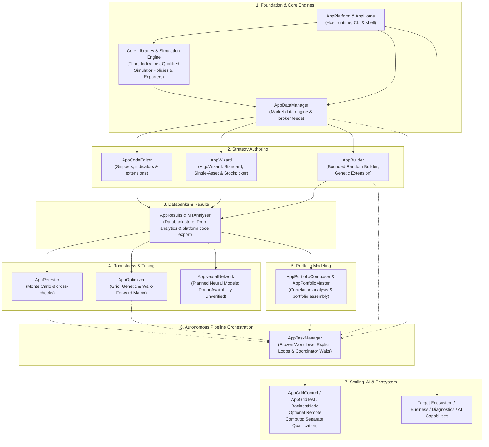

# Quantitative Workstation — Greenfield Clean-Room Architecture & Reimplementation Blueprint

This document is the **greenfield clean-room implementation blueprint** for the quantitative research workstation. Repository authority remains with [AGENTS.md](../../AGENTS.md), [PROJECT.md](../PROJECT.md), [ARCHITECTURE.md](../ARCHITECTURE.md), and owning capability contracts. The REA reconciliation supplies missing behavioral requirements and evidence limits; it does not register implementations or replace approved runtime APIs. It unites:

1. **Section 0 — Greenfield Engineering Guardrails, Line-Count Budgets & DRY Rules** (`<= 100` line docstrings, `1,000` line hard file cutoff, zero backward-compatibility aliases, AI-tool-ready methods, and repository-wide DRY deduplication).
2. **Complete 3-Tier Spatial Project & File Structure** (`app/host/`, `app/services/`, `app/workspace/`, `app/plugins/`, `ui/app/`).
3. **Per-Feature Task Specifications** mapping every feature task directly to its **Dry Rule**, **Donor** (`C:\SQX-145\...`), **Backend**, **Frontend**, **Class**, and **Functional Requirements & Exact Method Signatures**.
4. **Upfront `FR-*` & Exact Method Signatures Per File** (`ClassName.method_name(args: Type) -> ReturnType`) so agents never invent unapproved functions, aliases, or spaghetti logic.

---

## TARGET STACK (the reimplementation must use this)

- **Frontend:** React + TypeScript + Vite + Tailwind CSS
- **Workspace:** Dockview (dockable panels, tabs, resizable layouts)
- **Tables/Charts:** TanStack Table + TanStack Virtual + Lightweight Charts
- **Desktop (optional):** Tauri with packaged Python sidecar
- **Backend API:** Python + FastAPI + Pydantic + Uvicorn
- **Domain layer:** Framework-independent Python feature modules
- **Numerics:** NumPy + Numba
- **Background work:** Python worker processes + SQLite-backed job ledger and scheduler
- **Realtime:** FastAPI WebSocket (optional SSE for one-way streams)
- **Messaging/cache:** In-memory maps, bounded queues, local IPC (no Redis)
- **Persistence:** SQLite (WAL, coordinated writes, centralized in `app/host/persistence.py`)
- **Bulk data:** Parquet + PyArrow (Zstandard)
- **Brokers:** MetaTrader 5 Python adapter + cTrader Open API adapter
- **Platform:** Windows first

---

<a id="sqx-section-0"></a>

## 0. Greenfield Clean-Room Engineering Guardrails & DRY Architecture Rules

Every file created in the greenfield reimplementation MUST obey the following four constitutional rules without exception.

### 0.1 Top-of-File Docstring Rule ($\le 100$ Lines Hard Maximum)

- The top-of-file docstring (`Description:`, `Purpose:`, `Key Capabilities:`, `Python API Usage:`, `CLI Usage:`) must be **brief, dense, and compact** — the fewer lines the better.
- **Hard Cutoff:** Strictly **$\le 100$ lines maximum** (target `25–50` lines).
- Format each `FR-*` entry under `Key Capabilities:` as a single compact bullet containing the `FR-*` identifier, brief summary, associated `[ClassName.method_name()]`, and explicit log level (`INFO`, `WARNING`, `ERROR`, `DEBUG`).

### 0.2 File Line-Count Cutoff Rule (1,000 Lines Hard Maximum)

No source file may exceed **1,000 lines**. Every module is evaluated against this rubric:

| Line Count    | Status            | Engineering Guideline                                                                                                                        |
| ------------- | ----------------- | -------------------------------------------------------------------------------------------------------------------------------------------- |
| `< 200`       | 🟢 **Ideal**      | Highly focused, easy to test, and perfectly readable.                                                                                        |
| `200 – 500`   | 🟡 **Sweet Spot** | Standard for modules with a few closely related classes or complex logic.                                                                    |
| `500 – 1,000` | 🟠 **Warning**    | Starting to push boundaries. Evaluate if the file violates the Single Responsibility Principle.                                              |
| `1,000+`      | 🔴 **Refactor**   | Too large. Refactor internally; if you cannot internally refactor, extract shared logic to `<domain>/_common.py` or `app/services/include/`. |

**Exceptions to the 1,000-Line Rule:**

1. **Generated Files** (auto-generated schemas, protocol buffers, or compiled artifacts).
2. **Configuration & Assets** (modules containing large static dictionaries, catalog mappings, or SQL DDL lookup tables).
3. **Monolithic GUI Logic** (complex UI layout components where splitting would cause fragmented, hard-to-follow event chains).

### 0.3 Upfront `FR-*` & Exact Method Signature Contract (AI-Tool Ready, Zero Aliases)

1. **Strict 1:1 `FR-*` Mapping:** A file may have several functional requirements (`FR-*`). All `FR-*` identifiers and the **exact typed method signature (`ClassName.method_name(args: Type) -> ReturnType`)** that handles each `FR-*` are specified beforehand in this blueprint and in the task's `implementation-plan.md`.
2. **No Invented Public Methods:** If a file declares $N$ functional requirements, its service class exposes **only those $N$ public methods**. Helper methods must be private (`_helper_name()`).
3. **Zero Backward-Compatibility Shims or Aliases:** Never create alias methods, deprecated wrappers, or duplicate module-level functions that wrap class methods.
4. **AI-Agent Tool Readiness:** Every public `FR-*` method accepts explicit, typed parameters (primitives, `Mapping[str, Any]`, or typed dataclasses) and returns a deterministic `dict[str, Any]` or typed contract so it can be registered directly as an AI Agent / MCP tool without wrapper glue.
5. **Non-Silent Logging:** Every `FR-*` method must emit a structured log entry via `logger = get_logger(__name__)` (`app/host/logging.py`).

### 0.4 Repository-Wide DRY Deduplication Hierarchy

To eliminate duplication and maintain strict modular boundaries across the codebase:

1. **Centralized Database Persistence (`HostPersistence` only):**
   - Only `app/host/persistence.py` (`HostPersistence`) may resolve database paths, open SQLite connections, or execute SQL/migrations.
   - All other files (`app/host/*`, `app/workspace/*`, `app/services/*`) are **strictly forbidden** from defining `resolved_db_path()`, `_get_connection()`, or calling `sqlite3.connect()`. They must exclusively call `HostPersistence.create_record()`, `read_records()`, `update_record()`, `delete_record()`, `create_entity()`, `read_entity()`, `update_entity()`, `delete_entity()`, or `apply_batch()`.
2. **Indicator Base Inheritance (`BaseIndicator`):**
   - All 8 universal indicator condition methods (`is_rising`, `is_falling`, `crosses_above`, `crosses_below`, `is_higher`, `is_lower`, `changes_up`, `changes_down`) and parameter validation live **once** on `BaseIndicator` in `app/services/indicators/base.py`.
   - Individual indicator modules (`app/services/indicators/<category>/<name>.py`) subclass `BaseIndicator` and implement only `calculate()` (plus multi-buffer accessors where applicable), keeping every indicator file `< 150` lines (`🟢 Ideal`).
3. **Broker Transport & History Parsers (`app/services/brokers/`):**
   - Shared HTTP retry/rate-limiting/redaction lives in `app/services/brokers/_http.py`.
   - Shared CSV/TXT/archive history parsing lives in `app/services/brokers/_file_history.py`.
   - Shared binary tick/bar decoding (`.bi5`, `.fxt`, `.hst`, `.dat`) lives in `app/services/brokers/_native_history.py`.
4. **Domain-Scoped vs Cross-Domain Helpers:**
   - Logic shared across 2+ files within the same workspace/domain folder $\rightarrow$ `<domain>/_common.py`.
   - Logic shared across 2+ different workspaces/domains $\rightarrow$ `app/services/include/`.

---

<a id="sqx-evidence"></a>

### 0.5 Evidence, authority and implementation status

Reconciliation date: **20 October 2026**. Sources are the retained REA reports
and registries in [the source register](#sqx-sources), not newly observed product
runs. Installed-product claims retain their source tags (`DOC`, `UI`, `CONFIG`,
`BINARY`, `LOG`, `INFERRED`) and High/Med/Low confidence. Static source,
configuration and metadata inspection is not a live UI observation. A path or
class name establishes presence/reference only; ownership inside the eight opaque
`.jar.enc` files, active loading, licensing and numerical behavior remain unknown.
[R00], [R01], [R02]

Every contract imported from REA Stage 4/5 below is **proposed target design
[INFERRED] Med**, unless explicitly described as an observed artifact fact.
Approving this documentation update does not approve a runtime API/schema change,
register a capability, adopt a dependency, or certify original-system parity.
Repository authority and future owning implementation plans govern adoption.
The 82 detailed task blocks and their six metadata fields remain the work catalog.
Their 454 FR checkboxes (33 checked, 421 unchecked at this audit) retain historical
state; this review does not requalify those completions. Estimated line budgets
are design goals, not measurements of existing files.

`Donor:` paths under `C:\SQX-145\` remain provenance locators as requested.
Parenthesized package names beside opaque archives are reference hints, not
verified class ownership. Implementation uses the approved neutral specification;
it must not copy donor algorithms, original templates, source bodies, branding,
icons or UI prose. The original installation and retained investigation workspace
remain read-only. No runtime Java ABI or arbitrary original HTML/Java extension
is loaded into the product. [R02], [R10]

The logical `domain.*` names in the REA design describe responsibilities, not a
new package tree to introduce here. Map them to framework-independent
`app/services/` and workspace coordinators within the existing three tiers;
FastAPI/Pydantic, Arrow, SQLite and broker SDKs remain at adapters. SQL, schema,
transactions and retention remain under `HostPersistence`; no worker/plugin gains
ad-hoc SQL authority. `PROJECT.md` retains wider optional remote compute, neural,
AI, marketplace/business and authorized execution scope. REA MVP exclusions are
reference-profile decisions, not deletion of that product scope. [R07], [R09]

<a id="sqx-host-contracts"></a>

### 0.6 Durable work, ownership and cancellation contracts

Owners: [host jobs/persistence](#sqx-section-1), with domain work in services and
workflow coordination in [Custom Projects](#sqx-section-12). Current local code
has seven uppercase job states (`QUEUED`, `RUNNING`, `PAUSED`, `COMPLETED`,
`FAILED`, `CANCELLED`, `INTERRUPTED`); `app/host/events.py` provides bounded
in-memory replay. The following twelve-state model and transactional event store
are proposed gaps to implement under a separate approved feature plan, not
existing guarantees. Existing `JobManager.submit_job` accepts a callable and
returns `JobRecord`, unlike the retained blueprint signature. Preserve working
APIs until explicitly reconciled; do not add compatibility aliases. [R07], [R08]

| Contract | Proposed required behavior |
| --- | --- |
| Durable acceptance | Validate capability, frozen inputs/settings, dependencies and idempotency; acknowledge only after job/command/event transaction commits. Full bounded admission returns retryable failure before acceptance. |
| Single workspace owner | Exclusive OS ownership lock, one scheduler epoch, one coordinated SQLite writer; bounded reads off the async event loop. Spawn import-safe workers on Windows; no live connection/SDK handle crosses process boundaries. |
| Attempts and fencing | Immutable job specification; append-only attempts with unique fence token, epoch, heartbeat and lease. Reject stale worker progress/checkpoints/results. Verify process identity/quiescence before releasing exclusive resources; historical PID alone is insufficient. |
| Scheduling | Dependency-cycle validation, finite budgets, priority plus project fairness/aging, CPU/memory/I/O reservations and adapter exclusivity. Coordinator workflows/waits consume no numerical worker slot. Internal Numba/BLAS/Arrow threads count toward admission. |
| State model | `queued`, `blocked`, `retry_wait`, `running`, `waiting`, `pause_requested`, `paused`, `cancel_requested`, `succeeded`, `failed`, `cancelled`, `interrupted`; last four terminal. Persist state version and previous scheduling/wait context. |
| Command outcome | `pause`, `resume`, `cancel`, `continue`, `retry` carry expected version and idempotency key; persist accepted/acknowledged/failed/superseded outcome. Request acknowledgment is distinct from paused/cancelled completion. |
| Pause/resume | Running work reaches a safe, compatible checkpoint and verified quiescence before `paused`; resume starts a new fenced attempt with the same logical experiment seeds. Pause timeout fails the command and restores running unless superseded. |
| Cancel/complete race | Writer transaction decides order: completion committed first conflicts with cancel; cancel committed first fences later outputs. Check ancestor cancellation during descendant publication in that same transaction. |
| Recovery/retry | Preserve accepted child outputs and partial counts. Interrupted attempts never imply success; checkpoint/model/data/settings mismatch rejects resume. Retry transient pure work within policy; unknown external outcomes require reconciliation, not automatic replay. |
| Workflows | Freeze graph/settings/bindings, stable task IDs and activation ordinals. Commit next activation with cursor advancement; explicit loop budget and handler policy. User continuation differs from resume; file waits retain grant and freshness baseline across restart. |

Proposed ledger families are `scheduler_sessions`, `jobs`, `job_dependencies`,
`job_attempts`, `job_commands`, `idempotency_keys`, `job_work_units`,
`job_checkpoints`, `job_outputs`, `job_resolved_inputs`, `resource_leases`,
`workflow_runs`, `workflow_waits`, `events`, and `log_indexes`. Unique logical
output/work-unit/activation keys prevent duplicate accepted completion; epochs and
fences guard writes. These are design entities from [R07], not executed DDL or
permission to replace the current host schema. Host transactions must not span
worker execution, awaited network access or file I/O. [R07], [R08]

<a id="sqx-replay"></a>

### 0.7 Committed events, snapshots and bounded queries

Commit visible entity changes and their events together. The durable ledger is
authoritative; sockets are delivery mechanisms. Obtain a consistent snapshot and
high-water mark, replay events after that cursor, then stream live committed
events. Filtered subscriptions use scanned-through watermarks; deduplicate by
sequence/event ID. Expired cursor requires a fresh snapshot; future cursor fails.
Slow-consumer overflow closes with resync guidance rather than silently losing
state. Command outcomes remain queryable after reconnect. [R07], [R08]

Bind query cursors to query hash, projection, sort, unique tie key, revisions and
snapshot. Invalidate expired snapshots; avoid holding a SQLite transaction while
a user scrolls. Charts request bounded display reduction; statistical formulas
always use qualified full data. Lightweight Charts, TanStack Table/Virtual and
Dockview remain presentation tools, not calculation authorities. [R07], [R08]

| Initial proposed bound | Value; qualification |
| --- | --- |
| Writer queue / IPC message | 256 commands and 16 MiB total; 1 MiB IPC message. Bulk payloads pass by manifest reference. |
| Progress / heartbeat / lease | Coalesce progress to at most once per job/second plus boundaries; 2 s heartbeat, 15 s lease; lease expiry suspects loss, not proof that external work stopped. |
| Control grace / pure-work retry | 30 s pause/cancel grace; at most three pure-work attempts, bounded backoff. Uncertain side effects are not retried automatically. |
| Query page / decoded batch | 200 default, 2,000 maximum rows; candidate Arrow batch/row group 65,536 rows subject to byte budget. |
| Event retention / client queue | Seven days or one million events, whichever bounds first; 256 frames/1 MiB per client and 64 KiB per frame; retain required audit state separately. |
| Memory / cache | Candidate admission budget 60% physical RAM; cache min(512 MiB, 10% of that budget), decoded buffers separately bounded. Existing 15% RAM-floor watchdog remains current until separately revised. |

These are unmeasured reference defaults [INFERRED] Med. They do not replace
current resource policy, establish supported capacity, or promise pause latency.
Windows spawn, file locking, owned-child cleanup, memory and cancellation timing
require measurement and fault tests. [R06], [R07], [R08]

<a id="sqx-storage"></a>

### 0.8 Immutable data, result lineage and publication

Separate instruments, provider symbol mappings, sessions and source connections
from datasets and immutable dataset revisions. Strategies/settings have immutable
revisions independent of optional result runs. A databank entry may hold only a
strategy definition; result variants/metrics retain market, sample, direction,
P/L representation, formula/version and units. Exact semantic hashes use a
versioned canonical neutral model; unavailable similarity matching is not silently
replaced with an equivalent-sounding algorithm. [R05], [R07], [R09]

| Store / grain | Required distinction |
| --- | --- |
| SQLite metadata | Catalogs, project/task bindings, revisions, collection membership/views, metric definitions/qualified values, capabilities, manifests, ledger and events; all through HostPersistence. |
| Bars / ticks | UTC microsecond event time and sequence, explicit bar-open/close semantics, source precision/units and quality flags; tick bid/ask/last availability is explicit. |
| Custom values | Typed field identity/value status plus effective event time and separate availability/publication time; no future weekly value carried into earlier decisions. |
| Orders / fills / trades | Append-only order events and fills with order/position identities, quantity/tick grids, signed costs and currency; partial exits retain parent position and fill references. |
| Equity / experiments | Realized balance versus synchronized marked equity, calendar/sample kind and cashflows; trial/window/perturbation/seed IDs with failed or partial outcomes, not only successful scores. |
| Files | Immutable Arrow/Parquet/Zstandard manifests with schema/layout/software versions, workspace-relative paths, content digests, row/byte counts and coverage/quality. Neutral bundles keep definitions/results separable. |

Freeze selected source bytes into a validated immutable artifact and record its
resolved input digest before numerical work. A file grant authorizes access; it
does not freeze content. Changed source fingerprint fails `source_changed`.
Validate timezone/DST, duplicate/order/overlap, finite price and required-column
policies; preserve incomplete coverage as incomplete, never a successful full
import. `[from,to)` intervals and UTC microseconds are proposed neutral policies,
not inferred original binary timestamp units. [R05], [R07], [R08]

Publication sequence: worker writes and closes attempt-owned staging files;
coordinator validates ownership, ancestor state, schema, paths, hashes and counts;
move to unique same-volume final paths; publish manifest/references/output keys
and events in one short writer transaction. Files become query-visible only
through committed manifests. SQLite and filesystem changes are not one atomic
transaction: reconcile unreferenced files after crash; missing/corrupt committed
files raise `artifact_integrity`. Never replace a Windows file under active read.
Qualify flush/rename/power-loss behavior independently. [R07]

Membership deletion, revision deletion and artifact retention/GC are separate
operations. Restrict deletion of referenced revisions, preserve retained evidence,
and use an explicit grace/retention policy. Back up an active WAL store with a
supported consistent SQLite backup plus immutable manifests; copying only the
main database is insufficient. No migration, reset or live database modification
is authorized by this blueprint update. [R05], [R07]

<a id="sqx-numerics"></a>

### 0.9 Causal simulation, search, ranking and experiment policies

Proposed baseline `bar_next_open_conservative.v1`: decisions use completed bars;
orders fill no earlier than the next eligible open; adverse stop/target outcome
wins when OHLC cannot resolve order, with ambiguity recorded. Tick bid/ask
execution, synthetic ticks, hedging/netting, advanced sizing/partial exits and
platform profiles are separate capabilities. A template/export target does not
establish backtest parity. Reject unsupported combinations before work. [R07]

Validate decimal price/quantity inputs against instrument grids, convert to
bounded int64 units, use explicit overflow and posting-rounding rules; float64
research arithmetic records currency, precision and tolerances. Initial-risk,
margin, session, warmup, end-of-range, gaps, spread/slippage/commission/swap and
negative-price rules must be explicit for each accepted policy. Record gross
price P/L and signed cost components once; never double-subtract fees. No
`available_time` later than a decision may influence that decision. [R04], [R07]

A root seed, algorithm/version and stable logical work-unit key determine random
streams before dispatch. Attempt number and worker completion order must not
change those streams. Fixed completed-unit sets permit deterministic candidate
identity and stable reductions; elapsed-time budgets/cancellation may yield
different completed sets and must report them. `fastmath=False`, declared reduction
order, single-threaded reference kernels and tested NumPy-versus-Numba vectors
are qualification requirements, not a current cross-machine bitwise guarantee.
The repository currently declares Python `>=3.14` and no Numba dependency; a
compatible Windows numerical stack must be selected/tested in an owning plan.
No dependency installation or change is implied here. [R07], [R10]

Ranking distinguishes scoring from acceptance, uses explicit higher/lower-is-better
metadata, rejects malformed predicates and keeps null/unsupported metrics
from passing numeric filters. Bounded top-N and exact canonical duplicates have
stable ties by semantic hash then entry ID. Strategy GP and portfolio genetics
are separate algorithms; Watchmaker inheritance supports only the inspected
portfolio family. Indicator calibration estimates output thresholds from declared
history, parameter instances, warmup/sampling and rounding policies; it is not
period-range optimization. Conflicting original presets/defaults retain source
context instead of becoming a universal preset. [R02], [R03], [R07], [R09]

Keep trade permutation, with-replacement bootstrap and omission distinct from
full input-retest perturbations. Proposed `close_slot.v1` assigns eligible outcomes
to ordered source close slots and retains sampled source/slot IDs. Permutation
preserves final net outcome; bootstrap/omission generally do not. These scenarios
produce research outcome/equity paths, not executable altered fills. Perturbation
distributions, joint/independent sampling, bounds and rounding need explicit
versioned contracts. Empirical quantiles/threshold-breach fractions do not prove
future coverage or an analytical risk-of-ruin formula. [R03], [R09], [R10]

Walk-forward requires explicit train/OOS windows, warmup/position carryover,
required/valid/failed window counts and selection rules; never fabricate an
opaque source score. Portfolio subset search differs from account composition
and weight optimization: define aligned-return correlation, missing periods,
weight units, currencies, costs, margin and synchronized account marks. A
heuristic result does not claim a global optimum. IS/OOS intervals and any OOS
ranking exposure remain recorded; a label alone does not establish holdout
isolation. [R03], [R04], [R07], [R09], [R10]

<a id="sqx-wire"></a>

### 0.10 API, file access and adapter authority

The reference protocol uses `/api/v1`, strict discriminated DTOs, unknown-field
rejection, finite values and separate schema/model/formula/layout versions.
Timezone-aware inputs normalize to RFC3339 UTC `Z`; naive dates fail. Event
sequences, byte/row totals and seeds use decimal strings with field-specific
signed/unsigned 64-bit bounds; small counts reject booleans. Decimal grids/money
configuration use canonical decimal strings. These are proposed wire rules;
current transport routes/models require explicit reconciliation before adoption.
[R08]

Mutating entity operations require ETag/`If-Match` (428 missing, 412 stale).
Commands require expected state version (409 stale); POST mutations/jobs require
scoped UUID idempotency keys, checking replay before stale-version rejection.
Same key/body replays the original reference/status; changed body conflicts.
Read-only query POSTs are exempt from mutation idempotency. Durable acceptance
is 202, never completion; typed errors distinguish validation/unsupported (422),
expired replay/query (410), throttling (429), and unaccepted admission failure
(503). GET does not start work or mutate domain state. [R08]

| Reference registry | Coverage and existing owner |
| --- | --- |
| R01-R09, R48, R51 | Capabilities, consistent snapshot/events, jobs, commands/outcomes/logs and single-use stream tickets; host transport/jobs/events. |
| R10-R18, R49 | Project/task/run/settings, databanks/views/commands and atomic template application; workspace coordinators plus host transactions. |
| R19-R26 | Strategy/revisions/validation, blocks, formula definitions and qualified result/series queries; services, Wizard and Results. |
| R27-R28 | Versioned portfolio CRUD; Portfolio workspace. |
| R29-R31, R44-R45 | Connection configuration/status/actions and authorization flow; host adapter boundary, not implicit connect-on-create. |
| R32-R40, R46-R47 | Typed catalogs/datasets/imports/artifacts, staged uploads and purpose-scoped file grants; Data Manager with host custody. |
| R41-R43, R50 | Layout/preferences, sanitized diagnostic exports and trusted extension descriptors; host/workspace shell. |

The complete [contract registry][C4] defines **51 route groups / 68 HTTP+WS
operations, nine topic prefixes, 21 panel types, 35 job kinds, nine kernel
families, twelve job states**; [R08] supplies payload/error/invariant details.
These are specified counts, not implemented endpoints or a new naming mandate.
Panels retain selected project/task/run/sample/direction context. Jobs are
capability-validated tagged specifications, never arbitrary ignored dictionaries;
reserved neural/cloud kinds fail unavailable until separately designed. [C4], [V4]

Bind loopback by default; validate Host/Origin and session/scope. Use short-lived
single-use WS tickets with no credential leakage in URLs/logs/layouts. Workspace
artifact IDs cannot name arbitrary paths; external access requires purpose-scoped
trusted file grants and containment checks. Trusted extension installation
is separate from opening a strategy; model text never grants code/OS authority.
Store secrets in an OS vault, with references/public metadata in SQLite. [R07], [R08]

The REA baseline includes readonly MT5/cTrader symbol/history/account/position
operations with owned adapter sessions, bounded timeouts/retries/rates, provider
coverage checks and sanitized errors. Serialize MT5 access by terminal identity;
separate cTrader demo/live authorization, one-use state, refresh and heartbeat.
Current MetaTrader bridge and SDK design must be reconciled explicitly; cTrader
is a target addition, not established by a generic donor connection archive.
Missing SDK/terminal/account is unavailable, not mock-connected. [R08], [R09]

Existing live-order/latency tasks below remain broader product scope, disabled
by default and outside this readonly profile. Placing/modifying/closing orders,
notifications, scripts, publishing and deletions require their own typed authority,
validation, lifecycle and reconciliation rules. Documentation approval grants no
external-action or trading authority; unknown external outcomes are not replayed
automatically. [R08], [R09], [R10]

<a id="sqx-formats"></a>

### 0.11 Format, exporter and extension qualification boundaries

| Surface | Evidence and supported-contract boundary |
| --- | --- |
| `.cfx` | Observed Project-root config plus separately referenced Settings members differs from a Task-root single-entry template. Validate kind, task references/types and versions before conversion; no suffix-only root assumption. [R00], [R05] |
| `.sqx` | Observed ZIP/XML definitions can omit results. Member names vary; no required `sourceCode.txt` or universal `strategy.xml` layout is established. Orders/equity binaries remain opaque without an independent codec. [R00], [R05] |
| `.sq4` / `.sqw` / legacy | Five `.sq4` samples are ZIP/XML carriers; the sampled `.sqw` is plain XML. `.sq3` loader presence does not establish its format/compatibility. Unknown fields/versions fail or remain explicitly opaque. [R00], [R05] |
| History/result/H2 | Original `.dat` record encodings, `.bin` order/equity payloads and H2 schemas are unresolved. No blanket transcode/lossless round trip or direct original DB attachment is promised. [R00], [R05], [R09] |
| Neutral persistence | Independently versioned JSON/manifests/Parquet bundles preserve supported definitions/results/provenance; arbitrary original extension payloads are not executable or automatically convertible. [R07], [R10] |
| Export targets | Six installed template families indicate intended source targets; source export, backtest policy and successful target compilation are distinct. Independently author templates/indicator companions; qualify target/version/block/option matrix and reject unsupported nodes. [R02], [R09], [R10] |
| COT / volume profile | Publication/effective time, staleness, scale, session/DST/lookback and repeated block IDs need independent definitions. Candle-volume delta is a proxy, not measured bid/ask transaction delta. Manuals/research examples are not verified trading performance. [R01], [R03] |
| NN / cloud / grid / ecosystem | Availability, algorithm, entitlement and protocol gaps remain explicit. Preserve target ambitions, but installed/hidden/menu names alone cannot establish a working capability. [R01], [R02], [R09] |

Source/compiled equivalence, licensing/activation, runtime loading, numerical
throughput and capacity were not established by the retained investigation.
Historical logs are bounded observations of those sessions. Source validation
JSON checks documentation/registries/identities; it is not product test evidence.
Qualification requires actual independent normal, boundary and failure fixtures
for each supported behavior. [R02], [R06], [V4], [V5]

---

## High-Level System Architecture & Strategy Lifecycle



---

## HaruQuantAI Project & File Structure

```text
HaruQuantAI/
├── app/                                    # Greenfield Python Backend (FastAPI, Pydantic, SQLite WAL, NumPy/Numba)
│   ├── host/                               # Tier 1: Platform Host (Ordered bottom-up by dependency)
│   │   ├── logging.py                      # 1. Multi-sink asynchronous telemetry & secret redaction (TelemetryLogger, get_logger)
│   │   ├── persistence.py                  # 2. SQLite WAL database CRUD & atomic batch transactions (HostPersistence)
│   │   ├── response.py                     # 3. Standardized API response & error envelopes (ApiResponse)
│   │   ├── resources.py                    # 4. Hardware inspection & memory watchdog (ResourceMonitor)
│   │   ├── settings.py                     # 5. Central configuration & theme tokens (SettingsManager, Theme)
│   │   ├── session.py                      # 6. Ephemeral authentication & scope guards (SessionManager)
│   │   ├── discovery.py                    # 7. Dynamic plugin scanner & manifest loader (PluginDiscovery)
│   │   ├── jobs.py                         # 8. Multiprocessing job coordinator & ProcessPoolExecutor (JobManager)
│   │   ├── bootstrap.py                    # 9. Multi-stage startup & LIFO teardown (AppHost)
│   │   └── transport.py                    # 11. FastAPI gateway, connection & constants servlets (ConnectionTest, ServletConnection, ServletConstants)
│   ├── main.py                             # 9b. Uvicorn / desktop sidecar entrypoint
│   ├── cli.py                              # 10. Headless CLI runner (sqcli.config / SQConsoleStarter parity)
│   ├── workspace/                          # Tier 2: Domain Workspaces (Cohesive business workflows)
│   │   ├── home/                           # Landing dashboard & system overview (Home, About)
│   │   ├── data_manager/                   # Central market data catalog, instruments, sessions, baskets, broker profiles
│   │   ├── code_editor/                    # Monaco-backed snippet and extension development
│   │   ├── algo_wizard/                    # Visual rule authoring (Standard, Single-Asset, Stockpicker), Custom Blocks
│   │   ├── builder/                        # Random/genetic search with explicit budgets, seeds and ranking contracts
│   │   ├── results/                        # Databank storage, strategy comparison, performance reports, equity charts
│   │   ├── retester/                       # Multi-market cross-checks, Monte Carlo, SPP, Walk-Forward
│   │   ├── optimizer/                      # Grid/genetic parameter tuning, Walk-Forward Matrix, 3D surface charts
│   │   ├── neural_network/                 # Planned neural models; algorithms/dependencies require qualification
│   │   ├── portfolio/                      # Portfolio Composer (interactive) & Portfolio Master (genetic search)
│   │   ├── custom_projects/                # Automated 18-task pipeline DAG engine (Custom Projects)
│   │   ├── grid_control/                   # Optional remote compute; protocol/auth/ownership require qualification
│   │   ├── grid_test/                      # Cluster benchmark test suite & latency probes
│   │   ├── marketplace/                    # Community extension package repository client
│   │   ├── business/                       # Multi-account licensing & institutional compliance reporting
│   │   ├── debug_console/                  # Live system telemetry & memory diagnostics
│   │   ├── chart/                          # Standalone charting engine & visual analytics
│   │   └── mt_analyzer/                    # Standalone MetaTrader report & portfolio analyzer (MTAnalyzer)
│   ├── services/                           # Shared Domain Primitives, Engines & Adapters
│   │   ├── include/                        # Core time, RNG, bar series, contracts & signal building blocks
│   │   ├── brokers/                        # Unified BrokerClient / TradingClient data feeds & execution bridges
│   │   ├── indicators/                     # 69 mathematical indicators inheriting from BaseIndicator
│   │   ├── engine/                         # Core Backtest & Simulation Kernel (4 precision modes, 7 platforms, codecs)
│   │   ├── snippets/                       # 24 Extensible Snippet Categories & 12 XML Catalogs
│   │   └── codegen/                        # Target-Platform Strategy Code Exporters (MQL4, MQL5, EasyLanguage, NinjaScript, JForex, PseudoCode)
│   └── plugins/                            # Tier 3: Dynamic Add-on Packages (data_source, results_plugins, ai_plugins)
├── ui/                                     # Greenfield React Frontend (TypeScript, Vite, Tailwind CSS, Dockview)
│   └── app/
│       ├── host/                           # Platform UI (HostConnectionModal, HostSettingsModal)
│       ├── components/                     # Reusable UI primitives (ThemeToggle, HelpTooltip, tables, charts)
│       ├── plugins/                        # Plugin UI widgets & dialogs (databank, data_source, optimization, project)
│       └── workspace/                      # Domain Workspace Views (Dockview panel views)
├── tests/                                  # Greenfield unit & integration test suites (>=80% branch coverage)
└── docs/                                   # Architectural specifications & templates
```

---

<a id="sqx-section-1"></a>

## 1. AppPlatform — Host Application Runtime & Shared Services

- **Primary Role:** Root host application container. Bootstraps telemetry logging, the SQLite WAL persistence engine, response envelopes, hardware monitor, settings, session guard, plugin registry, multiprocessing job ledger, embedded web server, and broker/exchange connectivity bridges in strict bottom-up dependency order.
- **Dependencies:** None (Root Host)
- **Outputs / Downstream Role:** Core application container, `get_logger()` telemetry API, centralized `HostPersistence` database API, event bus, and broker connection adapters.

---

### Phase 1.1: Core Application Container & Stage 1 Host Foundation (Ordered Bottom-Up)

#### 1. `app/host/logging.py` — `TelemetryLogger`, `TelemetryEngine` & `LogRingBuffer` (`FEAT-HOST-LOGGING`)

- **Dry Rule:** Zero internal `app.*` imports. Every other file in the repository imports `from app.host.logging import get_logger`.
- **Donor:** `C:\SQX-145\internal\libs\SQLib.jar.enc` (`com.strategyquant.lib.L`, `SQLog`), `C:\SQX-145\internal\libs\logback-core-1.4.14.jar`, `C:\SQX-145\internal\libs\logback-classic-1.4.14.jar`
- **Backend:** `app/host/logging.py` (`🟠 500–995L`, Docstring `<=45L`)
- **Frontend:** `ui/app/host/HostSettingsModal.tsx`
- **Class:** `TelemetryLogger`, `TelemetryEngine`, `LogRingBuffer`, `WindowsSafeRotatingFileHandler`, `LogEventFormatter` (plus `get_logger`, `get_access_logger`, `setup_logging`, `flush_logs`, `shutdown_logging`, `TelemetryLoggerCLI`)
- **Functional Requirements & Exact Method Signatures:**
  - [x] `FR-HOST-LOGGING-WORKER`: Asynchronous non-blocking `QueueHandler`/`QueueListener` engine (`TelemetryEngine`), `setup_logging()`, `flush_logs()`, and `shutdown_logging()`
  - [x] `FR-HOST-LOGGING-REDACTION`: Deterministic SHA-256 secret fingerprinting (`fingerprint_secret`), workspace/home path normalization (`normalize_path`), `redact_value`, `redact_mapping`, and `TelemetryLogger.redact_secrets()`
  - [x] `FR-HOST-LOGGING-ERROR-BOUNDARY`: Safe formatting and handler error boundary (`[LOGGING-ERROR-BOUNDARY]`) ensuring logging never raises into caller execution
  - [x] `FR-HOST-LOGGING-FORMATTING`: `LogEventFormatter` with millisecond timestamps (`YYYY-MM-DD HH:MM:SS.mmm | LEVEL | module:func:line - msg`), ANSI console colors, and scrubbed tracebacks
  - [x] `FR-HOST-LOGGING-SINKS`: `WindowsSafeRotatingFileHandler` (10 MB / 30 backups with Windows lock retry) across 3 split files (`app.log`, `errors.log` at `WARNING+`, `access.log` via `get_access_logger()`)
  - [x] `FR-HOST-LOGGING-RING-BUFFER`: Bounded thread-safe `LogRingBuffer` (`append`, `query`, `clear`, `get_ring_buffer()`) + WebSocket broadcast sinks (`TelemetryLogger.register_ws_sink`)
  - [x] `FR-HOST-LOGGING-BOUND-LOGGER`: Contextual `TelemetryLogger` (`bind(**kwargs)`, `emit`, `info`, `warning`, `error`, `critical`, `exception`, `debug`, `log`)
  - [x] `FR-HOST-LOGGING-CORRELATION`: `contextvars.ContextVar` request correlation propagation (`get_correlation_id`, `set_correlation_id`, `reset_correlation_id`)
  - [x] `FR-HOST-LOGGING-EXPORTS`: Public factory exports (`get_logger`, `get_access_logger`, `get_ring_buffer`) and `TelemetryLoggerCLI` (`--verify`)

#### 2. `app/host/persistence.py` — `HostPersistence` (`FEAT-HOST-PERSISTENCE`)

- **Dry Rule:** Depends only on `app/host/logging.py`. All SQLite path resolution, connection pooling, schema bootstrapping, and parameterized SQL live exclusively inside `HostPersistence`. No other module may import `sqlite3` or resolve DB paths.
- **Donor:** `C:\SQX-145\internal\libs\SQDataLib.jar.enc` (`com.strategyquant.datalib.*`), `C:\SQX-145\internal\libs\sqlite-jdbc-3.51.2.0.jar`, `C:\SQX-145\internal\libs\h2-1.3.149.jar`
- **Backend:** `app/host/persistence.py` (`🟠 500–900L`, Docstring `<=60L`)
- **Frontend:** `ui/app/host/HostSettingsModal.tsx`
- **Class:** `HostPersistence` (plus `HostPersistenceCLI`)
- **Functional Requirements & Exact Method Signatures:**
  - [x] `FR-HOST-PERSISTENCE-CREATE`: Execute parameterized single-row and domain-entity creation in SQLite WAL $\rightarrow$ `HostPersistence.create_record(table: str, values: Mapping[str, Any]) -> dict[str, Any]` & `HostPersistence.create_entity(entity: str, values: Mapping[str, Any]) -> dict[str, Any]`
  - [x] `FR-HOST-PERSISTENCE-READ`: Execute parameterized queries, filtering, and cursor pagination $\rightarrow$ `HostPersistence.read_records(table: str, filters: Mapping[str, Any] | None = None, *, limit: int = 100, offset: int = 0, order_by: str | None = None) -> list[dict[str, Any]]` & `HostPersistence.read_entity(entity: str, entity_id: str | None = None, filters: Mapping[str, Any] | None = None, *, limit: int = 100, offset: int = 0) -> list[dict[str, Any]]`
  - [x] `FR-HOST-PERSISTENCE-UPDATE`: Execute parameterized updates and optimistic revision compare-and-set $\rightarrow$ `HostPersistence.update_record(table: str, key_columns: Mapping[str, Any], updates: Mapping[str, Any], *, expected_revision: int | None = None) -> dict[str, Any]` & `HostPersistence.update_entity(entity: str, entity_id: str, updates: Mapping[str, Any], *, expected_revision: int | None = None) -> dict[str, Any]`
  - [x] `FR-HOST-PERSISTENCE-DELETE`: Execute parameterized deletion with foreign-key reference guards $\rightarrow$ `HostPersistence.delete_record(table: str, key_columns: Mapping[str, Any]) -> dict[str, Any]` & `HostPersistence.delete_entity(entity: str, entity_id: str) -> dict[str, Any]`
  - [x] `FR-HOST-PERSISTENCE-BATCH`: Execute atomic multi-row batch writes with all-or-nothing rollback $\rightarrow$ `HostPersistence.apply_batch(operations: Sequence[Mapping[str, Any]]) -> dict[str, Any]`

#### 3. `app/host/response.py` — `StandardResponse`, `StandardError`, `ResponseMetadata` & `ApiResponse` (`FEAT-HOST-RESPONSE`)

- **Dry Rule:** Depends on `TelemetryLogger`; provides the single standard REST/WebSocket/CLI response and error envelope across the repository.
- **Donor:** `C:\SQX-145\internal\libs\SQAppLib.jar.enc` (`com.strategyquant.webguilib.servlet.*`), `C:\SQX-145\internal\libs\StrategyQuant.jar.enc`
- **Backend:** `app/host/response.py` (`🟡 200–495L`, Docstring `<=45L`)
- **Frontend:** `ui/app/host/HostSettingsModal.tsx`
- **Class:** `StandardResponse[T]`, `StandardError`, `ResponseMetadata`, `ApiResponse` (plus `ApiResponseCLI`)
- **Functional Requirements & Exact Method Signatures:**
  - [x] `FR-HOST-RESPONSE-SUCCESS-ENVELOPE`: Construct validated immutable success envelopes and HTTP/CLI dicts $\rightarrow$ `StandardResponse.success(...) -> StandardResponse[V]` & `ApiResponse.ok(data: Any = None, *, meta: Mapping[str, Any] | None = None, request_id: str | None = None) -> dict[str, Any]`
  - [x] `FR-HOST-RESPONSE-ERROR-ENVELOPE`: Construct validated `StandardError` taxonomy and error envelopes with `unwrap()` / `__bool__()` $\rightarrow$ `StandardResponse.failure(...) -> StandardResponse[V]` & `ApiResponse.error(code: str, message: str, *, details: Mapping[str, Any] | None = None, status_code: int = 400, request_id: str | None = None) -> dict[str, Any]`
  - [x] `FR-HOST-RESPONSE-SERIALIZATION`: Serialize `StandardResponse[T]` envelopes to JSON-compatible dictionaries $\rightarrow$ `StandardResponse.to_dict() -> dict[str, Any]`

#### 4. `app/host/resources.py` — `ResourceMonitor` (`FEAT-HOST-RESOURCES`)

- **Dry Rule:** Depends on `TelemetryLogger`; centralizes CPU, RAM, and disk pressure inspection for all host and workspace services.
- **Donor:** `C:\SQX-145\internal\libs\SQLib.jar.enc` (`com.strategyquant.lib.memory.MemoryMonitor`, `com.strategyquant.lib.utils.OSUtils`)
- **Backend:** `app/host/resources.py` (`🟢 <200L`, Docstring `<=45L`)
- **Frontend:** `ui/app/host/HostSettingsModal.tsx`
- **Class:** `ResourceMonitor` (plus `ResourceMonitorCLI`)
- **Functional Requirements & Exact Method Signatures:**
  - [x] `FR-HOST-RESOURCES-INSPECT`: Monitor CPU cores, RAM utilization, disk quotas, and memory pressure thresholds $\rightarrow$ `ResourceMonitor.inspect_resources(workspace_path: Path | str | None = None) -> dict[str, Any]`

#### 5. `app/host/settings.py` — `SettingsManager` & `Theme` (`FEAT-HOST-SETTINGS`)

- **Dry Rule:** Depends on `TelemetryLogger` and `HostPersistence` (`settings` table); centralizes configuration and theme token persistence.
- **Donor:** `C:\SQX-145\user\settings\settings.xml`, `C:\SQX-145\internal\AppSettings.txt`, `C:\SQX-145\internal\plugins\SkinDark\`, `C:\SQX-145\internal\plugins\SkinLight\`, `C:\SQX-145\internal\libs\SQLib.jar.enc` (`com.strategyquant.lib.SettingsMap`)
- **Backend:** `app/host/settings.py` (`🟡 200–350L`, Docstring `<=55L`)
- **Frontend:** `ui/app/host/HostSettingsModal.tsx`, `ui/app/components/ThemeToggle.tsx`
- **Class:** `SettingsManager`, `Theme` (plus `SettingsManagerCLI`)
- **Functional Requirements & Exact Method Signatures:**
  - [x] `FR-HOST-SETTINGS-SAVE`: Persist revision-tracked application settings and workspace layouts via `HostPersistence` $\rightarrow$ `SettingsManager.save_settings(settings: Mapping[str, Any], *, namespace: str = "global") -> dict[str, Any]`
  - [x] `FR-HOST-THEME-SET-DARK`: Apply dark theme configuration and persist active theme state $\rightarrow$ `Theme.set_dark() -> dict[str, Any]`
  - [x] `FR-HOST-THEME-DARK-TOKENS`: Provide dark mode color variables, background shades, and typography tokens $\rightarrow$ `Theme.get_tokens() -> dict[str, Any]`
  - [x] `FR-HOST-THEME-SET-LIGHT`: Apply light mode configuration and persist active theme state $\rightarrow$ `Theme.set_light() -> dict[str, Any]`
  - [x] `FR-HOST-THEME-LIGHT-TOKENS`: Provide light theme styling tokens for Dockview panels, tables, and charts $\rightarrow$ `Theme.get_light_tokens() -> dict[str, Any]`

#### 6. `app/host/session.py` — `SessionManager` (`FEAT-HOST-SESSION`)

- **Dry Rule:** Depends on `TelemetryLogger` and `HostPersistence` (`sessions` table); single authority for token verification and scope enforcement.
- **Donor:** `C:\SQX-145\internal\libs\SQAppLib.jar.enc` (`com.strategyquant.webguilib.servlet.*`), `C:\SQX-145\internal\libs\StrategyQuant.jar.enc` (`SessionAuth`)
- **Backend:** `app/host/session.py` (`🟢 <200L`, Docstring `<=45L`)
- **Frontend:** `ui/app/host/HostSettingsModal.tsx`
- **Class:** `SessionManager` (plus `SessionManagerCLI`)
- **Functional Requirements & Exact Method Signatures:**
  - [x] `FR-HOST-SESSION-VERIFY`: Issue ephemeral session tokens and enforce route scope authorization against `HostPersistence` $\rightarrow$ `SessionManager.verify_session(token: str | None = None, *, required_scope: str = "read", issue_if_none: bool = False) -> dict[str, Any]`

#### 7. `app/host/discovery.py` — `PluginDiscovery` (`FEAT-HOST-DISCOVERY`)

- **Dry Rule:** Depends on `TelemetryLogger` and `HostPersistence`; scans plugin manifests once at bootstrap and persists registry state.
- **Donor:** `C:\SQX-145\internal\libs\SQPluginLib.jar.enc` (`com.strategyquant.pluginlib.*`), `C:\SQX-145\internal\plugins\`
- **Backend:** `app/host/discovery.py` (`🟡 200–350L`, Docstring `<=45L`)
- **Frontend:** `ui/app/host/HostSettingsModal.tsx`
- **Class:** `PluginDiscovery` (plus `PluginDiscoveryCLI`)
- **Functional Requirements & Exact Method Signatures:**
  - [x] `FR-HOST-DISCOVERY-SCAN`: Scan and validate dynamic plugin manifests and extension slots at startup and persist registry state via `HostPersistence` $\rightarrow$ `PluginDiscovery.discover_plugins(plugin_dirs: Sequence[Path | str] | None = None) -> dict[str, Any]`

#### 8. `app/host/jobs.py` — `JobManager` (`FEAT-HOST-JOBS`)

- **Dry Rule:** Depends on `TelemetryLogger` and `HostPersistence` (`jobs` table); provides shared multiprocessing task scheduling and cancellation for all workspaces.
- **Donor:** `C:\SQX-145\internal\libs\SQJobsLib.jar.enc` (`com.strategyquant.jobslib.*`), `C:\SQX-145\internal\plugins\AppTaskManager\AppTaskManager.jar`
- **Backend:** `app/host/jobs.py` (`🟡 250–400L`, Docstring `<=50L`)
- **Frontend:** `ui/app/host/HostSettingsModal.tsx`
- **Class:** `JobManager` (plus `JobManagerCLI`)
- **Functional Requirements & Exact Method Signatures:**
  - [x] `FR-HOST-JOBS-SUBMIT`: Schedule, track, and persist background worker tasks in the SQLite job ledger via `HostPersistence` $\rightarrow$ `JobManager.submit_job(job_type: str, payload: Mapping[str, Any], *, priority: int = 0) -> dict[str, Any]`
  - [x] `FR-HOST-JOBS-CANCEL`: Cancel queued or running background worker tasks and record terminal state in SQLite $\rightarrow$ `JobManager.cancel_job(job_id: str, *, reason: str = "user_cancelled") -> dict[str, Any]`

#### 9. `app/host/bootstrap.py` & `app/main.py` — `AppPlatform` (`FEAT-HOST-BOOTSTRAP`)

- **Dry Rule:** Orchestrates `TelemetryLogger`, `HostPersistence`, and all Phase 1.1 host services in deterministic startup and LIFO teardown order.
- **Donor:** `C:\SQX-145\StrategyQuantX.config`, `C:\SQX-145\internal\libs\StrategyQuant.jar.enc` (`com.strategyquant.strategyquant.SQStarter`), `C:\SQX-145\internal\plugins\AppStrategyQuant\AppStrategyQuant.jar`, `C:\SQX-145\internal\electron\`
- **Backend:** `app/host/bootstrap.py` (`🟡 250–450L`, Docstring `<=50L`), `app/main.py` (`🟢 <150L`, Docstring `<=40L`)
- **Frontend:** `ui/app/host/HostConnectionModal.tsx`
- **Class:** `AppHost` (plus `AppHostCLI`)
- **Functional Requirements & Exact Method Signatures:**
  - [x] `FR-HOST-BOOTSTRAP-STARTUP`: Bootstrap FastAPI backend application with CORS, security headers, and Uvicorn runtime state $\rightarrow$ `AppHost.startup(host: str = "127.0.0.1", port: int = 8000) -> dict[str, Any]`
  - [x] `FR-HOST-BOOTSTRAP-INIT-DB`: Initialize SQLite database with WAL mode and coordinated write locks via `HostPersistence` $\rightarrow$ `AppHost.initialize_db(db_path: Path | str | None = None) -> dict[str, Any]`
  - [x] `FR-HOST-BOOTSTRAP-REGISTER-MODULES`: Register and initialize all domain feature modules and background worker processes $\rightarrow$ `AppHost.register_modules(module_names: Sequence[str] | None = None) -> dict[str, Any]`
  - [x] `FR-HOST-BOOTSTRAP-BROADCAST`: Broadcast structured events across the global in-memory event bus and WebSocket channel $\rightarrow$ `AppHost.broadcast_event(topic: str, payload: Mapping[str, Any]) -> dict[str, Any]`
  - [x] `FR-HOST-BOOTSTRAP-SHUTDOWN`: Manage graceful LIFO shutdown, worker process termination, and resource cleanup $\rightarrow$ `AppHost.shutdown(reason: str = "normal") -> dict[str, Any]`

#### 10. `app/cli.py` — Headless CLI Runner (`FEAT-HOST-CLI`)

- **Dry Rule:** Reuses `TelemetryLogger`, `AppHost`, and `HostPersistence` without duplicating host configuration or service logic.
- **Donor:** `C:\SQX-145\sqcli.config`, `C:\SQX-145\sqcli.exe`, `C:\SQX-145\internal\libs\StrategyQuant.jar.enc` (`com.strategyquant.strategyquant.SQConsoleStarter`)
- **Backend:** `app/cli.py` (`🟡 200–350L`, Docstring `<=45L`)
- **Frontend:** N/A (Headless CLI)
- **Class:** `HeadlessCLI` & `run_cli`
- **Functional Requirements & Exact Method Signatures:**
  - [x] `FR-HOST-CLI-RUN`: Execute headless CLI workflows, project pipelines, and system diagnostics (`sqcli.config` parity) $\rightarrow$ `run_cli(argv: Sequence[str] | None = None) -> dict[str, Any]`

---

### Phase 1.2: Platform & Broker Connectivity

#### 11. `app/host/transport.py` — `ConnectionTest`, `ServletConnection` & `ServletConstants` (`FEAT-HOST-TRANSPORT`)

- **Dry Rule:** Depends on `TelemetryLogger`, `HostPersistence`, and `ApiResponse`; consolidates network diagnostics, connection CRUD, and system constants.
- **Donor:** `C:\SQX-145\internal\plugins\ConnectionTest\ConnectionTest.jar`, `C:\SQX-145\internal\plugins\ServletConnection\ServletConnection.jar`, `C:\SQX-145\internal\plugins\ServletConstants\ServletConstants.jar`
- **Backend:** `app/host/transport.py` (`🟡 300–480L`, Docstring `<=65L`)
- **Frontend:** `ui/app/host/HostConnectionModal.tsx`, `ui/app/host/HostSettingsModal.tsx`
- **Class:** `ConnectionTest`, `ServletConnection`, `ServletConstants` (plus `TransportCLI`)
- **Functional Requirements & Exact Method Signatures:**
  - [x] `FR-HOST-TRANSPORT-PING`: Ping remote and local server endpoints to verify network connectivity $\rightarrow$ `ConnectionTest.ping_endpoint(url: str, *, timeout_seconds: float = 5.0) -> dict[str, Any]`
  - [x] `FR-HOST-TRANSPORT-LATENCY`: Measure round-trip latency and report packet loss across probes $\rightarrow$ `ConnectionTest.check_latency(host: str, *, port: int = 443, samples: int = 3) -> dict[str, Any]`
  - [x] `FR-HOST-TRANSPORT-DIAGNOSE`: Diagnose DNS resolution and socket connection failures $\rightarrow$ `ConnectionTest.diagnose_network(target: str) -> dict[str, Any]`
  - [x] `FR-HOST-SERVLET-CONN-LIST`: List existing broker and exchange connections from `HostPersistence` $\rightarrow$ `ServletConnection.list_connections(provider: str | None = None) -> list[dict[str, Any]]`
  - [x] `FR-HOST-SERVLET-CONN-SAVE`: Save or update public connection metadata and secret-vault references via `HostPersistence`; plaintext credentials stay outside SQLite $\rightarrow$ `ServletConnection.save_connection(connection: Mapping[str, Any]) -> dict[str, Any]`
  - [x] `FR-HOST-SERVLET-CONN-DELETE`: Delete authorized connection metadata via `HostPersistence` and revoke associated vault references under adapter lifecycle control $\rightarrow$ `ServletConnection.delete_connection(connection_id: str) -> dict[str, Any]`
  - [x] `FR-HOST-SERVLET-CONN-TEST`: Test saved or inline connection credentials and report latency status $\rightarrow$ `ServletConnection.test_connection(connection_id_or_config: str | Mapping[str, Any]) -> dict[str, Any]`
  - [x] `FR-HOST-SERVLET-CONSTANTS`: Expose application version, build timestamp, and runtime environment paths $\rightarrow$ `ServletConstants.get_constants() -> dict[str, Any]`
  - [x] `FR-HOST-SERVLET-SPECS`: Serve system resource limits, hardware concurrency specs, and supported timeframes $\rightarrow$ `ServletConstants.get_system_specs() -> dict[str, Any]`

#### 12. `app/services/brokers/registry.py` — `ConnectionLiveTest` (`FEAT-BROKER-LIVETEST`)

- **Dry Rule:** Inherits shared transport and lifecycle contracts from `BrokerClient` in `app/services/brokers/base.py`.
- **Donor:** `C:\SQX-145\internal\plugins\ConnectionLiveTest\ConnectionLiveTest.jar`, `C:\SQX-145\internal\libs\SQAppLib.jar.enc` (`com.strategyquant.tradinglib.connection.*`)
- **Backend:** `app/services/brokers/registry.py` (`🟢 <200L`, Docstring `<=45L`)
- **Frontend:** `ui/app/workspace/Trading/TradingDashboard.tsx`
- **Class:** `LiveTest` (plus `LiveTestCLI`)
- **Functional Requirements & Exact Method Signatures:**
  - [x] `FR-BROKER-LIVETEST-CREDENTIALS`: Validate live broker credentials and API tokens against broker gateways $\rightarrow$ `LiveTest.validate_credentials(provider: str, credentials: Mapping[str, Any]) -> dict[str, Any]`
  - [x] `FR-BROKER-LIVETEST-LATENCY`: Separately authorized execution capability, disabled in the readonly research profile: Measure order placement and quote streaming round-trip latency $\rightarrow$ `LiveTest.measure_trading_latency(provider: str, symbol: str = "EURUSD") -> dict[str, Any]`
  - [x] `FR-BROKER-LIVETEST-PERMISSIONS`: Verify account trading permissions and margin currency settings $\rightarrow$ `LiveTest.verify_trading_permissions(provider: str, account_id: str) -> dict[str, Any]`

#### 13. `app/services/brokers/metatrader.py` — `ConnectionMT4` / `ConnectionMT5` & `DataSourceMt5Api` (`FEAT-BROKER-MT5`)

- **Dry Rule:** Inherits shared transport from `TradingClient` (`base.py`) and binary history decoding / Parquet export from `files.py`.
- **Donor:** `C:\SQX-145\internal\plugins\ConnectionMT4\ConnectionMT4.jar`, `C:\SQX-145\internal\plugins\DataSourceMt5Api\DataSourceMt5Api.jar`, `C:\SQX-145\internal\libs\SQDataLib.jar.enc` (`com.strategyquant.datalib.metatrader4.*`)
- **Backend:** `app/services/brokers/metatrader.py` (`MetaTraderClient`, `Bridge`, `encode_frame`, `decode_frame`)
- **Frontend:** `ui/app/plugins/data_source/Catalogs/BrokerProfiles/BrokerProfileEditorDialog.tsx`, `ui/app/plugins/data_source/MetaTrader/DataSourceMt5Api.ts`
- **Class:** `MetaTraderClient`, `Bridge`
- **Functional Requirements & Exact Method Signatures:**
  - [x] `FR-BROKER-MT5-INIT`: Initialize connection to local MetaTrader 5 terminal via EA loopback bridge $\rightarrow$ `MetaTraderClient.start() -> None`, `MetaTraderClient.wait_connected(timeout: float | None = None) -> None`, `MetaTraderClient.connect() -> bool`
  - [x] `FR-BROKER-MT5-ACCOUNT`: Query account balance, equity, leverage, server time, and broker specifications $\rightarrow$ `MetaTraderClient.account.AccountInfo() -> Awaitable[AccountInfo]`, `MetaTraderClient.get_terminal_info() -> TerminalInfo`, `MetaTraderClient.get_account_info() -> AccountInfo | Awaitable[AccountInfo]`
  - [x] `FR-BROKER-MT5-STREAM`: Fetch and stream live tick, bar, and transaction event feeds into bounded async queues $\rightarrow$ `MetaTraderClient.get_ticks(symbol: str, date_from: datetime | None = None, date_to: datetime | None = None, *, count: int | None = None, limit: int = 1000) -> Awaitable[list[MarketTick]]`, `MetaTraderClient.get_bars(...) -> Awaitable[list[MarketBar]]`, `MetaTraderClient.next_event(timeout: float | None = None) -> BridgeEvent`
  - [x] `FR-BROKER-MT5-ORDER`: Separately authorized execution capability, disarmed by default (`arm()` / `disarm()`): Dispatch trading orders (buy, sell, modify, close) to MetaTrader terminal $\rightarrow$ `MetaTraderClient.trade.OrderSend(request: TradeRequest) -> Awaitable[TradeResult]`, `MetaTraderClient.call(..., requires_arm: bool = False) -> Any`
  - [x] `FR-BROKER-MT5-SHUTDOWN`: Terminate terminal connection session and release resources $\rightarrow$ `MetaTraderClient.close() -> None`, `MetaTraderClient.close_sync() -> None`, `MetaTraderClient.disconnect() -> None`
  - [x] `FR-DATASRC-MT5-IMPORT`: Import historical price data from MetaTrader terminal and `.hst`/`.fxt` codecs into Parquet storage $\rightarrow$ `MetaTraderClient.get_bars(...)`, `export_bars_to_parquet(...)`, `decode_hst_bytes(...)`, `decode_fxt_bytes(...)` (`app/services/brokers/files.py`)

#### 14. `app/services/brokers/ctrader.py` — `ConnectionCTrader` (`FEAT-BROKER-CTRADER`)

- **Dry Rule:** Inherits shared transport and `Trading` facade dispatch from `TradingClient` (`app/services/brokers/base.py`).
- **Donor:** `C:\SQX-145\internal\libs\SQAppLib.jar.enc` (`com.strategyquant.tradinglib.connection.*`), `C:\SQX-145\internal\plugins\ServletConnection\ServletConnection.jar`
- **Backend:** `app/services/brokers/ctrader.py` (`CTraderClient`)
- **Frontend:** `ui/app/plugins/data_source/Catalogs/BrokerProfiles/BrokerProfileEditorDialog.tsx`
- **Class:** `CTraderClient`
- **Functional Requirements & Exact Method Signatures:**
  - [x] `FR-BROKER-CTRADER-CONNECT`: Authenticate cTrader Open API TLS/Protobuf session, rotate OAuth tokens, and resolve tradable symbol catalog $\rightarrow$ `CTraderClient.connect() -> bool`, `CTraderClient.get_symbols() -> list[str]`, `CTraderClient.get_symbol_info(symbol: str) -> SymbolInfo`
  - [x] `FR-BROKER-CTRADER-HISTORY`: Download historical OHLCV trendbars and bid/ask tick quotes from cTrader servers $\rightarrow$ `CTraderClient.get_bars(symbol: str, timeframe: Timeframe | str = Timeframe.PERIOD_H1, date_from: datetime | None = None, date_to: datetime | None = None, **kw: Any) -> list[MarketBar]`, `CTraderClient.get_ticks(symbol: str, date_from: datetime | None = None, date_to: datetime | None = None, **kw: Any) -> list[MarketTick]`
  - [x] `FR-BROKER-CTRADER-TRADING`: Separately authorized execution capability: Submit, reconcile, and manage orders and positions via cTrader Open API $\rightarrow$ `CTraderClient.order_send(request: TradeRequest) -> TradeResult`, `CTraderClient.order_check(request: TradeRequest) -> TradeCheckResult`, `CTraderClient.reconcile() -> tuple[list[dict[str, Any]], list[dict[str, Any]]]`

#### 15. `app/services/brokers/simulator.py` — `ConnectionSimulator` (`FEAT-BROKER-SIMULATOR`)

- **Dry Rule:** Inherits shared account/order contracts and MQL5 `Trading` facade dispatch from `TradingClient` in `app/services/brokers/base.py`.
- **Donor:** `C:\SQX-145\internal\libs\SQAppLib.jar.enc` (`com.strategyquant.tradinglib.connection.*`, `com.strategyquant.tradinglib.execution.*`)
- **Backend:** `app/services/brokers/simulator.py` (`SimulatorClient`)
- **Frontend:** `ui/app/workspace/Trading/TradingDashboard.tsx`
- **Class:** `SimulatorClient`
- **Functional Requirements & Exact Method Signatures:**
  - [x] `FR-BROKER-SIM-ACCOUNT`: Simulate broker account state, balances, mark-to-market equity, margin, open positions, pending orders, and deal history in memory $\rightarrow$ `SimulatorClient.get_account_info() -> AccountInfo`, `SimulatorClient.get_positions() -> list[PositionInfo]`, `SimulatorClient.get_orders() -> list[OrderInfo]`, `SimulatorClient.get_deals() -> list[DealInfo]`
  - [x] `FR-BROKER-SIM-ORDER`: Execute deterministic market, limit, stop, stop-limit, SL/TP, and close-by orders against seeded historical or replayed tick feeds $\rightarrow$ `SimulatorClient.order_send(request: TradeRequest) -> TradeResult`, `SimulatorClient.order_check(request: TradeRequest) -> TradeCheckResult`, `SimulatorClient.feed_tick(symbol: str, *, bid: float, ask: float, **kw: Any) -> MarketTick`

---

### Phase 1.3: Cryptocurrency Exchange Adapters

#### 16. `app/services/brokers/crypto.py` — Consolidated Crypto Exchange Clients & `DataSourceCrypto` (`FEAT-BROKER-CRYPTO`)

- **Dry Rule:** All exchange clients inherit shared REST session pooling, bounded retries, rate-limit handling, and `BrokerClient` contracts from `app/services/brokers/base.py` and Parquet persistence from `app/services/brokers/files.py`.
- **Donor:** `C:\SQX-145\internal\plugins\CryptoExchangeBinance\CryptoExchangeBinance.jar`, `C:\SQX-145\internal\plugins\CryptoExchangeBinanceCoinM\CryptoExchangeBinanceCoinM.jar`, `C:\SQX-145\internal\plugins\CryptoExchangeBinanceUsdtM\CryptoExchangeBinanceUsdtM.jar`, `C:\SQX-145\internal\plugins\CryptoExchangeBitfinex\CryptoExchangeBitfinex.jar`, `C:\SQX-145\internal\plugins\CryptoExchangeCoinbasePro\CryptoExchangeCoinbasePro.jar`, `C:\SQX-145\internal\plugins\CryptoExchangePoloniex\CryptoExchangePoloniex.jar`, `C:\SQX-145\internal\plugins\DataSourceCrypto\DataSourceCrypto.jar`, `C:\SQX-145\internal\libs\SQAppLib.jar.enc` (`com.strategyquant.tradinglib.crypto.*`, `com.strategyquant.tradinglib.exchange.*`)
- **Backend:** `app/services/brokers/crypto.py` (`CryptoClient`, `BinanceClient`, `BitfinexClient`, `CoinbaseClient`, `PoloniexClient`)
- **Frontend:** `ui/app/plugins/data_source/Crypto/DataSourceCryptoService.ts`, `ui/app/plugins/data_source/Crypto/crypto.ts`
- **Class:** `CryptoClient`, `BinanceClient`, `BitfinexClient`, `CoinbaseClient`, `PoloniexClient`, `BitfinexExchangeAdapter`, `CoinbaseExchangeAdapter`, `PoloniexExchangeAdapter`
- **Functional Requirements & Exact Method Signatures:**
  - [x] `FR-CRYPTO-BINANCE-INFO`: Fetch Binance spot exchange info, tradable symbols, and price/lot filters $\rightarrow$ `BinanceClient.get_symbol_info(symbol: str) -> SymbolInfo`, `BinanceClient.get_symbols() -> list[str]`
  - [x] `FR-CRYPTO-BINANCE-STREAM`: Retrieve aggregate trade tick feeds and 1-minute Kline bars from Binance Spot API $\rightarrow$ `BinanceClient.get_ticks(symbol: str, ...) -> list[MarketTick]`, `BinanceClient.get_bars(symbol: str, timeframe: Timeframe | str = Timeframe.PERIOD_H1, ...) -> list[MarketBar]`
  - [x] `FR-CRYPTO-BINANCE-HISTORY`: Download deduplicated historical Kline bar and trade archives for backtesting $\rightarrow$ `BinanceClient.get_bars(...) -> list[MarketBar]`, `BinanceClient.get_ticks(...) -> list[MarketTick]`
  - [x] `FR-CRYPTO-BINANCE-ORDER`: Enforced read-only `BrokerClient` data boundary (live trade mutations isolated to `TradingClient` backends per `test_data_broker_client_blocks_execution_mutations`)
  - [x] `FR-CRYPTO-COINM-CONTRACTS`: Fetch Coin-M (`/dapi/v1`) contract specifications, tick/lot filters, and symbol catalog $\rightarrow$ `CryptoClient(venue="coin-m").get_symbol_info(symbol: str) -> SymbolInfo`, `CryptoClient(venue="coin-m").get_symbols() -> list[str]`
  - [x] `FR-CRYPTO-COINM-FUNDING`: Historical Coin-M futures Kline and trade ingestion via `/dapi/v1/klines` and `/dapi/v1/aggTrades` $\rightarrow$ `CryptoClient(venue="coin-m").get_bars(...) -> list[MarketBar]`
  - [x] `FR-CRYPTO-COINM-STREAM`: Retrieve Coin-M futures aggregate trade ticks and bars $\rightarrow$ `CryptoClient(venue="coin-m").get_ticks(...) -> list[MarketTick]`
  - [x] `FR-CRYPTO-COINM-LEVERAGE`: Enforced read-only `BrokerClient` data boundary for Coin-M historical venue
  - [x] `FR-CRYPTO-USDTM-INFO`: Fetch USDT-M (`/fapi/v1`) contract rules, tick sizes, and step sizes $\rightarrow$ `CryptoClient(venue="usdt-m").get_symbol_info(symbol: str) -> SymbolInfo`, `CryptoClient(venue="usdt-m").get_symbols() -> list[str]`
  - [x] `FR-CRYPTO-USDTM-STREAM`: Retrieve USDT-M Kline bars and aggregated trade events (`/fapi/v1/aggTrades`) $\rightarrow$ `CryptoClient(venue="usdt-m").get_ticks(symbol: str, ...) -> list[MarketTick]`
  - [x] `FR-CRYPTO-USDTM-HISTORY`: Download historical USDT-M futures Kline bar archives (`/fapi/v1/klines`) $\rightarrow$ `CryptoClient(venue="usdt-m").get_bars(symbol: str, timeframe: Timeframe | str = Timeframe.PERIOD_H1, ...) -> list[MarketBar]`
  - [x] `FR-CRYPTO-USDTM-ORDER`: Enforced read-only `BrokerClient` data boundary for USDT-M historical venue
  - [x] `FR-CRYPTO-BITFINEX-SYMBOLS`: Resolve Bitfinex currency pairs and symbol catalog $\rightarrow$ `BitfinexClient.get_symbols() -> list[str]`
  - [x] `FR-CRYPTO-BITFINEX-STREAM`: Retrieve Bitfinex v2 trade candle feeds $\rightarrow$ `BitfinexClient.get_bars(symbol: str, timeframe: Timeframe | str = Timeframe.PERIOD_H1, ...) -> list[MarketBar]`
  - [x] `FR-CRYPTO-BITFINEX-HISTORY`: Query historical candle archives from Bitfinex API v2 (`/v2/candles/trade:{interval}:{sym}/hist`) $\rightarrow$ `BitfinexExchangeAdapter.get_bars(...) -> list[MarketBar]`
  - [x] `FR-CRYPTO-COINBASE-PRODUCTS`: Resolve Coinbase product catalog and base/quote pair formatting $\rightarrow$ `CoinbaseClient.get_symbols() -> list[str]`, `CoinbaseExchangeAdapter._format_product_id(symbol: str) -> str`
  - [x] `FR-CRYPTO-COINBASE-STREAM`: Retrieve Coinbase candle feeds $\rightarrow$ `CoinbaseClient.get_bars(symbol: str, timeframe: Timeframe | str = Timeframe.PERIOD_H1, ...) -> list[MarketBar]`
  - [x] `FR-CRYPTO-COINBASE-HISTORY`: Download historical candle data from Coinbase (`/products/{product_id}/candles`) and export to Parquet $\rightarrow$ `CoinbaseExchangeAdapter.get_bars(...) -> list[MarketBar]`, `export_bars_to_parquet(...)`
  - [x] `FR-CRYPTO-POLONIEX-MARKETS`: Resolve Poloniex market definitions and symbol pairs $\rightarrow$ `PoloniexClient.get_symbols() -> list[str]`, `PoloniexExchangeAdapter._format_symbol(symbol: str) -> str`
  - [x] `FR-CRYPTO-POLONIEX-HISTORY`: Fetch historical candlestick records from Poloniex (`/markets/{sym}/candles`) $\rightarrow$ `PoloniexClient.get_bars(...) -> list[MarketBar]`, `PoloniexExchangeAdapter.get_bars(...) -> list[MarketBar]`
  - [x] `FR-DATASRC-CRYPTO-ADD`: Add cryptocurrency symbols and exchange definitions $\rightarrow$ `cryptoService.add(...)` (`ui/app/plugins/data_source/Crypto/DataSourceCryptoService.ts`)
  - [x] `FR-DATASRC-CRYPTO-IMPORT`: Download and import historical crypto candlestick data into catalog / Parquet storage $\rightarrow$ `CryptoClient.get_bars(...)`, `export_bars_to_parquet(...)`, `cryptoService.download(...)`

---

<a id="sqx-section-1a"></a>

## 1A. Core Libraries, Indicators & Backtest Simulation Engine (`internal/libs/` $\rightarrow$ `app/services/`)

- **Primary Role:** Target-owned non-UI quantitative services for time, RNG, data, indicators, signal evaluation, simulation and supported formats. Encrypted donor libraries identify unresolved reference boundaries; indicator counts and precision/platform lists below are scope inventories, not recovered algorithms or verified parity.
- **Dependencies:** `AppPlatform` (`Section 1`)
- **Outputs / Downstream Role:** Consumed by every domain workspace (`Sections 2–17`).

---

### Phase 1A.1: Core Primitives, Data Contracts & Signal Building Blocks (`app/services/include/`)

#### 1. `app/services/include/bar_time.py` — `DateTime`, `BarTime` & `TimeConditions` (`FEAT-INCLUDE-BARTIME`)

- **Dry Rule:** Single source of truth for epoch-millisecond UTC/timezone calendar arithmetic (`DateTime`), shift-indexed bar timestamp series, and temporal rule predicates (`BarTime`, `TimeConditions`) across all services and workspaces.
- **Donor:** `C:\SQX-145\internal\libs\SQLib.jar.enc` (`com.strategyquant.lib.SQTime`), `C:\SQX-145\internal\libs\SQDataLib.jar.enc` (`com.strategyquant.datalib.timezone.*`, `com.strategyquant.datalib.session.*`, `com.strategyquant.datalib.timeframe.*`, `com.strategyquant.datalib.bartype.*`), `C:\SQX-145\internal\extend\Snippets\SQ\Blocks\BarAndTime\`
- **Backend:** `app/services/include/bar_time.py` (`DateTime`, `BarTime`, `TimeConditions`, `format_timestamp`, `normalize_timestamps`)
- **Frontend:** N/A (Core backend primitive)
- **Class:** `DateTime`, `BarTime`, `TimeConditions`
- **Functional Requirements & Exact Method Signatures:**
  - [x] `FR-INCLUDE-TIME-ARITHMETIC`: Perform epoch-millisecond timestamp arithmetic, calendar component extraction, formatting/parsing, and session boundary checks $\rightarrow$ `DateTime.to_long(year: int, month: int, day: int, hour: int = 0, minute: int = 0, second: int = 0) -> int`, `DateTime.add_days(time_ms: int, days: int) -> int`, `DateTime.add_hours(time_ms: int, hours: int) -> int`, `DateTime.set_hhmm(time_ms: int, hhmm: int) -> int`, `DateTime.get_ymd(arg0: int, arg1: int | None = None, arg2: int | None = None) -> int`, `DateTime.get_hhmm(arg0: int | str) -> int`, `DateTime.correct_day_start(time_ms: int) -> int`, `DateTime.correct_day_end_mt(time_ms: int) -> int`
  - [x] `FR-INCLUDE-BARTIME-ALIGN`: Extract shift-indexed bar calendar/clock components and evaluate temporal rule predicates $\rightarrow$ `BarTime.bar_hour(shift: int = 0) -> int`, `BarTime.bar_minute(shift: int = 0) -> int`, `BarTime.bar_day_of_week(shift: int = 0) -> int`, `BarTime.bar_day_of_month(shift: int = 0) -> int`, `BarTime.bar_month(shift: int = 0) -> int`, `BarTime.bar_date(shift: int = 0) -> int`, `BarTime.bar_time(shift: int = 0) -> int`, `TimeConditions.bar_hour_is(...) -> bool`, `TimeConditions.bar_day_of_week_is(...) -> bool`, `normalize_timestamps(timestamps: Any) -> np.ndarray`

#### 3. `app/services/include/generators.py` — `RandomGenerator` (`FEAT-INCLUDE-RNG`)

- **Dry Rule:** Deterministic seeded PRNG shared by genetic evolution, Monte Carlo, and SPP engines.
- **Donor:** `C:\SQX-145\internal\libs\SQLib.jar.enc` (`com.strategyquant.lib.IRandomGenerator`, `com.strategyquant.lib.RandomGenerator`)
- **Backend:** `app/services/include/generators.py` (`RandomGenerator`)
- **Frontend:** N/A (Core backend primitive)
- **Class:** `RandomGenerator`
- **Functional Requirements & Exact Method Signatures:**
  - [x] `FR-INCLUDE-RNG-STREAM`: Generate reproducible pseudo-random streams (uniform floats, stepped integers, Gaussian variates, Bernoulli trials, and cloned state) for genetic evolution and Monte Carlo permutations $\rightarrow$ `RandomGenerator.next_double(min_val: float | None = None, max_val: float | None = None, step: float = 0.0, decimals: int = 4) -> float`, `RandomGenerator.next_int(bound_or_min: int, max_val: int | None = None, step: int = 1) -> int`, `RandomGenerator.next_gaussian() -> float`, `RandomGenerator.probability(prob: float) -> bool`, `RandomGenerator.clone(seed: int | None = None) -> RandomGenerator`

#### 4. `app/services/include/data.py` — `DataBackend`, `get_historical_bars` & `bars_to_dataframe` (`FEAT-INCLUDE-DATA`)

- **Dry Rule:** Shared historical OHLCV/tick retrieval, request/row boundary validation, and DataFrame conversion across broker and local data backends.
- **Donor:** `C:\SQX-145\internal\libs\SQDataLib.jar.enc` (`com.strategyquant.datalib.DataSeries`, `com.strategyquant.datalib.dataseries.*`, `com.strategyquant.datalib.historyData.*`)
- **Backend:** `app/services/include/data.py` (`DataBackend`, `get_historical_bars`, `get_ticks`, `bars_to_dataframe`, `ticks_to_dataframe`, `validate_request`, `validate_rows`)
- **Frontend:** N/A (Core backend primitive)
- **Class:** `DataBackend`
- **Functional Requirements & Exact Method Signatures:**
  - [x] `FR-INCLUDE-DATA-SERIES`: Retrieve, validate, and convert historical OHLCV bar series and tick buffers $\rightarrow$ `get_historical_bars(backend: DataBackend, symbol: str, timeframe: Timeframe, ...) -> list[MarketBar]`, `get_ticks(backend: DataBackend, symbol: str, ...) -> list[MarketTick]`, `bars_to_dataframe(bars: Iterable[MarketBar]) -> pd.DataFrame`, `ticks_to_dataframe(ticks: Iterable[MarketTick]) -> pd.DataFrame`, `validate_request(...) -> None`, `validate_rows(...) -> list[MarketBar | MarketTick]`

#### 5. `app/services/include/contracts.py`, `enums.py`, `trading.py` — Domain Contracts & Trading Facade (`FEAT-INCLUDE-TRADING`)

- **Dry Rule:** Canonical dataclasses, trading enums, and unified eight-class MQL5 `Trading` proxy facade shared across simulation, brokers, and results analysis.
- **Donor:** `C:\SQX-145\internal\libs\SQAppLib.jar.enc` (`com.strategyquant.tradinglib.Order`, `com.strategyquant.tradinglib.OrdersList`, `com.strategyquant.tradinglib.Trader`, `com.strategyquant.tradinglib.consts.*`)
- **Backend:** `app/services/include/contracts.py`, `app/services/include/enums.py`, `app/services/include/trading.py`
- **Frontend:** N/A (Core backend contracts)
- **Class:** `MarketBar`, `MarketTick`, `AccountInfo`, `TerminalInfo`, `SymbolInfo`, `OrderInfo`, `PositionInfo`, `DealInfo`, `TradeRequest`, `TradeResult`, `TradeCheckResult`, `TradingSession`, `Trading`, `Trade`, `AccountProxy`, `TerminalProxy`, `SymbolProxy`, `OrderProxy`, `HistoryOrderProxy`, `PositionProxy`, `DealProxy`
- **Functional Requirements & Exact Method Signatures:**
  - [x] `FR-INCLUDE-TRADING-CONTRACTS`: Construct, validate, and dispatch canonical market data, order, fill, position, deal, session, and MQL5 trading proxy contracts $\rightarrow$ `Trading(backend: TradingBackend)`, `Trade.OrderSend(request: TradeRequest) -> Awaitable[TradeResult]`, `Trade.OrderCheck(request: TradeRequest) -> Awaitable[TradeCheckResult]`, `TradingSession.contains(dt: datetime) -> bool`

#### 6. `app/services/include/{comparisons,functions,price,actions,types}.py` — `CoreSignalAndMathInclude` (`FEAT-INCLUDE-SIGNAL`)

- **Dry Rule:** Unified signal building block modules and facades (`Comparisons`, `Functions`, `BarPrice`/`QuotePrice`/`MTFPrice`/`SessionPrice`/`HeikenAshiPrice`, `Actions`, `Types`) shared across snippets, indicators, and rule compilers.
- **Donor:** `C:\SQX-145\internal\extend\Snippets\SQ\Blocks\Comparisons\`, `C:\SQX-145\internal\extend\Snippets\SQ\Blocks\Functions\`, `C:\SQX-145\internal\extend\Snippets\SQ\Blocks\Price\`, `C:\SQX-145\internal\extend\Snippets\SQ\Blocks\OtherActions\`, `C:\SQX-145\internal\extend\Snippets\SQ\Functions\`, `C:\SQX-145\internal\libs\SQAppLib.jar.enc` (`com.strategyquant.tradinglib.blocks.*`, `com.strategyquant.tradinglib.Variable.*`)
- **Backend:** `app/services/include/{comparisons,functions,price,actions,types}.py`
- **Frontend:** N/A (Core backend signal primitives)
- **Class:** `Comparisons`, `Functions`, `BarPrice`, `QuotePrice`, `MTFPrice`, `SessionPrice`, `HeikenAshiPrice`, `Actions`, `Types`, `Variable`
- **Functional Requirements & Exact Method Signatures:**
  - [x] `FR-INCLUDE-COMPARISONS`: Evaluate precision-aware equality, crossovers, directional trend persistence, rolling counts, percentiles, and MA relations (`comparisons.py`) $\rightarrow$ `crosses_above(left: Any, right: Any, shift: int = 0, precision: int = 6) -> bool`, `crosses_below(left: Any, right: Any, shift: int = 0, precision: int = 6) -> bool`, `equals(left: Any, right: Any, shift: int = 0, precision: int = 6) -> bool`, `is_greater(...) -> bool`, `is_lower(...) -> bool`, `is_rising(...) -> bool`, `is_falling(...) -> bool`, `Comparisons`
  - [x] `FR-INCLUDE-FUNCTIONS`: Execute arithmetic with zero-division safeguard, math primitives, temporal integer builders, rolling window Nth-rank extractors, and pip conversions (`functions.py`) $\rightarrow$ `indicator_highest(source: Any, period: int, nth: int = 0, shift: int = 0) -> float`, `indicator_lowest(source: Any, period: int, nth: int = 0, shift: int = 0) -> float`, `division(left: Any, right: Any, shift: int = 0) -> float`, `convert_price_to_pips(price_diff: float, point: float = 0.0001, digits: int = 4) -> float`, `Functions`
  - [x] `FR-INCLUDE-PRICE`: Compute single-bar, quote spread, multi-timeframe (`Daily`/`Weekly`/`Monthly`), intraday session window, and Heiken Ashi price blocks (`price.py`) $\rightarrow$ `BarPrice`, `QuotePrice`, `MTFPrice`, `SessionPrice`, `HeikenAshiPrice`
  - [x] `FR-INCLUDE-ACTIONS`: Execute strategy side-effect action blocks, variable assignments with boolean coercion, chart annotations, journal/file logging, and email alerts (`actions.py`) $\rightarrow$ `Actions.assign(variable: Variable[Any], value: Any, is_boolean: bool = False) -> ActionRecord`, `Actions.draw_up_arrow(...) -> ActionRecord`, `Actions.log_journal(...) -> ActionRecord`, `Actions.send_email(...) -> ActionRecord`
  - [x] `FR-INCLUDE-TYPES`: Manage generic mutable strategy variables (`Variable[T]`), typed variable blocks (`BooleanVariable`, `DoubleVariable`, `IntVariable`), and constant evaluators (`types.py`) $\rightarrow$ `Types.create_variable(name: str, var_type: str, initial_value: T) -> Variable[T]`, `Types.boolean(value: bool = True) -> float`, `Types.number(value: float = 0.0) -> float`

---

### Phase 1A.2: Technical Indicator Library (`app/services/indicators/`)

#### 7. `app/services/indicators/base.py` & 6 Category Packages — `CoreIndicatorLibrary` (`FEAT-INDICATORS`)

- **Dry Rule:** `IndicatorSeries` in `base.py` implements the universal signal condition methods (`is_rising`, `is_falling`, `crosses_above`, `crosses_below`, `is_greater`, `is_lower`, `is_higher`, `changes_up`, `changes_down`) once, and `BaseIndicator` provides shared `to_numpy` conversion and abstract `calculate(...) -> IndicatorSeries` contract. Concrete indicator classes implement `calculate(...)` and return `IndicatorSeries` instances with all condition methods automatically available.
- **Donor:** `C:\SQX-145\internal\extend\Snippets\SQ\Blocks\Indicators\`, `C:\SQX-145\internal\extend\Snippets\SQ\TALibIndicators\`, `C:\SQX-145\internal\libs\SQDataLib.jar.enc` (`com.strategyquant.datalib.indicators.*`), `C:\SQX-145\internal\libs\SQAppLib.jar.enc` (`com.strategyquant.tradinglib.indicators.*`)
- **Backend:** `app/services/indicators/base.py` (`271L`), `app/services/indicators/momentum/` (18 files, 18 classes), `app/services/indicators/price_action/` (10 files, 10 classes), `app/services/indicators/regime/` (3 files, 3 classes), `app/services/indicators/trend/` (16 files, 16 classes), `app/services/indicators/volatility/` (15 files, 15 classes), `app/services/indicators/volume/` (9 files, 11 classes)
- **Frontend:** `ui/app/workspace/CodeEditor/IndicatorTesterModal.tsx`
- **Class:** `BaseIndicator`, `IndicatorSeries`; Momentum (`AwesomeOscillator`, `BearsPower`, `BullsPower`, `CCI`, `DeMarker`, `LaguerreRSI`, `MACD`, `Momentum`, `OSMA`, `PriceVelocity`, `QQE`, `Reflex`, `ROC`, `RSI`, `SchaffTrendCycle`, `Stochastic`, `WaveTrend`, `WilliamsPR`); Price Action (`CandlestickPatterns`, `ChartPatterns`, `Fibo`, `Fractal`, `HeikenAshi`, `HighestLowest`, `LevelClustering`, `Pivots`, `PriceGap`, `ZigZag`); Regime (`ChoppinessIndex`, `HurstExponent`, `MarketRegimeResolver`); Trend (`ADX`, `Aroon`, `DirectionalIndex`, `DonchianChannels`, `GannHiLo`, `HullMovingAverage`, `Ichimoku`, `KAMA`, `KaufmanEfficiencyRatio`, `LinReg`, `MovingAverage`, `ParabolicSAR`, `Supertrend`, `TEMA`, `Trend`, `Vortex`); Volatility (`AverageDailyRange`, `AmihudIlliquidity`, `ATR`, `BarRange`, `BollingerBands`, `GarmanKlassVolatility`, `KeltnerChannel`, `MTATR`, `MTKeltnerChannel`, `ParkinsonVolatility`, `RogersSatchellVolatility`, `SRPercentRank`, `StdDev`, `TrueRange`, `UlcerIndex`); Volume (`AnchoredVWAP`, `AvgVolume`, `CMF`, `COT`, `OBV`, `MFI`, `CumulativeVolumeDelta`, `AggressiveTradeImbalance`, `TPOProfile`, `VolumeProfile`, `VWAP`)
- **Functional Requirements & Exact Method Signatures:**
  - [x] `FR-IND-BASE-CONDITIONS`: Evaluate universal indicator signal conditions on any calculated `IndicatorSeries` buffer $\rightarrow$ `IndicatorSeries.is_rising(shift: int = 0) -> bool`, `IndicatorSeries.is_falling(shift: int = 0) -> bool`, `IndicatorSeries.crosses_above(level: float | IndicatorSeries, shift: int = 0) -> bool`, `IndicatorSeries.crosses_below(level: float | IndicatorSeries, shift: int = 0) -> bool`, `IndicatorSeries.is_greater(other: float | IndicatorSeries, shift: int = 0) -> bool`, `IndicatorSeries.is_lower(other: float | IndicatorSeries, shift: int = 0) -> bool`, `IndicatorSeries.is_higher(lookback: int = 1, shift: int = 0) -> bool`, `IndicatorSeries.changes_up(shift: int = 0) -> bool`, `IndicatorSeries.changes_down(shift: int = 0) -> bool`
  - [x] `FR-IND-MOMENTUM`: Compute all 18 momentum oscillators (`momentum/`) $\rightarrow$ `<IndicatorClass>.calculate(...) -> IndicatorSeries`
  - [x] `FR-IND-PRICE-ACTION`: Compute all 10 price-action, pattern, Fibonacci, pivot & structural level indicators (`price_action/`) $\rightarrow$ `<IndicatorClass>.calculate(...) -> IndicatorSeries`
  - [x] `FR-IND-REGIME`: Compute all 3 market regime, Hurst persistence & choppiness filters (`regime/`) $\rightarrow$ `<IndicatorClass>.calculate(...) -> IndicatorSeries`
  - [x] `FR-IND-TREND`: Compute all 16 trend moving averages, directional systems & channels (`trend/`) $\rightarrow$ `<IndicatorClass>.calculate(...) -> IndicatorSeries`
  - [x] `FR-IND-VOLATILITY`: Compute all 15 volatility bands, range & dispersion estimators (`volatility/`) $\rightarrow$ `<IndicatorClass>.calculate(...) -> IndicatorSeries`
  - [x] `FR-IND-VOLUME`: Compute all 11 volume, VWAP, order-flow & market profile indicators (`volume/`) $\rightarrow$ `<IndicatorClass>.calculate(...) -> IndicatorSeries`

---

### Phase 1A.3: Backtest Simulation & Order Execution Kernel (`app/services/engine/`)

#### 8. `app/services/engine/{simulator,precision,platforms,orders,accounting}.py` — `BacktestSimulationEngine` (`FEAT-ENGINE-SIM`)

- **Dry Rule:** Reuses `DataSeries`, `OrderRecord`, and `TradeRecord` from `app/services/include/`; single backtest execution kernel for Builder, Retester, Optimizer, and Portfolio workspaces.
- **Donor:** `C:\SQX-145\internal\libs\SQAppLib.jar.enc` (`com.strategyquant.tradinglib.engine.*`, `com.strategyquant.tradinglib.backtest.*`, `com.strategyquant.tradinglib.backtestrunner.*`, `com.strategyquant.tradinglib.execution.*`, `com.strategyquant.tradinglib.commissions.*`, `com.strategyquant.tradinglib.atm.*`), `C:\SQX-145\internal\libs\SQDataLib.jar.enc` (`com.strategyquant.datalib.ticksimulator.*`), `C:\SQX-145\internal\extend\Snippets\SQ\Trading\`
- **Backend:** `app/services/engine/precision.py` (`🟡 200–350L`), `app/services/engine/platforms.py` (`🟡 200–350L`), `app/services/engine/orders.py` (`🟡 250–400L`), `app/services/engine/accounting.py` (`🟡 200–350L`), `app/services/engine/simulator.py` (`🟡 250–400L`)
- **Frontend:** N/A (Core simulation kernel)
- **Class:** `PrecisionSynthesizer`, `PlatformExecutionProfile`, `OrderStateMachine`, `AccountLedger`, `BacktestSimulator`
- **Functional Requirements & Exact Method Signatures:**
  - [ ] `FR-ENGINE-PRECISION-TICKS`: Generate synthetic or real tick sequences across all 4 Precision Modes + Open Prices (`Selected TF`, `1M Data Tick Sim`, `Real Tick Custom Spread`, `Real Tick Real Spread`, `Open Prices`) $\rightarrow$ `PrecisionSynthesizer.generate_ticks(bars: DataSeries, mode: str, *, custom_spread_pips: float = 1.0, minute_bars: DataSeries | None = None, real_ticks: DataSeries | None = None) -> dict[str, np.ndarray]`
  - [ ] `FR-ENGINE-PLATFORMS-ROUTE`: Validate and route orders under all 7 Execution Platform Profiles (`MT4`, `MT5_HEDGED`, `MT5_NETTED`, `TRADESTATION`, `MULTICHARTS`, `NINJATRADER`, `JFOREX`) + `STOCKPICKER` $\rightarrow$ `PlatformExecutionProfile.validate_and_route(order: OrderRecord, platform: str, open_positions: Sequence[OrderRecord], *, stops_level_pips: float = 0.0, freeze_level_pips: float = 0.0) -> dict[str, Any]`
  - [ ] `FR-ENGINE-ORDERS-STEP`: Advance order state machine (`Market`, `Stop`, `Limit`, `StopLimit`, `ReverseAtMarket`, `BarsValid`, `ReplaceExisting`, `MagicNumber`, `AllowDuplicateTrades`) on bar or tick $\rightarrow$ `OrderStateMachine.process_bar_or_tick(orders: Sequence[OrderRecord], tick_or_bar: Mapping[str, float]) -> dict[str, Any]`
  - [ ] `FR-ENGINE-ORDERS-INTRABAR`: Evaluate deterministic intrabar exit precedence (`StopLoss`, `ProfitTarget`, `TrailingStop`, `MoveSL2BE`, `ExitAfterBars`, `ATM` partial scale-outs) with pessimistic/optimistic tie-breaking $\rightarrow$ `OrderStateMachine.evaluate_intrabar_exits(open_order: OrderRecord, bar: Mapping[str, float], *, tie_breaker: str = "pessimistic") -> dict[str, Any]`
  - [ ] `FR-ENGINE-ACCOUNTING-SETTLE`: Compute commission models, overnight swap rollover (with triple-swap weekday), margin checks, and cross-currency PnL conversion $\rightarrow$ `AccountLedger.settle_trade(order: OrderRecord, close_price: float, close_time_us: int, instrument_spec: Mapping[str, Any]) -> TradeRecord`
  - [ ] `FR-ENGINE-SIMULATOR-RUN`: Orchestrate end-to-end strategy backtest over historical data using precision synthesizer, platform profile, order state machine, and account ledger $\rightarrow$ `BacktestSimulator.run_backtest(strategy_spec: Mapping[str, Any], data: DataSeries, config: Mapping[str, Any]) -> dict[str, Any]`

#### 9. `app/services/engine/formats.py` — `CorePersistenceFormats` (`FEAT-ENGINE-FORMATS`)

- **Dry Rule:** Centralizes neutral Parquet/bundle codecs and supported carrier classification across workspaces. Unknown proprietary binary payloads are retained opaque; the filename suffix is not a decoder contract (see [format gates](#sqx-formats)).
- **Donor:** `C:\SQX-145\internal\libs\SQAppLib.jar.enc` (`com.strategyquant.tradinglib.project.*`, `com.strategyquant.tradinglib.StrategyBase.*`), `C:\SQX-145\internal\plugins\LoaderSQ3\LoaderSQ3.jar`, `C:\SQX-145\internal\plugins\LoaderSQ4\LoaderSQ4.jar`, `C:\SQX-145\internal\plugins\SaverSQ3\SaverSQ3.jar`, `C:\SQX-145\user\projects\`, `C:\SQX-145\user\strategies\`, `C:\SQX-145\user\data\`
- **Backend:** `app/services/engine/formats.py` (`🟡 250–400L`, Docstring `<=55L`)
- **Frontend:** N/A (Core persistence codec service)
- **Class:** `ProjectArchiveCodec`, `StrategyArchiveCodec`, `MarketDataFormatCodec`
- **Functional Requirements & Exact Method Signatures:**
  - [ ] `FR-ENGINE-FORMATS-CFX`: Distinguish Project-root `.cfx` ZIPs with referenced task settings from Task-root single-entry templates; read/write only validated supported shapes $\rightarrow$ `ProjectArchiveCodec.load_cfx(file_path: Path | str) -> dict[str, Any]` & `ProjectArchiveCodec.save_cfx(file_path: Path | str, project_manifest: Mapping[str, Any]) -> dict[str, Any]`
  - [ ] `FR-ENGINE-FORMATS-SQX`: Classify `.sqx` ZIP/XML definitions with optional result members and observed `.sq4` ZIP/XML carriers; read/write only independently specified supported content, with legacy `.sq3` compatibility unverified $\rightarrow$ `StrategyArchiveCodec.load_sqx(file_path: Path | str) -> dict[str, Any]` & `StrategyArchiveCodec.save_sqx(file_path: Path | str, strategy_payload: Mapping[str, Any]) -> dict[str, Any]`
  - [ ] `FR-ENGINE-FORMATS-DAT`: Transcode only independently specified and qualified `.dat` formats to/from Zstandard-compressed Parquet; unknown proprietary history/result records remain opaque and unavailable $\rightarrow$ `MarketDataFormatCodec.transcode_dat_parquet(source_path: Path | str, target_path: Path | str, *, direction: str = "dat_to_parquet") -> dict[str, Any]`

---

<a id="sqx-section-1b"></a>

## 1B. Extensible Snippet System, XML Catalogs & Target-Platform Code Exporters (`internal/extend/` & `internal/ctemplate/` $\rightarrow$ `app/services/snippets/` & `app/services/codegen/`)

- **Primary Role:** Independently specifies typed blocks, sizing, exits, statistics and exporters from behavioral contracts. Stage 2 inspected 1,049 snippet source files and six platform template families; these counts do not establish source/compiled parity or a required one-class-per-source implementation. Reauthor neutral catalogs/templates without copying original code or assets.
- **Dependencies:** Core Libraries & Simulation Engine (`Section 1A`)
- **Outputs / Downstream Role:** Supplies building blocks, position sizing, exit rules, Monte Carlo perturbations, What-If filters, databank/trade columns, fitness formulas, and platform source-code generators to all workspaces.

---

### Phase 1B.1: Strategy Building Blocks, Sizing & Execution Snippets (`app/services/snippets/`)

#### 1. `app/services/snippets/blocks.py` — `SnippetBuildingBlocksAndCatalogs` (`FEAT-SNIPPETS-BLOCKS`)

- **Dry Rule:** Reuses `CoreIndicatorLibrary` (`app/services/indicators/`) and `CoreSignalAndMathInclude` (`app/services/include/`); serves all block definitions and XML templates to AlgoWizard and Builder.
- **Donor:** `C:\SQX-145\internal\extend\Snippets\SQ\Blocks\` (`BarAndTime\`, `CandlePatterns\`, `Comparisons\`, `Functions\`, `Indicators\`, `Order\`, `Other\`, `OtherActions\`, `Price\`, `StrategyControl\`), `C:\SQX-145\internal\ctemplate\` (`actions.xml`, `advancedTypes.xml`, `colors.xml`, `comparisons.xml`, `conditions.xml`, `config.xml`, `datasTimeframes.xml`, `events.xml`, `moneyManagement.xml`, `parameterSets.xml`, `talibs.xml`, `values.xml`, `wizard.xml`)
- **Backend:** `app/services/snippets/blocks.py` (`🟡 300–450L`, Docstring `<=50L`)
- **Frontend:** `ui/app/workspace/Builder/settings/BuildingBlocksTab.tsx`
- **Class:** `BlockRegistry`, `CatalogTemplateLoader`
- **Functional Requirements & Exact Method Signatures:**
  - [ ] `FR-SNIPPETS-BLOCKS-REGISTER`: Register all 10 building block families (`Indicators`, `Price`, `BarAndTime`, `Comparisons`, `StrategyControl`, `Functions`, `Order`, `OtherActions`, `CandlePatterns`, `Variables`) $\rightarrow$ `BlockRegistry.load_all_blocks(category: str | None = None) -> dict[str, Any]`
  - [ ] `FR-SNIPPETS-BLOCKS-CATALOGS`: Parse and serve the 12 block/template catalogs (`config`, `conditions`, `values`, `actions`, `comparisons`, `events`, `talibs`, `wizard`, `moneyManagement`, `parameterSets`, `datasTimeframes`, `advancedTypes`) and build rule templates $\rightarrow$ `CatalogTemplateLoader.load_catalogs(catalog_name: str | None = None) -> dict[str, Any]`

#### 2. `app/services/snippets/money_management.py` — `SnippetMoneyManagement` (`FEAT-SNIPPETS-MM`)

- **Dry Rule:** Delegates lot rounding and step clamping to `Actions.normalize_lots` (`app/services/include/actions.py`).
- **Donor:** `C:\SQX-145\internal\extend\Snippets\SQ\MoneyManagement\`, `C:\SQX-145\internal\ctemplate\moneyManagement.xml`
- **Backend:** `app/services/snippets/money_management.py` (`🟡 200–350L`, Docstring `<=45L`)
- **Frontend:** `ui/app/workspace/Builder/settings/MoneyManagementTab.tsx`
- **Class:** `MoneyManagementEngine`
- **Functional Requirements & Exact Method Signatures:**
  - [ ] `FR-SNIPPETS-MM-COMPUTE`: Compute trade order size across all 12 money management models (`FixedSize`, `FixedAmount`, `RiskFixedPctOfAccount`, `RiskFixedBalancePct`, `ATRRiskBasedSizing`, `SimpleMartingaleMM`, `StocksSizeByPrice`, `CryptoSizeByPrice`, `CryptoRiskFixedPctOfAccount`, `CryptoRiskFixedBalancePct`, `PickerFixedAmount`, `PickerRiskFixedPctOfAccount`) $\rightarrow$ `MoneyManagementEngine.compute_lots(model: str, account_state: Mapping[str, float], trade_params: Mapping[str, float]) -> dict[str, Any]`

#### 3. `app/services/snippets/exit_methods.py` & `trading_options.py` — `SnippetExitMethodsAndTradingOptions` (`FEAT-SNIPPETS-EXITS`)

- **Dry Rule:** Integrates with `OrderStateMachine` (`app/services/engine/orders.py`) and `DateTime` (`app/services/include/bar_time.py`) for intrabar exits and session enforcement.
- **Donor:** `C:\SQX-145\internal\extend\Snippets\SQ\ExitMethods\`, `C:\SQX-145\internal\extend\Snippets\SQ\TradingOptions\`, `C:\SQX-145\internal\extend\Snippets\SQ\RiskManagement\`
- **Backend:** `app/services/snippets/exit_methods.py` (`🟢 <200L`), `app/services/snippets/trading_options.py` (`🟡 200–300L`)
- **Frontend:** `ui/app/workspace/Builder/settings/TradingOptionsTab.tsx`
- **Class:** `ExitMethodEvaluator`, `TradingOptionEnforcer`
- **Functional Requirements & Exact Method Signatures:**
  - [ ] `FR-SNIPPETS-EXITS-APPLY`: Evaluate modular exit methods (`StopLoss`, `ProfitTarget`, `TrailingStop`, `MoveSL2BE`, `ExitAfterBars`) per open trade $\rightarrow$ `ExitMethodEvaluator.apply_exits(open_trade: Mapping[str, Any], bar: Mapping[str, float], exit_config: Mapping[str, Any]) -> dict[str, Any]`
  - [ ] `FR-SNIPPETS-OPTIONS-ENFORCE`: Enforce the 8 session and risk trading options (`DontTradeOnWeekends`, `ExitAtEndOfDay`, `ExitOnFriday`, `LimitTimeRange`, `MaxDistanceFromMarket`, `MaxTradesPerDay`, `MinMaxSLPT`, `UseInitialSLPT`) $\rightarrow$ `TradingOptionEnforcer.enforce_options(timestamp_us: int, open_trades: Sequence[Mapping[str, Any]], candidate_order: Mapping[str, Any] | None, options_config: Mapping[str, Any]) -> dict[str, Any]`

---

### Phase 1B.2: Robustness, What-If, Databank Columns, Charts & Formulas (`app/services/snippets/`)

#### 4. `app/services/snippets/monte_carlo.py` & `what_if.py` — `SnippetMonteCarloAndWhatIf` (`FEAT-SNIPPETS-MC-WHATIF`)

- **Dry Rule:** Reuses `RandomGenerator` (`app/services/include/generators.py`) and `BacktestSimulator` (`app/services/engine/simulator.py`); consumed by Retester, Results plugins, and MTAnalyzer.
- **Donor:** `C:\SQX-145\internal\extend\Snippets\SQ\MonteCarlo\`, `C:\SQX-145\internal\extend\Snippets\SQ\WhatIf\`
- **Backend:** `app/services/snippets/monte_carlo.py` (`🟡 250–400L`), `app/services/snippets/what_if.py` (`🟡 250–400L`)
- **Frontend:** `ui/app/workspace/Retester/views/WhatIfModal.tsx`
- **Class:** `MonteCarloManipulator`, `MonteCarloRetester`, `WhatIfSimulator`
- **Functional Requirements & Exact Method Signatures:**
  - [ ] `FR-SNIPPETS-MC-MANIPULATE`: Run separately specified exact permutation, bootstrap or omission on existing eligible trade outcomes; history/start/parameter perturbations belong to full retests $\rightarrow$ `MonteCarloManipulator.run_simulation(trades: Sequence[Mapping[str, Any]], method: str, iterations: int = 100, *, seed: int = 42, params: Mapping[str, Any] | None = None) -> dict[str, Any]`
  - [ ] `FR-SNIPPETS-MC-RETEST`: Run qualified full-backtest input perturbations with explicit parameter/history/start/cost distributions, bounds, rounding and seed policy; installed method names do not establish nine verified behaviors $\rightarrow$ `MonteCarloRetester.run_retest_simulation(strategy_spec: Mapping[str, Any], bars: DataSeries, method: str, iterations: int = 50, *, seed: int = 42, params: Mapping[str, Any] | None = None) -> dict[str, Any]`
  - [ ] `FR-SNIPPETS-WHATIF-APPLY`: Apply all 15 post-backtest What-If trade filters and equity controls $\rightarrow$ `WhatIfSimulator.apply_scenario(trades: Sequence[Mapping[str, Any]], scenario: str, params: Mapping[str, Any] | None = None) -> dict[str, Any]`

#### 5. `app/services/snippets/{columns,charts,correlation,fitness,formulas,negaters,checkers_calculators}.py` — `SnippetColumnsChartsAndFormulas` (`FEAT-SNIPPETS-METRICS`)

- **Dry Rule:** Vectorized NumPy metric and chart series calculators shared across Results, Builder rankings, Retester, Optimizer, Portfolio, and MTAnalyzer.
- **Donor:** `C:\SQX-145\internal\extend\Snippets\SQ\Columns\`, `C:\SQX-145\internal\extend\Snippets\SQ\TradeAnalysis\`, `C:\SQX-145\internal\extend\Snippets\SQ\EngineCharts\`, `C:\SQX-145\internal\extend\Snippets\SQ\CorrelationOf\`, `C:\SQX-145\internal\extend\Snippets\SQ\PortfolioMasterFitness\`, `C:\SQX-145\internal\extend\Snippets\SQ\Formulas\`, `C:\SQX-145\internal\extend\Snippets\SQ\Negater\`, `C:\SQX-145\internal\extend\Snippets\SQ\Checker\`, `C:\SQX-145\internal\extend\Snippets\SQ\Calculators\`, `C:\SQX-145\internal\extend\Snippets\SQ\Stats\`
- **Backend:** `app/services/snippets/{columns,charts,correlation,fitness,formulas,negaters,checkers_calculators}.py` (each `🟢 <200L` to `🟡 250–450L`)
- **Frontend:** `ui/app/workspace/Results/ResultsWorkspace.tsx`
- **Class:** `ColumnRegistry`, `ChartSnippetRegistry`, `CorrelationAndFitnessRegistry`, `FormulaAndNegaterRegistry`
- **Functional Requirements & Exact Method Signatures:**
  - [ ] `FR-SNIPPETS-COLUMNS-EVAL`: Compute only qualified formula/version/population/unit combinations; catalog counts are inventory targets and unsupported metrics return explicit status (`columns.py`) $\rightarrow$ `ColumnRegistry.evaluate_columns(trades: Sequence[Mapping[str, Any]], *, initial_capital: float = 10000.0, columns: Sequence[str] | None = None) -> dict[str, Any]`
  - [ ] `FR-SNIPPETS-CHARTS-SERIES`: Generate data series for all 27 TradeAnalysis charts and 14 live EngineCharts (`charts.py`) $\rightarrow$ `ChartSnippetRegistry.build_chart_series(trades: Sequence[Mapping[str, Any]], chart_type: str = "equity") -> dict[str, Any]`
  - [ ] `FR-SNIPPETS-CORR-FITNESS`: Extract the 6 `CorrelationOf` time series and compute the 3 `PortfolioMasterFitness` scores (`correlation.py`, `fitness.py`) $\rightarrow$ `CorrelationAndFitnessRegistry.evaluate(strategy_trades_map: Mapping[str, Sequence[Mapping[str, Any]]], *, mode: str = "ProfitLossByDay", fitness_type: str = "ReturnDD") -> dict[str, Any]`
  - [ ] `FR-SNIPPETS-FORMULAS-NEGATERS`: Evaluate the 19 `Formulas`, 15 `Negater` opposite-block mappings, 3 acceptance `Checkers`, and 7 statistical `Calculators` (`formulas.py`, `negaters.py`, `checkers_calculators.py`) $\rightarrow$ `FormulaAndNegaterRegistry.apply(operation: str, payload: Mapping[str, Any]) -> dict[str, Any]`

---

### Phase 1B.3: Target-Platform Strategy Code Exporters (`internal/extend/Code/` $\rightarrow$ `app/services/codegen/`)

#### 6. `app/services/codegen/{template_engine,easylanguage,jforex,metatrader4,metatrader5,ninjatrader,pseudocode,custom_indicators}.py` — `PlatformCodeExporters` (`FEAT-CODEGEN`)

- **Dry Rule:** All 6 platform exporters share the canonical AST normalizer and walker in `CodegenTemplateEngine` (`app/services/codegen/template_engine.py`).
- **Donor:** `C:\SQX-145\internal\extend\Code\` (`global\`, `EasyLanguage\`, `JForex\`, `MetaTrader4\`, `MetaTrader5\`, `NinjaTrader\`, `PseudoCode\`), `C:\SQX-145\custom_indicators\`, `C:\SQX-145\COT\`, `C:\SQX-145\VolumeProfile\`
- **Backend:** `app/services/codegen/{template_engine,easylanguage,jforex,metatrader4,metatrader5,ninjatrader,pseudocode,custom_indicators}.py` (each `🟢 <200L` to `🟡 200–350L`)
- **Frontend:** `ui/app/workspace/Builder/results/tabs/SourceCodeTab.tsx`
- **Class:** `CodegenTemplateEngine`, `MetaTrader4Exporter`, `MetaTrader5Exporter`, `EasyLanguageExporter`, `NinjaTraderExporter`, `JForexExporter`, `PseudoCodeExporter`, `CustomIndicatorPackager`
- **Functional Requirements & Exact Method Signatures:**
  - [ ] `FR-CODEGEN-TEMPLATE`: Normalize strategy AST into canonical intermediate representation for target platform rendering (`template_engine.py`) $\rightarrow$ `CodegenTemplateEngine.render_ast(strategy_ast: Mapping[str, Any], target_platform: str) -> dict[str, Any]`
  - [ ] `FR-CODEGEN-MT4-MT5`: Render strategy ASTs into MetaTrader 4 (`MQL4` `.mq4`) and MetaTrader 5 (`MQL5` `.mq5` Hedged & Netted) expert advisors (`metatrader4.py`, `metatrader5.py`) $\rightarrow$ `MetaTrader4Exporter.render(strategy_ast: Mapping[str, Any]) -> dict[str, Any]` & `MetaTrader5Exporter.render(strategy_ast: Mapping[str, Any], *, account_mode: str = "hedged") -> dict[str, Any]`
  - [ ] `FR-CODEGEN-EASYLANGUAGE`: Render strategy ASTs into TradeStation / MultiCharts (`EasyLanguage` `.txt` / `.eld` / `.pla`) and Stockpicker multi-symbol scripts (`easylanguage.py`) $\rightarrow$ `EasyLanguageExporter.render(strategy_ast: Mapping[str, Any], *, target: str = "tradestation") -> dict[str, Any]`
  - [ ] `FR-CODEGEN-NINJA-JFOREX`: Render strategy ASTs into NinjaTrader 8 (`NinjaScript` `.cs`) and Dukascopy (`JForex` `.java`) strategy classes (`ninjatrader.py`, `jforex.py`) $\rightarrow$ `NinjaTraderExporter.render(strategy_ast: Mapping[str, Any]) -> dict[str, Any]` & `JForexExporter.render(strategy_ast: Mapping[str, Any]) -> dict[str, Any]`
  - [ ] `FR-CODEGEN-PSEUDOCODE`: Render human-readable PseudoCode (`.txt`) descriptions of all strategy signals, blocks, stops, and money management (`pseudocode.py`) $\rightarrow$ `PseudoCodeExporter.render(strategy_ast: Mapping[str, Any]) -> dict[str, Any]`
  - [ ] `FR-CODEGEN-CUSTOM-IND`: Package independently authored and qualified companion indicators for the supported platform/block subset; retained original indicator sources are provenance, not distributable implementation input (`custom_indicators.py`) $\rightarrow$ `CustomIndicatorPackager.bundle_indicators(indicators: Sequence[str], target_platform: str) -> dict[str, Any]`

---

<a id="sqx-section-2"></a>

## 2. AppHome — Getting Started & Shell Landing

- **Primary Role:** Default welcome landing workspace providing local onboarding guides, recent project summaries, release metadata inspection, and offline text documentation.
- **Dependencies:** `AppPlatform` (`Section 1`)
- **Outputs / Downstream Role:** User onboarding, navigation entry points, and version inspection.
- **Delivery:** Approved target contracts implemented with scoped verification. The [Home domain README](../../app/workspace/home/README.md) owns registered contracts, implementation status, and limitations; checked items below reflect that bounded target scope and do not assert SQX parity.

### Phase 2.1: Welcome & Landing Workspace

#### 1. `app/workspace/home/routes.py` — `AppHome` & `HomeAbout` (`FEAT-HOME-DASHBOARD`)

- **Dry Rule:** Reuses `HostPersistence`, `ResourceMonitor`, and `ServletConstants` without duplicating version or system diagnostic queries; host services are injected through `AppHost`.
- **Donor:** `SQX_REFERENCE_ROOT/internal/plugins/AppSQXHome/AppSQXHome.jar`, `SQX_REFERENCE_ROOT/internal/plugins/HomeAbout/HomeAbout.jar`, `SQX_REFERENCE_ROOT/internal/web/SQXHOME/`, `SQX_REFERENCE_ROOT/internal/web/HOME/` (static evidence only; opaque HOME scripts remain unverified).
- **Backend:** `app/workspace/home/routes.py` (`🟢 193 physical lines`, module docstring `20 lines`; meets `<200L` / `<=45L` limits), with private local-content and release-feed helpers.
- **Frontend:** `ui/app/workspace/Home/HomeScreen.tsx`, domain-owned typed client, responsive styles, and a shared original local guide catalog.
- **Class:** `Home`, `About` (plus `HomeCLI`)
- **Functional Requirements & Exact Method Signatures:**
  - [x] `FR-HOME-INDEX`: Display the welcome view and quick-start workspace navigation $\rightarrow$ `Home.index() -> dict[str, Any]`
  - [x] `FR-HOME-RECENT`: Render original bundled offline guides/tutorial cards and host-persisted recent project summaries, ordered by last activity; cards navigate to the owning workspace $\rightarrow$ `Home.get_recent_projects(limit: int = 10) -> list[dict[str, Any]]`
  - [x] `FR-HOME-UPDATES`: Check an explicitly configured bounded release feed and display validated version/changelog data or explicit unavailable/error/unsupported states $\rightarrow$ `Home.check_updates() -> dict[str, Any]`
  - [x] `FR-HOME-ABOUT`: Display host-reported platform version, build timestamp, and runtime, with explicit license-provider unavailability $\rightarrow$ `About.about() -> dict[str, Any]`
  - [x] `FR-HOME-DIAGNOSTICS`: Display configured workspace paths, database status, and memory statistics through the injected `ResourceMonitor` on request $\rightarrow$ `About.diagnostics() -> dict[str, Any]`
  - [x] `FR-HOME-CLI`: Format headless Home/About results through the existing CLI presentation layer $\rightarrow$ `HomeCLI.format_output(data: Mapping[str, Any]) -> str`
- **Integration:** Host-authorized `/home` HTTP endpoints are mounted under the existing API prefixes; `app.cli` dispatches `home`, `about`, `diagnostics`, and `updates`. UI requests cancel on navigation/session changes; local guides remain readable while offline or locked.
- **Verification (2026-10-21):** 35 Home backend tests, 2 host/CLI integration tests, 13 Home inventory/ownership tests, 504 UI unit tests, and 5 Home browser tests passed. UI typecheck/build and scoped lint, formatting, strict typing, and architecture checks passed. Home Python modules reached 100% branch-aware coverage; coverage is evidence, not parity proof.
- **Evidence:** [Ledger](../dev/evidence/reimplementation.json) records `SQX145-EV-000007`–`SQX145-EV-000023`; the separate [Home inventory](../dev/evidence/home-inventory.json) pins eight donor artifacts. The P00 manifest and all six historical records are preserved. New evidence validation/review remains pending/unreviewed; donor runtime parity is unqualified.
- **Delivered limits:** No production release feed is configured and no license provider is registered. Checking updates does not install them. Project cards do not reopen a specific saved project; offline onboarding supplies text guides without progress synchronization or offline videos. Host version/build values are reported by the existing host and are not independently qualified build provenance.
- **Repository qualification:** Full Python verification reported 413 passed and 22 setup errors from the pre-existing missing reference document. Overall application coverage is 56.49% against the unchanged 80% requirement; repository CI also encounters an unrelated host-settings test typing error. This completed Home scope does not qualify the whole repository for release.

---

<a id="sqx-section-3"></a>

## 3. AppDataManager — Market Data Engine

- **Primary Role:** Historical market data repository. Manages instrument specifications, trading sessions, broker profiles, symbol baskets, and central price bar data (`M1`, `H1`, `D1`, `Tick`). Every strategy backtesting, generation, and optimization workspace depends directly on this engine.
- **Dependencies:** `AppPlatform` (`Section 1`), `CoreIncludePrimitives` (`Section 1A.1`)
- **Outputs / Downstream Role:** Historical price bars, instrument specifications, and trading sessions for backtesting.

---

### Phase 3.1: Foundational Specifications

#### 1. `app/workspace/data_manager/instruments.py` — `DataManagerInstruments` (`FEAT-DATAMGR-INSTRUMENTS`)

- **Dry Rule:** Persists all instrument records through `HostPersistence` (`instruments` entity) and shares validation helpers via `app/workspace/data_manager/_common.py`.
- **Donor:** `C:\SQX-145\internal\plugins\DataManagerInstruments\DataManagerInstruments.jar`, `C:\SQX-145\internal\libs\SQDataLib.jar.enc` (`com.strategyquant.datalib.instrument.*`), `C:\SQX-145\user\settings\DataConfig\`
- **Backend:** `app/workspace/data_manager/instruments.py` (`🟡 200–350L`, Docstring `<=45L`)
- **Frontend:** `ui/app/plugins/data_source/Catalogs/Instruments/InstrumentsModal.tsx`
- **Class:** `Instruments` (plus `InstrumentsCLI`)
- **Functional Requirements & Exact Method Signatures:**
  - [ ] `FR-DATAMGR-INSTR-LIST`: List all configured instruments with point/pip sizes, contract sizes, and margins $\rightarrow$ `Instruments.instruments(filters: Mapping[str, Any] | None = None) -> list[dict[str, Any]]`
  - [ ] `FR-DATAMGR-INSTR-ADD`: Add new instrument specifications to SQLite via `HostPersistence` $\rightarrow$ `Instruments.add_instrument(instrument: Mapping[str, Any]) -> dict[str, Any]`
  - [ ] `FR-DATAMGR-INSTR-MASS-EDIT`: Edit one or more existing instrument definitions in bulk via `HostPersistence.apply_batch()` $\rightarrow$ `Instruments.mass_edit_instruments(instrument_ids: Sequence[str], updates: Mapping[str, Any]) -> dict[str, Any]`
  - [ ] `FR-DATAMGR-INSTR-CLONE`: Clone an existing instrument to create a new specification $\rightarrow$ `Instruments.clone_instrument(source_id: str, new_symbol: str) -> dict[str, Any]`

#### 2. `app/workspace/data_manager/sessions.py` — `DataManagerSessions` (`FEAT-DATAMGR-SESSIONS`)

- **Dry Rule:** Persists session definitions via `HostPersistence` (`sessions_catalog` entity) and delegates timezone/session boundary math to `DateTime` (`app/services/include/bar_time.py`).
- **Donor:** `C:\SQX-145\internal\plugins\DataManagerSessions\DataManagerSessions.jar`, `C:\SQX-145\internal\libs\SQDataLib.jar.enc` (`com.strategyquant.datalib.session.*`), `C:\SQX-145\user\settings\DataConfig\`
- **Backend:** `app/workspace/data_manager/sessions.py` (`🟡 200–350L`, Docstring `<=45L`)
- **Frontend:** `ui/app/plugins/data_source/Catalogs/Sessions/SessionsModal.tsx`
- **Class:** `Sessions` (plus `SessionsCLI`)
- **Functional Requirements & Exact Method Signatures:**
  - [ ] `FR-DATAMGR-SESS-LIST`: List all trading session profiles and holiday calendars $\rightarrow$ `Sessions.sessions(filters: Mapping[str, Any] | None = None) -> list[dict[str, Any]]`
  - [ ] `FR-DATAMGR-SESS-CLONE`: Create, clone, and delete trading sessions with timezone shifts $\rightarrow$ `Sessions.clone_session(session_id: str, new_name: str, *, timezone_offset: int = 0, delete: bool = False) -> dict[str, Any]`
  - [ ] `FR-DATAMGR-SESS-ELEMENT`: Add and configure session time intervals (daily open, close, lunch pauses) $\rightarrow$ `Sessions.session_element(session_id: str, element: Mapping[str, Any]) -> dict[str, Any]`
  - [ ] `FR-DATAMGR-SESS-TEMPLATE`: Configure and save reusable session templates $\rightarrow$ `Sessions.session_template(template: Mapping[str, Any]) -> dict[str, Any]`

#### 3. `app/workspace/data_manager/connections.py` — `DataManagerConnections` (`FEAT-DATAMGR-CONNECTIONS`)

- **Dry Rule:** Delegates connection storage and connectivity probing to `ServletConnection` (`app/host/transport.py`) and `HostPersistence`.
- **Donor:** `C:\SQX-145\internal\plugins\DataManagerConnections\DataManagerConnections.jar`, `C:\SQX-145\internal\plugins\ServletConnection\ServletConnection.jar`
- **Backend:** `app/workspace/data_manager/connections.py` (`🟢 <200L`, Docstring `<=45L`)
- **Frontend:** `ui/app/plugins/data_source/Common/DataSourceRibbon.tsx`
- **Class:** `Connections` (plus `ConnectionsCLI`)
- **Functional Requirements & Exact Method Signatures:**
  - [ ] `FR-DATAMGR-CONN-LIST`: List all external market data provider connections $\rightarrow$ `Connections.list_connections() -> list[dict[str, Any]]`
  - [ ] `FR-DATAMGR-CONN-ADD`: Add or edit external market data provider credentials $\rightarrow$ `Connections.add_connection(connection: Mapping[str, Any]) -> dict[str, Any]`
  - [ ] `FR-DATAMGR-CONN-TEST`: Test real-time connectivity and authenticate data subscription feeds $\rightarrow$ `Connections.test_feed_connection(connection_id: str) -> dict[str, Any]`

---

### Phase 3.2: Profiles & Grouping Aggregators

#### 4. `app/workspace/data_manager/broker.py` — `DataManagerBroker` (`FEAT-DATAMGR-BROKER`)

- **Dry Rule:** Persists broker profiles via `HostPersistence` (`brokers` entity) and reuses instrument/session import schemas from `instruments.py` and `sessions.py`.
- **Donor:** `C:\SQX-145\internal\plugins\DataManagerBroker\DataManagerBroker.jar`, `C:\SQX-145\internal\libs\SQDataLib.jar.enc` (`com.strategyquant.datalib.broker.*`)
- **Backend:** `app/workspace/data_manager/broker.py` (`🟡 200–350L`, Docstring `<=50L`)
- **Frontend:** `ui/app/plugins/data_source/Catalogs/BrokerProfiles/BrokerProfilesModal.tsx`
- **Class:** `Broker` (plus `BrokerCLI`)
- **Functional Requirements & Exact Method Signatures:**
  - [ ] `FR-DATAMGR-BROKER-LIST`: List all broker profiles configured in the system $\rightarrow$ `Broker.brokers() -> list[dict[str, Any]]`
  - [ ] `FR-DATAMGR-BROKER-ADD`: Add or edit broker profiles with custom spread and commission models $\rightarrow$ `Broker.add_broker(profile: Mapping[str, Any]) -> dict[str, Any]`
  - [ ] `FR-DATAMGR-BROKER-STOCKS`: Edit stock symbols assigned to a broker profile $\rightarrow$ `Broker.edit_stocks(broker_id: str, symbols: Sequence[str]) -> dict[str, Any]`
  - [ ] `FR-DATAMGR-BROKER-IMPORT-INSTR`: Import instrument definitions from external XML/JSON files $\rightarrow$ `Broker.import_instruments(broker_id: str, payload: Sequence[Mapping[str, Any]] | str) -> dict[str, Any]`
  - [ ] `FR-DATAMGR-BROKER-IMPORT-SESS`: Import trading session definitions from external XML/JSON files $\rightarrow$ `Broker.import_sessions(broker_id: str, payload: Sequence[Mapping[str, Any]] | str) -> dict[str, Any]`

#### 5. `app/workspace/data_manager/baskets.py` — `DataManagerBasket` (`FEAT-DATAMGR-BASKET`)

- **Dry Rule:** Persists symbol baskets via `HostPersistence` (`baskets` entity); shared by Stockpicker and Multi-Market cross-checks.
- **Donor:** `C:\SQX-145\internal\plugins\DataManagerBasket\DataManagerBasket.jar`, `C:\SQX-145\internal\libs\SQDataLib.jar.enc` (`com.strategyquant.datalib.basket.*`)
- **Backend:** `app/workspace/data_manager/baskets.py` (`🟢 <200L`, Docstring `<=45L`)
- **Frontend:** `ui/app/plugins/data_source/Catalogs/StockGroups/StockGroupsModal.tsx`
- **Class:** `Basket` (plus `BasketCLI`)
- **Functional Requirements & Exact Method Signatures:**
  - [ ] `FR-DATAMGR-BASKET-LIST`: List all stock baskets and symbol groupings $\rightarrow$ `Basket.baskets() -> list[dict[str, Any]]`
  - [ ] `FR-DATAMGR-BASKET-ADD`: Create new stock basket groups (e.g., S&P 500, Tech, Forex Majors) $\rightarrow$ `Basket.add_basket(basket: Mapping[str, Any]) -> dict[str, Any]`
  - [ ] `FR-DATAMGR-BASKET-EDIT`: Edit and maintain symbol membership in selected baskets $\rightarrow$ `Basket.edit_stocks(basket_id: str, symbols: Sequence[str]) -> dict[str, Any]`

---

### Phase 3.3: Central Data Hub & Catalog Engine

#### 6. `app/workspace/data_manager/data.py` — `DataManagerData` (`FEAT-DATAMGR-DATA`)

- **Dry Rule:** Uses `HostPersistence` (`market_data` entity) for symbol catalog metadata and `DataSeries` (`app/services/include/data.py`) for Parquet bar series access.
- **Donor:** `C:\SQX-145\internal\plugins\DataManagerData\DataManagerData.jar`, `C:\SQX-145\internal\libs\SQDataLib.jar.enc` (`com.strategyquant.datalib.data.*`), `C:\SQX-145\user\data\`
- **Backend:** `app/workspace/data_manager/data.py` (`🟡 200–350L`, Docstring `<=45L`)
- **Frontend:** `ui/app/workspace/DataManager/DataManager.tsx`
- **Class:** `Data` (plus `DataCLI`)
- **Functional Requirements & Exact Method Signatures:**
  - [ ] `FR-DATAMGR-DATA-LIST`: List all imported price data symbols with timeframes, date ranges, and bar counts $\rightarrow$ `Data.data(filters: Mapping[str, Any] | None = None) -> list[dict[str, Any]]`
  - [ ] `FR-DATAMGR-DATA-EDIT`: Edit symbol properties, associated broker profile, and session template $\rightarrow$ `Data.data_edit(symbol_id: str, updates: Mapping[str, Any]) -> dict[str, Any]`
  - [ ] `FR-DATAMGR-DATA-DELETE`: Confirm and delete selected price data symbols and clear cached bar files $\rightarrow$ `Data.data_delete_confirm(symbol_ids: Sequence[str]) -> dict[str, Any]`
  - [ ] `FR-DATAMGR-DATA-ADD-BR`: Add BMF futures data symbols to the database $\rightarrow$ `Data.add_br(symbol_config: Mapping[str, Any]) -> dict[str, Any]`

---

### Phase 3.4: Data Ingestion (Data Sources)

#### 7. `app/services/brokers/files.py` — `DataSourceFiles` (`FEAT-DATASRC-FILES`)

- **Dry Rule:** Reuses shared CSV/TXT/archive history parsing in `app/services/brokers/_file_history.py` and persists symbol metadata via `HostPersistence`.
- **Donor:** `C:\SQX-145\internal\plugins\DataSourceFiles\DataSourceFiles.jar`, `C:\SQX-145\internal\libs\SQDataLib.jar.enc` (`com.strategyquant.datalib.data.*`)
- **Backend:** `app/services/brokers/files.py` (`🟡 200–350L`, Docstring `<=50L`)
- **Frontend:** `ui/app/plugins/data_source/FileImport/FileImportModal.tsx`
- **Class:** `Files` (plus `FilesCLI`)
- **Functional Requirements & Exact Method Signatures:**
  - [ ] `FR-DATASRC-FILES-ADD`: Add new symbol definition from local historical data file $\rightarrow$ `Files.add(symbol_config: Mapping[str, Any]) -> dict[str, Any]`
  - [ ] `FR-DATASRC-FILES-IMPORT`: Import price data from local files into Parquet storage $\rightarrow$ `Files.import_data(symbol: str, file_path: Path | str, format_spec: Mapping[str, Any] | None = None) -> dict[str, Any]`
  - [ ] `FR-DATASRC-FILES-APP-IMPORT`: Import price data directly from external trading applications $\rightarrow$ `Files.app_import(app_name: str, source_dir: Path | str, symbols: Sequence[str]) -> dict[str, Any]`
  - [ ] `FR-DATASRC-FILES-FORMAT`: Define and save custom text/CSV file delimiter and column formats $\rightarrow$ `Files.new_format(format_spec: Mapping[str, Any]) -> dict[str, Any]`
  - [ ] `FR-DATASRC-FILES-MASS-IMPORT`: Perform bulk mass import of multiple data files across directories $\rightarrow$ `Files.mass_import(directory: Path | str, format_name: str = "standard_csv") -> dict[str, Any]`

#### 8. `app/services/brokers/yahoo.py` — `DataSourceYahoo` (`FEAT-DATASRC-YAHOO`)

- **Dry Rule:** Reuses shared HTTP transport (`app/services/brokers/_http.py`) and `HostPersistence`.
- **Donor:** `C:\SQX-145\internal\plugins\DataSourceYahoo\DataSourceYahoo.jar`
- **Backend:** `app/services/brokers/yahoo.py` (`🟢 <200L`, Docstring `<=40L`)
- **Frontend:** `ui/app/plugins/data_source/Yahoo/YahooModal.tsx`
- **Class:** `Yahoo` (plus `YahooCLI`)
- **Functional Requirements & Exact Method Signatures:**
  - [ ] `FR-DATASRC-YAHOO-ADD`: Add Yahoo Finance data symbols to the database $\rightarrow$ `Yahoo.add(symbol_config: Mapping[str, Any]) -> dict[str, Any]`
  - [ ] `FR-DATASRC-YAHOO-DOWNLOAD`: Download historical OHLCV price bars from Yahoo Finance $\rightarrow$ `Yahoo.download(symbol: str, start_date: str, end_date: str, interval: str = "1d") -> dict[str, Any]`

#### 9. `app/services/brokers/dukascopy.py` — `DataSourceDukascopy` (`FEAT-DATASRC-DUKASCOPY`)

- **Dry Rule:** Reuses shared HTTP retry/rate-limiting (`_http.py`), `.bi5` binary tick decoding (`_native_history.py`), and `HostPersistence`.
- **Donor:** `C:\SQX-145\internal\plugins\DataSourceDukascopy\DataSourceDukascopy.jar`, `C:\SQX-145\internal\libs\SQAppLib.jar.enc` (`com.strategyquant.tradinglib.dukascopy.*`)
- **Backend:** `app/services/brokers/dukascopy.py` (`🟡 200–350L`, Docstring `<=50L`)
- **Frontend:** `ui/app/plugins/data_source/Dukascopy/DukascopyModal.tsx`
- **Class:** `Dukascopy` (plus `DukascopyCLI`)
- **Functional Requirements & Exact Method Signatures:**
  - [ ] `FR-DATASRC-DUKA-ADD`: Add Dukascopy data symbols to the database $\rightarrow$ `Dukascopy.add(symbol_config: Mapping[str, Any]) -> dict[str, Any]`
  - [ ] `FR-DATASRC-DUKA-SELECT`: Identify and select instruments for Dukascopy data $\rightarrow$ `Dukascopy.select_instruments(category: str | None = None) -> list[dict[str, Any]]`
  - [ ] `FR-DATASRC-DUKA-CDN-DISC`: Display provider CDN data disclaimer $\rightarrow$ `Dukascopy.cdn_disclaimer() -> dict[str, Any]`
  - [ ] `FR-DATASRC-DUKA-DISC`: Display Dukascopy data disclaimer $\rightarrow$ `Dukascopy.disclaimer() -> dict[str, Any]`
  - [ ] `FR-DATASRC-DUKA-IMPORT`: Download and import Dukascopy tick and minute price data $\rightarrow$ `Dukascopy.import_data(symbol: str, start_date: str, end_date: str, timeframe: str = "M1") -> dict[str, Any]`

#### 10. `app/services/brokers/tick_downloader.py` — `DataSourceTD` (`FEAT-DATASRC-TD`)

- **Dry Rule:** Reuses shared file history parsing (`_file_history.py`) and `HostPersistence`.
- **Donor:** `C:\SQX-145\internal\plugins\DataSourceTD\DataSourceTD.jar`
- **Backend:** `app/services/brokers/tick_downloader.py` (`🟢 <200L`, Docstring `<=40L`)
- **Frontend:** `ui/app/plugins/data_source/TickDownloader/TickDownloaderModal.tsx`
- **Class:** `TD` (plus `TDCLI`)
- **Functional Requirements & Exact Method Signatures:**
  - [ ] `FR-DATASRC-TD-IMPORT`: Import historical tick and minute price data generated by TickDownloader $\rightarrow$ `TD.import_data(source_path: Path | str, symbols: Sequence[str] | None = None) -> dict[str, Any]`

#### 11. `app/services/brokers/darwinex.py` — `DataSourceDarwinex` (`FEAT-DATASRC-DARWINEX`)

- **Dry Rule:** Reuses shared HTTP transport (`_http.py`), archive history parsing (`_file_history.py`), and `HostPersistence`.
- **Donor:** `C:\SQX-145\internal\plugins\DataSourceDarwinex\DataSourceDarwinex.jar`, `C:\SQX-145\internal\libs\SQDataLib.jar.enc` (`com.strategyquant.datalib.darwinex.*`), `C:\SQX-145\internal\libs\SQAppLib.jar.enc` (`com.strategyquant.tradinglib.darwinex.*`)
- **Backend:** `app/services/brokers/darwinex.py` (`🟡 200–350L`, Docstring `<=50L`)
- **Frontend:** `ui/app/plugins/data_source/Darwinex/DarwinexModal.tsx`
- **Class:** `Darwinex` (plus `DarwinexCLI`)
- **Functional Requirements & Exact Method Signatures:**
  - [ ] `FR-DATASRC-DARWINEX-ADD`: Add Darwinex data symbols to the database $\rightarrow$ `Darwinex.add(symbol_config: Mapping[str, Any]) -> dict[str, Any]`
  - [ ] `FR-DATASRC-DARWINEX-DISC`: Display Darwinex data disclaimer $\rightarrow$ `Darwinex.darwinex_disclaimer() -> dict[str, Any]`
  - [ ] `FR-DATASRC-DARWINEX-DOWNLOAD`: Download data from Darwinex $\rightarrow$ `Darwinex.download(symbol: str, start_date: str, end_date: str) -> dict[str, Any]`
  - [ ] `FR-DATASRC-DARWINEX-IMPORT`: Import data downloaded from Darwinex $\rightarrow$ `Darwinex.import_data(symbol: str, archive_path: Path | str) -> dict[str, Any]`
  - [ ] `FR-DATASRC-DARWINEX-SELECT`: Identify and select instruments for Darwinex data $\rightarrow$ `Darwinex.select_instruments() -> list[dict[str, Any]]`

#### 12. `app/services/brokers/sq_equity.py` & `sq_futures.py` — `DataSourceEquities` & `DataSourceFutures` (`FEAT-DATASRC-SUB`)

- **Dry Rule:** Reuses shared HTTP transport (`_http.py`) and `HostPersistence` across subscription equity and futures feeds.
- **Donor:** `C:\SQX-145\internal\plugins\DataSourceSQEquityData\DataSourceSQEquityData.jar`, `C:\SQX-145\internal\plugins\DataSourceSQFuturesData\DataSourceSQFuturesData.jar`
- **Backend:** `app/services/brokers/sq_equity.py` (`🟢 <200L`), `app/services/brokers/sq_futures.py` (`🟢 <200L`)
- **Frontend:** `ui/app/plugins/data_source/Equities/EquitiesModal.tsx`, `ui/app/plugins/data_source/Futures/FuturesModal.tsx`
- **Class:** `EquitiesData`, `FuturesData`
- **Functional Requirements & Exact Method Signatures:**
  - [ ] `FR-DATASRC-EQUITIES-ADD`: Add US equities data symbols to database $\rightarrow$ `EquitiesData.add(symbol_config: Mapping[str, Any]) -> dict[str, Any]`
  - [ ] `FR-DATASRC-EQUITIES-TERMS`: Display equities data usage terms and conditions $\rightarrow$ `EquitiesData.data_usage_conditions() -> dict[str, Any]`
  - [ ] `FR-DATASRC-EQUITIES-UPDATE`: Update existing equity historical data with latest trading sessions $\rightarrow$ `EquitiesData.update(symbols: Sequence[str] | None = None) -> dict[str, Any]`
  - [ ] `FR-DATASRC-FUTURES-ADD`: Add futures data symbols to database $\rightarrow$ `FuturesData.add(symbol_config: Mapping[str, Any]) -> dict[str, Any]`
  - [ ] `FR-DATASRC-FUTURES-TERMS`: Display futures data usage conditions $\rightarrow$ `FuturesData.data_usage_conditions() -> dict[str, Any]`
  - [ ] `FR-DATASRC-FUTURES-UPDATE`: Update existing futures historical data with latest session bars $\rightarrow$ `FuturesData.update(symbols: Sequence[str] | None = None) -> dict[str, Any]`

---

### Phase 3.5: Custom & Auxiliary Data Series

#### 13. `app/workspace/data_manager/custom_data.py` — `DataManagerCustomData` (`FEAT-DATAMGR-CUSTOMDATA`)

- **Dry Rule:** Persists custom data metadata via `HostPersistence` (`custom_data` entity) and reuses delimiter/column recognition from `app/services/brokers/_file_history.py`.
- **Donor:** `C:\SQX-145\internal\plugins\DataManagerCustomData\DataManagerCustomData.jar`, `C:\SQX-145\internal\libs\SQDataLib.jar.enc` (`com.strategyquant.datalib.customData.*`), `C:\SQX-145\internal\libs\SQAppLib.jar.enc` (`com.strategyquant.tradinglib.cot.*`), `C:\SQX-145\user\customdata\`, `C:\SQX-145\user\settings\customDataIndys.xml`, `C:\SQX-145\COT\`
- **Backend:** `app/workspace/data_manager/custom_data.py` (`🟡 250–400L`, Docstring `<=60L`)
- **Frontend:** `ui/app/plugins/data_source/Tools/CustomDataModal.tsx`
- **Class:** `CustomData` (plus `CustomDataCLI`)
- **Functional Requirements & Exact Method Signatures:**
  - [ ] `FR-DATAMGR-CUSTOM-LIST`: List all custom and external data series $\rightarrow$ `CustomData.custom_data() -> list[dict[str, Any]]`
  - [ ] `FR-DATAMGR-CUSTOM-ADD`: Add external indicators and non-price custom data to database $\rightarrow$ `CustomData.custom_data_add(series_config: Mapping[str, Any]) -> dict[str, Any]`
  - [ ] `FR-DATAMGR-CUSTOM-COT`: Update Commitments of Traders (COT) historical data reports $\rightarrow$ `CustomData.custom_data_cot(symbols: Sequence[str] | None = None) -> dict[str, Any]`
  - [ ] `FR-DATAMGR-CUSTOM-IMPORT`: Import custom indicator and macro series from files $\rightarrow$ `CustomData.custom_data_import(series_id: str, file_path: Path | str, format_name: str = "auto") -> dict[str, Any]`
  - [ ] `FR-DATAMGR-CUSTOM-FORMAT`: Create new data format definitions for custom data import $\rightarrow$ `CustomData.custom_data_new_format(format_spec: Mapping[str, Any]) -> dict[str, Any]`
  - [ ] `FR-DATAMGR-CUSTOM-RECOGNIZE`: Recognize custom data structure and delimiters automatically from file $\rightarrow$ `CustomData.custom_data_recognize(sample_path: Path | str) -> dict[str, Any]`
  - [ ] `FR-DATAMGR-CUSTOM-VIEW`: View custom data records in table and interactive chart $\rightarrow$ `CustomData.custom_data_view(series_id: str, *, limit: int = 500) -> dict[str, Any]`
  - [ ] `FR-DATAMGR-CUSTOM-DELETE`: Confirm deletion of custom data series $\rightarrow$ `CustomData.custom_data_delete_confirm(series_ids: Sequence[str]) -> dict[str, Any]`

---

### Phase 3.6: Post-Processing, Transformations & Exports

#### 14. `app/workspace/data_manager/actions/review/quality.py` & `actions/transform/transforms.py` — `DataManagerActions` (`FEAT-DATAMGR-ACTIONS`)

- **Dry Rule:** Reuses `DateTime`, `BarTime`, `DataSeries`, and `_native_history.py` (`.fxt`/`.hst` encoders) across data review and transformation pipelines.
- **Donor:** `C:\SQX-145\internal\plugins\DataManagerActions\`, `C:\SQX-145\internal\libs\SQDataLib.jar.enc` (`com.strategyquant.datalib.validation.*`, `com.strategyquant.datalib.metatrader4.*`)
- **Backend:** `app/workspace/data_manager/actions/review/quality.py` (`🟡 200–350L`), `app/workspace/data_manager/actions/transform/transforms.py` (`🟡 250–400L`)
- **Frontend:** `ui/app/plugins/data_source/Tools/DataToolsModal.tsx`
- **Class:** `Actions` (exposed cleanly across `quality.py` and `transforms.py`)
- **Functional Requirements & Exact Method Signatures:**
  - [ ] `FR-DATAMGR-ACT-CLONE-TZ`: Clone price data to a specified timezone offset with bar timestamp shifts (`transforms.py`) $\rightarrow$ `Actions.clone_to_timezone(symbol_id: str, target_timezone: str, new_symbol: str | None = None) -> dict[str, Any]`
  - [ ] `FR-DATAMGR-ACT-RESAMPLE`: Resample and aggregate lower-timeframe tick/minute series into higher OHLCV timeframes (`transforms.py`) $\rightarrow$ `Actions.resample_timeframe(symbol_id: str, target_timeframe: str) -> dict[str, Any]`
  - [ ] `FR-DATAMGR-ACT-EXPORT-CSV`: Export price data to CSV format with custom headers and delimiters (`transforms.py`) $\rightarrow$ `Actions.export_to_csv(symbol_id: str, output_path: Path | str, format_spec: Mapping[str, Any] | None = None) -> dict[str, Any]`
  - [ ] `FR-DATAMGR-ACT-NEW-FORMAT`: Create new CSV export format configurations (`transforms.py`) $\rightarrow$ `Actions.new_format(format_spec: Mapping[str, Any]) -> dict[str, Any]`
  - [ ] `FR-DATAMGR-ACT-EXPORT-MT4`: Export price data to MetaTrader 4 FXT and HST files (`transforms.py`) $\rightarrow$ `Actions.export_to_mt4(symbol_id: str, output_dir: Path | str) -> dict[str, Any]`
  - [ ] `FR-DATAMGR-ACT-EXPORT-MT5`: Export price data to MetaTrader 5 format (`transforms.py`) $\rightarrow$ `Actions.export_to_mt5(symbol_id: str, output_dir: Path | str) -> dict[str, Any]`
  - [ ] `FR-DATAMGR-ACT-BATCH`: Delete selected symbol datasets, load/save `.dat`/Parquet archives, and trigger batch `update_all`/`update_selected`/`br_data_update` feed refreshes (`transforms.py`) $\rightarrow$ `Actions.batch_manage_data(action: str, symbol_ids: Sequence[str], *, options: Mapping[str, Any] | None = None) -> dict[str, Any]`
  - [ ] `FR-DATAMGR-ACT-REVIEW`: Open data review modal to view data details and summary statistics (`quality.py`) $\rightarrow$ `Actions.review(symbol_id: str) -> dict[str, Any]`
  - [ ] `FR-DATAMGR-ACT-REVIEW-CHART`: Display interactive candlestick price chart series in data review (`quality.py`) $\rightarrow$ `Actions.review_chart(symbol_id: str, *, timeframe: str = "H1", limit: int = 500) -> dict[str, Any]`
  - [ ] `FR-DATAMGR-ACT-REVIEW-DATA`: Display raw bar table in data review (`quality.py`) $\rightarrow$ `Actions.review_data(symbol_id: str, *, offset: int = 0, limit: int = 100) -> dict[str, Any]`
  - [ ] `FR-DATAMGR-ACT-QUALITY`: Perform data quality audit and gap analysis across timeframes (`quality.py`) $\rightarrow$ `Actions.quality(symbol_id: str, *, max_gap_minutes: int = 60) -> dict[str, Any]`

---

### Phase 3.7: Monitoring, Shell & UI Support

#### 15. `app/workspace/data_manager/{routes,log,home,help}.py` — Shell, Log, Home & Help (`FEAT-DATAMGR-SHELL`)

- **Dry Rule:** Reuses `HostPersistence` and `TelemetryLogger` (`LogRingBuffer`) for workspace state, storage metrics, and live operation logs.
- **Donor:** `C:\SQX-145\internal\plugins\AppDataManager\AppDataManager.jar`, `C:\SQX-145\internal\plugins\DataManagerLog\`, `C:\SQX-145\internal\plugins\DataManagerHome\DataManagerHome.jar`, `C:\SQX-145\internal\plugins\DataManagerHelp\`, `C:\SQX-145\internal\web\SQMANAGER\`
- **Backend:** `app/workspace/data_manager/routes.py` (`🟢 <200L`), `app/workspace/data_manager/log.py` (`🟢 <150L`), `app/workspace/data_manager/home.py` (`🟢 <150L`), `app/workspace/data_manager/help.py` (`🟢 <150L`)
- **Frontend:** `ui/app/workspace/DataManager/{DataManager,DataManagerHome}.tsx`, `ui/app/components/HelpTooltip.tsx`
- **Class:** `AppDataManager` (`routes.py`), `DataLog` (`log.py`), `DMHome` (`home.py`), `DMHelp` (`help.py`)
- **Functional Requirements & Exact Method Signatures:**
  - [ ] `FR-DATAMGR-SHELL-INIT`: Host dockable tabs for Instruments, Sessions, Brokers, Data, and Custom Data $\rightarrow$ `AppDataManager.init_workspace() -> dict[str, Any]`
  - [ ] `FR-DATAMGR-SHELL-TAB`: Coordinate active symbol selections and synchronize data tables with charts $\rightarrow$ `AppDataManager.open_tab(tab_id: str, context: Mapping[str, Any] | None = None) -> dict[str, Any]`
  - [ ] `FR-DATAMGR-LOG-STREAM`: Stream live data download, import, and export logs via WebSocket $\rightarrow$ `DataLog.data_log(limit: int = 100) -> list[dict[str, Any]]`
  - [ ] `FR-DATAMGR-LOG-CLEAR`: Clear data operation logs and reset progress state $\rightarrow$ `DataLog.clear_log() -> dict[str, Any]`
  - [ ] `FR-DATAMGR-HOME-OVERVIEW`: Display Data Manager overview with disk storage usage and symbol counts $\rightarrow$ `DMHome.home() -> dict[str, Any]`
  - [ ] `FR-DATAMGR-HOME-INDEX`: Provide offline fallback view when internet connectivity is lost $\rightarrow$ `DMHome.index() -> dict[str, Any]`
  - [ ] `FR-DATAMGR-HELP-GUIDE`: Display contextual documentation and tutorials for data management operations $\rightarrow$ `DMHelp.help(topic: str = "overview") -> dict[str, Any]`

---

<a id="sqx-section-4"></a>

## 4. AppCodeEditor — Code IDE & Extension Development Workspace

- **Primary Role:** Embedded code development environment for authoring custom building blocks, technical indicators, money management algorithms, and custom databank analysis snippets.
- **Dependencies:** `AppDataManager` (`Section 3`), `CoreIndicatorLibrary` (`Section 1A.2`)
- **Outputs / Downstream Role:** Custom indicators, trading rules, and snippet extensions consumed by `AppWizard`, `AppBuilder`, and `AppResults`.

### Phase 4.1: Code IDE & Extension Development Workspace

#### 1. `app/workspace/code_editor/editor.py` — `AppCodeEditor` (`FEAT-CODEEDITOR-WORKSPACE`)

- **Dry Rule:** Persists open editor tabs and workspace state through `HostPersistence`.
- **Donor:** `C:\SQX-145\CodeEditor.config`, `C:\SQX-145\internal\libs\CodeEditor.jar.enc`, `C:\SQX-145\internal\plugins\AppCodeEditor\AppCodeEditor.jar`, `C:\SQX-145\internal\web\SQEDITOR\`
- **Backend:** `app/workspace/code_editor/editor.py` (`🟢 <200L`, Docstring `<=40L`)
- **Frontend:** `ui/app/workspace/CodeEditor/CodeEditorWorkspace.tsx`
- **Class:** `AppCodeEditor`
- **Functional Requirements & Exact Method Signatures:**
  - [ ] `FR-CODEEDITOR-INIT`: Host dockable editor panels, file navigators, and bottom log panes $\rightarrow$ `AppCodeEditor.init_workspace() -> dict[str, Any]`
  - [ ] `FR-CODEEDITOR-OPEN-TAB`: Manage active open code documents and syntax highlighting mode $\rightarrow$ `AppCodeEditor.open_file_tab(file_path: str, *, mode: str = "python") -> dict[str, Any]`

#### 2. `app/workspace/code_editor/routes.py` — `ServletCodeEditor` (`FEAT-CODEEDITOR-SERVLET`)

- **Dry Rule:** Shares workspace path sandboxing and file helpers in `app/workspace/code_editor/_common.py` and state persistence in `HostPersistence`.
- **Donor:** `C:\SQX-145\internal\plugins\ServletCodeEditor\ServletCodeEditor.jar`, `C:\SQX-145\internal\libs\CodeEditor.jar.enc`, `C:\SQX-145\internal\autocomplete\`, `C:\SQX-145\Extending_SQX.pdf`
- **Backend:** `app/workspace/code_editor/routes.py` (`🟡 250–400L`, Docstring `<=70L`)
- **Frontend:** `ui/app/workspace/CodeEditor/codeEditorClient.ts`
- **Class:** `CodeEditor` (plus `CodeEditorCLI`)
- **Functional Requirements & Exact Method Signatures:**
  - [ ] `FR-CODEEDITOR-MENU`: Display code editor main menu, toolbar, and build actions $\rightarrow$ `CodeEditor.menu() -> dict[str, Any]`
  - [ ] `FR-CODEEDITOR-MAINTABS`: Manage open editor document tabs $\rightarrow$ `CodeEditor.maintabs() -> list[dict[str, Any]]`
  - [ ] `FR-CODEEDITOR-EDITORS`: List open editor files with dirty/unsaved indicators $\rightarrow$ `CodeEditor.editors() -> list[dict[str, Any]]`
  - [ ] `FR-CODEEDITOR-NAVIGATOR`: Display file system directory tree and code symbol navigator $\rightarrow$ `CodeEditor.navigator(root_dir: str | None = None) -> dict[str, Any]`
  - [ ] `FR-CODEEDITOR-RIGHTTABS`: Display right sidebar tabs container $\rightarrow$ `CodeEditor.righttabs() -> dict[str, Any]`
  - [ ] `FR-CODEEDITOR-BOTTOMTABS`: Display bottom tabs container for compilation logs and search results $\rightarrow$ `CodeEditor.bottomtabs() -> dict[str, Any]`
  - [ ] `FR-CODEEDITOR-LOGPANE`: Display compilation, error, and build output log pane $\rightarrow$ `CodeEditor.logpane() -> list[dict[str, Any]]`
  - [ ] `FR-CODEEDITOR-SEARCHPANE`: Display find-in-files search results pane $\rightarrow$ `CodeEditor.searchpane() -> list[dict[str, Any]]`
  - [ ] `FR-CODEEDITOR-NEW-FILE`: Create a new source code file $\rightarrow$ `CodeEditor.new_file(file_path: str, content: str = "") -> dict[str, Any]`
  - [ ] `FR-CODEEDITOR-NEW-DIR`: Create a new directory in the code workspace $\rightarrow$ `CodeEditor.new_dir(dir_path: str) -> dict[str, Any]`
  - [ ] `FR-CODEEDITOR-CREATE-NEW`: Create a new custom indicator, snippet, or class template $\rightarrow$ `CodeEditor.create_new(template_type: str, name: str, category: str = "custom") -> dict[str, Any]`
  - [ ] `FR-CODEEDITOR-CLONE`: Clone an existing code file or snippet $\rightarrow$ `CodeEditor.clone(source_path: str, target_path: str) -> dict[str, Any]`
  - [ ] `FR-CODEEDITOR-RENAME`: Rename a source file or directory $\rightarrow$ `CodeEditor.rename_file(old_path: str, new_path: str) -> dict[str, Any]`
  - [ ] `FR-CODEEDITOR-FIND`: Search for text patterns across project files $\rightarrow$ `CodeEditor.find_in_files(query: str, *, case_sensitive: bool = False) -> list[dict[str, Any]]`

#### 3. `app/workspace/code_editor/import_export.py` — `CodeEditorImportExport` (`FEAT-CODEEDITOR-IMPEXP`)

- **Dry Rule:** Uses standard `zipfile` packaging and `HostPersistence` for extension manifest registration.
- **Donor:** `C:\SQX-145\internal\plugins\CodeEditorImportExport\CodeEditorImportExport.jar`, `C:\SQX-145\user\extend\`
- **Backend:** `app/workspace/code_editor/import_export.py` (`🟢 <200L`, Docstring `<=45L`)
- **Frontend:** `ui/app/workspace/CodeEditor/CodeEditorWorkspace.tsx`
- **Class:** `ImportExport`
- **Functional Requirements & Exact Method Signatures:**
  - [ ] `FR-CODEEDITOR-EXPORT`: Export code editor extensions, indicators, or snippets to zip packages $\rightarrow$ `ImportExport.export(file_paths: Sequence[str], archive_path: Path | str) -> dict[str, Any]`
  - [ ] `FR-CODEEDITOR-IMPORTED`: Display list of imported files and compilation verification status $\rightarrow$ `ImportExport.imported_files(archive_path: Path | str | None = None) -> list[dict[str, Any]]`
  - [ ] `FR-CODEEDITOR-OVERWRITE`: Confirm overwriting existing code files during import $\rightarrow$ `ImportExport.overwrite_confirm(file_paths: Sequence[str], *, confirm: bool = True) -> dict[str, Any]`

#### 4. `app/workspace/code_editor/indicator_tester.py` — `CodeEditorIndicatorTester` (`FEAT-CODEEDITOR-INDTEST`)

- **Dry Rule:** Executes indicators directly through `CoreIndicatorLibrary` (`app/services/indicators/`) over `DataSeries` (`app/services/include/data.py`).
- **Donor:** `C:\SQX-145\internal\plugins\CodeEditorIndicatorTester\CodeEditorIndicatorTester.jar`, `C:\SQX-145\user\settings\IndicatorTesterConfigs\`
- **Backend:** `app/workspace/code_editor/indicator_tester.py` (`🟡 200–300L`, Docstring `<=45L`)
- **Frontend:** `ui/app/workspace/CodeEditor/IndicatorTesterModal.tsx`
- **Class:** `IndicatorTester`
- **Functional Requirements & Exact Method Signatures:**
  - [ ] `FR-CODEEDITOR-INDTEST-RUN`: Open indicator tester and execute indicator logic over market data $\rightarrow$ `IndicatorTester.indicator_tester(indicator_name: str, symbol: str = "EURUSD", timeframe: str = "H1", params: Mapping[str, Any] | None = None) -> dict[str, Any]`
  - [ ] `FR-CODEEDITOR-INDTEST-PARAMS`: Modify indicator input parameters and re-run calculation on the fly $\rightarrow$ `IndicatorTester.edit_indy_params(test_id: str, params: Mapping[str, Any]) -> dict[str, Any]`
  - [ ] `FR-CODEEDITOR-INDTEST-ERROR`: Display compilation and runtime error logs encountered during indicator execution $\rightarrow$ `IndicatorTester.indicator_tester_error(test_id: str | None = None) -> list[dict[str, Any]]`
  - [ ] `FR-CODEEDITOR-INDTEST-NEW`: Create a new indicator test configuration with target symbol and timeframe $\rightarrow$ `IndicatorTester.new_indy_test(indicator_name: str, symbol: str, timeframe: str) -> dict[str, Any]`

---

<a id="sqx-section-5"></a>

## 5. AppWizard — AlgoWizard Visual Strategy Authoring Workspace

- **Primary Role:** Visual rule-based strategy editor across 3 editor modes (`Standard`, `Single-Asset`, `Stockpicker`), supporting Custom Blocks, Random Groups, and embeddable share widgets.
- **Dependencies:** `AppDataManager`, `AppCodeEditor`, `SnippetBuildingBlocksAndCatalogs` (`Section 1B.1`)
- **Outputs / Downstream Role:** Concrete strategy ASTs and `.sqx` manifests ready for backtesting or code export.

### Phase 5.1: Visual Strategy Authoring Workspace

#### 1. `app/workspace/algo_wizard/wizard.py` — `AppWizard` (`FEAT-WIZARD-WORKSPACE`)

- **Dry Rule:** Persists active visual editor sessions and strategy drafts through `HostPersistence`.
- **Donor:** `C:\SQX-145\internal\plugins\AppWizard\AppWizard.jar`, `C:\SQX-145\internal\web\AlgoWizard\`, `C:\SQX-145\internal\web\SQWIZARD\`, `C:\SQX-145\internal\web\wizard\`, `C:\SQX-145\user\settings\AlgoWizardRecentFiles.xml`, `C:\SQX-145\user\settings\wizard.txt`
- **Backend:** `app/workspace/algo_wizard/wizard.py` (`🟢 <200L`, Docstring `<=40L`)
- **Frontend:** `ui/app/workspace/AlgoWizard/AlgoWizardWorkspace.tsx`
- **Class:** `AppWizard`
- **Functional Requirements & Exact Method Signatures:**
  - [ ] `FR-WIZARD-INIT`: Host dockable canvas panels for visual rule-based strategy editing $\rightarrow$ `AppWizard.init_workspace(editor_mode: str = "standard") -> dict[str, Any]`
  - [ ] `FR-WIZARD-LOAD`: Manage active strategy manifest and synchronize with Results databank $\rightarrow$ `AppWizard.load_strategy(strategy_id: str) -> dict[str, Any]`

#### 2. `app/workspace/algo_wizard/routes.py` — `ServletAlgoWizard` (`FEAT-WIZARD-SERVLET`)

- **Dry Rule:** Reuses `BlockRegistry` (`app/services/snippets/blocks.py`) and `HostPersistence` for block catalogs, Custom Blocks, and rule AST validation.
- **Donor:** `C:\SQX-145\internal\plugins\ServletAlgoWizard\ServletAlgoWizard.jar`, `C:\SQX-145\internal\ctemplate\wizard.xml`, `C:\SQX-145\internal\web\awShareWidget\`, `C:\SQX-145\user\extend\`
- **Backend:** `app/workspace/algo_wizard/routes.py` (`🟡 250–400L`, Docstring `<=50L`)
- **Frontend:** `ui/app/workspace/AlgoWizard/AlgoWizardToolbar.tsx`
- **Class:** `AlgoWizard`
- **Functional Requirements & Exact Method Signatures:**
  - [ ] `FR-WIZARD-CANVAS`: Render visual drag-and-drop rule canvas across all 3 editor modes (`standard`, `single_asset`, `stockpicker`) $\rightarrow$ `AlgoWizard.render_canvas(mode: str = "standard", strategy_id: str | None = None) -> dict[str, Any]`
  - [ ] `FR-WIZARD-VALIDATE`: Validate condition node connectivity, operator types, and signal logic $\rightarrow$ `AlgoWizard.validate_rules(rule_tree: Mapping[str, Any]) -> dict[str, Any]`
  - [ ] `FR-WIZARD-RULE-TREE`: Retrieve abstract syntax tree of trading rules for compilation $\rightarrow$ `AlgoWizard.get_rule_tree(strategy_id: str) -> dict[str, Any]`
  - [ ] `FR-WIZARD-CUSTOM-BLOCKS`: Author, save, and reuse user Custom Blocks (`user/extend/Blocks`) and Random Groups $\rightarrow$ `AlgoWizard.manage_custom_blocks(action: str, block_payload: Mapping[str, Any]) -> dict[str, Any]`
  - [ ] `FR-WIZARD-SHARE-WIDGET`: Transform versioned XML strategy rule trees and export read-only embeddable strategy rule views (`awShareWidget`) $\rightarrow$ `AlgoWizard.export_share_widget(strategy_id: str) -> dict[str, Any]`

#### 3. `app/workspace/builder/routes.py` & `strategy_servlet.py` — `ServletBuilder` & `ServletStrategy` (`FEAT-WIZARD-COMPILER`)

- **Dry Rule:** Delegates AST rendering to `CodegenTemplateEngine` (`app/services/codegen/template_engine.py`) and archive serialization to `StrategyArchiveCodec` (`app/services/engine/formats.py`).
- **Donor:** `C:\SQX-145\internal\plugins\ServletBuilder\ServletBuilder.jar`, `C:\SQX-145\internal\plugins\ServletStrategy\ServletStrategy.jar`, `C:\SQX-145\internal\libs\SQAppLib.jar.enc` (`com.strategyquant.tradinglib.StrategyBase.*`)
- **Backend:** `app/workspace/builder/routes.py` (`🟢 <200L`), `app/workspace/builder/strategy_servlet.py` (`🟢 <200L`)
- **Frontend:** `ui/app/workspace/Builder/builderClient.ts`, `ui/app/workspace/Builder/resultsModel.ts`
- **Class:** `BuilderServlet`, `StrategyServlet`
- **Functional Requirements & Exact Method Signatures:**
  - [ ] `FR-BUILDER-SERVLET-COMPILE`: Compile visual rule trees into executable Python/Numba strategy functions $\rightarrow$ `BuilderServlet.compile_rules(rule_tree: Mapping[str, Any]) -> dict[str, Any]`
  - [ ] `FR-BUILDER-SERVLET-CODEGEN`: Generate entry, exit, stop loss, and trailing stop logic structures $\rightarrow$ `BuilderServlet.generate_code(rule_tree: Mapping[str, Any], target_platform: str = "pseudocode") -> dict[str, Any]`
  - [ ] `FR-STRATEGY-SERVLET-SERIALIZE`: Serialize strategy objects into portable XML/JSON strategy manifests $\rightarrow$ `StrategyServlet.serialize_strategy(strategy: Mapping[str, Any], format_type: str = "json") -> dict[str, Any]`
  - [ ] `FR-STRATEGY-SERVLET-DESERIALIZE`: Parse and deserialize external strategy files into memory structures $\rightarrow$ `StrategyServlet.deserialize_strategy(payload: str | bytes, format_type: str = "json") -> dict[str, Any]`

---

<a id="sqx-section-6"></a>

## 6. AppBuilder — Strategy Generation & Genetic Builder Workspace

- **Primary Role:** Automated strategy generation engine using genetic programming and random search across multi-island populations to construct, filter, and backtest candidate strategies.
- **Dependencies:** `AppDataManager`, `CoreIndicatorLibrary`, `BacktestSimulationEngine`, `SnippetBuildingBlocksAndCatalogs`
- **Outputs / Downstream Role:** Accepted candidate strategies deposited into `AppResults` databanks.

### Phase 6.1 – 6.6: Strategy Builder Settings Modules (`app/workspace/builder/settings/`)

#### 1. `app/workspace/builder/settings/what_to_build.py` — `SettingsWhatToBuild` (`FEAT-BUILDER-WHATTOBUILD`)

- **Dry Rule:** Reuse `builder/_common.py` and `HostPersistence` for strategy build settings validation and persistence.
- **Donor:** `C:\SQX-145\internal\plugins\SettingsWhatToBuild\SettingsWhatToBuild.jar`, `C:\SQX-145\internal\ctemplate\build\`, `C:\SQX-145\internal\web\BUILDER\`
- **Backend:** `app/workspace/builder/settings/what_to_build.py` (`🟡 200–350L`, Docstring `<=55L`)
- **Frontend:** `ui/app/workspace/Builder/settings/WhatToBuildTab.tsx`
- **Class:** `WhatToBuild`
- **Functional Requirements & Exact Method Signatures:**
  - [ ] `FR-BUILDER-WTB-OVERVIEW`: Display strategy architecture and build requirements overview $\rightarrow$ `WhatToBuild.what_to_build() -> dict[str, Any]`
  - [ ] `FR-BUILDER-WTB-MODE`: Configure strategy generation mode (`genetic`, `random`) $\rightarrow$ `WhatToBuild.build_mode(mode_config: Mapping[str, Any]) -> dict[str, Any]`
  - [ ] `FR-BUILDER-WTB-ARCH`: Configure rule architecture separately from trading intent; momentum, mean reversion and breakout are intent presets, not verified donor architecture switches $\rightarrow$ `WhatToBuild.strategy_architecture(arch_config: Mapping[str, Any]) -> dict[str, Any]`
  - [ ] `FR-BUILDER-WTB-CONDITIONS`: Configure trading conditions and timeframe periods $\rightarrow$ `WhatToBuild.conditions_and_periods(config: Mapping[str, Any]) -> dict[str, Any]`
  - [ ] `FR-BUILDER-WTB-PT`: Configure profit target rules and allowable ranges $\rightarrow$ `WhatToBuild.profit_target(pt_config: Mapping[str, Any]) -> dict[str, Any]`
  - [ ] `FR-BUILDER-WTB-SL`: Configure stop loss rules and allowable ranges $\rightarrow$ `WhatToBuild.stop_loss(sl_config: Mapping[str, Any]) -> dict[str, Any]`
  - [ ] `FR-BUILDER-WTB-DIRECTIONS`: Configure allowed trading directions (`long_only`, `short_only`, `both`) $\rightarrow$ `WhatToBuild.trading_directions(direction_config: Mapping[str, Any]) -> dict[str, Any]`
  - [ ] `FR-BUILDER-WTB-ADDITIONAL`: Configure additional strategy build settings and constraints $\rightarrow$ `WhatToBuild.additional_config(extra_config: Mapping[str, Any]) -> dict[str, Any]`

#### 2. `app/workspace/builder/settings/{data_setup,blocks,genetic_options,parts_to_improve,options,advanced_tm,money_management,rankings}.py` (`FEAT-BUILDER-SETTINGS`)

- **Dry Rule:** Delegate data configuration to `Data` (`data_manager/data.py`), block metadata to `BlockRegistry` (`snippets/blocks.py`), trading constraints to `TradingOptionEnforcer`, position sizing to `MoneyManagementEngine`, and fitness/correlation criteria to `ColumnRegistry` and `CorrelationAndFitnessRegistry`.
- **Donor:** `C:\SQX-145\internal\plugins\SettingsData\SettingsData.jar`, `C:\SQX-145\internal\plugins\SettingsBlocks\SettingsBlocks.jar`, `C:\SQX-145\internal\plugins\SettingsGeneticOptions\`, `C:\SQX-145\internal\plugins\SettingsPartsToImprove\SettingsPartsToImprove.jar`, `C:\SQX-145\internal\plugins\SettingsOptions\SettingsOptions.jar`, `C:\SQX-145\internal\plugins\SettingsAdvancedTM\SettingsAdvancedTM.jar`, `C:\SQX-145\internal\plugins\SettingsMoneyManagement\SettingsMoneyManagement.jar`, `C:\SQX-145\internal\plugins\SettingsRankings\SettingsRankings.jar`, `C:\SQX-145\internal\web\BUILDER\`
- **Backend:** `app/workspace/builder/settings/{data_setup,blocks,genetic_options,parts_to_improve,options,advanced_tm,money_management,rankings}.py` (8 focused settings modules, `🟢 <200L` to `🟡 200–300L` each)
- **Frontend:** `ui/app/workspace/Builder/settings/{DataTab,BuildingBlocksTab,GeneticOptionsTab,PartsToImproveTab,TradingOptionsTab,MoneyManagementTab,RankingTab}.tsx`
- **Class:** `DataSettings` (`data_setup.py`), `Blocks` (`blocks.py`), `GeneticOptions` (`genetic_options.py`), `PartsToImprove` (`parts_to_improve.py`), `BuildOptions` (`options.py`), `AdvancedTM` (`advanced_tm.py`), `MoneyManagement` (`money_management.py`), `Rankings` (`rankings.py`)
- **Functional Requirements & Exact Method Signatures:**
  - [ ] `FR-BUILDER-DATA-SETUP`: Configure backtest symbols, primary/secondary timeframes, and date ranges (`data_setup.py`) $\rightarrow$ `DataSettings.data(config: Mapping[str, Any] | None = None) -> dict[str, Any]`
  - [ ] `FR-BUILDER-BLOCKS-LIST`: Configure allowable building blocks (`blocks.py`) $\rightarrow$ `Blocks.blocks(selected_blocks: Sequence[str] | None = None) -> dict[str, Any]`
  - [ ] `FR-BUILDER-BLOCKS-PARAMS`: Edit parameter ranges and step increments for individual building blocks (`blocks.py`) $\rightarrow$ `Blocks.block_parameters(block_id: str, params: Mapping[str, Any]) -> dict[str, Any]`
  - [ ] `FR-BUILDER-BLOCKS-OPTIONS`: Edit possible values and discrete options for building blocks (`blocks.py`) $\rightarrow$ `Blocks.possible_options(block_id: str, options: Sequence[Any]) -> dict[str, Any]`
  - [ ] `FR-BUILDER-GENETIC-OPTS`: Configure genetic algorithm parameters, population, mutation, and crossover (`genetic_options.py`) $\rightarrow$ `GeneticOptions.genetic_options(config: Mapping[str, Any] | None = None) -> dict[str, Any]`
  - [ ] `FR-BUILDER-PARTS-IMPROVE`: Select which strategy components to evolve or mutate (`parts_to_improve.py`) $\rightarrow$ `PartsToImprove.parts_to_improve(parts: Mapping[str, Any] | None = None) -> dict[str, Any]`
  - [ ] `FR-BUILDER-TRADING-OPTS`: Configure trade execution constraints (`options.py`) $\rightarrow$ `BuildOptions.options(config: Mapping[str, Any] | None = None) -> dict[str, Any]`
  - [ ] `FR-BUILDER-ATM-CONFIG`: Configure Advanced Trade Management scale-out and multiple partial exits (`advanced_tm.py`) $\rightarrow$ `AdvancedTM.advanced_tm(config: Mapping[str, Any] | None = None) -> dict[str, Any]`
  - [ ] `FR-BUILDER-ATM-ADD-EXIT`: Add or modify an exit target in Advanced Trade Management (`advanced_tm.py`) $\rightarrow$ `AdvancedTM.add_new_exit(exit_rule: Mapping[str, Any]) -> dict[str, Any]`
  - [ ] `FR-BUILDER-MM-CONFIG`: Configure initial capital, margin currency, and position sizing models (`money_management.py`) $\rightarrow$ `MoneyManagement.money_management(config: Mapping[str, Any] | None = None) -> dict[str, Any]`
  - [ ] `FR-BUILDER-RANK-LIMITS`: Configure databank ranking criteria and maximum strategy storage limits (`rankings.py`) $\rightarrow$ `Rankings.ranking(config: Mapping[str, Any] | None = None) -> dict[str, Any]`
  - [ ] `FR-BUILDER-RANK-FITNESS`: Configure strategy ranking fitness function weighted criteria (`rankings.py`) $\rightarrow$ `Rankings.fitness_function(criteria: Mapping[str, Any]) -> dict[str, Any]`
  - [ ] `FR-BUILDER-RANK-DISMISSAL`: Configure automatic dismissal conditions for candidate strategies (`rankings.py`) $\rightarrow$ `Rankings.auto_dismissal(rules: Sequence[Mapping[str, Any]]) -> dict[str, Any]`
  - [ ] `FR-BUILDER-RANK-CORR`: Configure portfolio correlation limits during generation ranking (`rankings.py`) $\rightarrow$ `Rankings.fit_portfolio_correlation(config: Mapping[str, Any]) -> dict[str, Any]`

---

### Phase 6.7: Builder Container & Task Execution

#### 3. `app/workspace/builder/builder.py`, `settings/controls.py` & `engine/build_task.py` (`FEAT-BUILDER-ENGINE`)

- **Dry Rule:** Reuse `JobManager`, `BacktestSimulator`, and `RandomGenerator` for bounded random generation and independently specified genetic evolution. The donor strategy GP core remains opaque; portfolio Watchmaker declarations do not recover its operators.
- **Donor:** `C:\SQX-145\internal\plugins\AppBuilder\AppBuilder.jar`, `C:\SQX-145\internal\plugins\SettingsPanel\`, `C:\SQX-145\internal\plugins\TaskBuild\TaskBuild.jar`, `C:\SQX-145\user\settings\calibrationSettings.txt`, `C:\SQX-145\internal\web\BUILDER\`
- **Backend:** `app/workspace/builder/builder.py` (`🟢 <200L`), `app/workspace/builder/settings/controls.py` (`🟢 <150L`), `app/workspace/builder/engine/build_task.py` (`🟡 250–400L`)
- **Frontend:** `ui/app/workspace/Builder/{BuilderWorkspace,EnginePanel,settings/SettingsControls}.tsx`
- **Class:** `AppBuilder` (`builder.py`), `SettingsPanel` (`settings/controls.py`), `BuildTask` (`engine/build_task.py`)
- **Functional Requirements & Exact Method Signatures:**
  - [ ] `FR-BUILDER-WORKSPACE-INIT`: Host dockable builder tabs, execution progress bars, and live generation statistics $\rightarrow$ `AppBuilder.init_workspace() -> dict[str, Any]`
  - [ ] `FR-BUILDER-WORKSPACE-START`: Trigger explicitly selected, seeded and budgeted random or independently defined genetic generation via `JobManager` $\rightarrow$ `AppBuilder.start_generation(config: Mapping[str, Any] | None = None) -> dict[str, Any]`
  - [ ] `FR-BUILDER-WORKSPACE-STOP`: Abort or pause active genetic generation run $\rightarrow$ `AppBuilder.stop_generation(job_id: str | None = None) -> dict[str, Any]`
  - [ ] `FR-BUILDER-SETTINGS-PANEL`: Display container panel for strategy builder and retester settings $\rightarrow$ `SettingsPanel.settings(mode: str = "builder") -> dict[str, Any]`
  - [ ] `FR-BUILDER-TASK-SIMPLE`: Configure simple settings for strategy build task $\rightarrow$ `BuildTask.simple_settings(config: Mapping[str, Any] | None = None) -> dict[str, Any]`
  - [ ] `FR-BUILDER-TASK-CALIBRATE`: Calibrate indicator output-value thresholds from explicitly selected history and sampling policy; period ranges and volatility tuning are separate $\rightarrow$ `BuildTask.indicators_calibration(symbol: str, timeframe: str) -> dict[str, Any]`
  - [ ] `FR-BUILDER-TASK-EXECUTE`: Execute genetic programming & random strategy generation worker loop across multi-island populations $\rightarrow$ `BuildTask.execute_build(build_config: Mapping[str, Any]) -> dict[str, Any]`
  - [ ] `FR-BUILDER-TASK-EVALUATE`: Evaluate initial backtest, IS/OOS split, and sequential cross-check filter gates before depositing accepted candidates into target databank $\rightarrow$ `BuildTask.evaluate_candidate_pipeline(candidate: Mapping[str, Any], pipeline_config: Mapping[str, Any]) -> dict[str, Any]`

---

<a id="sqx-section-7"></a>

## 7. AppResults — Strategy Databanks & Results Analysis Workspace

- **Primary Role:** Central databank repository and strategy inspection workspace. Displays detailed backtest reports, equity curves, trade logs, portfolio correlations, stockpicker analytics, and prop-firm challenge simulations, and exports strategy code for trading platforms.
- **Dependencies:** `AppBuilder`, `AppWizard`, `SnippetColumnsChartsAndFormulas`, `PlatformCodeExporters`
- **Outputs / Downstream Role:** Strategy evaluation, portfolio candidates, HTML/PDF/CSV/Parquet reports, and compiled platform code.

### Phase 7.1: Databank Storage & Strategy Management

#### 1. `app/workspace/results/results.py` & `app/workspace/builder/project_databanks.py` (`FEAT-RESULTS-DATABANKS`)

- **Dry Rule:** Reuse `HostPersistence` (`databanks` and `strategies` entities) for all strategy storage, selection, and pagination queries.
- **Donor:** `C:\SQX-145\internal\plugins\AppResults\AppResults.jar`, `C:\SQX-145\internal\plugins\ProjectDatabanks\`, `C:\SQX-145\internal\libs\SQAppLib.jar.enc` (`com.strategyquant.tradinglib.databank.*`), `C:\SQX-145\internal\web\RESULTS\`
- **Backend:** `app/workspace/results/results.py` (`🟢 <200L`), `app/workspace/builder/project_databanks.py` (`🟢 <200L`)
- **Frontend:** `ui/app/workspace/Results/ResultsWorkspace.tsx`, `ui/app/workspace/Builder/ResultsColumn.tsx`
- **Class:** `AppResults`, `Databanks`
- **Functional Requirements & Exact Method Signatures:**
  - [ ] `FR-RESULTS-INIT`: Host dockable databank tables, performance overview, equity charts, and trade logs $\rightarrow$ `AppResults.init_workspace() -> dict[str, Any]`
  - [ ] `FR-RESULTS-SELECT`: Select active strategy and load comprehensive performance metrics $\rightarrow$ `AppResults.select_strategy(strategy_id: str) -> dict[str, Any]`
  - [ ] `FR-DATABANKS-LIST`: Display all databanks and databank management toolbar $\rightarrow$ `Databanks.databanks() -> list[dict[str, Any]]`
  - [ ] `FR-DATABANKS-GET`: Display single databank table with strategy candidates and metrics $\rightarrow$ `Databanks.databank(databank_id: str, *, limit: int = 100, offset: int = 0) -> dict[str, Any]`

#### 2. `app/workspace/results/reports/results_databank_views.py` & `results_databank_actions.py` (`FEAT-RESULTS-DB-ACTIONS`)

- **Dry Rule:** Reuse `HostPersistence`, `PlatformCodeExporters`, and `StrategyArchiveCodec` for databank views, strategy archive I/O, and batch source code generation.
- **Donor:** `C:\SQX-145\internal\plugins\ResultsDatabankViews\ResultsDatabankViews.jar`, `C:\SQX-145\internal\plugins\ResultsDatabankActions\ResultsDatabankActions.jar`, `C:\SQX-145\user\settings\views\`, `C:\SQX-145\internal\web\RESULTS\`
- **Backend:** `app/workspace/results/reports/results_databank_views.py` (`🟢 <200L`), `app/workspace/results/reports/results_databank_actions.py` (`🟡 300–450L`)
- **Frontend:** `ui/app/workspace/Results/views/{ResultsDatabankActionsView,ResultsDatabankViewsView}.tsx`
- **Class:** `DatabankViews`, `DatabankActions`
- **Functional Requirements & Exact Method Signatures:**
  - [ ] `FR-RESULTS-DB-VIEWS`: Manage databank column views and customized table layouts $\rightarrow$ `DatabankViews.databank_views(view_config: Mapping[str, Any] | None = None) -> dict[str, Any]`
  - [ ] `FR-RESULTS-DB-NEW`: Create a new databank in SQLite via `HostPersistence` $\rightarrow$ `DatabankActions.new_databank(name: str, capacity: int = 1000) -> dict[str, Any]`
  - [ ] `FR-RESULTS-DB-LOAD`: Load strategies into databank from external files $\rightarrow$ `DatabankActions.load(databank_id: str, file_paths: Sequence[str]) -> dict[str, Any]`
  - [ ] `FR-RESULTS-DB-SAVE`: Save strategies from databank to disk $\rightarrow$ `DatabankActions.save(databank_id: str, strategy_ids: Sequence[str], output_dir: str) -> dict[str, Any]`
  - [ ] `FR-RESULTS-DB-MERGE`: Merge selected strategies into a portfolio strategy $\rightarrow$ `DatabankActions.merge_strategies(strategy_ids: Sequence[str], portfolio_name: str) -> dict[str, Any]`
  - [ ] `FR-RESULTS-DB-COMPARE`: Compare settings and parameters of two selected strategies side-by-side $\rightarrow$ `DatabankActions.compare_strategies(strategy_id_a: str, strategy_id_b: str) -> dict[str, Any]`
  - [ ] `FR-RESULTS-DB-EDIT-PARAMS`: Edit trading parameters of strategy directly in databank $\rightarrow$ `DatabankActions.edit_parameters(strategy_id: str, parameters: Mapping[str, Any]) -> dict[str, Any]`
  - [ ] `FR-RESULTS-DB-RETEST`: Copy selected strategies to Retester workspace $\rightarrow$ `DatabankActions.retest(strategy_ids: Sequence[str]) -> dict[str, Any]`
  - [ ] `FR-RESULTS-DB-RUN-CA`: Run custom analysis script over databank strategies $\rightarrow$ `DatabankActions.run_ca(databank_id: str, script_name: str) -> dict[str, Any]`
  - [ ] `FR-RESULTS-DB-SET-NOTE`: Set rich-text note for selected strategies $\rightarrow$ `DatabankActions.set_note(strategy_id: str, note: str) -> dict[str, Any]`
  - [ ] `FR-RESULTS-DB-PORTFOLIO-ACT`: Merge Walk-Forward periods (`merge_wf`), split portfolio (`split`), or route selected strategies to Portfolio Composer (`move_to_pc`) and Portfolio Master (`move_to_pm`) $\rightarrow$ `DatabankActions.portfolio_actions(action: str, strategy_ids: Sequence[str]) -> dict[str, Any]`
  - [ ] `FR-RESULTS-DB-SYNC-TOOLS`: Open strategy in AlgoWizard, select passed/failed strategies, refresh databank, and synchronize folder-backed databanks $\rightarrow$ `DatabankActions.sync_and_tools(action: str, databank_id: str, *, payload: Mapping[str, Any] | None = None) -> dict[str, Any]`
  - [ ] `FR-RESULTS-DB-BATCH-EXPORT`: Batch export databank table to CSV, save `.sqx` archives, and batch export target-platform source code $\rightarrow$ `DatabankActions.batch_export_source_code(databank_id: str, target_format: str, output_dir: str) -> dict[str, Any]`

#### 3. `app/workspace/results/databank/{rename,databank_rename,databank_filter_by_correlation,custom_databank_actions}.py` & `reports/custom_results_plugin_actions.py` (`FEAT-RESULTS-DB-UTILS`)

- **Dry Rule:** Reuse `HostPersistence` and `CorrelationAndFitnessRegistry` for databank entity renaming and correlation-based strategy filtering.
- **Donor:** `C:\SQX-145\internal\plugins\ServletRenameTool\ServletRenameTool.jar`, `C:\SQX-145\internal\plugins\DatabankRename\DatabankRename.jar`, `C:\SQX-145\internal\plugins\DatabankFilterByCorrelation\DatabankFilterByCorrelation.jar`, `C:\SQX-145\internal\plugins\CustomDatabankActions\`, `C:\SQX-145\internal\plugins\CustomResultsPluginActions\`
- **Backend:** `app/workspace/results/databank/{rename,databank_rename,databank_filter_by_correlation,custom_databank_actions}.py` & `app/workspace/results/reports/custom_results_plugin_actions.py` (5 focused modules, each `🟢 <180L`)
- **Frontend:** `ui/app/plugins/databank/{DatabankRenameController,DatabankRename,DatabankFilterByCorrelation,CustomDatabankActions}.tsx`
- **Class:** `ServletRenameTool` (`rename.py`), `DatabankRename` (`databank_rename.py`), `DatabankFilter` (`databank_filter_by_correlation.py`), `CustomDatabank` (`custom_databank_actions.py`), `CustomResults` (`custom_results_plugin_actions.py`)
- **Functional Requirements & Exact Method Signatures:**
  - [ ] `FR-RESULTS-SERVLET-RENAME-BATCH`: Apply regex and template pattern replacements across symbol, databank, and strategy names (`rename.py`) $\rightarrow$ `ServletRenameTool.batch_rename(items: Sequence[str], pattern: str, replacement: str) -> dict[str, Any]`
  - [ ] `FR-RESULTS-SERVLET-RENAME-VALIDATE`: Validate proposed renamed entities for naming collisions and illegal characters (`rename.py`) $\rightarrow$ `ServletRenameTool.validate_names(names: Sequence[str]) -> dict[str, Any]`
  - [ ] `FR-RESULTS-DB-RENAME`: Rename selected strategies in databank using pattern templates (`databank_rename.py`) $\rightarrow$ `DatabankRename.databank_rename(databank_id: str, template: str, strategy_ids: Sequence[str] | None = None) -> dict[str, Any]`
  - [ ] `FR-RESULTS-DB-FILTER-CORR`: Filter strategies in databank by return correlation threshold (`databank_filter_by_correlation.py`) $\rightarrow$ `DatabankFilter.databank_filter_by_correlation(databank_id: str, max_correlation: float = 0.5, mode: str = "ProfitLossByDay") -> dict[str, Any]`
  - [ ] `FR-RESULTS-CUSTOM-DB-RENAME`: Rename a databank and update references in SQLite (`custom_databank_actions.py`) $\rightarrow$ `CustomDatabank.rename_databank(databank_id: str, new_name: str) -> dict[str, Any]`
  - [ ] `FR-RESULTS-CUSTOM-PLUGIN-RENAME`: Rename a custom analysis plugin tab (`custom_results_plugin_actions.py`) $\rightarrow$ `CustomResults.rename_results_plugin(plugin_id: str, new_name: str) -> dict[str, Any]`

---

### Phase 7.2 – 7.7: Strategy Reports, Charts, Trade Lists, Correlation, Stockpicker & Exporters

#### 4. `app/workspace/builder/{project_results,dashboard_panel,dashboard_results}.py` & `app/workspace/results/reports/{overview,results_report,results_strategy_config}.py` (`FEAT-RESULTS-OVERVIEW`)

- **Dry Rule:** Reuse `ColumnRegistry` (`snippets/columns.py`) and `HostPersistence` for strategy performance summaries, report metrics, and dashboard panels.
- **Donor:** `C:\SQX-145\internal\plugins\ProjectResults\`, `C:\SQX-145\internal\plugins\DashboardPanel\`, `C:\SQX-145\internal\plugins\DashboardResults\DashboardResults.jar`, `C:\SQX-145\internal\plugins\ResultsOverview\ResultsOverview.jar`, `C:\SQX-145\internal\plugins\ResultsReport\`, `C:\SQX-145\internal\plugins\ResultsStrategyConfig\ResultsStrategyConfig.jar`, `C:\SQX-145\user\settings\ResultsDashboard\`, `C:\SQX-145\internal\web\RESULTS\`
- **Backend:** `app/workspace/builder/{project_results,dashboard_panel,dashboard_results}.py` & `app/workspace/results/reports/{overview,results_report,results_strategy_config}.py` (6 focused modules, each `🟢 <200L`)
- **Frontend:** `ui/app/workspace/Builder/{ResultsView,ProgressDashboard,results/tabs/OverviewTab}.tsx`, `ui/app/workspace/Results/views/{ResultsReportView,ResultsStrategyConfigView}.tsx`
- **Class:** `ProjectResults`, `Dashboard`, `DashboardResults`, `Overview`, `Report`, `StrategyConfig`
- **Functional Requirements & Exact Method Signatures:**
  - [ ] `FR-RESULTS-PROJ-TABS`: Display strategy test results and analysis tabs $\rightarrow$ `ProjectResults.results(strategy_id: str | None = None) -> dict[str, Any]`
  - [ ] `FR-RESULTS-PROJ-NEW-PLUGIN`: Create a new custom result analysis plugin $\rightarrow$ `ProjectResults.new_custom_plugin(name: str, template: str = "default") -> dict[str, Any]`
  - [ ] `FR-RESULTS-OVERVIEW-TEMPLATE`: Render strategy overview with default HTML template $\rightarrow$ `Overview.default_template(strategy_id: str) -> dict[str, Any]`
  - [ ] `FR-RESULTS-OVERVIEW-METRICS`: Calculate total net profit, profit factor, Sharpe/Sortino ratios, and return/drawdown $\rightarrow$ `Overview.calculate_metrics(trades: Sequence[Mapping[str, Any]], *, initial_capital: float = 10000.0) -> dict[str, Any]`
  - [ ] `FR-RESULTS-OVERVIEW-ANNUAL`: Display annualized returns, winning percentage, and average trade expectancy $\rightarrow$ `Overview.annualized_stats(trades: Sequence[Mapping[str, Any]], *, years: float = 1.0) -> dict[str, Any]`
  - [ ] `FR-RESULTS-OVERVIEW-EXPORT`: Export performance summary report to JSON and CSV $\rightarrow$ `Overview.export_report(strategy_id: str, format_type: str = "json") -> dict[str, Any]`
  - [ ] `FR-RESULTS-REPORT-VIEW`: Display comprehensive strategy performance report $\rightarrow$ `Report.report(strategy_id: str) -> dict[str, Any]`
  - [ ] `FR-RESULTS-STRATEGY-CONFIG`: Display full strategy build configuration, trading rules, and indicator parameters $\rightarrow$ `StrategyConfig.strategyconfig(strategy_id: str) -> dict[str, Any]`
  - [ ] `FR-RESULTS-DASHBOARD-PANEL`: Display main dashboard overview panel with aggregate system statistics $\rightarrow$ `Dashboard.dashboard() -> dict[str, Any]`
  - [ ] `FR-RESULTS-DASHBOARD-RESULTS`: Display project results overview and individual result summary panel widget $\rightarrow$ `DashboardResults.dashboard_results(project_id: str | None = None) -> dict[str, Any]` & `DashboardResults.result_panel(strategy_id: str) -> dict[str, Any]`

#### 5. `app/workspace/results/reports/{equity_chart,results_chart,results_profile_chart}.py` & `charts/{benchmark,daily_chart,drawdown,volatility,volume}.py` (`FEAT-RESULTS-CHARTS`)

- **Dry Rule:** Reuse `ChartSnippetRegistry` (`snippets/charts.py`) for equity curves, underwater drawdowns, benchmark overlays, and volatility/volume distributions.
- **Donor:** `C:\SQX-145\internal\plugins\ResultsEquityChart\ResultsEquityChart.jar`, `C:\SQX-145\internal\plugins\ResultsChart\ResultsChart.jar`, `C:\SQX-145\internal\plugins\ResultsProfileChart\ResultsProfileChart.jar`, `C:\SQX-145\internal\plugins\EquityChartBenchmark\EquityChartBenchmark.jar`, `C:\SQX-145\internal\plugins\EquityChartDailyChart\EquityChartDailyChart.jar`, `C:\SQX-145\internal\plugins\EquityChartDrawdown\EquityChartDrawdown.jar`, `C:\SQX-145\internal\plugins\EquityChartVolatility\EquityChartVolatility.jar`, `C:\SQX-145\internal\plugins\EquityChartVolume\EquityChartVolume.jar`, `C:\SQX-145\internal\web\RESULTS\`
- **Backend:** `app/workspace/results/reports/{equity_chart,results_chart,results_profile_chart}.py` & `app/workspace/results/charts/{benchmark,daily_chart,drawdown,volatility,volume}.py` (8 focused modules, each `🟢 <180L`)
- **Frontend:** `ui/app/workspace/Results/EquityChart.tsx`, `ui/app/workspace/Results/views/{ResultsChartView,ResultsProfileChartView}.tsx`
- **Class:** `EquityChart`, `Chart`, `ProfileChart`, `BenchmarkEngine`, `DailyChartEngine`, `DrawdownEngine`, `VolatilityEngine`, `VolumeEngine`
- **Functional Requirements & Exact Method Signatures:**
  - [ ] `FR-RESULTS-EQ-CHART`: Display equity curve and drawdown chart series $\rightarrow$ `EquityChart.equity_chart(strategy_id: str) -> dict[str, Any]`
  - [ ] `FR-RESULTS-EQ-BENCHMARK`: Configure and display benchmark equity overlay on chart $\rightarrow$ `EquityChart.benchmark(strategy_id: str, benchmark_symbol: str = "SPY") -> dict[str, Any]`
  - [ ] `FR-RESULTS-PRICE-CHART`: Display strategy performance chart with price bars and trade executions $\rightarrow$ `Chart.chart(strategy_id: str, *, limit: int = 500) -> dict[str, Any]`
  - [ ] `FR-RESULTS-PROFILE-CHART`: Display strategy parameter profile chart $\rightarrow$ `ProfileChart.profile_chart(strategy_id: str) -> dict[str, Any]`
  - [ ] `FR-RESULTS-BENCHMARK-CALC`: Calculate normalized benchmark equity curve and align timestamps (`benchmark.py`) $\rightarrow$ `BenchmarkEngine.calculate_benchmark(prices: Sequence[float], initial_capital: float = 10000.0) -> list[float]` & `BenchmarkEngine.align_series(strategy_timestamps: Sequence[int], benchmark_series: Mapping[int, float]) -> list[dict[str, Any]]`
  - [ ] `FR-RESULTS-DAILY-PNL`: Aggregate trade profits into daily PnL buckets (`daily_chart.py`) $\rightarrow$ `DailyChartEngine.aggregate_daily_pnl(trades: Sequence[Mapping[str, Any]]) -> list[dict[str, Any]]`
  - [ ] `FR-RESULTS-DRAWDOWN-CALC`: Compute underwater drawdown percentage series from equity curve (`drawdown.py`) $\rightarrow$ `DrawdownEngine.calculate_drawdown_series(equity_curve: Sequence[float]) -> list[float]`
  - [ ] `FR-RESULTS-VOLATILITY-CALC`: Calculate rolling 30-day and 90-day annualized equity volatility (`volatility.py`) $\rightarrow$ `VolatilityEngine.calculate_rolling_volatility(daily_returns: Sequence[float], window: int = 30) -> list[float]`
  - [ ] `FR-RESULTS-VOLUME-DIST`: Analyze volume distribution per trade, instrument, and time session (`volume.py`) $\rightarrow$ `VolumeEngine.calculate_volume_distribution(trades: Sequence[Mapping[str, Any]]) -> dict[str, Any]`

#### 6. `app/workspace/results/reports/{trade_list,results_tradelist_views,trade_analysis,portfolio_correlation,results_portfolio_composer_chart,results_portfolio_composer_log,results_explore,results_sp_overview,results_stockpicker}.py` & `fitness/{existing_portfolio,strategy_result,wf_result}.py` (`FEAT-RESULTS-ANALYSIS`)

- **Dry Rule:** Reuse `ColumnRegistry`, `ChartSnippetRegistry`, and `CorrelationAndFitnessRegistry` across trade list views, trade analysis panels, portfolio correlation matrices, stockpicker analytics, and fitness evaluators.
- **Donor:** `C:\SQX-145\internal\plugins\ResultsTradeList\ResultsTradeList.jar`, `C:\SQX-145\internal\plugins\ResultsTradelistViews\ResultsTradelistViews.jar`, `C:\SQX-145\internal\plugins\ResultsTradeAnalysis\ResultsTradeAnalysis.jar`, `C:\SQX-145\internal\plugins\ResultsPortfolioCorrelation\ResultsPortfolioCorrelation.jar`, `C:\SQX-145\internal\plugins\ResultsPortfolioComposerChart\ResultsPortfolioComposerChart.jar`, `C:\SQX-145\internal\plugins\ResultsPortfolioComposerLog\ResultsPortfolioComposerLog.jar`, `C:\SQX-145\internal\plugins\ResultsExplore\ResultsExplore.jar`, `C:\SQX-145\internal\plugins\ResultsSPOverview\ResultsSPOverview.jar`, `C:\SQX-145\internal\plugins\ResultsStockpicker\ResultsStockpicker.jar`, `C:\SQX-145\internal\plugins\FitnessMethodExistingPortfolio\FitnessMethodExistingPortfolio.jar`, `C:\SQX-145\internal\plugins\FitnessMethodStrategyResult\FitnessMethodStrategyResult.jar`, `C:\SQX-145\internal\plugins\FitnessMethodWFResult\FitnessMethodWFResult.jar`, `C:\SQX-145\internal\web\RESULTS\`
- **Backend:** `app/workspace/results/reports/{trade_list,results_tradelist_views,trade_analysis,portfolio_correlation,results_portfolio_composer_chart,results_portfolio_composer_log,results_explore,results_sp_overview,results_stockpicker}.py` & `app/workspace/results/fitness/{existing_portfolio,strategy_result,wf_result}.py` (12 focused modules, each `🟢 <200L`)
- **Frontend:** `ui/app/workspace/Builder/results/tabs/TradeListTab.tsx`, `ui/app/workspace/Results/views/{ResultsTradelistViewsView,TradeAnalysisView,PortfolioCorrelationView,ResultsPortfolioComposerChartView,ResultsPortfolioComposerLogView,ResultsExploreView,ResultsSPOverviewView,ResultsStockpickerView}.tsx`, `ui/app/workspace/Builder/FitnessEvolutionModal.tsx`
- **Class:** `TradeList`, `TradelistViews`, `TradeAnalysis`, `PortfolioCorrelation`, `PortfolioComposerChart`, `PortfolioComposerLog`, `Explore`, `SPOverview`, `Stockpicker`, `FitnessPortfolio`, `FitnessStrategy`, `FitnessWF`
- **Functional Requirements & Exact Method Signatures:**
  - [ ] `FR-RESULTS-TRADELIST`: List all trades executed by strategy with entry/exit times, prices, and profits $\rightarrow$ `TradeList.trade_list(strategy_id: str, *, limit: int = 500, offset: int = 0) -> list[dict[str, Any]]`
  - [ ] `FR-RESULTS-TRADELIST-VIEWS`: Manage custom column views and filtering presets for trade list $\rightarrow$ `TradelistViews.tradelist_views(view_config: Mapping[str, Any] | None = None) -> dict[str, Any]`
  - [ ] `FR-RESULTS-TRADE-ANALYSIS`: Display trade analysis breakdown by periods, days of week, and hours, plus charts panel $\rightarrow$ `TradeAnalysis.trade_analysis(strategy_id: str) -> dict[str, Any]` & `TradeAnalysis.trade_analysis_panel(strategy_id: str) -> dict[str, Any]`
  - [ ] `FR-RESULTS-PORT-CORR`: Display portfolio correlation analysis, matrix, detail, and overlapping trades $\rightarrow$ `PortfolioCorrelation.portfolio_correlation(strategy_ids: Sequence[str]) -> dict[str, Any]`, `PortfolioCorrelation.correlation_matrix(strategy_ids: Sequence[str], mode: str = "ProfitLossByDay") -> dict[str, Any]`, `PortfolioCorrelation.correlation_matrix_detail(strategy_a: str, strategy_b: str) -> dict[str, Any]`, `PortfolioCorrelation.overlapping_trades(strategy_ids: Sequence[str]) -> dict[str, Any]`, `PortfolioCorrelation.overlapping_trades_detail(strategy_a: str, strategy_b: str) -> dict[str, Any]`
  - [ ] `FR-RESULTS-PC-CHART-LOG`: Display portfolio composer performance chart and calculation log $\rightarrow$ `PortfolioComposerChart.portfolio_composer_chart(portfolio_id: str) -> dict[str, Any]` & `PortfolioComposerLog.portfolio_composer_log(portfolio_id: str) -> list[dict[str, Any]]`
  - [ ] `FR-RESULTS-EXPLORE`: Display strategy exploration and parameter spaces $\rightarrow$ `Explore.explore(strategy_id: str) -> dict[str, Any]`
  - [ ] `FR-RESULTS-SP-OVERVIEW`: Display stock picker overview dashboard, list view, stats, top chart, and treemap $\rightarrow$ `SPOverview.sp_overview(strategy_id: str) -> dict[str, Any]`, `SPOverview.sp_overview_list(strategy_id: str) -> list[dict[str, Any]]`, `SPOverview.sp_overview_stats(strategy_id: str) -> dict[str, Any]`, `SPOverview.sp_overview_top_chart(strategy_id: str) -> dict[str, Any]`, `SPOverview.sp_overview_tree_map(strategy_id: str) -> dict[str, Any]`
  - [ ] `FR-RESULTS-STOCKPICKER`: Display stock picker strategy execution results and rebalance dates $\rightarrow$ `Stockpicker.stockpicker(strategy_id: str) -> dict[str, Any]`
  - [ ] `FR-RESULTS-FITNESS-METHODS`: Configure fitness calculation against existing portfolio, strategy result, and Walk-Forward efficiency $\rightarrow$ `FitnessPortfolio.fitness_method_existing_portfolio(config: Mapping[str, Any]) -> dict[str, Any]`, `FitnessStrategy.fitness_method_strategy_result(config: Mapping[str, Any]) -> dict[str, Any]`, `FitnessWF.calculate_wf_fitness(wf_metrics: Mapping[str, Any]) -> dict[str, Any]`

#### 7. `app/workspace/results/reports/{source_code,results_plugins}.py`, `exporters/{saver_html,saver_pdf,saver_legacy_v3,saver_trades}.py`, `loaders/{loader_legacy_v3,loader_legacy_v4}.py` (`FEAT-RESULTS-EXPORTERS`)

- **Dry Rule:** Reuse `PlatformCodeExporters`, `MonteCarloManipulator`, and `StrategyArchiveCodec` (`formats.py`) for strategy code viewing, prop-firm analytics/simulations, report savers, and legacy strategy loaders.
- **Donor:** `C:\SQX-145\internal\plugins\ResultsSourceCode\ResultsSourceCode.jar`, `C:\SQX-145\internal\plugins\ResultsPlugins\ResultsPlugins.jar`, `C:\SQX-145\internal\plugins\SaverHTML\SaverHTML.jar`, `C:\SQX-145\internal\plugins\SaverPDF\SaverPDF.jar`, `C:\SQX-145\internal\plugins\SaverSQ3\SaverSQ3.jar`, `C:\SQX-145\internal\plugins\SaverStrategyTrades\SaverStrategyTrades.jar`, `C:\SQX-145\internal\plugins\LoaderSQ3\LoaderSQ3.jar`, `C:\SQX-145\internal\plugins\LoaderSQ4\LoaderSQ4.jar`, `C:\SQX-145\internal\web\RESULTS2\`
- **Backend:** `app/workspace/results/reports/{source_code,results_plugins}.py`, `app/workspace/results/exporters/{saver_html,saver_pdf,saver_legacy_v3,saver_trades}.py`, `app/workspace/results/loaders/{loader_legacy_v3,loader_legacy_v4}.py` (8 focused modules, `🟢 <200L` to `🟡 200–300L` each)
- **Frontend:** `ui/app/workspace/Builder/results/tabs/SourceCodeTab.tsx`, `ui/app/workspace/Results/views/ResultsPluginsView.tsx`, `ui/app/plugins/databank/{DatabankSaveExports,DatabankToolbar}.tsx`
- **Class:** `SourceCode`, `Plugins`, `SaverHTML`, `SaverPDF`, `LegacySaver`, `SaverTrades`, `LegacyLoader`
- **Functional Requirements & Exact Method Signatures:**
  - [ ] `FR-RESULTS-SRCCODE`: Display generated strategy source code, custom indicator guide, terminal compiler popup, clipboard copy, and disk save (`source_code.py`) $\rightarrow$ `SourceCode.source_code(strategy_id: str, platform: str = "mt5") -> dict[str, Any]`, `SourceCode.custom_indicators(platform: str = "mt5") -> dict[str, Any]`, `SourceCode.terminal_config_popup(config: Mapping[str, Any] | None = None) -> dict[str, Any]`, `SourceCode.copy_clipboard(strategy_id: str, platform: str = "mt5") -> dict[str, Any]`, `SourceCode.save_code(strategy_id: str, platform: str, output_path: Path | str) -> dict[str, Any]`
  - [ ] `FR-RESULTS-PLUGINS`: Render sandboxed plugin iframe, run Prop Analytics, and run Prop Monte Carlo simulations (`results_plugins.py`) $\rightarrow$ `Plugins.plugin_iframe(plugin_id: str) -> dict[str, Any]`, `Plugins.run_prop_analytics(trades: Sequence[Mapping[str, Any]], rules: Mapping[str, Any]) -> dict[str, Any]`, `Plugins.run_prop_monte_carlo(trades: Sequence[Mapping[str, Any]], rules: Mapping[str, Any], iterations: int = 500) -> dict[str, Any]`
  - [ ] `FR-RESULTS-SAVERS`: Export HTML reports (`SaverHTML.default_template()`, `SaverHTML.export_html()`), PDF reports (`SaverPDF.generate_pdf()`, `SaverPDF.render_tearsheet()`), legacy v3 archives (`LegacySaver.export_legacy_v3()`), and Parquet/CSV trade histories (`SaverTrades.to_parquet()`, `SaverTrades.to_csv()`)
  - [ ] `FR-RESULTS-LOADERS`: Parse and deserialize legacy v3 (`LegacyLoader.load_legacy_v3(file_path: Path | str) -> dict[str, Any]`) and legacy v4 (`LegacyLoader.load_legacy_v4(file_path: Path | str) -> dict[str, Any]`) strategy files

---

<a id="sqx-section-8"></a>

## 8. AppRetester — Robustness Verification & Stress-Testing Workspace

- **Primary Role:** Strategy robustness testing workspace. Stress-tests candidate strategies from databanks against curve-fitting using Monte Carlo permutations, higher precision data, additional markets, SPP, Walk-Forward, and What-If scenarios.
- **Dependencies:** `AppDataManager`, `AppResults`, `SnippetMonteCarloAndWhatIf`, `BacktestSimulationEngine`
- **Outputs / Downstream Role:** Verified robust strategies filtered and ranked for optimization or portfolio assembly.

### Phase 8.1 – 8.5: Retester Workspace, Cross-Checks, Robustness Reports & Execution Engine

#### 1. `app/workspace/retester/retester.py`, `settings/{what_to_retest,automatic_retest}.py` & `app/workspace/builder/settings/cross_checks.py` (`FEAT-RETESTER-SETTINGS`)

- **Dry Rule:** Reuse `HostPersistence` and `JobManager` for retester workspace orchestration, automatic retest pipelines, and cross-check pipeline configuration.
- **Donor:** `C:\SQX-145\internal\plugins\AppRetester\AppRetester.jar`, `C:\SQX-145\internal\plugins\SettingsWhatToRetest\SettingsWhatToRetest.jar`, `C:\SQX-145\internal\plugins\SettingsAutomaticRetest\`, `C:\SQX-145\internal\plugins\SettingsCrossChecks\SettingsCrossChecks.jar`, `C:\SQX-145\internal\web\RETESTER\`
- **Backend:** `app/workspace/retester/retester.py` (`🟢 <200L`), `app/workspace/retester/settings/{what_to_retest,automatic_retest}.py` (each `🟢 <150L`), `app/workspace/builder/settings/cross_checks.py` (`🟢 <200L`)
- **Frontend:** `ui/app/workspace/Retester/{RetesterWorkspace,RetesterSettings}.tsx`, `ui/app/workspace/Builder/settings/CrossChecksTab.tsx`
- **Class:** `AppRetester` (`retester.py`), `WhatToRetest` (`what_to_retest.py`), `AutomaticRetest` (`automatic_retest.py`), `CrossChecks` (`cross_checks.py`)
- **Functional Requirements & Exact Method Signatures:**
  - [ ] `FR-RETESTER-INIT`: Initialize Retester workspace and load active retest configuration $\rightarrow$ `AppRetester.init_workspace() -> dict[str, Any]`
  - [ ] `FR-RETESTER-START`: Trigger strategy retest execution pipeline via `JobManager` $\rightarrow$ `AppRetester.start_retest(config: Mapping[str, Any]) -> dict[str, Any]`
  - [ ] `FR-RETESTER-WHAT`: Configure source/target databanks and retest scope $\rightarrow$ `WhatToRetest.what_to_retest(config: Mapping[str, Any] | None = None) -> dict[str, Any]`
  - [ ] `FR-RETESTER-AUTO`: Configure automatic strategy retest pipeline triggers $\rightarrow$ `AutomaticRetest.automatic_retest(config: Mapping[str, Any] | None = None) -> dict[str, Any]`
  - [ ] `FR-RETESTER-CROSSCHECKS`: List, inspect, and configure sequential robustness cross-check gates and acceptance criteria $\rightarrow$ `CrossChecks.cross_checks() -> list[dict[str, Any]]`, `CrossChecks.cross_check(check_id: str) -> dict[str, Any]`, `CrossChecks.cross_check_acceptance_settings(check_id: str, criteria: Mapping[str, Any]) -> dict[str, Any]`, `CrossChecks.cross_check_settings(check_id: str, settings: Mapping[str, Any]) -> dict[str, Any]`

#### 2. `app/workspace/retester/cross_checks/` — 9 Robustness Cross-Check Modules (`FEAT-RETESTER-CROSSCHECKS`)

- **Dry Rule:** Reuse `MonteCarloManipulator`, `MonteCarloRetester`, `WhatIfSimulator`, and `retester/_common.py` for all robustness stress-test configurations and filtering rules.
- **Donor:** `C:\SQX-145\internal\plugins\CrossCheckMonteCarloManipulation\CrossCheckMonteCarloManipulation.jar`, `C:\SQX-145\internal\plugins\CrossCheckMonteCarloRetest\CrossCheckMonteCarloRetest.jar`, `C:\SQX-145\internal\plugins\CrossCheckRetestWithHigherPrecision\CrossCheckRetestWithHigherPrecision.jar`, `C:\SQX-145\internal\plugins\CrossCheckRetestOnAdditionalMarkets\CrossCheckRetestOnAdditionalMarkets.jar`, `C:\SQX-145\internal\plugins\CrossCheckOptProfileSysParamPermutation\CrossCheckOptProfileSysParamPermutation.jar`, `C:\SQX-145\internal\plugins\CrossCheckSequentialOptimization\CrossCheckSequentialOptimization.jar`, `C:\SQX-145\internal\plugins\CrossCheckWalkForwardMatrix\CrossCheckWalkForwardMatrix.jar`, `C:\SQX-145\internal\plugins\CrossCheckWalkForwardOptimization\CrossCheckWalkForwardOptimization.jar`, `C:\SQX-145\internal\plugins\CrossCheckWhatIf\CrossCheckWhatIf.jar`
- **Backend:** `app/workspace/retester/cross_checks/` (9 files, each `🟢 <180L`)
- **Frontend:** `ui/app/workspace/Retester/views/*Modal.tsx`
- **Class:** `MonteCarloManipulation`, `MonteCarloRetest`, `HigherPrecision`, `AdditionalMarkets`, `SPPCheck`, `SequentialOptCheck`, `WFMatrixCheck`, `WFOptCheck`, `WhatIf`
- **Functional Requirements & Exact Method Signatures:**
  - [ ] `FR-RETESTER-CC-MC-MANIP` (`cross_check_monte_carlo_manipulation.py`) $\rightarrow$ `MonteCarloManipulation.settings(config: Mapping[str, Any] | None = None) -> dict[str, Any]`, `MonteCarloManipulation.mc_manipulation_fitness(config: Mapping[str, Any]) -> dict[str, Any]`
  - [ ] `FR-RETESTER-CC-MC-RETEST` (`cross_check_monte_carlo_retest.py`) $\rightarrow$ `MonteCarloRetest.settings(config: Mapping[str, Any] | None = None) -> dict[str, Any]`, `MonteCarloRetest.mc_retest_fitness(config: Mapping[str, Any]) -> dict[str, Any]`
  - [ ] `FR-RETESTER-CC-HIGHER-PREC` (`cross_check_retest_with_higher_precision.py`) $\rightarrow$ `HigherPrecision.settings(config: Mapping[str, Any] | None = None) -> dict[str, Any]`, `HigherPrecision.cc_higher_precision(config: Mapping[str, Any]) -> dict[str, Any]`
  - [ ] `FR-RETESTER-CC-ADD-MARKETS` (`cross_check_retest_on_additional_markets.py`) $\rightarrow$ `AdditionalMarkets.settings(config: Mapping[str, Any] | None = None) -> dict[str, Any]`, `AdditionalMarkets.filtering(rules: Sequence[Mapping[str, Any]]) -> dict[str, Any]`, `AdditionalMarkets.portfolio_fitness(config: Mapping[str, Any]) -> dict[str, Any]`
  - [ ] `FR-RETESTER-CC-SPP` (`cross_check_opt_profile_sys_param_permutation.py`) $\rightarrow$ `SPPCheck.settings(config: Mapping[str, Any] | None = None) -> dict[str, Any]`, `SPPCheck.filtering(rules: Sequence[Mapping[str, Any]]) -> dict[str, Any]`
  - [ ] `FR-RETESTER-CC-SEQ-OPT` (`cross_check_sequential_optimization.py`) $\rightarrow$ `SequentialOptCheck.settings(config: Mapping[str, Any] | None = None) -> dict[str, Any]`, `SequentialOptCheck.filtering(rules: Sequence[Mapping[str, Any]]) -> dict[str, Any]`
  - [ ] `FR-RETESTER-CC-WFM` (`cross_check_walk_forward_matrix.py`) $\rightarrow$ `WFMatrixCheck.settings(config: Mapping[str, Any] | None = None) -> dict[str, Any]`, `WFMatrixCheck.filtering(rules: Sequence[Mapping[str, Any]]) -> dict[str, Any]`
  - [ ] `FR-RETESTER-CC-WFO` (`cross_check_walk_forward_optimization.py`) $\rightarrow$ `WFOptCheck.settings(config: Mapping[str, Any] | None = None) -> dict[str, Any]`, `WFOptCheck.filtering(rules: Sequence[Mapping[str, Any]]) -> dict[str, Any]`
  - [ ] `FR-RETESTER-CC-WHATIF` (`what_if.py`) $\rightarrow$ `WhatIf.settings(config: Mapping[str, Any] | None = None) -> dict[str, Any]`

#### 3. `app/workspace/results/reports/{results_robustness_tests,results_sys_param_permutation,results_sequential_optimization,results_walk_forward}.py` (`FEAT-RETESTER-REPORTS`)

- **Dry Rule:** Reuse `ColumnRegistry` (`snippets/columns.py`) for robustness percentile tables, System Parameter Permutation (`SPP`) distributions, sequential optimization charts, and Walk-Forward results.
- **Donor:** `C:\SQX-145\internal\plugins\ResultsRobustnessTests\ResultsRobustnessTests.jar`, `C:\SQX-145\internal\plugins\ResultsSysParamPermutation\ResultsSysParamPermutation.jar`, `C:\SQX-145\internal\plugins\ResultsSequentialOptimization\ResultsSequentialOptimization.jar`, `C:\SQX-145\internal\plugins\ResultsWalkForward\ResultsWalkForward.jar`
- **Backend:** `app/workspace/results/reports/{results_robustness_tests,results_sys_param_permutation,results_sequential_optimization,results_walk_forward}.py` (each `🟢 <200L`)
- **Frontend:** `ui/app/workspace/Results/views/{ResultsRobustnessTestsView,ResultsSysParamPermutationView,ResultsSequentialOptimizationView,ResultsWalkForwardView}.tsx`
- **Class:** `RobustnessTests`, `SysParamPermutation`, `SequentialOptimization`, `WalkForward`
- **Functional Requirements & Exact Method Signatures:**
  - [ ] `FR-RETESTER-RES-ROBUSTNESS`: Render Monte Carlo robustness confidence tables and fan charts $\rightarrow$ `RobustnessTests.robustness_tests(strategy_id: str) -> dict[str, Any]`, `RobustnessTests.manageviews(view_config: Mapping[str, Any] | None = None) -> dict[str, Any]`, `RobustnessTests.robustness_analysis(strategy_id: str) -> dict[str, Any]`
  - [ ] `FR-RETESTER-RES-SPP`: Render System Parameter Permutation (`SPP`) median/percentile distribution analysis $\rightarrow$ `SysParamPermutation.sys_param_permutation(strategy_id: str) -> dict[str, Any]`, `SysParamPermutation.spp_panel(strategy_id: str) -> dict[str, Any]`
  - [ ] `FR-RETESTER-RES-SEQ-OPT`: Render Sequential Optimization parameter stability reports and charts $\rightarrow$ `SequentialOptimization.sequential_optimization(strategy_id: str) -> dict[str, Any]`, `SequentialOptimization.sequential_param_chart(strategy_id: str) -> dict[str, Any]`
  - [ ] `FR-RETESTER-RES-WF`: Render Walk-Forward Optimization and Walk-Forward Matrix (`WFM`) stability results $\rightarrow$ `WalkForward.wfresults(strategy_id: str) -> dict[str, Any]`, `WalkForward.manageviews(view_config: Mapping[str, Any] | None = None) -> dict[str, Any]`

#### 4. `app/workspace/retester/engine/retest_task.py` & `app/workspace/custom_projects/tasks/auto_retest.py` (`FEAT-RETESTER-ENGINE`)

- **Dry Rule:** Reuse `BacktestSimulator`, `MonteCarloManipulator`, and `WhatIfSimulator` for batch retest and automatic retest execution tasks.
- **Donor:** `C:\SQX-145\internal\plugins\TaskRetest\TaskRetest.jar`, `C:\SQX-145\internal\plugins\TaskAutomaticRetest\TaskAutomaticRetest.jar`, `C:\SQX-145\internal\web\RETESTER\`
- **Backend:** `app/workspace/retester/engine/retest_task.py` (`🟡 200–350L`), `app/workspace/custom_projects/tasks/auto_retest.py` (`🟢 <200L`)
- **Frontend:** `ui/app/workspace/Retester/{retesterClient.ts,RetesterSettings.tsx}`
- **Class:** `RetestTask`, `AutoRetestTask`
- **Functional Requirements & Exact Method Signatures:**
  - [ ] `FR-RETESTER-TASK-EXECUTE`: Configure and execute strategy retest and cross-check evaluation pipeline $\rightarrow$ `RetestTask.simple_settings(config: Mapping[str, Any] | None = None) -> dict[str, Any]` & `RetestTask.execute_retest(strategy_ids: Sequence[str], pipeline_config: Mapping[str, Any]) -> dict[str, Any]`
  - [ ] `FR-RETESTER-AUTOTASK-EXECUTE`: Configure and execute automated multi-databank retest task $\rightarrow$ `AutoRetestTask.simple_settings(config: Mapping[str, Any] | None = None) -> dict[str, Any]` & `AutoRetestTask.execute_auto_retest(databank_ids: Sequence[str], retest_config: Mapping[str, Any]) -> dict[str, Any]`

---

<a id="sqx-section-9"></a>

## 9. AppOptimizer — Parameter Optimization & Walk-Forward Workspace

- **Primary Role:** Strategy parameter optimization engine discovering optimal parameter plateaus via Grid Search, Genetic Optimization, Walk-Forward Optimization, and Walk-Forward Matrix (`WFM`) 3D neighbourhood evaluation.
- **Dependencies:** `AppDataManager`, `AppResults`, `BacktestSimulationEngine`
- **Outputs / Downstream Role:** Optimized strategy parameters and Walk-Forward stability matrices.

### Phase 9.1 – 9.3: Optimizer Workspace, Settings, Profile Reports & Execution Engine

#### 1. `app/workspace/optimizer/optimizer.py` & `app/workspace/optimizer/settings/optimization_settings.py` (`FEAT-OPTIMIZER-WORKSPACE`)

- **Dry Rule:** Reuse `JobManager`, `HostPersistence`, and `optimizer/_common.py` for optimization workspace state and parameter range presets.
- **Donor:** `C:\SQX-145\internal\plugins\AppOptimizer\AppOptimizer.jar`, `C:\SQX-145\internal\plugins\SettingsOptimization\SettingsOptimization.jar`, `C:\SQX-145\internal\web\OPTIMIZER\`
- **Backend:** `app/workspace/optimizer/optimizer.py` (`🟢 <200L`), `app/workspace/optimizer/settings/optimization_settings.py` (`🟢 <200L`)
- **Frontend:** `ui/app/workspace/Optimizer/{OptimizerWorkspace,OptimizerSettings}.tsx`
- **Class:** `AppOptimizer` (`optimizer.py`), `Optimization` (`optimization_settings.py`)
- **Functional Requirements & Exact Method Signatures:**
  - [ ] `FR-OPTIMIZER-INIT`: Initialize Optimizer workspace and load optimization configuration $\rightarrow$ `AppOptimizer.init_workspace() -> dict[str, Any]`
  - [ ] `FR-OPTIMIZER-START`: Start parameter optimization or Walk-Forward job via `JobManager` $\rightarrow$ `AppOptimizer.start_optimization(config: Mapping[str, Any]) -> dict[str, Any]`
  - [ ] `FR-OPTIMIZER-SETTINGS`: Configure optimization method (`grid`, `genetic`, `wfo`, `wfm`), parameter steps, and constraints $\rightarrow$ `Optimization.optimization(config: Mapping[str, Any] | None = None) -> dict[str, Any]`
  - [ ] `FR-OPTIMIZER-AUTOPRESET`: Automatically populate parameter ranges and step increments from strategy definition $\rightarrow$ `Optimization.auto_preset(strategy_id: str) -> dict[str, Any]`

#### 2. `app/workspace/results/reports/results_optimization_profile.py` & `app/workspace/optimizer/engine/optimize_task.py` (`FEAT-OPTIMIZER-ENGINE`)

- **Dry Rule:** Reuse `ColumnRegistry`, `BacktestSimulator`, and `RandomGenerator` for parameter space evaluation, 3D optimization profile heatmaps, and Walk-Forward Matrix (`WFM`) neighbourhood scoring.
- **Donor:** `C:\SQX-145\internal\plugins\ResultsOptimizationProfile\ResultsOptimizationProfile.jar`, `C:\SQX-145\internal\plugins\TaskOptimize\TaskOptimize.jar`, `C:\SQX-145\internal\web\OPTIMIZER\`
- **Backend:** `app/workspace/results/reports/results_optimization_profile.py` (`🟢 <200L`), `app/workspace/optimizer/engine/optimize_task.py` (`🟡 250–400L`)
- **Frontend:** `ui/app/workspace/Results/views/ResultsOptimizationProfileView.tsx`, `ui/app/workspace/Optimizer/optimizerClient.ts`
- **Class:** `OptimizationProfile` (`results_optimization_profile.py`), `OptimizeTask` (`optimize_task.py`)
- **Functional Requirements & Exact Method Signatures:**
  - [ ] `FR-OPTIMIZER-PROFILE-VIEW`: Render optimization profile summary and 2D/3D parameter landscape $\rightarrow$ `OptimizationProfile.optimization_profile(strategy_id: str) -> dict[str, Any]`
  - [ ] `FR-OPTIMIZER-PROFILE-LEVELS`: Configure threshold levels for optimization profile stability scoring $\rightarrow$ `OptimizationProfile.optim_profile_levels(levels_config: Mapping[str, Any]) -> dict[str, Any]`
  - [ ] `FR-OPTIMIZER-PROFILE-MANAGE`: Manage custom column views for optimization profile tables $\rightarrow$ `OptimizationProfile.manageviews(view_config: Mapping[str, Any] | None = None) -> dict[str, Any]`
  - [ ] `FR-OPTIMIZER-TASK-SIMPLE`: Configure simple settings for parameter optimization task $\rightarrow$ `OptimizeTask.simple_settings(config: Mapping[str, Any] | None = None) -> dict[str, Any]`
  - [ ] `FR-OPTIMIZER-TASK-EXECUTE`: Execute Grid Search, Genetic Optimization, Walk-Forward Optimization (`WFO`), or Walk-Forward Matrix (`WFM`) evaluation $\rightarrow$ `OptimizeTask.execute_optimization(strategy_spec: Mapping[str, Any], opt_config: Mapping[str, Any]) -> dict[str, Any]`

---

<a id="sqx-section-10"></a>

## 10. AppNeuralNetwork — Neural Network Trainer Workspace & Built-in AI (`ServletAI`)

- **Primary Role:** Planned target neural-model and AI-assistant capabilities. The retained NN documentation conflicts on shipped availability; training algorithms, model artifacts and performance remain unverified. AI orchestration is broader HaruQuantAI target scope, not proven by a donor filename.
- **Dependencies:** `AppDataManager`, `AppResults`, `CoreIndicatorLibrary`
- **Outputs / Downstream Role:** Qualified target model artifacts and authorized AI actions only after their owning contracts/tests; unavailable capabilities expose a reason.

### Phase 10.1: Neural Network Trainer & Built-in AI (`ServletAI`)

#### 1. `app/workspace/neural_network/neural_net.py` & `app/workspace/neural_network/trainer.py` (`FEAT-NN-TRAINER`)

- **Dry Rule:** Reuse `JobManager`, `HostPersistence`, `CoreIndicatorLibrary`, and `DataSeries` for feature matrix construction and model persistence.
- **Donor:** `C:\SQX-145\internal\plugins\AppNeuralNetwork\AppNeuralNetwork.jar`, `C:\SQX-145\internal\plugins\TaskNeuralNetworkTrainer\TaskNeuralNetworkTrainer.jar`, `C:\SQX-145\internal\web\NEURALNETWORK\`
- **Backend:** `app/workspace/neural_network/neural_net.py` (`🟢 <200L`), `app/workspace/neural_network/trainer.py` (`🟡 200–350L`)
- **Frontend:** `ui/app/workspace/NeuralNetwork/{NeuralNetworkTrainer.tsx,neuralNetStore.ts}`
- **Class:** `AppNeuralNetwork` (`neural_net.py`), `NNTrainer` (`trainer.py`)
- **Functional Requirements & Exact Method Signatures:**
  - [ ] `FR-NN-WORKSPACE-INIT`: Initialize Neural Network Trainer workspace $\rightarrow$ `AppNeuralNetwork.init_workspace() -> dict[str, Any]`
  - [ ] `FR-NN-WORKSPACE-START`: Dispatch neural network training run via `JobManager` $\rightarrow$ `AppNeuralNetwork.start_training(config: Mapping[str, Any]) -> dict[str, Any]`
  - [ ] `FR-NN-TRAINER-SIMPLE`: Configure simple settings for neural network training task $\rightarrow$ `NNTrainer.simple_settings(config: Mapping[str, Any] | None = None) -> dict[str, Any]`
  - [ ] `FR-NN-TRAINER-FEATURES`: Compute normalized indicator feature matrices for training and validation splits $\rightarrow$ `NNTrainer.prepare_features(symbol: str, timeframe: str, indicators: Sequence[str]) -> dict[str, Any]`
  - [ ] `FR-NN-TRAINER-TRAIN`: Train neural network classifier over prepared feature matrices $\rightarrow$ `NNTrainer.train_model(feature_matrix: Mapping[str, Any], hyperparams: Mapping[str, Any]) -> dict[str, Any]`
  - [ ] `FR-NN-TRAINER-EVAL`: Evaluate model classification accuracy, precision, and confusion matrix on out-of-sample data $\rightarrow$ `NNTrainer.evaluate_accuracy(model_id: str, validation_data: Mapping[str, Any]) -> dict[str, Any]`
  - [ ] `FR-NN-TRAINER-EXPORT`: Serialize and export trained neural network weights for strategy execution $\rightarrow$ `NNTrainer.export_model(model_id: str, output_path: Path | str | None = None) -> dict[str, Any]`

#### 2. `app/workspace/neural_network/routes.py` — `ServletAI` (`FEAT-AI-COPILOT`)

- **Dry Rule:** Reuse `HostPersistence` and `FormulaAndNegaterRegistry` for AI conversation history, agent skill loading, and workspace tool invocation.
- **Donor:** `C:\SQX-145\internal\plugins\ServletSQAI\ServletSQAI.jar`, `C:\SQX-145\internal\web\SQAI\`, `C:\SQX-145\internal\libs\agentscope-core-2.0.3.jar`, `C:\SQX-145\internal\libs\agentscope-harness-2.0.3.jar`, `C:\SQX-145\plugin_functions.md`
- **Backend:** `app/workspace/neural_network/routes.py` (`🟡 200–350L`)
- **Frontend:** `ui/app/workspace/AI/AIWorkspace.tsx`
- **Class:** `ServletAI`
- **Functional Requirements & Exact Method Signatures:**
  - [ ] `FR-AI-SEND-MSG`: Send user prompt and active workspace context to AI assistant session $\rightarrow$ `ServletAI.send_message(prompt: str, *, session_id: str = "default", context: Mapping[str, Any] | None = None) -> dict[str, Any]`
  - [ ] `FR-AI-STREAM-RESP`: Stream incremental AI assistant token responses over SSE/WebSocket $\rightarrow$ `ServletAI.stream_response(session_id: str = "default") -> dict[str, Any]`
  - [ ] `FR-AI-CLEAR-HIST`: Clear conversation history for an AI assistant session $\rightarrow$ `ServletAI.clear_history(session_id: str = "default") -> dict[str, Any]`
  - [ ] `FR-AI-INVOKE-TOOL`: Execute registered MCP / workspace function tools requested by the AI agent $\rightarrow$ `ServletAI.invoke_ai_tool(tool_name: str, arguments: Mapping[str, Any]) -> dict[str, Any]`
  - [ ] `FR-AI-LOAD-AGENTS`: Discover and load custom AI agent personas and skills from plugin directories $\rightarrow$ `ServletAI.load_agents_and_skills(plugin_dir: Path | str | None = None) -> dict[str, Any]`

---

<a id="sqx-section-11"></a>

## 11. AppPortfolioComposer & AppPortfolioMaster — Portfolio Assembly Workspaces

- **Primary Role:** Multi-strategy portfolio modeling workspaces. `AppPortfolioComposer` enables interactive strategy weighting, correlation auditing, and equity curve blending. `AppPortfolioMaster` automates the genetic/brute-force search for optimal uncorrelated strategy combinations.
- **Dependencies:** `AppResults`, `SnippetColumnsChartsAndFormulas` (`CorrelationAndFitnessRegistry`)
- **Outputs / Downstream Role:** Versioned multi-strategy research portfolios with explicit weights, account assumptions and measured results; execution and source-export qualification are separate gates.

### Phase 11.1 – 11.2: Portfolio Composer & Automatic Portfolio Master

#### 1. `app/workspace/portfolio/composer.py`, `settings/create_portfolio.py` & `app/workspace/custom_projects/tasks/create_portfolio.py` (`FEAT-PORTFOLIO-COMPOSER`)

- **Dry Rule:** Reuse `CorrelationAndFitnessRegistry`, `ColumnRegistry`, and `HostPersistence` for portfolio equity curve blending, correlation matrices, and portfolio persistence.
- **Donor:** `C:\SQX-145\internal\plugins\AppPortfolioComposer\AppPortfolioComposer.jar`, `C:\SQX-145\internal\plugins\PortfolioComposer\PortfolioComposer.jar`, `C:\SQX-145\internal\plugins\SettingsCreatePortfolio\SettingsCreatePortfolio.jar`, `C:\SQX-145\internal\plugins\TaskCreatePortfolio\TaskCreatePortfolio.jar`, `C:\SQX-145\internal\web\PORTFOLIOCOMPOSER\`
- **Backend:** `app/workspace/portfolio/composer.py` (`🟡 250–380L`), `app/workspace/portfolio/settings/create_portfolio.py` (`🟢 <150L`), `app/workspace/custom_projects/tasks/create_portfolio.py` (`🟢 <200L`)
- **Frontend:** `ui/app/workspace/PortfolioComposer/{PortfolioComposerWorkspace,PortfolioConfiguration}.tsx`
- **Class:** `AppPortfolioComposer` & `Composer` (`composer.py`), `CreatePortfolio` (`settings/create_portfolio.py`), `CreatePortfolioTask` (`tasks/create_portfolio.py`)
- **Functional Requirements & Exact Method Signatures:**
  - [ ] `FR-PORTFOLIO-COMP-INIT`: Initialize Portfolio Composer workspace $\rightarrow$ `AppPortfolioComposer.init_workspace() -> dict[str, Any]`
  - [ ] `FR-PORTFOLIO-COMP-COMPUTE`: Compute combined portfolio equity curve, drawdown, and correlation metrics for weighted constituent strategies $\rightarrow$ `AppPortfolioComposer.compute_portfolio(strategy_ids: Sequence[str], weights: Mapping[str, float] | None = None) -> dict[str, Any]`
  - [ ] `FR-PORTFOLIO-COMP-VIEW`: Load Portfolio Composer state and constituent strategy table $\rightarrow$ `Composer.portfolio_composer(portfolio_id: str | None = None) -> dict[str, Any]`
  - [ ] `FR-PORTFOLIO-COMP-RESULTS`: Retrieve computed portfolio performance report and equity series $\rightarrow$ `Composer.results(portfolio_id: str) -> dict[str, Any]`
  - [ ] `FR-PORTFOLIO-COMP-SETTINGS`: Configure Portfolio Composer date ranges and capital settings $\rightarrow$ `Composer.settings(config: Mapping[str, Any] | None = None) -> dict[str, Any]`
  - [ ] `FR-PORTFOLIO-COMP-AUTOCOMP`: Toggle automatic portfolio recomputation on constituent changes $\rightarrow$ `Composer.autocomputation(enabled: bool = True) -> dict[str, Any]`
  - [ ] `FR-PORTFOLIO-COMP-WEIGHTS`: Update constituent strategy weights and lot multipliers $\rightarrow$ `Composer.composition(weights: Mapping[str, float]) -> dict[str, Any]`
  - [ ] `FR-PORTFOLIO-COMP-CONFIG`: Update portfolio simulation configuration parameters $\rightarrow$ `Composer.configuration(params: Mapping[str, Any]) -> dict[str, Any]`
  - [ ] `FR-PORTFOLIO-COMP-BUYHOLD`: Add a buy-and-hold benchmark strategy for a symbol and timeframe $\rightarrow$ `Composer.add_buy_hold_str(symbol: str, timeframe: str = "D1") -> dict[str, Any]`
  - [ ] `FR-PORTFOLIO-CREATE-SETTINGS`: Configure portfolio creation settings for custom project pipelines $\rightarrow$ `CreatePortfolio.settings_create_portfolio(config: Mapping[str, Any] | None = None) -> dict[str, Any]`
  - [ ] `FR-PORTFOLIO-CREATE-TASK`: Execute automated portfolio assembly task from databank candidates $\rightarrow$ `CreatePortfolioTask.simple_settings(config: Mapping[str, Any] | None = None) -> dict[str, Any]` & `CreatePortfolioTask.execute_create_portfolio(strategy_ids: Sequence[str], weights: Mapping[str, float] | None = None) -> dict[str, Any]`

#### 2. `app/workspace/portfolio/{master,settings/auto_builder,master_task}.py` (`FEAT-PORTFOLIO-MASTER`)

- **Dry Rule:** Reuse `CorrelationAndFitnessRegistry` and `RandomGenerator` for genetic/brute-force search over uncorrelated strategy combinations.
- **Donor:** `C:\SQX-145\internal\plugins\AppPortfolioMaster\AppPortfolioMaster.jar`, `C:\SQX-145\internal\plugins\SettingsAutomaticPortfolioBuilder\SettingsAutomaticPortfolioBuilder.jar`, `C:\SQX-145\internal\plugins\TaskAutomaticPortfolioBuilder\TaskAutomaticPortfolioBuilder.jar`, `C:\SQX-145\internal\web\PORTFOLIOMASTER\`
- **Backend:** `app/workspace/portfolio/master.py` (`🟢 <200L`), `app/workspace/portfolio/settings/auto_builder.py` (`🟢 <200L`), `app/workspace/portfolio/master_task.py` (`🟡 200–350L`)
- **Frontend:** `ui/app/workspace/PortfolioMaster/{PortfolioMasterWorkspace,PortfolioMasterSettings,portfolioMasterModel}.tsx`
- **Class:** `AppPortfolioMaster` (`master.py`), `AutoPortfolioBuilder` (`settings/auto_builder.py`), `AutoPortfolioTask` (`master_task.py`)
- **Functional Requirements & Exact Method Signatures:**
  - [ ] `FR-PORTFOLIO-MASTER-INIT`: Initialize Portfolio Master workspace and trigger automated portfolio search $\rightarrow$ `AppPortfolioMaster.init_workspace() -> dict[str, Any]` & `AppPortfolioMaster.start_search(config: Mapping[str, Any]) -> dict[str, Any]`
  - [ ] `FR-PORTFOLIO-AUTO-SETTINGS`: Configure portfolio size, sector/symbol quotas, correlation limits, and genetic search parameters $\rightarrow$ `AutoPortfolioBuilder.automatic_portfolio_builder(config: Mapping[str, Any] | None = None) -> dict[str, Any]`, `AutoPortfolioBuilder.correlation_settings(config: Mapping[str, Any]) -> dict[str, Any]`, `AutoPortfolioBuilder.genetic_settings(config: Mapping[str, Any]) -> dict[str, Any]`
  - [ ] `FR-PORTFOLIO-AUTO-TASK`: Execute combinatorial or genetic portfolio search over candidate databanks $\rightarrow$ `AutoPortfolioTask.simple_settings(config: Mapping[str, Any] | None = None) -> dict[str, Any]` & `AutoPortfolioTask.execute_portfolio_search(databank_id: str, search_config: Mapping[str, Any]) -> dict[str, Any]`

---

<a id="sqx-section-12"></a>

## 12. AppTaskManager — Custom Projects Workflow Orchestration Workspace

- **Primary Role:** Workflow pipeline super-orchestrator (`Custom Projects`). Chains together data updates, strategy generation, robustness retesting, optimization, filtering, and portfolio creation into unattended end-to-end DAG pipelines.
- **Dependencies:** Workspaces 3–11 (`AppDataManager`, `AppBuilder`, `AppRetester`, `AppOptimizer`, `AppPortfolioComposer`)
- **Outputs / Downstream Role:** Autonomous quantitative research pipelines running end-to-end without manual intervention.

### Phase 12.1: Project & Task Hierarchy Management

#### 1. `app/workspace/custom_projects/{projects,routes,projects_manager,tasks_manager,project_resources,project_settings,engine_panel}.py` & `app/workspace/builder/settings/notes.py` (`FEAT-PROJECTS-ORCHESTRATOR`)

- **Dry Rule:** Reuse `HostPersistence` (`projects` entity), `JobManager`, and `ProjectArchiveCodec` (`.cfx` archives) for Custom Project DAG storage, execution scheduling, and live telemetry panels.
- **Donor:** `C:\SQX-145\internal\plugins\AppTaskManager\AppTaskManager.jar`, `C:\SQX-145\internal\plugins\ServletProject\ServletProject.jar`, `C:\SQX-145\internal\plugins\TaskManagerProjects\TaskManagerProjects.jar`, `C:\SQX-145\internal\plugins\TaskManagerTasks\`, `C:\SQX-145\internal\plugins\ProjectResources\`, `C:\SQX-145\internal\plugins\ProjectSettings\`, `C:\SQX-145\internal\plugins\EnginePanel\EnginePanel.jar`, `C:\SQX-145\internal\plugins\SettingsNotes\SettingsNotes.jar`, `C:\SQX-145\internal\web\TASKMANAGER\`, `C:\SQX-145\user\projects\`
- **Backend:** `app/workspace/custom_projects/{projects,routes,projects_manager,tasks_manager,project_resources,project_settings}.py` (each `🟢 <200L`), `app/workspace/custom_projects/engine_panel.py` (`🟡 200–350L`), `app/workspace/builder/settings/notes.py` (`🟢 <150L`)
- **Frontend:** `ui/app/workspace/CustomProjects/{CustomProjectsWorkspace,projectClient}.tsx`, `ui/app/plugins/project/ProjectWorkbench.tsx`, `ui/app/workspace/Builder/EnginePanel.tsx`
- **Class:** `AppTaskManager` (`projects.py`), `ServletProject` (`routes.py`), `TMProjects` (`projects_manager.py`), `TMTasks` (`tasks_manager.py`), `Resources` (`project_resources.py`), `PMSettings` (`project_settings.py`), `Engine` (`engine_panel.py`), `Notes` (`notes.py`)
- **Functional Requirements & Exact Method Signatures:**
  - **`AppTaskManager` (`projects.py`):**
    - [ ] `FR-PROJECTS-INIT` $\rightarrow$ `AppTaskManager.init_workspace() -> dict[str, Any]`
    - [ ] `FR-PROJECTS-RUN` $\rightarrow$ `AppTaskManager.run_project(project_id: str) -> dict[str, Any]`
  - **`ServletProject` (`routes.py`):**
    - [ ] `FR-PROJECTS-SERVLET-LIST` $\rightarrow$ `ServletProject.list_projects() -> list[dict[str, Any]]`
    - [ ] `FR-PROJECTS-SERVLET-LOAD` $\rightarrow$ `ServletProject.load_project(project_id: str) -> dict[str, Any]`
    - [ ] `FR-PROJECTS-SERVLET-SAVE` $\rightarrow$ `ServletProject.save_project(project: Mapping[str, Any]) -> dict[str, Any]`
    - [ ] `FR-PROJECTS-SERVLET-DELETE` $\rightarrow$ `ServletProject.delete_project(project_id: str) -> dict[str, Any]`
  - **`TMProjects` (`projects_manager.py`):**
    - [ ] `FR-PROJECTS-TM-LIST` $\rightarrow$ `TMProjects.projects() -> list[dict[str, Any]]`
    - [ ] `FR-PROJECTS-TM-NEW` $\rightarrow$ `TMProjects.new_project(name: str, config: Mapping[str, Any] | None = None) -> dict[str, Any]`
    - [ ] `FR-PROJECTS-TM-RENAME` $\rightarrow$ `TMProjects.rename_project(project_id: str, new_name: str) -> dict[str, Any]`
    - [ ] `FR-PROJECTS-TM-SYMBOLS` $\rightarrow$ `TMProjects.modify_symbols(project_id: str, symbol_map: Mapping[str, str]) -> dict[str, Any]`
    - [ ] `FR-PROJECTS-TM-CONTROL` $\rightarrow$ `TMProjects.tm_project_control(project_id: str, action: str) -> dict[str, Any]`
  - **`TMTasks` (`tasks_manager.py`):**
    - [ ] `FR-PROJECTS-TASKS-LIST` $\rightarrow$ `TMTasks.tasks(project_id: str, order: Sequence[str] | None = None) -> list[dict[str, Any]]`
    - [ ] `FR-PROJECTS-TASKS-NEW` $\rightarrow$ `TMTasks.new_task(project_id: str, task_type: str, name: str) -> dict[str, Any]`
    - [ ] `FR-PROJECTS-TASKS-RENAME` $\rightarrow$ `TMTasks.rename_task(task_id: str, new_name: str) -> dict[str, Any]`
    - [ ] `FR-PROJECTS-TASKS-COPY-FROM` $\rightarrow$ `TMTasks.copy_from_task(target_task_id: str, source_task_id: str) -> dict[str, Any]`
    - [ ] `FR-PROJECTS-TASKS-COPY-TO` $\rightarrow$ `TMTasks.copy_to_tasks(source_task_id: str, target_task_ids: Sequence[str]) -> dict[str, Any]`
    - [ ] `FR-PROJECTS-TASKS-CARD` $\rightarrow$ `TMTasks.tmtask(task_id: str) -> dict[str, Any]`
  - **`Resources` (`project_resources.py`) & `PMSettings` (`project_settings.py`) & `Notes` (`notes.py`):**
    - [ ] `FR-PROJECTS-RES-ADDED` $\rightarrow$ `Resources.added_resources(project_id: str) -> list[dict[str, Any]]`
    - [ ] `FR-PROJECTS-RES-DIFF` $\rightarrow$ `Resources.diff_resources(project_id: str) -> dict[str, Any]`
    - [ ] `FR-PROJECTS-RES-CUSTOM` $\rightarrow$ `Resources.resolve_custom_resources(project_id: str) -> dict[str, Any]`
    - [ ] `FR-PROJECTS-RES-RESOLVE` $\rightarrow$ `Resources.resolve_resources(project_id: str) -> dict[str, Any]`
    - [ ] `FR-PROJECTS-SETTINGS` $\rightarrow$ `PMSettings.settings(project_id: str, updates: Mapping[str, Any] | None = None) -> dict[str, Any]`
    - [ ] `FR-PROJECTS-NOTES` $\rightarrow$ `Notes.notes(entity_id: str, content: str | None = None) -> dict[str, Any]`
  - **`Engine` (`engine_panel.py`):**
    - [ ] `FR-PROJECTS-ENGINE-PANEL`: `Engine.engine(project_id: str) -> dict[str, Any]`, `Engine.accepted_stats(project_id: str) -> dict[str, Any]`, `Engine.dismissal_stats(project_id: str) -> dict[str, Any]`, `Engine.duration_stats(project_id: str) -> dict[str, Any]`, `Engine.project_config_help() -> dict[str, Any]`, `Engine.text_log(project_id: str) -> list[dict[str, Any]]`, `Engine.visual_log(project_id: str) -> dict[str, Any]`, `Engine.engine_chart_panel(project_id: str) -> dict[str, Any]`, `Engine.fitness_evolution(project_id: str) -> dict[str, Any]`

---

### Phase 12.2 – 12.4: Custom Project Task Runners, Settings & DAG Condition Evaluators

#### 2. `app/workspace/custom_projects/tasks/{goto,wait,stop_start,notify}.py`, `tasks/settings/*.py` & `conditions/*.py` — Flow Control Tasks & Conditions (`FEAT-PROJECTS-FLOW-CONTROL`)

- **Dry Rule:** Reuse `custom_projects/_common.py` and `HostPersistence` for frozen workflow graphs, explicit bounded loop transitions and conditional branches. Validate the job dependency DAG separately; notifications require scoped external-action authority.
- **Donor:** `C:\SQX-145\internal\plugins\TaskGoToTask\TaskGoToTask.jar`, `C:\SQX-145\internal\plugins\SettingsGoToTask\SettingsGoToTask.jar`, `C:\SQX-145\internal\plugins\TaskWaitFor\TaskWaitFor.jar`, `C:\SQX-145\internal\plugins\SettingsWaitFor\SettingsWaitFor.jar`, `C:\SQX-145\internal\plugins\TaskStopAndStart\TaskStopAndStart.jar`, `C:\SQX-145\internal\plugins\SettingsStopAndStart\SettingsStopAndStart.jar`, `C:\SQX-145\internal\plugins\TaskNotification\TaskNotification.jar`, `C:\SQX-145\internal\plugins\SettingsNotification\SettingsNotification.jar`, `C:\SQX-145\internal\plugins\ProjectConditionCyclesCount\ProjectConditionCyclesCount.jar`, `C:\SQX-145\internal\plugins\ProjectConditionGoToActivated\ProjectConditionGoToActivated.jar`, `C:\SQX-145\internal\plugins\ProjectConditionGoToEvaluated\ProjectConditionGoToEvaluated.jar`, `C:\SQX-145\internal\plugins\ProjectConditionResultsCount\ProjectConditionResultsCount.jar`, `C:\SQX-145\internal\plugins\ProjectConditionRunTime\ProjectConditionRunTime.jar`
- **Backend:** `app/workspace/custom_projects/tasks/{goto,wait,stop_start,notify}.py`, `app/workspace/custom_projects/tasks/settings/{goto,wait,stop_start,notification}.py`, `app/workspace/custom_projects/conditions/{cycles_count,goto_activated,goto_evaluated,results_count,run_time}.py` (each `🟢 <180L`)
- **Frontend:** `ui/app/workspace/CustomProjects/tasks/{GoTo,Wait,StopStart,Notify}TaskModal.tsx`
- **Class:** `GoToTask`, `GoToSettings`, `WaitForTask`, `WaitForSettings`, `StopAndStartTask`, `StopAndStartSettings`, `NotificationTask`, `NotificationSettings`, `CyclesCondition`, `GoToActivatedCondition`, `GoToEvaluatedCondition`, `ResultsCountCondition`, `RunTimeCondition`
- **Functional Requirements & Exact Method Signatures:**
  - [ ] `FR-PROJECTS-TASK-GOTO` (`goto.py` & `settings/goto.py`) $\rightarrow$ `GoToTask.simple_settings(config: Mapping[str, Any] | None = None) -> dict[str, Any]`, `GoToTask.execute_goto(dag_state: Mapping[str, Any], config: Mapping[str, Any]) -> dict[str, Any]`, `GoToSettings.settings_go_to_task(config: Mapping[str, Any] | None = None) -> dict[str, Any]`
  - [ ] `FR-PROJECTS-TASK-WAIT` (`wait.py` & `settings/wait.py`) $\rightarrow$ `WaitForTask.simple_settings(config: Mapping[str, Any] | None = None) -> dict[str, Any]`, `WaitForTask.execute_wait(config: Mapping[str, Any]) -> dict[str, Any]`, `WaitForSettings.settings_wait_for(config: Mapping[str, Any] | None = None) -> dict[str, Any]`
  - [ ] `FR-PROJECTS-TASK-STOP-START` (`stop_start.py` & `settings/stop_start.py`) $\rightarrow$ `StopAndStartTask.simple_settings(config: Mapping[str, Any] | None = None) -> dict[str, Any]`, `StopAndStartTask.execute_stop_start(config: Mapping[str, Any]) -> dict[str, Any]`, `StopAndStartSettings.settings_stop_and_start(config: Mapping[str, Any] | None = None) -> dict[str, Any]`
  - [ ] `FR-PROJECTS-TASK-NOTIFY` (`notify.py` & `settings/notification.py`) $\rightarrow$ `NotificationTask.simple_settings(config: Mapping[str, Any] | None = None) -> dict[str, Any]`, `NotificationTask.execute_notification(config: Mapping[str, Any]) -> dict[str, Any]`, `NotificationSettings.settings_notification(config: Mapping[str, Any] | None = None) -> dict[str, Any]`
  - **5 Condition Evaluators (`conditions/{cycles_count,goto_activated,goto_evaluated,results_count,run_time}.py`):**
    - [ ] `FR-PROJECTS-COND-CYCLES` $\rightarrow$ `CyclesCondition.evaluate(context: Mapping[str, Any]) -> bool`
    - [ ] `FR-PROJECTS-COND-GOTO-ACTIVATED` $\rightarrow$ `GoToActivatedCondition.evaluate(context: Mapping[str, Any]) -> bool`
    - [ ] `FR-PROJECTS-COND-GOTO-EVALUATED` $\rightarrow$ `GoToEvaluatedCondition.evaluate(context: Mapping[str, Any]) -> bool`
    - [ ] `FR-PROJECTS-COND-RESULTS-COUNT` $\rightarrow$ `ResultsCountCondition.evaluate(context: Mapping[str, Any]) -> bool`
    - [ ] `FR-PROJECTS-COND-RUN-TIME` $\rightarrow$ `RunTimeCondition.evaluate(context: Mapping[str, Any]) -> bool`

#### 3. `app/workspace/custom_projects/tasks/` & `settings/` — Data, Databank, Script & Mass-Config Tasks (`FEAT-PROJECTS-PIPELINE-TASKS`)

- **Dry Rule:** Reuse `HostPersistence`, `StrategyArchiveCodec`, `PlatformCodeExporters`, and `FormulaAndNegaterRegistry` across data updates, databank filtering/archiving, custom analysis scripts, and mass configuration steps.
- **Donor:** `C:\SQX-145\internal\plugins\TaskUpdateData\TaskUpdateData.jar`, `C:\SQX-145\internal\plugins\SettingsUpdateData\SettingsUpdateData.jar`, `C:\SQX-145\internal\plugins\SettingsAutoRetestData\SettingsAutoRetestData.jar`, `C:\SQX-145\internal\plugins\TaskLoadFromFiles\TaskLoadFromFiles.jar`, `C:\SQX-145\internal\plugins\SettingsLoadFromFiles\SettingsLoadFromFiles.jar`, `C:\SQX-145\internal\plugins\TaskClearDatabanks\TaskClearDatabanks.jar`, `C:\SQX-145\internal\plugins\SettingsClearDatabanks\SettingsClearDatabanks.jar`, `C:\SQX-145\internal\plugins\TaskFiltering\TaskFiltering.jar`, `C:\SQX-145\internal\plugins\SettingsFiltering\SettingsFiltering.jar`, `C:\SQX-145\internal\plugins\TaskLogDatabankStats\TaskLogDatabankStats.jar`, `C:\SQX-145\internal\plugins\SettingsLogDatabankStats\SettingsLogDatabankStats.jar`, `C:\SQX-145\internal\plugins\TaskSaveToFiles\TaskSaveToFiles.jar`, `C:\SQX-145\internal\plugins\SettingsSaveToFiles\SettingsSaveToFiles.jar`, `C:\SQX-145\internal\plugins\TaskDeleteFile\TaskDeleteFile.jar`, `C:\SQX-145\internal\plugins\SettingsDeleteFile\SettingsDeleteFile.jar`, `C:\SQX-145\internal\plugins\TaskCallExternalScript\TaskCallExternalScript.jar`, `C:\SQX-145\internal\plugins\SettingsCallExternalScript\SettingsCallExternalScript.jar`, `C:\SQX-145\internal\plugins\TaskCustomAnalysis\TaskCustomAnalysis.jar`, `C:\SQX-145\internal\plugins\SettingsCustomAnalysis\SettingsCustomAnalysis.jar`, `C:\SQX-145\internal\plugins\TaskApplyMassConfig\TaskApplyMassConfig.jar`, `C:\SQX-145\internal\plugins\SettingsApplyMassConfig\SettingsApplyMassConfig.jar`, `C:\SQX-145\internal\extend\Snippets\SQ\CustomAnalysis\`
- **Backend:** `app/workspace/custom_projects/tasks/{data_update,load_files,databank_clear,filtering,log_stats,save_files,delete_file,external_script,custom_analysis,mass_config}.py`, `app/workspace/custom_projects/tasks/settings/*.py`, `app/workspace/builder/settings/custom_analysis.py` (each `🟢 <200L`)
- **Frontend:** `ui/app/workspace/CustomProjects/tasks/{DataUpdate,DatabankClear,DeleteFile,ExternalScript,MassConfig}TaskModal.tsx`, `ui/app/plugins/databank/{DatabankToolbar,DatabankViews,DatabankSaveExports}.tsx`, `ui/app/workspace/Builder/settings/CustomAnalysisTab.tsx`
- **Class:** `UpdateDataTask`, `UpdateDataSettings`, `AutoRetestData`, `LoadFromFilesTask`, `LoadFromFilesSettings`, `ClearDatabanksTask`, `ClearDatabanksSettings`, `FilteringTask`, `FilteringSettings`, `LogDatabankStatsTask`, `LogStatsSettings`, `SaveToFilesTask`, `SaveToFilesSettings`, `DeleteFileTask`, `DeleteFileSettings`, `CallScriptTask`, `CallScriptSettings`, `CustomAnalysisTask`, `CustomAnalysisSettings`, `ApplyMassConfigTask`, `ApplyMassConfigSettings`
- **Functional Requirements & Exact Method Signatures:**
  - **`data_update.py`, `settings/update_data.py`, `settings/auto_retest.py`:**
    - [ ] `FR-PROJECTS-TASK-UPDATE-DATA` $\rightarrow$ `UpdateDataTask.simple_settings(config: Mapping[str, Any] | None = None) -> dict[str, Any]` & `UpdateDataTask.execute_update_data(config: Mapping[str, Any]) -> dict[str, Any]`
    - [ ] `FR-PROJECTS-SETTINGS-UPDATE-DATA` $\rightarrow$ `UpdateDataSettings.settings_update_data(config: Mapping[str, Any] | None = None) -> dict[str, Any]`
    - [ ] `FR-PROJECTS-SETTINGS-AUTO-RETEST` $\rightarrow$ `AutoRetestData.auto_retest_data(config: Mapping[str, Any] | None = None) -> dict[str, Any]`
  - **`load_files.py` & `settings/load_files.py`:**
    - [ ] `FR-PROJECTS-TASK-LOAD-FILES` $\rightarrow$ `LoadFromFilesTask.simple_settings(config: Mapping[str, Any] | None = None) -> dict[str, Any]` & `LoadFromFilesTask.execute_load_files(config: Mapping[str, Any]) -> dict[str, Any]`
    - [ ] `FR-PROJECTS-SETTINGS-LOAD-FILES` $\rightarrow$ `LoadFromFilesSettings.settings_load_from_files(config: Mapping[str, Any] | None = None) -> dict[str, Any]`
  - **`databank_clear.py` & `settings/clear_databanks.py`:**
    - [ ] `FR-PROJECTS-TASK-CLEAR-DB` $\rightarrow$ `ClearDatabanksTask.simple_settings(config: Mapping[str, Any] | None = None) -> dict[str, Any]` & `ClearDatabanksTask.execute_clear_databanks(databank_ids: Sequence[str]) -> dict[str, Any]`
    - [ ] `FR-PROJECTS-SETTINGS-CLEAR-DB` $\rightarrow$ `ClearDatabanksSettings.clear_databanks(config: Mapping[str, Any] | None = None) -> dict[str, Any]`
  - **`filtering.py` & `settings/filtering.py`:**
    - [ ] `FR-PROJECTS-TASK-FILTERING` $\rightarrow$ `FilteringTask.simple_settings(config: Mapping[str, Any] | None = None) -> dict[str, Any]` & `FilteringTask.execute_filtering(config: Mapping[str, Any]) -> dict[str, Any]`
    - [ ] `FR-PROJECTS-SETTINGS-FILTERING` $\rightarrow$ `FilteringSettings.settings_filtering(config: Mapping[str, Any] | None = None) -> dict[str, Any]`
  - **`log_stats.py` & `settings/log_stats.py`:**
    - [ ] `FR-PROJECTS-TASK-LOG-STATS` $\rightarrow$ `LogDatabankStatsTask.simple_settings(config: Mapping[str, Any] | None = None) -> dict[str, Any]` & `LogDatabankStatsTask.execute_log_stats(config: Mapping[str, Any]) -> dict[str, Any]`
    - [ ] `FR-PROJECTS-SETTINGS-LOG-STATS` $\rightarrow$ `LogStatsSettings.log_databank_stats(config: Mapping[str, Any] | None = None) -> dict[str, Any]`, `LogStatsSettings.new_log_databank_stats(rule: Mapping[str, Any]) -> dict[str, Any]`, `LogStatsSettings.log_databank_stats_type(stat_type: str) -> dict[str, Any]`
  - **`save_files.py` & `settings/save_files.py`:**
    - [ ] `FR-PROJECTS-TASK-SAVE-FILES` $\rightarrow$ `SaveToFilesTask.simple_settings(config: Mapping[str, Any] | None = None) -> dict[str, Any]` & `SaveToFilesTask.execute_save_files(config: Mapping[str, Any]) -> dict[str, Any]`
    - [ ] `FR-PROJECTS-SETTINGS-SAVE-FILES` $\rightarrow$ `SaveToFilesSettings.settings_save_to_files(config: Mapping[str, Any] | None = None) -> dict[str, Any]`
  - **`delete_file.py` & `settings/delete_file.py`:**
    - [ ] `FR-PROJECTS-TASK-DELETE-FILE` $\rightarrow$ `DeleteFileTask.simple_settings(config: Mapping[str, Any] | None = None) -> dict[str, Any]` & `DeleteFileTask.execute_delete_file(config: Mapping[str, Any]) -> dict[str, Any]`
    - [ ] `FR-PROJECTS-SETTINGS-DELETE-FILE` $\rightarrow$ `DeleteFileSettings.settings_delete_file(config: Mapping[str, Any] | None = None) -> dict[str, Any]`
  - **`external_script.py` & `settings/external_script.py`:**
    - [ ] `FR-PROJECTS-TASK-EXT-SCRIPT` $\rightarrow$ `CallScriptTask.simple_settings(config: Mapping[str, Any] | None = None) -> dict[str, Any]` & `CallScriptTask.execute_external_script(config: Mapping[str, Any]) -> dict[str, Any]`
    - [ ] `FR-PROJECTS-SETTINGS-EXT-SCRIPT` $\rightarrow$ `CallScriptSettings.settings_call_external_script(config: Mapping[str, Any] | None = None) -> dict[str, Any]`
  - **`custom_analysis.py` & `app/workspace/builder/settings/custom_analysis.py`:**
    - [ ] `FR-PROJECTS-TASK-CUSTOM-ANALYSIS` $\rightarrow$ `CustomAnalysisTask.simple_settings(config: Mapping[str, Any] | None = None) -> dict[str, Any]` & `CustomAnalysisTask.execute_custom_analysis(config: Mapping[str, Any]) -> dict[str, Any]`
    - [ ] `FR-PROJECTS-SETTINGS-CUSTOM-ANALYSIS` $\rightarrow$ `CustomAnalysisSettings.settings_custom_analysis(config: Mapping[str, Any] | None = None) -> dict[str, Any]`
  - **`mass_config.py` & `settings/mass_config.py`:**
    - [ ] `FR-PROJECTS-TASK-MASS-CONFIG` $\rightarrow$ `ApplyMassConfigTask.simple_settings(config: Mapping[str, Any] | None = None) -> dict[str, Any]` & `ApplyMassConfigTask.execute_mass_config(config: Mapping[str, Any]) -> dict[str, Any]`
    - [ ] `FR-PROJECTS-SETTINGS-MASS-CONFIG` $\rightarrow$ `ApplyMassConfigSettings.apply_mass_config(config: Mapping[str, Any] | None = None) -> dict[str, Any]`

---

<a id="sqx-section-13"></a>

## 13. AppGridControl & AppGridTest — Distributed Grid Computing Workspaces

- **Primary Role:** Optional target remote-compute extension. Static grid/job symbols and installed surfaces do not establish a recovered distributed protocol, scheduler or scaling guarantee. The REA reference profile is single-machine; preserve this broader scope behind a separately qualified host/auth/storage design.
- **Dependencies:** `AppTaskManager`, `AppBuilder`, `AppOptimizer`, `JobManager`
- **Outputs / Downstream Role:** Distributed computing cluster management and worker node validation.

### Phase 13.1: Distributed Grid Control, BacktestNode & GridTest

#### 1. `app/workspace/grid_control/{routes,grid_control}.py` & `app/workspace/grid_test/grid_test.py` (`FEAT-GRID-CLUSTER`)

- **Dry Rule:** Reuse `HostPersistence` and `JobManager` for remote worker registration, batch partitioning, result collection, and throughput benchmarking.
- **Donor:** `C:\SQX-145\internal\libs\SQGridLib2.jar.enc`, `C:\SQX-145\internal\plugins\ServletGridControl\ServletGridControl.jar`, `C:\SQX-145\internal\plugins\AppGridControl\AppGridControl.jar`, `C:\SQX-145\internal\plugins\AppGridTest\AppGridTest.jar`, `C:\SQX-145\internal\web\GRIDCONTROL\`, `C:\SQX-145\internal\web\GRIDTEST\`, `C:\SQX-145\internal\web\BACKTESTNODE\`, `C:\SQX-145\internal\web\NODEUPDATER\`
- **Backend:** `app/workspace/grid_control/routes.py` (`🟢 <200L`), `app/workspace/grid_control/grid_control.py` (`🟡 200–350L`), `app/workspace/grid_test/grid_test.py` (`🟢 <200L`)
- **Frontend:** `ui/app/workspace/GridControl/GridControlWorkspace.tsx`, `ui/app/workspace/GridTest/GridTestWorkspace.tsx`
- **Class:** `ServletGridControl` (`routes.py`), `GridControl` (`grid_control.py`), `GridTest` (`grid_test.py`)
- **Functional Requirements & Exact Method Signatures:**
  - **`app/workspace/grid_control/routes.py` (`ServletGridControl`):**
    - [ ] `FR-GRID-SERVLET-REGISTER`: Authenticate and accept remote worker node WebSocket connections $\rightarrow$ `ServletGridControl.register_worker(worker_info: Mapping[str, Any]) -> dict[str, Any]`
    - [ ] `FR-GRID-SERVLET-STATUS`: Route calculation jobs to idle workers and stream worker status $\rightarrow$ `ServletGridControl.stream_worker_status(worker_id: str | None = None) -> dict[str, Any]`
    - [ ] `FR-GRID-SERVLET-CANCEL`: Cancel remote task and stream health metrics $\rightarrow$ `ServletGridControl.cancel_task(task_id: str) -> dict[str, Any]`
  - **`app/workspace/grid_control/grid_control.py` (`GridControl`):**
    - [ ] `FR-GRID-CONNECT`: Maintain connection pool to remote Python worker nodes over WebSocket / local IPC $\rightarrow$ `GridControl.connect_worker(endpoint: str, credentials: Mapping[str, Any] | None = None) -> dict[str, Any]`
    - [ ] `FR-GRID-DISPATCH`: Partition and dispatch heavy backtest, optimization, and Monte Carlo batches across cluster $\rightarrow$ `GridControl.dispatch_batch(job_type: str, batch_payload: Sequence[Mapping[str, Any]]) -> dict[str, Any]`
    - [ ] `FR-GRID-COLLECT`: Aggregate remote worker result batches into local SQLite job ledger via `HostPersistence` $\rightarrow$ `GridControl.collect_results(batch_id: str) -> dict[str, Any]`
    - [ ] `FR-GRID-STATUS`: Monitor worker node CPU utilization, memory pressure, and heartbeat latency $\rightarrow$ `GridControl.get_cluster_status() -> dict[str, Any]`
    - [ ] `FR-GRID-NODE`: Run standalone headless/UI `BacktestNode` worker daemon and synchronize node runtime/snippet versions via `NodeUpdater` $\rightarrow$ `GridControl.manage_backtest_node(action: str, node_config: Mapping[str, Any] | None = None) -> dict[str, Any]`
  - **`app/workspace/grid_test/grid_test.py` (`GridTest`):**
    - [ ] `FR-GRIDTEST-BENCHMARK`: Send benchmark calculation jobs to remote workers and verify throughput $\rightarrow$ `GridTest.run_benchmark(worker_id: str, iterations: int = 100) -> dict[str, Any]`
    - [ ] `FR-GRIDTEST-VERIFY`: Measure round-trip latency and report worker node execution errors $\rightarrow$ `GridTest.verify_worker(worker_id: str) -> dict[str, Any]`

---

<a id="sqx-section-14"></a>

## 14. AppMarketplace — Community Extensions & Marketplace Workspace (`ServletAlgoCloud` & `AppMarketplace`)

- **Primary Role:** Planned target ecosystem client for approved packages and cloud integrations. Installed names do not establish a working marketplace, account entitlement or synchronization contract; remote operations require actual supported services and explicit authority.
- **Dependencies:** `AppCodeEditor`, `AppPlatform`
- **Outputs / Downstream Role:** Installed community extensions, presets, and synchronized cloud packages.

### Phase 14.1: Marketplace & AlgoCloud Synchronization

#### 1. `app/workspace/marketplace/{routes,marketplace}.py` (`FEAT-MARKETPLACE-ALGOCLOUD`)

- **Dry Rule:** Reuse `HostPersistence` for local extension package tracking, cloud synchronization metadata, and user subscription state.
- **Donor:** `C:\SQX-145\internal\plugins\ServletAlgoCloud\ServletAlgoCloud.jar`, `C:\SQX-145\internal\plugins\AppMarketplace\AppMarketplace.jar`, `C:\SQX-145\internal\web\MARKETPLACE\`
- **Backend:** `app/workspace/marketplace/routes.py` (`🟢 <200L`), `app/workspace/marketplace/marketplace.py` (`🟢 <200L`)
- **Frontend:** `ui/app/workspace/Marketplace/MarketplaceWorkspace.tsx`
- **Class:** `ServletAlgoCloud` (`routes.py`), `Marketplace` (`marketplace.py`)
- **Functional Requirements & Exact Method Signatures:**
  - **`app/workspace/marketplace/routes.py` (`ServletAlgoCloud`):**
    - [ ] `FR-ALGOCLOUD-SYNC`: Synchronize strategies and databanks with cloud platform $\rightarrow$ `ServletAlgoCloud.sync_strategies(databank_id: str) -> dict[str, Any]`
    - [ ] `FR-ALGOCLOUD-PLAN`: Authenticate cloud user account and fetch plan quotas and subscription limits $\rightarrow$ `ServletAlgoCloud.get_user_plan(account_id: str | None = None) -> dict[str, Any]`
    - [ ] `FR-ALGOCLOUD-DOWNLOAD`: Download pre-built shared strategy templates and market data packages $\rightarrow$ `ServletAlgoCloud.download_package(package_id: str) -> dict[str, Any]`
  - **`app/workspace/marketplace/marketplace.py` (`Marketplace`):**
    - [ ] `FR-MARKETPLACE-BROWSE`: Browse and search marketplace catalog for community indicators and snippets $\rightarrow$ `Marketplace.browse_catalog(query: str = "", category: str | None = None) -> list[dict[str, Any]]`
    - [ ] `FR-MARKETPLACE-INSTALL`: Download and install verified extension packages into local workspace $\rightarrow$ `Marketplace.install_package(package_id: str) -> dict[str, Any]`
    - [ ] `FR-MARKETPLACE-PUBLISH`: Publish custom user indicators or strategy presets to marketplace $\rightarrow$ `Marketplace.publish_item(item_manifest: Mapping[str, Any]) -> dict[str, Any]`

---

<a id="sqx-section-15"></a>

## 15. AppBusiness — Enterprise & Institutional Features Workspace

- **Primary Role:** Planned target enterprise workspace. The retained evidence does not verify white-label, institutional analytics or licensing behavior from the Business surface name; preserve proposed scope without implying an entitlement emulator or working vendor service.
- **Dependencies:** `AppPlatform`
- **Outputs / Downstream Role:** Enterprise license management and institutional audit tear-sheets.

### Phase 15.1: Enterprise Licensing & Institutional Audit Reports

#### 1. `app/workspace/business/business.py` — `AppBusiness` (`FEAT-BUSINESS-ENTERPRISE`)

- **Dry Rule:** Reuse `HostPersistence` for enterprise license records, multi-account permissions, and white-label audit report templates.
- **Donor:** `C:\SQX-145\internal\plugins\AppSQXBusiness\AppSQXBusiness.jar`, `C:\SQX-145\internal\web\SQXBUSINESS\`
- **Backend:** `app/workspace/business/business.py` (`🟢 <200L`, Docstring `<=40L`)
- **Frontend:** `ui/app/workspace/Business/BusinessWorkspace.tsx`
- **Class:** `Business`
- **Functional Requirements & Exact Method Signatures:**
  - [ ] `FR-BUSINESS-LICENSES`: Manage institutional enterprise licenses and multi-account permissions $\rightarrow$ `Business.manage_licenses(action: str = "list", license_payload: Mapping[str, Any] | None = None) -> dict[str, Any]`
  - [ ] `FR-BUSINESS-AUDIT-REPORT`: Export white-label executive strategy fact-sheets and compliance reports $\rightarrow$ `Business.generate_audit_report(strategy_id: str, branding: Mapping[str, Any] | None = None) -> dict[str, Any]`

---

<a id="sqx-section-16"></a>

## 16. AppDebugConsole — Diagnostic Logging & Memory Monitor Workspace

- **Primary Role:** Developer diagnostic workspace providing real-time CPU/RAM telemetry, active worker thread monitoring, garbage collection triggers, and system error log inspection.
- **Dependencies:** `AppPlatform` (`ResourceMonitor`, `TelemetryLogger`)
- **Outputs / Downstream Role:** System health metrics and debugging telemetry.

### Phase 16.1: Diagnostic Logging & Resource Telemetry Console

#### 1. `app/workspace/debug_console/debug_console.py` — `AppDebugConsole` (`FEAT-DEBUG-CONSOLE`)

- **Dry Rule:** Delegate all hardware telemetry and structured log streaming to `ResourceMonitor` and `TelemetryLogger` (`app/include/libs/system/`).
- **Donor:** `C:\SQX-145\internal\plugins\AppDebugConsole\AppDebugConsole.jar`, `C:\SQX-145\internal\web\DEBUGCONSOLE\`
- **Backend:** `app/workspace/debug_console/debug_console.py` (`🟢 <200L`, Docstring `<=40L`)
- **Frontend:** `ui/app/workspace/DebugConsole/DebugConsoleWorkspace.tsx`
- **Class:** `DebugConsole`
- **Functional Requirements & Exact Method Signatures:**
  - [ ] `FR-DEBUG-TELEMETRY`: Display live CPU, RAM, and background worker thread telemetry via `ResourceMonitor` $\rightarrow$ `DebugConsole.get_telemetry() -> dict[str, Any]`
  - [ ] `FR-DEBUG-STREAM-LOGS`: Stream system warning and error logs over WebSocket to Dockview console $\rightarrow$ `DebugConsole.stream_system_logs(level: str = "INFO", limit: int = 100) -> list[dict[str, Any]]`
  - [ ] `FR-DEBUG-CLEAR-CACHES`: Trigger manual garbage collection and memory cache cleanup $\rightarrow$ `DebugConsole.clear_caches() -> dict[str, Any]`

---

<a id="sqx-section-17"></a>

## 17. MTAnalyzer — Standalone MetaTrader Trade Report & Portfolio Analyzer (`internal/web/MTANALYZER`)

- **Primary Role:** Standalone trade-report analysis, money management simulation, portfolio correlation, and Monte Carlo stress-testing application (`MTANALYZER`) for external MetaTrader 4 / MetaTrader 5 HTML/CSV account statements and `.sqx` strategy results.
- **Dependencies:** `AppPlatform`, `CoreIncludePrimitives` (`Section 1A`), `ExtensibleSnippetSystem` (`Section 1B`)
- **Outputs / Downstream Role:** Post-trade account statement diagnostics, position-sizing what-if simulations, and multi-report portfolio blending.

### Phase 17.1: Standalone MetaTrader Report & Portfolio Analyzer

#### 1. `app/workspace/mt_analyzer/analyzer.py` — `MTAnalyzer` (`FEAT-MTANALYZER`)

- **Dry Rule:** Reuse `ColumnRegistry`, `MoneyManagementEngine`, `MonteCarloManipulator`, and `CorrelationAndFitnessRegistry` for post-trade MT4/MT5 statement analysis, position-sizing simulations, and portfolio blending.
- **Donor:** `C:\SQX-145\internal\web\MTANALYZER\`, `C:\SQX-145\internal\libs\SQAppLib.jar.enc` (`com.strategyquant.tradinglib.results.*`, `com.strategyquant.tradinglib.correlation.*`)
- **Backend:** `app/workspace/mt_analyzer/analyzer.py` (`🟡 250–400L`, Docstring `<=50L`)
- **Frontend:** `ui/app/workspace/MTAnalyzer/MTAnalyzerWorkspace.tsx`
- **Class:** `MTAnalyzer` (plus `MTAnalyzerCLI`)
- **Functional Requirements & Exact Method Signatures:**
  - [ ] `FR-MTANALYZER-IMPORT`: Import and parse MetaTrader 4 / MetaTrader 5 HTML and CSV account history reports into normalized `TradeRecord` tables $\rightarrow$ `MTAnalyzer.import_mt_report(file_path: Path | str, *, format_type: str = "auto") -> dict[str, Any]`
  - [ ] `FR-MTANALYZER-ANALYZE`: Compute comprehensive performance overview, equity/underwater drawdown curves, monthly/hourly/weekday PnL heatmaps, and MAE/MFE scatter charts $\rightarrow$ `MTAnalyzer.analyze_report(trades: Sequence[Mapping[str, Any]], *, initial_capital: float = 10000.0) -> dict[str, Any]`
  - [ ] `FR-MTANALYZER-SIMULATE-MM`: Simulate alternative position-sizing models (`FixedSize`, `FixedAmount`, `RiskFixedPctOfAccount`, `FixedRatio`, `KellyCriterion`) over imported trade histories $\rightarrow$ `MTAnalyzer.simulate_money_management(trades: Sequence[Mapping[str, Any]], model: str, params: Mapping[str, float]) -> dict[str, Any]`
  - [ ] `FR-MTANALYZER-MONTE-CARLO`: Run Monte Carlo trade-order/skip permutations and What-If time/day filters with confidence-level drawdown tables $\rightarrow$ `MTAnalyzer.run_monte_carlo(trades: Sequence[Mapping[str, Any]], *, iterations: int = 200, method: str = "RandomizeTradesOrder") -> dict[str, Any]`
  - [ ] `FR-MTANALYZER-PORTFOLIO`: Combine multiple imported MT4/MT5 reports into a blended portfolio and compute return/drawdown correlation matrices $\rightarrow$ `MTAnalyzer.compose_portfolio(report_trades_map: Mapping[str, Sequence[Mapping[str, Any]]], *, weights: Mapping[str, float] | None = None) -> dict[str, Any]`

---

<a id="sqx-metric-policies"></a>

## 18. Qualified metric policies

Owners: [shared statistics](#sqx-section-1b) and [Results](#sqx-section-7),
reused by ranking, robustness, optimization and portfolios. Each value binds
formula/version, eligible population, units/currency, sample, direction, costs,
calendar and provenance. Return `finite` with a finite value, or null with
`undefined`, `unavailable` or `unsupported` and a reason. Missing values are not
zero; unknown formulas do not pass numeric filters. [R04], [R05], [R08]

The table summarizes the **proposed neutral policies [INFERRED] Med** from [R09].
It does not reproduce all original metrics. Source-specific safe-division helpers,
PctPL, date helpers, sentinel 5/10/99999, opaque similarity and WF producers remain
qualified gaps; source and neutral outputs can differ on identical trades.
Mathematical identities sharing arithmetic are not permission for API aliases or
compatibility wrappers. The source formulas/edge cases remain in [R04].

| Family | Proposed formula / eligible input | Divergence or qualification gate |
| --- | --- | --- |
| MET-01 | `net_profit.v1`: sum net realized P/L over selected eligible trade legs | Excludes account cashflows; original helper/cost composition not assumed |
| MET-02 | `gross_wins.v1` / `gross_losses.v1`: positive net outcomes and absolute negative net outcomes in the same selected currency population | Classification and summed quantity use the same representation; no hidden money-sign/percent mix |
| MET-03 | `sum_trade_return.v1` and separately `capital_return.v1=N/C` | Stored source PctPL denominator unresolved; neither key is silently called source percentage profit |
| MET-04 | `closed_trade_leg_count.v1` | Filled partial-exit legs count according to the neutral ledger, not unresolved original predicates |
| MET-05 | `profit_factor.v1=G+/G−` | No loss: undefined with `zero_loss`; empty sample: undefined `insufficient_data`; no finite sentinel 5 |
| MET-06 | `drawdown_realized.v1`: maximum decline from running peak of realized balance including initial capital point | No float per-order intermediate or implicit trade-weighted average; sample/time scope explicit |
| MET-07 | `drawdown_relative.v1`: maximum peak-relative decline, returned as fraction | Nonpositive reference peak undefined; UI converts to percent; not percent of initial capital |
| MET-08 | `drawdown_marked.v1`: drawdown from synchronized marked account equity | Unavailable without adequate marks; no per-order MAE approximation presented as portfolio equity |
| MET-09 | `return_to_drawdown.v1=N/D` | Zero D undefined, no sentinel 10 |
| MET-10 | `recovery_factor_money.v1` explicit alias of neutral money Return/DD | Source percentage recovery ratio is not reproduced or treated equivalent |
| MET-11 | `mean_trade_pnl.v1=N/n` / `expectancy_pnl.v1` explicit alias | Empty population undefined; same eligibility for numerator/denominator |
| MET-12 | `mean_initial_risk_multiple.v1=mean(pnl_i/initial_risk_i)` | Requires positive known initial risks; differs from source average-loss-normalized ratio; unavailable otherwise |
| MET-13 | `periodic_sharpe.v1=sqrt(P)*mean(excess)/sd(excess,ddof=1)` | Return fractions from declared cashflow-adjusted sampled account series; P/calendar explicit, effective riskfree per period `(1+r_annual)^(1/P)-1`; default annual riskfree 0; n<2 or zero deviation undefined |
| MET-14 | `cagr_elapsed.v1=(ending/starting)^(365.2425/elapsed_days)-1` | Positive capital, positive duration and no external flows required; no integer-year clamp. Arithmetic annual return is a separately named mean-periodic-return×P quantity |
| MET-15 | `daily_account_series.v1` over explicitly requested calendar/range | No three-element padding or inferred original date helper; no-close dates carry only under declared calendar policy |
| MET-16 | `source.stability` unsupported | Opaque similarity not replaced by a similarly labeled score; neutral R² is a distinct MET-17 key |
| MET-17 | `equity_trend_r2.v1`: OLS of sampled cumulative P/L on elapsed time with intercept; 1−SSE/SST | Constant/insufficient samples undefined. No source reference-line denominator convention or signed score alias |
| MET-18 | `source.legacy_stability` unsupported | Proprietary specialized score deferred; no approximation labeled equivalent |
| MET-19 | `stagnation_duration.v1`: longest interval without strictly exceeding adjusted realized high | Full selected range, elapsed seconds, incomplete interval censored at configured end; no hidden integer-day truncation |
| MET-20 | `drawdown_duration.v1`: longest peak-to-recovery interval, recovery ≥ previous peak | Unrecovered tail reported with censored flag; distinct from strict-new-high stagnation |
| MET-21 | `wf_run_summary.v1`: max DD and minimum trade count over explicitly valid OOS windows, with required/valid counts | Missing first period does not fabricate zero; requested full-window summary unavailable if required windows failed |
| MET-22 | `wf_profitable_fraction.v1`: positive-net OOS windows / all required completed valid OOS windows | All required windows must be complete for a full metric; no arbitrary exclusion of last period |
| MET-23 | `wf_acceptance_fraction.v1`: passed explicit criteria / required valid windows | Source WF score and parameter-stability producer remain unsupported; no inferred formula from precomputed fields |
| MET-24 | `mc_empirical_quantile.v1`: nearest-rank Q(q), index max(0,ceil(q*n)−1), q in [0,1]; adverse q=1−c for beneficial, c for risk | Independent explicit convention; require declared scenario eligibility and expose failed counts. `mc_threshold_breach_fraction.v1` requires a threshold/horizon and complete paths; it is an empirical scenario fraction, not guaranteed ruin probability |
| MET-25 | `commission_swap.v1`: sum signed recorded commission+swap, debits negative, credits positive | Net P/L already includes these components; never subtract twice; adapter sign/unit mappings explicit |

Units are stored as currency, fraction, seconds, ratio or count; percent/day
formatting is presentation only. R-based metrics require positive known initial
risk, marked drawdown requires synchronized marks, and Sharpe/CAGR require the
specified return/cashflow/calendar population. Never substitute a trade-only
approximation while claiming marked-account or source-metric equivalence. [R09]

<a id="sqx-feature-crosswalk"></a>

## 19. Complete REA feature crosswalk

This table covers exactly **79 families**: 25 engine, 12 data, 17 workflow and
25 metric families. Parent W17 is background evidence already covered by E22/E23,
not an extra family. Source identities/statuses come from [T3]; [M4] supplies the
reference design disposition, and [P5] supplies reference priority and scope.
These are links to representative existing FR owners, not a claim that their
current signatures/checkboxes implement every family contract. The shared gaps
in sections 0.5-0.11 and 18 apply to every row. The full route/topic/domain/kernel/
job/SQLite/Parquet/panel mapping is retained in [M4] rather than inferred from a
workspace name. Original-source confidence is scoped to the cited observation;
all reference design/priority decisions are [INFERRED] Med. [R03], [R04], [R07]

Must/Should/Could/Won't below describe the **QuantX reference profile only**;
its 43/20/11/5 family counts do not reduce the wider HaruQuantAI scope. Primary
slices show partial-family MVP scope, not full parity; follow-ups and optional
C01-C08 packages remain visible. Deferral/unsupported entries are explicit gaps,
not silent deletion of a feature task. [R09], [R10]

| REA family | Existing section / representative FR | Source observation status | Reference disposition / priority | Primary / follow-ups | Scoped delivery or remaining gap |
| --- | --- | --- | --- | --- | --- |
| E01 · Random strategy generation | [§6](#sqx-section-6) / `FR-BUILDER-TASK-EXECUTE` | documentary/static; unexecuted | retain / Must | S08 | Bounded seeded random generation over the MVP grammar. |
| E02 · Genetic strategy evolution | [§6](#sqx-section-6) / `FR-BUILDER-GENETIC-OPTS` | documentary/static; unexecuted | replace / Should | S15 | No genetic generation in MVP; independent operators/islands after baseline. |
| E03 · Strategy skeleton, direction and complexity | [§6](#sqx-section-6) / `FR-BUILDER-WTB-ARCH` | documentary/static; unexecuted | retain / Must | S04, then S15, S22 | Single-chart simple skeleton/direction/complexity only. |
| E04 · Building-block pool and parameter generation | [§1B](#sqx-section-1b) / `FR-SNIPPETS-BLOCKS-REGISTER` | documentary/static; unexecuted | replace / Must | S04, then C01 | Typed minimal block catalog and validated ranges; more blocks/calibration later. |
| E05 · Indicator output calibration | [§6](#sqx-section-6) / `FR-BUILDER-TASK-CALIBRATE` | documentary/static; unexecuted | retain / Could | C01 | Indicator-output calibration requires a complete neutral sampling/rounding policy. |
| E06 · Historical backtest setup and precision | [§1A](#sqx-section-1a) / `FR-ENGINE-SIMULATOR-RUN` | documentary/static; unexecuted | replace / Must | S05, then C02 | Conservative bar backtest; no tick/synthesized-tick equivalence. |
| E07 · Trading constraints and position sizing | [§1B](#sqx-section-1b) / `FR-SNIPPETS-MM-COMPUTE` | documentary/static; unexecuted | replace / Must | S05, then S22 | Fixed size, supported sessions/costs and initial SL/PT; advanced risk sizing later. |
| E08 · Retest existing strategies | [§8](#sqx-section-8) / `FR-RETESTER-TASK-EXECUTE` | documentary/static; unexecuted | retain / Must | S07, then S14 | Selected neutral-strategy retests; automatic data-first pipelines later. |
| E09 · Additional-market and precision cross-checks | [§8](#sqx-section-8) / `FR-RETESTER-CC-ADD-MARKETS` | documentary/static; unexecuted | retain / Should | S17, then C02 | Additional-market and supported bar retests; higher tick precision remains C02. |
| E10 · Simple parameter optimization | [§9](#sqx-section-9) / `FR-OPTIMIZER-TASK-EXECUTE` | documentary/static; unexecuted | retain / Must | S09 | Finite decimal-safe grid trials with explicit ranking and budgets. |
| E11 · Walk-forward optimization and matrix | [§8](#sqx-section-8) / `FR-RETESTER-CC-WFO` | documentary/static; unexecuted | replace / Should | S18 | WF/windows/matrix after grid and retest contracts. |
| E12 · Sequential parameter optimization | [§8](#sqx-section-8) / `FR-RETESTER-CC-SEQ-OPT` | documentary/static; unexecuted | retain / Could | C03 | Sequential parameter tuning requires independent region-selection/tie policy. |
| E13 · Monte Carlo trade manipulation | [§1B](#sqx-section-1b) / `FR-SNIPPETS-MC-MANIPULATE` | documentary/static; unexecuted | replace / Must | S10 | Permutation/bootstrap/skip scenarios under close_slot.v1. |
| E14 · Monte Carlo input retesting | [§1B](#sqx-section-1b) / `FR-SNIPPETS-MC-RETEST` | documentary/static; unexecuted | retain / Should | S17 | Full perturbed-input backtests; no undocumented distributions. |
| E15 · Portfolio subset search | [§11](#sqx-section-11) / `FR-PORTFOLIO-AUTO-TASK` | documentary/static; unexecuted | retain / Should | S20 | Subset search after account composition/reference subsets. |
| E16 · Weighted portfolio composition | [§11](#sqx-section-11) / `FR-PORTFOLIO-COMP-COMPUTE` | documentary/static; unexecuted | replace / Should | S19 | Weighted synchronized account simulation with supported units/currencies. |
| E17 · Automatic portfolio weight search | [§11](#sqx-section-11) / `FR-PORTFOLIO-COMP-CONFIG` | documentary/static; unexecuted | replace / Could | C03 | Alternative weight solvers need independent objective/solver definitions. |
| E18 · Platform source export | [§1B](#sqx-section-1b) / `FR-CODEGEN-PSEUDOCODE` | documentary/static; unexecuted | replace / Must | S11, then S21, C04 | Native bundle and pseudocode only; EA source not claimed in MVP. |
| E19 · Manual visual strategy authoring | [§5](#sqx-section-5) / `FR-WIZARD-CANVAS` | documentary/static; unexecuted | replace / Must | S04, then S22 | Simple form-based typed rule authoring; advanced editor/actions later. |
| E20 · Fixed and generated scale-out exits | [§6](#sqx-section-6) / `FR-BUILDER-ATM-CONFIG` | documentary/static; unexecuted | retain / Should | S22 | Risk-sized/multipart exits after reference order/fill accounting. |
| E21 · Custom analysis hooks | [§12](#sqx-section-12) / `FR-PROJECTS-TASK-CUSTOM-ANALYSIS` | documentary/static; unexecuted | simplify / Could | C01 | Trusted typed custom analysis only; original Java ABI excluded. |
| E22 · Conditional neural-network extension | [§10](#sqx-section-10) / `FR-NN-TRAINER-TRAIN` | conditional/unverified | defer / Won't | Outside reference release | NN architecture/training behavior unresolved; explicit unavailable capability. |
| E23 · Conditional cloud-engine strategy behavior | [§14](#sqx-section-14) / `FR-ALGOCLOUD-SYNC` | conditional/unverified | defer / Won't | Outside reference release | Cloud packaging/execution remains separate and unavailable. |
| E24 · What-if trade-list scenarios | [§1B](#sqx-section-1b) / `FR-SNIPPETS-WHATIF-APPLY` | documentary/static; unexecuted | retain / Could | C03 | Additional what-if transforms require explicit timing/eligibility assumptions. |
| E25 · In-sample/out-of-sample result ratios | [§8](#sqx-section-8) / `FR-RETESTER-CROSSCHECKS` | documentary/static; unexecuted | replace / Must | S10 | Qualified IS/OOS comparison with denominator and selection-exposure status. |
| D01 · Register, update and clear provider histories | [§3](#sqx-section-3) / `FR-DATAMGR-DATA-ADD-BR` | documentary/static; unexecuted | retain / Must | S02, then S12, S13, C05 | Registration/local history lifecycle, then two mandated provider adapters. |
| D02 · Preview and import mapped CSV/text bars or ticks | [§3](#sqx-section-3) / `FR-DATASRC-FILES-IMPORT` | documentary/static; unexecuted | retain / Must | S02, then C02, C05 | Single-file mapped OHLC CSV, preview/quality and immutable revision. |
| D03 · Bulk import historical files | [§3](#sqx-section-3) / `FR-DATASRC-FILES-MASS-IMPORT` | documentary/static; unexecuted | simplify / Could | C05 | Folder/mixed-file mass import is not required for first research loop. |
| D04 · Discover symbols and import history from local MT5 | [§1](#sqx-section-1) / `FR-DATASRC-MT5-IMPORT` | documentary/static; unexecuted | replace / Must | S12 | MT5 readonly session/symbol/account/history adapter; missing terminal handled truthfully. |
| D05 · Clone history to a timezone and optionally remove weekends | [§3](#sqx-section-3) / `FR-DATAMGR-ACT-CLONE-TZ` | documentary/static; unexecuted | replace / Could | C05 | Derived timezone/history transforms after explicit DST/reaggregation policy. |
| D06 · Maintain instruments, brokers, sessions and stock groups | [§3](#sqx-section-3) / `FR-DATAMGR-INSTR-ADD` | documentary/static; unexecuted | retain / Must | S01, then S12, S13, C05 | Minimum instrument/session/mapping economics; adapter metadata later, full catalogs optional. |
| D07 · Import timestamped custom value series | [§3](#sqx-section-3) / `FR-DATAMGR-CUSTOM-IMPORT` | documentary/static; unexecuted | retain / Could | C05 | Custom timestamped series need availability/staleness/value-type specification. |
| D08 · Export stored market history | [§3](#sqx-section-3) / `FR-DATAMGR-ACT-EXPORT-CSV` | documentary/static; unexecuted | replace / Must | S11, then C04 | CSV market data output; proprietary terminal binary formats optional. |
| D09 · Classify and validate project versus task archives | [§1A](#sqx-section-1a) / `FR-ENGINE-FORMATS-CFX` | documentary/static; unexecuted | simplify / Could | C06 | Original project/task carrier classification/conversion beyond neutral bundles. |
| D10 · Load strategy definitions separately from optional results | [§1A](#sqx-section-1a) / `FR-ENGINE-FORMATS-SQX` | documentary/static; unexecuted | simplify / Must | S11, then C06 | Neutral definition/result separation and round-trip; original .sqx payload decoding excluded. |
| D11 · Persist databank membership and qualified views | [§7](#sqx-section-7) / `FR-RESULTS-DB-VIEWS` | documentary/static; unexecuted | replace / Must | S07 | Transactional membership, qualified views and explicit role bindings. |
| D12 · Distinguish archive, model and result versions | [§1A](#sqx-section-1a) / `FR-ENGINE-FORMATS-CFX` | proposal plus source rules | replace / Must | S01, then S11, C06 | Independent schema/model/layout/formula versions and unsupported diagnostics. |
| W01 · Project and task identity | [§12](#sqx-section-12) / `FR-PROJECTS-TASKS-NEW` | documentary/static; unexecuted | retain / Must | S01, then S14 | Basic project/task context; ordered multi-step custom graphs later. |
| W02 · Start, pause, resume and stop | [§1](#sqx-section-1) / `FR-HOST-JOBS-CANCEL` | documentary/static; unexecuted | replace / Must | S03 | Durable request/ack state machine and pause/resume/cancel semantics. |
| W03 · Progress subscriptions and errors | [§1](#sqx-section-1) / `FR-HOST-BOOTSTRAP-BROADCAST` | documentary/static; unexecuted | replace / Must | S03 | Committed progress/errors plus snapshot/replay/deduplication. |
| W04 · Task configuration snapshots and application | [§12](#sqx-section-12) / `FR-PROJECTS-TASK-MASS-CONFIG` | documentary/static; unexecuted | replace / Must | S04, then S14 | Immutable task/strategy settings revisions; stopped multi-target apply later. |
| W05 · Workflow conditions and looping | [§12](#sqx-section-12) / `FR-PROJECTS-TASK-GOTO` | documentary/static; unexecuted | replace / Should | S14 | Explicit graph conditions/jumps/loop ceiling and restart cursor. |
| W06 · Wait for user or file | [§12](#sqx-section-12) / `FR-PROJECTS-TASK-WAIT` | documentary/static; unexecuted | replace / Should | S14 | Persisted user/fresh-file waits, no worker slot consumed. |
| W07 · External task actions | [§12](#sqx-section-12) / `FR-PROJECTS-TASK-EXT-SCRIPT` | documentary/static; unexecuted | simplify / Could | C07 | Registered external side effects are separate from offline research. |
| W08 · Conditional databank processing | [§12](#sqx-section-12) / `FR-PROJECTS-TASK-FILTERING` | documentary/static; unexecuted | replace / Must | S07, then S14 | Strict basic predicates, membership mutation and simple aggregates; pipeline use later. |
| W09 · Workflow load/save operations | [§12](#sqx-section-12) / `FR-PROJECTS-TASK-SAVE-FILES` | documentary/static; unexecuted | simplify / Must | S11, then S23, C04, C06, C07 | Neutral file load/save and CSV export; richer formats/side effects optional. |
| W10 · Command-line automation | [§1](#sqx-section-1) / `FR-HOST-CLI-RUN` | documentary/static; unexecuted | replace / Should | S23 | Thin new CLI after workflow and artifact APIs; no original syntax promise. |
| W11 · Detailed result inspection | [§7](#sqx-section-7) / `FR-RESULTS-REPORT-VIEW` | documentary/static; unexecuted | retain / Must | S06, then S16, S18, S19 | Context-bound result metrics/charts/virtualized detail; specialized tabs later. |
| W12 · Live best-result panels and extension tabs | [§7](#sqx-section-7) / `FR-RESULTS-DASHBOARD-RESULTS` | documentary/static; unexecuted | simplify / Could | C01 | Rich live best-result panels/trusted custom views; no arbitrary original iframe ABI. |
| W13 · Resource and retention controls | [§1](#sqx-section-1) / `FR-HOST-RESOURCES-INSPECT` | documentary/static; unexecuted | replace / Must | S03, then C01 | Operative CPU/memory/query/queue bounds and diagnostics; advanced retention knobs optional. |
| W14 · Periodic and completion synchronization | [§7](#sqx-section-7) / `FR-RESULTS-DB-SYNC-TOOLS` | documentary/static; unexecuted | replace / Must | S02, then S03, S11 | Committed metadata plus immutable manifests; original periodic-save-only semantics replaced. |
| W15 · Shell preferences and diagnostics | [§1](#sqx-section-1) / `FR-HOST-SETTINGS-SAVE` | documentary/static; unexecuted | replace / Must | S01, then C08 | Layout/basic appearance and diagnostics; extra localization/native desktop optional. |
| W16 · COT and volume-profile extension families | [§1A](#sqx-section-1a) / `FR-IND-VOLUME` | extension/manual scope | defer / Won't | Outside reference release | COT/VP ambiguous or unqualified extensions require new neutral definitions, not original research examples. |
| W18 · Ranking, acceptance filters and stopping | [§6](#sqx-section-6) / `FR-BUILDER-RANK-FITNESS` | documentary/static; unexecuted | replace / Must | S07 | One qualified fitness metric, strict filters/top-N/exact duplicates/stable ties; no similarity parity. |
| MET-01 · Net profit | [§1B](#sqx-section-1b) / `FR-SNIPPETS-COLUMNS-EVAL` | partial; unexecuted | replace / Must | S06 | The independently named 09 baseline formula and typed undefined/eligibility/unit behavior; no original numeric parity. |
| MET-02 · Gross profit and gross loss | [§1B](#sqx-section-1b) / `FR-SNIPPETS-COLUMNS-EVAL` | partial; unexecuted | replace / Must | S06 | The independently named 09 baseline formula and typed undefined/eligibility/unit behavior; no original numeric parity. |
| MET-03 · Net profit in percent | [§1B](#sqx-section-1b) / `FR-SNIPPETS-COLUMNS-EVAL` | partial; unexecuted | replace / Must | S06 | The independently named 09 baseline formula and typed undefined/eligibility/unit behavior; no original numeric parity. |
| MET-04 · Trade count | [§1B](#sqx-section-1b) / `FR-SNIPPETS-COLUMNS-EVAL` | partial; unexecuted | replace / Must | S06 | The independently named 09 baseline formula and typed undefined/eligibility/unit behavior; no original numeric parity. |
| MET-05 · Profit factor | [§1B](#sqx-section-1b) / `FR-SNIPPETS-COLUMNS-EVAL` | partial; unexecuted | replace / Must | S06 | The independently named 09 baseline formula and typed undefined/eligibility/unit behavior; no original numeric parity. |
| MET-06 · Maximum drawdown in money | [§1B](#sqx-section-1b) / `FR-SNIPPETS-COLUMNS-EVAL` | partial; unexecuted | replace / Must | S06 | The independently named 09 baseline formula and typed undefined/eligibility/unit behavior; no original numeric parity. |
| MET-07 · Maximum relative drawdown | [§1B](#sqx-section-1b) / `FR-SNIPPETS-COLUMNS-EVAL` | partial; unexecuted | replace / Must | S06 | The independently named 09 baseline formula and typed undefined/eligibility/unit behavior; no original numeric parity. |
| MET-08 · Open drawdown | [§1B](#sqx-section-1b) / `FR-SNIPPETS-COLUMNS-EVAL` | partial; unexecuted | replace / Should | S16 | Explicit independent advanced formula, input availability and boundary fixtures. |
| MET-09 · Return / drawdown ratio | [§1B](#sqx-section-1b) / `FR-SNIPPETS-COLUMNS-EVAL` | partial; unexecuted | replace / Must | S06 | The independently named 09 baseline formula and typed undefined/eligibility/unit behavior; no original numeric parity. |
| MET-10 · Recovery factor | [§1B](#sqx-section-1b) / `FR-SNIPPETS-COLUMNS-EVAL` | partial; unexecuted | replace / Must | S06 | The independently named 09 baseline formula and typed undefined/eligibility/unit behavior; no original numeric parity. |
| MET-11 · Expectancy and average trade | [§1B](#sqx-section-1b) / `FR-SNIPPETS-COLUMNS-EVAL` | partial; unexecuted | replace / Must | S06 | The independently named 09 baseline formula and typed undefined/eligibility/unit behavior; no original numeric parity. |
| MET-12 · R expectancy | [§1B](#sqx-section-1b) / `FR-SNIPPETS-COLUMNS-EVAL` | partial; unexecuted | replace / Should | S16 | Explicit independent advanced formula, input availability and boundary fixtures. |
| MET-13 · Sharpe ratio | [§1B](#sqx-section-1b) / `FR-SNIPPETS-COLUMNS-EVAL` | partial; unexecuted | replace / Should | S16 | Explicit independent advanced formula, input availability and boundary fixtures. |
| MET-14 · CAGR and annual percentage return | [§1B](#sqx-section-1b) / `FR-SNIPPETS-COLUMNS-EVAL` | partial; unexecuted | replace / Should | S16 | Explicit independent advanced formula, input availability and boundary fixtures. |
| MET-15 · Daily equity sampling used by consistency metrics | [§1B](#sqx-section-1b) / `FR-SNIPPETS-COLUMNS-EVAL` | partial; unexecuted | replace / Must | S06 | The independently named 09 baseline formula and typed undefined/eligibility/unit behavior; no original numeric parity. |
| MET-16 · Current stability | [§1B](#sqx-section-1b) / `FR-SNIPPETS-COLUMNS-EVAL` | partial; unexecuted | defer / Won't | Outside reference release | Opaque/specialized source formula unsupported; no substitute score using its name. |
| MET-17 · R-squared consistency | [§1B](#sqx-section-1b) / `FR-SNIPPETS-COLUMNS-EVAL` | partial; unexecuted | replace / Should | S16 | Explicit independent advanced formula, input availability and boundary fixtures. |
| MET-18 · Legacy stability | [§1B](#sqx-section-1b) / `FR-SNIPPETS-COLUMNS-EVAL` | algorithm-class-only; unexecuted | defer / Won't | Outside reference release | Opaque/specialized source formula unsupported; no substitute score using its name. |
| MET-19 · Stagnation | [§1B](#sqx-section-1b) / `FR-SNIPPETS-COLUMNS-EVAL` | partial; unexecuted | replace / Should | S16 | Explicit independent advanced formula, input availability and boundary fixtures. |
| MET-20 · Maximum drawdown duration | [§1B](#sqx-section-1b) / `FR-SNIPPETS-COLUMNS-EVAL` | partial; unexecuted | replace / Should | S16 | Explicit independent advanced formula, input availability and boundary fixtures. |
| MET-21 · Walk-forward run summaries | [§1B](#sqx-section-1b) / `FR-SNIPPETS-COLUMNS-EVAL` | partial; unexecuted | replace / Should | S18 | Neutral required-window/WF aggregates only; source score/parameter-stability producers remain unsupported. |
| MET-22 · Percentage of profitable walk-forward runs | [§1B](#sqx-section-1b) / `FR-SNIPPETS-COLUMNS-EVAL` | partial; unexecuted | replace / Should | S18 | Neutral required-window/WF aggregates only; source score/parameter-stability producers remain unsupported. |
| MET-23 · Walk-forward score and parameter stability | [§1B](#sqx-section-1b) / `FR-SNIPPETS-COLUMNS-EVAL` | upstream-formula-unresolved; unexecuted | replace / Should | S18 | Neutral required-window/WF aggregates only; source score/parameter-stability producers remain unsupported. |
| MET-24 · Monte Carlo confidence tables and ruin risk | [§1B](#sqx-section-1b) / `FR-SNIPPETS-COLUMNS-EVAL` | documented-only; unexecuted | replace / Must | S10, then C03 | Empirical nearest-rank quantiles; threshold-breach/advanced scenario summaries require complete explicit paths. |
| MET-25 · Commission and swap total | [§1B](#sqx-section-1b) / `FR-SNIPPETS-COLUMNS-EVAL` | partial; unexecuted | replace / Must | S06 | The independently named 09 baseline formula and typed undefined/eligibility/unit behavior; no original numeric parity. |

<a id="sqx-delivery"></a>

## 20. Reference delivery sequence and release gates

Preserve the existing numbered feature phases as the structural work catalog.
The source roadmap is a dependency-based **reference delivery profile**, not a
replacement for repository V2 milestones or owning implementation plans. Deliver
useful vertical behavior before broad optional infrastructure. The 13 Must and
10 Should slices below are planned, not completed; no time estimate is inferred
from their relative effort labels. Full scope/tests/failure demonstrations are
available in [S5] and [R10].

| Slice | Reference priority | Direct dependencies | Independently useful outcome |
| --- | --- | --- | --- |
| S01 · Portable workspace, catalogs and capability shell | Must | None | An installable local app that creates a workspace, manages basic instrument/dataset registrations and restores its layout. |
| S02 · Single-file bar import and immutable history storage | Must | S01 | Preview a mapped CSV and import validated OHLC bars to an immutable Parquet revision with visible quality/progress. |
| S03 · Durable job controls, event replay and resource bounds | Must | S02 | Pause/resume/cancel imports safely, inspect command outcomes and reconnect to authoritative job progress. |
| S04 · Typed strategy model and simple rule authoring | Must | S01 | Create, validate, revise and reopen a simple strategy through forms using a small typed block catalog. |
| S05 · Deterministic single-symbol bar backtest | Must | S02, S03, S04 | Run the authored strategy on imported bars and obtain a reproducible orders/fills/trades/equity result manifest. |
| S06 · Single-run results, core metrics and virtualized views | Must | S05 | Inspect a selected run with qualified core metrics, equity/price charts and virtualized order/fill/trade tables. |
| S07 · Databanks, ranking and selected-strategy retesting | Must | S06 | Keep, sort/filter, copy/move/delete and retest selected strategy revisions with explicit input/output collections. |
| S08 · Finite-budget random strategy builder | Must | S07 | Generate valid strategies from the supported grammar, test them and retain ranked accepted candidates. |
| S09 · Grid parameter optimization | Must | S07 | Tune explicit parameter axes for a saved strategy and inspect ranked trial outcomes. |
| S10 · Trade-list Monte Carlo and held-out sample reports | Must | S07 | Run explicit permutation/bootstrap/omission scenarios and inspect empirical outcome summaries alongside IS/OOS report contexts. |
| S11 · Portable neutral bundles, CSV and pseudocode export | Must | S07 | Save/reload supported neutral strategies/results and export reproducible CSV data/trades/tables and readable pseudocode. |
| S12 · Read-only MT5 Python adapter | Must | S02, S03 | Configure a local MT5 adapter, inspect symbols/account state and acquire supported M1 history into neutral revisions. |
| S13 · Read-only cTrader Open API adapter | Must | S02, S03 | Configure cTrader authorization, inspect supported readonly account/symbol data and acquire supported M1 history. |
| S14 · Ordered custom workflows and basic waits | Should | S03, S07, S11 | Compose retest/filter/save tasks into a persistent workflow with explicit bindings, loops and user/file waits. |
| S15 · Independent genetic strategy evolution | Should | S08 | Evolve valid candidate populations with explicitly versioned genetic operators and seeded island/checkpoint behavior. |
| S16 · Advanced neutral metrics and marked-account analysis | Should | S06 | Add explicit marked drawdown, initial-risk multiples, periodic Sharpe, elapsed CAGR, neutral trend R² and duration metrics. |
| S17 · Additional-market and input-perturbation retests | Should | S07, S10 | Batch independent market setups and supported parameter/history/cost perturbation backtests with acceptance reports. |
| S18 · Walk-forward windows, matrix and neutral summaries | Should | S09, S17 | Optimize training windows, evaluate following OOS windows and display a matrix with independently defined summaries. |
| S19 · Weighted portfolio account composition | Should | S07, S16 | Combine selected strategy revisions using declared weights and a synchronized supported account model. |
| S20 · Portfolio subset search | Should | S19 | Search strategy subsets under explicit cardinality/correlation/sector/budget constraints. |
| S21 · Independent MT5 source generator | Should | S11, S05 | Export the supported neutral strategy subset to independently authored MT5 source with a version/block support matrix. |
| S22 · Advanced authoring, sizing and partial exits | Should | S04, S05, S16 | Extend the editor/engine with specifically defined multievent/order/risk-size/scale-out behavior. |
| S23 · Thin CLI and repeatable batch automation | Should | S11, S14 | Automate the same validated project/job/artifact operations without a separate computation engine. |

In S05 the initial supported subset is one symbol/account currency/position,
long/short market entry/exit, fixed size, initial stop/target, supported sessions,
fixed spread/slippage/flat commission and no swap. S04 begins with simple typed
forms and a minimal price/lag/constant/parameter/comparison/boolean/SMA grammar.
S07 bounds atomic selected membership mutation to 5,000 entries; larger requests
need a separate batch contract. Broader task signatures do not override these
reference subset limits or establish their implementation. [R10]

| Optional package | Reference scope; entry condition |
| --- | --- |
| C01 | Output-threshold calibration, richer blocks/analyses/custom panels; independent typed unit/warmup/permission contracts. |
| C02 | Tick/bid-ask/high-precision simulation/import; qualified event/fill/calendar model, real versus synthetic provenance. |
| C03 | Sequential optimization, weight solvers and extra scenarios; explicit objective/algorithm/budget/ties/missing-result rules. |
| C04 | Other platform generators and report/binary exports; separate format/compiler/version/block qualification per target. |
| C05 | Folder imports, timezone clones, custom values/full catalogs/providers; explicit availability/DST/duplicates/quality fixtures. |
| C06 | Original carrier conversion; independent format specification, version support and loss diagnostics; unknown binary payloads stay opaque. |
| C07 | Extended file utilities/scripts/notifications/deletions; typed grants and side-effect/reconciliation contract, no automatic external authority. |
| C08 | Optional Tauri/Python packaging; working browser build plus Windows spawn, shutdown, install/upgrade qualification. |

The reference release excludes E22/E23/W16/MET-16/MET-18; its baseline also omits
live orders, distributed scheduling, network-file SQLite, original runtime/plugin
loading and copied assets/templates. Those exclusions do not cancel broader
repository-owned future capabilities; keep them explicitly unavailable until
separately specified, authorized and qualified. [R09], [R10]

| Milestone | Evidence required before naming the release |
| --- | --- |
| S06 research preview | Catalog → import → author → backtest → inspect works against independent figures; no builder/optimizer/provider implication. |
| S11 offline research | All Must slices through S11 pass supported generation/grid/scenario, neutral bundle round-trip, restart/control/replay gates. |
| S13 reference adapter MVP | Both readonly adapters pass offline/Windows tests; real terminal/account/demo qualification reported separately. Missing setup remains unavailable, not connected. |
| S21 EA export | Independent generator compiles with declared MetaEditor version and passes supported semantic cases; no compiler means unqualified, not a compiled EA. |

### Independent acceptance fixtures

These references are constructed arithmetic/behavior fixtures, not copied donor
outputs or tests executed by this documentation task. They must be independently
implemented with explicit tolerances in the owning feature plan. [R10]

| Fixture | Expected reference / failure boundary |
| --- | --- |
| F01 | Net outcomes +10, −4, +6 with initial 100: net 12, gross wins 16, gross losses 4, mean 4, PF 4, realized DD 4, relative DD 4/110, Return/DD 3; no cashflow or cost ambiguity. |
| F02 | Submit after A closes; B open 103/high 104/low 100/close 102; long quantity 1, point value 1, zero costs, SL 100/PT 104. Next-open entry 103 and adverse same-bar exit 100 yield −3; no fill on A. |
| F03 | SMA(3) over 1,2,3,4 is invalid for two points then 2,3; changing future inputs cannot change an earlier decision. |
| F04 | Decimal grid 1..5 step 2 is 1,3,5; nonpositive step or inverted range fails, and an off-grid stop is not appended. |
| F05 | F01 permutation preserves net 12; bootstrap [10,10,6] gives 26; zero/all omission has explicit eligibility/undefined handling. |
| F06 | Empty/zero-denominator ratios return null with reason; absent/unsupported differs from zero; no source sentinel fallback. |
| F07 | Same immutable inputs/root seed and completed logical units produce stable candidate/trial IDs and aggregates across worker counts/retries; record differing completed sets for time budgets/cancel. |
| F08 | An observation cannot affect a decision before its available time; DST ambiguity/duplicate rejection cannot publish a silently complete revision. |

### Definition of done and current qualification limits

Each slice needs independent domain/numeric/storage/API/worker tests as applicable,
FR log assertions, typed client/schema agreement, meaningful frontend tests and
a real-browser smoke of its delivered journey. Include stale-attempt fencing,
control/completion races, checkpoint mismatch, crash-before-manifest publication,
replay expiry/overflow, unavailable dependencies/providers, file locks/full disk,
retention/removal and bounded memory/query/DOM behavior. A mocked call is not
external connectivity; measured workload/hardware/version data is required for
capacity claims. Run scoped pytest with `--no-cov` during iteration and the
repository-required release checks/coverage when the owning plan requires them.
[R06], [R07], [R08], [R10]

Pin compatible backend/frontend/runtime dependencies and lockfiles in an owning
implementation plan, with Windows setup/reopen/upgrade tests. A browser build
must work without optional broker SDKs; no Redis, proprietary runtime or external
service is introduced to bypass an incomplete slice. Preserve source versions,
policy settings, seed/work units and partial outputs in each build note. Approval
of this document does not migrate active databases or authorize external probes.
[R10]

The remaining evidence gaps include original simulation/GP internals, several
metric helpers, proprietary codecs, source/compiled/loading parity, current
entitlements, provider/compiler connectivity and measured performance. Adopt
explicit neutral behavior through the owner workflow when appropriate; otherwise
keep the capability unavailable. The retained validation results are document
checks, not numerical/runtime certification. [R02], [R04], [R06], [V4], [V5]

<a id="sqx-sources"></a>

## 21. REA source register and audit provenance

The source workspace is a separate sibling project. Links below resolve from
`docs/SQX/` to `../../../QuantX/SQX-REA-WORKSPACE/`; portable product packages must
not depend on that investigation tree or ship it. The root reports paraphrase
behavior/evidence; their links to copied code are provenance, not implementation
permission. This reconciliation changes this blueprint only; it does not rewrite
the source evidence, repository evidence ledger or approved implementation status.

| Ref | Authored source / exact scope |
| --- | --- |
| R00 | [Reconnaissance][R00], especially scope and section 6: sampled carriers, binary/SQLite boundaries and unknowns. |
| R01 | [Documentation findings][R01], sections 5-7: manuals, extension ambiguities and conflicting availability claims. |
| R02 | [Architecture map][R02], sections 3/7/8: static ownership, GP/portfolio distinction and unresolved boundaries. |
| R03 | [Feature inventory][R03], E01-E25/D01-D12/W01-W16/W18/MET-01-MET-25: inputs, parameters, defaults and limits. |
| R04 | [Functional requirements][R04], sections 2-5: unexecuted Given/When/Then, metric formulas and blockers. |
| R05 | [Data model][R05], sections 3-7: observed formats versus proposed entities/layouts. |
| R06 | [Nonfunctional profile][R06], sections 1-6: bounded historical/static observations, unmeasured guarantees and test gaps. |
| R07 | [Target architecture][R07], sections 2-8/10: proposed numerical policies, storage/ledger/ownership, replay and complete mapping. |
| R08 | [API contracts][R08], sections 1-7: proposed wire/route/DTO/job/event/adapter schemas and validation. |
| R09 | [Gap analysis][R09], sections 1-4: compatibility decisions, 25 neutral policies and per-family disposition. |
| R10 | [Roadmap][R10], sections 1-10: reference priorities, S01-S23/C01-C08, F01-F08 and clean-room handoff. |
| RG | [Glossary][RG]: source-scoped terminology; later metric/source qualifications above take precedence over shorthand definitions. |
| T3 / M4 / C4 | [79-family traceability][T3], [complete feature-to-stack mapping][M4], [contract registry][C4]; machine-readable design coverage. |
| P5 / S5 | [Priorities][P5] and [slice dependencies/acceptance][S5]; reference planning data, not release status. |
| V4 / V5 | [Stage 4 validation][V4] and [Stage 5 validation][V5]; document/reference/integrity checks, explicitly excluding runtime qualification. |

Current-repository observations in section 0.6 come from
[host jobs](../../app/host/jobs.py), [events](../../app/host/events.py),
[persistence](../../app/host/persistence.py), [transport](../../app/host/transport.py),
[host registry](../../app/host/README.md), [MetaTrader adapter](../../app/services/brokers/metatrader.py),
[cTrader adapter](../../app/services/brokers/ctrader.py) and
[dependency declarations](../../pyproject.toml), inspected at HEAD
`9c85d785a9496f9410da0e18eaa4cb43e83c306a`. Current status belongs to those owners;
this documentation review does not run or certify them.

[R00]: ../../../QuantX/SQX-REA-WORKSPACE/00_recon.md
[R01]: ../../../QuantX/SQX-REA-WORKSPACE/01_docs_findings.md
[R02]: ../../../QuantX/SQX-REA-WORKSPACE/02_architecture_map.md
[R03]: ../../../QuantX/SQX-REA-WORKSPACE/03_feature_inventory.md
[R04]: ../../../QuantX/SQX-REA-WORKSPACE/04_functional_requirements.md
[R05]: ../../../QuantX/SQX-REA-WORKSPACE/05_data_model.md
[R06]: ../../../QuantX/SQX-REA-WORKSPACE/06_nonfunctional_profile.md
[R07]: ../../../QuantX/SQX-REA-WORKSPACE/07_target_architecture.md
[R08]: ../../../QuantX/SQX-REA-WORKSPACE/08_api_contracts.md
[R09]: ../../../QuantX/SQX-REA-WORKSPACE/09_gap_analysis.md
[R10]: ../../../QuantX/SQX-REA-WORKSPACE/10_roadmap.md
[RG]: ../../../QuantX/SQX-REA-WORKSPACE/glossary.md
[T3]: ../../../QuantX/SQX-REA-WORKSPACE/evidence/stage3/traceability.json
[M4]: ../../../QuantX/SQX-REA-WORKSPACE/evidence/stage4/feature_mapping.json
[C4]: ../../../QuantX/SQX-REA-WORKSPACE/evidence/stage4/contract_registry.json
[P5]: ../../../QuantX/SQX-REA-WORKSPACE/evidence/stage5/priority_plan.json
[S5]: ../../../QuantX/SQX-REA-WORKSPACE/evidence/stage5/slice_plan.json
[V4]: ../../../QuantX/SQX-REA-WORKSPACE/evidence/stage4/stage4_validation.json
[V5]: ../../../QuantX/SQX-REA-WORKSPACE/evidence/stage5/stage5_validation.json
