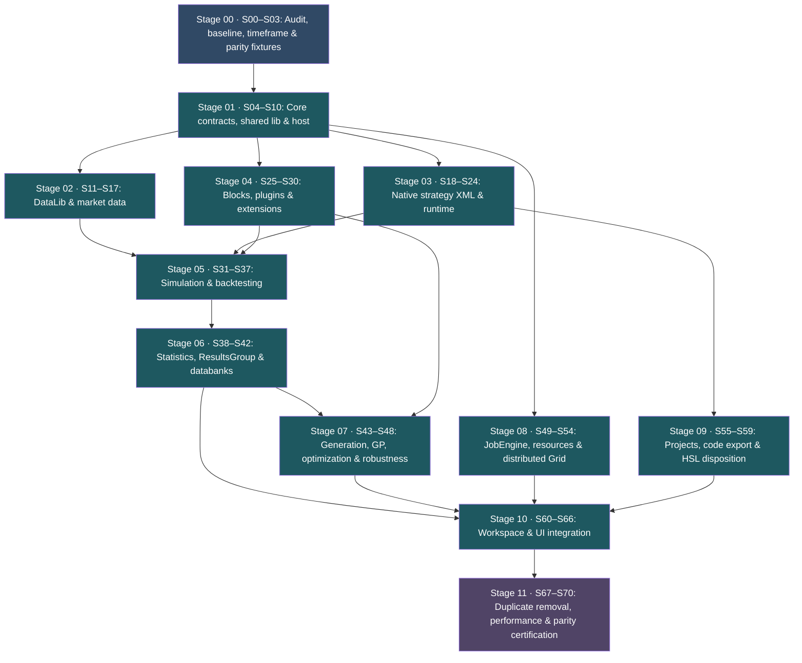
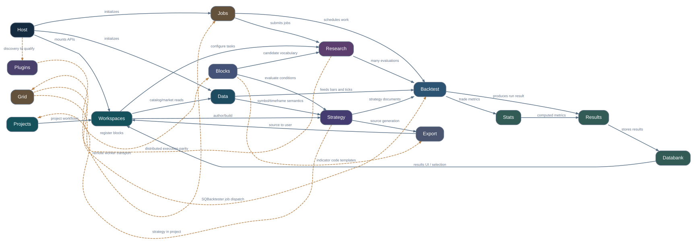
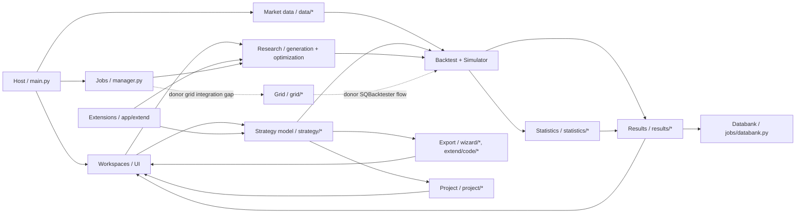

# HaruQuantAI V3 — Complete Donor-First Implementation Plan

PROPOSED · No code changes authorized

Scope: Full cleanup and SQX donor-parity implementation of `app/core`, including the necessary connections to `app/extend`, `app/workspace`, `app/plugins` and `app/web`.

The implementation is divided into **71 slices (`S00`–`S70`) across 12 execution stages**, covering all **76 responsibility boundaries** from the donor-to-destination blueprint.

This replaces approving an isolated first slice without knowing the rest of the work. We maintain one master roadmap, with individually bounded implementation plans and approvals.

## 1. Overall execution order and parallel lanes



Dependencies establish a safe execution sequence, not an instruction to run all 71 slices serially. Several lanes can overlap once their prerequisites pass: for example, host settings work (`S08`) does not block XML parsing (`S19`); core plugin discovery (`S25`) can proceed while DataLib (`S11`–`S17`) is aligned; and JobEngine lifecycle work (`S49`–`S50`) can proceed before full grid integration (`S51`–`S54`). In contrast, HSL retirement (`S59`, `S67`) cannot safely precede native strategy execution (`S18`–`S23`) and consumer migration (`S60`–`S66`).

For parallel work, two coding agents must not edit the same ownership boundary or shared contracts concurrently. They must use separately approved plans with explicit, non-overlapping write paths, or sequence the overlapping change.

## 2. Implementation principles and architectural blueprint

Each slice must follow the same contract: inspect the exact donor methods, implement or correct the designated Python owner, migrate every affected caller, verify behavior against donor evidence, and remove duplication only when that behavior has a qualified replacement.

- **No backwards-compatibility shims.** When we intentionally change an internal Python contract, we update its consumers in the same approved slice. We will not keep two implementations simply to support old imports.
- **No speculative abstractions or folder-count quotas.** New modules are permitted only where a distinct donor responsibility or a necessary Python adaptation justifies them. Existing files should be retained when they are already the appropriate owner; no target reorganization should force donor Java file-count equality.
- **No premature deletion of HSL, `.haru` or other custom implementations.** They are divergences to resolve after their donor replacements, consumers and stored data have been examined. A cleanup slice must explicitly list any deletion.
- **Status terminology:** An implementation can pass Python tests and still be donor-parity unverified. Certification requires behavior supported by recovered donor source and, where obtainable, donor-produced outputs (`partial`: functionality exists but donor behavior is unqualified; `subset`: narrow tested capability; `custom`: non-donor divergence; `gap`: missing source-backed behavior; `adapt`: legitimate host/Python difference; `out-of-core`: workspace/extension owner; `duplicated` / `ownership defect`: overlapping or inverted core/workspace boundary).
- **Path prefixes:** `D/` means `data/reference-donor/internal/libs/`, `X/` means `data/reference-donor/internal/extend/`, and `P/` means `data/reference-donor/internal/plugins/`.

### 2.1 Master runtime and domain topology





### 2.2 Target `app/core` package responsibilities and destination invariants

```text
app/core/
  data/          ← datalib: ONE source of market data, timeframes, chart/symbol contracts,
                   shared instrument/series semantics, storage, resampling and streaming
  trading/       ← tradinglib: ONE native strategy XML model/interpreter, ONE block registry,
                   ONE strategy runtime, ONE simulator, ONE backtest engine, ONE generation
                   engine, ONE optimization engine, ONE metrics/result representation, projects
                   and exports (separate modules only when a distinct responsibility warrants)
  jobs/          ← jobslib: common job submission, admission, cancellation, durable lifecycle
                   and databank jobs (no duplicated task-specific scheduler in workspaces)
  grid/          ← gridlib: distributed worker protocol, message contracts and remote execution
                   (not a second local backtest logic)
  host/          ← consolestarter + host-related lib: web/runtime lifecycle, HTTP/SSE/WS,
                   access control, settings, persistence, logging and resource custody
  lib/           ← selected lib + pluginlib: narrow shared time/RNG/program/error utilities only
  wizard/        ↪ proposed move of source generation to trading/export/ after parity
  enums.py       ↪ proposed distribution of timeframes → data, trade enums → trading
  generators.py  ↪ proposed PRNG move to lib/random.py (not data/)
  # app/plugins/ (currently absent) is outside core and owns plugin lifecycle; block registry stays trading/blocks/
  # app/extend/ owns concrete donor indicators, signals, actions, exits, MM, cross-checks and .tpl platform templates
  # app/workspace/ orchestrates UI/API and projects; never duplicates trading or extension algorithms
```

### 2.3 End-to-end pipeline connections (donor vs current Python vs target)

#### A. Application boot and plugin discovery

```text
DONOR:          SQApp.initApp → SQPluginManager.initForProduct/loadPlugins → Blocks/Config
                → DataManager + SessionManager → JobEngine → GridClient → WebServer
PYTHON CURRENT: app/main.create_app/lifespan → HostPersistence/SettingsManager
                → ResourceMonitor/JobManager/DataCatalog → mounted workspace routers
TARGET:         add donor-equivalent extension discovery and controlled runtime wiring
                only after contract and initialization audit.
```

#### B. Historical data to backtest

```text
DONOR:          DataManager.getDataLoader → BacktestDataFeed.processEvent → StrategyBase.OnEvent
                → TradingSimulator → BacktestRunner → ResultsGroup/StatsComputer/Databank
PYTHON CURRENT: DataCatalog.read → MarketBar → BacktestRunner.run
                → StrategyRuntime.evaluate ↔ BlockRegistry/app/extend
                → SimulationEngine.apply_effects → backtest.RunResult
                → StatisticsService + from_backtest_result → ResultStore
TARGET:         donor-specific precision, market sessions, tick simulation, cross-checks,
                results hierarchy and async SQBacktester coordination must be qualified.
```

#### C. Builder / strategy generation

```text
DONOR:          Builder task → BlocksConfig + StrategyGenerator.generate(XML template)
                → StrategyFixer + StrategyBase → BacktestRunner → fitness → Databank
PYTHON CURRENT: workspace/home/ProjectExecutor or workspace/builder task
                → GenerationEngine.generate_random_strategy / generate_hsl_strategy
                → StrategyDocument (or HSL compiled plan) → BacktestRunner → results
TARGET:         one donor-native strategy grammar, one generator responsible for donor
                XML/template semantics, one block registry and one backtest implementation.
```

#### D. AlgoWizard and source export

```text
DONOR:          AlgoWizard visual editor ↔ AlgoWizardServlet ↔ Strategy XML/SQX package
                → StrategyFixer/StrategyBase → Backtest OR SourceCode + platform snippets
PYTHON CURRENT: web/workspaces/algo_wizard → workspace/algo_wizard backend (not mounted)
                → HSL JSON models/compiler/validator → strategy/runtime or wizard/transform
                ↔ strategy/files.py (.sqx archive only) + extend/code platform descriptors
TARGET:         map XML semantics before removing HSL; mount only after approved parity.
```

#### E. Compute and grid

```text
DONOR:          SQBacktester.run → GridClient.executeOnGrid(SQBacktesterJob)
                → worker → GridMessage progress/finish → ResultsGroup → AlgoWizard WebSocket
PYTHON CURRENT: workspace → JobManager(process/thread pools) → local BacktestRunner
                grid_control → RemoteComputeCoordinator (separate path today)
TARGET:         prove actual grid dispatch/worker/cancel/result integration; do not assume
                coordinator topology equals a functioning SQGrid replacement.
```

#### F. Optimization, robustness and results

```text
DONOR:          Optimizer/Retester tasks → OptimizationEngineSimple/WF + CrossChecks
                → BacktestRunner × candidates → ResultsGroup.mergeWF → StatsComputer
                → Databank → Results UI
PYTHON CURRENT: workspace/optimizer and workspace/retester task modules
                → optimization/engine.py and retester cross_check_* (integration incomplete)
                → backtest/runner.py → results/store.py + statistics/service.py → UI
TARGET:         donor-equivalent sampling, robustness, result hierarchy and statistics.
```

## Stage 00 — Baseline, donor inventory and verification infrastructure

4 slices · S00–S03 · Required before modifying business behavior

| Slice                                  | Implementation work & preflight findings                                                                                                                                                                                                                                                                                                                                                                                                                      | Completion criteria                                                                                                                                                                                   |
| :------------------------------------- | :------------------------------------------------------------------------------------------------------------------------------------------------------------------------------------------------------------------------------------------------------------------------------------------------------------------------------------------------------------------------------------------------------------------------------------------------------------ | :---------------------------------------------------------------------------------------------------------------------------------------------------------------------------------------------------- |
| S00 — Repository baseline             | Freeze source `HEAD` (`main` at `dc24c18a9520e48a8def040472ef6b6914a8f60d`), working-tree status, dependency versions, current tests and architecture checks (`scripts/check_architecture.py`, `scripts/ci_check.py`). Note that `docs/dev/full-reimplementation/research/appcore-completion-audit.md` (2026-11-01) asserts Python test completeness and ratifies `.haru` JSON ZIP projects, which is not donor parity certification.           | Reproducible baseline with existing failures separated from new failures; `AGENTS.md` plan/approval/commit gates enforced.                                                                          |
| S01 — Canonical timeframes            | Compare `D/datalib/TimeframeManager.java` and `D/datalib/timeframe/TimeframesComparator.java` with `app/core/enums.py`, `app/core/data/io.py`, and `app/core/data/contracts.py`. Consolidate conversion semantics initially in the existing owner; moving the canonical `Timeframe` type into a new module (`app/core/data/timeframes.py`) happens in `S11` if justified.                                                                     | Donor-derived tests for `TICK`, `Intraday`, custom `S/M/H/D` (`H7`, `D2`), `Weekly`, `Monthly`, hashes, aliases and invalid inputs. Existing callers continue using one implementation. |
| S02 — Responsibility and caller graph | Complete the 76-entry responsibility map (embedded directly in Stages 01–10 below) at method level across all 10 subsystems (29 initial dependency edges; initial triage counts: `partial` 39, `adapt` 9, `gap` 8, `custom` 6, `out-of-core` 6, `subset` 3, `unverified` 3, `duplicated` 1, `ownership defect` 1). Identify every caller, duplicate, cross-domain import and proposed relocation, including tests and workspace consumers. | Each mapped method has a concrete donor reference, Python owner, status, disposition and verification requirement. Unmapped methods are reported explicitly.                                          |
| S03 — Donor parity test corpus        | Establish reusable fixtures and comparison tests in `tests/` (starting with `tests/core/data/test_contract_imports.py`, `tests/core/data/test_io.py`, `tests/core/data/test_catalog.py`) using donor samples, recovered source algorithms and donor outputs where available. Inventory extension/plugin classes as well.                                                                                                                              | Tests distinguish exact parity, permitted numeric tolerance, expected exceptions and unresolved donor behavior.                                                                                       |

### S01 preflight — Source-observed timeframe discrepancies

| Case         | Donor `getMillis` (ms) | Python `timeframe_to_seconds` (s) | Python `ChartDef.timeframe_seconds` (s) | Triage                           |
| ------------ | -----------------------: | ----------------------------------: | ----------------------------------------: | -------------------------------- |
| `TICK`     |                        0 |                                   0 |                                         0 | duration matches                 |
| `Intraday` |                        0 |                               error |                                         0 | alias/error differs              |
| `M1`       |                    60000 |                                  60 |                                        60 | matches                          |
| `S15`      |                    15000 |                                  15 |                                        15 | matches                          |
| `H7`       |                 25200000 |                               25200 |                                         0 | **confirmed mismatch**     |
| `D2`       |                172800000 |                              172800 |                                         0 | **confirmed mismatch**     |
| `Weekly`   |                604800000 |                               error |                                         0 | alias differs (`W1` accepted)  |
| `Monthly`  |               2419200000 |                               error |                                         0 | alias differs (`MN1` accepted) |

- **Unmapped donor `TimeframeManager` methods to inventory:** `getTFHash`, `getTFName`, `getPredefinedTimeframes`, `getTimeframes`, `addTimeframe`, `TFExists`, `translateSQ3TFToString`, and `translateToMTConstant`.
- **Confirmed donor `getTFHash` research vectors:** `TICK→0`, `Intraday→-10`, `S15→15300`, `M1→60400`, `H1→3600500`, `D1→86400600`, `Weekly→604800700`, `Monthly→2419200800`.
- **Caveats & existing test gaps (`S03`):** Donor `isValid`/`getMillis` parse integer unit counts (including zero/negative counts) which is distinct from safe resampling duration. `ChartDef` connection/symbol hashes are not donor timeframe hashes. `app/core/enums.py::Timeframe` supports `CURRENT`, but not `Intraday`/`TICK` as enum members. Existing `tests/core/data/test_io.py` covers `M1/M5/M10/H1/D1/TICK/S15` and invalid strings, and `tests/core/data/test_contract_imports.py` checks `M1/H1/D1` `to_seconds`, but neither tests `H7/D2/Weekly/Monthly/Intraday` or a custom `ChartDef` duration matrix.

## Stage 01 — Shared primitives, contracts and host infrastructure

7 slices · S04–S10

| Slice                                | Donor source & methods                                                                                                                                                                                                                                                                            | Python current owner(s)                                                                                                                                  | Intended owner & connects to                                                                                                                                                                                                           | Triage                 | Implementation and acceptance boundary                                                                                                                                                                                                                                                                                   |
| :----------------------------------- | :------------------------------------------------------------------------------------------------------------------------------------------------------------------------------------------------------------------------------------------------------------------------------------------------ | :------------------------------------------------------------------------------------------------------------------------------------------------------- | :------------------------------------------------------------------------------------------------------------------------------------------------------------------------------------------------------------------------------------- | :--------------------- | :----------------------------------------------------------------------------------------------------------------------------------------------------------------------------------------------------------------------------------------------------------------------------------------------------------------------- |
| S04 — Contract ownership            | `D/datalib/{ChartDef,DataInfo}.java` (`chart definition, XML, clone`); `D/tradinglib/{Order,StrategyBase}.java`; Python bridge/MT5 connector contracts (`AccountInfo, OrderInfo, TradeRequest, BridgeError`)                                                                              | `app/core/data/contracts.py; app/core/enums.py; app/core/trading/connection/{base,codecs,trading_dispatch}.py; app/core/trading/strategy/contracts.py` | `app/core/data/contracts.py` (chart/data types) & proposed `app/core/trading/connection/contracts.py` (trading-side split) → connects to `app/workspace/trading; brokers; simulation client; market catalog; strategy contexts` | `partial / custom`   | Split market-data contracts from orders, accounts and bridge-specific types where their responsibilities differ. Migrate all imports. Preserve serialization and callers; no duplicate type definitions.                                                                                                                 |
| S05 — Random number generator       | `D/lib/random/{MTRandom,MersenneTwisterRng,MersenneTwisterFast}.java` (`random streams and seeding`)                                                                                                                                                                                          | `app/core/generators.py::RandomGenerator`                                                                                                              | Proposed `app/core/lib/random.py` → connects to `trading/generation/engine.py; optimizer tests`                                                                                                                                   | `unverified`         | Verify generator algorithm, seed, range, cloning and sequence semantics (this is PRNG utility in `lib/random/*`, not `datalib` or `StrategyGenerator`). Compare with donor before choosing MT-compatible implementation. Update generation/optimization imports and remove the old owner.                          |
| S06 — Generic shared utilities      | `D/pluginlib/program/Program.java` (`register, get, isRegistered`); `D/lib/exception/SQException.java` (`domain errors and response envelopes`); `D/lib/{SQTime,TimePeriod}.java` (`time conversion and duration`); `D/lib/XMLUtil.java` (`XML parsing/serialization primitives`) | `app/core/lib/{programs,errors,responses,time}.py; app/core/trading/strategy/files.py; Python XML libraries`                                           | `app/core/lib/{programs,errors,responses,time}.py` & stdlib XML utilities at owning strategy/project boundaries → connects to `registered host/workspace services; logging; statistics; jobs; strategy XML; project config`       | `partial / adapt`    | Align applicable time and program-registry behavior; keep XML parsing with strategy/project owners instead of introducing a generic XML framework. Preserve explicit error semantics and consolidate split `StandardResponse` tests (`tests/core/host/test_responses.py` into `tests/core/lib/test_responses.py`). |
| S07 — Startup and lifecycle         | `D/consolestarter/SQApp.java` (`main, initApp, initEngines, initPluginSystem`); `D/consolestarter/{SQStarter,SQInitializer}.java` (`start and initialize`); `D/lib/memory/{MemoryUsageChecker,CpuInfo}.java` (`memory and CPU guard`)                                                 | `app/main.py; app/cli.py; app/core/host/resources.py`                                                                                                  | `app/main.py; app/cli.py; app/core/host/resources.py` → connects to `app/web; CLI; mounted workspace routers; application lifecycle; app/core/jobs/manager.py`                                                                    | `adapt / unverified` | One startup composition root, controlled service initialization, failure rollback and reverse shutdown. No strategy algorithms in host and no second host framework.                                                                                                                                                     |
| S08 — Settings and persistence      | `D/lib/app/AppSettings.java; D/lib/SettingsMap.java` (`settings read/write`); donor app persistence and file APIs (`generic database isolation`)                                                                                                                                            | `app/core/host/{settings,persistence,strategy_storage}.py`                                                                                             | `app/core/host/settings.py; app/core/host/persistence.py` (audit separate `strategy_storage.py`) → connects to `host services; workspaces; jobs; settings; results; strategies`                                                 | `adapt / custom`     | Verify effective settings defaults, reads, writes and recovery. Preserve Python SQLite isolation; test on temporary stores only. No active database migration or deletion.                                                                                                                                               |
| S09 — Authentication and secrets    | Donor app/host security: exact owners not yet mapped (`session and credentials`)                                                                                                                                                                                                                | `app/core/host/{session,vault}.py`                                                                                                                     | `app/core/host/{session,vault}.py` → connects to `app/core/host/transport.py; broker connections`                                                                                                                                 | `unverified`         | Retain necessary Python host adaptation, validate scope/secret handling, session expiry and fail-closed behavior. Keep distinct from trading-calendar `SessionManager` (`S16`).                                                                                                                                      |
| S10 — Logging, events and transport | `D/consolestarter/SQWebServer.java; D/lib/app/webserver/MainAppWebServer.java` (`webserver startup and routes`); `D/consolestarter/SQApp.java` (`logging, startup diagnostics`)                                                                                                           | `app/core/host/{transport,events,logging,resources}.py`                                                                                                | `app/core/host/{transport,events,logging}.py` → connects to `app/main.py; app/workspace/*/routes.py; every app module`                                                                                                            | `adapt`              | One logging/event/HTTP boundary (FastAPI/SSE/WebSocket host adaptation); consistent startup, request correlation, error handling, stream teardown and redaction. No business algorithms in transport.                                                                                                                    |

## Stage 02 — DataLib parity and market-data ownership

7 slices · S11–S17

| Slice                                              | Donor source & methods                                                                                                                                           | Python current owner(s)                                                                                                                                 | Intended owner & connects to                                                                                                                                                                    | Triage                    | Implementation and acceptance boundary                                                                                                                                                                                |
| :------------------------------------------------- | :--------------------------------------------------------------------------------------------------------------------------------------------------------------- | :------------------------------------------------------------------------------------------------------------------------------------------------------ | :---------------------------------------------------------------------------------------------------------------------------------------------------------------------------------------------- | :------------------------ | :-------------------------------------------------------------------------------------------------------------------------------------------------------------------------------------------------------------------- |
| S11 — Timeframe and chart identity                | `D/datalib/TimeframeManager.java` (`isValid, getMillis, getTFHash, addTimeframe`); `D/datalib/{ChartDef,DataInfo}.java` (`chart definition, XML, clone`) | `app/core/enums.py::Timeframe; app/core/data/io.py::timeframe_to_seconds; app/core/data/contracts.py::ChartDef; app/core/data/catalog.py::DatasetRef` | Proposed `app/core/data/timeframes.py` & `app/core/data/contracts.py` → connects to `data catalog; broker clients; backtest; charts; strategy contexts`                                  | `duplicated / partial`  | Complete chart identity, timeframe metadata, validation, cloning and serialization. If the canonical timeframe type moves, migrate every import in this slice; no permanent shim.                                     |
| S12 — Instrument and symbol economics             | `D/datalib/InstrumentInfo.java; D/datalib/data/SymbolInfo.java` (`symbol economics / instrument metadata`)                                                   | `app/core/data/contracts.py::SymbolInfo; app/workspace/data_manager/symbols/*`                                                                        | `app/core/data/contracts.py` (shared immutable metadata; workspace owns CRUD) → connects to `data manager; simulator; brokers`                                                             | `partial`               | Match symbol precision, tick size/value, point economics and instrument identity. Keep MT5-specific bridge metadata distinct if semantics differ.                                                                     |
| S13 — Market series and event representation      | `D/datalib/{TickEvent,DataSeries,SymbolData}.java` (`tick/bar streams and series`)                                                                           | `app/core/data/contracts.py::MarketBar/MarketTick; app/core/trading/blocks/series.py`                                                                 | `app/core/data/contracts.py; app/core/trading/blocks/series.py` → connects to `backtest feed; indicators`                                                                                  | `partial`               | Verify tick/bar timestamps, ordering, indexing, reserve bars, timezones, precision, missing history, bar boundaries and stateful series operations.                                                                   |
| S14 — Data catalog lifecycle                      | `D/datalib/data/DataManager.java` (`list, addData, getDataLoader, flushUpdatedData`)                                                                         | `app/core/data/catalog.py::DataCatalog; app/core/data/market_storage.py`                                                                              | `app/core/data/{catalog,market_storage}.py` → connects to `app/workspace/data_manager; backtest jobs`                                                                                      | `partial`               | Match dataset listing, registration, updates, lookup and loader lifecycle (workspace coordinates, Core owns shared read/write/stream), with tests for metadata and catalog consistency.                               |
| S15 — Data loading, storage and transforms        | `D/datalib/data/io/{DataBinReader,DataBinWriter,VersatileData}.java` (`binary read/write, data feed`)                                                        | `app/core/data/{market_storage,io}.py`                                                                                                                | `app/core/data/{market_storage,io}.py` → connects to `DataCatalog.read; historical testing`                                                                                                | `adapt`                 | Verify ingest, seek/read, range selection, resampling, precision and append/recovery behavior. Physical Parquet/columnar storage may remain a justified Python adaptation; functional differences must be documented. |
| S16 — Trading sessions, calendars and timezones   | `D/datalib/session/{SessionManager,Session}.java; D/datalib/timezone/*` (`trading calendars and sessions`)                                                   | `app/workspace/data_manager/sessions/*; app/core/data/contracts.py`                                                                                   | `app/workspace/data_manager/sessions/*` & shared readonly types in `app/core/data` → connects to `data manager; backtest time restrictions`                                              | `partial`               | Match sessions, breaks, holidays, timezone transitions and session-based bar handling. No use of `app/core/host/session.py` (`S09`, UI authentication) for trading calendars.                                     |
| S17 — Broker definitions, baskets and custom data | `D/datalib/broker/{BrokerManager,BrokerDto}.java` (`broker costs and definitions`); `D/datalib/{customData,basket}/*` (`custom series and baskets`)      | `app/workspace/data_manager/{brokers,custom,baskets}/*; app/workspace/brokers/*`                                                                      | `app/workspace/data_manager/{brokers,custom,baskets}/*` (definitions/tasks) & `app/workspace/brokers/*` (connections) → connects to `backtest costs; live account sessions; DataCatalog` | `partial / out-of-core` | Verify configuration and data semantics feeding the core. Keep broker execution and market-data adapters distinct. Do not duplicate Data Manager functionality inside core.                                           |

Stage 02 gate: Historical data must enter the quantitative engines through stable, tested core contracts. Data Manager may coordinate imports and configuration, but it cannot become an alternative market-data engine.

## Stage 03 — Native SQX strategy files, XML semantics and strategy runtime

7 slices · S18–S24 · Highest-priority semantic dependency

This stage establishes the strategy representation that Builder, AlgoWizard, backtesting and code export must share. We should not build further custom HSL functionality while the donor-native model remains incomplete.

| Slice                                           | Donor source & methods                                                                                                                                             | Python current owner(s)                                                                                                                                                                                 | Intended owner & connects to                                                                                                                                  | Triage               | Implementation and acceptance boundary                                                                                                                                                                                                                                                                                         |
| :---------------------------------------------- | :----------------------------------------------------------------------------------------------------------------------------------------------------------------- | :------------------------------------------------------------------------------------------------------------------------------------------------------------------------------------------------------ | :------------------------------------------------------------------------------------------------------------------------------------------------------------ | :------------------- | :----------------------------------------------------------------------------------------------------------------------------------------------------------------------------------------------------------------------------------------------------------------------------------------------------------------------------- |
| S18 — SQX package I/O                          | `P/ServletAlgoWizard/AlgoWizard/AlgoWizardServlet.java` (`onLoadFile, onSaveFile; archive exchange`)                                                           | `app/core/trading/strategy/files.py::read_sqx/write_sqx`                                                                                                                                              | `app/core/trading/strategy/files.py` → connects to `app/workspace/algo_wizard/workspace.py; UI`                                                          | `subset`           | Retain the already-tested ZIP entry preservation implementation. Expand only verified package compatibility, metadata and corruption cases. Do not mix ZIP I/O with XML interpretation.                                                                                                                                        |
| S19 — Native XML parsing and serialization     | `X/Snippets/SQ/Internal/XmlStrategy.java` (`donor strategy XML interpretation`); `D/tradinglib/StrategyBase.java`                                            | `app/core/trading/strategy/hsl/{models,compiler}.py`                                                                                                                                                  | Proposed `app/core/trading/strategy/xml.py` + existing runtime models → connects to `AlgoWizard; generation; export`                                     | `gap`              | Parse, represent and serialize donor strategy XML without semantic loss. Preserve rule trees, parameters, variables, actions, identifiers, settings and supported extension nodes.                                                                                                                                             |
| S20 — Strategy repair and normalization        | `D/tradinglib/strategy/xml/StrategyFixer.java` (`fixStrategy, fixShifts, fixMissingVariables`)                                                                 | `app/core/trading/strategy/hsl/documents.py` (legacy conversion)                                                                                                                                      | Proposed `app/core/trading/strategy/xml.py` (donor XML semantics) → connects to `strategy loader; generated strategies`                                  | `gap`              | Match `fixStrategy`, parameter/variable repairs, shifts, strategy-version normalization and donor repair rules. Fix confirmed defect in `hsl/documents.py` line 555 where `float(sig.get("threshold") or 50.0)` corrupts an explicit `0` threshold to `50.0`. Test before/after XML fixtures.                        |
| S21 — Authoritative strategy model             | `D/tradinglib/StrategyBase.java` (`Initialize, OnEvent, createXmlStrategy`); donor `StrategyBase / StrategyFixer / AlgoWizard XML` (`strategy validation`) | `app/core/trading/strategy/{contracts,runtime}.py; app/core/trading/strategy/hsl/{validation,models}.py`                                                                                              | `app/core/trading/strategy/{contracts,xml}.py` & native strategy validator → connects to `generator; backtester; editor; workspace/algo_wizard; builder` | `partial / custom` | Establish one runtime-capable representation preserving donor XML semantics. Determine which existing `StrategyDocument` fields are sufficient and migrate gaps without creating a competing DSL.                                                                                                                            |
| S22 — Strategy event execution                 | `D/tradinglib/StrategyBase.java::Initialize, OnEvent`; `D/tradinglib/strategy/MarketData.java` (`event dispatch and strategy context`)                       | `app/core/trading/strategy/{runtime,contracts}.py`                                                                                                                                                    | `app/core/trading/strategy/{runtime,contracts}.py` → connects to `backtest/runner.py; extension indicators`                                              | `partial`          | Correct tick/bar/open/close event dispatch timings, state, variables, block evaluation, entry/exit decisions and action ordering. This becomes the sole strategy execution owner used by backtesting.                                                                                                                          |
| S23 — Strategy loading, versioning and merging | `D/tradinglib/strategy/{StrategyLoader,StrategyMerger}.java; D/tradinglib/strategy/xml/SQ3StrategyConverter.java` (`load and legacy conversions`)              | `app/core/trading/strategy/files.py; app/core/trading/strategy/hsl/documents.py; app/workspace/algo_wizard/strategies.py`                                                                             | `app/core/trading/strategy/{xml,files,contracts}.py` → connects to `workspace editors and file operations`                                               | `gap`              | Handle native strategies, versions, settings and merges without losing source data. Reject unsupported versions explicitly rather than silently converting or reserializing unknown XML.                                                                                                                                       |
| S24 — HSL equivalence inventory                | `none: HaruQuant Strategy Language 1.0` (`JSON AST, validation, compiled HSL semantics`) versus donor XML semantics                                            | `app/core/trading/strategy/hsl/{capabilities,catalogue_models,compiler,documents,execution,expressions,library,models,orders,policies,validation,value_models}.py; app/core/host/strategy_storage.py` | Candidate for staged replacement after donor-native parity → connects to `AlgoWizard backend; generation; backtester`                                      | `custom`           | Identify every HSL capability, caller and persisted artifact (including duplicate 594-line `WizardBlockLibrary` in `hsl/library.py` and the `hsl/documents.py` line 555 `0`-threshold bug). Classify donor-equivalent, custom-only and missing behavior. Define migration requirements; no HSL deletion in this slice. |

Stage 03 gate: A real donor strategy package can be loaded, interpreted, serialized and executed through the shared strategy model, subject to explicitly recorded unsupported donor behavior.

## Stage 04 — Blocks, indicators, plugins and extension integration

6 slices · S25–S30

The `app/extend` implementations remain the starting point. This stage verifies that the core actually discovers, instantiates, configures and executes them using donor-equivalent semantics.

| Slice                                           | Donor source & methods                                                                                                                                                                                                          | Python current owner(s)                                                                                                                                   | Intended owner & connects to                                                                                                                                                 | Triage               | Implementation and acceptance boundary                                                                                                                                                                                                                                                    |
| :---------------------------------------------- | :------------------------------------------------------------------------------------------------------------------------------------------------------------------------------------------------------------------------------ | :-------------------------------------------------------------------------------------------------------------------------------------------------------- | :--------------------------------------------------------------------------------------------------------------------------------------------------------------------------- | :------------------- | :---------------------------------------------------------------------------------------------------------------------------------------------------------------------------------------------------------------------------------------------------------------------------------------- |
| S25 — Plugin lifecycle                         | `D/pluginlib/{SQPluginManager,ISQPlugin}.java` (`initForProduct, loadPlugins, getPlugins`)                                                                                                                                  | `app/core/trading/blocks/registry.py` (note: `app/plugins/` does not currently exist in `app/`)                                                     | Proposed `app/plugins/` (plugin lifecycle) & `app/core/trading/blocks/registry.py` (blocks only) → connects to `app/extend; host/workspace registration`              | `partial`          | Verify discovery, categories, eligibility, initialization order, failure handling and shutdown. Do not confuse a trading-block registry with the entire plugin system.                                                                                                                    |
| S26 — Block registry and configuration         | `D/tradinglib/{IBlock,Indicator,Blocks}.java; D/tradinglib/blocks/random/BlocksConfig.java` (`block metadata, selectable random blocks`); `D/lib/snippets/CustomClassesLoader.java` (`extension discovery and loading`) | `app/core/trading/blocks/{base,indicator,metadata,registry}.py; app/core/trading/strategy/hsl/library.py`                                               | `app/core/trading/blocks/{base,indicator,metadata,registry}.py` (one registry owner) → connects to `app/extend/blocks/*; strategy runtime; generator; wizard catalogue` | `partial`          | Match block identity, parameters, defaults, categories, explicit Python module discovery (`register_file/discover`), and selection constraints. Eliminate the duplicate 594-line `WizardBlockLibrary` in `hsl/library.py` in favor of one authoritative 795-line `BlockRegistry`. |
| S27 — Series and indicator execution           | `D/tradinglib/Indicator.java; D/datalib/DataSeries.java; D/tradinglib/blocks/*; X/Snippets/SQ/Blocks/Indicators/*` (`indicators, series, indicator state and composition`)                                                  | `app/core/trading/blocks/{base,indicator,metadata,series,runtime,composition,composition_runtime,runtime_inputs}.py; app/extend/blocks/indicators/*`    | Same core block runtime files & `app/extend/blocks/indicators/*` → connects to `core/trading/blocks registry; strategy/runtime.py; hsl/execution.py`                    | `subset / partial` | Verify calculation timing, lookback, indexing, warm-up, cache invalidation and numerical output for representative donor indicators, keeping one numerical/state implementation per block.                                                                                                |
| S28 — Price, signals and Bar & Time            | `X/Snippets/SQ/Blocks/{BarAndTime,CandlePatterns,Comparisons,Functions,Order,Other,OtherActions,Price,StrategyControl}/*; X/Snippets/SQ/Trading/*` (`signals, price expressions and actions`)                               | `app/extend/blocks/*; app/core/trading/blocks/composition.py`                                                                                           | Same extension files & `app/core/trading/blocks/composition.py` → connects to `strategy execution; builder catalogue`                                                   | `partial`          | Verify each recovered donor block is registered and callable with its required parameters. Cover timeframe shifts, signal thresholds, date/session boundaries and bar-open conditions.                                                                                                    |
| S29 — Trading blocks and actions               | `X/Snippets/SQ/Blocks/{Order,OtherActions,StrategyControl}/*; X/Snippets/SQ/Trading/*; D/tradinglib/blocks/*` (`order, exit and action snippets`)                                                                           | `app/extend/blocks/*; app/core/trading/blocks/{series,runtime,composition,composition_runtime,runtime_inputs}.py; app/core/trading/strategy/runtime.py` | Same extension/core block owners & `app/core/trading/strategy/runtime.py` → connects to `strategy execution; simulation`                                                | `partial`          | Match order/action parameter semantics and resulting strategy effects. Extension blocks implement behavior; runtime orchestrates execution.                                                                                                                                               |
| S30 — Money management and research extensions | `X/Snippets/SQ/* (MM/Exit/WhatIf/MC)` (`money management, exits and research extensions`)                                                                                                                                   | `app/extend/money_management/*; app/extend/monte_carlo/*; app/extend/what_if/*`                                                                         | Same extension owners → connects to `strategy/backtest; retester; portfolio tools`                                                                                        | `partial`          | Verify sizing, risk, exit and experiment calculations. Preserve algorithms at extension ownership boundaries instead of rewriting them in workspaces.                                                                                                                                     |

Stage 04 gate: Every donor block in the scoped inventory has exactly one accountable destination or an explicitly recorded gap. Registration success alone does not count as execution parity.

## Stage 05 — Trading simulator and backtesting engine

7 slices · S31–S37

This stage is one of the largest behavioral corrections. A strategy can be perfectly represented yet produce different results if bar timing, spreads, fills, stop orders or position accounting differ.

| Slice                                              | Donor source & methods                                                                                                                                                                                | Python current owner(s)                                                                                                                                     | Intended owner & connects to                                                                                                                                               | Triage                        | Implementation and acceptance boundary                                                                                                                                                                                                                                                                                                                                                                                                                                                                                                                                               |
| :------------------------------------------------- | :---------------------------------------------------------------------------------------------------------------------------------------------------------------------------------------------------- | :---------------------------------------------------------------------------------------------------------------------------------------------------------- | :------------------------------------------------------------------------------------------------------------------------------------------------------------------------- | :---------------------------- | :----------------------------------------------------------------------------------------------------------------------------------------------------------------------------------------------------------------------------------------------------------------------------------------------------------------------------------------------------------------------------------------------------------------------------------------------------------------------------------------------------------------------------------------------------------------------------------- |
| S31 — Correct core/workspace dependency direction | Donor `TradingSimulator/connection` APIs (`trade request/response simulation`)                                                                                                                    | `app/core/trading/simulation/{client,validation}.py; app/core/trading/connection/{base,codecs,trading_dispatch}.py; app/workspace/brokers/simulator.py`   | `app/core/trading/simulation/{client,validation}.py; app/core/trading/connection/{base,codecs,trading_dispatch}.py` → connects to `workspace/trading; tests; brokers` | `ownership defect`          | Remove direct dependencies on `app.workspace.data_manager.data.conversions`, `app.workspace.data_manager.data.history.validate_rows`, and `app.workspace.trading.Trading` from `simulation/client.py` and `app.workspace.trading.base.normalize_request` from `connection/trading_dispatch.py` (line 194). Remove the 8-line `app/workspace/brokers/simulator.py` `sys.modules` shim and the 3 duplicated test suites `tests/core/trading/simulation/test_{exits,operations,strategy_control}.py` (1,090 lines duplicating `tests/workspace/trading/test_*.py`). |
| S32 — Trading orders and execution contracts      | `D/tradinglib/{Order,Trader}.java`, simulator interfaces & bridge connector contracts (`AccountInfo, OrderInfo, TradeRequest, BridgeError`)                                                       | `app/core/data/contracts.py; app/core/enums.py; app/core/trading/connection/{base,codecs,trading_dispatch}.py; app/core/trading/simulation/validation.py` | `app/core/trading/connection/*; app/core/trading/simulation/validation.py; strategy/contracts.py` → connects to `workspace/trading; brokers; simulator`               | `custom / ownership defect` | Align order types, pending orders, modification requests, account economics, quantity validation, costs and failures.                                                                                                                                                                                                                                                                                                                                                                                                                                                                |
| S33 — Price matching and fill engine              | `D/tradinglib/simulator/impl/AbstractTradingSimulator.java` (`eventNewTick, priceLevelReached, fills`)                                                                                            | `app/core/trading/simulation/engine.py`                                                                                                                   | `app/core/trading/simulation/engine.py` → connects to `backtest runner`                                                                                               | `partial`                   | Match market/limit/stop triggering, SL/TP same-bar ambiguity, spread, commission, slippage, bar gaps and MAE/MFE. Unify order-matching semantics across `SimulationEngine` (`engine.py`, 728 lines) and `SimulatorClient` (`client.py`, 971 lines + `validation.py`, 80 lines). Donor fixtures must cover exact fills and resulting P&L.                                                                                                                                                                                                                                   |
| S34 — Hedging, netting and position lifecycle     | `D/tradinglib/simulator/impl/{MetaTraderSimulatorHedging,MetaTraderSimulatorNetting}.java` (`position semantics`)                                                                                 | `app/core/trading/simulation/{engine,client}.py`                                                                                                          | `app/core/trading/simulation/*` → connects to `backtest; broker abstraction`                                                                                          | `partial`                   | Validate multiple positions, partial closes, reversals, margin, equity, balance, pending orders, order modifications and position state transitions across the unified simulation engine and client surface.                                                                                                                                                                                                                                                                                                                                                                         |
| S35 — Historical backtest data feed               | `D/tradinglib/backtest/{BacktestDataFeed,BacktestSettings}.java` (`initialize, loadDataForFeed, processEvent`)                                                                                    | `app/core/data/catalog.py; app/core/trading/backtest/{contracts,runner}.py`                                                                               | `app/core/trading/backtest/* + app/core/data` I/O → connects to `simulator and runtime`                                                                               | `gap`                       | Match tick/bar precision, data preparation, warm-up, sessions, market timing, cross-symbol alignment and configuration defaults.                                                                                                                                                                                                                                                                                                                                                                                                                                                     |
| S36 — Backtest runner                             | `D/tradinglib/backtestrunner/BacktestRunner.java` (`execute, runBacktestOnMainSetup, cross-checks`); `D/tradinglib/backtest/SQBacktester.java` (`run, stop, processMessage, getResultsGroup`) | `app/core/trading/backtest/runner.py; app/core/jobs/manager.py; app/core/grid/executor.py; app/workspace/algo_wizard/visual_blocks.py`                    | `app/core/trading/backtest/runner.py` (engine) + `app/workspace/retester` (cross-check orchestration) → connects to `home executor; AlgoWizard; optimizer`          | `partial / gap`             | Execute strategies with donor event ordering through the single simulator and runtime, and delegate inline `SimulationEngine.compute_metrics()` / `_calculate_sharpe()` to `StatisticsService`. Validate trades, equity, drawdown, MAE/MFE, progress and cancellation checkpoints. Grid delegation is completed in Stage 08 (`S53`).                                                                                                                                                                                                                                         |
| S37 — Conditions, risk rules and backtest parity  | `D/tradinglib/conditions/ConditionsChecker.java` (`check, cross-check sample handling`)                                                                                                           | `app/core/trading/conditions.py; app/core/trading/strategy/runtime.py`                                                                                    | Same files with responsibility separation → connects to `strategies; retester`                                                                                          | `partial`                   | Verify entry restrictions, run conditions, sampling boundaries and risk decisions. Establish donor-versus-Python differential tests covering representative trading scenarios.                                                                                                                                                                                                                                                                                                                                                                                                       |

Stage 05 gate: Given the same donor strategy, historical data, broker settings and simulation configuration, the Python runner reproduces the donor's observable order/trade results within explicitly defined tolerances.

## Stage 06 — Statistics, ResultsGroup and Databank

5 slices · S38–S42

| Slice                                     | Donor source & methods                                                                                                                                                                                           | Python current owner(s)                                                                      | Intended owner & connects to                                                                                                                                                 | Triage               | Implementation and acceptance boundary                                                                                                                                                                                                                                                                                                                       |
| :---------------------------------------- | :--------------------------------------------------------------------------------------------------------------------------------------------------------------------------------------------------------------- | :------------------------------------------------------------------------------------------- | :--------------------------------------------------------------------------------------------------------------------------------------------------------------------------- | :------------------- | :----------------------------------------------------------------------------------------------------------------------------------------------------------------------------------------------------------------------------------------------------------------------------------------------------------------------------------------------------------- |
| S38 — Result contract consolidation      | `D/tradinglib/{Result,ResultsGroup}.java` (`result/portfolio and subresult hierarchy`); `D/tradinglib/backtestrunner/BacktestRunner.java` (`result generation / fitness`)                                | `app/core/trading/results/{contracts,adapters}.py; app/core/trading/backtest/contracts.py` | `app/core/trading/results/{contracts,adapters}.py; app/core/trading/backtest/contracts.py` → connects to `results workspace; databank; WF; ResultStore; home executor`  | `partial / adapt`  | Audit the two current `RunResult` representations bridged by `from_backtest_result`. Retain separate execution/storage types only if they have genuinely different responsibilities; otherwise consolidate and migrate callers.                                                                                                                          |
| S39 — Statistics engine                  | `D/tradinglib/SQStats.java; D/tradinglib/results/stats/StatsComputer.java` (`computeStats, computeStatValues, dependency graph`)                                                                             | `app/core/trading/statistics/{base,contracts,dependencies,service}.py`                     | Same statistics files → connects to `home execution; results UI`                                                                                                          | `partial`          | Match metric formulas, rounding, trade populations, IS/OOS splitting, dependency calculations and zero/undefined cases. Replace inline `SimulationEngine.compute_metrics()` and `_calculate_sharpe()` in `app/core/trading/simulation/engine.py` with `StatisticsService` and `app/extend/metrics/`. Verify donor numeric vectors.                 |
| S40 — ResultsGroup hierarchy             | `D/tradinglib/ResultsGroup.java; D/tradinglib/results/ResultsMap.java` (`result key mapping and additional markets`)                                                                                         | `app/core/trading/results/{contracts,store}.py`                                            | `app/core/trading/results/{contracts,store}.py` → connects to `retester; portfolio; results UI; databank; WF`                                                           | `partial`          | Support donor result grouping, source results, retests, additional markets, merged WF results, portfolios and clone/merge semantics.                                                                                                                                                                                                                         |
| S41 — Databank behavior and jobs         | `D/tradinglib/Databank.java` (`add, remove, filter, synchronize, lock`); `D/jobslib/databank/{AddToDatabankJob,MoveToDatabankJob,DeleteFromDatabankJob,LoadFileToDatabankJob}.java` (`databank job run`) | `app/core/jobs/databank.py; app/core/trading/results/store.py`                             | `app/core/trading/results/store.py` + `app/core/jobs/databank.py` (distinct store vs. job owners) → connects to `project home; result grids; ResultStore; JobManager` | `partial / subset` | Match add/move/delete/load, filtering, ordering, duplicate identity, concurrent access and result ownership, including extending `LoadFileToDatabankJob` in `app/core/jobs/databank.py` (currently JSON-only) to load `.sqx` ZIP archives via `app/core/trading/strategy/files.py::read_sqx`. No parallel databank implementation in workspace code. |
| S42 — Result persistence and read models | `D/tradinglib/results/ResultsMap.java`; donor result storage/loading                                                                                                                                           | `app/core/trading/results/{store,adapters}.py; app/core/host/persistence.py`               | `app/core/trading/results/{store,adapters}.py` & host persistence → connects to `ResultStore; home executor; results UI`                                                | `partial / adapt`  | Verify durable result integrity, search/retrieval, migrations where separately approved, and serialization of complete trade/equity/statistic records. Test with isolated stores.                                                                                                                                                                            |

Stage 06 gate: Results from a strategy run, optimization, robustness test or portfolio operation remain inspectable and statistically consistent after saving and reloading.

## Stage 07 — Strategy generation, genetic programming, optimization and robustness

6 slices · S43–S48

The objective is to replace the current simplified/custom generation logic with donor-equivalent behavior, while reusing the single strategy model, block registry and backtester.

| Slice                                              | Donor source & methods                                                                                                                                              | Python current owner(s)                                                        | Intended owner & connects to                                                                                                                          | Triage          | Implementation and acceptance boundary                                                                                                                                                                                                                                                                                                                                                                                       |
| :------------------------------------------------- | :------------------------------------------------------------------------------------------------------------------------------------------------------------------ | :----------------------------------------------------------------------------- | :---------------------------------------------------------------------------------------------------------------------------------------------------- | :-------------- | :--------------------------------------------------------------------------------------------------------------------------------------------------------------------------------------------------------------------------------------------------------------------------------------------------------------------------------------------------------------------------------------------------------------------------- |
| S43 — Generator configuration and block selection | `D/tradinglib/generator/GeneratorBase.java; D/tradinglib/blocks/random/{BlocksConfig,ReplacementsConfig}.java` (`template IDs, replacements and shared config`) | `app/core/trading/generation/engine.py; app/core/trading/blocks/registry.py` | `app/core/trading/generation/engine.py` + `app/core/trading/blocks/registry.py` → connects to `Builder settings; donor block templates`        | `gap`         | Match selectable blocks, enabled directions, replacement rules, parameter bounds, identifiers and donor defaults. Fix confirmed defect in `GenerationEngine._generate_conditions()` (`app/core/trading/generation/engine.py` lines 266–277) where `ConditionDefinition(..., composition_block_id=block_id)` emits empty `composition_params` when selecting composition blocks that require non-default parameters. |
| S44 — Donor strategy generation pipeline          | `D/tradinglib/generator/StrategyGenerator.java` (`generate; random block/param replacement; post-fixes`) & `StrategyFixer.java`                               | `app/core/trading/generation/engine.py::GenerationEngine`                    | `app/core/trading/generation/engine.py` (donor-first logic) + shared strategy XML owner → connects to `workspace/builder; home project executor` | `partial`     | Reproduce template cloning, random conditions, block/parameter replacement, exits, direction handling, strategy repair and output validation. Avoid generating a separate HSL strategy as the authoritative result.                                                                                                                                                                                                          |
| S45 — Genetic programming                         | `D/tradinglib/gp/{GPEngine,strategies/*}.java` (`genetic selection/crossover/mutation`)                                                                         | `app/core/trading/generation/engine.py`                                      | Same engine with measured donor semantics → connects to `app/workspace/builder/task_build.py`                                                      | `partial`     | Match population initialization, mutations, crossover, selection, fitness handling, generation limits, termination and seeded reproducibility. Remove custom algorithms where donor equivalents are confirmed.                                                                                                                                                                                                               |
| S46 — Simple optimization                         | `D/tradinglib/optimization/{OptimizationEngine,OptimizationEngineSimple}.java` (`parameter optimization, brute force and genetic`)                              | `app/core/trading/optimization/engine.py`                                    | Same engine (`app/workspace/optimizer` controls task) → connects to `app/workspace/optimizer/task_optimize.py`                                   | `partial`     | Verify parameter combinations, ranges, optimization methods, candidate evaluation, ranking, stopping and fitness calculation. All evaluations call the shared backtester.                                                                                                                                                                                                                                                    |
| S47 — Walk-forward and sequential optimization    | `D/tradinglib/optimization/{OptimizationEngineWF,SequentialOptimizationEngine}.java` (`walk-forward and sequential optimization`)                               | `app/core/trading/optimization/engine.py`                                    | Same engine (`app/workspace/optimizer` owns task config) → connects to `retester WF cross-checks; optimizer UI`                                  | `partial`     | Match IS/OOS windows, rolling or anchored periods, best-candidate selection, OOS evaluation, trades merge, WF efficiency and scoring.                                                                                                                                                                                                                                                                                        |
| S48 — Retester and robustness methods             | `D/tradinglib/crosscheck/ICrossCheck.java; D/tradinglib/robustnesstests/*` (`retest and robustness methods`)                                                    | `app/workspace/retester/cross_check_*.py; app/extend/monte_carlo/*`          | `app/workspace/retester` orchestration + extension-owned test implementations → connects to `BacktestRunner; result store`                       | `out-of-core` | Match higher precision, additional markets, parameter permutations, Monte Carlo, What-If, WF matrix and applicable robustness tests. Workspace coordinates; extension/core owners calculate (do not duplicate retest algorithms inside Core).                                                                                                                                                                                |

Stage 07 gate: Builder generation and optimization produce donor-equivalent candidate behavior, while all research paths use the same backtest and result engines. Existing Builder parameter-selection and cancellation failures must be resolved or explicitly shown to be unrelated.

## Stage 08 — JobEngine, resource allocation and distributed SQGrid

6 slices · S49–S54

| Slice                                    | Donor source & methods                                                                                                                                           | Python current owner(s)                                                                                                                  | Intended owner & connects to                                                                                                | Triage            | Implementation and acceptance boundary                                                                                                                                                                           |
| :--------------------------------------- | :--------------------------------------------------------------------------------------------------------------------------------------------------------------- | :--------------------------------------------------------------------------------------------------------------------------------------- | :-------------------------------------------------------------------------------------------------------------------------- | :---------------- | :--------------------------------------------------------------------------------------------------------------------------------------------------------------------------------------------------------------- |
| S49 — Job lifecycle                     | `D/jobslib/{SQJob,JobEngine,JobsList}.java` (`job run, submit, listener and list`)                                                                           | `app/core/jobs/manager.py::JobManager`                                                                                                 | `app/core/jobs/manager.py` → connects to `home execution; data downloads; code editor`                                 | `partial`       | Match submission, queued/running/paused/finished states, progress, failures, cancellation, completion events and job ownership. Retain justified Python process/thread pool execution and durable job lifecycle. |
| S50 — Resource scheduling and admission | `D/lib/memory/{MemoryUsageChecker,CpuInfo}.java; D/jobslib/JobEngine.java` (`finite capacity and worker controls`)                                           | `app/core/host/resources.py; app/core/jobs/manager.py`                                                                                 | `app/core/host/resources.py` & `app/core/jobs/manager.py` separately → connects to `backtest; generation; optimizer` | `adapt`         | One resource policy for CPU, RAM and job concurrency. Verify admission, release, exhaustion, cancellation and no resource leakage.                                                                               |
| S51 — Grid protocol and contracts       | `D/gridlib/client/{GridClient,SQGrid,GridMessage,GridJob,JobDetails}.java` (`executeOnGrid, topology, message, stop; wire contracts, completion and events`) | `app/core/grid/executor.py::RemoteComputeCoordinator; app/core/grid/contracts.py`                                                      | `app/core/grid/{contracts,executor}.py` → connects to `app/workspace/grid_control/service.py; progress consumers`      | `partial`       | Establish explicit job payloads, identifiers, heartbeat, correlation, progress, completion, errors, worker identity, cancellation and retry behavior.                                                            |
| S52 — Worker computation and topology   | `D/gridlib/{compute,sync,topology}/*` (`remote compute, folder guards, worker sync`)                                                                         | `app/core/grid/{executor,contracts}.py`                                                                                                | `app/core/grid/*` + necessary host worker implementation → connects to `remote agents; backtest/optimization`          | `gap`           | Implement or correct actual remote worker execution, capacity reporting, task dispatch, result return and required artifact synchronization. New files require donor-backed responsibility justification.        |
| S53 — SQBacktester-to-Grid integration  | `D/tradinglib/backtest/SQBacktester.java` (`run, stop, processMessage, getResultsGroup`) & `D/gridlib/client/GridClient.java::executeOnGrid`               | `app/core/jobs/manager.py; app/core/grid/executor.py; app/workspace/algo_wizard/visual_blocks.py; app/core/trading/backtest/runner.py` | `app/core/trading/backtest/*; app/core/grid/*; app/core/jobs/*` → connects to `AlgoWizard backtest/progress/results`   | `gap / partial` | Connect the one backtest engine to real grid dispatch, progress, stop and result collection. Verify local and remote results agree. No second remote backtesting algorithm.                                      |
| S54 — Grid monitoring and control       | `D/gridlib/client/{GridClient,SQGrid}.java; D/gridlib/topology/*` (`status/topology/message behavior`)                                                       | `app/workspace/grid_control/{service,routes}.py; app/core/grid/{executor,contracts}.py`                                                | `app/workspace/grid_control/{service,routes}.py` & `app/core/grid/*` → connects to `grid UI; active jobs`            | `partial / gap` | Verify nodes, status, active jobs, cancel/pause operations, worker loss and progress reporting. UI actions must affect actual executing jobs, not just coordinator metadata.                                     |

Stage 08 gate: A backtest or optimization can be submitted, assigned resources, executed locally or remotely, cancelled, resumed where donor semantics permit, and returned as a complete result through one job lifecycle.

## Stage 09 — SQX projects, code export and custom-model disposition

5 slices · S55–S59

| Slice                                        | Donor source & methods                                                                                                                                                              | Python current owner(s)                                                                                                                                                                                 | Intended owner & connects to                                                                                                               | Triage      | Implementation and acceptance boundary                                                                                                                                                                                                                                                                                                                                                                                                                                                        |
| :------------------------------------------- | :---------------------------------------------------------------------------------------------------------------------------------------------------------------------------------- | :------------------------------------------------------------------------------------------------------------------------------------------------------------------------------------------------------ | :----------------------------------------------------------------------------------------------------------------------------------------- | :---------- | :-------------------------------------------------------------------------------------------------------------------------------------------------------------------------------------------------------------------------------------------------------------------------------------------------------------------------------------------------------------------------------------------------------------------------------------------------------------------------------------------- |
| S55 — Native project packaging              | `D/tradinglib/file/SQFileManager.java` (`loadProjectConfig, loadTaskConfigs, saveProjectFile`)                                                                                  | `app/core/trading/project/{envelope,contracts,store}.py`                                                                                                                                              | Proposed native donor `.cfx` owner; current `.haru` retained pending review → connects to `home project workspace; custom projects` | `custom`  | Implement or qualify donor `.cfx` project semantics: configuration, tasks, settings, embedded references and validation. Document the current `.haru` JSON ZIP divergence and make its final disposition an explicit decision.                                                                                                                                                                                                                                                            |
| S56 — Project and task configuration        | `D/tradinglib/project/{SQProject,ProjectConfigHelper}.java` (`project/task settings and execution`)                                                                             | `app/workspace/home/{execution,project_repository}.py; app/core/trading/project/{envelope,contracts,store}.py`                                                                                        | `app/core/trading/project` contracts + `app/workspace/home` orchestration → connects to `Builder/Retester/Optimizer tasks`          | `partial` | Match project/task identity, ordering, settings, dependencies and execution handoff. Separate shared project model from project workflow; project workflows coordinate existing engines rather than implement another scheduler.                                                                                                                                                                                                                                                              |
| S57 — Shared strategy source transformation | `D/tradinglib/strategy/SourceCode.java; D/lib/sourcecode/{SourceCodeGenerator,SourceCodeGenerators,XMLIndicatorsAnalyzer,CustomBlocksAnalyzer}.java` (`source code generation`) | `app/core/wizard/{transform,template_helpers}.py; app/extend/code/*`                                                                                                                                  | Proposed `app/core/trading/export/{transform,template_helpers}.py` → connects to `AlgoWizard export; code editor`                     | `custom`  | Change `transform.py` (886 lines) and `template_helpers.py` (314 lines) to consume the authoritative strategy model (including composition-block conditions) instead of flat `NormalizedStrategy` with hardcoded string templates (`MQL5_TEMPLATE`, `MQL4_TEMPLATE`, `EASYLANGUAGE_TEMPLATE`, `CTRADER_TEMPLATE`, `PYTHON_TEMPLATE`). Once qualified, relocate the existing implementation with every caller migrated and remove the old path. Do not maintain two exporters. |
| S58 — Platform-specific code generation     | `X/Code/*`, donor platform code snippets/templates (`source code generation`)                                                                                                   | `app/extend/code/{mql4,mql5,easylanguage,...}/*; app/core/wizard/{transform,template_helpers}.py`                                                                                                     | `app/extend/code/*` + shared export owner → connects to `AlgoWizard export; Code Editor integration`                                  | `custom`  | Drive the ported `.tpl` templates in `app/extend/code/*` via donor `SourceCodeGenerator` / `XMLIndicatorsAnalyzer` semantics and verify generated strategy structure, variables, indicators, orders, exits and target-platform limitations. Distinguish code-generation tests from actual target compiler validation.                                                                                                                                                                 |
| S59 — HSL and custom storage disposition    | Donor strategy XML/runtime versus `HaruQuant Strategy Language 1.0` & custom persistence                                                                                          | `app/core/trading/strategy/hsl/{capabilities,catalogue_models,compiler,documents,execution,expressions,library,models,orders,policies,validation,value_models}.py; app/core/host/strategy_storage.py` | Staged retirement/replacement plan → connects to `AlgoWizard; generation; backtester; strategies`                                       | `custom`  | Produce the final retain/replace/remove decision per custom capability and stored format. Define exact migration and rollback tests. This slice does not authorize deleting unsupported or still-referenced behavior.                                                                                                                                                                                                                                                                         |

Stage 09 gate: Native SQX strategy and project artifacts can move through the system without requiring HSL to reinterpret them. Source export relies on the same strategy semantics used for simulation.

## Stage 10 — Connect all domain workspaces to the completed engines

7 slices · S60–S66 · Deliberately after core engine parity

This is where the previously disconnected features become one working application. It is not permission to reconstruct every workspace from scratch.

| Slice                                                          | Donor source & methods                                                                                                                                                                                                                                                                                                                                                                   | Python current owner(s)                                                                                                                         | Intended owner & connects to                                                                                                                                                               | Triage                          | Implementation and acceptance boundary                                                                                                                                                                                                                                                                                                                                                                     |
| :------------------------------------------------------------- | :--------------------------------------------------------------------------------------------------------------------------------------------------------------------------------------------------------------------------------------------------------------------------------------------------------------------------------------------------------------------------------------- | :---------------------------------------------------------------------------------------------------------------------------------------------- | :----------------------------------------------------------------------------------------------------------------------------------------------------------------------------------------- | :------------------------------ | :--------------------------------------------------------------------------------------------------------------------------------------------------------------------------------------------------------------------------------------------------------------------------------------------------------------------------------------------------------------------------------------------------------- |
| S60 — Builder workflow                                        | `P/AppBuilder/Builder/BuilderAppPlugin.java; P/AppBuilder/*` (`task configuration, research UI and task orchestration`)                                                                                                                                                                                                                                                              | `app/workspace/builder/{task_build,app_builder,settings_*}.py; app/workspace/home/execution.py`                                               | Same workspace delegating shared engine to core → connects to `host router/project executor; jobs and grid`                                                                             | `partial`                     | Builder uses the single generator, strategies, blocks, backtester, optimizer and databank. Resolve duplicated Builder orchestration. Test random/genetic generation, candidate selection, cancellation and progress.                                                                                                                                                                                       |
| S61 — AlgoWizard workflow                                     | `P/ServletAlgoWizard/AlgoWizard/AlgoWizardServlet.java` (`onValidate, onNegate, onBacktest, onSaveToRetester`); `P/AppWizard/Wizard/WizardAppPlugin.java` (`Wizard UI registration, HTTP actions`); `D/business/{Dispatcher,loader/StrategyLoader,loader/RecentFilesLoader,loader/TransformEngineLoader}.java` (`desktop wizard file/recent/clipboard/transform dispatcher`) | `app/workspace/algo_wizard/{visual_blocks,workspace,strategies,cloud_export,routes}.py; app/core/host/strategy_storage.py; app/core/wizard/*` | `app/workspace/algo_wizard/*` (API coordination only; `business/` belongs to Wizard Desktop, not host) → connects to `frontend wizard; backtest; retester; shared trading export`   | `partial / out-of-core / gap` | Load, edit, validate, preview, test, save and export native strategies through the shared model. Workspace delegates trading semantics rather than reimplementing them. Remove the requirement for a separate HSL execution language once replacement parity is proven.                                                                                                                                    |
| S62 — Optimizer and Retester workflows                        | `P/AppOptimizer/Optimizer/OptimizerAppPlugin.java; P/AppRetester/Retester/RetesterAppPlugin.java; P/{AppOptimizer,AppRetester}/*` (`task configuration, research UI and task orchestration`)                                                                                                                                                                                         | `app/workspace/{optimizer,retester}/*`                                                                                                        | Same workspaces delegating shared engine to core → connects to `host routing; jobs and grid`                                                                                            | `partial`                     | Connect configurations, submitted jobs, parameter searches, robustness operations, progress and results to the common engines. Eliminate redundant calculations in workspace files.                                                                                                                                                                                                                        |
| S63 — Results workspace                                       | `P/AppResults/Results/ResultsAppPlugin.java` (`results UI/commands`)                                                                                                                                                                                                                                                                                                                 | `app/workspace/results/*; app/web/workspaces/results/*`                                                                                       | Same workspace (owns presentation/filters, not metric algorithms) → connects to `results contracts; statistics; databank`                                                               | `out-of-core`                 | Connect databanks, portfolios, reports, charts, trade lists and robustness results to the canonical result/statistics owners. Verify displayed numbers against stored results.                                                                                                                                                                                                                             |
| S64 — Home, Data Manager, Code Editor and trading integration | `D/lib/snippets/compile/*` (`snippet compilation`); `D/tradinglib/project/{SQProject,ProjectConfigHelper}.java`; `X/Snippets/SQ/*; P/*` (`concrete feature behavior and plugin endpoints`)                                                                                                                                                                                     | `app/workspace/{home,data_manager,code_editor,trading}/*; app/extend/*`                                                                       | Extensions implement algorithms; workspaces coordinate (`code_editor` owns compiler coordination); core supplies contracts → connects to `strategy runtime; research engines; export` | `out-of-core / partial`       | Migrate remaining callers to final shared contracts. Verify project execution, data access, code export, snippet compilation and trading boundaries without direct extension-to-workspace business-logic duplication.                                                                                                                                                                                      |
| S65 — Production API and startup integration                  | `D/consolestarter/{SQApp,SQWebServer}.java; D/lib/app/webserver/MainAppWebServer.java; P/{AppWizard,AppBuilder,AppRetester,AppOptimizer}/*` (`webserver startup, app/plugin registration and routes`)                                                                                                                                                                                | `app/main.py; app/cli.py; app/core/host/{transport,events}.py; app/workspace/*/routes.py`                                                     | `app/main.py` & workspace routers → connects to `app/web; CLI; all workspace endpoints`                                                                                               | `adapt / gap / partial`       | Mount and initialize completed workspaces through one authorized API/host lifecycle (`app/main.py::_register_routers` currently mounts only `data_manager`, `code_editor`, `grid_control`, `trading`, `ai` and `home`, and omits `algo_wizard`, `builder`, `retester`, `optimizer` and `results`). Verify authentication, typed responses, startup/shutdown and endpoint behavior. |
| S66 — Frontend functional integration                         | `internal/web/AlgoWizard/*` (`visual editor state, blocks and XML UI`); donor Builder, Wizard, Retester, Optimizer, Results and Grid UI behavior                                                                                                                                                                                                                                     | `app/web/workspaces/{algo_wizard,results}/*; app/web/workspaces/*`                                                                            | `app/web/workspaces/*` (React host adaptation vs. donor Vue) → connects to `workspace API routes`                                                                                     | `partial / out-of-core / gap` | Verify complete user journeys, real status updates, settings persistence, errors, stop/cancel, results exploration and export. No simulated UI success states disconnected from the backend.                                                                                                                                                                                                               |

Stage 10 gate: A user can move from data preparation through building, testing, optimization, results and export without switching between incompatible internal strategy or result models.

## Stage 11 — Eliminate duplication and certify the result

4 slices · S67–S70

| Slice                                                | Implementation work                                                                                                                                                                  | Completion criteria                                                                                                                                 |
| :--------------------------------------------------- | :----------------------------------------------------------------------------------------------------------------------------------------------------------------------------------- | :-------------------------------------------------------------------------------------------------------------------------------------------------- |
| S67 — Final duplicate and bloat removal             | Remove only now-proven redundant modules, compatibility imports, competing runtimes, HSL layers approved for retirement, and duplicate calculations. Update all consumers and tests. | Zero known duplicate semantic owners in the approved scope. Every deletion has a replacement, caller proof and rollback record.                     |
| S68 — End-to-end donor golden tests                 | Validate data → strategy → block → backtest → statistics → databank → optimization → project/export and applicable grid workflows.                                            | Each tested pipeline has reproducible donor-backed evidence. Gaps are explicitly identified rather than counted as passing.                         |
| S69 — Performance, resource and scale qualification | Benchmark data loading, indicator execution, backtesting, generation, optimization, parallel processing, RAM, disk and startup.                                                      | Measured regressions are understood and resolved against agreed thresholds; Python-specific differences are documented.                             |
| S70 — Final parity and architecture certification   | Re-run architecture checks, strict typing, coverage, integration tests and complete donor inventory reconciliation; produce a final responsibility map and walkthrough.              | Every scoped donor responsibility is marked verified, justified adaptation, approved divergence or unresolved. No unsupported claim of 100% parity. |

## 3. Acceptance gates applied to every slice

The following evidence is required in each individual implementation walkthrough:

| Gate                  | Required evidence                                                                                 |
| :-------------------- | :------------------------------------------------------------------------------------------------ |
| Donor ownership       | Exact Java file, class and relevant methods                                                       |
| Destination ownership | Single Python implementation owner, with affected callers traced                                  |
| Functional parity     | Input/output, state, default, exception and edge-case comparisons                                 |
| Integration           | Real consuming code exercised—not only isolated unit tests                                       |
| No duplication        | Reused existing implementations; redundant code accounted for                                     |
| Static quality        | Ruff, strict Mypy and architecture checks applicable to changed files                             |
| Testing               | Focused pytest with `--no-cov`; broad coverage/integration checks at milestone gates            |
| Safety                | No unauthorized DB mutation, live trading, package installation or Git operation                  |
| Walkthrough           | File/line changes, exact commands and results, parity limitations, deviations and proposed commit |

A typical slice uses focused check commands such as:

```text
uv run pytest tests/core/trading/strategy --no-cov
uv run ruff check app/core/trading/strategy
uv run mypy --strict app/core/trading/strategy
```

Each slice will use its actual affected paths and the repository's supported test commands.

## 4. What we measure as the work progresses

Reducing file count alone is not the objective. However, given the bloat concern, each completed slice reports:

| Metric                          | Meaning                                                      |
| :------------------------------ | :----------------------------------------------------------- |
| Donor responsibilities verified | Evidence-backed functional coverage                          |
| Missing donor methods           | Outstanding implementation work                              |
| Duplicate Python owners         | More than one implementation of the same behavior            |
| Cross-domain import violations  | Incorrect dependencies, especially core importing workspaces |
| Python modules added / removed  | Structural change                                            |
| Net source LOC change           | Whether the implementation is actually becoming simpler      |
| Tests passed / failed           | Regression and integration results                           |
| Custom divergences remaining    | Outstanding departures from donor behavior                   |

The final code may legitimately have a different number of files or lines from Java. What matters is whether that difference has a clear responsibility or Python-runtime justification.

## 5. Implementation authority and how we proceed

This master roadmap is Iteration 1, status `PROPOSED`. It is a complete slice backlog, not 71 individually pre-authorized work orders. Exact write paths, test files and method-level decisions are finalized from the current checkout for each slice.

Under the repository's `AGENTS.md`, each execution requires its own in-chat implementation plan, followed by the exact `APPROVED: EXECUTE` authorization. Approval of one slice does not authorize later slices, destructive cleanup or commits.

The most important sequencing decision is that `S67` is where broad redundant-code removal belongs—not at the beginning. Earlier slices may remove narrowly scoped duplicates when the approved changes establish equivalence, but we must not delete a competing strategy runtime, serializer or persistence path until its actual replacement works.

End goal: one donor-faithful strategy model, one set of executable donor blocks, one simulator, one backtester, one generation/optimization pipeline, one result/statistics/databank system and one coherent host/job/grid infrastructure—used by all workspaces without parallel implementations.
