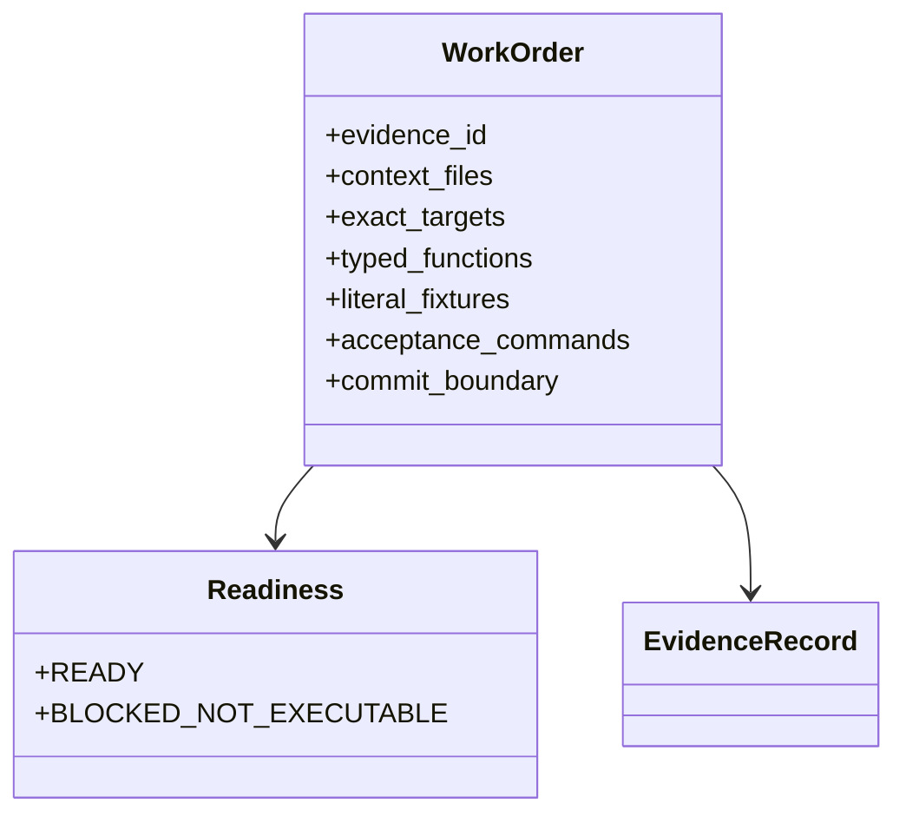

# Full reimplementation - work-order dispatch



- **Primary Role:** dispatch one independently specified feature commit to a coding executor.
- **Dependencies:** none to read this dispatch; code starts only after the exact prerequisite work-order commits listed in a READY feature exist.
- **Outputs / Downstream Role:** accepted feature commits, not independently invented interfaces or placeholder implementations.

## Current readiness — source-backed revision of 2026-10-30

Read the [review result and remaining work](research/2026-10-30-reimplementation-review.md)
for the exact scope, released slices and validation.

There are 20 top-level dispatch/phase Markdown files; supporting research lives in `research/`.
The historical allocation assigns 183 primary plugin modules across 19 phases. Assignment
coverage is not implementation readiness.

## Canonical donor layout

**`DONOR_REFERENCE_ROOT` = `data\reference-donor`**, relative to the repository root.
This is the sole donor-root alias throughout this documentation. A path such as
`DONOR_REFERENCE_ROOT/internal/libs/lib/qdm/QDM.java` resolves directly to
`data\reference-donor\internal\libs\lib\qdm\QDM.java`.
Forward slashes in documented locators are equivalent to Windows backslashes.
Clickable links and machine-readable source manifests retain concrete filesystem paths.

All active donor context uses `DONOR_REFERENCE_ROOT/`, preserving the SQX `internal/`
layout. Read Java files and folders directly; no JAR extraction or decompilation is required.

- Shared libraries: `DONOR_REFERENCE_ROOT/internal/libs/` (`lib`, `tradinglib`, `datalib`, `gridlib`, `jobslib`, `pluginlib`, `business`, `consolestarter`).
- Plugins: `DONOR_REFERENCE_ROOT/internal/plugins/<module>/`.
- Extension Java: `DONOR_REFERENCE_ROOT/internal/extend/`.
- Export templates: `DONOR_REFERENCE_ROOT/internal/ctemplate/` and `DONOR_REFERENCE_ROOT/internal/extend/Code/`.
- Web resources: `DONOR_REFERENCE_ROOT/internal/web/`.

For example: `DONOR_REFERENCE_ROOT/internal/libs/lib/qdm/QDM.java` or
`DONOR_REFERENCE_ROOT/internal/libs/lib/qdm/`. DONOR and Context to Read paths refer to
these direct sources, not `.jar!package/Class.class` archive-member syntax.

The [current source manifest](research/donor-source-manifest.json) indexes 2,819 Java
files: 1,356 in libraries, 412 in plugins and 1,051 in extensions. The earlier audit counts
and no-match findings describe the pre-consolidation search; they are not a current source
inventory. Source consolidation changes locators, not accepted behavior or work-order readiness.
Historical evidence retains carrier suffixes, sizes and hashes under the same root alias;
those are provenance records, not instructions to open an installed SQX copy or a current archive.

The earlier blanket assertion that WO-C06/C08/C09/C10/C11/C13 were unblocked is withdrawn.
Those labels group several capabilities; readable classes expose implementation details but
do not alone define a complete Python service API, numerical acceptance fixtures, concurrency
rules, project migrations or React workflow. The exact revised suborder controls readiness.
An unavailable-source blocker must be replaced by its verified source locator; a remaining
contract gap must be named, not silently converted to READY.

Original archive identities and encrypted-carrier observations remain in historical
evidence. Do not compare an old archive hash to a relocated source folder or infer current
build equivalence from a folder name.

Migration tables remain proposals, subject to each phase's source review and prerequisite
contracts. A DIRECT FIT label is not proof of donor equivalence or permission to move the
entire current implementation. Keep existing accepted host/core APIs unless a specific order
explicitly changes them.

**New independently specified Home slices:** WO-H05 dashboard panel selection and WO-H06
advanced money-management tab visibility require only WO-C00. They do not authorize full
Home workflow completion. Other revised bounded orders are listed in their owning phases.

## Executor contract - applies to every assigned feature

1. Receive one READY work order, not a whole workspace. Read only its task text and
   the exact files listed under Context to Read. If a prerequisite file/symbol does
   not exist with the specified contract, report that exact missing dependency and
   make no production change. Do not search sibling workspaces for a substitute.
2. Create/edit only the literal files named by the order. A donor folder alone is
   never permission to create a backend folder or auto-port every Java class. A
   blocked order's reserved names are not permission to create stubs.
3. Implement only the named signatures, fields, defaults, constants, error strings
   and side effects. Public method aliases, additional endpoints, field coercion,
   trimming, retries, enum restrictions and new dependencies are forbidden unless
   the order explicitly lists them. Private implementation details may vary only
   when they cannot change any specified output, error, side effect or test result.
4. Every behavioral requirement cites a literal evidence-record ID in that phase.
   Helpers explicitly use the helper exception: a transport/test-infrastructure
   decision is labelled target-only and is not called an SQX fact. A metadata record
   establishing file presence never authorizes a backend algorithm.
5. Run the listed commands from HARUQUANTAI_ROOT. Each must exit 0 and collect the
   specified tests/cases. A command that discovers no tests or assertions is failure.
   Do not weaken assertions, change a literal or mark a fixture as skipped to pass.
6. Stage only that feature's named files and make exactly one commit using its
   specified message. Do not stage other plan files, run repository-wide formatters
   or combine two orders. If the assigned text lacks a commit message/fixture/type,
   return the missing item to the senior planner; do not choose it.
7. Record actual command outputs, test counts, execution time, commit and review
   state in the owning domain's existing workflow. Domain README owns implementation
   status; these work orders are not a second status registry.

The current change is plan authoring only: no application code, tests or registry
entries have been implemented by writing this package.

## Bootstrap and shared contract decisions

The canonical shared response/error implementations already exist under `app/core/lib/`.
WO-C01 and WO-C02 specify the instance contracts; the Core baseline also explicitly
retains the legacy static builders used by current host callers:

- `app/core/lib/errors.py`: keyword-only DomainError and JSONValue/copy_json.
- `app/core/lib/responses.py`: keyword-only StandardResponse[T], to_dict and to_json;
  data must already be JSON-compatible. Existing `success`/`failure` builders,
  `ResponseMetadata` and `StandardError` remain in that same canonical module for
  migrated callers. Do not replace their wire dictionaries during relocation.
  New adapters use only the envelope explicitly named by their work order.
  Dataclass payloads require an explicitly specified conversion; a TypedDict is
  already a JSON object.
- `app/web/package.json` and `app/web/vitest.config.ts`: WO-C00 owns the node-based
  frontend test harness. Frontend orders use `npm --prefix app/web test -- tests/<literal>.test.ts`;
  the feature replaces the placeholder with its exact path. Do not change the runner.
- Python orders use `uv run python -m pytest <literal test file> -q`. Tests of pure
  helpers do not prove that a live provider, engine or external account is working.

`DatasetRef`, `RunSpec`, `RunResult`, JobHandle and related domain names mentioned
by blocked work are reserved conceptual names, not approved complete schemas.
A class name appearing in a diagram is not permission to invent its fields.

## Phase files

- [01 AppCore](01-AppCore.md)
- [02 AppHome](02-AppHome.md)
- [03 AppDataManager](03-AppDataManager.md)
- [04 AppCodeEditor](04-AppCodeEditor.md)
- [05 AppWizard](05-AppWizard.md)
- [06 AppResults](06-AppResults.md)
- [07 AppRetester](07-AppRetester.md)
- [08 AppBuilder](08-AppBuilder.md)
- [09 AppOptimizer](09-AppOptimizer.md)
- [10 AppPortfolioComposer](10-AppPortfolioComposer.md)
- [11 AppPortfolioMaster](11-AppPortfolioMaster.md)
- [12 AppTaskManager](12-AppTaskManager.md)
- [13 AppNeuralNetwork](13-AppNeuralNetwork.md)
- [14 AppGridControl](14-AppGridControl.md)
- [15 AppGridTest](15-AppGridTest.md)
- [16 AppDebugConsole](16-AppDebugConsole.md)
- [17 AppMarketplace](17-AppMarketplace.md)
- [18 AppBusiness](18-AppBusiness.md)
- [19 AppSQAI](19-AppAI.md)
- [20 AppLiveTrading](20-AppLiveTrading.md)

## Direct assignment order for currently specified work

1. WO-C00 frontend/Python package bootstrap.
2. WO-C01 DomainError, followed by WO-C02 StandardResponse.
3. WO-C03 previous-version ProgramRegistry; the six Home helper orders may then
   run according to their own dependencies (frontend-only orders require only C00).
4. Assign the exact READY-AFTER-* slice in each later phase only after its named
   helper/core prerequisite exists. These slices do not release that phase's blocked
   production routes, persistence adapters or algorithms.

Phase numbers organize ownership and overall dependencies; they do not override
feature-specific prerequisites. Do not wait for a blocked full Core engine to write
an independent, fully specified string helper, and do not use that helper's passing
test to claim the engine is ready.

## Full-scope and donor rules

Target roots remain app/core, app/workspace, app/extend and app/web. Concrete
plugins stay under their owning workspace. No Electron, Java compiler or Java
class-loader reproduction. Internal runtimes/dependencies receive explicit target
capability replacements rather than source ports. main.py and cli.py use the same
accepted application services. Project/strategy ownership remains under extend;
data retains existing contents. No user data is deleted by a work order.

The sole donor root is `DONOR_REFERENCE_ROOT`. Retained historical evidence also uses
this alias for consistency. Historical archive/executable suffixes describe original carriers,
not current files to open; active Context to Read paths select direct copied sources.
Relocation alone does not establish build-145 parity. New findings retain source locators/hashes, classification, confidence,
limitations, domain/ID ownership or registration gap, commit/review state, concrete
validation, actual timestamps and all four clean-room flags. Original historical
record objects remain unchanged below their owning phase. Revised decisions add
linked records; they do not erase contradictory observations.

The retained allocation/validation tables below document the earlier construction
snapshot. They are historical proof of assignment and consolidation integrity,
not acceptance of these new work orders or proof of full algorithm parity.

## Phase-level dependency map (context, not coding authorization)

| Phase | Required phases |
| --- | --- |
| AppCore | None |
| AppHome | AppCore |
| AppDataManager | AppCore, AppHome |
| AppCodeEditor | AppCore, AppHome, AppDataManager |
| AppWizard | AppCore, AppHome, AppCodeEditor |
| AppResults | AppCore, AppHome, AppDataManager, AppCodeEditor |
| AppRetester | AppCore, AppHome, AppDataManager, AppCodeEditor, AppResults |
| AppBuilder | AppCore, AppHome, AppDataManager, AppCodeEditor, AppResults, AppRetester |
| AppOptimizer | AppCore, AppHome, AppDataManager, AppCodeEditor, AppResults, AppRetester |
| AppPortfolioComposer | AppCore, AppHome, AppDataManager, AppResults |
| AppPortfolioMaster | AppCore, AppHome, AppDataManager, AppResults, AppPortfolioComposer |
| AppTaskManager | AppCore, AppHome, AppDataManager, AppWizard, AppResults, AppRetester, AppBuilder, AppOptimizer, AppPortfolioComposer, AppPortfolioMaster |
| AppNeuralNetwork | AppCore, AppHome, AppDataManager, AppCodeEditor, AppResults, AppTaskManager |
| AppGridControl | AppCore, AppHome, AppTaskManager |
| AppGridTest | AppCore, AppHome |
| AppDebugConsole | AppCore, AppHome, AppTaskManager |
| AppMarketplace | AppCore, AppHome, AppCodeEditor |
| AppBusiness | AppCore, AppHome, AppWizard |
| AppAI | AppCore, AppHome, AppWizard, AppTaskManager |

## Retained coverage and validation snapshot

Snapshot: 2026-10-29T08:08:36.320399+00:00; repository commit `f5c7d12d5715b8ebee55165b8eddad9068f83cb9`. The completed structural check assigned **13,726 files and 183 plugin modules** to one primary owner each, with zero unassigned paths and zero dependency cycles. This is assignment coverage, not implemented-feature or donor-behavior acceptance.

| Phase | Assigned files | Plugin modules |
| --- | ---: | ---: |
| [AppCore](01-AppCore.md) | 5082 | 0 |
| [AppHome](02-AppHome.md) | 1502 | 18 |
| [AppDataManager](03-AppDataManager.md) | 289 | 31 |
| [AppCodeEditor](04-AppCodeEditor.md) | 853 | 4 |
| [AppWizard](05-AppWizard.md) | 4556 | 5 |
| [AppResults](06-AppResults.md) | 456 | 34 |
| [AppRetester](07-AppRetester.md) | 187 | 15 |
| [AppBuilder](08-AppBuilder.md) | 144 | 9 |
| [AppOptimizer](09-AppOptimizer.md) | 62 | 8 |
| [AppPortfolioComposer](10-AppPortfolioComposer.md) | 40 | 4 |
| [AppPortfolioMaster](11-AppPortfolioMaster.md) | 23 | 2 |
| [AppTaskManager](12-AppTaskManager.md) | 250 | 43 |
| [AppNeuralNetwork](13-AppNeuralNetwork.md) | 11 | 2 |
| [AppGridControl](14-AppGridControl.md) | 12 | 2 |
| [AppGridTest](15-AppGridTest.md) | 6 | 1 |
| [AppDebugConsole](16-AppDebugConsole.md) | 25 | 1 |
| [AppMarketplace](17-AppMarketplace.md) | 21 | 1 |
| [AppBusiness](18-AppBusiness.md) | 92 | 1 |
| [AppSQAI](19-AppAI.md) | 115 | 2 |

Allocation includes every primary internal top-level category: libs, plugins, web, extend, autocomplete, ctemplate, electron, python, icons, langs, AppSettings.txt and license.db. Runtime/dependency files receive capability replacements, private state is not copied, and meaningful user workflows remain acceptance obligations. Each phase retains its complete named plugin queue.

Executed validation result, retained unchanged:

```json
{
  "classification": "observed",
  "confidence": "high",
  "repository_commit": "f5c7d12d5715b8ebee55165b8eddad9068f83cb9",
  "review_state": "automated-structure-check-passed-owner-review-pending",
  "contains_proprietary_source": false,
  "contains_sensitive_data": false,
  "contains_personal_data": false,
  "paraphrased_behavior_only": true,
  "feature_ids": [],
  "requirement_ids": [],
  "decision_ids": [],
  "registration_gap": "Planning labels are not registered domain feature IDs.",
  "limitations": "Structural/inventory checks only; no implementation, algorithm, provider or donor parity acceptance.",
  "supersedes_records": [],
  "superseded_by": [],
  "validation": {
    "status": "passed",
    "executed_at": "2026-10-29T08:20:00.880070+00:00",
    "procedure": "validate_plan.py: compare reference paths/hashes, unique owners/tickets, phase diagrams, links and ordered dependency graph.",
    "expected_observation": "No unassigned paths, missing owners/tickets, cycles or broken links.",
    "actual_observation": {
      "reference_files": 13726,
      "plugin_modules": 183,
      "phase_files": 19,
      "unassigned": 0,
      "dependency_cycles": 0
    },
    "artifacts": [
      "coverage.json",
      "module-contract-inventory.json",
      "phase-dependencies.json"
    ]
  }
}
```

### Historical artifact labels

Original evidence records retain historical artifact labels to preserve their provenance. They are labels for prior observations, not instructions to open deleted files. Their implementation-relevant content is consolidated as follows:

| Historical label | Retained content |
| --- | --- |
| coverage.json / coverage.md | Coverage snapshot and allocation table above; per-phase named module queues |
| phase-dependencies.json | Authoritative prerequisite table above |
| module-contract-inventory.json | Per-module donor paths, declaration counts and mandatory research tasks in the owner phase |
| validation.json | Executed validation result above |
| artifact-manifest.json / loader-probe-manifest.json / previous-library-inventory.json | Core donor fingerprint table, library counts and static dependency snapshot |
| records.json / loader-recovery-records.json / previous-version-records.json | Original record objects retained under their owning phases; index below |

### Evidence-record locations

| Record | Owning plan file |
| --- | --- |
| `LIB-001` | [01-AppCore.md](01-AppCore.md) |
| `LIB-002` | [01-AppCore.md](01-AppCore.md) |
| `LIB-003` | [01-AppCore.md](01-AppCore.md) |
| `LIB-004` | [01-AppCore.md](01-AppCore.md) |
| `LIB-005` | [01-AppCore.md](01-AppCore.md) |
| `LIB-006` | [01-AppCore.md](01-AppCore.md) |
| `LIB-007` | [01-AppCore.md](01-AppCore.md) |
| `LIB-008` | [01-AppCore.md](01-AppCore.md) |
| `LIB-009` | [02-AppHome.md](02-AppHome.md) |
| `LIB-010` | [01-AppCore.md](01-AppCore.md) |
| `MAP-001` | [08-AppBuilder.md](08-AppBuilder.md) |
| `MAP-002` | [03-AppDataManager.md](03-AppDataManager.md) |
| `MAP-003` | [04-AppCodeEditor.md](04-AppCodeEditor.md) |
| `MAP-004` | [00-README.md](00-README.md) |
| `CHAT-2026-10-29-tradinglib-bundling-hypothesis` | [01-AppCore.md](01-AppCore.md) |
| `CHAT-2026-10-29-all-execution-core-proposal` | [01-AppCore.md](01-AppCore.md) |
| `RECOVERY-001` | [01-AppCore.md](01-AppCore.md) |
| `RECOVERY-002` | [01-AppCore.md](01-AppCore.md) |
| `RECOVERY-003` | [01-AppCore.md](01-AppCore.md) |
| `PREVIOUS-001` | [03-AppDataManager.md](03-AppDataManager.md) |
| `PREVIOUS-002` | [01-AppCore.md](01-AppCore.md) |
| `PREVIOUS-003` | [01-AppCore.md](01-AppCore.md) |
| `PREVIOUS-004` | [01-AppCore.md](01-AppCore.md) |
| `PREVIOUS-005` | [01-AppCore.md](01-AppCore.md) |
| `PREVIOUS-006` | [02-AppHome.md](02-AppHome.md) |
| `PREVIOUS-007` | [05-AppWizard.md](05-AppWizard.md) |
| `PREVIOUS-008` | [04-AppCodeEditor.md](04-AppCodeEditor.md) |
| `PREVIOUS-009` | [01-AppCore.md](01-AppCore.md) |
| `PREVIOUS-010` | [01-AppCore.md](01-AppCore.md) |
| `PREVIOUS-011` | [00-README.md](00-README.md) |

## Embedded donor findings and historical provenance

The following original record objects are retained unchanged. Their historical artifact labels resolve through the index’s consolidation table; they are not additional files to follow. Supersession links and version-specific limitations remain intact. These records are evidence, not implementation-status entries.

### Evidence record `MAP-004`

<details>
<summary>Finding, limitations, provenance and validation</summary>

```json
{
  "id": "MAP-004",
  "classification": "normative",
  "confidence": "high",
  "claim": "Keep core responsibilities under app/core, plugin backend implementations under their owning app/workspace workspace, plugin UI under app/web/workspaces, and concrete extensions under app/extend. Retain user-requested project/strategy placement and main/CLI entrypoints.",
  "sources": [
    "User architecture instructions in current chat"
  ],
  "target_domain": "app/core; app/workspace; app/extend; app/web",
  "feature_ids": [],
  "requirement_ids": [],
  "decision_ids": [],
  "related_existing_owners": [
    "ui/app/host/README.md"
  ],
  "registration_gap": "No registered owning feature under proposed architecture; propose domain README registration before implementation.",
  "limitations": "This is user-directed target placement, not a donor dependency graph. Shared multi-workspace plugin ownership requires a decision. No registry changes authorized by this record.",
  "validation": {
    "status": "pending",
    "procedure": "Review concrete mappings and ratify domain README ownership; enforce import boundaries when implementation begins.",
    "expected_observation": "One owner for each shared capability; no separate plugins folder or duplicate computation implementations.",
    "executed_at": null,
    "actual_observation": null,
    "artifacts": null
  },
  "repository_commit": "f5c7d12d5715b8ebee55165b8eddad9068f83cb9",
  "review_state": "preliminary-owner-review-pending",
  "contains_proprietary_source": false,
  "contains_sensitive_data": false,
  "contains_personal_data": false,
  "paraphrased_behavior_only": true,
  "supersedes_records": [],
  "superseded_by": []
}
```

</details>

### Evidence record `PREVIOUS-011`

<details>
<summary>Finding, limitations, provenance and validation</summary>

```json
{
  "id": "PREVIOUS-011",
  "classification": "normative",
  "confidence": "high",
  "claim": "Use the user-authorized previous-version responsibilities for architecture planning. Keep concrete plugins under their workspace and compiled snippets under their source-owned extension category; preserve separate build-145 verification.",
  "sources": [
    "User fallback instruction in current chat",
    "previous-version-map.md"
  ],
  "target_domain": "app/core; app/workspace; app/extend; app/web; app/main.py; app/cli.py",
  "related_records": [
    "MAP-004",
    "RECOVERY-002",
    "RECOVERY-003"
  ],
  "feature_ids": [],
  "requirement_ids": [],
  "decision_ids": [],
  "registration_gap": "No feature ID ratified for proposed domain. Propose domain README registration before implementation; no registry edit performed.",
  "limitations": "Previous-version static definitions and representative method bodies only; exact product build and build-145 equivalence unverified. No full algorithm/formula parity or successful licensed operation asserted.",
  "validation": {
    "status": "pending",
    "executed_at": null,
    "procedure": "Review responsibility map and register domain feature/requirement/decision ownership through repository workflow before implementation.",
    "expected_observation": "Ratified domain ownership map.",
    "actual_observation": null,
    "artifacts": null
  },
  "repository_commit": "f5c7d12d5715b8ebee55165b8eddad9068f83cb9",
  "review_state": "preliminary-owner-review-pending",
  "contains_proprietary_source": false,
  "contains_sensitive_data": false,
  "contains_personal_data": false,
  "paraphrased_behavior_only": true,
  "supersedes_records": [],
  "superseded_by": [],
  "cross_version_policy": "Related current-build records remain valid for their own version; fallback findings do not supersede facts about a different build."
}
```

</details>

## Consolidation acceptance

Classification: observed; confidence: high; review: automated checks passed, owner review pending.

Validation passed at 2026-10-29T08:30:12.940444+00:00: exactly 20 Markdown files and no subfolders; all 183 unique module implementation checklists retained; all 30 original finding objects preserved with reciprocal historical links; all 19 phase prerequisites acyclic; local document links valid. Artifacts are these 20 plan files. This validates consolidation integrity, not software implementation or donor parity.

## Work-order rewrite validation

Observed structural check at 2026-10-29T09:46:49.359114+00:00: 20 Markdown files; all 183 primary plugin modules retain exactly one named owner; 101 evidence records including all 30 historical objects unchanged; diagrams/code fences/local links and literal donor-file references pass checks. Generic R/I/V folder-only queues have been removed. This pass does not execute unimplemented feature tests or assert that blocked domain contracts are resolved.
