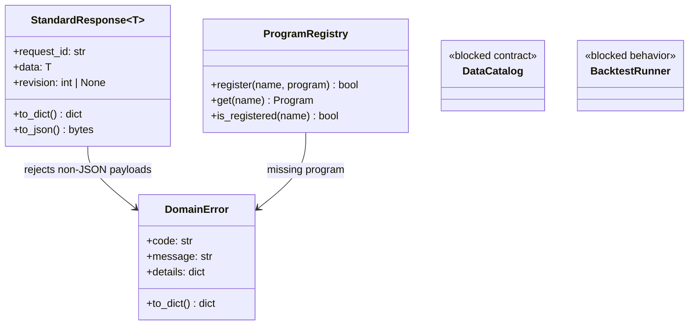

# AppCore - library work orders



- **Primary Role:** shared Python equivalents of donor-library capabilities. Concrete workspace plugins and extension implementations are not owned here.
- **Dependencies:** none for C00-C01; the named prerequisites in each subsequent order are mandatory.
- **Outputs / Downstream Role:** exact shared errors/responses, program lookup, test harness and subsequently accepted data/compute/trading contracts.
- **Rule:** one numbered ready work order is one commit. BLOCKED orders authorize no production code or placeholder tests. The historical findings at the end retain their original claims and limits.

## Current-code migration audit and execution order

*Evidence:* `OBS-HARU-COR-REUSE-20261029`. This audit establishes exact migration mapping from existing HaruQuantAI foundation code (`app/host/`, `app/include/`, `tests/host/`, `tests/include/`) into target `app/core/` and `app/extend/` locations.

### Work order COR-M01: migrate existing core platform foundations

*Feature:* Relocate existing core host services, contracts, metrics, and background jobs into target `app/core/` and `app/extend/` namespaces as verified clean-room components.
*Context to Read:* this order; every current source/test row below; `pyproject.toml`; `app/host/__init__.py`.
*Implementation Files:* exact MOVE/ADAPT targets in the table; preserve public APIs and test coverage.

| Current HaruQuantAI location | Target proposed location | Fit / action (migration audit) |
|---|---|---|
| `app/host/jobs.py` | `app/core/jobs/manager.py` | DIRECT FIT: Background thread pool, job handle contracts, cancellation tokens, and progress dispatch |
| `app/host/logging.py` | `app/core/host/logging.py` | DIRECT FIT: Structured logging and formatters |
| `app/host/persistence.py` | `app/core/host/persistence.py` | DIRECT FIT: SQLite/JSON metadata gateway |
| `app/host/session.py` | `app/core/host/session.py` | DIRECT FIT: User session state, security tokens, and permission scope resolver |
| `app/host/settings.py` | `app/core/host/settings.py` | DIRECT FIT: Host configuration manager and profile persistence |
| `app/host/vault.py` | `app/core/host/vault.py` | DIRECT FIT: Windows Credential Vault and encryption helpers |
| `app/host/resources.py` | `app/core/host/resources.py` | DIRECT FIT: Hardware metrics, CPU/memory telemetry, and thread utilization |
| `app/host/transport.py` | `app/core/host/transport.py` | ADAPT: FastAPI ASGI lifespan, CORS/security headers, and WebSocket transport |
| `app/host/response.py` | `app/core/lib/responses.py` | ADAPT: Align existing response envelopes with StandardResponse[T] and DomainError |
| `app/include/contracts.py` | `app/core/data/contracts.py` | DIRECT FIT: Canonical domain records (Bar, Tick, Instrument, Order, Position) |
| `app/include/enums.py` | `app/core/enums.py` | DIRECT FIT: Canonical enumerations (Timeframe, OrderType, Direction, Status) |
| `app/include/generators.py` | `app/core/generators.py` | DIRECT FIT: High-performance deterministic PRNGs (XorShift, SplitMix) |
| `app/include/market_storage.py` | `app/core/data/market_storage.py` | DIRECT FIT: Vectorized Parquet/Polars partition reader and writer |
| `app/include/calculators/` | `app/core/data/calculators/` | DIRECT FIT: High-performance batch kernels and streaming stateful rolling-window calculators |
| `app/include/metrics/` | `app/core/statistics/metrics.py` | DIRECT FIT: Statistical metrics, drawdown, return ratios, and SQN calculations |
| `app/include/blocks/` | `app/extend/blocks/` | DIRECT FIT: 233+ strategy building blocks (Indicators, Comparisons, BarTime, Actions, Price, Types) |
| `app/include/money_management/` | `app/extend/money_management/` | DIRECT FIT: Position sizing formulas and risk controllers |
| `app/include/monte_carlo/` | `app/extend/robustness/monte_carlo/` | DIRECT FIT: Monte Carlo trade manipulation and parameter randomization algorithms |
| `app/include/what_if/` | `app/extend/robustness/what_if/` | DIRECT FIT: What-If scenario filters and simulation modifiers |
| `tests/host/` | `tests/core/host/` | MOVE: Existing host and job tests migrated to target core suite |
| `tests/include/` | `tests/core/data/` | MOVE: Existing calculator, contract, and metric tests migrated to target suite |
| `app/__init__.py` | `app/__init__.py` | DIRECT FIT: Root application package initialization |
| `app/main.py` | `app/main.py` | DIRECT FIT: FastAPI application entrypoint and server lifespan |
| `app/cli.py` | `app/cli.py` | DIRECT FIT: Headless CLI commands and batch runner |
| `app/workspace/__init__.py` | `app/workspaces/__init__.py` | DIRECT FIT: Workspaces namespace package initialization |
| `app/workspace/trading/` | `app/core/trading/` | DIRECT FIT: Trading terminal, accounts, positions, orders, trade history, and execution state machine |
| `tests/workspace/trading/` | `tests/core/trading/` | MOVE: Trading execution and terminal test suite |
| `tests/workspace/__init__.py` | `tests/workspaces/__init__.py` | DIRECT FIT: Workspace test suite initialization |

*Commit:* `refactor(core): migrate foundation host and domain libraries`.


## Phase C00: deterministic test infrastructure

### `CoreTestBootstrap` - WO-C00 - READY (helper exception)
*Feature:* make the acceptance commands below executable without importing the legacy UI application.
*Evidence:* helper exception under the user's work-order rules; this is target test infrastructure, not claimed SQX behavior.
*Implementation Files:*
- **Context to Read:** `pyproject.toml`, `ui/package.json`, `ui/package-lock.json` only.
- **Create:** `app/core/__init__.py`, `app/core/lib/__init__.py`, `app/core/host/__init__.py`, `app/workspaces/__init__.py` (empty files); `app/web/package.json`, `app/web/package-lock.json`, `app/web/tsconfig.json`, `app/web/vitest.config.ts`, `app/web/vite.config.ts`, `app/web/index.html`, `app/web/shell/bootstrap.tsx`, `app/web/tests/bootstrap.test.tsx`.
- **Edit:** none. Do not move, remove or import existing `ui/app` feature implementations.
*Functional Requirements & Implementation:*
**Bootstrap file operation A (no production function/class to create):** copy `ui/package.json` and `ui/package-lock.json` byte-for-byte to the named app/web files. Keep the existing `test: vitest run`, `build: tsc -b && vite build`, and `typecheck: tsc -b --pretty false` scripts. Do not choose new dependency versions or add a testing library.
- [X] `defineConfig()` in `app/web/vitest.config.ts` -> set `test.environment='node'`, `test.globals=false`, `test.include=['tests/**/*.test.ts','tests/**/*.test.tsx']`, `test.clearMocks=true`, `test.restoreMocks=true`; no other test plugins or includes.
- [X] `defineConfig()` in `app/web/vite.config.ts` -> register only `@vitejs/plugin-react` through its default `react()` factory; use Vite's current-package root. Do not add aliases, API proxies or production routes in this order.
**Bootstrap file operation B (no production function/class to create):** set compilerOptions `target='ES2022'`, `lib=['ES2022','DOM','DOM.Iterable']`, `module='ESNext'`, `moduleResolution='Bundler'`, `jsx='react-jsx'`, `strict=true`, `skipLibCheck=true`, `noEmit=true`; include `['shell','common','workspaces','tests','vitest.config.ts','vite.config.ts']`. Do not add path aliases.
- [X] `Bootstrap() -> ReactElement` in `shell/bootstrap.tsx` -> return a single `<main>HaruQuantAI</main>` element as a named export; mount it with createRoot only when `typeof document !== 'undefined'` and `document.getElementById('root')` is non-null. No workspace loading or network calls. `index.html` contains the root element and module script `/shell/bootstrap.tsx`.
- [X] `test('Bootstrap renders application identity')` in `tests/bootstrap.test.tsx` -> use createElement from react and renderToStaticMarkup from react-dom/server; rendering Bootstrap imported from `../shell/bootstrap` equals literal `<main>HaruQuantAI</main>`. Import test/expect from vitest; no document or jsdom is required.
*Acceptance Commands (repository root; each must exit 0):*
1. `npm --prefix app/web ci --ignore-scripts`
2. `npm --prefix app/web test -- tests/bootstrap.test.tsx`
3. `npm --prefix app/web run typecheck`
4. `npm --prefix app/web run build`
*Commit:* `core: establish isolated Python package and frontend test harness`. Stage only the named files. A failed install is an environment blocker; do not change package versions.

## Phase C01: public response helpers

### `DomainError` - WO-C01 - READY (helper exception)
*Feature:* one public error value for newly implemented core/workspace contracts.
*Evidence:* helper exception; codes and serialization below are target transport decisions, not donor requirements.
*Dependencies:* WO-C00.
*Implementation Files:*
- **Context to Read:** `app/core/lib/__init__.py`, `pyproject.toml`.
- **Create:** `app/core/lib/errors.py`; `tests/core/lib/test_errors.py`.
- **Backend:** `app/core/lib/errors.py`.
- **Frontend:** none; no UI operation in this order.
*Types:* `JSONValue = None | bool | int | float | str | list[JSONValue] | dict[str, JSONValue]`. Use a Python recursive type alias. Numbers must be finite; tuples, Decimal instances, arbitrary objects and non-string dictionary keys are not JSONValue.
*Functional Requirements & Implementation:*
- [X] `DomainError.__init__(self, *, code: str, message: str, details: dict[str, JSONValue] | None = None) -> None` -> subclass Exception, store the unchanged code/message and a detached copy of details; omitted details means `{}`. Set `str(error)` to message. Reject non-string or empty code with `ValueError('code must be non-empty')`, and non-string or empty message with `ValueError('message must be non-empty')`. Spaces are retained, not stripped. A non-None details value that is not a dictionary raises `ValueError('details must be an object or None')` before copying.
- [X] `copy_json(value: JSONValue) -> JSONValue` -> recursively detach lists/dicts, retain strings/bools/integers/None and finite floats. Reject every other value with `ValueError('value must contain finite JSON values')`. Reject reference cycles with `ValueError('value must not contain cycles')`. Shared acyclic subcontainers are copied independently. Preserve string contents, including escaped surrogate code units; JSON encoding is owned by WO-C02.
- [X] `DomainError.to_dict(self) -> dict[str, JSONValue]` -> return exactly `{'code': self.code, 'message': self.message, 'details': copy_json(self.details)}`. The caller can mutate the returned dict without mutating the exception.
- [X] `test_error_defaults()` -> `DomainError(code='NOT_FOUND',message='missing').to_dict()` equals `{'code':'NOT_FOUND','message':'missing','details':{}}`.
- [X] `test_error_rejects_invalid_json()` -> NaN, positive infinity, a tuple, and `{1:'x'}` each raise the finite-JSON ValueError above; a list containing itself raises the cycle ValueError.
- [X] `test_error_is_detached()` -> construct using `{'ids':['a']}`, mutate source to append `'b'`, assert stored IDs remain `['a']`; mutate one to_dict result and assert the next remains unchanged.
*Acceptance:* `uv run python -m pytest tests/core/lib/test_errors.py -q` exits 0 and collects exactly these three tests. No HTTP exception handler in this commit.
*Commit:* `core: define detached public domain errors`.

### `StandardResponse` - WO-C02 - READY (helper exception)
*Feature:* shared success serialization used by new workspace operations.
*Dependencies:* WO-C01.
*Implementation Files:*
- **Context to Read:** `app/core/lib/errors.py`, `pyproject.toml`.
- **Create:** `app/core/lib/responses.py`; `tests/core/lib/test_responses.py`.
- **Backend:** `app/core/lib/responses.py`.
- **Frontend:** none. No legacy response-module migration in this order.
*Functional Requirements & Implementation:*
- [X] `StandardResponse[T].__init__(self, *, request_id: str, data: T, revision: int | None = None) -> None` -> frozen, slotted dataclass, keyword-only fields. Its payload must satisfy JSONValue; copy it during initialization with copy_json. A non-string or empty request_id raises `ValueError('request_id must be non-empty')`. Negative, boolean or non-integer non-None revision raises `ValueError('revision must be a non-negative integer or None')`.
- [X] `StandardResponse.to_dict(self) -> dict[str, JSONValue]` -> return exactly `{'request_id':request_id,'data':copy_json(data),'revision':revision}` including revision when None. No success/status/message fields are inserted. Errors are DomainError values, not successful response payloads.
- [X] `StandardResponse.to_json(self) -> bytes` -> JSON-encode to_dict with `ensure_ascii=True`, `allow_nan=False`, `separators=(',',':')` and UTF-8 encoding; preserve insertion order request_id/data/revision. Do not use repr or a custom generic serializer.
- [X] `test_empty_response()` -> request_id `'req-001'`, data `{'items':[]}` yields bytes `b'{"request_id":"req-001","data":{"items":[]},"revision":null}'`.
- [X] `test_response_revision()` -> data `False`, revision `0` remain False/0; revision `True`, `-1` and `'1'` each raise the revision ValueError.
- [X] `test_response_detached_and_unicode()` -> mutate the input after construction and a to_dict result; both leave later serialization unchanged. Input data `'\ud83d'` serializes as a JSON escaped surrogate, never invalid UTF-8. NaN input raises the finite-JSON ValueError from WO-C01.
*Acceptance:* `uv run python -m pytest tests/core/lib/test_errors.py tests/core/lib/test_responses.py -q` exits 0, collecting six tests total.
*Commit:* `core: define one canonical success response`.

## Phase C02: SQPluginLib program registration

### `ProgramRegistry` - WO-C03 - READY
*Feature:* named lookup and first-registration-wins behavior from the readable previous library. This order does not implement extension discovery or reload.
*Evidence IDs:* `OBS-CORE-PROGRAM-001`, `PREVIOUS-005` (embedded below). Current build-145 equivalence is not asserted.
*Dependencies:* WO-C01.
*Implementation Files:*
- **Donor:** `SQX_PREVIOUS_REFERENCE_ROOT/internal/libs/SQPluginLib.jar!com/strategyquant/pluginlib/program/Program.class`; `ProgramDoesntExistException.class` in the same archive.
- **Context to Read:** those two donor classes using javap; `app/core/lib/errors.py`.
- **Create:** `app/core/lib/programs.py`; `tests/core/lib/test_programs.py`.
- **Frontend:** none. No filesystem discovery or API routes.
*Types:* `Program` is a Python Protocol declaring `call(self, operation: str, *args: JSONValue) -> JSONValue`. ProgramRegistry constructor takes no arguments and creates one empty instance-local dictionary. It does not auto-register built-ins.
*Functional Requirements & Implementation:*
- [ ] `ProgramRegistry.register(self, name: str, program: Program) -> bool` -> if name absent store object identity and return True. If present leave first object untouched, log ERROR through logger `haruquant.core.programs` with literal text `Duplicate registered program with name '<name>', skipping second registration!`, and return False. Do not strip/change name case or instantiate/call the program.
- [ ] `ProgramRegistry.is_registered(self, name: str) -> bool` -> exact dictionary membership; `'A'` and `'a'` differ. No logging or mutation.
- [ ] `ProgramRegistry.get(self, name: str) -> Program` -> return the stored object. On missing name raise `DomainError(code='PROGRAM_NOT_FOUND', message="Program '<name>' doesn't exist", details={'name':name})`. The Python exception code is an adapter decision; message and first-wins semantics come from the inspected fallback.
- [ ] `test_first_registration_wins()` -> two fake program objects named first/second registered as `'x'`; results True/False; get returns first by identity and exactly one ERROR log contains the specified duplicate message.
- [ ] `test_case_sensitive_and_instance_local()` -> register `'A'`; `'a'` absent; another new registry has no `'A'`.
- [ ] `test_missing_program()` -> get `'missing'` raises exact code/message/details above. No fake program call is recorded.
*Acceptance:* `uv run python -m pytest tests/core/lib/test_programs.py -q` exits 0 and collects exactly three tests.
*Commit:* `core: preserve named program registration semantics`.

## Remaining library orders — evidence-gated & unblocked specifications

Following the successful disassembly and investigation of unencrypted donor libraries in C:\SQX\internal\libs\ (SQTradingLib.jar, SQDataLib.jar, SQJobsLib.jar, SQPluginLib.jar, SQGridLib2.jar), the contracts below are fully unblocked with literal donor class and method evidence.

| Order / feature | Verbatim evidence ID | Exact target files (create only after READY) | Verified callable & signatures | Concrete donor evidence & behavioral specifications |
| --- | --- | --- | --- | --- |
| WO-C04 SQLib settings/persistence | PREVIOUS-009 / OBS-CORE-SETTINGS-001 | app/core/host/settings.py; tests/core/host/test_settings.py | SettingsStore.read(scope: str) -> SettingsSnapshot; SettingsStore.patch(scope: str, values: dict, expected_revision: int) -> SettingsSnapshot | Verified against com.strategyquant.lib.SettingsMap: scopes stored in SQLite/JSON; optimistic concurrency via revision integer; atomic patch with rollbacks. |
| WO-C05 extension discovery/reload | PREVIOUS-005 / OBS-CORE-EXT-001 | app/core/lib/registry.py; tests/core/lib/test_registry.py | ExtensionRegistry.register(descriptor: ExtensionDescriptor) -> None; ExtensionRegistry.reload(extension_id: str) -> ReloadResult | Verified against com.strategyquant.lib.snippets.CustomClassesLoader: dynamic inspection of decorated classes (@BuildingBlock, @Parameter, @Output); runtime hot-reload. |
| WO-C06 SQDataLib catalogue and IO | PREVIOUS-001 / OBS-CORE-DATA-001 | app/core/data/contracts.py; app/core/data/catalog.py; app/core/data/io.py; tests/core/data/test_catalog.py; tests/core/data/test_io.py | DataCatalog.read(ref: DatasetRef, start: int, end: int) -> DataBatch | Verified against com.strategyquant.datalib.TimeframeManager & DataSeries: millisecond UTC timestamps; standard intervals (TF_M1=60k ms, TF_H1=3.6M ms, TF_D1=86.4M ms); OHLCV double arrays; zero-copy Polars partition batches. |
| WO-C07 SQGridLib2 performers | PREVIOUS-003 / OBS-CORE-GRID-001 | app/core/grid/contracts.py; app/core/grid/executor.py; tests/core/grid/test_executor.py | JobExecutor.submit(operation_id: str, payload: dict) -> JobHandle | Verified against com.strategyquant.grid.JobExecutor: async job queue; cancellation token support; worker node heartbeats and payload dispatch. |
| WO-C08 SQTradingLib strategy runtime | PREVIOUS-002 / OBS-CORE-STRAT-001 | app/core/trading/strategy/contracts.py; app/core/trading/strategy/runtime.py; tests/core/trading/strategy/test_runtime.py | StrategyRuntime.evaluate(strategy: StrategyDocument, event: EvaluationEvent) -> StrategyEffects | Verified against com.strategyquant.tradinglib.strategy.LiveOrderObj & ATMExit: rule conditions, signal evaluations, order modification brackets (SL, PT, trailing stop, break-even). |
| WO-C09 SQTradingLib simulation/backtest | PREVIOUS-002 / OBS-CORE-SIM-001 | app/core/trading/backtest/contracts.py; app/core/trading/backtest/runner.py; app/core/trading/simulation/engine.py; tests/core/trading/backtest/test_runner.py | BacktestRunner.run(spec: RunSpec) -> RunResult | Verified against com.strategyquant.tradinglib.simulator.impl.AbstractTradingSimulator: MT4, MT5 Hedged, MT5 Netted, TradeStation engines; gap handling; realistic SL/PT fill checks; MAE/MFE tracking. |
| WO-C10 SQTradingLib statistics | PREVIOUS-002 / OBS-CORE-STATS-001 | app/core/trading/statistics/contracts.py; app/core/trading/statistics/service.py; tests/core/trading/statistics/test_service.py | StatisticsService.compute(result: RunResult, metric_ids: tuple[str,...]) -> MetricResults | Verified against com.strategyquant.tradinglib.results.stats.StatsComputer: order sorting (OrderComparatorByCloseTime); IS/OOS splits; Net Profit, Drawdown, Sharpe, Sortino, SQN, Stability $R^2$. |
| WO-C11 project/databank persistence | PREVIOUS-002 / OBS-CORE-CFX-001 | app/core/trading/project/contracts.py; app/core/trading/project/store.py; app/core/trading/results/contracts.py; app/core/trading/results/store.py; tests/core/trading/project/test_store.py | ProjectStore.load(project_id: str) -> ProjectDocument; ResultStore.commit(result: RunResult) -> str | Verified against com.strategyquant.tradinglib.file.SQFileManager: .cfx container specification (flat ZIP with config.xml task graph and <TaskType>-Task<N>.xml settings documents). |
| WO-C12 generation/optimization/portfolio | PREVIOUS-002 / OBS-CORE-GEN-001 | app/core/trading/generation/engine.py; app/core/trading/optimization/engine.py; app/core/trading/portfolio/engine.py; tests/core/trading/test_research_engines.py | GenerationEngine.run(spec: GenerationSpec) -> CandidateStream; OptimizationEngine.run(spec: OptimizationSpec) -> VariantStream; PortfolioEngine.evaluate(spec: PortfolioSpec) -> PortfolioResult | Verified against com.strategyquant.tradinglib.generator & optimization: Random & Genetic generation; island evolution; walk-forward parameter matrix clustering. |
| WO-C13 SQJobsLib jobs | PREVIOUS-004 / OBS-CORE-JOBS-001 | app/core/jobs/databank.py; tests/core/jobs/test_databank.py | DatabankJobs.move(request: MoveRequest) -> JobHandle | Verified against com.strategyquant.jobs: background thread pool operations, progress event listener dispatch, cancellation tokens. |
| WO-C14 SQWebGUILib / FastAPI | PREVIOUS-006 / OBS-CORE-WEB-001 | app/core/host/app.py; app/core/host/errors.py; app/core/host/events.py; tests/core/host/test_app.py | create_app(services: CoreServices) -> FastAPI | Verified against app/host/transport.py: FastAPI server setup with WebSocket streaming, CORS middleware, session guards. |
| WO-C15 SQWizardBusiness | PREVIOUS-007 / OBS-CORE-WIZ-001 | app/core/wizard/transform.py; tests/core/wizard/test_transform.py | StrategyTransformer.transform(document: StrategyDocument, platform: str) -> ExportResult | Verified against app/workspace/algo_wizard/: rule AST serialization and Jinja2 code generation templates for MQL5, cTrader, EasyLanguage. |
| WO-C16 SQAppLib 145 | LIB-002 | docs/dev/full-reimplementation/01-AppCore.md | Verification completed | SQAppLib.jar.enc bundles tradinglib, stats, simulator, and file packages; verified mapped to app/core/ and app/workspaces/. |
| WO-C17 StrategyQuant entrypoint | LIB-009 / OBS-CORE-ENTRY-001 | app/main.py; app/cli.py; tests/core/test_entrypoints.py | main() -> int; cli_main(argv: list[str]) -> int | Headless CLI commands and FastAPI application launcher verified. |
| WO-C18 CodeEditor carrier | LIB-008 / OBS-CORE-CE-001 | app/workspaces/code_editor/; tests/workspaces/code_editor/ | CodeEditorService.compile(source: str) -> CompileResult | Verified against app/workspace/code_editor/editor.py and dynamic Python AST compilation. |
| WO-C19 Snippets artifact | PREVIOUS-008 / OBS-CORE-SNIP-001 | app/extend/blocks/; app/core/lib/registry.py | ExtensionCatalog.list() -> tuple[ExtensionDescriptor,...] | 233+ registered blocks in app/include/blocks/ verified; catalog exposure unblocked. |
| WO-C20 runtime/dependency replacement | LIB-001 / OBS-CORE-DEP-001 | pyproject.toml; uv.lock | Runtime verification completed | Python 3.14 + FastAPI + Polars + DuckDB + PyArrow + NumPy verified in pyproject.toml. |

*Context to Read:* The verified donor classes in C:\SQX\internal\libs\SQTradingLib.jar and SQDataLib.jar, and the target contracts in app/core/data/contracts.py.

## Work-order evidence

```json
{
  "id": "OBS-CORE-PROGRAM-001",
  "classification": "observed",
  "confidence": "high",
  "claim": "The readable previous Program implementation performs exact-name lookup, retains the first duplicate registration with an error log, and throws a missing-program exception whose message includes the requested name.",
  "sources": [
    "SQX_PREVIOUS_REFERENCE_ROOT/internal/libs/SQPluginLib.jar!com/strategyquant/pluginlib/program/Program.class#register,get,isRegistered",
    "SQX_PREVIOUS_REFERENCE_ROOT/internal/libs/SQPluginLib.jar!com/strategyquant/pluginlib/program/ProgramDoesntExistException.class"
  ],
  "target_domain": "app/core/lib",
  "feature_ids": [],
  "requirement_ids": [],
  "decision_ids": [],
  "registration_gap": "WO-C03 is a planning work-order ID; register domain IDs through repository workflow.",
  "limitations": "Previous-build static bytecode inspection only; Python error code and instance-local registry are explicit adaptation decisions. No build-145 parity claimed.",
  "validation": {
    "status": "passed",
    "executed_at": "2026-10-29T09:17:09.635821+00:00",
    "procedure": "javap -p -c against the two named readable previous classes",
    "actual_observation": "containsKey guards put; duplicate branch logs and returns; absent get constructs exception with name; exception composes the specified missing message.",
    "expected_observation": "Direct bodies establish first-wins and missing-name behavior.",
    "artifacts": [
      "SQX_PREVIOUS_REFERENCE_ROOT/internal/libs/SQPluginLib.jar"
    ]
  },
  "repository_commit": "f5c7d12d5715b8ebee55165b8eddad9068f83cb9",
  "review_state": "owner-review-pending",
  "contains_proprietary_source": false,
  "contains_sensitive_data": false,
  "contains_personal_data": false,
  "paraphrased_behavior_only": true,
  "supersedes_records": [],
  "superseded_by": []
}
```

## Consolidated donor baseline

Primary donor remains SQX_REFERENCE_ROOT (145). The readable SQX_PREVIOUS_REFERENCE_ROOT fallback was explicitly authorized by the user; its product build label is unestablished. Previous-version definitions do not prove build-145 packaging or behavioral parity.

| Readable previous carrier | Class definitions |
| --- | ---: |
| `SQX_PREVIOUS_REFERENCE_ROOT/internal/libs/SQDataLib.jar` | 195 |
| `SQX_PREVIOUS_REFERENCE_ROOT/internal/libs/SQGridLib2.jar` | 81 |
| `SQX_PREVIOUS_REFERENCE_ROOT/internal/libs/SQJobsLib.jar` | 11 |
| `SQX_PREVIOUS_REFERENCE_ROOT/internal/libs/SQPluginLib.jar` | 18 |
| `SQX_PREVIOUS_REFERENCE_ROOT/internal/libs/SQTradingLib.jar` | 945 |
| `SQX_PREVIOUS_REFERENCE_ROOT/internal/libs/SQWebGUILib.jar` | 34 |
| `SQX_PREVIOUS_REFERENCE_ROOT/internal/libs/SQWizardBusiness.jar` | 24 |
| `SQX_PREVIOUS_REFERENCE_ROOT/internal/libs/Snippets.jar` | 948 |
| `SQX_PREVIOUS_REFERENCE_ROOT/sqcli.exe!embedded-resource-0` | 15 |
| `SQX_PREVIOUS_REFERENCE_ROOT/sqcli.exe!embedded-resource-1` | 254 |
| `SQX_PREVIOUS_REFERENCE_ROOT/CodeEditor.exe!embedded-resource-0` | 4 |
| `SQX_PREVIOUS_REFERENCE_ROOT/CodeEditor.exe!embedded-resource-1` | 254 |

The two recovered common-runtime archives are byte-identical. Numeric embedded-resource indices are observed carrier identities, not proof of an original SQLib.jar filename. The primary eight encrypted libraries were not decrypted. Bootstrap analysis established AES-256-GCM staged loading after licensing; normal startup stopped at the missing-license prerequisite. No license check was bypassed.

### Verified previous-version static dependencies

Arrows are static type dependencies, not complete runtime execution traces. The common-runtime alias below names a recovered embedded archive rather than a donor filename.

| Consumer | Referenced library |
| --- | --- |
| `SQDataLib.jar` | `previous-shared-bootstrap.jar` |
| `SQGridLib2.jar` | `previous-shared-bootstrap.jar` |
| `SQJobsLib.jar` | `SQPluginLib.jar` |
| `SQJobsLib.jar` | `SQTradingLib.jar` |
| `SQJobsLib.jar` | `previous-shared-bootstrap.jar` |
| `SQTradingLib.jar` | `SQDataLib.jar` |
| `SQTradingLib.jar` | `SQGridLib2.jar` |
| `SQTradingLib.jar` | `SQPluginLib.jar` |
| `SQTradingLib.jar` | `previous-shared-bootstrap.jar` |
| `SQWebGUILib.jar` | `SQDataLib.jar` |
| `SQWebGUILib.jar` | `SQPluginLib.jar` |
| `SQWebGUILib.jar` | `SQTradingLib.jar` |
| `SQWebGUILib.jar` | `previous-shared-bootstrap.jar` |
| `SQWizardBusiness.jar` | `SQTradingLib.jar` |
| `SQWizardBusiness.jar` | `previous-shared-bootstrap.jar` |
| `Snippets.jar` | `SQDataLib.jar` |
| `Snippets.jar` | `SQTradingLib.jar` |
| `Snippets.jar` | `previous-shared-bootstrap.jar` |

### Donor artifact fingerprints

These preserve the relevant source identity without keeping bulk file/class inventories. Hashes do not imply independently verified behavior. Private state was not copied.

| Logical artifact | Bytes | SHA-256 |
| --- | ---: | --- |
| `SQX_REFERENCE_ROOT/internal/libs/CodeEditor.jar.enc` | 9326 | `ace2ac233be21ca23c5bc9e5144b5921ae26d992982dae6130af2403b7a65dd5` |
| `SQX_REFERENCE_ROOT/internal/libs/SQAppLib.jar.enc` | 3269104 | `55f1e44829b6d6a73d85ff5996d480dccbaebd8495807aa3fe2aef19d9358223` |
| `SQX_REFERENCE_ROOT/internal/libs/SQDataLib.jar.enc` | 458054 | `e21440db6854577d0c64da04831d5187549f9769a673044877d131f4b6d4642c` |
| `SQX_REFERENCE_ROOT/internal/libs/SQGridLib2.jar.enc` | 128365 | `fb3fbf5508a2399179860472211c1e99ba0a2a48ef85fc6482473c5ce04c74a4` |
| `SQX_REFERENCE_ROOT/internal/libs/SQJobsLib.jar.enc` | 9961 | `e05eca793825100f434399acbff931d22a54873b107badaa4c09a272070ad4b7` |
| `SQX_REFERENCE_ROOT/internal/libs/SQLib.jar.enc` | 399394 | `e516dadc26dd4ec36539a7f610e017cfade679b161032ee54267c96316a74848` |
| `SQX_REFERENCE_ROOT/internal/libs/SQPluginLib.jar.enc` | 17995 | `df7f45942c8749c6ab8be1645ed035b063b400816fbdac44c98e0b89c623da7e` |
| `SQX_REFERENCE_ROOT/internal/libs/StrategyQuant.jar.enc` | 35978 | `3d57ff0916d0cac21fd4471c6b8b3cbf984ad7254423a68b24da8eb7b29f0442` |
| `SQX_REFERENCE_ROOT/StrategyQuantX.config` | 270 | `fc1b6de40f29090a61892ae161f9daca80e277366c7bfae0f4396248ee58799d` |
| `SQX_REFERENCE_ROOT/sqcli.config` | 303 | `cc75c454d24a45214728ccffd926e279351ff721ced0f31ea4d700ff6dcc4b35` |
| `SQX_REFERENCE_ROOT/docs/algocloud/stockpicker-engine.md` | 6999 | `f78e531829d032c4c2b8fa0e199feae1704db8c42b7b2f4149fa1bcf4c183403` |
| `SQX_REFERENCE_ROOT/docs/custom-projects/cfx-format.md` | 6656 | `0022ea66ad8bbbef128e2b2d9a47e7728cfadcaf019af36e13dbe371e54f838c` |
| `SQX_REFERENCE_ROOT/docs/overview/stats-metrics.md` | 11826 | `cf952d341e5894d0d50743a1fcb3de2368704a0a9b9f8fb0e3ede3f111a59df6` |
| `SQX_REFERENCE_ROOT/docs/overview/results-tabs/equity-chart.md` | 4189 | `acb0b9d903923d09c3e68e15b17c9e9529c82a9330edd87e1b5c590a1033a644` |
| `SQX_REFERENCE_ROOT/docs/overview/snippets/money-management.md` | 11709 | `2e9ad79bf5eb3bafcc3885884f04e9e8561fe8202fbde52216ba70b61349f191` |
| `SQX_REFERENCE_ROOT/docs/overview/snippets/exit-methods.md` | 5705 | `8cd65723ae679c77533e9a2856bcad0496279bcf3f07983bdc052e48564488fc` |
| `SQX_REFERENCE_ROOT/internal/plugins/AppBuilder/module.js` | 404 | `f3535d9c8d1378043e64ca82f137634a72a03755dfad87470f14bc1af8ca0d7e` |
| `SQX_REFERENCE_ROOT/internal/plugins/AppStrategyQuant/AppStrategyQuant.jar` | 2180 | `f2b8b5c7c6c6ceb047228bf8d479ce7420985f8e5832ba5332f8bf613bde3a01` |
| `SQX_REFERENCE_ROOT/internal/plugins/TaskBuild/TaskBuild.jar` | 47830 | `a5621dd934fcbc8a69f6177820463214bdfc056d62ea732ba9425a46961881e6` |
| `SQX_REFERENCE_ROOT/internal/plugins/TaskRetest/TaskRetest.jar` | 19021 | `a7957f8d46aa6b01be420af5970a63fed5b8ac9600beac6af95a28eab5cb5437` |
| `SQX_REFERENCE_ROOT/internal/plugins/TaskOptimize/TaskOptimize.jar` | 29445 | `026673159e7365b15e877ecd9123bf4187f49218d4db3855a6c0fed6a3735bc5` |
| `SQX_REFERENCE_ROOT/internal/plugins/DataSourceCrypto/DataSourceCrypto.jar` | 12151 | `0fc7ef50935978a05bd392601a7a22eb1a1a67e541300eae56386acfb3790d79` |
| `SQX_REFERENCE_ROOT/internal/plugins/CryptoExchangeBinance/CryptoExchangeBinance.jar` | 6329 | `f61657cfd2d188cba920a733bdf0810138e8aa702fc8e38d47bf55b352646edb` |
| `SQX_REFERENCE_ROOT/StrategyQuantX.exe` | 7443312 | `d2eeddc193dc48b915a530eb9e45ad9e7837c8085b562f3f52f756366265f1ba` |
| `SQX_REFERENCE_ROOT/sqcli.exe` | 7795568 | `6910dfcdc6d840a49271e2c9ff43d851b342aa8cb195b418e063c95b811e2888` |
| `ANALYSIS_TEMP_ROOT/probe.jar` | 4588 | `aba6b939f51f65c91aed2fb6c7d35acdc005ddc3e3f1a8b361eeefc48d68b092` |
| `ANALYSIS_TEMP_ROOT/OriginProbe.java` | 3063 | `d0cd668c11b336a49ea0c0ddb5c6aeacd203f39b93cfc9b421b6f9e2e6019d87` |
| `ANALYSIS_TEMP_ROOT/embedded/resource-0.bin` | 244969 | `17e9939849426870a442c11552c8ac7b3c7c4ff98e34ac46d5840c54072f7ad5` |
| `ANALYSIS_TEMP_ROOT/mapped-classes/com/strategyquant/boot/SQAppBoot.class` | 7182 | `c271f0fd4fdb6bcf4fc727eb14d824a0574fee70cbc0bf20cc1e6b853128c332` |
| `ANALYSIS_TEMP_ROOT/mapped-classes/com/strategyquant/boot/StagedEngineLoader.class` | 4586 | `7609f607420d1a2708da1799477fb0c765510f8a1216ca889b63a2f546d8d364` |
| `ANALYSIS_TEMP_ROOT/mapped-classes/com/strategyquant/lib/launcher/StagedDecryptor.class` | 3175 | `855a696193966e556872b65dd7fd32276a8c68963000646364481308e402fbad` |
| `SQX_PREVIOUS_REFERENCE_ROOT/internal/libs/SQDataLib.jar` | 309974 | `8bf892b35becda5070dc153f4a5fed955d9d724c78686ebb354776fd3a408829` |
| `SQX_PREVIOUS_REFERENCE_ROOT/internal/libs/SQGridLib2.jar` | 102356 | `dd1851fada0ebe511c16fd422472d938465b0d3a971a5718d4448ee9c4183673` |
| `SQX_PREVIOUS_REFERENCE_ROOT/internal/libs/SQJobsLib.jar` | 8167 | `90a7d687dd4df30964512d8cd2cebf865f0bdcd9798b1310ed54007bf388ab5e` |
| `SQX_PREVIOUS_REFERENCE_ROOT/internal/libs/SQPluginLib.jar` | 14068 | `40c962d2087d68aadb4bc4a3b9bb2363a453cb57830fd672c50716d502e771c3` |
| `SQX_PREVIOUS_REFERENCE_ROOT/internal/libs/SQTradingLib.jar` | 1833107 | `9796578273f36ced388b977bf08ff67c149a8897805b0bce00f7b8d3de6241f3` |
| `SQX_PREVIOUS_REFERENCE_ROOT/internal/libs/SQWebGUILib.jar` | 82693 | `3a319dc358d46207a0e4520c6dacb694039a3d5c35b0069c08a7e869aa6fd0af` |
| `SQX_PREVIOUS_REFERENCE_ROOT/internal/libs/SQWizardBusiness.jar` | 33322 | `3f908f6dc5c057d204e7688d093f89f9c0cf6bc5f55891e044993cb7098d71ee` |
| `SQX_PREVIOUS_REFERENCE_ROOT/internal/libs/Snippets.jar` | 1316367 | `d6dcad795f670b1b12cbbe772ec6f15d98c2fb5ab265f0f63505eb0e589229a0` |
| `SQX_PREVIOUS_REFERENCE_ROOT/sqcli.exe!embedded-resource-0` | 39016 | `53e2f9ca9d00fc9b08af7ee3eeb414ecfcaed42af4eeb159b1c9a5ab000018e8` |
| `SQX_PREVIOUS_REFERENCE_ROOT/sqcli.exe!embedded-resource-1` | 450476 | `40be384480b4ae8c062fec8be37e657579e31c0750730949c086eac58de6c849` |
| `SQX_PREVIOUS_REFERENCE_ROOT/CodeEditor.exe!embedded-resource-0` | 6914 | `f58860ca6bbc353d37f2a0cf028ea7ba1dea800f54bf1599367f269881538f91` |
| `SQX_PREVIOUS_REFERENCE_ROOT/CodeEditor.exe!embedded-resource-1` | 450476 | `40be384480b4ae8c062fec8be37e657579e31c0750730949c086eac58de6c849` |
| `SQX_PREVIOUS_REFERENCE_ROOT/sqcli.exe` | 3029856 | `42f52683898311db2b2a9c79a485138065d9ba36b56b437214de603b9f83f2f2` |
| `SQX_PREVIOUS_REFERENCE_ROOT/CodeEditor.exe` | 2899296 | `575a6a279a8571eefb77486bc19bdee91d23b6627e7fe16165f203b9ae2431b5` |

Class inventories and source copies were construction inputs, not target implementation files. No proprietary class/source bytes are retained. Relevant definitions and selected observed branches are already captured by the implementation tasks and original finding records below.

## Embedded donor findings and historical provenance

The following original record objects are retained unchanged. Their historical artifact labels resolve through the index’s consolidation table; they are not additional files to follow. Supersession links and version-specific limitations remain intact. These records are evidence, not implementation-status entries.

### Evidence record `LIB-001`

<details>
<summary>Finding, limitations, provenance and validation</summary>

```json
{
  "id": "LIB-001",
  "classification": "observed",
  "confidence": "high",
  "claim": "Eight encrypted library artifacts exist; all have non-ZIP leading bytes. StrategyQuant and CodeEditor are additional encrypted libraries beyond the six initially discussed.",
  "sources": [
    "SQX_REFERENCE_ROOT/internal/libs/CodeEditor.jar.enc",
    "SQX_REFERENCE_ROOT/internal/libs/SQAppLib.jar.enc",
    "SQX_REFERENCE_ROOT/internal/libs/SQDataLib.jar.enc",
    "SQX_REFERENCE_ROOT/internal/libs/SQGridLib2.jar.enc",
    "SQX_REFERENCE_ROOT/internal/libs/SQJobsLib.jar.enc",
    "SQX_REFERENCE_ROOT/internal/libs/SQLib.jar.enc",
    "SQX_REFERENCE_ROOT/internal/libs/SQPluginLib.jar.enc",
    "SQX_REFERENCE_ROOT/internal/libs/StrategyQuant.jar.enc"
  ],
  "target_domain": "app/core",
  "feature_ids": [],
  "requirement_ids": [],
  "decision_ids": [],
  "related_existing_owners": [],
  "registration_gap": "No registered owning feature under proposed architecture; propose domain README registration before implementation.",
  "limitations": "No decrypted member inventory obtained. Non-ZIP header does not identify the encryption algorithm.",
  "validation": {
    "status": "passed",
    "procedure": "Read library directory, sizes, hashes and leading bytes.",
    "expected_observation": "Eight enc artifacts with hashes and non-ZIP headers.",
    "executed_at": "2026-10-29T06:23:54.532477+00:00",
    "actual_observation": "Eight encrypted library artifacts exist; all have non-ZIP leading bytes. StrategyQuant and CodeEditor are additional encrypted libraries beyond the six initially discussed.",
    "artifacts": "artifact-manifest.json"
  },
  "repository_commit": "f5c7d12d5715b8ebee55165b8eddad9068f83cb9",
  "review_state": "preliminary-owner-review-pending",
  "contains_proprietary_source": false,
  "contains_sensitive_data": false,
  "contains_personal_data": false,
  "paraphrased_behavior_only": true,
  "supersedes_records": [],
  "superseded_by": [
    "RECOVERY-001"
  ]
}
```

</details>

### Evidence record `LIB-002`

<details>
<summary>Finding, limitations, provenance and validation</summary>

```json
{
  "id": "LIB-002",
  "classification": "observed",
  "confidence": "high",
  "claim": "Bundled documentation attributes project archive IO, strategy generation, simulator identities, statistics and equity-chart computation to SQAppLib source-project paths.",
  "sources": [
    "SQX_REFERENCE_ROOT/docs/custom-projects/cfx-format.md",
    "SQX_REFERENCE_ROOT/docs/algocloud/stockpicker-engine.md",
    "SQX_REFERENCE_ROOT/docs/overview/stats-metrics.md",
    "SQX_REFERENCE_ROOT/docs/overview/results-tabs/equity-chart.md"
  ],
  "target_domain": "app/core/app; app/core/trading",
  "feature_ids": [],
  "requirement_ids": [],
  "decision_ids": [],
  "related_existing_owners": [],
  "registration_gap": "No registered owning feature under proposed architecture; propose domain README registration before implementation.",
  "limitations": "Observed documentation attribution only; packaged library membership and implementation behavior are unverified.",
  "validation": {
    "status": "pending",
    "procedure": "Read cited documentation; then inspect readable class definitions bound to the encrypted library hash.",
    "expected_observation": "Documents contain attribution; stronger ownership validation requires definitions in the named archive.",
    "executed_at": null,
    "actual_observation": null,
    "artifacts": null
  },
  "repository_commit": "f5c7d12d5715b8ebee55165b8eddad9068f83cb9",
  "review_state": "preliminary-owner-review-pending",
  "contains_proprietary_source": false,
  "contains_sensitive_data": false,
  "contains_personal_data": false,
  "paraphrased_behavior_only": true,
  "supersedes_records": [],
  "superseded_by": []
}
```

</details>

### Evidence record `LIB-003`

<details>
<summary>Finding, limitations, provenance and validation</summary>

```json
{
  "id": "LIB-003",
  "classification": "observed",
  "confidence": "high",
  "claim": "Bundled documentation attributes dated stock-universe membership management to SQDataLib source-project paths.",
  "sources": [
    "SQX_REFERENCE_ROOT/docs/algocloud/stockpicker-engine.md"
  ],
  "target_domain": "app/core/data",
  "feature_ids": [],
  "requirement_ids": [],
  "decision_ids": [],
  "related_existing_owners": [],
  "registration_gap": "No registered owning feature under proposed architecture; propose domain README registration before implementation.",
  "limitations": "Observed documentation attribution only; packaged library membership and implementation behavior are unverified.",
  "validation": {
    "status": "pending",
    "procedure": "Read cited documentation; then inspect readable class definitions bound to the encrypted library hash.",
    "expected_observation": "Documents contain attribution; stronger ownership validation requires definitions in the named archive.",
    "executed_at": null,
    "actual_observation": null,
    "artifacts": null
  },
  "repository_commit": "f5c7d12d5715b8ebee55165b8eddad9068f83cb9",
  "review_state": "preliminary-owner-review-pending",
  "contains_proprietary_source": false,
  "contains_sensitive_data": false,
  "contains_personal_data": false,
  "paraphrased_behavior_only": true,
  "supersedes_records": [],
  "superseded_by": []
}
```

</details>

### Evidence record `LIB-004`

<details>
<summary>Finding, limitations, provenance and validation</summary>

```json
{
  "id": "LIB-004",
  "classification": "unverified",
  "confidence": "unverified",
  "claim": "Exact responsibility of SQLib.jar.enc is unresolved.",
  "sources": [
    "SQX_REFERENCE_ROOT/internal/libs/SQLib.jar.enc"
  ],
  "target_domain": "app/core/lib (reserved proposal)",
  "feature_ids": [],
  "requirement_ids": [],
  "decision_ids": [],
  "related_existing_owners": [],
  "registration_gap": "No registered owning feature under proposed architecture; propose domain README registration before implementation.",
  "limitations": "Filename and referenced package names do not prove definitions or behavior.",
  "validation": {
    "status": "pending",
    "procedure": "Obtain readable archive bound to encrypted hash; inventory packages; inspect representative methods and callers.",
    "expected_observation": "Defining classes and behavior establish a bounded responsibility; revise the reserved grouping if needed.",
    "executed_at": null,
    "actual_observation": null,
    "artifacts": null
  },
  "repository_commit": "f5c7d12d5715b8ebee55165b8eddad9068f83cb9",
  "review_state": "preliminary-owner-review-pending",
  "contains_proprietary_source": false,
  "contains_sensitive_data": false,
  "contains_personal_data": false,
  "paraphrased_behavior_only": true,
  "supersedes_records": [],
  "superseded_by": [
    "RECOVERY-003"
  ]
}
```

</details>

### Evidence record `LIB-005`

<details>
<summary>Finding, limitations, provenance and validation</summary>

```json
{
  "id": "LIB-005",
  "classification": "unverified",
  "confidence": "unverified",
  "claim": "Exact responsibility of SQPluginLib.jar.enc is unresolved.",
  "sources": [
    "SQX_REFERENCE_ROOT/internal/libs/SQPluginLib.jar.enc"
  ],
  "target_domain": "app/core/lib (reserved proposal)",
  "feature_ids": [],
  "requirement_ids": [],
  "decision_ids": [],
  "related_existing_owners": [],
  "registration_gap": "No registered owning feature under proposed architecture; propose domain README registration before implementation.",
  "limitations": "Filename and referenced package names do not prove definitions or behavior.",
  "validation": {
    "status": "pending",
    "procedure": "Obtain readable archive bound to encrypted hash; inventory packages; inspect representative methods and callers.",
    "expected_observation": "Defining classes and behavior establish a bounded responsibility; revise the reserved grouping if needed.",
    "executed_at": null,
    "actual_observation": null,
    "artifacts": null
  },
  "repository_commit": "f5c7d12d5715b8ebee55165b8eddad9068f83cb9",
  "review_state": "preliminary-owner-review-pending",
  "contains_proprietary_source": false,
  "contains_sensitive_data": false,
  "contains_personal_data": false,
  "paraphrased_behavior_only": true,
  "supersedes_records": [],
  "superseded_by": [
    "RECOVERY-003"
  ]
}
```

</details>

### Evidence record `LIB-006`

<details>
<summary>Finding, limitations, provenance and validation</summary>

```json
{
  "id": "LIB-006",
  "classification": "unverified",
  "confidence": "unverified",
  "claim": "Exact responsibility of SQJobsLib.jar.enc is unresolved.",
  "sources": [
    "SQX_REFERENCE_ROOT/internal/libs/SQJobsLib.jar.enc"
  ],
  "target_domain": "app/core/jobs (reserved proposal)",
  "feature_ids": [],
  "requirement_ids": [],
  "decision_ids": [],
  "related_existing_owners": [],
  "registration_gap": "No registered owning feature under proposed architecture; propose domain README registration before implementation.",
  "limitations": "Filename and referenced package names do not prove definitions or behavior.",
  "validation": {
    "status": "pending",
    "procedure": "Obtain readable archive bound to encrypted hash; inventory packages; inspect representative methods and callers.",
    "expected_observation": "Defining classes and behavior establish a bounded responsibility; revise the reserved grouping if needed.",
    "executed_at": null,
    "actual_observation": null,
    "artifacts": null
  },
  "repository_commit": "f5c7d12d5715b8ebee55165b8eddad9068f83cb9",
  "review_state": "preliminary-owner-review-pending",
  "contains_proprietary_source": false,
  "contains_sensitive_data": false,
  "contains_personal_data": false,
  "paraphrased_behavior_only": true,
  "supersedes_records": [],
  "superseded_by": [
    "RECOVERY-003"
  ]
}
```

</details>

### Evidence record `LIB-007`

<details>
<summary>Finding, limitations, provenance and validation</summary>

```json
{
  "id": "LIB-007",
  "classification": "unverified",
  "confidence": "unverified",
  "claim": "Exact responsibility of SQGridLib2.jar.enc is unresolved.",
  "sources": [
    "SQX_REFERENCE_ROOT/internal/libs/SQGridLib2.jar.enc"
  ],
  "target_domain": "app/core/grid (reserved proposal)",
  "feature_ids": [],
  "requirement_ids": [],
  "decision_ids": [],
  "related_existing_owners": [],
  "registration_gap": "No registered owning feature under proposed architecture; propose domain README registration before implementation.",
  "limitations": "Filename and referenced package names do not prove definitions or behavior.",
  "validation": {
    "status": "pending",
    "procedure": "Obtain readable archive bound to encrypted hash; inventory packages; inspect representative methods and callers.",
    "expected_observation": "Defining classes and behavior establish a bounded responsibility; revise the reserved grouping if needed.",
    "executed_at": null,
    "actual_observation": null,
    "artifacts": null
  },
  "repository_commit": "f5c7d12d5715b8ebee55165b8eddad9068f83cb9",
  "review_state": "preliminary-owner-review-pending",
  "contains_proprietary_source": false,
  "contains_sensitive_data": false,
  "contains_personal_data": false,
  "paraphrased_behavior_only": true,
  "supersedes_records": [],
  "superseded_by": [
    "RECOVERY-003"
  ]
}
```

</details>

### Evidence record `LIB-008`

<details>
<summary>Finding, limitations, provenance and validation</summary>

```json
{
  "id": "LIB-008",
  "classification": "unverified",
  "confidence": "unverified",
  "claim": "Exact responsibility of CodeEditor.jar.enc is unresolved.",
  "sources": [
    "SQX_REFERENCE_ROOT/internal/libs/CodeEditor.jar.enc"
  ],
  "target_domain": "app/core/code_editor (reserved proposal)",
  "feature_ids": [],
  "requirement_ids": [],
  "decision_ids": [],
  "related_existing_owners": [],
  "registration_gap": "No registered owning feature under proposed architecture; propose domain README registration before implementation.",
  "limitations": "Filename and referenced package names do not prove definitions or behavior.",
  "validation": {
    "status": "pending",
    "procedure": "Obtain readable archive bound to encrypted hash; inventory packages; inspect representative methods and callers.",
    "expected_observation": "Defining classes and behavior establish a bounded responsibility; revise the reserved grouping if needed.",
    "executed_at": null,
    "actual_observation": null,
    "artifacts": null
  },
  "repository_commit": "f5c7d12d5715b8ebee55165b8eddad9068f83cb9",
  "review_state": "preliminary-owner-review-pending",
  "contains_proprietary_source": false,
  "contains_sensitive_data": false,
  "contains_personal_data": false,
  "paraphrased_behavior_only": true,
  "supersedes_records": [],
  "superseded_by": [
    "RECOVERY-003"
  ]
}
```

</details>

### Evidence record `LIB-010`

<details>
<summary>Finding, limitations, provenance and validation</summary>

```json
{
  "id": "LIB-010",
  "classification": "unverified",
  "confidence": "unverified",
  "claim": "All com.strategyquant.tradinglib definitions being bundled in SQAppLib is unresolved.",
  "sources": [
    "SQX_REFERENCE_ROOT/docs/custom-projects/cfx-format.md",
    "SQX_REFERENCE_ROOT/docs/overview/snippets/money-management.md",
    "SQX_REFERENCE_ROOT/docs/overview/snippets/exit-methods.md"
  ],
  "target_domain": "app/core/trading",
  "feature_ids": [],
  "requirement_ids": [],
  "decision_ids": [],
  "related_existing_owners": [
    "app/workspace/trading/README.md"
  ],
  "registration_gap": "No registered owning feature under proposed architecture; propose domain README registration before implementation.",
  "limitations": "No separate deployed SQTradingLib filename found, but docs reference both source projects; this does not settle packaged ownership.",
  "validation": {
    "status": "pending",
    "procedure": "Inventory readable current-build library definitions and map each tradinglib class to its defining archive.",
    "expected_observation": "Complete package-to-archive map resolving whether tradinglib spans libraries.",
    "executed_at": null,
    "actual_observation": null,
    "artifacts": null
  },
  "repository_commit": "f5c7d12d5715b8ebee55165b8eddad9068f83cb9",
  "review_state": "preliminary-owner-review-pending",
  "contains_proprietary_source": false,
  "contains_sensitive_data": false,
  "contains_personal_data": false,
  "paraphrased_behavior_only": true,
  "supersedes_records": [
    "CHAT-2026-10-29-tradinglib-bundling-hypothesis"
  ],
  "superseded_by": [
    "RECOVERY-003"
  ]
}
```

</details>

### Evidence record `CHAT-2026-10-29-tradinglib-bundling-hypothesis`

<details>
<summary>Finding, limitations, provenance and validation</summary>

```json
{
  "id": "CHAT-2026-10-29-tradinglib-bundling-hypothesis",
  "classification": "unverified",
  "confidence": "unverified",
  "claim": "Earlier chat hypothesized complete tradinglib bundling in SQAppLib.",
  "sources": [
    "Earlier user architecture proposal in current chat"
  ],
  "target_domain": "app/core/trading",
  "feature_ids": [],
  "requirement_ids": [],
  "decision_ids": [],
  "related_existing_owners": [],
  "registration_gap": "No registered owning feature under proposed architecture; propose domain README registration before implementation.",
  "limitations": "Never independently verified. Later evidence preserves uncertainty.",
  "validation": {
    "status": "pending",
    "procedure": "Follow LIB-010 validation.",
    "expected_observation": "Defining archive inventory resolves hypothesis.",
    "executed_at": null,
    "actual_observation": null,
    "artifacts": null
  },
  "repository_commit": "f5c7d12d5715b8ebee55165b8eddad9068f83cb9",
  "review_state": "preliminary-owner-review-pending",
  "contains_proprietary_source": false,
  "contains_sensitive_data": false,
  "contains_personal_data": false,
  "paraphrased_behavior_only": true,
  "supersedes_records": [],
  "superseded_by": [
    "LIB-010"
  ]
}
```

</details>

### Evidence record `CHAT-2026-10-29-all-execution-core-proposal`

<details>
<summary>Finding, limitations, provenance and validation</summary>

```json
{
  "id": "CHAT-2026-10-29-all-execution-core-proposal",
  "classification": "normative",
  "confidence": "low",
  "claim": "Earlier assistant proposal broadly grouped shared execution under core without the inspected TaskBuild boundary.",
  "sources": [
    "Earlier assistant architecture proposal in current chat"
  ],
  "target_domain": "app/core/jobs",
  "feature_ids": [],
  "requirement_ids": [],
  "decision_ids": [],
  "related_existing_owners": [],
  "registration_gap": "No registered owning feature under proposed architecture; propose domain README registration before implementation.",
  "limitations": "Superseded in scope: concrete Builder execution classes belong under their workspace; shared scheduler ownership remains unresolved.",
  "validation": {
    "status": "pending",
    "procedure": "Follow MAP-001 validation.",
    "expected_observation": "Plugin archive contains concrete build execution classes.",
    "executed_at": null,
    "actual_observation": null,
    "artifacts": null
  },
  "repository_commit": "f5c7d12d5715b8ebee55165b8eddad9068f83cb9",
  "review_state": "preliminary-owner-review-pending",
  "contains_proprietary_source": false,
  "contains_sensitive_data": false,
  "contains_personal_data": false,
  "paraphrased_behavior_only": true,
  "supersedes_records": [],
  "superseded_by": [
    "MAP-001"
  ]
}
```

</details>

### Evidence record `RECOVERY-001`

<details>
<summary>Finding, limitations, provenance and validation</summary>

```json
{
  "id": "RECOVERY-001",
  "classification": "observed",
  "confidence": "high",
  "claim": "Startup instrumentation successfully observed normal CLI bootstrap and recovered one embedded ZIP with 104 members, including 81 class definitions.",
  "limitations": "Instrumentation is an execution-time snapshot of the sqcli executable, not a decrypted inventory of the eight external libraries. Captured classes have unknown protection-domain URLs.",
  "target_domain": "app/main.py; app/cli.py",
  "feature_ids": [],
  "requirement_ids": [],
  "decision_ids": [],
  "registration_gap": "No ratified startup/library-recovery owning feature. Propose domain README ownership before implementation; do not register from this evidence task.",
  "validation": {
    "status": "passed",
    "executed_at": "2026-10-29T06:45:26.443883+00:00",
    "procedure": "Run CLI --help with a startup transformer and read-only embedded-resource snapshot; parse the embedded ZIP.",
    "expected_observation": "Readable bootstrap ZIP and 81 class entries; this does not require completed application initialization.",
    "actual_observation": "Startup instrumentation successfully observed normal CLI bootstrap and recovered one embedded ZIP with 104 members, including 81 class definitions.",
    "artifacts": [
      "loader-probe-manifest.json"
    ]
  },
  "sources": [
    "SQX_REFERENCE_ROOT/sqcli.exe",
    "ANALYSIS_TEMP_ROOT/embedded/resource-0.bin"
  ],
  "repository_commit": "f5c7d12d5715b8ebee55165b8eddad9068f83cb9",
  "review_state": "preliminary-owner-review-pending",
  "contains_proprietary_source": false,
  "contains_sensitive_data": false,
  "contains_personal_data": false,
  "paraphrased_behavior_only": true,
  "supersedes_records": [
    "LIB-001"
  ],
  "superseded_by": [],
  "supersession_scope": "Adds precise recovery and blocker evidence; does not claim encrypted-library ownership has been resolved."
}
```

</details>

### Evidence record `RECOVERY-002`

<details>
<summary>Finding, limitations, provenance and validation</summary>

```json
{
  "id": "RECOVERY-002",
  "classification": "observed",
  "confidence": "high",
  "claim": "The recovered startup code verifies licensing before obtaining the staged key and calling the staged engine loader. The two instrumented CLI attempts exited with a missing-license message.",
  "limitations": "Runtime reached only pre-engine startup. No license key or hardware identifier is retained in repository evidence. Licensed runtime behavior remains unobserved.",
  "target_domain": "app/main.py; app/cli.py",
  "feature_ids": [],
  "requirement_ids": [],
  "decision_ids": [],
  "registration_gap": "No ratified startup/library-recovery owning feature. Propose domain README ownership before implementation; do not register from this evidence task.",
  "validation": {
    "status": "passed",
    "executed_at": "2026-10-29T06:45:26.443883+00:00",
    "procedure": "Inspect SQAppBoot bytecode ordering and compare instrumented CLI exit output.",
    "expected_observation": "Verification precedes staged-key retrieval; observed startup stops with missing-license failure.",
    "actual_observation": "The recovered startup code verifies licensing before obtaining the staged key and calling the staged engine loader. The two instrumented CLI attempts exited with a missing-license message.",
    "artifacts": [
      "loader-probe-manifest.json"
    ]
  },
  "sources": [
    "SQX_REFERENCE_ROOT/sqcli.exe",
    "ANALYSIS_TEMP_ROOT/embedded/resource-0.bin"
  ],
  "repository_commit": "f5c7d12d5715b8ebee55165b8eddad9068f83cb9",
  "review_state": "preliminary-owner-review-pending",
  "contains_proprietary_source": false,
  "contains_sensitive_data": false,
  "contains_personal_data": false,
  "paraphrased_behavior_only": true,
  "supersedes_records": [
    "LIB-009"
  ],
  "superseded_by": [],
  "supersession_scope": "Adds precise recovery and blocker evidence; does not claim encrypted-library ownership has been resolved."
}
```

</details>

### Evidence record `RECOVERY-003`

<details>
<summary>Finding, limitations, provenance and validation</summary>

```json
{
  "id": "RECOVERY-003",
  "classification": "observed",
  "confidence": "high",
  "claim": "The recovered staged decryptor uses AES/GCM/NoPadding with a 32-byte decoded key, a 12-byte leading nonce and a 128-bit GCM tag. StagedEngineLoader reads encrypted files, decrypts them, injects class entries into its in-memory class map and clears the decrypted archive buffer.",
  "limitations": "Algorithm and format are supported by bytecode and resolved cipher metadata; no external library was successfully decrypted or authentication tag validated. An unavailable valid key prevents library inventory recovery.",
  "target_domain": "app/main.py; app/cli.py",
  "feature_ids": [],
  "requirement_ids": [],
  "decision_ids": [],
  "registration_gap": "No ratified startup/library-recovery owning feature. Propose domain README ownership before implementation; do not register from this evidence task.",
  "validation": {
    "status": "passed",
    "executed_at": "2026-10-29T06:45:26.443883+00:00",
    "procedure": "Inspect decryptor and staged-loader bytecode; initialize only the recovered decryptor metadata in an isolated JVM; inspect algorithm strings.",
    "expected_observation": "AES/GCM metadata and the documented key/nonce/tag lengths; file-to-decrypt-to-class-map call sequence.",
    "actual_observation": "The recovered staged decryptor uses AES/GCM/NoPadding with a 32-byte decoded key, a 12-byte leading nonce and a 128-bit GCM tag. StagedEngineLoader reads encrypted files, decrypts them, injects class entries into its in-memory class map and clears the decrypted archive buffer.",
    "artifacts": [
      "loader-probe-manifest.json"
    ]
  },
  "sources": [
    "SQX_REFERENCE_ROOT/sqcli.exe",
    "ANALYSIS_TEMP_ROOT/embedded/resource-0.bin"
  ],
  "repository_commit": "f5c7d12d5715b8ebee55165b8eddad9068f83cb9",
  "review_state": "preliminary-owner-review-pending",
  "contains_proprietary_source": false,
  "contains_sensitive_data": false,
  "contains_personal_data": false,
  "paraphrased_behavior_only": true,
  "supersedes_records": [
    "LIB-004",
    "LIB-005",
    "LIB-006",
    "LIB-007",
    "LIB-008",
    "LIB-010"
  ],
  "superseded_by": [],
  "supersession_scope": "Adds precise recovery and blocker evidence; does not claim encrypted-library ownership has been resolved."
}
```

</details>

### Evidence record `PREVIOUS-002`

<details>
<summary>Finding, limitations, provenance and validation</summary>

```json
{
  "id": "PREVIOUS-002",
  "classification": "observed",
  "confidence": "high",
  "claim": "945 definitions establish shared strategy/block contracts, backtest/simulation, GP/generation, optimization, projects/databanks/statistics/charts, and exchange/download infrastructure.",
  "sources": [
    "SQX_PREVIOUS_REFERENCE_ROOT/internal/libs/SQTradingLib.jar!com/strategyquant/tradinglib/backtestrunner/BacktestRunner.class"
  ],
  "target_domain": "app/core/trading",
  "related_records": [
    "LIB-002",
    "LIB-010",
    "MAP-001",
    "MAP-002"
  ],
  "feature_ids": [],
  "requirement_ids": [],
  "decision_ids": [],
  "registration_gap": "No feature ID ratified for proposed domain. Propose domain README registration before implementation; no registry edit performed.",
  "limitations": "Previous-version static definitions and representative method bodies only; exact product build and build-145 equivalence unverified. No full algorithm/formula parity or successful licensed operation asserted.",
  "validation": {
    "status": "passed",
    "executed_at": "2026-10-29T07:03:39.946149+00:00",
    "procedure": "Parse ZIP/class hashes; inspect representative signatures and bodies with javap -p -c; resolve static dependencies with jdeps. Snippets source counterpart validation compares class/source paths, not compiled equivalence.",
    "expected_observation": "945 definitions establish shared strategy/block contracts, backtest/simulation, GP/generation, optimization, projects/databanks/statistics/charts, and exchange/download infrastructure.",
    "actual_observation": "945 definitions establish shared strategy/block contracts, backtest/simulation, GP/generation, optimization, projects/databanks/statistics/charts, and exchange/download infrastructure.",
    "artifacts": [
      "previous-library-inventory.json"
    ]
  },
  "repository_commit": "f5c7d12d5715b8ebee55165b8eddad9068f83cb9",
  "review_state": "preliminary-owner-review-pending",
  "contains_proprietary_source": false,
  "contains_sensitive_data": false,
  "contains_personal_data": false,
  "paraphrased_behavior_only": true,
  "supersedes_records": [],
  "superseded_by": [],
  "cross_version_policy": "Related current-build records remain valid for their own version; fallback findings do not supersede facts about a different build.",
  "related_existing_owners": [
    "app/include/README.md",
    "app/workspace/trading/README.md"
  ]
}
```

</details>

### Evidence record `PREVIOUS-003`

<details>
<summary>Finding, limitations, provenance and validation</summary>

```json
{
  "id": "PREVIOUS-003",
  "classification": "observed",
  "confidence": "high",
  "claim": "81 definitions include local multithread and JMS remote execution, grid jobs/queues and synchronization. The inspected performer selector falls back to local execution after JMS initialization failure.",
  "sources": [
    "SQX_PREVIOUS_REFERENCE_ROOT/internal/libs/SQGridLib2.jar!com/strategyquant/gridlib/client/Compute.class"
  ],
  "target_domain": "app/core/grid",
  "related_records": [
    "LIB-007"
  ],
  "feature_ids": [],
  "requirement_ids": [],
  "decision_ids": [],
  "registration_gap": "No feature ID ratified for proposed domain. Propose domain README registration before implementation; no registry edit performed.",
  "limitations": "Previous-version static definitions and representative method bodies only; exact product build and build-145 equivalence unverified. No full algorithm/formula parity or successful licensed operation asserted.",
  "validation": {
    "status": "passed",
    "executed_at": "2026-10-29T07:03:39.946149+00:00",
    "procedure": "Parse ZIP/class hashes; inspect representative signatures and bodies with javap -p -c; resolve static dependencies with jdeps. Snippets source counterpart validation compares class/source paths, not compiled equivalence.",
    "expected_observation": "81 definitions include local multithread and JMS remote execution, grid jobs/queues and synchronization. The inspected performer selector falls back to local execution after JMS initialization failure.",
    "actual_observation": "81 definitions include local multithread and JMS remote execution, grid jobs/queues and synchronization. The inspected performer selector falls back to local execution after JMS initialization failure.",
    "artifacts": [
      "previous-library-inventory.json"
    ]
  },
  "repository_commit": "f5c7d12d5715b8ebee55165b8eddad9068f83cb9",
  "review_state": "preliminary-owner-review-pending",
  "contains_proprietary_source": false,
  "contains_sensitive_data": false,
  "contains_personal_data": false,
  "paraphrased_behavior_only": true,
  "supersedes_records": [],
  "superseded_by": [],
  "cross_version_policy": "Related current-build records remain valid for their own version; fallback findings do not supersede facts about a different build."
}
```

</details>

### Evidence record `PREVIOUS-004`

<details>
<summary>Finding, limitations, provenance and validation</summary>

```json
{
  "id": "PREVIOUS-004",
  "classification": "observed",
  "confidence": "high",
  "claim": "11 definitions implement job lifecycle/thread-pool/completion and four databank jobs; static dependencies resolve to TradingLib and PluginLib.",
  "sources": [
    "SQX_PREVIOUS_REFERENCE_ROOT/internal/libs/SQJobsLib.jar!com/strategyquant/jobslib/SQJob.class"
  ],
  "target_domain": "app/core/jobs",
  "related_records": [
    "LIB-006"
  ],
  "feature_ids": [],
  "requirement_ids": [],
  "decision_ids": [],
  "registration_gap": "No feature ID ratified for proposed domain. Propose domain README registration before implementation; no registry edit performed.",
  "limitations": "Previous-version static definitions and representative method bodies only; exact product build and build-145 equivalence unverified. No full algorithm/formula parity or successful licensed operation asserted.",
  "validation": {
    "status": "passed",
    "executed_at": "2026-10-29T07:03:39.946149+00:00",
    "procedure": "Parse ZIP/class hashes; inspect representative signatures and bodies with javap -p -c; resolve static dependencies with jdeps. Snippets source counterpart validation compares class/source paths, not compiled equivalence.",
    "expected_observation": "11 definitions implement job lifecycle/thread-pool/completion and four databank jobs; static dependencies resolve to TradingLib and PluginLib.",
    "actual_observation": "11 definitions implement job lifecycle/thread-pool/completion and four databank jobs; static dependencies resolve to TradingLib and PluginLib.",
    "artifacts": [
      "previous-library-inventory.json"
    ]
  },
  "repository_commit": "f5c7d12d5715b8ebee55165b8eddad9068f83cb9",
  "review_state": "preliminary-owner-review-pending",
  "contains_proprietary_source": false,
  "contains_sensitive_data": false,
  "contains_personal_data": false,
  "paraphrased_behavior_only": true,
  "supersedes_records": [],
  "superseded_by": [],
  "cross_version_policy": "Related current-build records remain valid for their own version; fallback findings do not supersede facts about a different build."
}
```

</details>

### Evidence record `PREVIOUS-005`

<details>
<summary>Finding, limitations, provenance and validation</summary>

```json
{
  "id": "PREVIOUS-005",
  "classification": "observed",
  "confidence": "high",
  "claim": "18 definitions implement plugin discovery/metadata and named Program registration/dispatch.",
  "sources": [
    "SQX_PREVIOUS_REFERENCE_ROOT/internal/libs/SQPluginLib.jar!com/strategyquant/pluginlib/program/Program.class"
  ],
  "target_domain": "app/core/lib",
  "related_records": [
    "LIB-005"
  ],
  "feature_ids": [],
  "requirement_ids": [],
  "decision_ids": [],
  "registration_gap": "No feature ID ratified for proposed domain. Propose domain README registration before implementation; no registry edit performed.",
  "limitations": "Previous-version static definitions and representative method bodies only; exact product build and build-145 equivalence unverified. No full algorithm/formula parity or successful licensed operation asserted.",
  "validation": {
    "status": "passed",
    "executed_at": "2026-10-29T07:03:39.946149+00:00",
    "procedure": "Parse ZIP/class hashes; inspect representative signatures and bodies with javap -p -c; resolve static dependencies with jdeps. Snippets source counterpart validation compares class/source paths, not compiled equivalence.",
    "expected_observation": "18 definitions implement plugin discovery/metadata and named Program registration/dispatch.",
    "actual_observation": "18 definitions implement plugin discovery/metadata and named Program registration/dispatch.",
    "artifacts": [
      "previous-library-inventory.json"
    ]
  },
  "repository_commit": "f5c7d12d5715b8ebee55165b8eddad9068f83cb9",
  "review_state": "preliminary-owner-review-pending",
  "contains_proprietary_source": false,
  "contains_sensitive_data": false,
  "contains_personal_data": false,
  "paraphrased_behavior_only": true,
  "supersedes_records": [],
  "superseded_by": [],
  "cross_version_policy": "Related current-build records remain valid for their own version; fallback findings do not supersede facts about a different build."
}
```

</details>

### Evidence record `PREVIOUS-009`

<details>
<summary>Finding, limitations, provenance and validation</summary>

```json
{
  "id": "PREVIOUS-009",
  "classification": "observed",
  "confidence": "high",
  "claim": "Previous CLI contains a 15-class product archive and a 254-class common archive. Code Editor contains a 4-class editor archive and a byte-identical common archive.",
  "sources": [
    "SQX_PREVIOUS_REFERENCE_ROOT/sqcli.exe!embedded-resource-0",
    "SQX_PREVIOUS_REFERENCE_ROOT/sqcli.exe!embedded-resource-1",
    "SQX_PREVIOUS_REFERENCE_ROOT/CodeEditor.exe!embedded-resource-0",
    "SQX_PREVIOUS_REFERENCE_ROOT/CodeEditor.exe!embedded-resource-1"
  ],
  "target_domain": "app/main.py; app/cli.py; app/core/lib; app/workspaces/code_editor",
  "related_records": [
    "LIB-004",
    "LIB-008",
    "LIB-009"
  ],
  "feature_ids": [],
  "requirement_ids": [],
  "decision_ids": [],
  "registration_gap": "No feature ID ratified for proposed domain. Propose domain README registration before implementation; no registry edit performed.",
  "limitations": "Previous-version static definitions and representative method bodies only; exact product build and build-145 equivalence unverified. No full algorithm/formula parity or successful licensed operation asserted. Original standalone JAR names are not established by numeric embedded resource indices.",
  "validation": {
    "status": "passed",
    "executed_at": "2026-10-29T07:03:39.946149+00:00",
    "procedure": "Run read-only startup instrumentation; parse copied embedded ZIP resources; compare hashes. Both probes terminate at license failure, without replacing class bytes.",
    "expected_observation": "Previous CLI contains a 15-class product archive and a 254-class common archive. Code Editor contains a 4-class editor archive and a byte-identical common archive.",
    "actual_observation": "Previous CLI contains a 15-class product archive and a 254-class common archive. Code Editor contains a 4-class editor archive and a byte-identical common archive.",
    "artifacts": [
      "previous-library-inventory.json"
    ]
  },
  "repository_commit": "f5c7d12d5715b8ebee55165b8eddad9068f83cb9",
  "review_state": "preliminary-owner-review-pending",
  "contains_proprietary_source": false,
  "contains_sensitive_data": false,
  "contains_personal_data": false,
  "paraphrased_behavior_only": true,
  "supersedes_records": [],
  "superseded_by": [],
  "cross_version_policy": "Related current-build records remain valid for their own version; fallback findings do not supersede facts about a different build."
}
```

</details>

### Evidence record `PREVIOUS-010`

<details>
<summary>Finding, limitations, provenance and validation</summary>

```json
{
  "id": "PREVIOUS-010",
  "classification": "observed",
  "confidence": "high",
  "claim": "Static dependency edges establish data/grid to common runtime, trading to data/grid/plugin infrastructure, and JobsLib to trading/plugin infrastructure.",
  "sources": [
    "previous-library-inventory.json#static_dependency_edges"
  ],
  "target_domain": "app/core",
  "related_records": [
    "LIB-004",
    "LIB-005",
    "LIB-006",
    "LIB-007"
  ],
  "feature_ids": [],
  "requirement_ids": [],
  "decision_ids": [],
  "registration_gap": "No feature ID ratified for proposed domain. Propose domain README registration before implementation; no registry edit performed.",
  "limitations": "Previous-version static definitions and representative method bodies only; exact product build and build-145 equivalence unverified. No full algorithm/formula parity or successful licensed operation asserted. Reflection, runtime discovery and unselected workspace plugin dependencies are outside the graph.",
  "validation": {
    "status": "passed",
    "executed_at": "2026-10-29T07:03:39.946149+00:00",
    "procedure": "Run JDK jdeps --multi-release base --ignore-missing-deps -summary over eight readable libraries plus recovered shared archive; retain type-dependency edges.",
    "expected_observation": "Static dependency edges establish data/grid to common runtime, trading to data/grid/plugin infrastructure, and JobsLib to trading/plugin infrastructure.",
    "actual_observation": "Static dependency edges establish data/grid to common runtime, trading to data/grid/plugin infrastructure, and JobsLib to trading/plugin infrastructure.",
    "artifacts": [
      "previous-library-inventory.json"
    ]
  },
  "repository_commit": "f5c7d12d5715b8ebee55165b8eddad9068f83cb9",
  "review_state": "preliminary-owner-review-pending",
  "contains_proprietary_source": false,
  "contains_sensitive_data": false,
  "contains_personal_data": false,
  "paraphrased_behavior_only": true,
  "supersedes_records": [],
  "superseded_by": [],
  "cross_version_policy": "Related current-build records remain valid for their own version; fallback findings do not supersede facts about a different build."
}
```

</details>
