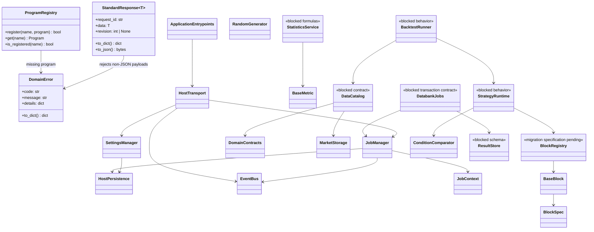

# AppCore - library work orders



- **Primary Role:** shared Python equivalents of donor-library capabilities. Concrete workspace plugins and extension implementations are not owned here.
- **Dependencies:** none for C00-C01; the named prerequisites in each subsequent order are mandatory.
- **Outputs / Downstream Role:** exact shared errors/responses, program lookup, test harness and subsequently accepted data/compute/trading contracts.
- **Rule:** one numbered ready work order is one commit. BLOCKED orders authorize no production code or placeholder tests. The historical findings at the end retain their original claims and limits.

## Current-code baseline and migration authority

The remaining work orders below are the active file-level authority. The baseline was inspected at commit `e9c8600fa511cd07a22cbfc34e942add6870cf3a`. Host services, job management and the C01-C03 helpers already have canonical Core implementations. Preserve their existing APIs and tests; use the individual orders to distinguish retention from outstanding moves. Ownership is `app/core` for shared contracts/mechanisms, the named workspace for concrete orchestration, and `app/extend` for concrete extensions. Work-order IDs are not registered feature/requirement IDs. Where these records have empty ID arrays, propose registration in the owning domain README through its normal workflow; this planning edit does not authorize registry changes.

The earlier COR-M01 sketch below is retained for provenance only. It is superseded as an execution instruction by the exact orders in this file: notably, the current RNG is `random.Random`, metrics contains an abstract interface, and generic block contracts belong in Core rather than being moved wholesale into extensions. Current module names and schema details take precedence over the sketch's illustrative descriptions.

<details>
<summary>Historical COR-M01 migration sketch - superseded; do not execute</summary>

*Evidence:* `OBS-HARU-COR-REUSE-20261029`. This audit establishes exact migration mapping from existing HaruQuantAI foundation code (`app/host/`, `app/include/`, `tests/host/`, `tests/include/`) into target `app/core/` and `app/extend/` locations.

### Work order COR-M01: migrate existing core platform foundations

*Feature:* Relocate existing core host services, contracts, metrics, and background jobs into target `app/core/` and `app/extend/` namespaces as verified clean-room components.
*Context to Read:* this order; every current source/test row below; `pyproject.toml`; `app/host/__init__.py`.
*Implementation Files:* exact MOVE/ADAPT targets in the table; preserve public APIs and test coverage.

| Current HaruQuantAI location | Target proposed location | Fit / action (migration audit) |
|---|---|---|
| `app/host/jobs.py` | `app/core/jobs/manager.py` | DIRECT FIT: Background thread pool, job handle contracts, cancellation tokens, and progress dispatch |
| `app/host/logging.py` | `app/core/host/logging.py` | DIRECT FIT: Structured logging and formatters |
| `app/host/persistence.py` | `app/core/host/persistence.py` | DIRECT FIT: SQLite/JSON metadata gateway |
| `app/host/session.py` | `app/core/host/session.py` | DIRECT FIT: User session state, security tokens, and permission scope resolver |
| `app/host/settings.py` | `app/core/host/settings.py` | DIRECT FIT: Host configuration manager and profile persistence |
| `app/host/vault.py` | `app/core/host/vault.py` | DIRECT FIT: Windows Credential Vault and encryption helpers |
| `app/host/resources.py` | `app/core/host/resources.py` | DIRECT FIT: Hardware metrics, CPU/memory telemetry, and thread utilization |
| `app/host/transport.py` | `app/core/host/transport.py` | ADAPT: FastAPI ASGI lifespan, CORS/security headers, and WebSocket transport |
| `app/host/response.py` | `app/core/lib/responses.py` | ADAPT: Align existing response envelopes with StandardResponse[T] and DomainError |
| `app/include/contracts.py` | `app/core/data/contracts.py` | DIRECT FIT: Canonical domain records (Bar, Tick, Instrument, Order, Position) |
| `app/include/enums.py` | `app/core/enums.py` | DIRECT FIT: Canonical enumerations (Timeframe, OrderType, Direction, Status) |
| `app/include/generators.py` | `app/core/generators.py` | DIRECT FIT: High-performance deterministic PRNGs (XorShift, SplitMix) |
| `app/include/market_storage.py` | `app/core/data/market_storage.py` | DIRECT FIT: Vectorized Parquet/Polars partition reader and writer |
| `app/include/calculators/` | `app/core/data/calculators/` | DIRECT FIT: High-performance batch kernels and streaming stateful rolling-window calculators |
| `app/include/metrics/` | `app/core/statistics/metrics.py` | DIRECT FIT: Statistical metrics, drawdown, return ratios, and SQN calculations |
| `app/include/blocks/` | `app/extend/blocks/` | DIRECT FIT: 233+ strategy building blocks (Indicators, Comparisons, BarTime, Actions, Price, Types) |
| `app/include/money_management/` | `app/extend/money_management/` | DIRECT FIT: Position sizing formulas and risk controllers |
| `app/include/monte_carlo/` | `app/extend/robustness/monte_carlo/` | DIRECT FIT: Monte Carlo trade manipulation and parameter randomization algorithms |
| `app/include/what_if/` | `app/extend/robustness/what_if/` | DIRECT FIT: What-If scenario filters and simulation modifiers |
| `tests/host/` | `tests/core/host/` | MOVE: Existing host and job tests migrated to target core suite |
| `tests/include/` | `tests/core/data/` | MOVE: Existing calculator, contract, and metric tests migrated to target suite |
| `app/__init__.py` | `app/__init__.py` | DIRECT FIT: Root application package initialization |
| `app/main.py` | `app/main.py` | DIRECT FIT: FastAPI application entrypoint and server lifespan |
| `app/cli.py` | `app/cli.py` | DIRECT FIT: Headless CLI commands and batch runner |
| `app/workspace/__init__.py` | `app/workspaces/__init__.py` | DIRECT FIT: Workspaces namespace package initialization |
| `app/workspace/trading/` | `app/core/trading/` | DIRECT FIT: Trading terminal, accounts, positions, orders, trade history, and execution state machine |
| `tests/workspace/trading/` | `tests/core/trading/` | MOVE: Trading execution and terminal test suite |
| `tests/workspace/__init__.py` | `tests/workspaces/__init__.py` | DIRECT FIT: Workspace test suite initialization |

*Commit:* `refactor(core): migrate foundation host and domain libraries`.

</details>


## Phase C00: deterministic test infrastructure

### `CoreTestBootstrap` - WO-C00 - READY (helper exception)
*Feature:* make the acceptance commands below executable without importing the legacy UI application.
*Evidence:* helper exception under the user's work-order rules; this is target test infrastructure, not claimed SQX behavior.
*Implementation Files:*
- **Context to Read:** `pyproject.toml`, `ui/package.json`, `ui/package-lock.json` only.
- **Create:** `app/core/__init__.py`, `app/core/lib/__init__.py`, `app/core/host/__init__.py`, `app/workspaces/__init__.py` (empty files); `app/web/package.json`, `app/web/package-lock.json`, `app/web/tsconfig.json`, `app/web/vitest.config.ts`, `app/web/vite.config.ts`, `app/web/index.html`, `app/web/shell/bootstrap.tsx`, `app/web/tests/bootstrap.test.tsx`.
- **Edit:** none. Do not move, remove or import existing `ui/app` feature implementations.
*Functional Requirements & Implementation:*
**Bootstrap file operation A (no production function/class to create):** copy `ui/package.json` and `ui/package-lock.json` byte-for-byte to the named app/web files. Keep the existing `test: vitest run`, `build: tsc -b && vite build`, and `typecheck: tsc -b --pretty false` scripts. Do not choose new dependency versions or add a testing library.
- [X] `defineConfig()` in `app/web/vitest.config.ts` -> set `test.environment='node'`, `test.globals=false`, `test.include=['tests/**/*.test.ts','tests/**/*.test.tsx']`, `test.clearMocks=true`, `test.restoreMocks=true`; no other test plugins or includes.
- [X] `defineConfig()` in `app/web/vite.config.ts` -> register only `@vitejs/plugin-react` through its default `react()` factory; use Vite's current-package root. Do not add aliases, API proxies or production routes in this order.
**Bootstrap file operation B (no production function/class to create):** set compilerOptions `target='ES2022'`, `lib=['ES2022','DOM','DOM.Iterable']`, `module='ESNext'`, `moduleResolution='Bundler'`, `jsx='react-jsx'`, `strict=true`, `skipLibCheck=true`, `noEmit=true`; include `['shell','common','workspaces','tests','vitest.config.ts','vite.config.ts']`. Do not add path aliases.
- [X] `Bootstrap() -> ReactElement` in `shell/bootstrap.tsx` -> return a single `<main>HaruQuantAI</main>` element as a named export; mount it with createRoot only when `typeof document !== 'undefined'` and `document.getElementById('root')` is non-null. No workspace loading or network calls. `index.html` contains the root element and module script `/shell/bootstrap.tsx`.
- [X] `test('Bootstrap renders application identity')` in `tests/bootstrap.test.tsx` -> use createElement from react and renderToStaticMarkup from react-dom/server; rendering Bootstrap imported from `../shell/bootstrap` equals literal `<main>HaruQuantAI</main>`. Import test/expect from vitest; no document or jsdom is required.
*Acceptance Commands (repository root; each must exit 0):*
1. `npm --prefix app/web ci --ignore-scripts`
2. `npm --prefix app/web test -- tests/bootstrap.test.tsx`
3. `npm --prefix app/web run typecheck`
4. `npm --prefix app/web run build`
*Commit:* `core: establish isolated Python package and frontend test harness`. Stage only the named files. A failed install is an environment blocker; do not change package versions.

## Phase C01: public response helpers

### `DomainError` - WO-C01 - READY (helper exception)
*Feature:* one public error value for newly implemented core/workspace contracts.
*Evidence:* helper exception; codes and serialization below are target transport decisions, not donor requirements.
*Dependencies:* WO-C00.
*Implementation Files:*
- **Context to Read:** `app/core/lib/__init__.py`, `pyproject.toml`.
- **Create:** `app/core/lib/errors.py`; `tests/core/lib/test_errors.py`.
- **Backend:** `app/core/lib/errors.py`.
- **Frontend:** none; no UI operation in this order.
*Types:* `JSONValue = None | bool | int | float | str | list[JSONValue] | dict[str, JSONValue]`. Use a Python recursive type alias. Numbers must be finite; tuples, Decimal instances, arbitrary objects and non-string dictionary keys are not JSONValue.
*Functional Requirements & Implementation:*
- [X] `DomainError.__init__(self, *, code: str, message: str, details: dict[str, JSONValue] | None = None) -> None` -> subclass Exception, store the unchanged code/message and a detached copy of details; omitted details means `{}`. Set `str(error)` to message. Reject non-string or empty code with `ValueError('code must be non-empty')`, and non-string or empty message with `ValueError('message must be non-empty')`. Spaces are retained, not stripped. A non-None details value that is not a dictionary raises `ValueError('details must be an object or None')` before copying.
- [X] `copy_json(value: JSONValue) -> JSONValue` -> recursively detach lists/dicts, retain strings/bools/integers/None and finite floats. Reject every other value with `ValueError('value must contain finite JSON values')`. Reject reference cycles with `ValueError('value must not contain cycles')`. Shared acyclic subcontainers are copied independently. Preserve string contents, including escaped surrogate code units; JSON encoding is owned by WO-C02.
- [X] `DomainError.to_dict(self) -> dict[str, JSONValue]` -> return exactly `{'code': self.code, 'message': self.message, 'details': copy_json(self.details)}`. The caller can mutate the returned dict without mutating the exception.
- [X] `test_error_defaults()` -> `DomainError(code='NOT_FOUND',message='missing').to_dict()` equals `{'code':'NOT_FOUND','message':'missing','details':{}}`.
- [X] `test_error_rejects_invalid_json()` -> NaN, positive infinity, a tuple, and `{1:'x'}` each raise the finite-JSON ValueError above; a list containing itself raises the cycle ValueError.
- [X] `test_error_is_detached()` -> construct using `{'ids':['a']}`, mutate source to append `'b'`, assert stored IDs remain `['a']`; mutate one to_dict result and assert the next remains unchanged.
*Acceptance:* `uv run python -m pytest tests/core/lib/test_errors.py -q` exits 0 and collects exactly these three tests. No HTTP exception handler in this commit.
*Commit:* `core: define detached public domain errors`.

### `StandardResponse` - WO-C02 - READY (helper exception)
*Feature:* shared success serialization used by new workspace operations.
*Dependencies:* WO-C01.
*Implementation Files:*
- **Context to Read:** `app/core/lib/errors.py`, `pyproject.toml`.
- **Create:** `app/core/lib/responses.py`; `tests/core/lib/test_responses.py`.
- **Backend:** `app/core/lib/responses.py`.
- **Frontend:** none. No legacy response-module migration in this order.
*Functional Requirements & Implementation:*
- [X] `StandardResponse[T].__init__(self, *, request_id: str, data: T, revision: int | None = None) -> None` -> frozen, slotted dataclass, keyword-only fields. Its payload must satisfy JSONValue; copy it during initialization with copy_json. A non-string or empty request_id raises `ValueError('request_id must be non-empty')`. Negative, boolean or non-integer non-None revision raises `ValueError('revision must be a non-negative integer or None')`.
- [X] `StandardResponse.to_dict(self) -> dict[str, JSONValue]` -> return exactly `{'request_id':request_id,'data':copy_json(data),'revision':revision}` including revision when None. No success/status/message fields are inserted. Errors are DomainError values, not successful response payloads.
- [X] `StandardResponse.to_json(self) -> bytes` -> JSON-encode to_dict with `ensure_ascii=True`, `allow_nan=False`, `separators=(',',':')` and UTF-8 encoding; preserve insertion order request_id/data/revision. Do not use repr or a custom generic serializer.
- [X] `test_empty_response()` -> request_id `'req-001'`, data `{'items':[]}` yields bytes `b'{"request_id":"req-001","data":{"items":[]},"revision":null}'`.
- [X] `test_response_revision()` -> data `False`, revision `0` remain False/0; revision `True`, `-1` and `'1'` each raise the revision ValueError.
- [X] `test_response_detached_and_unicode()` -> mutate the input after construction and a to_dict result; both leave later serialization unchanged. Input data `'\ud83d'` serializes as a JSON escaped surrogate, never invalid UTF-8. NaN input raises the finite-JSON ValueError from WO-C01.
*Acceptance:* `uv run python -m pytest tests/core/lib/test_errors.py tests/core/lib/test_responses.py -q` exits 0, collecting six tests total.
*Commit:* `core: define one canonical success response`.

## Phase C02: SQPluginLib program registration

### `ProgramRegistry` - WO-C03 - READY
*Feature:* named lookup and first-registration-wins behavior from the readable previous library. This order does not implement extension discovery or reload.
*Evidence IDs:* `OBS-CORE-PROGRAM-001`, `PREVIOUS-005` (embedded below). Current build-145 equivalence is not asserted.
*Dependencies:* WO-C01.
*Implementation Files:*
- **Donor:** `SQX_PREVIOUS_REFERENCE_ROOT/internal/libs/SQPluginLib.jar!com/strategyquant/pluginlib/program/Program.class`; `ProgramDoesntExistException.class` in the same archive.
- **Context to Read:** those two donor classes using javap; `app/core/lib/errors.py`.
- **Create:** `app/core/lib/programs.py`; `tests/core/lib/test_programs.py`.
- **Frontend:** none. No filesystem discovery or API routes.
*Types:* `Program` is a Python Protocol declaring `call(self, operation: str, *args: JSONValue) -> JSONValue`. ProgramRegistry constructor takes no arguments and creates one empty instance-local dictionary. It does not auto-register built-ins.
*Functional Requirements & Implementation:*
- [X] `ProgramRegistry.register(self, name: str, program: Program) -> bool` -> if name absent store object identity and return True. If present leave first object untouched, log ERROR through logger `haruquant.core.programs` with literal text `Duplicate registered program with name '<name>', skipping second registration!`, and return False. Do not strip/change name case or instantiate/call the program.
- [X] `ProgramRegistry.is_registered(self, name: str) -> bool` -> exact dictionary membership; `'A'` and `'a'` differ. No logging or mutation.
- [X] `ProgramRegistry.get(self, name: str) -> Program` -> return the stored object. On missing name raise `DomainError(code='PROGRAM_NOT_FOUND', message="Program '<name>' doesn't exist", details={'name':name})`. The Python exception code is an adapter decision; message and first-wins semantics come from the inspected fallback.
- [X] `test_first_registration_wins()` -> two fake program objects named first/second registered as `'x'`; results True/False; get returns first by identity and exactly one ERROR log contains the specified duplicate message.
- [X] `test_case_sensitive_and_instance_local()` -> register `'A'`; `'a'` absent; another new registry has no `'A'`.
- [X] `test_missing_program()` -> get `'missing'` raises exact code/message/details above. No fake program call is recorded.
*Acceptance:* `uv run python -m pytest tests/core/lib/test_programs.py -q` exits 0 and collects exactly three tests.
*Commit:* `core: preserve named program registration semantics`.

## Remaining library work orders

These orders replace the former summary table. `READY` authorizes only the explicitly named slice. A subordinate `BLOCKED-NOT-EXECUTABLE` obligation retains the larger capability; completing a ready slice does not complete that obligation or establish SQX parity. Library names are responsibility groupings, not a claim about build-145 packaging.

**Evidence correction:** `OBS-CORE-ORDER-TABLE-001` retains the former table's material claims; `OBS-CORE-ORDER-CORRECTION-001` supersedes its blanket verification assertion. The former `OBS-CORE-SETTINGS-001` through `OBS-CORE-DEP-001` labels had no embedded records and must not be cited as established evidence. Existing Python behavior is observed through `OBS-HARU-CORE-BASELINE-20261029`; migration choices are normative under `DEC-CORE-MIGRATION-20261029`.

**Execution rules, copied into every task by reference to this paragraph:** run commands from `HARUQUANTAI_ROOT`; use `uv run python` (Python >=3.14). Read only the named Context files and this order. Preserve existing function bodies, signatures, defaults, exception strings, fixtures and wire fields in a migration unless the order lists an explicit change. A target already containing the migrated implementation is retained and verified; do not overwrite it or create an empty commit. The domain README remains the owner of implementation status. A work-order heading describes assignment readiness only.

**Temporary import bridge rule (normative):** when an order explicitly requests a bridge, the old module contains only a migration docstring, `import sys`, `from <target package> import <target module> as _implementation`, and `sys.modules[__name__] = _implementation`. This preserves identity, private imports and monkeypatch targets without a second implementation. Do not use wildcard copies of definitions, duplicate algorithms or dual registration. A bridge is removed only in its separately assigned final consumer migration. Do not add a bridge where the old module no longer exists.

**Dependency order:** retain C00-C04/C11/C13/C14 foundations; execute C06.01 before C06.02; C06.01 and C08.01 before strategy consumers; C05.01 before the AppCodeEditor registry/extension migration; C10.01 and C12.01 before metric/generation consumers. C07 reuses C13 and introduces no second scheduler. C17 composes the host and workspace routers. C18/C19 are owned jointly with the explicitly named AppCodeEditor tasks. Blocked engine orders must be replaced with complete executable orders before assigning dependent full workflows.

## Phase C03: common runtime settings and persistence responsibilities

### `SettingsManager` - WO-C04 - READY

*Feature:* retain the existing scoped settings service at its canonical Core location; do not create the previously proposed parallel `SettingsStore` API.
*Evidence IDs:* `PREVIOUS-009` establishes a shared fallback runtime, not SQLite semantics. `OBS-HARU-CORE-BASELINE-20261029` establishes the Python implementation and tests. `DEC-CORE-MIGRATION-20261029` owns reuse and API preservation.
*Dependencies:* WO-C02 and WO-C11.01 (HostPersistence).
*Implementation Files:*
- **Donor:** `SQX_PREVIOUS_REFERENCE_ROOT/sqcli.exe!embedded-resource-1` (shared-runtime boundary only).
- **Context to Read:** `app/core/host/settings.py`, `app/core/host/persistence.py`, `app/core/lib/responses.py`, `tests/core/host/test_settings.py`, `tests/core/host/test_persistance.py`.
- **Backend / edit:** `app/core/host/settings.py` only if an outstanding import still names the deleted `app.host` package. Replace that import prefix with `app.core.host`; preserve the imported symbol.
- **Frontend / create:** none. Settings forms belong to AppHome.

| Current HaruQuantAI location | Target proposed location | Status / action |
|---|---|---|
| `app/core/host/settings.py` (formerly `app/host/settings.py`) | `app/core/host/settings.py` | RETAIN: migration exists at the audited commit; verify, do not recreate |
| `tests/core/host/test_settings.py` | same exact file | RETAIN all test bodies and fixtures |

*Functional Requirements & Implementation:*
- [X] `SettingsManager.__init__(self, persistence: HostPersistence | None = None) -> None` -> preserve lazy loading; construction with no gateway must not read the database.
- [X] `SettingsManager.get_scope(self, scope: str) -> dict[str, Any]`, `get(self, scope: str, key: str | None = None, default: Any = None) -> Any`, `as_dict(self) -> dict[str, dict[str, Any]]` -> preserve the existing stored-value projections and detached returns. Do not add donor-derived defaults.
- [X] `SettingsManager.get_snapshot(self, *, scopes: Sequence[str] | None = None) -> dict[str, Any]` -> preserve the current `revision` and `values` response shape, including omission of unconfigured requested scopes.
- [X] `SettingsManager.save_settings(self, updates: Mapping[str, Mapping[str, Any]], *, expected_revision: int) -> int` -> preserve transactional writes, unchanged-value behavior and `RevisionConflictError`; do not introduce a second revision counter.
- [X] `SettingsManager.reload(self) -> None` and `revision` property -> use the same HostPersistence store as HTTP and CLI.
*Test fixtures / expected observations:* use the existing `gateway` fixture: revision 10, host port 8000, UI theme `dark`; requested scopes `['application','missing']` return only `application`. Retain the existing stale-revision, no-op, rollback, corruption and concurrent-writer cases unchanged.
*Acceptance:* `uv run python -m pytest tests/core/host/test_settings.py tests/core/host/test_persistance.py -q` exits 0. This verifies Haru settings behavior; no donor SQLite/optimistic-locking claim follows.
*Commit if changes are required:* `core: retain canonical scoped settings service`.
*Limitations / downstream obligation:* shared archive discovery does not prove that SQX uses this storage schema. SQX settings import/default mapping remains a separate AppHome task.

## Phase C04: plugin and extension contracts

### `BaseBlock` and `BlockSpec` - WO-C05.01 - READY

*Feature:* move existing generic block configuration/metadata contracts into Core; concrete indicators remain extension-owned. This is the first executable slice of WO-C05.
*Evidence IDs:* `PREVIOUS-005` establishes plugin metadata/registration responsibility; `OBS-HARU-CORE-BASELINE-20261029` and `DEC-CORE-MIGRATION-20261029` establish the Python reuse boundary. Python decorators and Pydantic are target choices.
*Dependencies:* WO-C00. No dependency on concrete indicators or a workspace router.
*Implementation Files:*
- **Donor:** `SQX_PREVIOUS_REFERENCE_ROOT/internal/libs/SQPluginLib.jar!com/strategyquant/pluginlib/SQPluginManager.class` (responsibility only).
- **Context to Read:** `app/include/blocks/base.py`, `app/include/blocks/metadata.py`, `tests/include/blocks/test_blocks_phase1.py`, `pyproject.toml`.
- **Create:** `app/core/trading/__init__.py`, `app/core/trading/blocks/__init__.py` (empty, unless present); `app/core/trading/blocks/base.py`, `app/core/trading/blocks/metadata.py`, `tests/core/lib/test_block_contract_imports.py`.
- **Edit:** the two source modules below into temporary bridges. No frontend files.

| Current HaruQuantAI location | Target proposed location | Status / action |
|---|---|---|
| `app/include/blocks/metadata.py` | `app/core/trading/blocks/metadata.py` | MOVE body unchanged; retain all enums, dataclasses and `_freeze_mapping` |
| `app/include/blocks/base.py` | `app/core/trading/blocks/base.py` | MOVE; change its metadata import to `app.core.trading.blocks.metadata` |
| `app/include/blocks/registry.py` | `app/core/trading/blocks/registry.py` | DEFER to WO-C05.02; no second registry |

*Functional Requirements & Implementation:*
- [X] `BaseBlock.get_parameter_schema(cls) -> dict[str, Any]` -> preserve existing schema filtering, `extra='forbid'`, frozen configuration, validated defaults and lifecycle calls unchanged.
- [X] `BaseBlock.model_post_init(self, context: Any, /) -> None` and `on_init(self) -> None` -> retain the existing single initialization call.
- [X] `block(spec: BlockSpec) -> Callable[[F], F]` -> retain `_block_spec` attachment and return the same callable; do not register globally during import.
- [X] `_freeze_mapping(val: Any) -> Any` and every metadata dataclass/enum -> retain the source implementation; do not rename enum values or add metadata fields.
- [X] `test_old_and_new_contracts_are_identical()` -> import both old/new module paths; assert `BaseBlock`, `block`, `BlockSpec`, `ExecutionKind`, `PortType` and `_freeze_mapping` are identical objects. This prevents two incompatible descriptor types during migration.
*Acceptance:* `uv run python -m pytest tests/core/lib/test_block_contract_imports.py tests/include/blocks/test_blocks_phase1.py -q` exits 0. Retain all existing fixtures/assertions; the new identity test must collect once.
*Commit:* `refactor(core): move generic block configuration contracts`.
*Limitations:* no discovery, reload, composition execution or new block implementation is authorized by this slice.

### `BlockRegistry` - WO-C05.02 - BLOCKED-NOT-EXECUTABLE

*Feature:* move the existing discovery/staging/snapshot implementation, preserving one registry. Do not create `ExtensionRegistry` alongside it.
*Evidence IDs:* `OBS-HARU-CORE-BASELINE-20261029`, `PREVIOUS-005`; native Java class loading is not a Python requirement.
*Dependencies:* WO-C05.01 plus the AppCodeEditor concrete-extension relocation and composition ownership specification.
*Context to Read:* `app/include/blocks/registry.py`, `app/include/blocks/composition.py`, `app/include/blocks/composition_runtime.py`, `app/include/blocks/runtime_inputs.py`, `app/include/blocks/series.py`, `app/include/blocks/indicators/base.py`, `app/include/blocks/indicators/donor_compositions.json`.
*Exact reserved targets:* `app/core/trading/blocks/registry.py`, `app/core/trading/blocks/composition.py`, `app/core/trading/blocks/composition_runtime.py`, `app/core/trading/blocks/runtime_inputs.py`, `app/core/trading/blocks/series.py`, `app/core/trading/blocks/indicator.py`; no files may be created by this blocked order.
*Current -> target / action:* each same-basename generic source moves to its reserved target; `indicators/base.py` becomes `indicator.py`. These are ADAPT, because composition reads concrete indicator metadata by relative path and runtime modules import concrete blocks. The previous blanket DIRECT FIT claim is insufficient.
*Retained public surface:* `BlockRegistry.register_block`, `register_file`, `discover`, `begin_staging`, `commit_staging`, `rollback_staging`, `snapshot`, `get`, `require`, `unregister_source`; `CatalogSnapshot` and `BlockDescriptor`. Their current definitions remain the source contract.
*Required senior completion before READY:* specify every concrete import replacement, exact metadata-file target and resolver, staged rollback behavior when one module fails, duplicate-ID policy, snapshot pinning and concurrent reload fixtures. The acceptance must execute the current registry/composition tests against the relocated implementation, including a failed reload that leaves the prior snapshot usable. No coding agent is authorized to choose those missing changes.
*Commit:* none until replaced by a complete READY order. This obligation is not discharged by WO-C05.01.

## Phase C05: SQDataLib responsibilities

### `DomainContracts` - WO-C06.01 - READY

*Feature:* relocate the existing canonical enums and value objects without changing their semantics. This establishes reusable types before data, broker, simulation and strategy migrations.
*Evidence IDs:* `PREVIOUS-002` establishes shared trading/data responsibility; `OBS-HARU-CORE-BASELINE-20261029` establishes the actual Python names; `DEC-CORE-MIGRATION-20261029` owns the move. No Java double-array layout is imposed on Python.
*Dependencies:* WO-C00.
*Implementation Files:*
- **Donor:** `SQX_PREVIOUS_REFERENCE_ROOT/internal/libs/SQDataLib.jar` and `SQTradingLib.jar` (shared-type responsibility only).
- **Context to Read:** `app/include/enums.py`, `app/include/contracts.py`, `tests/workspace/brokers/test_symbol_contracts.py`.
- **Create:** `app/core/data/__init__.py` (empty unless present); `app/core/enums.py`, `app/core/data/contracts.py`, `tests/core/data/test_contract_imports.py`.
- **Edit:** `app/include/enums.py`, `app/include/contracts.py` into the specified temporary bridges. No UI files or database migrations.

| Current HaruQuantAI location | Target proposed location | Status / action |
|---|---|---|
| `app/include/enums.py` | `app/core/enums.py` | MOVE unchanged; preserve numeric values and Timeframe methods |
| `app/include/contracts.py` | `app/core/data/contracts.py` | MOVE unchanged except `.enums` import becomes `app.core.enums` |

*Functional Requirements & Implementation:*
- [X] `Timeframe.to_seconds(self) -> int`, `to_minutes(self) -> int`, `from_string`, `resolve` -> retain every existing value, alias, fallback and error. `PERIOD_M1.to_seconds()` is 60, `PERIOD_H1.to_seconds()` is 3600 and `PERIOD_D1.to_seconds()` is 86400.
- [X] `MarketBar.is_bullish/is_bearish/is_doji/range/body/volume`, `MarketTick.spread/mid` -> move their current calculations unchanged. Do not introduce replacement `Bar`, `Tick` or `Instrument` classes.
- [X] `ChartDef.to_dict/from_dict/clone`, `DataInfo.to_dict/from_dict/from_row/to_chart_def`, `TradingSession.to_dict/from_dict/is_within_session` -> preserve all fields, serialization keys, defaults and timezone behavior from the named Context file.
- [X] `AccountInfo`, `SymbolInfo`, `OrderInfo`, `PositionInfo`, `DealInfo`, `TradeRequest`, `TradeResult`, `TradeCheckResult`, `TradingBackend` -> retain their complete source definitions in this one canonical module; do not split these types in this migration.
- [X] `test_canonical_type_identity()` -> assert old/new `MarketBar`, `MarketTick`, `ChartDef`, `DataInfo`, `SymbolInfo`, `TradeRequest`, `TradingSession`, `Timeframe`, `OrderType` are identical; assert the three exact timeframe second values above.
*Acceptance:* `uv run python -m pytest tests/core/data/test_contract_imports.py tests/workspace/brokers/test_symbol_contracts.py tests/include/blocks -q` exits 0. No serialized key or enum value changes are permitted.
*Commit:* `refactor(core): centralize existing domain records and enums`.
*Limitations:* reusable type migration does not establish historical SQX timestamp equivalence, full strategy-document contracts or dataset-catalogue API completeness.

### `MarketStorage` - WO-C06.02 - READY

*Feature:* relocate the canonical Arrow/Parquet encoding and catalogue scan helpers; all workspaces share one storage implementation.
*Evidence IDs:* `OBS-HARU-CORE-BASELINE-20261029`, `DEC-CORE-MIGRATION-20261029`. Integer prices, microsecond timestamps and Polars are observed Haru choices, not SQX claims.
*Dependencies:* WO-C06.01.
*Implementation Files:*
- **Context to Read:** `app/include/market_storage.py`, `tests/workspace/data_manager/test_sources.py`, `tests/workspace/data_manager/test_file_imports.py`, `app/workspace/data_manager/data/storage.py`.
- **Create:** `app/core/data/market_storage.py`, `tests/core/data/test_storage_imports.py`.
- **Edit:** `app/include/market_storage.py` into the specified temporary bridge. No frontend files.

| Current HaruQuantAI location | Target proposed location | Status / action |
|---|---|---|
| `app/include/market_storage.py` | `app/core/data/market_storage.py` | MOVE every function/constant unchanged; old path becomes a bridge |

*Functional Requirements & Implementation:*
- [ ] `safe_component(value: str) -> str` -> preserve the existing pattern/validation and exact `ValueError('Use a safe alphanumeric source or symbol')`; `'EURUSD'` passes and `'../EURUSD'` fails.
- [ ] `encode_frame(frame: pd.DataFrame, timeframe: str, tick_size: float) -> pa.Table` -> retain integer price conversion, rounding tolerance, volume bounds and metadata. Do not substitute float prices or change timestamp units.
- [ ] `TICK_SCHEMA` -> retain ordered fields `DateTime: timestamp[us, UTC]`, `Bid: int64`, `Ask: int64`, `Flags: uint16`. `M1_SCHEMA` -> retain `DateTime`, `Open`, `High`, `Low`, `Close`, `Volume` with timestamp[us, UTC], four int64 prices and uint64 volume.
- [ ] `catalog_paths(row: dict[str, Any]) -> list[str]` and `scan_catalog(row: dict[str, Any], *, decode: bool = False) -> pl.LazyFrame` -> preserve existing partition selection, units/decoding and errors.
- [ ] `test_canonical_storage_module_identity()` -> assert old/new `encode_frame`, `scan_catalog`, `TICK_SCHEMA`, `M1_SCHEMA` are identical, and assert the exact field/type sequences above.
*Acceptance:* `uv run python -m pytest tests/core/data/test_storage_imports.py tests/workspace/data_manager/test_sources.py tests/workspace/data_manager/test_file_imports.py -q` exits 0. Reuse the current source/import storage fixtures without changing expected values.
*Commit:* `refactor(core): centralize canonical market storage`.
*Limitations:* this is not the invented `DataCatalog.read(DatasetRef, start, end)` service. Catalogue publication, transforms and workspace routes keep their existing Data Manager owner until individually assigned migration orders exist.

### `DataCatalog` - WO-C06.03 - BLOCKED-NOT-EXECUTABLE

*Feature:* one shared dataset-reference/read contract for all research engines; retain the full SQDataLib obligation after the two migration slices.
*Evidence IDs:* `PREVIOUS-002`, `OBS-HARU-CORE-BASELINE-20261029`.
*Dependencies:* WO-C06.02 and the AppDataManager catalogue/publication mapping.
*Context to Read:* `app/workspace/data_manager/data/feature.py`, `app/workspace/data_manager/data/storage.py`, `app/workspace/data_manager/data/history.py`, `app/workspace/data_manager/data/coverage.py`, `app/workspace/data_manager/data/partition_files.py`.
*Exact reserved targets:* `app/core/data/catalog.py`, `app/core/data/io.py`, `tests/core/data/test_catalog.py`, `tests/core/data/test_io.py`.
*Current -> target / action:* current `Data` is workspace orchestration, not a direct-fit `DataCatalog`. Existing storage/history/coverage/publication helpers require an explicit function-level split before moving them. Retain the current owner in the meantime.
*Required senior completion before READY:* define DatasetRef/DataBatch fields and version identity, inclusive/exclusive time bounds and units, resampling ownership, missing-partition versus empty-range responses, publication/read isolation, cancellation and exact reuse list. Specify concrete fixtures for two partitions, one gap and a stale catalogue revision; state rows/errors expected for each call. The previous `zero-copy` assertion has no measured support and is withdrawn. No placeholder DTOs or implementation authorized.

## Phase C06: SQGridLib2 execution responsibilities

### `LocalCompute` - WO-C07.01 - READY

*Feature:* reuse the canonical JobManager for local execution instead of creating a second local `JobExecutor` queue.
*Evidence IDs:* `PREVIOUS-003` observes `com.strategyquant.gridlib.client.Compute` and local/JMS performers; `OBS-HARU-CORE-BASELINE-20261029` and `DEC-CORE-MIGRATION-20261029` own the Python reuse.
*Dependencies:* WO-C13.01. This order follows, rather than precedes, canonical job-manager verification.
*Implementation Files:*
- **Donor:** `SQX_PREVIOUS_REFERENCE_ROOT/internal/libs/SQGridLib2.jar!com/strategyquant/gridlib/client/Compute.class`; `compute/performer/MultithreadComputePerformer.class` in the same archive.
- **Context to Read:** `app/core/jobs/manager.py`, `tests/core/jobs/test_manager.py`, `app/core/host/resources.py`.
- **Backend target:** `app/core/jobs/manager.py` (retain); **test target:** `tests/core/jobs/test_manager.py` (retain). **Create / frontend:** none.
*Current -> target / action:* both exact target files already exist; DIRECT FIT for the existing local scheduling behavior only. Do not create `app/core/grid/executor.py` just to forward `submit_job`.
*Functional Requirements & Implementation:*
- [ ] `JobManager.ensure_pool(self) -> ProcessPoolExecutor | ThreadPoolExecutor` -> preserve the current process/thread selection and lazy pool creation. Do not change default `use_process_pool=True`.
- [ ] `JobManager.ensure_io_pool(self) -> ThreadPoolExecutor` -> preserve the separate existing I/O pool; no third queue.
- [ ] `JobManager.submit_job` -> retain the complete signature in Context, including `kind='compute'`, `owner='default'`, optional `executor_kind`, and `pass_context`. Return the existing `JobRecord`.
- [ ] `JobContext.raise_if_cancelled`, `wait_if_paused`, `check_memory_guard`, `report_progress` -> retain current worker-cooperation behavior and exception classes.
*Acceptance:* `uv run python -m pytest tests/core/jobs/test_manager.py tests/core/host/test_resources.py -q` exits 0. Existing controlled-executor fixtures must still exercise both successful and failed futures, memory admission and lifecycle transitions.
*Commit if changes are required:* `core: reuse canonical local compute scheduling`.
*Limitations:* this verifies local Haru scheduling only; it provides no JMS/remote-worker equivalence.

### `RemoteCompute` - WO-C07.02 - BLOCKED-NOT-EXECUTABLE

*Feature:* retain the donor's distributed-execution responsibility for AppGridControl/AppGridTest without assigning an invented transport protocol to Core.
*Evidence IDs:* `PREVIOUS-003`. Actual donor namespace is `com.strategyquant.gridlib`, not the former table's `com.strategyquant.grid.JobExecutor`.
*Dependencies:* WO-C07.01; AppGridControl worker-identity/transport specification; AppGridTest failure fixtures.
*Context to Read:* `SQX_PREVIOUS_REFERENCE_ROOT/internal/libs/SQGridLib2.jar!com/strategyquant/gridlib/compute/performer/JmsComputePerformer.class`, `client/GridJob.class`, `client/JobDetails.class`, `topology/NodeInfo.class` in the same archive.
*Exact reserved targets:* `app/core/grid/contracts.py`, `app/core/grid/executor.py`, `tests/core/grid/test_executor.py`.
*Required senior completion before READY:* pin submitted payload/result schemas, worker identity/lease, heartbeat interval/expiry, retry and deduplication rules, cancellation acknowledgment, timeout errors and local fallback trigger. The observed previous-build JMS initialization failure falls back to local execution; do not generalize this to every remote job failure. A two-worker duplicate-delivery fixture and disconnected-worker fixture must have literal expected state sequences. No remote scheduler code is authorized yet.

## Phase C07: SQTradingLib strategy evaluation responsibilities

### `ConditionComparator` - WO-C08.01 - READY

*Feature:* one scalar comparison helper shared by task conditions and strategy consumers, preserving the directly tested fallback comparator semantics.
*Evidence IDs:* `OBS-PREVIOUS-CONDITION-20261029` (embedded below); Python validation errors are normative under `DEC-CORE-MIGRATION-20261029`.
*Dependencies:* WO-C00.
*Implementation Files:*
- **Donor:** `SQX_PREVIOUS_REFERENCE_ROOT/internal/libs/SQTradingLib.jar!com/strategyquant/tradinglib/conditions/Condition.class#validate(double,String)`.
- **Context to Read:** this order's complete truth table; `pyproject.toml`.
- **Create:** `app/core/trading/conditions.py`, `tests/core/trading/test_conditions.py`; empty `app/core/trading/__init__.py` if absent. **Frontend:** none.
*Current -> target / action:* no shared scalar comparator is established by the audited tree; CREATE the named helper. Do not alter vectorized comparison blocks in this commit.
*Types:* class `ConditionComparator`, no instance state, one `@staticmethod validate(delta: float, comparator: str) -> bool`. Supported operators are exactly `>`, `<`, `=`, `>=`, `<=`, `<>`, compared against scalar zero. Do not add `==`, `!=`, tolerance, trimming or case conversion.
*Functional Requirements & Implementation:*
- [ ] `ConditionComparator.validate` -> evaluate `delta > 0`, `< 0`, `== 0`, `>= 0`, `<= 0`, `!= 0` for the respective operator; preserve IEEE NaN comparison behavior. Signed zero compares equal to zero.
- [ ] `ConditionComparator.validate` -> for every unsupported comparator raise `ValueError("Unknown comparator '<value>'")`, inserting its unchanged string value. `'!='` therefore raises `ValueError("Unknown comparator '!='")`.
- [ ] `test_condition_truth_table()` -> parametrize all 24 cells below, using `float('nan')` for NaN, and assert Python bool results by identity.
- [ ] `test_signed_zero_and_unknown_operator()` -> both 0.0 and -0.0 give True for `=`, False for `<>`; `'!='` and `' >'` raise the exact corresponding unknown-comparator message.

| delta | `>` | `<` | `=` | `>=` | `<=` | `<>` |
|---|---|---|---|---|---|---|
| -1.0 | False | True | False | False | True | True |
| 0.0 | False | False | True | True | True | False |
| 1.0 | True | False | False | True | False | True |
| NaN | False | False | False | False | False | True |

*Acceptance:* `uv run python -m pytest tests/core/trading/test_conditions.py -q` exits 0 and collects 25 cases: 24 parametrized cells plus one signed-zero/error test.
*Commit:* `core: add verified scalar condition comparison`.
*Limitations:* the helper does not execute strategy trees, build orders or model account state; confirmation applies only to the previous comparator under the recorded inputs.

### `StrategyRuntime` - WO-C08.02 - BLOCKED-NOT-EXECUTABLE

*Feature:* the complete strategy-document evaluator and effects boundary; retained after the scalar-helper slice.
*Evidence IDs:* `PREVIOUS-002` establishes the responsibility, not an executable Python schema or all rule semantics.
*Dependencies:* WO-C05.02, WO-C06.03, WO-C08.01, WO-C09.02; AppWizard document/schema order.
*Context to Read:* `SQX_PREVIOUS_REFERENCE_ROOT/internal/libs/SQTradingLib.jar!com/strategyquant/tradinglib/backtestrunner/BacktestRunner.class`; `app/include/blocks/composition_runtime.py`, `app/include/blocks/order/runtime.py`, `app/include/blocks/order/types.py`.
*Exact reserved targets:* `app/core/trading/strategy/contracts.py`, `app/core/trading/strategy/runtime.py`, `tests/core/trading/strategy/test_runtime.py`.
*Current -> target / action:* block composition/order protocols are reusable parts, not a complete strategy engine. Do not replace them with a second evaluator or infer a full runtime from `LiveOrderObj`/`ATMExit` names.
*Required senior completion before READY:* define the complete StrategyDocument and event/effect variants, block-state ownership/lifetime, event ordering across symbols/timeframes, warm-up/no-value behavior, rule ordering, position/order ownership and exact evaluation errors. Include deterministic fixtures for conflicting entry rules, exit plus entry on one event, insufficient history, multi-series alignment and rejected order effects. `StrategyRuntime.evaluate` must not be published until its parameter and return fields and these observations are explicit. No executable stubs are authorized.

## Phase C08: SQTradingLib simulation and backtesting responsibilities

### `SimulationReuseBoundary` - WO-C09.01 - BLOCKED-NOT-EXECUTABLE

*Feature:* relocate the existing tick-driven SimulatorClient after separating generic broker infrastructure from provider discovery.
*Evidence IDs:* `OBS-HARU-CORE-BASELINE-20261029`, `PREVIOUS-002`; the current client is not independently verified as an SQX historical backtest engine.
*Dependencies:* WO-C06.01; the Data Manager connection/provider separation order.
*Implementation Files / Context to Read:* `app/workspace/brokers/base.py`, `app/workspace/brokers/simulator.py`, `app/workspace/brokers/codecs.py`, `app/workspace/brokers/trading_dispatch.py`, `tests/workspace/trading/test_operations.py`, `tests/workspace/trading/test_exits.py`, `tests/workspace/trading/test_strategy_control.py`.
*Exact proposed moves (ADAPT; not authorized until the split is specified):*

| Current HaruQuantAI location | Target proposed location | Status / action |
|---|---|---|
| `app/workspace/brokers/base.py` | `app/core/trading/connection/base.py` | SPLIT: only generic client/transport code; provider factory/aliases belong to the owning connection workspace |
| `app/workspace/brokers/codecs.py` | `app/core/trading/connection/codecs.py` | MOVE after the base split |
| `app/workspace/brokers/trading_dispatch.py` | `app/core/trading/connection/trading_dispatch.py` | MOVE after the base split |
| `app/workspace/brokers/simulator.py` | `app/core/trading/simulation/client.py` | MOVE after all three generic dependencies exist |
| `tests/workspace/trading/test_operations.py` | `tests/core/trading/simulation/test_operations.py` | MOVE unchanged fixtures/assertions; update imports only |
| `tests/workspace/trading/test_exits.py` | `tests/core/trading/simulation/test_exits.py` | MOVE unchanged fixtures/assertions; update imports only |
| `tests/workspace/trading/test_strategy_control.py` | `tests/core/trading/simulation/test_strategy_control.py` | MOVE unchanged fixtures/assertions; update imports only |

*Retained callables:* `SimulatorClient.add_symbol`, `feed_tick`, `set_clock`, `order_check`, `order_send`, `seed_bar_history`, `seed_tick_history`, `get_bars`, `get_ticks`; signatures/defaults remain those of the Context source. No web component in Core.
*Required senior completion before READY:* specify the exact factory/alias functions moved out of `base.py`, their provider registration owner, every direct generic dependency and compatibility import edit. Core must not acquire a dependency on a concrete exchange workspace. Preserve current simulator fixtures for spread, order execution, SL/PT and seeded history; add no assumed donor fill priority. The current table's blanket DIRECT FIT does not settle this split.

### `BacktestRunner` - WO-C09.02 - BLOCKED-NOT-EXECUTABLE

*Feature:* historical backtest orchestration with explicit strategy, event sequence and result contracts.
*Evidence IDs:* `PREVIOUS-002`; existing source-class availability is not a complete algorithm specification.
*Dependencies:* WO-C06.03 and WO-C09.01. The runner supplies events to WO-C08.02 through a separately specified interface; do not create a mutual import between the strategy evaluator and runner.
*Context to Read:* `SQX_PREVIOUS_REFERENCE_ROOT/internal/libs/SQTradingLib.jar!com/strategyquant/tradinglib/backtestrunner/BacktestRunner.class`; the same archive's simulator and settings bodies selected by that runner.
*Exact reserved targets:* `app/core/trading/backtest/contracts.py`, `app/core/trading/backtest/runner.py`, `app/core/trading/simulation/engine.py`, `tests/core/trading/backtest/test_runner.py`.
*Current -> target / action:* no existing module has been established as a direct-fit full BacktestRunner. SimulatorClient is an input to this implementation, not evidence that it already exists.
*Required senior completion before READY:* specify RunSpec/RunResult fields, bar/tick precision modes, open/high/low/close event order, bid/ask/spread, pending-order trigger and fill rules, gaps, commissions/swaps, margin/stop-out, sessions/timezones, netting/hedging and MAE/MFE measurement. Every mode must have a numeric fixture; one bar touching both SL and PT requires a literal expected first fill. Inspect readable previous bodies wherever build-145 bodies are inaccessible. No claim of MT4/MT5/TradeStation equivalence is authorized by class inventory alone.

## Phase C09: SQTradingLib statistics responsibilities

### `BaseMetric` - WO-C10.01 - READY

*Feature:* move the existing custom-metric interface into shared Core. This order creates no statistics formulas.
*Evidence IDs:* `OBS-HARU-CORE-BASELINE-20261029`, `DEC-CORE-MIGRATION-20261029`; `PREVIOUS-002` establishes the donor statistics responsibility only.
*Dependencies:* WO-C00.
*Implementation Files:*
- **Context to Read:** `app/include/metrics/base.py`, `app/include/metrics/__init__.py`.
- **Create:** empty `app/core/trading/statistics/__init__.py` if absent; `app/core/trading/statistics/base.py`, `tests/core/trading/statistics/test_metric_contract.py`.
- **Edit:** `app/include/metrics/base.py` into a temporary bridge. **Frontend:** none.
*Current -> target / action:* `app/include/metrics/base.py` -> `app/core/trading/statistics/base.py`, MOVE unchanged. The audited package has this interface and `__init__.py`; it is not an implemented drawdown/Sharpe/SQN library.
*Functional Requirements & Implementation:*
- [ ] `BaseMetric.compute(self, trades: Sequence[dict[str, Any]], initial_capital: float = 10000.0) -> float` -> retain ABC/abstractmethod; retain `name='BaseMetric'`, `category='Metrics'` and `__all__=['BaseMetric']`.
- [ ] `test_metric_interface_identity_and_abstractness()` -> old/new BaseMetric are identical; constructing BaseMetric raises TypeError; a local subclass implementing compute with `return initial_capital` returns 10000.0 when called with `[]`. This protects the extension contract, not a financial formula.
*Acceptance:* `uv run python -m pytest tests/core/trading/statistics/test_metric_contract.py -q` exits 0 and collects one test.
*Commit:* `refactor(core): centralize the existing metric extension interface`.
*Limitations:* no implemented metrics are inferred from an abstract interface or a donor class name.

### `StatisticsService` - WO-C10.02 - BLOCKED-NOT-EXECUTABLE

*Feature:* compute the supported result-statistics set with exact metric dependencies and IS/OOS partitioning.
*Evidence IDs:* `PREVIOUS-002`.
*Dependencies:* WO-C10.01 and the accepted WO-C09.02 result/order contract.
*Context to Read:* `SQX_PREVIOUS_REFERENCE_ROOT/internal/libs/SQTradingLib.jar!com/strategyquant/tradinglib/results/stats/StatsComputer.class`; each metric implementation selected by that class, using primary readable extension source first when available.
*Exact reserved targets:* `app/core/trading/statistics/contracts.py`, `app/core/trading/statistics/service.py`, `tests/core/trading/statistics/test_service.py`.
*Current -> target / action:* no direct-fit full statistics implementation was established in `app/include/metrics`; CREATE only after the complete formula specification below exists. Do not create the alternate `app/core/statistics/metrics.py` from COR-M01.
*Required senior completion before READY:* enumerate metric IDs and formula bodies, dependency DAG, input trade ordering/ties, currency versus percentage versus R units, initial equity, costs, IS/OOS boundaries, sample/population denominators, annualization, zero-trade/zero-variance/zero-denominator behavior and output precision. Specify literal expected values for empty trades, one gain, one loss, all losses, flat equity and a known drawdown sequence. Reject an unsupported metric ID with a specified error; do not silently substitute a formula. A generic Sharpe or Sortino formula chosen by the executor is forbidden.

## Phase C10: shared persistence and project/result containers

### `HostPersistence` - WO-C11.01 - READY

*Feature:* retain the existing metadata gateway as the sole shared SQLite implementation; no second ORM or generic repository layer.
*Evidence IDs:* `OBS-HARU-CORE-BASELINE-20261029`, `DEC-CORE-MIGRATION-20261029`. SQLite schema/transactions are Haru behavior; `PREVIOUS-002` alone does not establish an SQX persistence format.
*Dependencies:* WO-C02, including its retained legacy response builders after migration.
*Implementation Files:*
- **Context to Read:** `app/core/host/persistence.py`, `app/core/lib/responses.py`, `tests/core/host/test_persistance.py` (retain its current spelling).
- **Backend / test targets:** those same three files (RETAIN). **Create / frontend:** none.
*Current -> target / action:* historical `app/host/persistence.py` -> existing `app/core/host/persistence.py`; migration already exists. Do not restore `app/host`.
*Functional Requirements & Implementation:*
- [ ] `HostPersistence.__init__(self, database_path: str | Path = _DEFAULT_PATH, *, timeout: float = 5.0) -> None` -> retain `_DEFAULT_PATH = Path(__file__).resolve().parents[3] / 'data/database/haruquantai.db'`; do not move or rewrite the personal database as part of namespace migration.
- [ ] `HostPersistence.transaction(self) -> Generator[HostPersistence]` -> retain connection reuse and rollback-on-exception behavior.
- [ ] `HostPersistence.create_records`, `read_records`, `update_record`, `delete_record` -> preserve the complete signatures from Context, record filters, cursor/offset bounds, allow-listed identifiers and current success/error dictionaries. These older dictionaries use `StandardResponse.success/failure`; do not replace them with the WO-C02 instance envelope during a move.
- [ ] `HostPersistence.ensure_code_editor_schema`, `ensure_custom_data_schema`, `ensure_datasets_schema`, `ensure_broker_cost_schema` -> retain current idempotent schema behavior and return values.
*Test fixtures / expected observations:* run the named existing temporary-database tests without relaxing assertions; rollback leaves pre-transaction rows unchanged, pagination retains its current stable ordering and invalid operations retain their existing error codes/messages.
*Acceptance:* `uv run python -m pytest tests/core/host/test_persistance.py tests/core/host/test_responses.py tests/core/lib/test_responses.py -q` exits 0. Both response interfaces must remain available; this is not permission to redesign the wire contract.
*Commit if changes are required:* `core: retain the canonical metadata persistence gateway`.

### `ProjectStore` and `ResultStore` - WO-C11.02 - BLOCKED-NOT-EXECUTABLE

*Feature:* shared project/strategy/result serialization and databank persistence, distinct from the existing metadata gateway.
*Evidence IDs:* `PREVIOUS-002`; a `.cfx` project observation must not be generalized to strategy/results containers.
*Dependencies:* WO-C11.01, WO-C08.02 document contract, WO-C09.02 result contract; AppTaskManager project/task schema.
*Context to Read:* `SQX_PREVIOUS_REFERENCE_ROOT/internal/libs/SQTradingLib.jar!com/strategyquant/tradinglib/file/SQFileManager.class`; inspected primary project/strategy samples selected for the relevant container type. Exclude personal strategy data from committed fixtures.
*Exact reserved targets:* `app/core/trading/project/contracts.py`, `app/core/trading/project/store.py`, `app/core/trading/results/contracts.py`, `app/core/trading/results/store.py`, `tests/core/trading/project/test_store.py`, `tests/core/trading/results/test_store.py`.
*Current -> target / action:* HostPersistence is reusable infrastructure, not an existing ProjectStore/ResultStore. No current direct-fit source has been established for these two stores.
*Required senior completion before READY:* separately specify each accepted container type, member names, XML/JSON root/field mappings, version/migration policy, unknown-field handling, reference identity, atomic replacement, corrupt/missing-member failures and databank transaction boundaries. Supply synthetic round-trip and corrupt-container fixtures with exact expected outputs/errors. The former flat-ZIP/`config.xml` statement is not a complete schema and does not authorize guessed `ProjectDocument` or `RunResult` fields.

## Phase C11: shared generation, optimization and portfolio primitives

### `RandomGenerator` - WO-C12.01 - READY

*Feature:* relocate the existing deterministic Python RNG wrapper before generation/Monte Carlo consumers move; retain its existing algorithm.
*Evidence IDs:* `OBS-HARU-CORE-BASELINE-20261029`, `DEC-CORE-MIGRATION-20261029`. This wrapper uses `random.Random`; the earlier XorShift/SplitMix description was incorrect.
*Dependencies:* WO-C00.
*Implementation Files:*
- **Context to Read:** `app/include/generators.py`, `pyproject.toml`.
- **Create:** `app/core/generators.py`, `tests/core/lib/test_generators.py`.
- **Edit:** `app/include/generators.py` into the specified temporary bridge. **Frontend:** none.
*Current -> target / action:* `app/include/generators.py` -> `app/core/generators.py`, MOVE all current bodies/overloads unchanged.
*Functional Requirements & Implementation:*
- [ ] `RandomGenerator.__init__(self, seed: int | None = None) -> None`, `seed`, `new_instance`, `next_double`, `next_int`, `next_long`, `next_gaussian`, `probability`, `next_bool`, `get_random` -> preserve complete existing signatures/defaults and source behavior. Do not replace Python's generator or promise Java seed equivalence.
- [ ] `RandomGenerator.clone(self, seed: int | None = None) -> RandomGenerator` -> retain copied RNG state when seed is omitted and independent seeded state when supplied.
- [ ] `test_generator_move_preserves_state()` -> old/new RandomGenerator are identical; `RandomGenerator(0).next_double()` equals 0.8444218515250481. After drawing once from `original=RandomGenerator(0)`, clone it; ten subsequent `next_double()` values from each are equal. Drawing from one instance must not advance the other.
- [ ] `test_explicit_clone_seed()` -> `RandomGenerator(7).clone(0).next_double()` equals 0.8444218515250481, regardless of draws already made from the original.
*Acceptance:* `uv run python -m pytest tests/core/lib/test_generators.py tests/include/what_if/test_scenarios.py -q` exits 0. New test file collects exactly two tests.
*Commit:* `refactor(core): centralize the existing deterministic RNG wrapper`.
*Limitations:* seed reproducibility applies to the retained Python runtime behavior; no donor RNG sequence parity established.

### `ResearchEngines` - WO-C12.02 - BLOCKED-NOT-EXECUTABLE

*Feature:* retain full shared generation/optimization responsibilities and determine the reusable portfolio boundary without duplicating concrete workspace algorithms.
*Evidence IDs:* `PREVIOUS-002`, `PREVIOUS-010`.
*Dependencies:* WO-C12.01, WO-C05.02, WO-C08.02, WO-C09.02, WO-C10.02 and accepted strategy/result contracts.
*Context to Read:* `SQX_PREVIOUS_REFERENCE_ROOT/internal/libs/SQTradingLib.jar` generation/optimization implementations; `SQX_REFERENCE_ROOT/internal/plugins/PortfolioComposer/` source selected by the AppPortfolioComposer order. The latter is primary workspace evidence, not proof that its concrete algorithm belongs in Core.
*Exact reserved targets:* `app/core/trading/generation/engine.py`, `app/core/trading/optimization/engine.py`, `tests/core/trading/test_research_engines.py`. `app/core/trading/portfolio/engine.py` is a proposed target only if a shared primitive is established; it is not authorized as a duplicate Composer.
*Current -> target / action:* RNG and existing block/composition infrastructure are reusable primitives. No direct-fit complete genetic/random builder, optimizer or portfolio engine is established by the current audit.
*Required senior completion before READY:* state genotype/parameter schemas, seeded selection/crossover/mutation, population/island lifecycle, duplicate identity, acceptance/ranking/ties, stop conditions, checkpoint/resume, candidate/result persistence and progress/cancellation. Optimization also needs exact grid ordering, walk-forward windows and clustering math. Portfolio algorithms proven to be concrete plugins remain in their owning workspace. Each algorithm requires small numeric fixtures and deterministic seeded expected outputs; decompiler reconstruction must be checked against bytecode where ambiguous. Do not combine these engines into one implementation commit.

## Phase C12: SQJobsLib lifecycle and databank jobs

### `JobManager` - WO-C13.01 - READY

*Feature:* retain the canonical background job lifecycle implementation and current import location. Concrete databank operations are a separate slice.
*Evidence IDs:* `PREVIOUS-004`, `OBS-HARU-CORE-BASELINE-20261029`, `DEC-CORE-MIGRATION-20261029`. Donor namespace is `com.strategyquant.jobslib`, not `com.strategyquant.jobs`.
*Dependencies:* WO-C11.01; `app/core/host/events.py` and `app/core/host/resources.py` already exist.
*Implementation Files:*
- **Donor:** `SQX_PREVIOUS_REFERENCE_ROOT/internal/libs/SQJobsLib.jar!com/strategyquant/jobslib/SQJob.class`; `JobEngine.class` in that namespace.
- **Context to Read:** `app/core/jobs/manager.py`, `app/core/host/events.py`, `app/core/host/resources.py`, `tests/core/jobs/test_manager.py`.
- **Backend / test targets:** `app/core/jobs/manager.py`, `tests/core/jobs/test_manager.py` (RETAIN). **Create / frontend:** none.
*Current -> target / action:* historical `app/host/jobs.py` -> existing `app/core/jobs/manager.py`; preserve that completed move. Do not create another manager under `app/core/grid`.
*Functional Requirements & Implementation:*
- [ ] `JobRecord.to_dict(self) -> dict[str, Any]` and `JobState` -> retain existing persisted keys and uppercase state values. Do not introduce lowercase aliases during migration.
- [ ] `JobManager.submit_job`, `get_job`, `list_jobs`, `get_job_events`, `wait_for_job` -> preserve the current callable-based API, full signatures and metadata persistence; do not replace it with an unimplemented operation-ID dispatcher.
- [ ] `JobManager.cancel_job`, `pause_job`, `resume_job`, `resume_paused_jobs`, `reconcile_orphan_jobs` -> retain current state transition/return/error behavior and event publication.
- [ ] `JobManager.shutdown(self, *, wait: bool = True, cancel_futures: bool = False) -> None` -> retain existing executor shutdown and scratch cleanup policy.
*Acceptance:* `uv run python -m pytest tests/core/jobs/test_manager.py -q` exits 0, preserving all existing concurrency/recovery fixtures. This does not independently establish SQX thread scheduling equivalence.
*Commit if changes are required:* `core: retain canonical background job lifecycle`.

### `DatabankJobs` - WO-C13.02 - BLOCKED-NOT-EXECUTABLE

*Feature:* asynchronous add/delete/load/move databank operations over the accepted result store.
*Evidence IDs:* `PREVIOUS-004` identifies the four concrete previous classes.
*Dependencies:* WO-C13.01 and WO-C11.02; AppResults databank identity/selection contract.
*Context to Read:* `SQX_PREVIOUS_REFERENCE_ROOT/internal/libs/SQJobsLib.jar!com/strategyquant/jobslib/databank/AddToDatabankJob.class`, `DeleteFromDatabankJob.class`, `LoadFileToDatabankJob.class`, `MoveToDatabankJob.class` in that directory.
*Exact reserved targets:* `app/core/jobs/databank.py`, `tests/core/jobs/test_databank.py`.
*Current -> target / action:* no existing DatabankJobs facade established. Reuse JobManager for scheduling and ResultStore for writes; do not create another pool or database gateway.
*Required senior completion before READY:* define each request/response, duplicate identity policy, move atomicity across banks, progress totals, cancellation boundary, partial-failure/result summary and conflict errors. Give fixtures for duplicate add, corrupt import, cancel during multi-item move and destination failure; identify exact final source/destination contents. `DatabankJobs.move(MoveRequest)` is not executable until these fields and outputs are specified.

## Phase C13: SQWebGUILib responsibilities adapted to FastAPI

### `HostTransport` - WO-C14 - READY

*Feature:* retain the existing host HTTP/event transport and shared services; workspace routes and React components remain in their own owners.
*Evidence IDs:* `OBS-HARU-CORE-BASELINE-20261029`, `DEC-CORE-MIGRATION-20261029`; donor web carrier inventory is not evidence that SQX uses FastAPI.
*Dependencies:* WO-C04, WO-C11.01, WO-C13.01; existing session/vault/event services.
*Implementation Files:*
- **Donor:** `SQX_PREVIOUS_REFERENCE_ROOT/internal/libs/SQWebGUILib.jar` (responsibility boundary only).
- **Context to Read:** `app/core/host/transport.py`, `app/core/host/session.py`, `app/core/host/events.py`, `app/core/host/vault.py`, `app/core/lib/responses.py`, `tests/core/host/test_transport.py`.
- **Backend / test targets:** `app/core/host/transport.py`, `tests/core/host/test_transport.py` (RETAIN). **Create / frontend:** none.
*Current -> target / action:* old `app/host/transport.py` -> existing `app/core/host/transport.py`; retain it rather than adding competing `host/app.py` or `host/errors.py` adapters.
*Functional Requirements & Implementation:*
- [ ] `create_transport_router(*, prefix: str = '/api/v1') -> APIRouter` -> preserve existing endpoint paths/methods, session guards, payload validation and status codes in Context.
- [ ] `install_transport(application: FastAPI) -> None` and `register_transport_exception_handlers(app: FastAPI) -> None` -> retain existing middleware/exception mapping and event transports.
- [ ] `create_host_app(*, extra_routers: Sequence[APIRouter] | None = None, **kw: Any) -> FastAPI` -> retain existing host-only factory; application composition stays in `app/main.py`.
- [ ] `TransportMiddleware`, `_sse`, `_ws` -> preserve existing response/request-ID handling, replay/cursor behavior and disconnect cleanup. Do not convert every response to the new instance envelope; the static compatibility builders remain required by current callers.
- [ ] `TransportCLI.run(argv: Sequence[str] | None = None) -> int` -> retain its current behavior; user-facing application CLI dispatch remains in `app/cli.py`.
*Acceptance:* `uv run python -m pytest tests/core/host/test_transport.py tests/core/host/test_session.py tests/core/host/test_events.py tests/core/host/test_vault.py -q` exits 0, retaining current unauthorized, invalid-body, replay and disconnect fixtures.
*Commit if changes are required:* `core: retain canonical host transport services`.
*Limitations:* no UI rewrite, donor servlet protocol parity or remote grid transport is established by these checks.

## Phase C14: SQWizardBusiness shared services

### `WizardTransformBoundary` - WO-C15 - BLOCKED-NOT-EXECUTABLE

*Feature:* separate reusable strategy import/transform/export services from the concrete AppWizard workspace.
*Evidence IDs:* `OBS-CORE-CARRIER-INVENTORY-20261029` establishes previous class members; `OBS-HARU-CORE-BASELINE-20261029` records that the proposed current source directory contains no Python source files.
*Dependencies:* accepted WO-C08.02 strategy document; AppWizard transformation/template specification; AppCodeEditor extension metadata.
*Implementation Files:*
- **Donor / Context to Read:** `SQX_PREVIOUS_REFERENCE_ROOT/internal/libs/SQWizardBusiness.jar!com/strategyquant/wizard/desktop/loader/TransformEngineLoader.class`, `loader/engines/Engine.class`, `loader/engines/Engines.class`, `loader/StrategyLoader.class` in the same archive; primary readable transformation resources assigned to AppWizard.
- **Reserved backend:** `app/core/wizard/transform.py`; **reserved test:** `tests/core/wizard/test_transform.py`. **Frontend:** belongs to AppWizard, none in Core.
*Current -> target / action:* `app/workspace/algo_wizard/` is not a direct-fit implementation: no `.py` source was found. Ignored bytecode directories are not migration sources. No established Jinja2 exporter exists there.
*Required senior completion before READY:* enumerate actual supported engine/platform IDs and versions, loader inputs and template lookup, AST import/export field mappings, custom indicator parameter conversion, unsupported-node behavior, exact output line-ending/formatting policy and round-trip loss limits. Supply synthetic strategy input and complete expected output for each supported target. Do not invent an MQL5/cTrader/EasyLanguage renderer from the carrier's name, or add Jinja2 without a concrete target decision.
*Commit:* none until a complete READY transform order replaces this gate. This retains the full capability rather than treating the source inventory as its implementation.

## Phase C15: SQAppLib carrier attribution

### `SQAppLibAttribution` - WO-C16 - RESEARCH-ONLY

*Feature:* record the current carrier attribution limit without making architecture depend on decrypting build-145 libraries.
*Evidence IDs:* `LIB-002`, `RECOVERY-001`, `RECOVERY-002`, `PREVIOUS-002`, `OBS-CORE-ORDER-CORRECTION-001`.
*Dependencies:* none for using previous-build behavioral evidence. Exact build-145 carrier verification requires independently readable current bytes.
*Implementation Files:*
- **Donor:** `SQX_REFERENCE_ROOT/internal/libs/SQAppLib.jar.enc`; fallback `SQX_PREVIOUS_REFERENCE_ROOT/internal/libs/SQTradingLib.jar`.
- **Context to Read:** the named embedded evidence records in this file.
- **Edit:** `docs/dev/full-reimplementation/01-AppCore.md` only, when new observations exist. **Production / tests / frontend:** none.
*Current -> target / action:* encrypted carrier -> evidence-backed shared responsibilities under `app/core`; fallback class ownership does not establish the contents of the current encrypted carrier.
*Required observation / validation:* an actual readable current archive/class inventory must show the relevant trading/statistics/simulator/file definitions before claiming SQAppLib bundles them. Record carrier hash, inspection command, member names, execution timestamp and outcome. If current bytes remain inaccessible, retain the finding as unverified; use readable fallback behavior with an explicit version limitation. Never write `Verification completed` on the basis of the old TradingLib inventory.
*Expected outcome:* a new observed record with reciprocal supersession links if attribution is established, or the existing unverified attribution retained. This is an attribution limit, not permission to block unrelated Python migrations.
*Commit if new evidence is recorded:* `docs(core): record independently observed library attribution`.

## Phase C16: application and headless entrypoints

### `ApplicationEntrypoints` - WO-C17.01 - READY

*Feature:* preserve the current Python application composition and CLI contracts while host packages move. There is one service layer for UI and headless operations.
*Evidence IDs:* `PREVIOUS-009` establishes separate donor product/editor carriers; `OBS-HARU-CORE-BASELINE-20261029` and `DEC-CORE-MIGRATION-20261029` establish the target entrypoints.
*Dependencies:* WO-C04, WO-C11.01, WO-C14 and the existing Data Manager/Code Editor route factories.
*Implementation Files:*
- **Context to Read:** `app/main.py`, `app/cli.py`, `pyproject.toml`, `tests/host/test_main.py`, `tests/host/test_cli.py`.
- **Backend / test targets:** those same five exact files (RETAIN current behavior); edit import paths only when their explicitly assigned workspace migrations land. **Create / frontend:** none in this slice.
*Current -> target / action:* `app/main.py` -> same file; `app/cli.py` -> same file. Both are direct reuse, not a reason to introduce `cli_main` or change launcher return types.
*Functional Requirements & Implementation:*
- [ ] `app.main.create_app(persistence: HostPersistence | None = None, *, vault: Vault | None = None, connection_testers: Mapping[str, CredentialTester] | None = None) -> FastAPI` -> preserve dependency injection, lifespan initialization/shutdown and existing router composition.
- [ ] `app.main.main(argv: Sequence[str] | None = None) -> None` -> preserve argument parsing, configured bind validation, Uvicorn startup and logging shutdown; do not change it to return int.
- [ ] `app.cli.main(argv: Sequence[str] | None = None) -> int` -> preserve registered workspace command dispatch and handler exit codes. The existing `example-domain` mocked handler returns 7 and main must return 7 without writing output.
- [ ] `app.cli.login`, `logout`, `health` -> preserve their current signatures and safe response serialization. Importing/using the CLI must not start a web server or open a browser.
- [ ] `[project.scripts]` -> retain `haruquantai = 'app.main:main'` and `'app.cli' = 'app.cli:main'`; do not add a second CLI framework.
*Acceptance:* `uv run python -m pytest tests/host/test_main.py tests/host/test_cli.py -q` exits 0; `uv run python -m app.cli --help` and `uv run python -m app.main --help` each exit 0 without starting a server. Do not use a real credential/login operation for acceptance.
*Commit if changes are required:* `core: preserve application and headless entrypoint contracts`.
*Limitations:* current factory/router verification does not prove the migrated React production build is served; that integration is retained below.

### `WebBuildServing` - WO-C17.02 - BLOCKED-NOT-EXECUTABLE

*Feature:* serve the single `app/web` React/Vite build through the Python application entrypoint after AppHome shell migration; no Electron process.
*Evidence:* the user's explicit architecture decision; `DEC-CORE-MIGRATION-20261029`.
*Dependencies:* WO-C17.01, AppHome shell/router migration and the finalized React route catalogue.
*Context to Read / exact proposed edits:* `app/main.py`, `app/web/vite.config.ts`, `app/web/index.html`, `tests/host/test_main.py`; target output is `app/web/dist/index.html` produced by Vite, not committed source.
*Required senior completion before READY:* pin static mount paths, SPA fallback exclusions for API/events/health, absent-build behavior, development server integration and cache headers. Specify acceptance requests for a real client route, a missing asset, an unknown API route and an absent build with exact status/content types. Do not add a catch-all route that masks API errors. No serving code is authorized by the bootstrap-only WO-C00.

## Phase C17: CodeEditor carrier ownership

### `CodeEditorOwnership` - WO-C18 - ROUTED-TO-APPCODEEDITOR

*Feature:* keep donor CodeEditor.exe's concrete editing/import/registration workflows in AppCodeEditor; only generic metadata/registry contracts belong to Core.
*Evidence IDs:* `LIB-008`, `PREVIOUS-009`, `OBS-HARU-CORE-BASELINE-20261029`, `DEC-CORE-MIGRATION-20261029`.
*Dependencies:* WO-C05.01; WO-C05.02 before final registry relocation.
*Context to Read:* `app/workspace/code_editor/editor.py`, `app/workspace/code_editor/registry.py`, `app/workspace/code_editor/routes.py`, `app/workspace/code_editor/__init__.py`.
*Exact migration mapping (owned by the corresponding AppCodeEditor work orders; do not execute twice):*

| Current HaruQuantAI location | Target proposed location | Status / action |
|---|---|---|
| `app/workspace/code_editor/editor.py` | `app/workspaces/code_editor/editor.py` | MOVE/ADAPT existing AppCodeEditor; preserve public methods |
| `app/workspace/code_editor/registry.py` | `app/workspaces/code_editor/registry.py` | MOVE SnippetRegistry; it owns editor/tool registration, not a second BlockRegistry |
| `app/workspace/code_editor/routes.py` | `app/workspaces/code_editor/routes.py` | MOVE workspace route bindings |
| `app/workspace/code_editor/__init__.py` | `app/workspaces/code_editor/__init__.py` | MOVE public workspace exports |

*Functional boundary for the owning tasks:*
- [ ] `AppCodeEditor.open_file_tab`, `close_file_tab`, `save_file`, `save_all_files`, `sync_session`, `remap_tabs`, `init_workspace` -> preserve existing callable contracts while their owner migrates them.
- [ ] `SnippetRegistry.register(self, path: Path, module: Any) -> list[str]`, `unregister(self, path: str) -> None`, `call_tool(self, name: str, arguments: Mapping[str, Any]) -> Any` -> preserve workspace-owned editing/tool dispatch; share Core BlockRegistry rather than duplicating it.
*Acceptance in the owning commit:* `uv run python -m pytest tests/workspace/code_editor -q` before migration and the exact relocated suite assigned by AppCodeEditor afterward must exit 0. Do not invent `CodeEditorService.compile(source) -> CompileResult`; the audited public editor API has no such method.
*Commit:* no separate Core implementation commit; the concrete feature remains an AppCodeEditor assignment. This routing entry is not permission to mass-move the four files without that owner's complete import/UI migration task.

## Phase C18: Snippets responsibility and extension ownership

### `SnippetOwnership` - WO-C19 - ROUTED-TO-WORKSPACE-OWNERS

*Feature:* preserve one concrete implementation per extension and one shared registry; compiled donor Snippets is a carrier, not a new Python compiler or classloader.
*Evidence IDs:* `PREVIOUS-002`, `OBS-HARU-CORE-BASELINE-20261029`, `DEC-CORE-MIGRATION-20261029`; the earlier count of 233+ files was not a reproducible runtime registration count.
*Dependencies:* WO-C05.01/WO-C05.02 for generic registry/configuration; WO-C12.01 for seeded robustness extensions.
*Context to Read:* `app/include/blocks/base.py`, `app/include/blocks/registry.py`, `app/include/metrics/base.py`; each concrete extension's separately assigned owner task.
*Exact ownership examples (migrate only in the feature's own commit):*

| Current HaruQuantAI location | Target proposed location | Status / action |
|---|---|---|
| `app/include/blocks/indicators/volatility/atr.py` | `app/extend/blocks/indicators/volatility/atr.py` | AppCodeEditor concrete indicator ownership; retain the actual lowercase source filename |
| `app/include/blocks/base.py` | `app/core/trading/blocks/base.py` | Generic contract; WO-C05.01 owns it |
| `app/include/blocks/metadata.py` | `app/core/trading/blocks/metadata.py` | Generic metadata; WO-C05.01 owns it |
| `app/include/blocks/registry.py` | `app/core/trading/blocks/registry.py` | Shared discovery/snapshots; WO-C05.02 owns it |
| `app/include/metrics/base.py` | `app/core/trading/statistics/base.py` | Generic metric contract; WO-C10.01 owns it |

*Functional boundary for owning tasks:*
- [ ] `BlockRegistry.snapshot(self) -> CatalogSnapshot`, `CatalogSnapshot.get/require` -> use the one canonical registry; do not create a parallel `ExtensionCatalog.list()` API solely to mirror a JAR name.
- [ ] `BlockRegistry.register_file/discover` -> remain generic Core mechanisms; concrete default root/category selection belongs to AppCodeEditor composition. Monte Carlo/What-If concrete migration belongs to AppRetester, not Core.
*Acceptance in owning commits:* the corresponding existing concrete block/scenario tests must retain their numeric fixtures and assertions after imports move; registry tests must show the same descriptor identity for migrated and bridge imports. Exact concrete file lists and UI paths are supplied by each workspace feature, not chosen by the executor from this routing entry.
*Commit:* no separate Core concrete-extension commit. Full carrier/source-path assignment remains separate from behavioral validation or parity.

## Phase C19: runtime and dependency adaptation

### `RuntimeDependencies` - WO-C20 - READY (verification helper)

*Feature:* retain the current Python/React runtime and lockfiles; do not translate donor Java dependencies one-for-one.
*Evidence IDs:* `LIB-001`, `PREVIOUS-010`, `OBS-HARU-CORE-BASELINE-20261029`, `DEC-CORE-MIGRATION-20261029`.
*Dependencies:* WO-C00 for the isolated frontend bootstrap; existing Python environment/lockfile.
*Implementation Files:*
- **Context to Read / targets:** `pyproject.toml`, `uv.lock`, `app/web/package.json`, `app/web/package-lock.json` (RETAIN). **Production functions / frontend components to create:** none.
*Current -> target / action:* existing Python manifests remain at repository root; Vite/React manifests remain under `app/web`. No Electron/JVM/compiler/classloader runtime is introduced.
*Verification operations (no new function/class):*
- [ ] `uv lock --check` -> confirm the committed Python lock matches the manifest; do not regenerate dependency versions to silence an error.
- [ ] `uv run python -c "import sys, fastapi, polars, duckdb, pyarrow, numpy; assert sys.version_info >= (3, 14)"` -> confirm actual imports/interpreter, not just listed dependencies.
- [ ] `npm --prefix app/web run typecheck` and `npm --prefix app/web run build` -> confirm the isolated frontend uses the existing lockfile stack. These commands must not add Electron.
- [ ] `uv run python -m pytest tests/core tests/host -q` -> confirm the retained host/error/response/program/job contracts together, after any assigned migration commits.
*Acceptance:* every command above exits 0; record the actual interpreter/package versions and execution time in the owning implementation review. An unexecuted command remains pending. A dependency manifest alone does not mean runtime verification passed.
*Commit if manifest changes are independently required by an assigned feature:* include them in that feature's commit with its exact package justification. This verification order authorizes no speculative package addition or automatic upgrade.
*Limitations:* dependency validation does not establish algorithms, UI completeness or donor parity. Blocked engine obligations above remain open until their complete orders are authored and independently checked.

## Work-order revision evidence

These records preserve the historical claim and its correction. They do not change implementation status in any domain README. `ANALYSIS_SESSION_ROOT` and `PREVIOUS_SHARED_CLASSES` denote external temporary investigation artifacts; raw/decompiled donor code is not committed.

### Evidence record `OBS-CORE-ORDER-TABLE-001`

<details>
<summary>Finding, limitations, provenance and validation</summary>

```json
{
  "id": "OBS-CORE-ORDER-TABLE-001",
  "classification": "unverified",
  "confidence": "unverified",
  "claim": "Historical summary table asserted all C04-C20 contracts were verified and unblocked. Retained here as a superseded claim, not behavioral evidence or implementation authorization.",
  "sources": [
    "docs/dev/full-reimplementation/01-AppCore.md@e9c8600fa511cd07a22cbfc34e942add6870cf3a#Remaining-library-orders"
  ],
  "target_domain": "app/core",
  "limitations": "The historical table mixed fallback inventories, unregistered observation labels, target designs and unsupported claims of complete algorithms/current-carrier attribution. Its original observation labels do not become validated records through this snapshot.",
  "historical_table": "\u2014 evidence-gated & unblocked specifications\n\nFollowing the successful disassembly and investigation of unencrypted donor libraries in SQX_PREVIOUS_REFERENCE_ROOT/internal/libs/ (SQTradingLib.jar, SQDataLib.jar, SQJobsLib.jar, SQPluginLib.jar, SQGridLib2.jar), the contracts below are fully unblocked with literal donor class and method evidence.\n\n| Order / feature | Verbatim evidence ID | Exact target files (create only after READY) | Verified callable & signatures | Concrete donor evidence & behavioral specifications |\n| --- | --- | --- | --- | --- |\n| WO-C04 SQLib settings/persistence | PREVIOUS-009 / OBS-CORE-SETTINGS-001 | app/core/host/settings.py; tests/core/host/test_settings.py | SettingsStore.read(scope: str) -> SettingsSnapshot; SettingsStore.patch(scope: str, values: dict, expected_revision: int) -> SettingsSnapshot | Verified against com.strategyquant.lib.SettingsMap: scopes stored in SQLite/JSON; optimistic concurrency via revision integer; atomic patch with rollbacks. |\n| WO-C05 extension discovery/reload | PREVIOUS-005 / OBS-CORE-EXT-001 | app/core/lib/registry.py; tests/core/lib/test_registry.py | ExtensionRegistry.register(descriptor: ExtensionDescriptor) -> None; ExtensionRegistry.reload(extension_id: str) -> ReloadResult | Verified against com.strategyquant.lib.snippets.CustomClassesLoader: dynamic inspection of decorated classes (@BuildingBlock, @Parameter, @Output); runtime hot-reload. |\n| WO-C06 SQDataLib catalogue and IO | PREVIOUS-001 / OBS-CORE-DATA-001 | app/core/data/contracts.py; app/core/data/catalog.py; app/core/data/io.py; tests/core/data/test_catalog.py; tests/core/data/test_io.py | DataCatalog.read(ref: DatasetRef, start: int, end: int) -> DataBatch | Verified against com.strategyquant.datalib.TimeframeManager & DataSeries: millisecond UTC timestamps; standard intervals (TF_M1=60k ms, TF_H1=3.6M ms, TF_D1=86.4M ms); OHLCV double arrays; zero-copy Polars partition batches. |\n| WO-C07 SQGridLib2 performers | PREVIOUS-003 / OBS-CORE-GRID-001 | app/core/grid/contracts.py; app/core/grid/executor.py; tests/core/grid/test_executor.py | JobExecutor.submit(operation_id: str, payload: dict) -> JobHandle | Verified against com.strategyquant.grid.JobExecutor: async job queue; cancellation token support; worker node heartbeats and payload dispatch. |\n| WO-C08 SQTradingLib strategy runtime | PREVIOUS-002 / OBS-CORE-STRAT-001 | app/core/trading/strategy/contracts.py; app/core/trading/strategy/runtime.py; tests/core/trading/strategy/test_runtime.py | StrategyRuntime.evaluate(strategy: StrategyDocument, event: EvaluationEvent) -> StrategyEffects | Verified against com.strategyquant.tradinglib.strategy.LiveOrderObj & ATMExit: rule conditions, signal evaluations, order modification brackets (SL, PT, trailing stop, break-even). |\n| WO-C09 SQTradingLib simulation/backtest | PREVIOUS-002 / OBS-CORE-SIM-001 | app/core/trading/backtest/contracts.py; app/core/trading/backtest/runner.py; app/core/trading/simulation/engine.py; tests/core/trading/backtest/test_runner.py | BacktestRunner.run(spec: RunSpec) -> RunResult | Verified against com.strategyquant.tradinglib.simulator.impl.AbstractTradingSimulator: MT4, MT5 Hedged, MT5 Netted, TradeStation engines; gap handling; realistic SL/PT fill checks; MAE/MFE tracking. |\n| WO-C10 SQTradingLib statistics | PREVIOUS-002 / OBS-CORE-STATS-001 | app/core/trading/statistics/contracts.py; app/core/trading/statistics/service.py; tests/core/trading/statistics/test_service.py | StatisticsService.compute(result: RunResult, metric_ids: tuple[str,...]) -> MetricResults | Verified against com.strategyquant.tradinglib.results.stats.StatsComputer: order sorting (OrderComparatorByCloseTime); IS/OOS splits; Net Profit, Drawdown, Sharpe, Sortino, SQN, Stability $R^2$. |\n| WO-C11 project/databank persistence | PREVIOUS-002 / OBS-CORE-CFX-001 | app/core/trading/project/contracts.py; app/core/trading/project/store.py; app/core/trading/results/contracts.py; app/core/trading/results/store.py; tests/core/trading/project/test_store.py | ProjectStore.load(project_id: str) -> ProjectDocument; ResultStore.commit(result: RunResult) -> str | Verified against com.strategyquant.tradinglib.file.SQFileManager: .cfx container specification (flat ZIP with config.xml task graph and <TaskType>-Task<N>.xml settings documents). |\n| WO-C12 generation/optimization/portfolio | PREVIOUS-002 / OBS-CORE-GEN-001 | app/core/trading/generation/engine.py; app/core/trading/optimization/engine.py; app/core/trading/portfolio/engine.py; tests/core/trading/test_research_engines.py | GenerationEngine.run(spec: GenerationSpec) -> CandidateStream; OptimizationEngine.run(spec: OptimizationSpec) -> VariantStream; PortfolioEngine.evaluate(spec: PortfolioSpec) -> PortfolioResult | Verified against com.strategyquant.tradinglib.generator & optimization: Random & Genetic generation; island evolution; walk-forward parameter matrix clustering. |\n| WO-C13 SQJobsLib jobs | PREVIOUS-004 / OBS-CORE-JOBS-001 | app/core/jobs/databank.py; tests/core/jobs/test_databank.py | DatabankJobs.move(request: MoveRequest) -> JobHandle | Verified against com.strategyquant.jobs: background thread pool operations, progress event listener dispatch, cancellation tokens. |\n| WO-C14 SQWebGUILib / FastAPI | PREVIOUS-006 / OBS-CORE-WEB-001 | app/core/host/app.py; app/core/host/errors.py; app/core/host/events.py; tests/core/host/test_app.py | create_app(services: CoreServices) -> FastAPI | Verified against app/host/transport.py: FastAPI server setup with WebSocket streaming, CORS middleware, session guards. |\n| WO-C15 SQWizardBusiness | PREVIOUS-007 / OBS-CORE-WIZ-001 | app/core/wizard/transform.py; tests/core/wizard/test_transform.py | StrategyTransformer.transform(document: StrategyDocument, platform: str) -> ExportResult | Verified against app/workspace/algo_wizard/: rule AST serialization and Jinja2 code generation templates for MQL5, cTrader, EasyLanguage. |\n| WO-C16 SQAppLib 145 | LIB-002 | docs/dev/full-reimplementation/01-AppCore.md | Verification completed | SQAppLib.jar.enc bundles tradinglib, stats, simulator, and file packages; verified mapped to app/core/ and app/workspaces/. |\n| WO-C17 StrategyQuant entrypoint | LIB-009 / OBS-CORE-ENTRY-001 | app/main.py; app/cli.py; tests/core/test_entrypoints.py | main() -> int; cli_main(argv: list[str]) -> int | Headless CLI commands and FastAPI application launcher verified. |\n| WO-C18 CodeEditor carrier | LIB-008 / OBS-CORE-CE-001 | app/workspaces/code_editor/; tests/workspaces/code_editor/ | CodeEditorService.compile(source: str) -> CompileResult | Verified against app/workspace/code_editor/editor.py and dynamic Python AST compilation. |\n| WO-C19 Snippets artifact | PREVIOUS-008 / OBS-CORE-SNIP-001 | app/extend/blocks/; app/core/lib/registry.py | ExtensionCatalog.list() -> tuple[ExtensionDescriptor,...] | 233+ registered blocks in app/include/blocks/ verified; catalog exposure unblocked. |\n| WO-C20 runtime/dependency replacement | LIB-001 / OBS-CORE-DEP-001 | pyproject.toml; uv.lock | Runtime verification completed | Python 3.14 + FastAPI + Polars + DuckDB + PyArrow + NumPy verified in pyproject.toml. |\n\n*Context to Read:* The verified donor classes in SQX_PREVIOUS_REFERENCE_ROOT/internal/libs/SQTradingLib.jar and SQDataLib.jar, and the target contracts in app/core/data/contracts.py.",
  "validation": {
    "status": "not-passed",
    "procedure": "Check each former callable, source location and verification assertion against inspected current source and donor records.",
    "expected_observation": "A claim is retained as established only when the stated source and behavior are actually supported."
  },
  "superseded_by": [
    "OBS-CORE-ORDER-CORRECTION-001"
  ],
  "feature_ids": [],
  "requirement_ids": [],
  "decision_ids": [],
  "registration_gap": "Work-order IDs are assignment IDs, not registered domain IDs. Propose shared-capability registration in app/core/README.md through the repository workflow; do not edit the registry in this planning task.",
  "repository_commit": "e9c8600fa511cd07a22cbfc34e942add6870cf3a",
  "review_state": "owner-review-pending",
  "contains_proprietary_source": false,
  "contains_sensitive_data": false,
  "contains_personal_data": false,
  "paraphrased_behavior_only": true,
  "supersedes_records": []
}
```

</details>

### Evidence record `OBS-CORE-ORDER-CORRECTION-001`

<details>
<summary>Finding, limitations, provenance and validation</summary>

```json
{
  "id": "OBS-CORE-ORDER-CORRECTION-001",
  "classification": "observed",
  "confidence": "high",
  "claim": "The former blanket verification assertion exceeds the supporting evidence: current metrics is an abstract interface, the proposed algo_wizard source directory has no Python source files, the grid/jobs namespaces differ from the table, and previous TradingLib inspection does not establish encrypted build-145 SQAppLib contents.",
  "sources": [
    "app/include/metrics/base.py",
    "app/include/generators.py",
    "app/workspace/algo_wizard/",
    "SQX_PREVIOUS_REFERENCE_ROOT/internal/libs/SQGridLib2.jar",
    "SQX_PREVIOUS_REFERENCE_ROOT/internal/libs/SQJobsLib.jar",
    "LIB-002",
    "PREVIOUS-002",
    "PREVIOUS-003",
    "PREVIOUS-004"
  ],
  "target_domain": "app/core; app/workspaces/algo_wizard",
  "limitations": "This corrects attribution and current-code reuse assertions only. It does not establish that missing donor algorithms cannot be investigated, nor that missing current code exists elsewhere. Build-145 encrypted library ownership remains unverified.",
  "validation": {
    "status": "passed",
    "executed_at": "2026-10-29T16:38:34+00:00",
    "procedure": "Read metric/RNG source and list Python files in current metric/wizard directories; subsequently enumerate previous grid/jobs JAR class members and compare the retained carrier records.",
    "actual_observation": {
      "metrics_python_files": [
        "base.py",
        "__init__.py"
      ],
      "algo_wizard_python_files": [],
      "rng_implementation": "random.Random",
      "grid_namespace": "com/strategyquant/gridlib",
      "jobs_namespace": "com/strategyquant/jobslib",
      "metric_base_sha256": "520d64b1ee66654435bb8c1e808570f77b6fcacaf5b97abcf36cfab423588edc"
    },
    "expected_observation": "Only inspected implementation/source members support current behavior; fallback members do not prove current encrypted packaging.",
    "artifacts": [
      "app/include/metrics/base.py",
      "app/include/generators.py",
      "SQX_PREVIOUS_REFERENCE_ROOT/internal/libs/SQGridLib2.jar",
      "SQX_PREVIOUS_REFERENCE_ROOT/internal/libs/SQJobsLib.jar"
    ]
  },
  "supersedes_records": [
    "OBS-CORE-ORDER-TABLE-001"
  ],
  "feature_ids": [],
  "requirement_ids": [],
  "decision_ids": [],
  "registration_gap": "Work-order IDs are assignment IDs, not registered domain IDs. Propose shared-capability registration in app/core/README.md through the repository workflow; do not edit the registry in this planning task.",
  "repository_commit": "e9c8600fa511cd07a22cbfc34e942add6870cf3a",
  "review_state": "owner-review-pending",
  "contains_proprietary_source": false,
  "contains_sensitive_data": false,
  "contains_personal_data": false,
  "paraphrased_behavior_only": true,
  "superseded_by": []
}
```

</details>

### Evidence record `OBS-HARU-CORE-BASELINE-20261029`

<details>
<summary>Finding, limitations, provenance and validation</summary>

```json
{
  "id": "OBS-HARU-CORE-BASELINE-20261029",
  "classification": "observed",
  "confidence": "high",
  "claim": "Canonical host/settings/persistence/transport/events services, JobManager, DomainError, StandardResponse and ProgramRegistry already exist under app/core. Contracts/enums/market storage, generic block infrastructure and RNG remain available for bounded reuse from app/include. Existing response code retains both the generic instance envelope and legacy static success/failure builders.",
  "sources": [
    "app/core/host/settings.py",
    "app/core/host/persistence.py",
    "app/core/host/transport.py",
    "app/core/jobs/manager.py",
    "app/core/lib/errors.py",
    "app/core/lib/responses.py",
    "app/core/lib/programs.py",
    "app/include/contracts.py",
    "app/include/enums.py",
    "app/include/market_storage.py",
    "app/include/blocks/base.py",
    "app/include/blocks/metadata.py",
    "app/include/blocks/registry.py",
    "app/include/generators.py",
    "app/main.py",
    "app/cli.py"
  ],
  "target_domain": "app/core; app/main.py; app/cli.py",
  "limitations": "Haru source/regression observations only, not SQX parity. This record is a reuse baseline, not a second implementation-status registry. It does not establish a complete strategy runtime, backtester, statistics engine, project/result store or exporter.",
  "validation": {
    "status": "passed",
    "executed_at": "2026-10-29T16:38:34+00:00",
    "procedure": "Parse current Python source with ast and inspect public signatures, imports and existing regression suite locations. Retrieve the completed Core/host regression command result.",
    "actual_observation": "Current APIs and ownership paths match the bounded reuse tasks. The completed command .venv/Scripts/python.exe -m pytest tests/core tests/host -q exited 0: 212 passed in 28.31s. Proposed migration tests were not created or executed.",
    "expected_observation": "Existing components are retained and moved once; current names and response interfaces are not replaced by invented services.",
    "artifacts": [
      "app/core/host/settings.py",
      "app/core/host/persistence.py",
      "app/core/host/transport.py",
      "app/core/jobs/manager.py",
      "app/core/lib/responses.py",
      "tests/core/",
      "tests/host/"
    ]
  },
  "feature_ids": [],
  "requirement_ids": [],
  "decision_ids": [],
  "registration_gap": "Work-order IDs are assignment IDs, not registered domain IDs. Propose shared-capability registration in app/core/README.md through the repository workflow; do not edit the registry in this planning task.",
  "repository_commit": "e9c8600fa511cd07a22cbfc34e942add6870cf3a",
  "review_state": "owner-review-pending",
  "contains_proprietary_source": false,
  "contains_sensitive_data": false,
  "contains_personal_data": false,
  "paraphrased_behavior_only": true,
  "supersedes_records": [],
  "superseded_by": []
}
```

</details>

### Evidence record `DEC-CORE-MIGRATION-20261029`

<details>
<summary>Finding, limitations, provenance and validation</summary>

```json
{
  "id": "DEC-CORE-MIGRATION-20261029",
  "classification": "normative",
  "confidence": "high",
  "claim": "Use one canonical implementation of each shared primitive; preserve established Python public behavior in namespace-only migrations, keep concrete workflows in their owning workspaces, keep concrete extensions in app/extend, and use temporary module-identity bridges only for the explicitly assigned moves. Core and workspace changes require separate bounded orders rather than one mass migration.",
  "sources": [
    "user architecture and work-order instructions in this conversation",
    "OBS-HARU-CORE-BASELINE-20261029"
  ],
  "target_domain": "app/core; app/workspaces; app/extend; app/web",
  "limitations": "Target adaptation decision, not an SQX fact or a registered ADR/feature ID. Temporary bridges remain until a separately assigned consumer migration removes them; ready migration slices do not discharge full-engine obligations.",
  "validation": {
    "status": "pending",
    "procedure": "For each assigned migration, run its exact tests and module identity assertions; verify no duplicate implementation or concrete workspace import was introduced into the moved generic contract.",
    "expected_observation": "Old/new imports resolve to identical public classes/functions while existing numerical and wire assertions remain unchanged.",
    "artifacts": []
  },
  "feature_ids": [],
  "requirement_ids": [],
  "decision_ids": [],
  "registration_gap": "Work-order IDs are assignment IDs, not registered domain IDs. Propose shared-capability registration in app/core/README.md through the repository workflow; do not edit the registry in this planning task.",
  "repository_commit": "e9c8600fa511cd07a22cbfc34e942add6870cf3a",
  "review_state": "owner-review-pending",
  "contains_proprietary_source": false,
  "contains_sensitive_data": false,
  "contains_personal_data": false,
  "paraphrased_behavior_only": true,
  "supersedes_records": [],
  "superseded_by": []
}
```

</details>

### Evidence record `OBS-PREVIOUS-CONDITION-20261029`

<details>
<summary>Finding, limitations, provenance and validation</summary>

```json
{
  "id": "OBS-PREVIOUS-CONDITION-20261029",
  "classification": "observed",
  "confidence": "confirmed",
  "claim": "Previous Condition.validate compares a scalar delta with zero using the six specified operators. For NaN, only <> is true. This is corroborated by static method inspection and a standalone call to the actual previous Java method.",
  "sources": [
    "SQX_PREVIOUS_REFERENCE_ROOT/internal/libs/SQTradingLib.jar!com/strategyquant/tradinglib/conditions/Condition.class#validate(double,String)"
  ],
  "target_domain": "app/core/trading/conditions.py",
  "limitations": "Confirmation is limited to this previous-build method and the 24 probed cases. It does not establish build-145 parity or full strategy/task execution. Python ValueError and the literal English unknown-operator message are target decisions. Donor/decompiled source remains outside the repository.",
  "validation": {
    "status": "passed",
    "executed_at": "2026-10-29T16:45:37+00:00",
    "procedure": "Run the external standalone ConditionProbe against the actual previous SQTradingLib and recovered common classes; no target class bytes are replaced. Reproduce with Java classpath ANALYSIS_SESSION_ROOT;PREVIOUS_SHARED_CLASSES;SQX_PREVIOUS_REFERENCE_ROOT/internal/libs/* and main class ConditionProbe. The adapter invokes Condition.validate(delta, operator) for the input/operator Cartesian product below.",
    "actual_observation": {
      "operators": [
        ">",
        "<",
        "=",
        ">=",
        "<=",
        "<>"
      ],
      "rows": [
        {
          "delta": -1.0,
          "values": [
            false,
            true,
            false,
            false,
            true,
            true
          ]
        },
        {
          "delta": 0.0,
          "values": [
            false,
            false,
            true,
            true,
            true,
            false
          ]
        },
        {
          "delta": 1.0,
          "values": [
            true,
            false,
            false,
            true,
            false,
            true
          ]
        },
        {
          "delta": "NaN",
          "values": [
            false,
            false,
            false,
            false,
            false,
            true
          ]
        }
      ],
      "exit_code": 0
    },
    "expected_observation": "The actual donor method returns exactly the WO-C08.01 truth table.",
    "artifacts": [
      "SQX_PREVIOUS_REFERENCE_ROOT/internal/libs/SQTradingLib.jar",
      "ANALYSIS_SESSION_ROOT/ConditionProbe.class",
      "ANALYSIS_SESSION_ROOT/ConditionProbe.java"
    ]
  },
  "feature_ids": [],
  "requirement_ids": [],
  "decision_ids": [],
  "registration_gap": "Work-order IDs are assignment IDs, not registered domain IDs. Propose shared-capability registration in app/core/README.md through the repository workflow; do not edit the registry in this planning task.",
  "repository_commit": "e9c8600fa511cd07a22cbfc34e942add6870cf3a",
  "review_state": "owner-review-pending",
  "contains_proprietary_source": false,
  "contains_sensitive_data": false,
  "contains_personal_data": false,
  "paraphrased_behavior_only": true,
  "supersedes_records": [],
  "superseded_by": []
}
```

</details>

### Evidence record `OBS-CORE-CARRIER-INVENTORY-20261029`

<details>
<summary>Finding, limitations, provenance and validation</summary>

```json
{
  "id": "OBS-CORE-CARRIER-INVENTORY-20261029",
  "classification": "observed",
  "confidence": "high",
  "claim": "The readable previous grid/jobs/wizard carriers contain the named gridlib performers, jobslib databank jobs and wizard transform/strategy loaders. Member names establish investigation entrypoints, not complete algorithms or Python contracts.",
  "sources": [
    "SQX_PREVIOUS_REFERENCE_ROOT/internal/libs/SQGridLib2.jar",
    "SQX_PREVIOUS_REFERENCE_ROOT/internal/libs/SQJobsLib.jar",
    "SQX_PREVIOUS_REFERENCE_ROOT/internal/libs/SQWizardBusiness.jar"
  ],
  "target_domain": "app/core/grid; app/core/jobs; app/core/wizard",
  "limitations": "ZIP member inventory only. Methods, schemas, defaults, failure behavior and build-145 equivalence are not established by names.",
  "validation": {
    "status": "passed",
    "executed_at": "2026-10-29T16:38:34+00:00",
    "procedure": "Enumerate .class ZIP members of the three readable previous carriers, excluding nested classes for the displayed list.",
    "actual_observation": {
      "grid": [
        "com/strategyquant/gridlib/client/Compute.class",
        "com/strategyquant/gridlib/compute/performer/MultithreadComputePerformer.class",
        "com/strategyquant/gridlib/compute/performer/JmsComputePerformer.class"
      ],
      "jobs": [
        "com/strategyquant/jobslib/SQJob.class",
        "com/strategyquant/jobslib/databank/AddToDatabankJob.class",
        "com/strategyquant/jobslib/databank/DeleteFromDatabankJob.class",
        "com/strategyquant/jobslib/databank/LoadFileToDatabankJob.class",
        "com/strategyquant/jobslib/databank/MoveToDatabankJob.class"
      ],
      "wizard": [
        "com/strategyquant/wizard/desktop/loader/TransformEngineLoader.class",
        "com/strategyquant/wizard/desktop/loader/StrategyLoader.class",
        "com/strategyquant/wizard/desktop/loader/engines/Engine.class",
        "com/strategyquant/wizard/desktop/loader/engines/Engines.class"
      ]
    },
    "expected_observation": "All named carrier members are present; no nonexistent com.strategyquant.grid.JobExecutor or com.strategyquant.jobs namespace is required.",
    "artifacts": [
      "SQX_PREVIOUS_REFERENCE_ROOT/internal/libs/SQGridLib2.jar",
      "SQX_PREVIOUS_REFERENCE_ROOT/internal/libs/SQJobsLib.jar",
      "SQX_PREVIOUS_REFERENCE_ROOT/internal/libs/SQWizardBusiness.jar"
    ]
  },
  "feature_ids": [],
  "requirement_ids": [],
  "decision_ids": [],
  "registration_gap": "Work-order IDs are assignment IDs, not registered domain IDs. Propose shared-capability registration in app/core/README.md through the repository workflow; do not edit the registry in this planning task.",
  "repository_commit": "e9c8600fa511cd07a22cbfc34e942add6870cf3a",
  "review_state": "owner-review-pending",
  "contains_proprietary_source": false,
  "contains_sensitive_data": false,
  "contains_personal_data": false,
  "paraphrased_behavior_only": true,
  "supersedes_records": [],
  "superseded_by": []
}
```

</details>

## Work-order evidence

```json
{
  "id": "OBS-CORE-PROGRAM-001",
  "classification": "observed",
  "confidence": "high",
  "claim": "The readable previous Program implementation performs exact-name lookup, retains the first duplicate registration with an error log, and throws a missing-program exception whose message includes the requested name.",
  "sources": [
    "SQX_PREVIOUS_REFERENCE_ROOT/internal/libs/SQPluginLib.jar!com/strategyquant/pluginlib/program/Program.class#register,get,isRegistered",
    "SQX_PREVIOUS_REFERENCE_ROOT/internal/libs/SQPluginLib.jar!com/strategyquant/pluginlib/program/ProgramDoesntExistException.class"
  ],
  "target_domain": "app/core/lib",
  "feature_ids": [],
  "requirement_ids": [],
  "decision_ids": [],
  "registration_gap": "WO-C03 is a planning work-order ID; register domain IDs through repository workflow.",
  "limitations": "Previous-build static bytecode inspection only; Python error code and instance-local registry are explicit adaptation decisions. No build-145 parity claimed.",
  "validation": {
    "status": "passed",
    "executed_at": "2026-10-29T09:17:09.635821+00:00",
    "procedure": "javap -p -c against the two named readable previous classes",
    "actual_observation": "containsKey guards put; duplicate branch logs and returns; absent get constructs exception with name; exception composes the specified missing message.",
    "expected_observation": "Direct bodies establish first-wins and missing-name behavior.",
    "artifacts": [
      "SQX_PREVIOUS_REFERENCE_ROOT/internal/libs/SQPluginLib.jar"
    ]
  },
  "repository_commit": "f5c7d12d5715b8ebee55165b8eddad9068f83cb9",
  "review_state": "owner-review-pending",
  "contains_proprietary_source": false,
  "contains_sensitive_data": false,
  "contains_personal_data": false,
  "paraphrased_behavior_only": true,
  "supersedes_records": [],
  "superseded_by": []
}
```

## Consolidated donor baseline

Primary donor remains SQX_REFERENCE_ROOT (145). The readable SQX_PREVIOUS_REFERENCE_ROOT fallback was explicitly authorized by the user; its product build label is unestablished. Previous-version definitions do not prove build-145 packaging or behavioral parity.

| Readable previous carrier | Class definitions |
| --- | ---: |
| `SQX_PREVIOUS_REFERENCE_ROOT/internal/libs/SQDataLib.jar` | 195 |
| `SQX_PREVIOUS_REFERENCE_ROOT/internal/libs/SQGridLib2.jar` | 81 |
| `SQX_PREVIOUS_REFERENCE_ROOT/internal/libs/SQJobsLib.jar` | 11 |
| `SQX_PREVIOUS_REFERENCE_ROOT/internal/libs/SQPluginLib.jar` | 18 |
| `SQX_PREVIOUS_REFERENCE_ROOT/internal/libs/SQTradingLib.jar` | 945 |
| `SQX_PREVIOUS_REFERENCE_ROOT/internal/libs/SQWebGUILib.jar` | 34 |
| `SQX_PREVIOUS_REFERENCE_ROOT/internal/libs/SQWizardBusiness.jar` | 24 |
| `SQX_PREVIOUS_REFERENCE_ROOT/internal/libs/Snippets.jar` | 948 |
| `SQX_PREVIOUS_REFERENCE_ROOT/sqcli.exe!embedded-resource-0` | 15 |
| `SQX_PREVIOUS_REFERENCE_ROOT/sqcli.exe!embedded-resource-1` | 254 |
| `SQX_PREVIOUS_REFERENCE_ROOT/CodeEditor.exe!embedded-resource-0` | 4 |
| `SQX_PREVIOUS_REFERENCE_ROOT/CodeEditor.exe!embedded-resource-1` | 254 |

The two recovered common-runtime archives are byte-identical. Numeric embedded-resource indices are observed carrier identities, not proof of an original SQLib.jar filename. The primary eight encrypted libraries were not decrypted. Bootstrap analysis established AES-256-GCM staged loading after licensing; normal startup stopped at the missing-license prerequisite. No license check was bypassed.

### Verified previous-version static dependencies

Arrows are static type dependencies, not complete runtime execution traces. The common-runtime alias below names a recovered embedded archive rather than a donor filename.

| Consumer | Referenced library |
| --- | --- |
| `SQDataLib.jar` | `previous-shared-bootstrap.jar` |
| `SQGridLib2.jar` | `previous-shared-bootstrap.jar` |
| `SQJobsLib.jar` | `SQPluginLib.jar` |
| `SQJobsLib.jar` | `SQTradingLib.jar` |
| `SQJobsLib.jar` | `previous-shared-bootstrap.jar` |
| `SQTradingLib.jar` | `SQDataLib.jar` |
| `SQTradingLib.jar` | `SQGridLib2.jar` |
| `SQTradingLib.jar` | `SQPluginLib.jar` |
| `SQTradingLib.jar` | `previous-shared-bootstrap.jar` |
| `SQWebGUILib.jar` | `SQDataLib.jar` |
| `SQWebGUILib.jar` | `SQPluginLib.jar` |
| `SQWebGUILib.jar` | `SQTradingLib.jar` |
| `SQWebGUILib.jar` | `previous-shared-bootstrap.jar` |
| `SQWizardBusiness.jar` | `SQTradingLib.jar` |
| `SQWizardBusiness.jar` | `previous-shared-bootstrap.jar` |
| `Snippets.jar` | `SQDataLib.jar` |
| `Snippets.jar` | `SQTradingLib.jar` |
| `Snippets.jar` | `previous-shared-bootstrap.jar` |

### Donor artifact fingerprints

These preserve the relevant source identity without keeping bulk file/class inventories. Hashes do not imply independently verified behavior. Private state was not copied.

| Logical artifact | Bytes | SHA-256 |
| --- | ---: | --- |
| `SQX_REFERENCE_ROOT/internal/libs/CodeEditor.jar.enc` | 9326 | `ace2ac233be21ca23c5bc9e5144b5921ae26d992982dae6130af2403b7a65dd5` |
| `SQX_REFERENCE_ROOT/internal/libs/SQAppLib.jar.enc` | 3269104 | `55f1e44829b6d6a73d85ff5996d480dccbaebd8495807aa3fe2aef19d9358223` |
| `SQX_REFERENCE_ROOT/internal/libs/SQDataLib.jar.enc` | 458054 | `e21440db6854577d0c64da04831d5187549f9769a673044877d131f4b6d4642c` |
| `SQX_REFERENCE_ROOT/internal/libs/SQGridLib2.jar.enc` | 128365 | `fb3fbf5508a2399179860472211c1e99ba0a2a48ef85fc6482473c5ce04c74a4` |
| `SQX_REFERENCE_ROOT/internal/libs/SQJobsLib.jar.enc` | 9961 | `e05eca793825100f434399acbff931d22a54873b107badaa4c09a272070ad4b7` |
| `SQX_REFERENCE_ROOT/internal/libs/SQLib.jar.enc` | 399394 | `e516dadc26dd4ec36539a7f610e017cfade679b161032ee54267c96316a74848` |
| `SQX_REFERENCE_ROOT/internal/libs/SQPluginLib.jar.enc` | 17995 | `df7f45942c8749c6ab8be1645ed035b063b400816fbdac44c98e0b89c623da7e` |
| `SQX_REFERENCE_ROOT/internal/libs/StrategyQuant.jar.enc` | 35978 | `3d57ff0916d0cac21fd4471c6b8b3cbf984ad7254423a68b24da8eb7b29f0442` |
| `SQX_REFERENCE_ROOT/StrategyQuantX.config` | 270 | `fc1b6de40f29090a61892ae161f9daca80e277366c7bfae0f4396248ee58799d` |
| `SQX_REFERENCE_ROOT/sqcli.config` | 303 | `cc75c454d24a45214728ccffd926e279351ff721ced0f31ea4d700ff6dcc4b35` |
| `SQX_REFERENCE_ROOT/docs/algocloud/stockpicker-engine.md` | 6999 | `f78e531829d032c4c2b8fa0e199feae1704db8c42b7b2f4149fa1bcf4c183403` |
| `SQX_REFERENCE_ROOT/docs/custom-projects/cfx-format.md` | 6656 | `0022ea66ad8bbbef128e2b2d9a47e7728cfadcaf019af36e13dbe371e54f838c` |
| `SQX_REFERENCE_ROOT/docs/overview/stats-metrics.md` | 11826 | `cf952d341e5894d0d50743a1fcb3de2368704a0a9b9f8fb0e3ede3f111a59df6` |
| `SQX_REFERENCE_ROOT/docs/overview/results-tabs/equity-chart.md` | 4189 | `acb0b9d903923d09c3e68e15b17c9e9529c82a9330edd87e1b5c590a1033a644` |
| `SQX_REFERENCE_ROOT/docs/overview/snippets/money-management.md` | 11709 | `2e9ad79bf5eb3bafcc3885884f04e9e8561fe8202fbde52216ba70b61349f191` |
| `SQX_REFERENCE_ROOT/docs/overview/snippets/exit-methods.md` | 5705 | `8cd65723ae679c77533e9a2856bcad0496279bcf3f07983bdc052e48564488fc` |
| `SQX_REFERENCE_ROOT/internal/plugins/AppBuilder/module.js` | 404 | `f3535d9c8d1378043e64ca82f137634a72a03755dfad87470f14bc1af8ca0d7e` |
| `SQX_REFERENCE_ROOT/internal/plugins/AppStrategyQuant/AppStrategyQuant.jar` | 2180 | `f2b8b5c7c6c6ceb047228bf8d479ce7420985f8e5832ba5332f8bf613bde3a01` |
| `SQX_REFERENCE_ROOT/internal/plugins/TaskBuild/TaskBuild.jar` | 47830 | `a5621dd934fcbc8a69f6177820463214bdfc056d62ea732ba9425a46961881e6` |
| `SQX_REFERENCE_ROOT/internal/plugins/TaskRetest/TaskRetest.jar` | 19021 | `a7957f8d46aa6b01be420af5970a63fed5b8ac9600beac6af95a28eab5cb5437` |
| `SQX_REFERENCE_ROOT/internal/plugins/TaskOptimize/TaskOptimize.jar` | 29445 | `026673159e7365b15e877ecd9123bf4187f49218d4db3855a6c0fed6a3735bc5` |
| `SQX_REFERENCE_ROOT/internal/plugins/DataSourceCrypto/DataSourceCrypto.jar` | 12151 | `0fc7ef50935978a05bd392601a7a22eb1a1a67e541300eae56386acfb3790d79` |
| `SQX_REFERENCE_ROOT/internal/plugins/CryptoExchangeBinance/CryptoExchangeBinance.jar` | 6329 | `f61657cfd2d188cba920a733bdf0810138e8aa702fc8e38d47bf55b352646edb` |
| `SQX_REFERENCE_ROOT/StrategyQuantX.exe` | 7443312 | `d2eeddc193dc48b915a530eb9e45ad9e7837c8085b562f3f52f756366265f1ba` |
| `SQX_REFERENCE_ROOT/sqcli.exe` | 7795568 | `6910dfcdc6d840a49271e2c9ff43d851b342aa8cb195b418e063c95b811e2888` |
| `ANALYSIS_TEMP_ROOT/probe.jar` | 4588 | `aba6b939f51f65c91aed2fb6c7d35acdc005ddc3e3f1a8b361eeefc48d68b092` |
| `ANALYSIS_TEMP_ROOT/OriginProbe.java` | 3063 | `d0cd668c11b336a49ea0c0ddb5c6aeacd203f39b93cfc9b421b6f9e2e6019d87` |
| `ANALYSIS_TEMP_ROOT/embedded/resource-0.bin` | 244969 | `17e9939849426870a442c11552c8ac7b3c7c4ff98e34ac46d5840c54072f7ad5` |
| `ANALYSIS_TEMP_ROOT/mapped-classes/com/strategyquant/boot/SQAppBoot.class` | 7182 | `c271f0fd4fdb6bcf4fc727eb14d824a0574fee70cbc0bf20cc1e6b853128c332` |
| `ANALYSIS_TEMP_ROOT/mapped-classes/com/strategyquant/boot/StagedEngineLoader.class` | 4586 | `7609f607420d1a2708da1799477fb0c765510f8a1216ca889b63a2f546d8d364` |
| `ANALYSIS_TEMP_ROOT/mapped-classes/com/strategyquant/lib/launcher/StagedDecryptor.class` | 3175 | `855a696193966e556872b65dd7fd32276a8c68963000646364481308e402fbad` |
| `SQX_PREVIOUS_REFERENCE_ROOT/internal/libs/SQDataLib.jar` | 309974 | `8bf892b35becda5070dc153f4a5fed955d9d724c78686ebb354776fd3a408829` |
| `SQX_PREVIOUS_REFERENCE_ROOT/internal/libs/SQGridLib2.jar` | 102356 | `dd1851fada0ebe511c16fd422472d938465b0d3a971a5718d4448ee9c4183673` |
| `SQX_PREVIOUS_REFERENCE_ROOT/internal/libs/SQJobsLib.jar` | 8167 | `90a7d687dd4df30964512d8cd2cebf865f0bdcd9798b1310ed54007bf388ab5e` |
| `SQX_PREVIOUS_REFERENCE_ROOT/internal/libs/SQPluginLib.jar` | 14068 | `40c962d2087d68aadb4bc4a3b9bb2363a453cb57830fd672c50716d502e771c3` |
| `SQX_PREVIOUS_REFERENCE_ROOT/internal/libs/SQTradingLib.jar` | 1833107 | `9796578273f36ced388b977bf08ff67c149a8897805b0bce00f7b8d3de6241f3` |
| `SQX_PREVIOUS_REFERENCE_ROOT/internal/libs/SQWebGUILib.jar` | 82693 | `3a319dc358d46207a0e4520c6dacb694039a3d5c35b0069c08a7e869aa6fd0af` |
| `SQX_PREVIOUS_REFERENCE_ROOT/internal/libs/SQWizardBusiness.jar` | 33322 | `3f908f6dc5c057d204e7688d093f89f9c0cf6bc5f55891e044993cb7098d71ee` |
| `SQX_PREVIOUS_REFERENCE_ROOT/internal/libs/Snippets.jar` | 1316367 | `d6dcad795f670b1b12cbbe772ec6f15d98c2fb5ab265f0f63505eb0e589229a0` |
| `SQX_PREVIOUS_REFERENCE_ROOT/sqcli.exe!embedded-resource-0` | 39016 | `53e2f9ca9d00fc9b08af7ee3eeb414ecfcaed42af4eeb159b1c9a5ab000018e8` |
| `SQX_PREVIOUS_REFERENCE_ROOT/sqcli.exe!embedded-resource-1` | 450476 | `40be384480b4ae8c062fec8be37e657579e31c0750730949c086eac58de6c849` |
| `SQX_PREVIOUS_REFERENCE_ROOT/CodeEditor.exe!embedded-resource-0` | 6914 | `f58860ca6bbc353d37f2a0cf028ea7ba1dea800f54bf1599367f269881538f91` |
| `SQX_PREVIOUS_REFERENCE_ROOT/CodeEditor.exe!embedded-resource-1` | 450476 | `40be384480b4ae8c062fec8be37e657579e31c0750730949c086eac58de6c849` |
| `SQX_PREVIOUS_REFERENCE_ROOT/sqcli.exe` | 3029856 | `42f52683898311db2b2a9c79a485138065d9ba36b56b437214de603b9f83f2f2` |
| `SQX_PREVIOUS_REFERENCE_ROOT/CodeEditor.exe` | 2899296 | `575a6a279a8571eefb77486bc19bdee91d23b6627e7fe16165f203b9ae2431b5` |

Class inventories and source copies were construction inputs, not target implementation files. No proprietary class/source bytes are retained. Relevant definitions and selected observed branches are already captured by the implementation tasks and original finding records below.

## Embedded donor findings and historical provenance

The following original record objects are retained unchanged. Their historical artifact labels resolve through the index’s consolidation table; they are not additional files to follow. Supersession links and version-specific limitations remain intact. These records are evidence, not implementation-status entries.

### Evidence record `LIB-001`

<details>
<summary>Finding, limitations, provenance and validation</summary>

```json
{
  "id": "LIB-001",
  "classification": "observed",
  "confidence": "high",
  "claim": "Eight encrypted library artifacts exist; all have non-ZIP leading bytes. StrategyQuant and CodeEditor are additional encrypted libraries beyond the six initially discussed.",
  "sources": [
    "SQX_REFERENCE_ROOT/internal/libs/CodeEditor.jar.enc",
    "SQX_REFERENCE_ROOT/internal/libs/SQAppLib.jar.enc",
    "SQX_REFERENCE_ROOT/internal/libs/SQDataLib.jar.enc",
    "SQX_REFERENCE_ROOT/internal/libs/SQGridLib2.jar.enc",
    "SQX_REFERENCE_ROOT/internal/libs/SQJobsLib.jar.enc",
    "SQX_REFERENCE_ROOT/internal/libs/SQLib.jar.enc",
    "SQX_REFERENCE_ROOT/internal/libs/SQPluginLib.jar.enc",
    "SQX_REFERENCE_ROOT/internal/libs/StrategyQuant.jar.enc"
  ],
  "target_domain": "app/core",
  "feature_ids": [],
  "requirement_ids": [],
  "decision_ids": [],
  "related_existing_owners": [],
  "registration_gap": "No registered owning feature under proposed architecture; propose domain README registration before implementation.",
  "limitations": "No decrypted member inventory obtained. Non-ZIP header does not identify the encryption algorithm.",
  "validation": {
    "status": "passed",
    "procedure": "Read library directory, sizes, hashes and leading bytes.",
    "expected_observation": "Eight enc artifacts with hashes and non-ZIP headers.",
    "executed_at": "2026-10-29T06:23:54.532477+00:00",
    "actual_observation": "Eight encrypted library artifacts exist; all have non-ZIP leading bytes. StrategyQuant and CodeEditor are additional encrypted libraries beyond the six initially discussed.",
    "artifacts": "artifact-manifest.json"
  },
  "repository_commit": "f5c7d12d5715b8ebee55165b8eddad9068f83cb9",
  "review_state": "preliminary-owner-review-pending",
  "contains_proprietary_source": false,
  "contains_sensitive_data": false,
  "contains_personal_data": false,
  "paraphrased_behavior_only": true,
  "supersedes_records": [],
  "superseded_by": [
    "RECOVERY-001"
  ]
}
```

</details>

### Evidence record `LIB-002`

<details>
<summary>Finding, limitations, provenance and validation</summary>

```json
{
  "id": "LIB-002",
  "classification": "observed",
  "confidence": "high",
  "claim": "Bundled documentation attributes project archive IO, strategy generation, simulator identities, statistics and equity-chart computation to SQAppLib source-project paths.",
  "sources": [
    "SQX_REFERENCE_ROOT/docs/custom-projects/cfx-format.md",
    "SQX_REFERENCE_ROOT/docs/algocloud/stockpicker-engine.md",
    "SQX_REFERENCE_ROOT/docs/overview/stats-metrics.md",
    "SQX_REFERENCE_ROOT/docs/overview/results-tabs/equity-chart.md"
  ],
  "target_domain": "app/core/app; app/core/trading",
  "feature_ids": [],
  "requirement_ids": [],
  "decision_ids": [],
  "related_existing_owners": [],
  "registration_gap": "No registered owning feature under proposed architecture; propose domain README registration before implementation.",
  "limitations": "Observed documentation attribution only; packaged library membership and implementation behavior are unverified.",
  "validation": {
    "status": "pending",
    "procedure": "Read cited documentation; then inspect readable class definitions bound to the encrypted library hash.",
    "expected_observation": "Documents contain attribution; stronger ownership validation requires definitions in the named archive.",
    "executed_at": null,
    "actual_observation": null,
    "artifacts": null
  },
  "repository_commit": "f5c7d12d5715b8ebee55165b8eddad9068f83cb9",
  "review_state": "preliminary-owner-review-pending",
  "contains_proprietary_source": false,
  "contains_sensitive_data": false,
  "contains_personal_data": false,
  "paraphrased_behavior_only": true,
  "supersedes_records": [],
  "superseded_by": []
}
```

</details>

### Evidence record `LIB-003`

<details>
<summary>Finding, limitations, provenance and validation</summary>

```json
{
  "id": "LIB-003",
  "classification": "observed",
  "confidence": "high",
  "claim": "Bundled documentation attributes dated stock-universe membership management to SQDataLib source-project paths.",
  "sources": [
    "SQX_REFERENCE_ROOT/docs/algocloud/stockpicker-engine.md"
  ],
  "target_domain": "app/core/data",
  "feature_ids": [],
  "requirement_ids": [],
  "decision_ids": [],
  "related_existing_owners": [],
  "registration_gap": "No registered owning feature under proposed architecture; propose domain README registration before implementation.",
  "limitations": "Observed documentation attribution only; packaged library membership and implementation behavior are unverified.",
  "validation": {
    "status": "pending",
    "procedure": "Read cited documentation; then inspect readable class definitions bound to the encrypted library hash.",
    "expected_observation": "Documents contain attribution; stronger ownership validation requires definitions in the named archive.",
    "executed_at": null,
    "actual_observation": null,
    "artifacts": null
  },
  "repository_commit": "f5c7d12d5715b8ebee55165b8eddad9068f83cb9",
  "review_state": "preliminary-owner-review-pending",
  "contains_proprietary_source": false,
  "contains_sensitive_data": false,
  "contains_personal_data": false,
  "paraphrased_behavior_only": true,
  "supersedes_records": [],
  "superseded_by": []
}
```

</details>

### Evidence record `LIB-004`

<details>
<summary>Finding, limitations, provenance and validation</summary>

```json
{
  "id": "LIB-004",
  "classification": "unverified",
  "confidence": "unverified",
  "claim": "Exact responsibility of SQLib.jar.enc is unresolved.",
  "sources": [
    "SQX_REFERENCE_ROOT/internal/libs/SQLib.jar.enc"
  ],
  "target_domain": "app/core/lib (reserved proposal)",
  "feature_ids": [],
  "requirement_ids": [],
  "decision_ids": [],
  "related_existing_owners": [],
  "registration_gap": "No registered owning feature under proposed architecture; propose domain README registration before implementation.",
  "limitations": "Filename and referenced package names do not prove definitions or behavior.",
  "validation": {
    "status": "pending",
    "procedure": "Obtain readable archive bound to encrypted hash; inventory packages; inspect representative methods and callers.",
    "expected_observation": "Defining classes and behavior establish a bounded responsibility; revise the reserved grouping if needed.",
    "executed_at": null,
    "actual_observation": null,
    "artifacts": null
  },
  "repository_commit": "f5c7d12d5715b8ebee55165b8eddad9068f83cb9",
  "review_state": "preliminary-owner-review-pending",
  "contains_proprietary_source": false,
  "contains_sensitive_data": false,
  "contains_personal_data": false,
  "paraphrased_behavior_only": true,
  "supersedes_records": [],
  "superseded_by": [
    "RECOVERY-003"
  ]
}
```

</details>

### Evidence record `LIB-005`

<details>
<summary>Finding, limitations, provenance and validation</summary>

```json
{
  "id": "LIB-005",
  "classification": "unverified",
  "confidence": "unverified",
  "claim": "Exact responsibility of SQPluginLib.jar.enc is unresolved.",
  "sources": [
    "SQX_REFERENCE_ROOT/internal/libs/SQPluginLib.jar.enc"
  ],
  "target_domain": "app/core/lib (reserved proposal)",
  "feature_ids": [],
  "requirement_ids": [],
  "decision_ids": [],
  "related_existing_owners": [],
  "registration_gap": "No registered owning feature under proposed architecture; propose domain README registration before implementation.",
  "limitations": "Filename and referenced package names do not prove definitions or behavior.",
  "validation": {
    "status": "pending",
    "procedure": "Obtain readable archive bound to encrypted hash; inventory packages; inspect representative methods and callers.",
    "expected_observation": "Defining classes and behavior establish a bounded responsibility; revise the reserved grouping if needed.",
    "executed_at": null,
    "actual_observation": null,
    "artifacts": null
  },
  "repository_commit": "f5c7d12d5715b8ebee55165b8eddad9068f83cb9",
  "review_state": "preliminary-owner-review-pending",
  "contains_proprietary_source": false,
  "contains_sensitive_data": false,
  "contains_personal_data": false,
  "paraphrased_behavior_only": true,
  "supersedes_records": [],
  "superseded_by": [
    "RECOVERY-003"
  ]
}
```

</details>

### Evidence record `LIB-006`

<details>
<summary>Finding, limitations, provenance and validation</summary>

```json
{
  "id": "LIB-006",
  "classification": "unverified",
  "confidence": "unverified",
  "claim": "Exact responsibility of SQJobsLib.jar.enc is unresolved.",
  "sources": [
    "SQX_REFERENCE_ROOT/internal/libs/SQJobsLib.jar.enc"
  ],
  "target_domain": "app/core/jobs (reserved proposal)",
  "feature_ids": [],
  "requirement_ids": [],
  "decision_ids": [],
  "related_existing_owners": [],
  "registration_gap": "No registered owning feature under proposed architecture; propose domain README registration before implementation.",
  "limitations": "Filename and referenced package names do not prove definitions or behavior.",
  "validation": {
    "status": "pending",
    "procedure": "Obtain readable archive bound to encrypted hash; inventory packages; inspect representative methods and callers.",
    "expected_observation": "Defining classes and behavior establish a bounded responsibility; revise the reserved grouping if needed.",
    "executed_at": null,
    "actual_observation": null,
    "artifacts": null
  },
  "repository_commit": "f5c7d12d5715b8ebee55165b8eddad9068f83cb9",
  "review_state": "preliminary-owner-review-pending",
  "contains_proprietary_source": false,
  "contains_sensitive_data": false,
  "contains_personal_data": false,
  "paraphrased_behavior_only": true,
  "supersedes_records": [],
  "superseded_by": [
    "RECOVERY-003"
  ]
}
```

</details>

### Evidence record `LIB-007`

<details>
<summary>Finding, limitations, provenance and validation</summary>

```json
{
  "id": "LIB-007",
  "classification": "unverified",
  "confidence": "unverified",
  "claim": "Exact responsibility of SQGridLib2.jar.enc is unresolved.",
  "sources": [
    "SQX_REFERENCE_ROOT/internal/libs/SQGridLib2.jar.enc"
  ],
  "target_domain": "app/core/grid (reserved proposal)",
  "feature_ids": [],
  "requirement_ids": [],
  "decision_ids": [],
  "related_existing_owners": [],
  "registration_gap": "No registered owning feature under proposed architecture; propose domain README registration before implementation.",
  "limitations": "Filename and referenced package names do not prove definitions or behavior.",
  "validation": {
    "status": "pending",
    "procedure": "Obtain readable archive bound to encrypted hash; inventory packages; inspect representative methods and callers.",
    "expected_observation": "Defining classes and behavior establish a bounded responsibility; revise the reserved grouping if needed.",
    "executed_at": null,
    "actual_observation": null,
    "artifacts": null
  },
  "repository_commit": "f5c7d12d5715b8ebee55165b8eddad9068f83cb9",
  "review_state": "preliminary-owner-review-pending",
  "contains_proprietary_source": false,
  "contains_sensitive_data": false,
  "contains_personal_data": false,
  "paraphrased_behavior_only": true,
  "supersedes_records": [],
  "superseded_by": [
    "RECOVERY-003"
  ]
}
```

</details>

### Evidence record `LIB-008`

<details>
<summary>Finding, limitations, provenance and validation</summary>

```json
{
  "id": "LIB-008",
  "classification": "unverified",
  "confidence": "unverified",
  "claim": "Exact responsibility of CodeEditor.jar.enc is unresolved.",
  "sources": [
    "SQX_REFERENCE_ROOT/internal/libs/CodeEditor.jar.enc"
  ],
  "target_domain": "app/core/code_editor (reserved proposal)",
  "feature_ids": [],
  "requirement_ids": [],
  "decision_ids": [],
  "related_existing_owners": [],
  "registration_gap": "No registered owning feature under proposed architecture; propose domain README registration before implementation.",
  "limitations": "Filename and referenced package names do not prove definitions or behavior.",
  "validation": {
    "status": "pending",
    "procedure": "Obtain readable archive bound to encrypted hash; inventory packages; inspect representative methods and callers.",
    "expected_observation": "Defining classes and behavior establish a bounded responsibility; revise the reserved grouping if needed.",
    "executed_at": null,
    "actual_observation": null,
    "artifacts": null
  },
  "repository_commit": "f5c7d12d5715b8ebee55165b8eddad9068f83cb9",
  "review_state": "preliminary-owner-review-pending",
  "contains_proprietary_source": false,
  "contains_sensitive_data": false,
  "contains_personal_data": false,
  "paraphrased_behavior_only": true,
  "supersedes_records": [],
  "superseded_by": [
    "RECOVERY-003"
  ]
}
```

</details>

### Evidence record `LIB-010`

<details>
<summary>Finding, limitations, provenance and validation</summary>

```json
{
  "id": "LIB-010",
  "classification": "unverified",
  "confidence": "unverified",
  "claim": "All com.strategyquant.tradinglib definitions being bundled in SQAppLib is unresolved.",
  "sources": [
    "SQX_REFERENCE_ROOT/docs/custom-projects/cfx-format.md",
    "SQX_REFERENCE_ROOT/docs/overview/snippets/money-management.md",
    "SQX_REFERENCE_ROOT/docs/overview/snippets/exit-methods.md"
  ],
  "target_domain": "app/core/trading",
  "feature_ids": [],
  "requirement_ids": [],
  "decision_ids": [],
  "related_existing_owners": [
    "app/workspace/trading/README.md"
  ],
  "registration_gap": "No registered owning feature under proposed architecture; propose domain README registration before implementation.",
  "limitations": "No separate deployed SQTradingLib filename found, but docs reference both source projects; this does not settle packaged ownership.",
  "validation": {
    "status": "pending",
    "procedure": "Inventory readable current-build library definitions and map each tradinglib class to its defining archive.",
    "expected_observation": "Complete package-to-archive map resolving whether tradinglib spans libraries.",
    "executed_at": null,
    "actual_observation": null,
    "artifacts": null
  },
  "repository_commit": "f5c7d12d5715b8ebee55165b8eddad9068f83cb9",
  "review_state": "preliminary-owner-review-pending",
  "contains_proprietary_source": false,
  "contains_sensitive_data": false,
  "contains_personal_data": false,
  "paraphrased_behavior_only": true,
  "supersedes_records": [
    "CHAT-2026-10-29-tradinglib-bundling-hypothesis"
  ],
  "superseded_by": [
    "RECOVERY-003"
  ]
}
```

</details>

### Evidence record `CHAT-2026-10-29-tradinglib-bundling-hypothesis`

<details>
<summary>Finding, limitations, provenance and validation</summary>

```json
{
  "id": "CHAT-2026-10-29-tradinglib-bundling-hypothesis",
  "classification": "unverified",
  "confidence": "unverified",
  "claim": "Earlier chat hypothesized complete tradinglib bundling in SQAppLib.",
  "sources": [
    "Earlier user architecture proposal in current chat"
  ],
  "target_domain": "app/core/trading",
  "feature_ids": [],
  "requirement_ids": [],
  "decision_ids": [],
  "related_existing_owners": [],
  "registration_gap": "No registered owning feature under proposed architecture; propose domain README registration before implementation.",
  "limitations": "Never independently verified. Later evidence preserves uncertainty.",
  "validation": {
    "status": "pending",
    "procedure": "Follow LIB-010 validation.",
    "expected_observation": "Defining archive inventory resolves hypothesis.",
    "executed_at": null,
    "actual_observation": null,
    "artifacts": null
  },
  "repository_commit": "f5c7d12d5715b8ebee55165b8eddad9068f83cb9",
  "review_state": "preliminary-owner-review-pending",
  "contains_proprietary_source": false,
  "contains_sensitive_data": false,
  "contains_personal_data": false,
  "paraphrased_behavior_only": true,
  "supersedes_records": [],
  "superseded_by": [
    "LIB-010"
  ]
}
```

</details>

### Evidence record `CHAT-2026-10-29-all-execution-core-proposal`

<details>
<summary>Finding, limitations, provenance and validation</summary>

```json
{
  "id": "CHAT-2026-10-29-all-execution-core-proposal",
  "classification": "normative",
  "confidence": "low",
  "claim": "Earlier assistant proposal broadly grouped shared execution under core without the inspected TaskBuild boundary.",
  "sources": [
    "Earlier assistant architecture proposal in current chat"
  ],
  "target_domain": "app/core/jobs",
  "feature_ids": [],
  "requirement_ids": [],
  "decision_ids": [],
  "related_existing_owners": [],
  "registration_gap": "No registered owning feature under proposed architecture; propose domain README registration before implementation.",
  "limitations": "Superseded in scope: concrete Builder execution classes belong under their workspace; shared scheduler ownership remains unresolved.",
  "validation": {
    "status": "pending",
    "procedure": "Follow MAP-001 validation.",
    "expected_observation": "Plugin archive contains concrete build execution classes.",
    "executed_at": null,
    "actual_observation": null,
    "artifacts": null
  },
  "repository_commit": "f5c7d12d5715b8ebee55165b8eddad9068f83cb9",
  "review_state": "preliminary-owner-review-pending",
  "contains_proprietary_source": false,
  "contains_sensitive_data": false,
  "contains_personal_data": false,
  "paraphrased_behavior_only": true,
  "supersedes_records": [],
  "superseded_by": [
    "MAP-001"
  ]
}
```

</details>

### Evidence record `RECOVERY-001`

<details>
<summary>Finding, limitations, provenance and validation</summary>

```json
{
  "id": "RECOVERY-001",
  "classification": "observed",
  "confidence": "high",
  "claim": "Startup instrumentation successfully observed normal CLI bootstrap and recovered one embedded ZIP with 104 members, including 81 class definitions.",
  "limitations": "Instrumentation is an execution-time snapshot of the sqcli executable, not a decrypted inventory of the eight external libraries. Captured classes have unknown protection-domain URLs.",
  "target_domain": "app/main.py; app/cli.py",
  "feature_ids": [],
  "requirement_ids": [],
  "decision_ids": [],
  "registration_gap": "No ratified startup/library-recovery owning feature. Propose domain README ownership before implementation; do not register from this evidence task.",
  "validation": {
    "status": "passed",
    "executed_at": "2026-10-29T06:45:26.443883+00:00",
    "procedure": "Run CLI --help with a startup transformer and read-only embedded-resource snapshot; parse the embedded ZIP.",
    "expected_observation": "Readable bootstrap ZIP and 81 class entries; this does not require completed application initialization.",
    "actual_observation": "Startup instrumentation successfully observed normal CLI bootstrap and recovered one embedded ZIP with 104 members, including 81 class definitions.",
    "artifacts": [
      "loader-probe-manifest.json"
    ]
  },
  "sources": [
    "SQX_REFERENCE_ROOT/sqcli.exe",
    "ANALYSIS_TEMP_ROOT/embedded/resource-0.bin"
  ],
  "repository_commit": "f5c7d12d5715b8ebee55165b8eddad9068f83cb9",
  "review_state": "preliminary-owner-review-pending",
  "contains_proprietary_source": false,
  "contains_sensitive_data": false,
  "contains_personal_data": false,
  "paraphrased_behavior_only": true,
  "supersedes_records": [
    "LIB-001"
  ],
  "superseded_by": [],
  "supersession_scope": "Adds precise recovery and blocker evidence; does not claim encrypted-library ownership has been resolved."
}
```

</details>

### Evidence record `RECOVERY-002`

<details>
<summary>Finding, limitations, provenance and validation</summary>

```json
{
  "id": "RECOVERY-002",
  "classification": "observed",
  "confidence": "high",
  "claim": "The recovered startup code verifies licensing before obtaining the staged key and calling the staged engine loader. The two instrumented CLI attempts exited with a missing-license message.",
  "limitations": "Runtime reached only pre-engine startup. No license key or hardware identifier is retained in repository evidence. Licensed runtime behavior remains unobserved.",
  "target_domain": "app/main.py; app/cli.py",
  "feature_ids": [],
  "requirement_ids": [],
  "decision_ids": [],
  "registration_gap": "No ratified startup/library-recovery owning feature. Propose domain README ownership before implementation; do not register from this evidence task.",
  "validation": {
    "status": "passed",
    "executed_at": "2026-10-29T06:45:26.443883+00:00",
    "procedure": "Inspect SQAppBoot bytecode ordering and compare instrumented CLI exit output.",
    "expected_observation": "Verification precedes staged-key retrieval; observed startup stops with missing-license failure.",
    "actual_observation": "The recovered startup code verifies licensing before obtaining the staged key and calling the staged engine loader. The two instrumented CLI attempts exited with a missing-license message.",
    "artifacts": [
      "loader-probe-manifest.json"
    ]
  },
  "sources": [
    "SQX_REFERENCE_ROOT/sqcli.exe",
    "ANALYSIS_TEMP_ROOT/embedded/resource-0.bin"
  ],
  "repository_commit": "f5c7d12d5715b8ebee55165b8eddad9068f83cb9",
  "review_state": "preliminary-owner-review-pending",
  "contains_proprietary_source": false,
  "contains_sensitive_data": false,
  "contains_personal_data": false,
  "paraphrased_behavior_only": true,
  "supersedes_records": [
    "LIB-009"
  ],
  "superseded_by": [],
  "supersession_scope": "Adds precise recovery and blocker evidence; does not claim encrypted-library ownership has been resolved."
}
```

</details>

### Evidence record `RECOVERY-003`

<details>
<summary>Finding, limitations, provenance and validation</summary>

```json
{
  "id": "RECOVERY-003",
  "classification": "observed",
  "confidence": "high",
  "claim": "The recovered staged decryptor uses AES/GCM/NoPadding with a 32-byte decoded key, a 12-byte leading nonce and a 128-bit GCM tag. StagedEngineLoader reads encrypted files, decrypts them, injects class entries into its in-memory class map and clears the decrypted archive buffer.",
  "limitations": "Algorithm and format are supported by bytecode and resolved cipher metadata; no external library was successfully decrypted or authentication tag validated. An unavailable valid key prevents library inventory recovery.",
  "target_domain": "app/main.py; app/cli.py",
  "feature_ids": [],
  "requirement_ids": [],
  "decision_ids": [],
  "registration_gap": "No ratified startup/library-recovery owning feature. Propose domain README ownership before implementation; do not register from this evidence task.",
  "validation": {
    "status": "passed",
    "executed_at": "2026-10-29T06:45:26.443883+00:00",
    "procedure": "Inspect decryptor and staged-loader bytecode; initialize only the recovered decryptor metadata in an isolated JVM; inspect algorithm strings.",
    "expected_observation": "AES/GCM metadata and the documented key/nonce/tag lengths; file-to-decrypt-to-class-map call sequence.",
    "actual_observation": "The recovered staged decryptor uses AES/GCM/NoPadding with a 32-byte decoded key, a 12-byte leading nonce and a 128-bit GCM tag. StagedEngineLoader reads encrypted files, decrypts them, injects class entries into its in-memory class map and clears the decrypted archive buffer.",
    "artifacts": [
      "loader-probe-manifest.json"
    ]
  },
  "sources": [
    "SQX_REFERENCE_ROOT/sqcli.exe",
    "ANALYSIS_TEMP_ROOT/embedded/resource-0.bin"
  ],
  "repository_commit": "f5c7d12d5715b8ebee55165b8eddad9068f83cb9",
  "review_state": "preliminary-owner-review-pending",
  "contains_proprietary_source": false,
  "contains_sensitive_data": false,
  "contains_personal_data": false,
  "paraphrased_behavior_only": true,
  "supersedes_records": [
    "LIB-004",
    "LIB-005",
    "LIB-006",
    "LIB-007",
    "LIB-008",
    "LIB-010"
  ],
  "superseded_by": [],
  "supersession_scope": "Adds precise recovery and blocker evidence; does not claim encrypted-library ownership has been resolved."
}
```

</details>

### Evidence record `PREVIOUS-002`

<details>
<summary>Finding, limitations, provenance and validation</summary>

```json
{
  "id": "PREVIOUS-002",
  "classification": "observed",
  "confidence": "high",
  "claim": "945 definitions establish shared strategy/block contracts, backtest/simulation, GP/generation, optimization, projects/databanks/statistics/charts, and exchange/download infrastructure.",
  "sources": [
    "SQX_PREVIOUS_REFERENCE_ROOT/internal/libs/SQTradingLib.jar!com/strategyquant/tradinglib/backtestrunner/BacktestRunner.class"
  ],
  "target_domain": "app/core/trading",
  "related_records": [
    "LIB-002",
    "LIB-010",
    "MAP-001",
    "MAP-002"
  ],
  "feature_ids": [],
  "requirement_ids": [],
  "decision_ids": [],
  "registration_gap": "No feature ID ratified for proposed domain. Propose domain README registration before implementation; no registry edit performed.",
  "limitations": "Previous-version static definitions and representative method bodies only; exact product build and build-145 equivalence unverified. No full algorithm/formula parity or successful licensed operation asserted.",
  "validation": {
    "status": "passed",
    "executed_at": "2026-10-29T07:03:39.946149+00:00",
    "procedure": "Parse ZIP/class hashes; inspect representative signatures and bodies with javap -p -c; resolve static dependencies with jdeps. Snippets source counterpart validation compares class/source paths, not compiled equivalence.",
    "expected_observation": "945 definitions establish shared strategy/block contracts, backtest/simulation, GP/generation, optimization, projects/databanks/statistics/charts, and exchange/download infrastructure.",
    "actual_observation": "945 definitions establish shared strategy/block contracts, backtest/simulation, GP/generation, optimization, projects/databanks/statistics/charts, and exchange/download infrastructure.",
    "artifacts": [
      "previous-library-inventory.json"
    ]
  },
  "repository_commit": "f5c7d12d5715b8ebee55165b8eddad9068f83cb9",
  "review_state": "preliminary-owner-review-pending",
  "contains_proprietary_source": false,
  "contains_sensitive_data": false,
  "contains_personal_data": false,
  "paraphrased_behavior_only": true,
  "supersedes_records": [],
  "superseded_by": [],
  "cross_version_policy": "Related current-build records remain valid for their own version; fallback findings do not supersede facts about a different build.",
  "related_existing_owners": [
    "app/include/README.md",
    "app/workspace/trading/README.md"
  ]
}
```

</details>

### Evidence record `PREVIOUS-003`

<details>
<summary>Finding, limitations, provenance and validation</summary>

```json
{
  "id": "PREVIOUS-003",
  "classification": "observed",
  "confidence": "high",
  "claim": "81 definitions include local multithread and JMS remote execution, grid jobs/queues and synchronization. The inspected performer selector falls back to local execution after JMS initialization failure.",
  "sources": [
    "SQX_PREVIOUS_REFERENCE_ROOT/internal/libs/SQGridLib2.jar!com/strategyquant/gridlib/client/Compute.class"
  ],
  "target_domain": "app/core/grid",
  "related_records": [
    "LIB-007"
  ],
  "feature_ids": [],
  "requirement_ids": [],
  "decision_ids": [],
  "registration_gap": "No feature ID ratified for proposed domain. Propose domain README registration before implementation; no registry edit performed.",
  "limitations": "Previous-version static definitions and representative method bodies only; exact product build and build-145 equivalence unverified. No full algorithm/formula parity or successful licensed operation asserted.",
  "validation": {
    "status": "passed",
    "executed_at": "2026-10-29T07:03:39.946149+00:00",
    "procedure": "Parse ZIP/class hashes; inspect representative signatures and bodies with javap -p -c; resolve static dependencies with jdeps. Snippets source counterpart validation compares class/source paths, not compiled equivalence.",
    "expected_observation": "81 definitions include local multithread and JMS remote execution, grid jobs/queues and synchronization. The inspected performer selector falls back to local execution after JMS initialization failure.",
    "actual_observation": "81 definitions include local multithread and JMS remote execution, grid jobs/queues and synchronization. The inspected performer selector falls back to local execution after JMS initialization failure.",
    "artifacts": [
      "previous-library-inventory.json"
    ]
  },
  "repository_commit": "f5c7d12d5715b8ebee55165b8eddad9068f83cb9",
  "review_state": "preliminary-owner-review-pending",
  "contains_proprietary_source": false,
  "contains_sensitive_data": false,
  "contains_personal_data": false,
  "paraphrased_behavior_only": true,
  "supersedes_records": [],
  "superseded_by": [],
  "cross_version_policy": "Related current-build records remain valid for their own version; fallback findings do not supersede facts about a different build."
}
```

</details>

### Evidence record `PREVIOUS-004`

<details>
<summary>Finding, limitations, provenance and validation</summary>

```json
{
  "id": "PREVIOUS-004",
  "classification": "observed",
  "confidence": "high",
  "claim": "11 definitions implement job lifecycle/thread-pool/completion and four databank jobs; static dependencies resolve to TradingLib and PluginLib.",
  "sources": [
    "SQX_PREVIOUS_REFERENCE_ROOT/internal/libs/SQJobsLib.jar!com/strategyquant/jobslib/SQJob.class"
  ],
  "target_domain": "app/core/jobs",
  "related_records": [
    "LIB-006"
  ],
  "feature_ids": [],
  "requirement_ids": [],
  "decision_ids": [],
  "registration_gap": "No feature ID ratified for proposed domain. Propose domain README registration before implementation; no registry edit performed.",
  "limitations": "Previous-version static definitions and representative method bodies only; exact product build and build-145 equivalence unverified. No full algorithm/formula parity or successful licensed operation asserted.",
  "validation": {
    "status": "passed",
    "executed_at": "2026-10-29T07:03:39.946149+00:00",
    "procedure": "Parse ZIP/class hashes; inspect representative signatures and bodies with javap -p -c; resolve static dependencies with jdeps. Snippets source counterpart validation compares class/source paths, not compiled equivalence.",
    "expected_observation": "11 definitions implement job lifecycle/thread-pool/completion and four databank jobs; static dependencies resolve to TradingLib and PluginLib.",
    "actual_observation": "11 definitions implement job lifecycle/thread-pool/completion and four databank jobs; static dependencies resolve to TradingLib and PluginLib.",
    "artifacts": [
      "previous-library-inventory.json"
    ]
  },
  "repository_commit": "f5c7d12d5715b8ebee55165b8eddad9068f83cb9",
  "review_state": "preliminary-owner-review-pending",
  "contains_proprietary_source": false,
  "contains_sensitive_data": false,
  "contains_personal_data": false,
  "paraphrased_behavior_only": true,
  "supersedes_records": [],
  "superseded_by": [],
  "cross_version_policy": "Related current-build records remain valid for their own version; fallback findings do not supersede facts about a different build."
}
```

</details>

### Evidence record `PREVIOUS-005`

<details>
<summary>Finding, limitations, provenance and validation</summary>

```json
{
  "id": "PREVIOUS-005",
  "classification": "observed",
  "confidence": "high",
  "claim": "18 definitions implement plugin discovery/metadata and named Program registration/dispatch.",
  "sources": [
    "SQX_PREVIOUS_REFERENCE_ROOT/internal/libs/SQPluginLib.jar!com/strategyquant/pluginlib/program/Program.class"
  ],
  "target_domain": "app/core/lib",
  "related_records": [
    "LIB-005"
  ],
  "feature_ids": [],
  "requirement_ids": [],
  "decision_ids": [],
  "registration_gap": "No feature ID ratified for proposed domain. Propose domain README registration before implementation; no registry edit performed.",
  "limitations": "Previous-version static definitions and representative method bodies only; exact product build and build-145 equivalence unverified. No full algorithm/formula parity or successful licensed operation asserted.",
  "validation": {
    "status": "passed",
    "executed_at": "2026-10-29T07:03:39.946149+00:00",
    "procedure": "Parse ZIP/class hashes; inspect representative signatures and bodies with javap -p -c; resolve static dependencies with jdeps. Snippets source counterpart validation compares class/source paths, not compiled equivalence.",
    "expected_observation": "18 definitions implement plugin discovery/metadata and named Program registration/dispatch.",
    "actual_observation": "18 definitions implement plugin discovery/metadata and named Program registration/dispatch.",
    "artifacts": [
      "previous-library-inventory.json"
    ]
  },
  "repository_commit": "f5c7d12d5715b8ebee55165b8eddad9068f83cb9",
  "review_state": "preliminary-owner-review-pending",
  "contains_proprietary_source": false,
  "contains_sensitive_data": false,
  "contains_personal_data": false,
  "paraphrased_behavior_only": true,
  "supersedes_records": [],
  "superseded_by": [],
  "cross_version_policy": "Related current-build records remain valid for their own version; fallback findings do not supersede facts about a different build."
}
```

</details>

### Evidence record `PREVIOUS-009`

<details>
<summary>Finding, limitations, provenance and validation</summary>

```json
{
  "id": "PREVIOUS-009",
  "classification": "observed",
  "confidence": "high",
  "claim": "Previous CLI contains a 15-class product archive and a 254-class common archive. Code Editor contains a 4-class editor archive and a byte-identical common archive.",
  "sources": [
    "SQX_PREVIOUS_REFERENCE_ROOT/sqcli.exe!embedded-resource-0",
    "SQX_PREVIOUS_REFERENCE_ROOT/sqcli.exe!embedded-resource-1",
    "SQX_PREVIOUS_REFERENCE_ROOT/CodeEditor.exe!embedded-resource-0",
    "SQX_PREVIOUS_REFERENCE_ROOT/CodeEditor.exe!embedded-resource-1"
  ],
  "target_domain": "app/main.py; app/cli.py; app/core/lib; app/workspaces/code_editor",
  "related_records": [
    "LIB-004",
    "LIB-008",
    "LIB-009"
  ],
  "feature_ids": [],
  "requirement_ids": [],
  "decision_ids": [],
  "registration_gap": "No feature ID ratified for proposed domain. Propose domain README registration before implementation; no registry edit performed.",
  "limitations": "Previous-version static definitions and representative method bodies only; exact product build and build-145 equivalence unverified. No full algorithm/formula parity or successful licensed operation asserted. Original standalone JAR names are not established by numeric embedded resource indices.",
  "validation": {
    "status": "passed",
    "executed_at": "2026-10-29T07:03:39.946149+00:00",
    "procedure": "Run read-only startup instrumentation; parse copied embedded ZIP resources; compare hashes. Both probes terminate at license failure, without replacing class bytes.",
    "expected_observation": "Previous CLI contains a 15-class product archive and a 254-class common archive. Code Editor contains a 4-class editor archive and a byte-identical common archive.",
    "actual_observation": "Previous CLI contains a 15-class product archive and a 254-class common archive. Code Editor contains a 4-class editor archive and a byte-identical common archive.",
    "artifacts": [
      "previous-library-inventory.json"
    ]
  },
  "repository_commit": "f5c7d12d5715b8ebee55165b8eddad9068f83cb9",
  "review_state": "preliminary-owner-review-pending",
  "contains_proprietary_source": false,
  "contains_sensitive_data": false,
  "contains_personal_data": false,
  "paraphrased_behavior_only": true,
  "supersedes_records": [],
  "superseded_by": [],
  "cross_version_policy": "Related current-build records remain valid for their own version; fallback findings do not supersede facts about a different build."
}
```

</details>

### Evidence record `PREVIOUS-010`

<details>
<summary>Finding, limitations, provenance and validation</summary>

```json
{
  "id": "PREVIOUS-010",
  "classification": "observed",
  "confidence": "high",
  "claim": "Static dependency edges establish data/grid to common runtime, trading to data/grid/plugin infrastructure, and JobsLib to trading/plugin infrastructure.",
  "sources": [
    "previous-library-inventory.json#static_dependency_edges"
  ],
  "target_domain": "app/core",
  "related_records": [
    "LIB-004",
    "LIB-005",
    "LIB-006",
    "LIB-007"
  ],
  "feature_ids": [],
  "requirement_ids": [],
  "decision_ids": [],
  "registration_gap": "No feature ID ratified for proposed domain. Propose domain README registration before implementation; no registry edit performed.",
  "limitations": "Previous-version static definitions and representative method bodies only; exact product build and build-145 equivalence unverified. No full algorithm/formula parity or successful licensed operation asserted. Reflection, runtime discovery and unselected workspace plugin dependencies are outside the graph.",
  "validation": {
    "status": "passed",
    "executed_at": "2026-10-29T07:03:39.946149+00:00",
    "procedure": "Run JDK jdeps --multi-release base --ignore-missing-deps -summary over eight readable libraries plus recovered shared archive; retain type-dependency edges.",
    "expected_observation": "Static dependency edges establish data/grid to common runtime, trading to data/grid/plugin infrastructure, and JobsLib to trading/plugin infrastructure.",
    "actual_observation": "Static dependency edges establish data/grid to common runtime, trading to data/grid/plugin infrastructure, and JobsLib to trading/plugin infrastructure.",
    "artifacts": [
      "previous-library-inventory.json"
    ]
  },
  "repository_commit": "f5c7d12d5715b8ebee55165b8eddad9068f83cb9",
  "review_state": "preliminary-owner-review-pending",
  "contains_proprietary_source": false,
  "contains_sensitive_data": false,
  "contains_personal_data": false,
  "paraphrased_behavior_only": true,
  "supersedes_records": [],
  "superseded_by": [],
  "cross_version_policy": "Related current-build records remain valid for their own version; fallback findings do not supersede facts about a different build."
}
```

</details>
