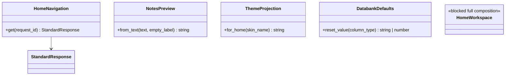

# AppHome - shell and shared-panel work orders



- **Primary Role:** application navigation and shared project/settings presentation. This file does not own backtest, dataset, statistics or provider algorithms.
- **Dependencies:** each ready order lists the exact Core order it requires; a whole-phase completion claim is not a prerequisite for an isolated pure helper.
- **Outputs / Downstream Role:** verified metadata and presentation helpers first; shared shell/project workflows only after their blocked contracts are resolved.
- **Commit boundary:** one ready order below is one commit. Do not bundle blocked features with a helper commit.

## Current-code migration audit and execution order

*Evidence:* OBS-HARU-HOM-REUSE-20261029. This audit establishes exact migration mapping from existing shell, navigation, and home presentation components (ui/app/host/, ui/app/workspace/Home/, ui/app/components/) into target app/web/shell/, app/web/common/, and app/web/workspaces/home/ namespaces.

### Work order HOM-M01: migrate existing desktop shell, navigation, and home workspace

*Feature:* Relocate the current React application shell, navigation state, host modals, and home workspace into the standardized target directory structure.
*Context to Read:* this order; every current source/test row below; ui/package.json; ui/tsconfig.json.
*Implementation Files:* exact MOVE/ADAPT targets in the table; update relative imports.

| Current HaruQuantAI location | Target proposed location | Fit / action (migration audit) |
|---|---|---|
| ui/app/host/App.tsx | app/web/shell/App.tsx | REORGANIZE (UI): Desktop app layout, header bar, active workspace view router, and modal host |
| ui/app/host/branding.ts | app/web/shell/branding.ts | DIRECT FIT: Application branding, titles, and product metadata |
| ui/app/host/navigation.ts | app/web/shell/navigation.ts | ADAPT: Top navigation bar and sidebar catalog matching SQX workspace routes |
| ui/app/host/navigationState.ts | app/web/shell/navigationState.ts | DIRECT FIT: Tab and active workspace navigation state machine |
| ui/app/host/HostConnection.tsx | app/web/shell/HostConnection.tsx | DIRECT FIT: Server connection status indicator |
| ui/app/host/HostConnectionModal.tsx | app/web/shell/HostConnectionModal.tsx | DIRECT FIT: Host connection settings dialog |
| ui/app/host/HostSettingsModal.tsx | app/web/shell/HostSettingsModal.tsx | DIRECT FIT: Global system settings dialog |
| ui/app/components/HelpTooltip.tsx | app/web/common/components/HelpTooltip.tsx | DIRECT FIT: Contextual help and documentation popover |
| ui/app/components/ui.tsx | app/web/common/components/ui.tsx | DIRECT FIT: Core UI button, input, toggle, select, and modal components |
| ui/app/workspace/Home/HomeScreen.tsx | app/web/workspaces/home/HomeScreen.tsx | DIRECT FIT: Getting started screen, quick actions, and recent projects list |
| ui/app/workspace/Home/HomeScreen.css | app/web/workspaces/home/HomeScreen.css | DIRECT FIT: Styling for home screen |
| ui/app/workspace/Home/homeClient.ts | app/web/workspaces/home/homeClient.ts | ADAPT: REST client for system status and getting-started tutorials |
| ui/app/workspace/Home/homeContent.json | app/web/workspaces/home/homeContent.json | DIRECT FIT: Getting started guides and tutorial resources |
| ui/tests/unit/workspace/Home/ | app/web/tests/workspaces/home/ | MOVE: Home workspace unit tests |

*Commit:*
efactor(home): migrate shell, navigation, and home presentation.

## Phase H01: getting-started navigation metadata

### `AppHome.navigation` - WO-H01 - READY
*Feature:* expose the observed Getting started navigation entry, without implementing its license-selected embedded page.
*Evidence IDs:* `OBS-HOME-NAV-001` (below).
*Dependencies:* WO-C02 (StandardResponse).
*Implementation Files:*
- **Donor / Context to Read:** `SQX_REFERENCE_ROOT/internal/plugins/AppSQXHome/module.js`; `app/core/lib/responses.py`.
- **Backend Create:** `app/workspaces/home/__init__.py` (empty); `app/workspaces/home/navigation.py`.
- **Backend Test Create:** `tests/workspaces/home/test_navigation.py`.
- **Frontend:** none in this order. The complete shell and registered-route API remain blocked below.
*Functional Requirements & Implementation:*
- [X] `HomeNavigation.get(self, *, request_id: str) -> StandardResponse[dict[str, JSONValue]]` -> no constructor arguments; return data exactly `{'app_code':'HOME','title':'Getting started','order':0,'section':0,'icon':'home'}` with revision None. Title/order/section come from the primary registration; snake_case and icon token are Python/React metadata adaptations. Do not read a database, network or license file.
- [X] `test_navigation_entry()` -> request_id `'req-home'` yields `{'request_id':'req-home','data':{'app_code':'HOME','title':'Getting started','order':0,'section':0,'icon':'home'},'revision':None}` through to_dict.
- [X] `test_navigation_is_detached()` -> mutate returned data.title to `'changed'`; a second call still returns `'Getting started'`. No global mutable descriptor is exposed.
*Acceptance:* `uv run python -m pytest tests/workspaces/home/test_navigation.py -q` exits 0; exactly two tests collected.
*Commit:* `home: expose getting-started navigation metadata`.
*Excluded from this commit:* route choice, iframe URL, external news/version endpoints, installation, licensing and start-project actions. Those need separate contracts; metadata success cannot close them.

## Phase H02: notes preview

### `SettingsNotes.preview` - WO-H02 - READY
*Feature:* replicate the observed Notes tab description without implementing save/autosave/storage or rich-text editing.
*Evidence IDs:* `OBS-HOME-NOTES-001`.
*Dependencies:* WO-C00 frontend runner only.
*Implementation Files:*
- **Donor / Context to Read:** `SQX_REFERENCE_ROOT/internal/plugins/SettingsNotes/module.js`; `app/web/package.json`; `app/web/vitest.config.ts`.
- **Backend:** none; preview is a browser presentation function, not a second notes store.
- **Frontend Create:** `app/web/workspaces/home/notesPreview.ts`.
- **Frontend Test Create:** `app/web/tests/workspaces/home/notesPreview.test.ts`.
*Functional Requirements & Implementation:*
- [ ] `NotesPreview.from_text(note_text: string | null, empty_label: string = 'Empty'): string` -> exported class with one static method. Null means no first text node: replace it with empty_label. An existing empty string remains empty. If selected string has more than 32 UTF-16 code units return its first 32 code units plus literal `'...'`; otherwise return it unchanged. Use JavaScript length/slice semantics, not Unicode code-point counting, ellipsis character or HTML parsing.
- [ ] `test('notes null and empty')` -> null/default gives `'Empty'`; null/custom `'Vacant'` gives `'Vacant'`; `''` gives `''`.
- [ ] `test('notes 32 code-unit boundary')` -> `'x'.repeat(32)` stays unchanged; `'x'.repeat(33)` gives 32 x characters plus three dots.
- [ ] `test('notes retains donor UTF16 slicing')` -> `'a'.repeat(31)+'\ud83d\ude00'` gives `'a'.repeat(31)+'\ud83d...'`. Do not silently repair the surrogate in this pure description helper.
*Acceptance:* `npm --prefix app/web test -- tests/workspaces/home/notesPreview.test.ts` exits 0 and collects three tests.
*Commit:* `home: preserve notes preview boundaries`.
*Blocked companion:* full rich-text storage/serialization must separately specify safe rendering, schema and Unicode transport behavior; this helper does not authorize a notes save endpoint.

## Phase H03: home theme projection

### `SkinDark / SkinLight` projection - WO-H03 - READY
*Feature:* produce the same light/dark home-message value from a selected skin name.
*Evidence IDs:* `OBS-HOME-THEME-001`.
*Dependencies:* WO-C00 frontend runner.
*Implementation Files:*
- **Donor / Context to Read:** `SQX_REFERENCE_ROOT/internal/web/SQXHOME/layout/LayoutCtrl.js`; `SQX_REFERENCE_ROOT/internal/plugins/SkinDark/module.js`; `SQX_REFERENCE_ROOT/internal/plugins/SkinLight/module.js`; `app/web/vitest.config.ts`.
- **Backend:** none. No persisted preference or stylesheet is created here.
- **Frontend Create:** `app/web/shell/themeProjection.ts`.
- **Frontend Test Create:** `app/web/tests/shell/themeProjection.test.ts`.
*Functional Requirements & Implementation:*
- [ ] `ThemeProjection.for_home(skin_name: string): 'dark' | 'light'` -> exported class with static method; exact name `'Dark skin'` returns `'dark'`; every other string returns `'light'`. No case folding, trim, DOM write or localStorage.
- [ ] `test('home theme name projection')` -> inputs `'Dark skin'`, `'Light skin'`, `'dark skin'`, `''` return `'dark'`, `'light'`, `'light'`, `'light'` respectively.
*Acceptance:* `npm --prefix app/web test -- tests/shell/themeProjection.test.ts` exits 0 and collects one test.
*Commit:* `home: define observed home theme projection`.
*Excluded:* a full theme token set, stylesheets and persistence. These require a separate complete visual/persistence work order.

## Phase H04: databank column reset value

### `ProjectDatabanks.reset_value` - WO-H04 - READY
*Feature:* replicate the observed column-type reset rule used by shared databank presentation.
*Evidence IDs:* `OBS-HOME-DATABANK-001`.
*Dependencies:* WO-C00 frontend runner.
*Implementation Files:*
- **Donor / Context to Read:** `SQX_REFERENCE_ROOT/internal/plugins/ProjectDatabanks/DatabankService.js`; `app/web/vitest.config.ts`.
- **Backend:** none. No databank mutation or result recalculation.
- **Frontend Create:** `app/web/workspaces/home/databankDefaults.ts`.
- **Frontend Test Create:** `app/web/tests/workspaces/home/databankDefaults.test.ts`.
*Functional Requirements & Implementation:*
- [ ] `DatabankDefaults.reset_value(column_type: string): '' | 0` -> exported class with static method; `'text'`, `'dateTime'`, `'filterResult'` return empty string; any other string returns numeric zero. No enum expansion, formatting or access to a results store.
- [ ] `test('column reset values')` -> `text/dateTime/filterResult` each equal `''`; `'integer'`, `'decimal'`, `'DateTime'`, `''` each equal numeric `0`.
*Acceptance:* `npm --prefix app/web test -- tests/workspaces/home/databankDefaults.test.ts` exits 0 and collects one test.
*Commit:* `home: preserve databank reset-value projection`.

## Full-workflow orders - BLOCKED-NOT-EXECUTABLE

Every named module remains in scope. The table reserves exact files but authorizes
no stub, placeholder result or fake successful API. A pure helper above never closes
the corresponding full workflow. Each row is one future feature commit only after
its missing contract is resolved and literal fixtures are appended by the plan owner.

| Feature / module | Verbatim evidence ID | Context to Read (primary donor files) | Backend file; frontend file; test file reserved | Missing contract |
| --- | --- | --- | --- | --- |
| `AppSQXHome` | `OBS-HOME-SCOPE-001` | `SQX_REFERENCE_ROOT/internal/plugins/AppSQXHome/AppSQXHome.jar`<br>`SQX_REFERENCE_ROOT/internal/plugins/AppSQXHome/module.js`<br>`SQX_REFERENCE_ROOT/internal/plugins/AppSQXHome/offline/_astro/_plugin-vue_export-helper.DlAUqK2U.js` | `app/workspaces/home/appsqx_home.py`; `app/web/workspaces/home/AppSQXHomePanel.tsx`; `tests/workspaces/home/test_appsqx_home.py` | Homepage URL/customization schema and offline payload, allowed origins, news/version response schema and installation side effects; primary HomeService exposes requests but not complete backend outcomes. |
| `AppStrategyQuant` | `OBS-HOME-SCOPE-001` | `SQX_REFERENCE_ROOT/internal/plugins/AppStrategyQuant/AppStrategyQuant.jar` | `app/workspaces/home/app_strategy_quant.py`; `app/web/workspaces/home/AppStrategyQuantPanel.tsx`; `tests/workspaces/home/test_app_strategy_quant.py` | Complete startup/stop/session and application-registration contract; native carrier classes are not a public FastAPI service schema. |
| `DashboardPanel` | `OBS-HOME-SCOPE-001` | `SQX_REFERENCE_ROOT/internal/plugins/DashboardPanel/dashboard.html`<br>`SQX_REFERENCE_ROOT/internal/plugins/DashboardPanel/DashboardCtrl.js`<br>`SQX_REFERENCE_ROOT/internal/plugins/DashboardPanel/module.js` | `app/workspaces/home/dashboard_panel.py`; `app/web/workspaces/home/DashboardPanelPanel.tsx`; `tests/workspaces/home/test_dashboard_panel.py` | Every dashboard dataset, refresh event, job-state mapping and empty/error projection. |
| `DashboardResults` | `OBS-HOME-SCOPE-001` | `SQX_REFERENCE_ROOT/internal/plugins/DashboardResults/dashboardResults.html`<br>`SQX_REFERENCE_ROOT/internal/plugins/DashboardResults/DashboardResults.jar`<br>`SQX_REFERENCE_ROOT/internal/plugins/DashboardResults/DashboardResultsCtrl.js` | `app/workspaces/home/dashboard_results.py`; `app/web/workspaces/home/DashboardResultsPanel.tsx`; `tests/workspaces/home/test_dashboard_results.py` | Ranking/selection and best-result response schema, sample/direction filtering and update ordering. |
| `EnginePanel` | `OBS-HOME-SCOPE-001` | `SQX_REFERENCE_ROOT/internal/plugins/EnginePanel/acceptedStatsPopup.html`<br>`SQX_REFERENCE_ROOT/internal/plugins/EnginePanel/directives/engineChartPanel/engineChartPanel.html`<br>`SQX_REFERENCE_ROOT/internal/plugins/EnginePanel/directives/engineChartPanel/EngineChartPanel.js` | `app/workspaces/home/engine_panel.py`; `app/web/workspaces/home/EnginePanelPanel.tsx`; `tests/workspaces/home/test_engine_panel.py` | Start/stop/pause action request fields, race/commit behavior and all engine counters/events. |
| `HomeAbout` | `OBS-HOME-SCOPE-001` | `SQX_REFERENCE_ROOT/internal/plugins/HomeAbout/AboutCtrl.js`<br>`SQX_REFERENCE_ROOT/internal/plugins/HomeAbout/HomeAbout.jar`<br>`SQX_REFERENCE_ROOT/internal/plugins/HomeAbout/services/AboutService.js` | `app/workspaces/home/home_about.py`; `app/web/workspaces/home/HomeAboutPanel.tsx`; `tests/workspaces/home/test_home_about.py` | Authorized license/account provider protocol, complete license response schema and secrets policy; do not recreate a verification bypass. |
| `ProjectDatabanks` | `OBS-HOME-SCOPE-001` | `SQX_REFERENCE_ROOT/internal/plugins/ProjectDatabanks/DatabankCtrl.js`<br>`SQX_REFERENCE_ROOT/internal/plugins/ProjectDatabanks/DatabanksCtrl.js`<br>`SQX_REFERENCE_ROOT/internal/plugins/ProjectDatabanks/DatabankService.js` | `app/workspaces/home/project_databanks.py`; `app/web/workspaces/home/ProjectDatabanksPanel.tsx`; `tests/workspaces/home/test_project_databanks.py` | Full list/mutation/query schemas, reference/selection persistence, error strings and transactions; reset_value helper is only one verified projection. |
| `ProjectResources` | `OBS-HOME-SCOPE-001` | `SQX_REFERENCE_ROOT/internal/plugins/ProjectResources/addedResourcesPopup.html`<br>`SQX_REFERENCE_ROOT/internal/plugins/ProjectResources/AddedResourcesPopupCtrl.js`<br>`SQX_REFERENCE_ROOT/internal/plugins/ProjectResources/diffResourcesPopup.html` | `app/workspaces/home/project_resources.py`; `app/web/workspaces/home/ProjectResourcesPanel.tsx`; `tests/workspaces/home/test_project_resources.py` | Resource-resolution request/response schemas and missing/conflicting custom resource import decisions. |
| `ProjectResults` | `OBS-HOME-SCOPE-001` | `SQX_REFERENCE_ROOT/internal/plugins/ProjectResults/module.js`<br>`SQX_REFERENCE_ROOT/internal/plugins/ProjectResults/newCustomPluginModal.html`<br>`SQX_REFERENCE_ROOT/internal/plugins/ProjectResults/results.html` | `app/workspaces/home/project_results.py`; `app/web/workspaces/home/ProjectResultsPanel.tsx`; `tests/workspaces/home/test_project_results.py` | All result-tab contribution contracts, lifecycle/selection events and custom analysis creation schema. |
| `ProjectSettings` | `OBS-HOME-SCOPE-001` | `SQX_REFERENCE_ROOT/internal/plugins/ProjectSettings/module.js`<br>`SQX_REFERENCE_ROOT/internal/plugins/ProjectSettings/SettingsCtrl.js`<br>`SQX_REFERENCE_ROOT/internal/plugins/ProjectSettings/SettingsService.js` | `app/workspaces/home/project_settings.py`; `app/web/workspaces/home/ProjectSettingsPanel.tsx`; `tests/workspaces/home/test_project_settings.py` | Simple/advanced template selection and returned project/task schema, replacement/merge rules and errors. |
| `ServletProject` | `OBS-HOME-SCOPE-001` | `SQX_REFERENCE_ROOT/internal/plugins/ServletProject/ServletProject.jar` | `app/workspaces/home/servlet_project.py`; `app/web/workspaces/home/ServletProjectPanel.tsx`; `tests/workspaces/home/test_servlet_project.py` | Each action handler request/default/error/storage/event contract; a servlet class is not one monolithic API endpoint. |
| `SettingsData` | `OBS-HOME-SCOPE-001` | `SQX_REFERENCE_ROOT/internal/plugins/SettingsData/ComplexitiesService.js`<br>`SQX_REFERENCE_ROOT/internal/plugins/SettingsData/DataCtrl.js`<br>`SQX_REFERENCE_ROOT/internal/plugins/SettingsData/DataService.js` | `app/workspaces/home/settings_data.py`; `app/web/workspaces/home/SettingsDataPanel.tsx`; `tests/workspaces/home/test_settings_data.py` | All market/chart/sample/setup fields and per-engine validation/default rules. |
| `SettingsMoneyManagement` | `OBS-HOME-SCOPE-001` | `SQX_REFERENCE_ROOT/internal/plugins/SettingsMoneyManagement/module.js`<br>`SQX_REFERENCE_ROOT/internal/plugins/SettingsMoneyManagement/MoneyManagementCtrl.js`<br>`SQX_REFERENCE_ROOT/internal/plugins/SettingsMoneyManagement/MoneyManagementService.js` | `app/workspaces/home/settings_money_management.py`; `app/web/workspaces/home/SettingsMoneyManagementPanel.tsx`; `tests/workspaces/home/test_settings_money_management.py` | Every model parameter schema, engine gating and sizing algorithm reference; a picker does not implement the size calculation. |
| `SettingsNotes` | `OBS-HOME-SCOPE-001` | `SQX_REFERENCE_ROOT/internal/plugins/SettingsNotes/module.js`<br>`SQX_REFERENCE_ROOT/internal/plugins/SettingsNotes/notes.html`<br>`SQX_REFERENCE_ROOT/internal/plugins/SettingsNotes/NotesCtrl.js` | `app/workspaces/home/settings_notes.py`; `app/web/workspaces/home/SettingsNotesPanel.tsx`; `tests/workspaces/home/test_settings_notes.py` | Rich-text allowed-content and saved schema, save failure text, dirty/activation rules, conflict and Unicode serialization policies; preview alone is verified. |
| `SettingsOptions` | `OBS-HOME-SCOPE-001` | `SQX_REFERENCE_ROOT/internal/plugins/SettingsOptions/module.js`<br>`SQX_REFERENCE_ROOT/internal/plugins/SettingsOptions/OptionsCtrl.js`<br>`SQX_REFERENCE_ROOT/internal/plugins/SettingsOptions/OptionsService.js` | `app/workspaces/home/settings_options.py`; `app/web/workspaces/home/SettingsOptionsPanel.tsx`; `tests/workspaces/home/test_settings_options.py` | All trading-option schemas, default/range/engine rules and associated core effects. |
| `SettingsPanel` | `OBS-HOME-SCOPE-001` | `SQX_REFERENCE_ROOT/internal/plugins/SettingsPanel/module.js`<br>`SQX_REFERENCE_ROOT/internal/plugins/SettingsPanel/settings.html`<br>`SQX_REFERENCE_ROOT/internal/plugins/SettingsPanel/SettingsPanelCtrl.js` | `app/workspaces/home/settings_panel.py`; `app/web/workspaces/home/SettingsPanelPanel.tsx`; `tests/workspaces/home/test_settings_panel.py` | Tab registration/visibility/order, dynamic settings serialization and lifecycle contract. |
| `SkinDark` | `OBS-HOME-SCOPE-001` | `SQX_REFERENCE_ROOT/internal/plugins/SkinDark/module.js` | `app/workspaces/home/skin_dark.py`; `app/web/workspaces/home/SkinDarkPanel.tsx`; `tests/workspaces/home/test_skin_dark.py` | Complete target token/style inventory and UI comparison fixtures; only name and home-message projection is established. |
| `SkinLight` | `OBS-HOME-SCOPE-001` | `SQX_REFERENCE_ROOT/internal/plugins/SkinLight/module.js` | `app/workspaces/home/skin_light.py`; `app/web/workspaces/home/SkinLightPanel.tsx`; `tests/workspaces/home/test_skin_light.py` | Complete target token/style inventory and UI comparison fixtures; only name/order and home-message projection is established. |

*Candidate callables are not runnable signatures:* each blocked module's final
class/method/request/response contract must be specified by the plan owner before
coding. Do not synthesize list/save/delete methods from these module names.

**Shared shell compatibility:** AppHome retains shared settings/project presentation
ownership. Builder/Retester/Optimizer consume its published contributions; they must
not implement their own copies. No producer contract exists merely because another
phase diagram names a class.

**Acceptance for blocked orders:** none yet. No code commit is authorized. Completion
requires an observed field/action record and a revised work order with exact DTOs,
methods, literals and executable test commands. This is an explicit unmet prerequisite.

## New directly observed evidence

```json
{
  "id": "OBS-HOME-NAV-001",
  "classification": "observed",
  "confidence": "high",
  "claim": "Getting started navigation registers SQXHOME, order 0, section 0 and a home icon.",
  "sources": [
    "SQX_REFERENCE_ROOT/internal/plugins/AppSQXHome/module.js"
  ],
  "target_domain": "app/workspaces/home; app/web/workspaces/home",
  "feature_ids": [],
  "requirement_ids": [],
  "decision_ids": [],
  "registration_gap": "Work-order labels are not ratified feature IDs.",
  "limitations": "Static primary source inspection only; derived helper acceptance is not acceptance of the whole plugin.",
  "validation": {
    "status": "passed",
    "executed_at": "2026-10-29T09:20:58.953727+00:00",
    "procedure": "Read named primary files; inspect named conditions, return values and directory entries.",
    "actual_observation": "Getting started navigation registers SQXHOME, order 0, section 0 and a home icon.",
    "expected_observation": "Getting started navigation registers SQXHOME, order 0, section 0 and a home icon.",
    "artifacts": [
      {
        "path": "SQX_REFERENCE_ROOT/internal/plugins/AppSQXHome/module.js",
        "sha256": "fdf50d0a8df3ef880150b3a8e2d13a5a429fe0633297766068580d83034fc5a6"
      }
    ]
  },
  "repository_commit": "f5c7d12d5715b8ebee55165b8eddad9068f83cb9",
  "review_state": "owner-review-pending",
  "contains_proprietary_source": false,
  "contains_sensitive_data": false,
  "contains_personal_data": false,
  "paraphrased_behavior_only": true,
  "supersedes_records": [],
  "superseded_by": []
}
```

```json
{
  "id": "OBS-HOME-NOTES-001",
  "classification": "observed",
  "confidence": "high",
  "claim": "Notes description selects the first text-node value or translated Empty and truncates strings longer than 32 JavaScript code units to the first 32 plus three dots.",
  "sources": [
    "SQX_REFERENCE_ROOT/internal/plugins/SettingsNotes/module.js"
  ],
  "target_domain": "app/workspaces/home; app/web/workspaces/home",
  "feature_ids": [],
  "requirement_ids": [],
  "decision_ids": [],
  "registration_gap": "Work-order labels are not ratified feature IDs.",
  "limitations": "Static primary source inspection only; derived helper acceptance is not acceptance of the whole plugin.",
  "validation": {
    "status": "passed",
    "executed_at": "2026-10-29T09:20:58.953727+00:00",
    "procedure": "Read named primary files; inspect named conditions, return values and directory entries.",
    "actual_observation": "Notes description selects the first text-node value or translated Empty and truncates strings longer than 32 JavaScript code units to the first 32 plus three dots.",
    "expected_observation": "Notes description selects the first text-node value or translated Empty and truncates strings longer than 32 JavaScript code units to the first 32 plus three dots.",
    "artifacts": [
      {
        "path": "SQX_REFERENCE_ROOT/internal/plugins/SettingsNotes/module.js",
        "sha256": "e085cbb663c5665b3f0c8a285bb102ef69b28ecabec3a8609736c3f7357edfb7"
      }
    ]
  },
  "repository_commit": "f5c7d12d5715b8ebee55165b8eddad9068f83cb9",
  "review_state": "owner-review-pending",
  "contains_proprietary_source": false,
  "contains_sensitive_data": false,
  "contains_personal_data": false,
  "paraphrased_behavior_only": true,
  "supersedes_records": [],
  "superseded_by": []
}
```

```json
{
  "id": "OBS-HOME-THEME-001",
  "classification": "observed",
  "confidence": "high",
  "claim": "Home theme projection chooses dark only when selected skin name is exactly Dark skin; otherwise light. Skin registrations use Dark skin and Light skin.",
  "sources": [
    "SQX_REFERENCE_ROOT/internal/web/SQXHOME/layout/LayoutCtrl.js",
    "SQX_REFERENCE_ROOT/internal/plugins/SkinDark/module.js",
    "SQX_REFERENCE_ROOT/internal/plugins/SkinLight/module.js"
  ],
  "target_domain": "app/workspaces/home; app/web/workspaces/home",
  "feature_ids": [],
  "requirement_ids": [],
  "decision_ids": [],
  "registration_gap": "Work-order labels are not ratified feature IDs.",
  "limitations": "Static primary source inspection only; derived helper acceptance is not acceptance of the whole plugin.",
  "validation": {
    "status": "passed",
    "executed_at": "2026-10-29T09:20:58.953727+00:00",
    "procedure": "Read named primary files; inspect named conditions, return values and directory entries.",
    "actual_observation": "Home theme projection chooses dark only when selected skin name is exactly Dark skin; otherwise light. Skin registrations use Dark skin and Light skin.",
    "expected_observation": "Home theme projection chooses dark only when selected skin name is exactly Dark skin; otherwise light. Skin registrations use Dark skin and Light skin.",
    "artifacts": [
      {
        "path": "SQX_REFERENCE_ROOT/internal/web/SQXHOME/layout/LayoutCtrl.js",
        "sha256": "6216c25d1c6915d166d2444aef87f4b230417a225710823a0ed765ed1af0ed82"
      },
      {
        "path": "SQX_REFERENCE_ROOT/internal/plugins/SkinDark/module.js",
        "sha256": "f6c37d9a93172c6865839ada0a981f86912423ddc5caa04580b08bd992ad70e8"
      },
      {
        "path": "SQX_REFERENCE_ROOT/internal/plugins/SkinLight/module.js",
        "sha256": "f3daddc1a49e0e42c325e13e164d5776e0698615b1f9e23e0ed2c33d7607479c"
      }
    ]
  },
  "repository_commit": "f5c7d12d5715b8ebee55165b8eddad9068f83cb9",
  "review_state": "owner-review-pending",
  "contains_proprietary_source": false,
  "contains_sensitive_data": false,
  "contains_personal_data": false,
  "paraphrased_behavior_only": true,
  "supersedes_records": [],
  "superseded_by": []
}
```

```json
{
  "id": "OBS-HOME-DATABANK-001",
  "classification": "observed",
  "confidence": "high",
  "claim": "Databank reset value is empty string for text/dateTime/filterResult column types and numeric zero for all other types.",
  "sources": [
    "SQX_REFERENCE_ROOT/internal/plugins/ProjectDatabanks/DatabankService.js"
  ],
  "target_domain": "app/workspaces/home; app/web/workspaces/home",
  "feature_ids": [],
  "requirement_ids": [],
  "decision_ids": [],
  "registration_gap": "Work-order labels are not ratified feature IDs.",
  "limitations": "Static primary source inspection only; derived helper acceptance is not acceptance of the whole plugin.",
  "validation": {
    "status": "passed",
    "executed_at": "2026-10-29T09:20:58.953727+00:00",
    "procedure": "Read named primary files; inspect named conditions, return values and directory entries.",
    "actual_observation": "Databank reset value is empty string for text/dateTime/filterResult column types and numeric zero for all other types.",
    "expected_observation": "Databank reset value is empty string for text/dateTime/filterResult column types and numeric zero for all other types.",
    "artifacts": [
      {
        "path": "SQX_REFERENCE_ROOT/internal/plugins/ProjectDatabanks/DatabankService.js",
        "sha256": "0689b0ce2d26978ea01ca1a7e4141d86627b2e5cc7fbfdabeb4d1e8ded0fc980"
      }
    ]
  },
  "repository_commit": "f5c7d12d5715b8ebee55165b8eddad9068f83cb9",
  "review_state": "owner-review-pending",
  "contains_proprietary_source": false,
  "contains_sensitive_data": false,
  "contains_personal_data": false,
  "paraphrased_behavior_only": true,
  "supersedes_records": [],
  "superseded_by": []
}
```

```json
{
  "id": "OBS-HOME-SCOPE-001",
  "classification": "observed",
  "confidence": "high",
  "claim": "The 18 listed primary plugin directories and their named readable source files exist; file presence alone does not establish complete workflows.",
  "sources": [
    "SQX_REFERENCE_ROOT/internal/plugins/AppSQXHome",
    "SQX_REFERENCE_ROOT/internal/plugins/AppStrategyQuant",
    "SQX_REFERENCE_ROOT/internal/plugins/DashboardPanel",
    "SQX_REFERENCE_ROOT/internal/plugins/DashboardResults",
    "SQX_REFERENCE_ROOT/internal/plugins/EnginePanel",
    "SQX_REFERENCE_ROOT/internal/plugins/HomeAbout",
    "SQX_REFERENCE_ROOT/internal/plugins/ProjectDatabanks",
    "SQX_REFERENCE_ROOT/internal/plugins/ProjectResources",
    "SQX_REFERENCE_ROOT/internal/plugins/ProjectResults",
    "SQX_REFERENCE_ROOT/internal/plugins/ProjectSettings",
    "SQX_REFERENCE_ROOT/internal/plugins/ServletProject",
    "SQX_REFERENCE_ROOT/internal/plugins/SettingsData",
    "SQX_REFERENCE_ROOT/internal/plugins/SettingsMoneyManagement",
    "SQX_REFERENCE_ROOT/internal/plugins/SettingsNotes",
    "SQX_REFERENCE_ROOT/internal/plugins/SettingsOptions",
    "SQX_REFERENCE_ROOT/internal/plugins/SettingsPanel",
    "SQX_REFERENCE_ROOT/internal/plugins/SkinDark",
    "SQX_REFERENCE_ROOT/internal/plugins/SkinLight"
  ],
  "target_domain": "app/workspaces/home; app/web/workspaces/home",
  "feature_ids": [],
  "requirement_ids": [],
  "decision_ids": [],
  "registration_gap": "Work-order labels are not ratified feature IDs.",
  "limitations": "Static primary source inspection only; derived helper acceptance is not acceptance of the whole plugin.",
  "validation": {
    "status": "passed",
    "executed_at": "2026-10-29T09:20:58.953727+00:00",
    "procedure": "Read named primary files; inspect named conditions, return values and directory entries.",
    "actual_observation": "The 18 listed primary plugin directories and their named readable source files exist; file presence alone does not establish complete workflows.",
    "expected_observation": "The 18 listed primary plugin directories and their named readable source files exist; file presence alone does not establish complete workflows.",
    "artifacts": [
      "SQX_REFERENCE_ROOT/internal/plugins"
    ]
  },
  "repository_commit": "f5c7d12d5715b8ebee55165b8eddad9068f83cb9",
  "review_state": "owner-review-pending",
  "contains_proprietary_source": false,
  "contains_sensitive_data": false,
  "contains_personal_data": false,
  "paraphrased_behavior_only": true,
  "supersedes_records": [],
  "superseded_by": []
}
```

## Embedded donor findings and historical provenance

The following original record objects are retained unchanged. Their historical artifact labels resolve through the index’s consolidation table; they are not additional files to follow. Supersession links and version-specific limitations remain intact. These records are evidence, not implementation-status entries.

### Evidence record `LIB-009`

<details>
<summary>Finding, limitations, provenance and validation</summary>

```json
{
  "id": "LIB-009",
  "classification": "observed",
  "confidence": "high",
  "claim": "GUI and headless launch configurations select distinct SQStarter and SQConsoleStarter classes.",
  "sources": [
    "SQX_REFERENCE_ROOT/StrategyQuantX.config",
    "SQX_REFERENCE_ROOT/sqcli.config"
  ],
  "target_domain": "app/main.py; app/cli.py",
  "feature_ids": [],
  "requirement_ids": [],
  "decision_ids": [],
  "related_existing_owners": [
    "ui/app/host/README.md"
  ],
  "registration_gap": "No registered owning feature under proposed architecture; propose domain README registration before implementation.",
  "limitations": "Defining JAR and startup body not established.",
  "validation": {
    "status": "passed",
    "procedure": "Read realmain configuration values.",
    "expected_observation": "Two distinct startup classes; CLI console flag enabled.",
    "executed_at": "2026-10-29T06:23:54.532477+00:00",
    "actual_observation": "GUI and headless launch configurations select distinct SQStarter and SQConsoleStarter classes.",
    "artifacts": "artifact-manifest.json"
  },
  "repository_commit": "f5c7d12d5715b8ebee55165b8eddad9068f83cb9",
  "review_state": "preliminary-owner-review-pending",
  "contains_proprietary_source": false,
  "contains_sensitive_data": false,
  "contains_personal_data": false,
  "paraphrased_behavior_only": true,
  "supersedes_records": [],
  "superseded_by": [
    "RECOVERY-002"
  ]
}
```

</details>

### Evidence record `PREVIOUS-006`

<details>
<summary>Finding, limitations, provenance and validation</summary>

```json
{
  "id": "PREVIOUS-006",
  "classification": "observed",
  "confidence": "high",
  "claim": "34 definitions include backend hosting, HTTP/JSON servlets, WebSocket, frontend asset assembly and browser/desktop integration.",
  "sources": [
    "SQX_PREVIOUS_REFERENCE_ROOT/internal/libs/SQWebGUILib.jar!com/strategyquant/webguilib/server/JettyServer.class"
  ],
  "target_domain": "app/core/web; app/web",
  "related_records": [
    "MAP-004"
  ],
  "feature_ids": [
    "FEAT-UI-TRANSPORT"
  ],
  "requirement_ids": [],
  "decision_ids": [],
  "registration_gap": "No feature ID ratified for proposed domain. Propose domain README registration before implementation; no registry edit performed.",
  "limitations": "Previous-version static definitions and representative method bodies only; exact product build and build-145 equivalence unverified. No full algorithm/formula parity or successful licensed operation asserted. Existing frontend feature is related context, not backend ownership.",
  "validation": {
    "status": "passed",
    "executed_at": "2026-10-29T07:03:39.946149+00:00",
    "procedure": "Parse ZIP/class hashes; inspect representative signatures and bodies with javap -p -c; resolve static dependencies with jdeps. Snippets source counterpart validation compares class/source paths, not compiled equivalence.",
    "expected_observation": "34 definitions include backend hosting, HTTP/JSON servlets, WebSocket, frontend asset assembly and browser/desktop integration.",
    "actual_observation": "34 definitions include backend hosting, HTTP/JSON servlets, WebSocket, frontend asset assembly and browser/desktop integration.",
    "artifacts": [
      "previous-library-inventory.json"
    ]
  },
  "repository_commit": "f5c7d12d5715b8ebee55165b8eddad9068f83cb9",
  "review_state": "preliminary-owner-review-pending",
  "contains_proprietary_source": false,
  "contains_sensitive_data": false,
  "contains_personal_data": false,
  "paraphrased_behavior_only": true,
  "supersedes_records": [],
  "superseded_by": [],
  "cross_version_policy": "Related current-build records remain valid for their own version; fallback findings do not supersede facts about a different build.",
  "related_existing_owners": [
    "ui/app/host/README.md"
  ]
}
```

</details>
