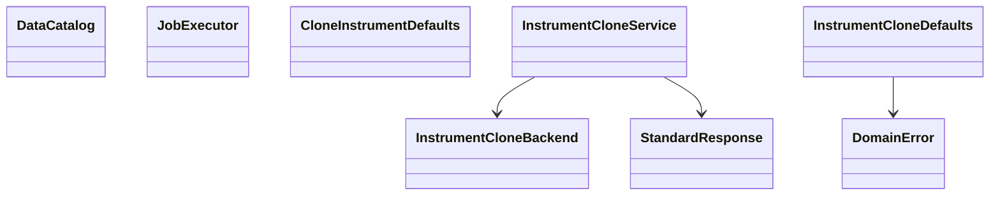

# AppDataManager — Market Data Engine



- **Primary Role:** Market Data Engine; the complete owned module list is below.
- **Dependencies:** AppCore data/storage/job/registry contracts; AppHome shell. No dependency on Builder or Retester.
- **Outputs / Downstream Role:** versioned datasets and catalogue references consumed through shared core interfaces.

## Source reassessment authority — 2026-10-30

The [workspace source review](research/workspaces-03-08-source-review.md) adds exact readable context to every blocked complete-contribution order in this file. Its source paths supplement the old Context to Read lists. Shared libraries are available locally; plugin bodies, UI consumers, templates and per-definition fixtures remain separate evidence. A complete-contribution order retains its status until its exact target contract and acceptance cases are specified. New bounded READY suborders below supersede only their named portion.

## Execution rule for this file

The task text and its exact Context to Read list are the entire coding context. READY tasks are independently implementable helper/coordinator slices; their prerequisites must already exist with the stated symbols. READY orders authorize no production edits and no guessed DTO/default/algorithm. A senior engineer must replace the listed missing contract with evidence-backed signatures before assigning that order to a coding agent. There is no instruction to make a design decision or research unspecified behavior during a coding commit.

Every checkbox in a ready task names its exact symbol. One ready feature task is one commit containing only its listed implementation/test files. Test command exit 0 is acceptance only when the specified test cases were collected. Do not run application-wide formatting or touch a sibling workspace.

All target names/signatures/error codes below are normative Python/React adaptations. Only the observations in named evidence records are SQX facts. StandardResponse is `StandardResponse[T](request_id: str, data: T, revision: int | None = None)` from `app/core/lib/responses.py`. DomainError is keyword-only `DomainError(*, code: str, message: str, details: dict[str, JSONValue] | None = None)` from `app/core/lib/errors.py`.


## Current-code migration audit and execution order

*Evidence:* OBS-HARU-DM-REUSE-20261029. HaruQuantAI already possesses a comprehensive implementation of the Market Data Engine (app/workspace/data_manager/ and app/workspace/brokers/ comprising 93 production files) and its interactive UI (ui/app/workspace/DataManager/ and ui/app/plugins/data_source/). This audit establishes the definitive migration mapping to app/workspace/data_manager/, app/workspace/data_sources/, and app/web/workspaces/data_manager/.

### Work order DM-M01: harmonize and migrate existing Data Manager and Brokers

*Feature:* Migrate existing Data Manager backend modules, broker connectors, and React panels into the target workspace structure as verified direct-fit components.
*Context to Read:* this order; every current source/test row below; app/workspace/data_manager/__init__.py.
*Implementation Files:* exact MOVE/ADAPT targets in the table; preserve all existing contracts and tests.

| Current HaruQuantAI location | Target proposed location | Fit / action (migration audit) |
|---|---|---|
| app/workspace/data_manager/data/ | app/workspace/data_manager/data/ | DIRECT FIT: Historical bar/tick reader, writer, time-gap fillers, and partition file manager |
| app/workspace/data_manager/instruments/ | app/workspace/data_manager/instruments/ | DIRECT FIT: Instrument specification repository, pip/point metrics, margin and tick sizing |
| app/workspace/data_manager/sessions/ | app/workspace/data_manager/sessions/ | DIRECT FIT: Trading session definitions, holiday calendars, and exchange schedule filters |
| app/workspace/data_manager/baskets/ | app/workspace/data_manager/baskets/ | DIRECT FIT: Symbol basket groupings and batch download scheduler |
| app/workspace/data_manager/sources/ | app/workspace/data_manager/sources/ | DIRECT FIT: Data source connectors and feed orchestration |
| app/workspace/data_manager/symbols/ | app/workspace/data_manager/symbols/ | DIRECT FIT: Master symbol registry and metadata catalog |
| app/workspace/data_manager/custom_data/ | app/workspace/data_manager/custom_data/ | DIRECT FIT: Macroeconomic, COT, and custom series importer |
| app/workspace/data_manager/logs/ | app/workspace/data_manager/logs/ | DIRECT FIT: Download, import, and data validation audit logger |
| app/workspace/brokers/ | app/workspace/data_sources/ | DIRECT FIT: Broker connectors (MetaTrader 5, cTrader, Dukascopy, Darwinex, Yahoo, Binance) |
| ui/app/workspace/DataManager/DataManager.tsx | app/web/workspaces/data_manager/DataManager.tsx | DIRECT FIT: Main Data Manager workspace container and layout |
| ui/app/workspace/DataManager/DataManagerChart.tsx | app/web/workspaces/data_manager/DataManagerChart.tsx | DIRECT FIT: Candlestick/tick history viewer and zoomable chart canvas |
| ui/app/workspace/DataManager/DataManagerDock.tsx | app/web/workspaces/data_manager/DataManagerDock.tsx | DIRECT FIT: Dockable panels container |
| ui/app/workspace/DataManager/DataManagerHome.tsx | app/web/workspaces/data_manager/DataManagerHome.tsx | DIRECT FIT: Data overview, storage statistics, and active instrument summary |
| ui/app/workspace/DataManager/DataManagerPanels.tsx | app/web/workspaces/data_manager/DataManagerPanels.tsx | DIRECT FIT: Tabbed panel selector for instruments, sessions, baskets, and sources |
| ui/app/workspace/DataManager/panels/* | app/web/workspaces/data_manager/panels/* | DIRECT FIT: Granular editor tabs (InstrumentsPanel, SessionsPanel, SourcesPanel, BasketsPanel) |
| ui/app/workspace/DataManager/dataManagerWorkspaceClient.ts | app/web/workspaces/data_manager/dataManagerWorkspaceClient.ts | ADAPT: REST client for data manager queries and commands |
| ui/app/workspace/DataManager/dataManagerLogClient.ts | app/web/workspaces/data_manager/dataManagerLogClient.ts | ADAPT: WebSocket client for real-time streaming download/import progress |
| ui/app/plugins/data_source/* | app/web/workspaces/data_manager/plugins/* | ADAPT: Provider-specific connection and credential forms |
| tests/workspace/data_manager/ | tests/workspace/data_manager/ | MOVE: Complete data manager backend test suite |
| tests/workspace/brokers/ | tests/workspace/data_sources/ | MOVE: Broker and data source connector test suite |
| tests/examples/test_brokers.py | tests/workspace/data_sources/test_brokers_example.py | MOVE: Broker example integration tests |

*Commit:* refactor(data-manager): migrate data manager and broker workspaces.


### Phase 3.1: Instrument clone defaults — `DataManagerInstruments`

*Feature:* produce exactly the clone dialog's initial values from current selection and broker catalogue.
**Task ID:** `WO-DM-INSTRUMENT-CLONE-DEFAULTS`. **Readiness:** READY-AFTER-CORE-CONTRACTS. **Evidence:** `OBS145-INSTRUMENT-CLONE-001`. **One commit:** `feat(data-manager): implement instrument clone defaults`.

*Context to Read (only these files):*
- `app/core/lib/errors.py` after its prerequisite commit; it must export DomainError exactly as declared here.
- `DONOR_REFERENCE_ROOT/internal/plugins/DataManagerInstruments/actions/clone/CloneInstrumentCtrl.js`.
- This task, including its test table; do not read the rest of the repository for a replacement design.

*Implementation Files:*
- **Backend create:** `app/workspace/data_manager/instrument_clone_defaults.py`.
- **Backend test create:** `tests/workspace/data_manager/test_instrument_clone_defaults.py`.
- **Frontend:** none in this commit. The subsequent clone-dialog task consumes the result; do not add HTTP or React code here.

*Exact types:* frozen dataclasses `InstrumentBrokerRef(instrument: str, broker_id: int)`, `CloneBroker(id: int, name: str, postfix: str, mt_use: bool)`, `CloneDefaults(source_name: str, clone_name: str, broker_id: int, choices: tuple[CloneBroker, ...])`. No field has an implicit default. `CloneInstrumentDefaults` contains only static method `build`.

*Functional Requirements & Implementation:*
- [ ] `CloneInstrumentDefaults.build(selected_names: Sequence[str], instruments: Sequence[InstrumentBrokerRef], brokers: Sequence[CloneBroker]) -> CloneDefaults` -> if selected_names is empty, raise `DomainError(code="INSTRUMENT_SELECTION_REQUIRED", message="You have to select some instrument.", details={})` before any other operation.
- [ ] `CloneInstrumentDefaults.build(...)` -> use selected_names[0], without trimming or case conversion. Start the clone base as this full name. Find exact-name instrument records; strip a broker postfix only when there is exactly one matching instrument and exactly one broker with that instrument's broker_id, the postfix is nonempty, and the name ends with it. Remove exactly one suffix occurrence.
- [ ] `CloneInstrumentDefaults.build(...)` -> return clone_name as the resulting base followed by literal `Clone`; return broker_id=-1. choices begins with `CloneBroker(-1,"SQ default","",True)`, followed by input brokers whose mt_use is True in input order. Do not deduplicate/sort or filter the broker used for suffix removal by mt_use.
- [ ] `CloneInstrumentDefaults.build(...)` -> allocate new output tuples; do not mutate any supplied sequence or dataclass. DomainError code and typed fields are target helper decisions; the selection text and naming behavior are observed donor behavior.

*Exact tests:*

| Test function | Input | Expected |
| --- | --- | --- |
| `test_strips_one_matching_postfix` | names `["EURUSD-Demo"]`; instrument `(EURUSD-Demo,7)`; broker `(7,"Demo","-Demo",True)` | source `EURUSD-Demo`, clone `EURUSDClone`, broker -1; choice IDs `[-1,7]` |
| `test_multiple_instrument_matches_keep_suffix` | same name twice with broker 7 | clone `EURUSD-DemoClone` |
| `test_nonmatching_or_empty_postfix_keeps_name` | broker postfix `""` then `"-Other"` in separate parameterized cases | clone `EURUSD-DemoClone` |
| `test_uses_first_selection` | `["A","B"]`, empty catalogues | source A, clone AClone, IDs [-1] |
| `test_excludes_unusable_broker_from_choices` | brokers `(8,"No","",False)`, `(7,"Yes","",True)` | IDs [-1,7] |
| `test_empty_selection_error` | empty sequences | exact DomainError code/message/details above |

*Verification:* `uv run python -m pytest tests/workspace/data_manager/test_instrument_clone_defaults.py -q` must exit 0 with all six named tests collected. No network, database, clock or random seed is used. Commit only the two listed files after this result.

### Phase 3.2: Clone command orchestration — `DataManagerInstruments`

*Feature:* clone an existing instrument through a supplied storage/naming adapter.
**Task ID:** `WO-DM-INSTRUMENT-CLONE-COMMAND`. **Readiness:** READY-AFTER-CORE-CONTRACTS for this coordinator only; production repository/HTTP integration is BLOCKED by `I-DataManagerInstruments`. **Evidence:** `OBS145-INSTRUMENT-CLONE-001`.
**One commit:** `feat(data-manager): implement instrument clone command`.

*Context to Read:* `app/core/lib/responses.py`, `app/core/lib/errors.py`, and `DONOR_REFERENCE_ROOT/internal/plugins/DataManagerInstruments/Instruments/InstrumentsServlet.java#onClone` (readable declaration/body). No other repository file is context.

*Implementation Files:*
- **Backend create:** `app/workspace/data_manager/instrument_clone.py`.
- **Tests create:** `tests/workspace/data_manager/test_instrument_clone.py`.
- **Frontend/routes/persistence adapter:** none in this commit. Do not register this coordinator until a separately specified adapter exists.

*Exact types:* frozen/slotted `CloneInstrumentRequest(source_name: str, clone_name: str, broker_id: int)`; `CloneInstrumentReceipt` is a TypedDict with required keys `instrument: str`, `broker_id: int`, `message: str` (a JSON object, not a dataclass). `InstrumentCloneBackend` is a Protocol declared in this same file with `resolve_name(clone_name: str, broker_id: int)->str`, `exists(name: str)->bool`, `clone_and_add(source_name: str,target_name: str,broker_id: int)->None`, `publish_instruments()->None`. `InstrumentCloneService.__init__(backend: InstrumentCloneBackend)` stores this injected dependency; it creates no database client.

*Functional Requirements & Implementation:*
- [ ] `InstrumentCloneService.clone(request: CloneInstrumentRequest, request_id: str) -> StandardResponse[CloneInstrumentReceipt]` -> call resolve_name once, then exists(target). If target exists raise `DomainError(code="INSTRUMENT_ALREADY_EXISTS", message="Instrument with name '<source_name>' already exists.", details={})`; interpolate the original source name, including this donor message quirk. Do not check source existence or write/publish after this failure.
- [ ] `InstrumentCloneService.clone(...)` -> if target is absent call exists(source_name). If absent raise `DomainError(code="INSTRUMENT_NOT_FOUND", message="Instrument with name '<source_name>' doesn't exist.", details={})`; no write/publish.
- [ ] `InstrumentCloneService.clone(...)` -> call clone_and_add(source_name,resolved_name,broker_id), then publish_instruments exactly once. Return StandardResponse(request_id=request_id,data=CloneInstrumentReceipt(instrument=resolved_name,broker_id=broker_id,message="Instrument cloned."),revision=None).
- [ ] `InstrumentCloneService._invoke(operation: Callable[[], T]) -> T` -> call operation once; catch any Exception, including a DomainError raised by the adapter, and raise `DomainError(code="INSTRUMENT_CLONE_FAILED",message="Cannot clone session.",details={})` with the original exception as its cause. Define private generic helper type T with `typing.TypeVar("T")` in this same module. Every backend call in clone runs through _invoke; the two service-generated validation errors are raised outside _invoke and therefore pass through unchanged. The misleading session text is observed and retained explicitly; details must remain an empty object.
- [ ] `InstrumentCloneService.clone(...)` -> do not undo clone_and_add when subsequent publishing fails; preserve the order observed in the donor. This task supplies no retry or idempotency API. A public adapter remains blocked until its separate commit/retry contract is specified.

*Exact tests:* recording fake backend returns resolved `COPY-B`, target absent and source present for request `(SRC,COPY,7)`/request_id `r1`; assert ordered calls `[resolve_name(COPY,7), exists(COPY-B), exists(SRC), clone_and_add(SRC,COPY-B,7), publish_instruments()]` and exact receipt. Additional tests: target exists -> source-name duplicate message and no write; source absent -> exact missing message and no write; parameterize exceptions at resolve/exists/clone_and_add/publish -> exact normalized failure. Inputs are already typed; do not add unsupported instrument-field validation to this coordinator.

*Verification:* `uv run python -m pytest tests/workspace/data_manager/test_instrument_clone.py -q` exits 0. Assert exact call order, not only the returned message. Commit only the two listed files. This test verifies orchestration, not the unresolved core clone/persistence algorithm.


## Phase 03.9: Full workspace feature orders — evidence-gated contracts

### `AppDataManager`

*Source reassessment — 2026-10-30:* [Exact available source and declarations](research/workspaces-03-08-source-review.md#appdatamanager). Readable shared-library context is now available in `DONOR_REFERENCE_ROOT/internal/libs/`; this removes the shared-bytecode-access obstacle, but does not by itself release this complete-workflow order. Located 1 current plugin JavaScript files and decompiled primary Java files recovered in data/reference-donor/internal/plugins/`AppDataManager`. The linked review replaces carrier-only lookup as the research starting point; original unresolved target-model and acceptance gates below remain in force.


*Feature:* `AppDataManager` complete observed workspace contribution. **Task ID:** `I-AppDataManager`. **Readiness:** READY. **Evidence:** `OBS145-AppDataManager-SURFACE-001`.

*Implementation Files (reserved exact paths; do not create them while blocked):*
- **Backend:** `app/workspace/data_manager/workspace.py` → `DataManagerWorkspace`.
- **Request/result models:** `app/workspace/data_manager/workspace_models.py`.
- **Frontend:** `app/web/workspaces/data_manager/DataManagerWorkspace.tsx`.
- **Backend test:** `tests/workspace/data_manager/test_workspace.py`.
- **Frontend test:** `app/web/tests/workspace/data_manager/DataManagerWorkspace.test.tsx`.
- **Context to Read:** `app/core/lib/responses.py`, `app/core/lib/errors.py`, `DONOR_REFERENCE_ROOT/internal/plugins/AppDataManager/module.js`, `DONOR_REFERENCE_ROOT/internal/plugins/AppDataManager/DataManager/DataManagerAppPlugin.java`.
- **Observed actions:** No client route literal was established; use the exact carrier context above..
- **Unresolved contract preventing coding:** The exact public operations, request/response fields, defaults, errors and persisted effects have not been established by this bounded inspection. A module name or Java method name is not a behavioral requirement.
- **Function/signature authorization:** none. Do not create `DataManagerWorkspace.execute(payload: dict)` or infer CRUD methods from the feature name.
- **Acceptance commands reserved for the completed senior specification:** `uv run python -m pytest tests/workspace/data_manager/test_workspace.py -q`; `npm --prefix app/web test -- tests/workspace/data_manager/DataManagerWorkspace.test.tsx`. These are not acceptance now: fixtures/assertions and the method contracts remain unset, so no commit may claim this task complete.
- **Commit boundary:** after the senior fills the missing contract, one commit for this one feature; if it requires more than one independently testable behavior, the senior splits the work order before assignment.

### `ConnectionLiveTest`

*Source reassessment — 2026-10-30:* [Exact available source and declarations](research/workspaces-03-08-source-review.md#connectionlivetest). Readable shared-library context is now available in `DONOR_REFERENCE_ROOT/internal/libs/`; this removes the shared-bytecode-access obstacle, but does not by itself release this complete-workflow order. Located 0 current plugin JavaScript files and decompiled primary Java files recovered in data/reference-donor/internal/plugins/`ConnectionLiveTest`. The linked review replaces carrier-only lookup as the research starting point; original unresolved target-model and acceptance gates below remain in force.


*Feature:* `ConnectionLiveTest` complete observed workspace contribution. **Task ID:** `I-ConnectionLiveTest`. **Readiness:** READY. **Evidence:** `OBS145-ConnectionLiveTest-SURFACE-001`.

*Implementation Files (reserved exact paths; do not create them while blocked):*
- **Backend:** `app/workspace/data_manager/connections/live_test.py` → `ConnectionLiveTestService`.
- **Request/result models:** `app/workspace/data_manager/connections/live_test_models.py`.
- **Frontend:** `app/web/workspaces/data_manager/ConnectionLiveTestPanel.tsx`.
- **Backend test:** `tests/workspace/data_manager/test_connections_live_test.py`.
- **Frontend test:** `app/web/tests/workspace/data_manager/ConnectionLiveTestPanel.test.tsx`.
- **Context to Read:** `app/core/lib/responses.py`, `app/core/lib/errors.py`, `DONOR_REFERENCE_ROOT/internal/plugins/ConnectionLiveTest`.
- **Observed actions:** No client route literal was established; use the exact carrier context above..
- **Unresolved contract preventing coding:** The exact public operations, request/response fields, defaults, errors and persisted effects have not been established by this bounded inspection. A module name or Java method name is not a behavioral requirement. External endpoint/authentication/rate-limit/cancellation and instrument/timeframe mapping contracts also require evidence; no network endpoint or broker execution feature is approved by this order.
- **Function/signature authorization:** none. Do not create `ConnectionLiveTestService.execute(payload: dict)` or infer CRUD methods from the feature name.
- **Acceptance commands reserved for the completed senior specification:** `uv run python -m pytest tests/workspace/data_manager/test_connections_live_test.py -q`; `npm --prefix app/web test -- tests/workspace/data_manager/ConnectionLiveTestPanel.test.tsx`. These are not acceptance now: fixtures/assertions and the method contracts remain unset, so no commit may claim this task complete.
- **Commit boundary:** after the senior fills the missing contract, one commit for this one feature; if it requires more than one independently testable behavior, the senior splits the work order before assignment.

### `ConnectionMT4`

*Source reassessment — 2026-10-30:* [Exact available source and declarations](research/workspaces-03-08-source-review.md#connectionmt4). Readable shared-library context is now available in `DONOR_REFERENCE_ROOT/internal/libs/`; this removes the shared-bytecode-access obstacle, but does not by itself release this complete-workflow order. Located 0 current plugin JavaScript files and decompiled primary Java files recovered in data/reference-donor/internal/plugins/`ConnectionMT4`. The linked review replaces carrier-only lookup as the research starting point; original unresolved target-model and acceptance gates below remain in force.


*Feature:* `ConnectionMT4` complete observed workspace contribution. **Task ID:** `I-ConnectionMT4`. **Readiness:** READY. **Evidence:** `OBS145-ConnectionMT4-SURFACE-001`.

*Implementation Files (reserved exact paths; do not create them while blocked):*
- **Backend:** `app/workspace/data_manager/connections/mt4.py` → `ConnectionMT4Service`.
- **Request/result models:** `app/workspace/data_manager/connections/mt4_models.py`.
- **Frontend:** `app/web/workspaces/data_manager/ConnectionMT4Panel.tsx`.
- **Backend test:** `tests/workspace/data_manager/test_connections_mt4.py`.
- **Frontend test:** `app/web/tests/workspace/data_manager/ConnectionMT4Panel.test.tsx`.
- **Context to Read:** `app/core/lib/responses.py`, `app/core/lib/errors.py`, `DONOR_REFERENCE_ROOT/internal/plugins/ConnectionMT4`.
- **Observed actions:** No client route literal was established; use the exact carrier context above..
- **Unresolved contract preventing coding:** The exact public operations, request/response fields, defaults, errors and persisted effects have not been established by this bounded inspection. A module name or Java method name is not a behavioral requirement. External endpoint/authentication/rate-limit/cancellation and instrument/timeframe mapping contracts also require evidence; no network endpoint or broker execution feature is approved by this order.
- **Function/signature authorization:** none. Do not create `ConnectionMT4Service.execute(payload: dict)` or infer CRUD methods from the feature name.
- **Acceptance commands reserved for the completed senior specification:** `uv run python -m pytest tests/workspace/data_manager/test_connections_mt4.py -q`; `npm --prefix app/web test -- tests/workspace/data_manager/ConnectionMT4Panel.test.tsx`. These are not acceptance now: fixtures/assertions and the method contracts remain unset, so no commit may claim this task complete.
- **Commit boundary:** after the senior fills the missing contract, one commit for this one feature; if it requires more than one independently testable behavior, the senior splits the work order before assignment.

### `ConnectionTest`

*Source reassessment — 2026-10-30:* [Exact available source and declarations](research/workspaces-03-08-source-review.md#connectiontest). Readable shared-library context is now available in `DONOR_REFERENCE_ROOT/internal/libs/`; this removes the shared-bytecode-access obstacle, but does not by itself release this complete-workflow order. Located 0 current plugin JavaScript files and decompiled primary Java files recovered in data/reference-donor/internal/plugins/`ConnectionTest`. The linked review replaces carrier-only lookup as the research starting point; original unresolved target-model and acceptance gates below remain in force.


*Feature:* `ConnectionTest` complete observed workspace contribution. **Task ID:** `I-ConnectionTest`. **Readiness:** READY. **Evidence:** `OBS145-ConnectionTest-SURFACE-001`.

*Implementation Files (reserved exact paths; do not create them while blocked):*
- **Backend:** `app/workspace/data_manager/connections/test.py` → `ConnectionTestService`.
- **Request/result models:** `app/workspace/data_manager/connections/test_models.py`.
- **Frontend:** `app/web/workspaces/data_manager/ConnectionTestPanel.tsx`.
- **Backend test:** `tests/workspace/data_manager/test_connections_test.py`.
- **Frontend test:** `app/web/tests/workspace/data_manager/ConnectionTestPanel.test.tsx`.
- **Context to Read:** `app/core/lib/responses.py`, `app/core/lib/errors.py`, `DONOR_REFERENCE_ROOT/internal/plugins/ConnectionTest`.
- **Observed actions:** No client route literal was established; use the exact carrier context above..
- **Unresolved contract preventing coding:** The exact public operations, request/response fields, defaults, errors and persisted effects have not been established by this bounded inspection. A module name or Java method name is not a behavioral requirement. External endpoint/authentication/rate-limit/cancellation and instrument/timeframe mapping contracts also require evidence; no network endpoint or broker execution feature is approved by this order.
- **Function/signature authorization:** none. Do not create `ConnectionTestService.execute(payload: dict)` or infer CRUD methods from the feature name.
- **Acceptance commands reserved for the completed senior specification:** `uv run python -m pytest tests/workspace/data_manager/test_connections_test.py -q`; `npm --prefix app/web test -- tests/workspace/data_manager/ConnectionTestPanel.test.tsx`. These are not acceptance now: fixtures/assertions and the method contracts remain unset, so no commit may claim this task complete.
- **Commit boundary:** after the senior fills the missing contract, one commit for this one feature; if it requires more than one independently testable behavior, the senior splits the work order before assignment.

### `CryptoExchangeBinance`

*Source reassessment — 2026-10-30:* [Exact available source and declarations](research/workspaces-03-08-source-review.md#cryptoexchangebinance). Readable shared-library context is now available in `DONOR_REFERENCE_ROOT/internal/libs/`; this removes the shared-bytecode-access obstacle, but does not by itself release this complete-workflow order. Located 0 current plugin JavaScript files and 1 previously recovered primary Java files for `CryptoExchangeBinance`. The linked review replaces carrier-only lookup as the research starting point; original unresolved target-model and acceptance gates below remain in force.


*Feature:* `CryptoExchangeBinance` complete observed workspace contribution. **Task ID:** `I-CryptoExchangeBinance`. **Readiness:** READY. **Evidence:** `OBS145-CryptoExchangeBinance-SURFACE-001`.

*Implementation Files (reserved exact paths; do not create them while blocked):*
- **Backend:** `app/workspace/data_manager/providers/crypto/binance.py` → `CryptoExchangeBinanceService`.
- **Request/result models:** `app/workspace/data_manager/providers/crypto/binance_models.py`.
- **Frontend:** `app/web/workspaces/data_manager/CryptoExchangeBinancePanel.tsx`.
- **Backend test:** `tests/workspace/data_manager/test_providers_crypto_binance.py`.
- **Frontend test:** `app/web/tests/workspace/data_manager/CryptoExchangeBinancePanel.test.tsx`.
- **Context to Read:** `app/core/lib/responses.py`, `app/core/lib/errors.py`, `DONOR_REFERENCE_ROOT/internal/plugins/CryptoExchangeBinance/Binance/CryptoExchangeBinancePlugin.java`.
- **Observed actions:** No client route literal was established; use the exact carrier context above..
- **Unresolved contract preventing coding:** The exact public operations, request/response fields, defaults, errors and persisted effects have not been established by this bounded inspection. A module name or Java method name is not a behavioral requirement. External endpoint/authentication/rate-limit/cancellation and instrument/timeframe mapping contracts also require evidence; no network endpoint or broker execution feature is approved by this order.
- **Function/signature authorization:** none. Do not create `CryptoExchangeBinanceService.execute(payload: dict)` or infer CRUD methods from the feature name.
- **Acceptance commands reserved for the completed senior specification:** `uv run python -m pytest tests/workspace/data_manager/test_providers_crypto_binance.py -q`; `npm --prefix app/web test -- tests/workspace/data_manager/CryptoExchangeBinancePanel.test.tsx`. These are not acceptance now: fixtures/assertions and the method contracts remain unset, so no commit may claim this task complete.
- **Commit boundary:** after the senior fills the missing contract, one commit for this one feature; if it requires more than one independently testable behavior, the senior splits the work order before assignment.

### `CryptoExchangeBinanceCoinM`

*Source reassessment — 2026-10-30:* [Exact available source and declarations](research/workspaces-03-08-source-review.md#cryptoexchangebinancecoinm). Readable shared-library context is now available in `DONOR_REFERENCE_ROOT/internal/libs/`; this removes the shared-bytecode-access obstacle, but does not by itself release this complete-workflow order. Located 0 current plugin JavaScript files and 1 previously recovered primary Java files for `CryptoExchangeBinanceCoinM`. The linked review replaces carrier-only lookup as the research starting point; original unresolved target-model and acceptance gates below remain in force.


*Feature:* `CryptoExchangeBinanceCoinM` complete observed workspace contribution. **Task ID:** `I-CryptoExchangeBinanceCoinM`. **Readiness:** READY. **Evidence:** `OBS145-CryptoExchangeBinanceCoinM-SURFACE-001`.

*Implementation Files (reserved exact paths; do not create them while blocked):*
- **Backend:** `app/workspace/data_manager/providers/crypto/binance_coinm.py` → `CryptoExchangeBinanceCoinMService`.
- **Request/result models:** `app/workspace/data_manager/providers/crypto/binance_coinm_models.py`.
- **Frontend:** `app/web/workspaces/data_manager/CryptoExchangeBinanceCoinMPanel.tsx`.
- **Backend test:** `tests/workspace/data_manager/test_providers_crypto_binance_coinm.py`.
- **Frontend test:** `app/web/tests/workspace/data_manager/CryptoExchangeBinanceCoinMPanel.test.tsx`.
- **Context to Read:** `app/core/lib/responses.py`, `app/core/lib/errors.py`, `DONOR_REFERENCE_ROOT/internal/plugins/CryptoExchangeBinanceCoinM/BinanceCoinM/CryptoExchangeBinanceCoinMPlugin.java`.
- **Observed actions:** No client route literal was established; use the exact carrier context above..
- **Unresolved contract preventing coding:** The exact public operations, request/response fields, defaults, errors and persisted effects have not been established by this bounded inspection. A module name or Java method name is not a behavioral requirement. External endpoint/authentication/rate-limit/cancellation and instrument/timeframe mapping contracts also require evidence; no network endpoint or broker execution feature is approved by this order.
- **Function/signature authorization:** none. Do not create `CryptoExchangeBinanceCoinMService.execute(payload: dict)` or infer CRUD methods from the feature name.
- **Acceptance commands reserved for the completed senior specification:** `uv run python -m pytest tests/workspace/data_manager/test_providers_crypto_binance_coinm.py -q`; `npm --prefix app/web test -- tests/workspace/data_manager/CryptoExchangeBinanceCoinMPanel.test.tsx`. These are not acceptance now: fixtures/assertions and the method contracts remain unset, so no commit may claim this task complete.
- **Commit boundary:** after the senior fills the missing contract, one commit for this one feature; if it requires more than one independently testable behavior, the senior splits the work order before assignment.

### `CryptoExchangeBinanceUsdtM`

*Source reassessment — 2026-10-30:* [Exact available source and declarations](research/workspaces-03-08-source-review.md#cryptoexchangebinanceusdtm). Readable shared-library context is now available in `DONOR_REFERENCE_ROOT/internal/libs/`; this removes the shared-bytecode-access obstacle, but does not by itself release this complete-workflow order. Located 0 current plugin JavaScript files and 1 previously recovered primary Java files for `CryptoExchangeBinanceUsdtM`. The linked review replaces carrier-only lookup as the research starting point; original unresolved target-model and acceptance gates below remain in force.


*Feature:* `CryptoExchangeBinanceUsdtM` complete observed workspace contribution. **Task ID:** `I-CryptoExchangeBinanceUsdtM`. **Readiness:** READY. **Evidence:** `OBS145-CryptoExchangeBinanceUsdtM-SURFACE-001`.

*Implementation Files (reserved exact paths; do not create them while blocked):*
- **Backend:** `app/workspace/data_manager/providers/crypto/binance_usdtm.py` → `CryptoExchangeBinanceUsdtMService`.
- **Request/result models:** `app/workspace/data_manager/providers/crypto/binance_usdtm_models.py`.
- **Frontend:** `app/web/workspaces/data_manager/CryptoExchangeBinanceUsdtMPanel.tsx`.
- **Backend test:** `tests/workspace/data_manager/test_providers_crypto_binance_usdtm.py`.
- **Frontend test:** `app/web/tests/workspace/data_manager/CryptoExchangeBinanceUsdtMPanel.test.tsx`.
- **Context to Read:** `app/core/lib/responses.py`, `app/core/lib/errors.py`, `DONOR_REFERENCE_ROOT/internal/plugins/CryptoExchangeBinanceUsdtM/BinanceUsdtM/CryptoExchangeBinanceUsdtMPlugin.java`.
- **Observed actions:** No client route literal was established; use the exact carrier context above..
- **Unresolved contract preventing coding:** The exact public operations, request/response fields, defaults, errors and persisted effects have not been established by this bounded inspection. A module name or Java method name is not a behavioral requirement. External endpoint/authentication/rate-limit/cancellation and instrument/timeframe mapping contracts also require evidence; no network endpoint or broker execution feature is approved by this order.
- **Function/signature authorization:** none. Do not create `CryptoExchangeBinanceUsdtMService.execute(payload: dict)` or infer CRUD methods from the feature name.
- **Acceptance commands reserved for the completed senior specification:** `uv run python -m pytest tests/workspace/data_manager/test_providers_crypto_binance_usdtm.py -q`; `npm --prefix app/web test -- tests/workspace/data_manager/CryptoExchangeBinanceUsdtMPanel.test.tsx`. These are not acceptance now: fixtures/assertions and the method contracts remain unset, so no commit may claim this task complete.
- **Commit boundary:** after the senior fills the missing contract, one commit for this one feature; if it requires more than one independently testable behavior, the senior splits the work order before assignment.

### `CryptoExchangeBitfinex`

*Source reassessment — 2026-10-30:* [Exact available source and declarations](research/workspaces-03-08-source-review.md#cryptoexchangebitfinex). Readable shared-library context is now available in `DONOR_REFERENCE_ROOT/internal/libs/`; this removes the shared-bytecode-access obstacle, but does not by itself release this complete-workflow order. Located 0 current plugin JavaScript files and 1 previously recovered primary Java files for `CryptoExchangeBitfinex`. The linked review replaces carrier-only lookup as the research starting point; original unresolved target-model and acceptance gates below remain in force.


*Feature:* `CryptoExchangeBitfinex` complete observed workspace contribution. **Task ID:** `I-CryptoExchangeBitfinex`. **Readiness:** READY. **Evidence:** `OBS145-CryptoExchangeBitfinex-SURFACE-001`.

*Implementation Files (reserved exact paths; do not create them while blocked):*
- **Backend:** `app/workspace/data_manager/providers/crypto/bitfinex.py` → `CryptoExchangeBitfinexService`.
- **Request/result models:** `app/workspace/data_manager/providers/crypto/bitfinex_models.py`.
- **Frontend:** `app/web/workspaces/data_manager/CryptoExchangeBitfinexPanel.tsx`.
- **Backend test:** `tests/workspace/data_manager/test_providers_crypto_bitfinex.py`.
- **Frontend test:** `app/web/tests/workspace/data_manager/CryptoExchangeBitfinexPanel.test.tsx`.
- **Context to Read:** `app/core/lib/responses.py`, `app/core/lib/errors.py`, `DONOR_REFERENCE_ROOT/internal/plugins/CryptoExchangeBitfinex/Bitfinex/CryptoExchangeBitfinexPlugin.java`.
- **Observed actions:** No client route literal was established; use the exact carrier context above..
- **Unresolved contract preventing coding:** The exact public operations, request/response fields, defaults, errors and persisted effects have not been established by this bounded inspection. A module name or Java method name is not a behavioral requirement. External endpoint/authentication/rate-limit/cancellation and instrument/timeframe mapping contracts also require evidence; no network endpoint or broker execution feature is approved by this order.
- **Function/signature authorization:** none. Do not create `CryptoExchangeBitfinexService.execute(payload: dict)` or infer CRUD methods from the feature name.
- **Acceptance commands reserved for the completed senior specification:** `uv run python -m pytest tests/workspace/data_manager/test_providers_crypto_bitfinex.py -q`; `npm --prefix app/web test -- tests/workspace/data_manager/CryptoExchangeBitfinexPanel.test.tsx`. These are not acceptance now: fixtures/assertions and the method contracts remain unset, so no commit may claim this task complete.
- **Commit boundary:** after the senior fills the missing contract, one commit for this one feature; if it requires more than one independently testable behavior, the senior splits the work order before assignment.

### `CryptoExchangeCoinbasePro`

*Source reassessment — 2026-10-30:* [Exact available source and declarations](research/workspaces-03-08-source-review.md#cryptoexchangecoinbasepro). Readable shared-library context is now available in `DONOR_REFERENCE_ROOT/internal/libs/`; this removes the shared-bytecode-access obstacle, but does not by itself release this complete-workflow order. Located 0 current plugin JavaScript files and 1 previously recovered primary Java files for `CryptoExchangeCoinbasePro`. The linked review replaces carrier-only lookup as the research starting point; original unresolved target-model and acceptance gates below remain in force.


*Feature:* `CryptoExchangeCoinbasePro` complete observed workspace contribution. **Task ID:** `I-CryptoExchangeCoinbasePro`. **Readiness:** READY. **Evidence:** `OBS145-CryptoExchangeCoinbasePro-SURFACE-001`.

*Implementation Files (reserved exact paths; do not create them while blocked):*
- **Backend:** `app/workspace/data_manager/providers/crypto/coinbase_pro.py` → `CryptoExchangeCoinbaseProService`.
- **Request/result models:** `app/workspace/data_manager/providers/crypto/coinbase_pro_models.py`.
- **Frontend:** `app/web/workspaces/data_manager/CryptoExchangeCoinbaseProPanel.tsx`.
- **Backend test:** `tests/workspace/data_manager/test_providers_crypto_coinbase_pro.py`.
- **Frontend test:** `app/web/tests/workspace/data_manager/CryptoExchangeCoinbaseProPanel.test.tsx`.
- **Context to Read:** `app/core/lib/responses.py`, `app/core/lib/errors.py`, `DONOR_REFERENCE_ROOT/internal/plugins/CryptoExchangeCoinbasePro/CoinbasePro/CryptoExchangeCoinbaseProPlugin.java`.
- **Observed actions:** No client route literal was established; use the exact carrier context above..
- **Unresolved contract preventing coding:** The exact public operations, request/response fields, defaults, errors and persisted effects have not been established by this bounded inspection. A module name or Java method name is not a behavioral requirement. External endpoint/authentication/rate-limit/cancellation and instrument/timeframe mapping contracts also require evidence; no network endpoint or broker execution feature is approved by this order.
- **Function/signature authorization:** none. Do not create `CryptoExchangeCoinbaseProService.execute(payload: dict)` or infer CRUD methods from the feature name.
- **Acceptance commands reserved for the completed senior specification:** `uv run python -m pytest tests/workspace/data_manager/test_providers_crypto_coinbase_pro.py -q`; `npm --prefix app/web test -- tests/workspace/data_manager/CryptoExchangeCoinbaseProPanel.test.tsx`. These are not acceptance now: fixtures/assertions and the method contracts remain unset, so no commit may claim this task complete.
- **Commit boundary:** after the senior fills the missing contract, one commit for this one feature; if it requires more than one independently testable behavior, the senior splits the work order before assignment.

### `CryptoExchangePoloniex`

*Source reassessment — 2026-10-30:* [Exact available source and declarations](research/workspaces-03-08-source-review.md#cryptoexchangepoloniex). Readable shared-library context is now available in `DONOR_REFERENCE_ROOT/internal/libs/`; this removes the shared-bytecode-access obstacle, but does not by itself release this complete-workflow order. Located 0 current plugin JavaScript files and 1 previously recovered primary Java files for `CryptoExchangePoloniex`. The linked review replaces carrier-only lookup as the research starting point; original unresolved target-model and acceptance gates below remain in force.


*Feature:* `CryptoExchangePoloniex` complete observed workspace contribution. **Task ID:** `I-CryptoExchangePoloniex`. **Readiness:** READY. **Evidence:** `OBS145-CryptoExchangePoloniex-SURFACE-001`.

*Implementation Files (reserved exact paths; do not create them while blocked):*
- **Backend:** `app/workspace/data_manager/providers/crypto/poloniex.py` → `CryptoExchangePoloniexService`.
- **Request/result models:** `app/workspace/data_manager/providers/crypto/poloniex_models.py`.
- **Frontend:** `app/web/workspaces/data_manager/CryptoExchangePoloniexPanel.tsx`.
- **Backend test:** `tests/workspace/data_manager/test_providers_crypto_poloniex.py`.
- **Frontend test:** `app/web/tests/workspace/data_manager/CryptoExchangePoloniexPanel.test.tsx`.
- **Context to Read:** `app/core/lib/responses.py`, `app/core/lib/errors.py`, `DONOR_REFERENCE_ROOT/internal/plugins/CryptoExchangePoloniex/Poloniex/CryptoExchangePoloniexPlugin.java`.
- **Observed actions:** No client route literal was established; use the exact carrier context above..
- **Unresolved contract preventing coding:** The exact public operations, request/response fields, defaults, errors and persisted effects have not been established by this bounded inspection. A module name or Java method name is not a behavioral requirement. External endpoint/authentication/rate-limit/cancellation and instrument/timeframe mapping contracts also require evidence; no network endpoint or broker execution feature is approved by this order.
- **Function/signature authorization:** none. Do not create `CryptoExchangePoloniexService.execute(payload: dict)` or infer CRUD methods from the feature name.
- **Acceptance commands reserved for the completed senior specification:** `uv run python -m pytest tests/workspace/data_manager/test_providers_crypto_poloniex.py -q`; `npm --prefix app/web test -- tests/workspace/data_manager/CryptoExchangePoloniexPanel.test.tsx`. These are not acceptance now: fixtures/assertions and the method contracts remain unset, so no commit may claim this task complete.
- **Commit boundary:** after the senior fills the missing contract, one commit for this one feature; if it requires more than one independently testable behavior, the senior splits the work order before assignment.

### `DataManagerActions`

*Source reassessment — 2026-10-30:* [Exact available source and declarations](research/workspaces-03-08-source-review.md#datamanageractions). Readable shared-library context is now available in `DONOR_REFERENCE_ROOT/internal/libs/`; this removes the shared-bytecode-access obstacle, but does not by itself release this complete-workflow order. Located 23 current plugin JavaScript files and decompiled primary Java files recovered in data/reference-donor/internal/plugins/`DataManagerActions`. The linked review replaces carrier-only lookup as the research starting point; original unresolved target-model and acceptance gates below remain in force.


*Feature:* `DataManagerActions` complete observed workspace contribution. **Task ID:** `I-DataManagerActions`. **Readiness:** READY. **Evidence:** `OBS145-DataManagerActions-SURFACE-001`.

*Implementation Files (reserved exact paths; do not create them while blocked):*
- **Backend:** `app/workspace/data_manager/data_actions.py` → `DataActionsService`.
- **Request/result models:** `app/workspace/data_manager/data_actions_models.py`.
- **Frontend:** `app/web/workspaces/data_manager/DataActionsPanel.tsx`.
- **Backend test:** `tests/workspace/data_manager/test_data_actions.py`.
- **Frontend test:** `app/web/tests/workspace/data_manager/DataActionsPanel.test.tsx`.
- **Context to Read:** `app/core/lib/responses.py`, `app/core/lib/errors.py`, `DONOR_REFERENCE_ROOT/internal/plugins/DataManagerActions/exportToCsv/ExportToCsvService.js`, `DONOR_REFERENCE_ROOT/internal/plugins/DataManagerActions/exportToMT4/ExportToMT4Service.js`, `DONOR_REFERENCE_ROOT/internal/plugins/DataManagerActions/exportToMT5/ExportToMT5Service.js`.
- **Observed actions:** `/data/exportToCsv`; `/data/exportToCsvAction`; `/data/exportToCsvDeleteFileFormat`; `/data/exportToCsvLoadSettings`; `/data/exportToCsvSaveAsFileFormat`; `/data/exportToCsvSaveFileFormat`; `/data/exportToMT4`; `/data/exportToMT4Action`; `/data/exportToMT4GetDataFolder`; `/data/exportToMT4GetServerNames`; `/data/exportToMT4LoadProperties`; `/data/exportToMT5`; `/data/exportToMT5Action`.
- **Unresolved contract preventing coding:** For every request literal listed here, the complete typed request and response fields, defaults, validation order/error literals, persistence transaction and event payload must be supplied. An opaque dict passthrough is not the contract.
- **Function/signature authorization:** none. Do not create `DataActionsService.execute(payload: dict)` or infer CRUD methods from the feature name.
- **Acceptance commands reserved for the completed senior specification:** `uv run python -m pytest tests/workspace/data_manager/test_data_actions.py -q`; `npm --prefix app/web test -- tests/workspace/data_manager/DataActionsPanel.test.tsx`. These are not acceptance now: fixtures/assertions and the method contracts remain unset, so no commit may claim this task complete.
- **Commit boundary:** after the senior fills the missing contract, one commit for this one feature; if it requires more than one independently testable behavior, the senior splits the work order before assignment.

### `DataManagerBasket`

*Source reassessment — 2026-10-30:* [Exact available source and declarations](research/workspaces-03-08-source-review.md#datamanagerbasket). Readable shared-library context is now available in `DONOR_REFERENCE_ROOT/internal/libs/`; this removes the shared-bytecode-access obstacle, but does not by itself release this complete-workflow order. Located 6 current plugin JavaScript files and 2 previously recovered primary Java files for `DataManagerBasket`. The linked review replaces carrier-only lookup as the research starting point; original unresolved target-model and acceptance gates below remain in force.


*Feature:* `DataManagerBasket` complete observed workspace contribution. **Task ID:** `I-DataManagerBasket`. **Readiness:** READY. **Evidence:** `OBS145-DataManagerBasket-SURFACE-001`.

*Implementation Files (reserved exact paths; do not create them while blocked):*
- **Backend:** `app/workspace/data_manager/baskets.py` → `BasketService`.
- **Request/result models:** `app/workspace/data_manager/baskets_models.py`.
- **Frontend:** `app/web/workspaces/data_manager/BasketsPanel.tsx`.
- **Backend test:** `tests/workspace/data_manager/test_baskets.py`.
- **Frontend test:** `app/web/tests/workspace/data_manager/BasketsPanel.test.tsx`.
- **Context to Read:** `app/core/lib/responses.py`, `app/core/lib/errors.py`, `DONOR_REFERENCE_ROOT/internal/plugins/DataManagerBasket/controllers/BasketsCtrl.js`, `DONOR_REFERENCE_ROOT/internal/plugins/DataManagerBasket/service/BasketService.js`, `DONOR_REFERENCE_ROOT/internal/plugins/DataManagerBasket`.
- **Observed actions:** `/basketOfStocks/delete`; `/basketOfStocks/editStocks`; `/basketOfStocks/export`; `/basketOfStocks/import`; `/basketOfStocks/listStocks`; `/basketOfStocks/loadXml`; `/basketOfStocks/save`; `/basketOfStocks/saveXml`; `/basketOfStocks/updateData`; `basketOfStocks/list`.
- **Unresolved contract preventing coding:** For every request literal listed here, the complete typed request and response fields, defaults, validation order/error literals, persistence transaction and event payload must be supplied. An opaque dict passthrough is not the contract.
- **Function/signature authorization:** none. Do not create `BasketService.execute(payload: dict)` or infer CRUD methods from the feature name.
- **Acceptance commands reserved for the completed senior specification:** `uv run python -m pytest tests/workspace/data_manager/test_baskets.py -q`; `npm --prefix app/web test -- tests/workspace/data_manager/BasketsPanel.test.tsx`. These are not acceptance now: fixtures/assertions and the method contracts remain unset, so no commit may claim this task complete.
- **Commit boundary:** after the senior fills the missing contract, one commit for this one feature; if it requires more than one independently testable behavior, the senior splits the work order before assignment.

### `DataManagerBroker`

*Source reassessment — 2026-10-30:* [Exact available source and declarations](research/workspaces-03-08-source-review.md#datamanagerbroker). Readable shared-library context is now available in `DONOR_REFERENCE_ROOT/internal/libs/`; this removes the shared-bytecode-access obstacle, but does not by itself release this complete-workflow order. Located 8 current plugin JavaScript files and 3 previously recovered primary Java files for `DataManagerBroker`. The linked review replaces carrier-only lookup as the research starting point; original unresolved target-model and acceptance gates below remain in force.


*Feature:* `DataManagerBroker` complete observed workspace contribution. **Task ID:** `I-DataManagerBroker`. **Readiness:** READY. **Evidence:** `OBS145-DataManagerBroker-SURFACE-001`.

*Implementation Files (reserved exact paths; do not create them while blocked):*
- **Backend:** `app/workspace/data_manager/broker_profiles.py` → `BrokerProfileService`.
- **Request/result models:** `app/workspace/data_manager/broker_profiles_models.py`.
- **Frontend:** `app/web/workspaces/data_manager/BrokerProfilesPanel.tsx`.
- **Backend test:** `tests/workspace/data_manager/test_broker_profiles.py`.
- **Frontend test:** `app/web/tests/workspace/data_manager/BrokerProfilesPanel.test.tsx`.
- **Context to Read:** `app/core/lib/responses.py`, `app/core/lib/errors.py`, `DONOR_REFERENCE_ROOT/internal/plugins/DataManagerBroker/controllers/BrokersCtrl.js`, `DONOR_REFERENCE_ROOT/internal/plugins/DataManagerBroker/service/BrokerService.js`, `DONOR_REFERENCE_ROOT/internal/plugins/DataManagerBroker`.
- **Observed actions:** `/brokers/delete`; `/brokers/editStocks`; `/brokers/export`; `/brokers/import`; `/brokers/importGetOverview`; `/brokers/importSessionInstrument`; `/brokers/listStocks`; `/brokers/loadXml`; `/brokers/save`; `/brokers/saveXml`; `/brokers/updateData`; `brokers/list`.
- **Unresolved contract preventing coding:** For every request literal listed here, the complete typed request and response fields, defaults, validation order/error literals, persistence transaction and event payload must be supplied. An opaque dict passthrough is not the contract.
- **Function/signature authorization:** none. Do not create `BrokerProfileService.execute(payload: dict)` or infer CRUD methods from the feature name.
- **Acceptance commands reserved for the completed senior specification:** `uv run python -m pytest tests/workspace/data_manager/test_broker_profiles.py -q`; `npm --prefix app/web test -- tests/workspace/data_manager/BrokerProfilesPanel.test.tsx`. These are not acceptance now: fixtures/assertions and the method contracts remain unset, so no commit may claim this task complete.
- **Commit boundary:** after the senior fills the missing contract, one commit for this one feature; if it requires more than one independently testable behavior, the senior splits the work order before assignment.

### `DataManagerConnections`

*Source reassessment — 2026-10-30:* [Exact available source and declarations](research/workspaces-03-08-source-review.md#datamanagerconnections). Readable shared-library context is now available in `DONOR_REFERENCE_ROOT/internal/libs/`; this removes the shared-bytecode-access obstacle, but does not by itself release this complete-workflow order. Located 0 current plugin JavaScript files and 3 previously recovered primary Java files for `DataManagerConnections`. The linked review replaces carrier-only lookup as the research starting point; original unresolved target-model and acceptance gates below remain in force.


*Feature:* `DataManagerConnections` complete observed workspace contribution. **Task ID:** `I-DataManagerConnections`. **Readiness:** READY. **Evidence:** `OBS145-DataManagerConnections-SURFACE-001`.

*Implementation Files (reserved exact paths; do not create them while blocked):*
- **Backend:** `app/workspace/data_manager/connections.py` → `ConnectionService`.
- **Request/result models:** `app/workspace/data_manager/connections_models.py`.
- **Frontend:** `app/web/workspaces/data_manager/ConnectionsPanel.tsx`.
- **Backend test:** `tests/workspace/data_manager/test_connections.py`.
- **Frontend test:** `app/web/tests/workspace/data_manager/ConnectionsPanel.test.tsx`.
- **Context to Read:** `app/core/lib/responses.py`, `app/core/lib/errors.py`, `DONOR_REFERENCE_ROOT/internal/plugins/DataManagerConnections`.
- **Observed actions:** No client route literal was established; use the exact carrier context above..
- **Unresolved contract preventing coding:** The exact public operations, request/response fields, defaults, errors and persisted effects have not been established by this bounded inspection. A module name or Java method name is not a behavioral requirement.
- **Function/signature authorization:** none. Do not create `ConnectionService.execute(payload: dict)` or infer CRUD methods from the feature name.
- **Acceptance commands reserved for the completed senior specification:** `uv run python -m pytest tests/workspace/data_manager/test_connections.py -q`; `npm --prefix app/web test -- tests/workspace/data_manager/ConnectionsPanel.test.tsx`. These are not acceptance now: fixtures/assertions and the method contracts remain unset, so no commit may claim this task complete.
- **Commit boundary:** after the senior fills the missing contract, one commit for this one feature; if it requires more than one independently testable behavior, the senior splits the work order before assignment.

### `DataManagerCustomData`

*Source reassessment — 2026-10-30:* [Exact available source and declarations](research/workspaces-03-08-source-review.md#datamanagercustomdata). Readable shared-library context is now available in `DONOR_REFERENCE_ROOT/internal/libs/`; this removes the shared-bytecode-access obstacle, but does not by itself release this complete-workflow order. Located 13 current plugin JavaScript files and 5 previously recovered primary Java files for `DataManagerCustomData`. The linked review replaces carrier-only lookup as the research starting point; original unresolved target-model and acceptance gates below remain in force.


*Feature:* `DataManagerCustomData` complete observed workspace contribution. **Task ID:** `I-DataManagerCustomData`. **Readiness:** READY. **Evidence:** `OBS145-DataManagerCustomData-SURFACE-001`.

*Implementation Files (reserved exact paths; do not create them while blocked):*
- **Backend:** `app/workspace/data_manager/custom_data.py` → `CustomDataService`.
- **Request/result models:** `app/workspace/data_manager/custom_data_models.py`.
- **Frontend:** `app/web/workspaces/data_manager/CustomDataPanel.tsx`.
- **Backend test:** `tests/workspace/data_manager/test_custom_data.py`.
- **Frontend test:** `app/web/tests/workspace/data_manager/CustomDataPanel.test.tsx`.
- **Context to Read:** `app/core/lib/responses.py`, `app/core/lib/errors.py`, `DONOR_REFERENCE_ROOT/internal/plugins/DataManagerCustomData/DMCustomDataService.js`, `DONOR_REFERENCE_ROOT/internal/plugins/DataManagerCustomData`.
- **Observed actions:** `/customdata/add`; `/customdata/clear`; `/customdata/edit`; `/customdata/import`; `/customdata/importAction`; `/customdata/importDeleteDataFormat`; `/customdata/importGetInfo`; `/customdata/importGetOverview`; `/customdata/importSaveNewDataFormat`; `/customdata/importUpdateDataFormat`; `/customdata/load`; `/customdata/recognizeFromFile`; `/customdata/remove`; `/customdata/save`; `/customdata/updateCot`.
- **Unresolved contract preventing coding:** For every request literal listed here, the complete typed request and response fields, defaults, validation order/error literals, persistence transaction and event payload must be supplied. An opaque dict passthrough is not the contract.
- **Function/signature authorization:** none. Do not create `CustomDataService.execute(payload: dict)` or infer CRUD methods from the feature name.
- **Acceptance commands reserved for the completed senior specification:** `uv run python -m pytest tests/workspace/data_manager/test_custom_data.py -q`; `npm --prefix app/web test -- tests/workspace/data_manager/CustomDataPanel.test.tsx`. These are not acceptance now: fixtures/assertions and the method contracts remain unset, so no commit may claim this task complete.
- **Commit boundary:** after the senior fills the missing contract, one commit for this one feature; if it requires more than one independently testable behavior, the senior splits the work order before assignment.

### `DataManagerData`

*Source reassessment — 2026-10-30:* [Exact available source and declarations](research/workspaces-03-08-source-review.md#datamanagerdata). Readable shared-library context is now available in `DONOR_REFERENCE_ROOT/internal/libs/`; this removes the shared-bytecode-access obstacle, but does not by itself release this complete-workflow order. Located 3 current plugin JavaScript files and 29 previously recovered primary Java files for `DataManagerData`. The linked review replaces carrier-only lookup as the research starting point; original unresolved target-model and acceptance gates below remain in force.


*Feature:* `DataManagerData` complete observed workspace contribution. **Task ID:** `I-DataManagerData`. **Readiness:** READY. **Evidence:** `OBS145-DataManagerData-SURFACE-001`.

*Implementation Files (reserved exact paths; do not create them while blocked):*
- **Backend:** `app/workspace/data_manager/datasets.py` → `DataService`.
- **Request/result models:** `app/workspace/data_manager/datasets_models.py`.
- **Frontend:** `app/web/workspaces/data_manager/DatasetsPanel.tsx`.
- **Backend test:** `tests/workspace/data_manager/test_datasets.py`.
- **Frontend test:** `app/web/tests/workspace/data_manager/DatasetsPanel.test.tsx`.
- **Context to Read:** `app/core/lib/responses.py`, `app/core/lib/errors.py`, `DONOR_REFERENCE_ROOT/internal/plugins/DataManagerData/DMDataService.js`, `DONOR_REFERENCE_ROOT/internal/plugins/DataManagerData`.
- **Observed actions:** `/connections/listConnections`; `/data/cancelDataOperation`; `/data/checkQualitySummary`; `/data/clearData`; `/data/cloneToTimezone`; `/data/cloneToTimezoneAction`; `/data/editData`; `/data/getIndexForDate`; `/data/load`; `/data/pauseAll`; `/data/removeData`; `/data/resumeAll`; `/data/save`; `/data/saveDataChanges`; `/data/stopAll`; `/data/updateAll`; `/data/updateSelected`; `data/reviewChart`; `data/showData`; `dataSourceDukascopy/getParallelDownload`; `dataSourceDukascopy/setParallelDownload`.
- **Unresolved contract preventing coding:** For every request literal listed here, the complete typed request and response fields, defaults, validation order/error literals, persistence transaction and event payload must be supplied. An opaque dict passthrough is not the contract.
- **Function/signature authorization:** none. Do not create `DataService.execute(payload: dict)` or infer CRUD methods from the feature name.
- **Acceptance commands reserved for the completed senior specification:** `uv run python -m pytest tests/workspace/data_manager/test_datasets.py -q`; `npm --prefix app/web test -- tests/workspace/data_manager/DatasetsPanel.test.tsx`. These are not acceptance now: fixtures/assertions and the method contracts remain unset, so no commit may claim this task complete.
- **Commit boundary:** after the senior fills the missing contract, one commit for this one feature; if it requires more than one independently testable behavior, the senior splits the work order before assignment.

### `DataManagerHelp`

*Source reassessment — 2026-10-30:* [Exact available source and declarations](research/workspaces-03-08-source-review.md#datamanagerhelp). Readable shared-library context is now available in `DONOR_REFERENCE_ROOT/internal/libs/`; this removes the shared-bytecode-access obstacle, but does not by itself release this complete-workflow order. Located 1 current plugin JavaScript files and decompiled primary Java files recovered in data/reference-donor/internal/plugins/`DataManagerHelp`. The linked review replaces carrier-only lookup as the research starting point; original unresolved target-model and acceptance gates below remain in force.


*Feature:* `DataManagerHelp` complete observed workspace contribution. **Task ID:** `I-DataManagerHelp`. **Readiness:** READY. **Evidence:** `OBS145-DataManagerHelp-SURFACE-001`.

*Implementation Files (reserved exact paths; do not create them while blocked):*
- **Backend:** `app/workspace/data_manager/help.py` → `DataHelpService`.
- **Request/result models:** `app/workspace/data_manager/help_models.py`.
- **Frontend:** `app/web/workspaces/data_manager/DataHelpPanel.tsx`.
- **Backend test:** `tests/workspace/data_manager/test_help.py`.
- **Frontend test:** `app/web/tests/workspace/data_manager/DataHelpPanel.test.tsx`.
- **Context to Read:** `app/core/lib/responses.py`, `app/core/lib/errors.py`, `DONOR_REFERENCE_ROOT/internal/plugins/DataManagerHelp/module.js`.
- **Observed actions:** No client route literal was established; use the exact carrier context above..
- **Unresolved contract preventing coding:** The exact public operations, request/response fields, defaults, errors and persisted effects have not been established by this bounded inspection. A module name or Java method name is not a behavioral requirement.
- **Function/signature authorization:** none. Do not create `DataHelpService.execute(payload: dict)` or infer CRUD methods from the feature name.
- **Acceptance commands reserved for the completed senior specification:** `uv run python -m pytest tests/workspace/data_manager/test_help.py -q`; `npm --prefix app/web test -- tests/workspace/data_manager/DataHelpPanel.test.tsx`. These are not acceptance now: fixtures/assertions and the method contracts remain unset, so no commit may claim this task complete.
- **Commit boundary:** after the senior fills the missing contract, one commit for this one feature; if it requires more than one independently testable behavior, the senior splits the work order before assignment.

### `DataManagerHome`

*Source reassessment — 2026-10-30:* [Exact available source and declarations](research/workspaces-03-08-source-review.md#datamanagerhome). Readable shared-library context is now available in `DONOR_REFERENCE_ROOT/internal/libs/`; this removes the shared-bytecode-access obstacle, but does not by itself release this complete-workflow order. Located 5 current plugin JavaScript files and 2 previously recovered primary Java files for `DataManagerHome`. The linked review replaces carrier-only lookup as the research starting point; original unresolved target-model and acceptance gates below remain in force.


*Feature:* `DataManagerHome` complete observed workspace contribution. **Task ID:** `I-DataManagerHome`. **Readiness:** READY. **Evidence:** `OBS145-DataManagerHome-SURFACE-001`.

*Implementation Files (reserved exact paths; do not create them while blocked):*
- **Backend:** `app/workspace/data_manager/home.py` → `DataHomeService`.
- **Request/result models:** `app/workspace/data_manager/home_models.py`.
- **Frontend:** `app/web/workspaces/data_manager/DataHomePanel.tsx`.
- **Backend test:** `tests/workspace/data_manager/test_home.py`.
- **Frontend test:** `app/web/tests/workspace/data_manager/DataHomePanel.test.tsx`.
- **Context to Read:** `app/core/lib/responses.py`, `app/core/lib/errors.py`, `DONOR_REFERENCE_ROOT/internal/plugins/DataManagerHome/DMHomeService.js`, `DONOR_REFERENCE_ROOT/internal/plugins/DataManagerHome`.
- **Observed actions:** `/main/appconfig`.
- **Unresolved contract preventing coding:** For every request literal listed here, the complete typed request and response fields, defaults, validation order/error literals, persistence transaction and event payload must be supplied. An opaque dict passthrough is not the contract.
- **Function/signature authorization:** none. Do not create `DataHomeService.execute(payload: dict)` or infer CRUD methods from the feature name.
- **Acceptance commands reserved for the completed senior specification:** `uv run python -m pytest tests/workspace/data_manager/test_home.py -q`; `npm --prefix app/web test -- tests/workspace/data_manager/DataHomePanel.test.tsx`. These are not acceptance now: fixtures/assertions and the method contracts remain unset, so no commit may claim this task complete.
- **Commit boundary:** after the senior fills the missing contract, one commit for this one feature; if it requires more than one independently testable behavior, the senior splits the work order before assignment.

### `DataManagerInstruments`

*Source reassessment — 2026-10-30:* [Exact available source and declarations](research/workspaces-03-08-source-review.md#datamanagerinstruments). Readable shared-library context is now available in `DONOR_REFERENCE_ROOT/internal/libs/`; this removes the shared-bytecode-access obstacle, but does not by itself release this complete-workflow order. Located 7 current plugin JavaScript files and decompiled primary Java files recovered in data/reference-donor/internal/plugins/`DataManagerInstruments`. The linked review replaces carrier-only lookup as the research starting point; original unresolved target-model and acceptance gates below remain in force.


*Feature:* `DataManagerInstruments` complete observed workspace contribution. **Task ID:** `I-DataManagerInstruments`. **Readiness:** READY. **Evidence:** `OBS145-DataManagerInstruments-SURFACE-001`.

*Implementation Files (reserved exact paths; do not create them while blocked):*
- **Backend:** `app/workspace/data_manager/instruments.py` → `InstrumentService`.
- **Request/result models:** `app/workspace/data_manager/instruments_models.py`.
- **Frontend:** `app/web/workspaces/data_manager/InstrumentsPanel.tsx`.
- **Backend test:** `tests/workspace/data_manager/test_instruments.py`.
- **Frontend test:** `app/web/tests/workspace/data_manager/InstrumentsPanel.test.tsx`.
- **Context to Read:** `app/core/lib/responses.py`, `app/core/lib/errors.py`, `DONOR_REFERENCE_ROOT/internal/plugins/DataManagerInstruments/controllers/InstrumentsCtrl.js`, `DONOR_REFERENCE_ROOT/internal/plugins/DataManagerInstruments/services/InstrumentService.js`, `DONOR_REFERENCE_ROOT/internal/plugins/DataManagerInstruments`.
- **Observed actions:** `/instruments/addInstrument`; `/instruments/clone`; `/instruments/editInstrument`; `/instruments/load`; `/instruments/massEditInstrument`; `/instruments/removeInstrument`; `/instruments/save`; `instruments/list?type=`.
- **Unresolved contract preventing coding:** For every request literal listed here, the complete typed request and response fields, defaults, validation order/error literals, persistence transaction and event payload must be supplied. An opaque dict passthrough is not the contract.
- **Function/signature authorization:** none. Do not create `InstrumentService.execute(payload: dict)` or infer CRUD methods from the feature name.
- **Acceptance commands reserved for the completed senior specification:** `uv run python -m pytest tests/workspace/data_manager/test_instruments.py -q`; `npm --prefix app/web test -- tests/workspace/data_manager/InstrumentsPanel.test.tsx`. These are not acceptance now: fixtures/assertions and the method contracts remain unset, so no commit may claim this task complete.
- **Commit boundary:** after the senior fills the missing contract, one commit for this one feature; if it requires more than one independently testable behavior, the senior splits the work order before assignment.

### `DataManagerLog`

*Source reassessment — 2026-10-30:* [Exact available source and declarations](research/workspaces-03-08-source-review.md#datamanagerlog). Readable shared-library context is now available in `DONOR_REFERENCE_ROOT/internal/libs/`; this removes the shared-bytecode-access obstacle, but does not by itself release this complete-workflow order. Located 2 current plugin JavaScript files and decompiled primary Java files recovered in data/reference-donor/internal/plugins/`DataManagerLog`. The linked review replaces carrier-only lookup as the research starting point; original unresolved target-model and acceptance gates below remain in force.


*Feature:* `DataManagerLog` complete observed workspace contribution. **Task ID:** `I-DataManagerLog`. **Readiness:** READY. **Evidence:** `OBS145-DataManagerLog-SURFACE-001`.

*Implementation Files (reserved exact paths; do not create them while blocked):*
- **Backend:** `app/workspace/data_manager/log.py` → `DataLogService`.
- **Request/result models:** `app/workspace/data_manager/log_models.py`.
- **Frontend:** `app/web/workspaces/data_manager/DataLogPanel.tsx`.
- **Backend test:** `tests/workspace/data_manager/test_log.py`.
- **Frontend test:** `app/web/tests/workspace/data_manager/DataLogPanel.test.tsx`.
- **Context to Read:** `app/core/lib/responses.py`, `app/core/lib/errors.py`, `DONOR_REFERENCE_ROOT/internal/plugins/DataManagerLog/module.js`.
- **Observed actions:** No client route literal was established; use the exact carrier context above..
- **Unresolved contract preventing coding:** The exact public operations, request/response fields, defaults, errors and persisted effects have not been established by this bounded inspection. A module name or Java method name is not a behavioral requirement.
- **Function/signature authorization:** none. Do not create `DataLogService.execute(payload: dict)` or infer CRUD methods from the feature name.
- **Acceptance commands reserved for the completed senior specification:** `uv run python -m pytest tests/workspace/data_manager/test_log.py -q`; `npm --prefix app/web test -- tests/workspace/data_manager/DataLogPanel.test.tsx`. These are not acceptance now: fixtures/assertions and the method contracts remain unset, so no commit may claim this task complete.
- **Commit boundary:** after the senior fills the missing contract, one commit for this one feature; if it requires more than one independently testable behavior, the senior splits the work order before assignment.

### `DataManagerSessions`

*Source reassessment — 2026-10-30:* [Exact available source and declarations](research/workspaces-03-08-source-review.md#datamanagersessions). Readable shared-library context is now available in `DONOR_REFERENCE_ROOT/internal/libs/`; this removes the shared-bytecode-access obstacle, but does not by itself release this complete-workflow order. Located 6 current plugin JavaScript files and 2 previously recovered primary Java files for `DataManagerSessions`. The linked review replaces carrier-only lookup as the research starting point; original unresolved target-model and acceptance gates below remain in force.


*Feature:* `DataManagerSessions` complete observed workspace contribution. **Task ID:** `I-DataManagerSessions`. **Readiness:** READY. **Evidence:** `OBS145-DataManagerSessions-SURFACE-001`.

*Implementation Files (reserved exact paths; do not create them while blocked):*
- **Backend:** `app/workspace/data_manager/sessions.py` → `SessionService`.
- **Request/result models:** `app/workspace/data_manager/sessions_models.py`.
- **Frontend:** `app/web/workspaces/data_manager/SessionsPanel.tsx`.
- **Backend test:** `tests/workspace/data_manager/test_sessions.py`.
- **Frontend test:** `app/web/tests/workspace/data_manager/SessionsPanel.test.tsx`.
- **Context to Read:** `app/core/lib/responses.py`, `app/core/lib/errors.py`, `DONOR_REFERENCE_ROOT/internal/plugins/DataManagerSessions/services/SessionService.js`, `DONOR_REFERENCE_ROOT/internal/plugins/DataManagerSessions`.
- **Observed actions:** `/sessions/addSession`; `/sessions/clone`; `/sessions/load`; `/sessions/removeSession`; `/sessions/save`; `/sessions/updateSession`.
- **Unresolved contract preventing coding:** For every request literal listed here, the complete typed request and response fields, defaults, validation order/error literals, persistence transaction and event payload must be supplied. An opaque dict passthrough is not the contract.
- **Function/signature authorization:** none. Do not create `SessionService.execute(payload: dict)` or infer CRUD methods from the feature name.
- **Acceptance commands reserved for the completed senior specification:** `uv run python -m pytest tests/workspace/data_manager/test_sessions.py -q`; `npm --prefix app/web test -- tests/workspace/data_manager/SessionsPanel.test.tsx`. These are not acceptance now: fixtures/assertions and the method contracts remain unset, so no commit may claim this task complete.
- **Commit boundary:** after the senior fills the missing contract, one commit for this one feature; if it requires more than one independently testable behavior, the senior splits the work order before assignment.

### `DataSourceCrypto`

*Source reassessment — 2026-10-30:* [Exact available source and declarations](research/workspaces-03-08-source-review.md#datasourcecrypto). Readable shared-library context is now available in `DONOR_REFERENCE_ROOT/internal/libs/`; this removes the shared-bytecode-access obstacle, but does not by itself release this complete-workflow order. Located 6 current plugin JavaScript files and 2 previously recovered primary Java files for `DataSourceCrypto`. The linked review replaces carrier-only lookup as the research starting point; original unresolved target-model and acceptance gates below remain in force.


*Feature:* `DataSourceCrypto` complete observed workspace contribution. **Task ID:** `I-DataSourceCrypto`. **Readiness:** READY. **Evidence:** `OBS145-DataSourceCrypto-SURFACE-001`.

*Implementation Files (reserved exact paths; do not create them while blocked):*
- **Backend:** `app/workspace/data_manager/providers/crypto.py` → `DataSourceCryptoService`.
- **Request/result models:** `app/workspace/data_manager/providers/crypto_models.py`.
- **Frontend:** `app/web/workspaces/data_manager/DataSourceCryptoPanel.tsx`.
- **Backend test:** `tests/workspace/data_manager/test_providers_crypto.py`.
- **Frontend test:** `app/web/tests/workspace/data_manager/DataSourceCryptoPanel.test.tsx`.
- **Context to Read:** `app/core/lib/responses.py`, `app/core/lib/errors.py`, `DONOR_REFERENCE_ROOT/internal/plugins/DataSourceCrypto/DataSourceCryptoService.js`, `DONOR_REFERENCE_ROOT/internal/plugins/DataSourceCrypto`.
- **Observed actions:** `/dataSourceCrypto/add`; `/dataSourceCrypto/addCancel`; `/dataSourceCrypto/getExchanges`; `/dataSourceCrypto/getSymbols`; `dataSourceCrypto/importData`; `dataSourceCrypto/importDataAction`.
- **Unresolved contract preventing coding:** For every request literal listed here, the complete typed request and response fields, defaults, validation order/error literals, persistence transaction and event payload must be supplied. An opaque dict passthrough is not the contract.
- **Function/signature authorization:** none. Do not create `DataSourceCryptoService.execute(payload: dict)` or infer CRUD methods from the feature name.
- **Acceptance commands reserved for the completed senior specification:** `uv run python -m pytest tests/workspace/data_manager/test_providers_crypto.py -q`; `npm --prefix app/web test -- tests/workspace/data_manager/DataSourceCryptoPanel.test.tsx`. These are not acceptance now: fixtures/assertions and the method contracts remain unset, so no commit may claim this task complete.
- **Commit boundary:** after the senior fills the missing contract, one commit for this one feature; if it requires more than one independently testable behavior, the senior splits the work order before assignment.

### `DataSourceDarwinex`

*Source reassessment — 2026-10-30:* [Exact available source and declarations](research/workspaces-03-08-source-review.md#datasourcedarwinex). Readable shared-library context is now available in `DONOR_REFERENCE_ROOT/internal/libs/`; this removes the shared-bytecode-access obstacle, but does not by itself release this complete-workflow order. Located 10 current plugin JavaScript files and 5 previously recovered primary Java files for `DataSourceDarwinex`. The linked review replaces carrier-only lookup as the research starting point; original unresolved target-model and acceptance gates below remain in force.


*Feature:* `DataSourceDarwinex` complete observed workspace contribution. **Task ID:** `I-DataSourceDarwinex`. **Readiness:** READY. **Evidence:** `OBS145-DataSourceDarwinex-SURFACE-001`.

*Implementation Files (reserved exact paths; do not create them while blocked):*
- **Backend:** `app/workspace/data_manager/providers/darwinex.py` → `DataSourceDarwinexService`.
- **Request/result models:** `app/workspace/data_manager/providers/darwinex_models.py`.
- **Frontend:** `app/web/workspaces/data_manager/DataSourceDarwinexPanel.tsx`.
- **Backend test:** `tests/workspace/data_manager/test_providers_darwinex.py`.
- **Frontend test:** `app/web/tests/workspace/data_manager/DataSourceDarwinexPanel.test.tsx`.
- **Context to Read:** `app/core/lib/responses.py`, `app/core/lib/errors.py`, `DONOR_REFERENCE_ROOT/internal/plugins/DataSourceDarwinex/DarwinexService.js`, `DONOR_REFERENCE_ROOT/internal/plugins/DataSourceDarwinex`.
- **Observed actions:** `/darwinex/importDataCancel`; `darwinex/downloadAddData`; `darwinex/downloadData`; `darwinex/downloadDataAction`; `darwinex/downloadGetDataList`; `darwinex/importData`; `darwinex/importDataAction`; `darwinex/importDataCancel`; `darwinex/importLoadAvailableSymbols`.
- **Unresolved contract preventing coding:** For every request literal listed here, the complete typed request and response fields, defaults, validation order/error literals, persistence transaction and event payload must be supplied. An opaque dict passthrough is not the contract.
- **Function/signature authorization:** none. Do not create `DataSourceDarwinexService.execute(payload: dict)` or infer CRUD methods from the feature name.
- **Acceptance commands reserved for the completed senior specification:** `uv run python -m pytest tests/workspace/data_manager/test_providers_darwinex.py -q`; `npm --prefix app/web test -- tests/workspace/data_manager/DataSourceDarwinexPanel.test.tsx`. These are not acceptance now: fixtures/assertions and the method contracts remain unset, so no commit may claim this task complete.
- **Commit boundary:** after the senior fills the missing contract, one commit for this one feature; if it requires more than one independently testable behavior, the senior splits the work order before assignment.

### `DataSourceDukascopy`

*Source reassessment — 2026-10-30:* [Exact available source and declarations](research/workspaces-03-08-source-review.md#datasourcedukascopy). Readable shared-library context is now available in `DONOR_REFERENCE_ROOT/internal/libs/`; this removes the shared-bytecode-access obstacle, but does not by itself release this complete-workflow order. Located 8 current plugin JavaScript files and 4 previously recovered primary Java files for `DataSourceDukascopy`. The linked review replaces carrier-only lookup as the research starting point; original unresolved target-model and acceptance gates below remain in force.


*Feature:* `DataSourceDukascopy` complete observed workspace contribution. **Task ID:** `I-DataSourceDukascopy`. **Readiness:** READY. **Evidence:** `OBS145-DataSourceDukascopy-SURFACE-001`.

*Implementation Files (reserved exact paths; do not create them while blocked):*
- **Backend:** `app/workspace/data_manager/providers/dukascopy.py` → `DataSourceDukascopyService`.
- **Request/result models:** `app/workspace/data_manager/providers/dukascopy_models.py`.
- **Frontend:** `app/web/workspaces/data_manager/DataSourceDukascopyPanel.tsx`.
- **Backend test:** `tests/workspace/data_manager/test_providers_dukascopy.py`.
- **Frontend test:** `app/web/tests/workspace/data_manager/DataSourceDukascopyPanel.test.tsx`.
- **Context to Read:** `app/core/lib/responses.py`, `app/core/lib/errors.py`, `DONOR_REFERENCE_ROOT/internal/plugins/DataSourceDukascopy/DukascopyService.js`, `DONOR_REFERENCE_ROOT/internal/plugins/DataSourceDukascopy`.
- **Observed actions:** `/dataSourceDukascopy/addCancel`; `dataSourceDukascopy/addData`; `dataSourceDukascopy/getDataList`; `dataSourceDukascopy/importData`; `dataSourceDukascopy/importDataAction`.
- **Unresolved contract preventing coding:** For every request literal listed here, the complete typed request and response fields, defaults, validation order/error literals, persistence transaction and event payload must be supplied. An opaque dict passthrough is not the contract.
- **Function/signature authorization:** none. Do not create `DataSourceDukascopyService.execute(payload: dict)` or infer CRUD methods from the feature name.
- **Acceptance commands reserved for the completed senior specification:** `uv run python -m pytest tests/workspace/data_manager/test_providers_dukascopy.py -q`; `npm --prefix app/web test -- tests/workspace/data_manager/DataSourceDukascopyPanel.test.tsx`. These are not acceptance now: fixtures/assertions and the method contracts remain unset, so no commit may claim this task complete.
- **Commit boundary:** after the senior fills the missing contract, one commit for this one feature; if it requires more than one independently testable behavior, the senior splits the work order before assignment.

### `DataSourceFiles`

*Source reassessment — 2026-10-30:* [Exact available source and declarations](research/workspaces-03-08-source-review.md#datasourcefiles). Readable shared-library context is now available in `DONOR_REFERENCE_ROOT/internal/libs/`; this removes the shared-bytecode-access obstacle, but does not by itself release this complete-workflow order. Located 10 current plugin JavaScript files and 8 previously recovered primary Java files for `DataSourceFiles`. The linked review replaces carrier-only lookup as the research starting point; original unresolved target-model and acceptance gates below remain in force.


*Feature:* `DataSourceFiles` complete observed workspace contribution. **Task ID:** `I-DataSourceFiles`. **Readiness:** READY. **Evidence:** `OBS145-DataSourceFiles-SURFACE-001`.

*Implementation Files (reserved exact paths; do not create them while blocked):*
- **Backend:** `app/workspace/data_manager/providers/files.py` → `DataSourceFilesService`.
- **Request/result models:** `app/workspace/data_manager/providers/files_models.py`.
- **Frontend:** `app/web/workspaces/data_manager/DataSourceFilesPanel.tsx`.
- **Backend test:** `tests/workspace/data_manager/test_providers_files.py`.
- **Frontend test:** `app/web/tests/workspace/data_manager/DataSourceFilesPanel.test.tsx`.
- **Context to Read:** `app/core/lib/responses.py`, `app/core/lib/errors.py`, `DONOR_REFERENCE_ROOT/internal/plugins/DataSourceFiles/DataSourceFilesService.js`, `DONOR_REFERENCE_ROOT/internal/plugins/DataSourceFiles`.
- **Observed actions:** `/dataSourceFiles/add`; `/dataSourceFiles/appImport`; `/dataSourceFiles/cancelAppImport`; `/dataSourceFiles/import`; `/dataSourceFiles/importAction`; `/dataSourceFiles/importDeleteDataFormat`; `/dataSourceFiles/importGetInfo`; `/dataSourceFiles/importGetOverview`; `/dataSourceFiles/importSaveNewDataFormat`; `/dataSourceFiles/importUpdateDataFormat`; `/dataSourceFiles/massImport`.
- **Unresolved contract preventing coding:** For every request literal listed here, the complete typed request and response fields, defaults, validation order/error literals, persistence transaction and event payload must be supplied. An opaque dict passthrough is not the contract.
- **Function/signature authorization:** none. Do not create `DataSourceFilesService.execute(payload: dict)` or infer CRUD methods from the feature name.
- **Acceptance commands reserved for the completed senior specification:** `uv run python -m pytest tests/workspace/data_manager/test_providers_files.py -q`; `npm --prefix app/web test -- tests/workspace/data_manager/DataSourceFilesPanel.test.tsx`. These are not acceptance now: fixtures/assertions and the method contracts remain unset, so no commit may claim this task complete.
- **Commit boundary:** after the senior fills the missing contract, one commit for this one feature; if it requires more than one independently testable behavior, the senior splits the work order before assignment.

### `DataSourceMt5Api`

*Source reassessment — 2026-10-30:* [Exact available source and declarations](research/workspaces-03-08-source-review.md#datasourcemt5api). Readable shared-library context is now available in `DONOR_REFERENCE_ROOT/internal/libs/`; this removes the shared-bytecode-access obstacle, but does not by itself release this complete-workflow order. Located 4 current plugin JavaScript files and 2 previously recovered primary Java files for `DataSourceMt5Api`. The linked review replaces carrier-only lookup as the research starting point; original unresolved target-model and acceptance gates below remain in force.


*Feature:* `DataSourceMt5Api` complete observed workspace contribution. **Task ID:** `I-DataSourceMt5Api`. **Readiness:** READY. **Evidence:** `OBS145-DataSourceMt5Api-SURFACE-001`.

*Implementation Files (reserved exact paths; do not create them while blocked):*
- **Backend:** `app/workspace/data_manager/providers/mt5_api.py` → `DataSourceMt5ApiService`.
- **Request/result models:** `app/workspace/data_manager/providers/mt5_api_models.py`.
- **Frontend:** `app/web/workspaces/data_manager/DataSourceMt5ApiPanel.tsx`.
- **Backend test:** `tests/workspace/data_manager/test_providers_mt5_api.py`.
- **Frontend test:** `app/web/tests/workspace/data_manager/DataSourceMt5ApiPanel.test.tsx`.
- **Context to Read:** `app/core/lib/responses.py`, `app/core/lib/errors.py`, `DONOR_REFERENCE_ROOT/internal/plugins/DataSourceMt5Api/DataSourceMt5Api.js`, `DONOR_REFERENCE_ROOT/internal/plugins/DataSourceMt5Api`.
- **Observed actions:** `dataSourceMt5Api/importData`; `dataSourceMt5Api/importDataAction`; `dataSourceMt5Api/loadAvailableSymbols`.
- **Unresolved contract preventing coding:** For every request literal listed here, the complete typed request and response fields, defaults, validation order/error literals, persistence transaction and event payload must be supplied. An opaque dict passthrough is not the contract.
- **Function/signature authorization:** none. Do not create `DataSourceMt5ApiService.execute(payload: dict)` or infer CRUD methods from the feature name.
- **Acceptance commands reserved for the completed senior specification:** `uv run python -m pytest tests/workspace/data_manager/test_providers_mt5_api.py -q`; `npm --prefix app/web test -- tests/workspace/data_manager/DataSourceMt5ApiPanel.test.tsx`. These are not acceptance now: fixtures/assertions and the method contracts remain unset, so no commit may claim this task complete.
- **Commit boundary:** after the senior fills the missing contract, one commit for this one feature; if it requires more than one independently testable behavior, the senior splits the work order before assignment.

### `DataSourceSQEquityData`

*Source reassessment — 2026-10-30:* [Exact available source and declarations](research/workspaces-03-08-source-review.md#datasourcesqequitydata). Readable shared-library context is now available in `DONOR_REFERENCE_ROOT/internal/libs/`; this removes the shared-bytecode-access obstacle, but does not by itself release this complete-workflow order. Located 6 current plugin JavaScript files and 2 previously recovered primary Java files for `DataSourceSQEquityData`. The linked review replaces carrier-only lookup as the research starting point; original unresolved target-model and acceptance gates below remain in force.


*Feature:* `DataSourceSQEquityData` complete observed workspace contribution. **Task ID:** `I-DataSourceSQEquityData`. **Readiness:** READY. **Evidence:** `OBS145-DataSourceSQEquityData-SURFACE-001`.

*Implementation Files (reserved exact paths; do not create them while blocked):*
- **Backend:** `app/workspace/data_manager/providers/sq_equity_data.py` → `DataSourceSQEquityDataService`.
- **Request/result models:** `app/workspace/data_manager/providers/sq_equity_data_models.py`.
- **Frontend:** `app/web/workspaces/data_manager/DataSourceSQEquityDataPanel.tsx`.
- **Backend test:** `tests/workspace/data_manager/test_providers_sq_equity_data.py`.
- **Frontend test:** `app/web/tests/workspace/data_manager/DataSourceSQEquityDataPanel.test.tsx`.
- **Context to Read:** `app/core/lib/responses.py`, `app/core/lib/errors.py`, `DONOR_REFERENCE_ROOT/internal/plugins/DataSourceSQEquityData/SQEquityDataService.js`, `DONOR_REFERENCE_ROOT/internal/plugins/DataSourceSQEquityData`.
- **Observed actions:** `/sqEquityData/add`; `/sqEquityData/addCancel`; `/sqEquityData/getExchanges`; `/sqEquityData/lookup`; `/sqEquityData/update`; `/sqEquityData/verifySubscription`.
- **Unresolved contract preventing coding:** For every request literal listed here, the complete typed request and response fields, defaults, validation order/error literals, persistence transaction and event payload must be supplied. An opaque dict passthrough is not the contract.
- **Function/signature authorization:** none. Do not create `DataSourceSQEquityDataService.execute(payload: dict)` or infer CRUD methods from the feature name.
- **Acceptance commands reserved for the completed senior specification:** `uv run python -m pytest tests/workspace/data_manager/test_providers_sq_equity_data.py -q`; `npm --prefix app/web test -- tests/workspace/data_manager/DataSourceSQEquityDataPanel.test.tsx`. These are not acceptance now: fixtures/assertions and the method contracts remain unset, so no commit may claim this task complete.
- **Commit boundary:** after the senior fills the missing contract, one commit for this one feature; if it requires more than one independently testable behavior, the senior splits the work order before assignment.

### `DataSourceSQFuturesData`

*Source reassessment — 2026-10-30:* [Exact available source and declarations](research/workspaces-03-08-source-review.md#datasourcesqfuturesdata). Readable shared-library context is now available in `DONOR_REFERENCE_ROOT/internal/libs/`; this removes the shared-bytecode-access obstacle, but does not by itself release this complete-workflow order. Located 6 current plugin JavaScript files and 2 previously recovered primary Java files for `DataSourceSQFuturesData`. The linked review replaces carrier-only lookup as the research starting point; original unresolved target-model and acceptance gates below remain in force.


*Feature:* `DataSourceSQFuturesData` complete observed workspace contribution. **Task ID:** `I-DataSourceSQFuturesData`. **Readiness:** READY. **Evidence:** `OBS145-DataSourceSQFuturesData-SURFACE-001`.

*Implementation Files (reserved exact paths; do not create them while blocked):*
- **Backend:** `app/workspace/data_manager/providers/sq_futures_data.py` → `DataSourceSQFuturesDataService`.
- **Request/result models:** `app/workspace/data_manager/providers/sq_futures_data_models.py`.
- **Frontend:** `app/web/workspaces/data_manager/DataSourceSQFuturesDataPanel.tsx`.
- **Backend test:** `tests/workspace/data_manager/test_providers_sq_futures_data.py`.
- **Frontend test:** `app/web/tests/workspace/data_manager/DataSourceSQFuturesDataPanel.test.tsx`.
- **Context to Read:** `app/core/lib/responses.py`, `app/core/lib/errors.py`, `DONOR_REFERENCE_ROOT/internal/plugins/DataSourceSQFuturesData/SQFuturesDataService.js`, `DONOR_REFERENCE_ROOT/internal/plugins/DataSourceSQFuturesData`.
- **Observed actions:** `/sqFuturesData/add`; `/sqFuturesData/addCancel`; `/sqFuturesData/getExchanges`; `/sqFuturesData/lookup`; `/sqFuturesData/update`; `/sqFuturesData/updateBr`; `/sqFuturesData/verifySubscription`.
- **Unresolved contract preventing coding:** For every request literal listed here, the complete typed request and response fields, defaults, validation order/error literals, persistence transaction and event payload must be supplied. An opaque dict passthrough is not the contract.
- **Function/signature authorization:** none. Do not create `DataSourceSQFuturesDataService.execute(payload: dict)` or infer CRUD methods from the feature name.
- **Acceptance commands reserved for the completed senior specification:** `uv run python -m pytest tests/workspace/data_manager/test_providers_sq_futures_data.py -q`; `npm --prefix app/web test -- tests/workspace/data_manager/DataSourceSQFuturesDataPanel.test.tsx`. These are not acceptance now: fixtures/assertions and the method contracts remain unset, so no commit may claim this task complete.
- **Commit boundary:** after the senior fills the missing contract, one commit for this one feature; if it requires more than one independently testable behavior, the senior splits the work order before assignment.

### `DataSourceTD`

*Source reassessment — 2026-10-30:* [Exact available source and declarations](research/workspaces-03-08-source-review.md#datasourcetd). Readable shared-library context is now available in `DONOR_REFERENCE_ROOT/internal/libs/`; this removes the shared-bytecode-access obstacle, but does not by itself release this complete-workflow order. Located 4 current plugin JavaScript files and 4 previously recovered primary Java files for `DataSourceTD`. The linked review replaces carrier-only lookup as the research starting point; original unresolved target-model and acceptance gates below remain in force.


*Feature:* `DataSourceTD` complete observed workspace contribution. **Task ID:** `I-DataSourceTD`. **Readiness:** READY. **Evidence:** `OBS145-DataSourceTD-SURFACE-001`.

*Implementation Files (reserved exact paths; do not create them while blocked):*
- **Backend:** `app/workspace/data_manager/providers/td.py` → `DataSourceTDService`.
- **Request/result models:** `app/workspace/data_manager/providers/td_models.py`.
- **Frontend:** `app/web/workspaces/data_manager/DataSourceTDPanel.tsx`.
- **Backend test:** `tests/workspace/data_manager/test_providers_td.py`.
- **Frontend test:** `app/web/tests/workspace/data_manager/DataSourceTDPanel.test.tsx`.
- **Context to Read:** `app/core/lib/responses.py`, `app/core/lib/errors.py`, `DONOR_REFERENCE_ROOT/internal/plugins/DataSourceTD/DataSourceTDService.js`, `DONOR_REFERENCE_ROOT/internal/plugins/DataSourceTD`.
- **Observed actions:** `dataSourceTD/importData`; `dataSourceTD/importDataAction`; `dataSourceTD/loadAvailableSymbols`.
- **Unresolved contract preventing coding:** For every request literal listed here, the complete typed request and response fields, defaults, validation order/error literals, persistence transaction and event payload must be supplied. An opaque dict passthrough is not the contract.
- **Function/signature authorization:** none. Do not create `DataSourceTDService.execute(payload: dict)` or infer CRUD methods from the feature name.
- **Acceptance commands reserved for the completed senior specification:** `uv run python -m pytest tests/workspace/data_manager/test_providers_td.py -q`; `npm --prefix app/web test -- tests/workspace/data_manager/DataSourceTDPanel.test.tsx`. These are not acceptance now: fixtures/assertions and the method contracts remain unset, so no commit may claim this task complete.
- **Commit boundary:** after the senior fills the missing contract, one commit for this one feature; if it requires more than one independently testable behavior, the senior splits the work order before assignment.

### `DataSourceYahoo`

*Source reassessment — 2026-10-30:* [Exact available source and declarations](research/workspaces-03-08-source-review.md#datasourceyahoo). Readable shared-library context is now available in `DONOR_REFERENCE_ROOT/internal/libs/`; this removes the shared-bytecode-access obstacle, but does not by itself release this complete-workflow order. Located 6 current plugin JavaScript files and 4 previously recovered primary Java files for `DataSourceYahoo`. The linked review replaces carrier-only lookup as the research starting point; original unresolved target-model and acceptance gates below remain in force.


*Feature:* `DataSourceYahoo` complete observed workspace contribution. **Task ID:** `I-DataSourceYahoo`. **Readiness:** READY. **Evidence:** `OBS145-DataSourceYahoo-SURFACE-001`.

*Implementation Files (reserved exact paths; do not create them while blocked):*
- **Backend:** `app/workspace/data_manager/providers/yahoo.py` → `DataSourceYahooService`.
- **Request/result models:** `app/workspace/data_manager/providers/yahoo_models.py`.
- **Frontend:** `app/web/workspaces/data_manager/DataSourceYahooPanel.tsx`.
- **Backend test:** `tests/workspace/data_manager/test_providers_yahoo.py`.
- **Frontend test:** `app/web/tests/workspace/data_manager/DataSourceYahooPanel.test.tsx`.
- **Context to Read:** `app/core/lib/responses.py`, `app/core/lib/errors.py`, `DONOR_REFERENCE_ROOT/internal/plugins/DataSourceYahoo/YahooService.js`, `DONOR_REFERENCE_ROOT/internal/plugins/DataSourceYahoo`.
- **Observed actions:** `/dataSourceYahoo/addCancel`; `dataSourceYahoo/add`; `dataSourceYahoo/importData`; `dataSourceYahoo/importDataAction`.
- **Unresolved contract preventing coding:** For every request literal listed here, the complete typed request and response fields, defaults, validation order/error literals, persistence transaction and event payload must be supplied. An opaque dict passthrough is not the contract.
- **Function/signature authorization:** none. Do not create `DataSourceYahooService.execute(payload: dict)` or infer CRUD methods from the feature name.
- **Acceptance commands reserved for the completed senior specification:** `uv run python -m pytest tests/workspace/data_manager/test_providers_yahoo.py -q`; `npm --prefix app/web test -- tests/workspace/data_manager/DataSourceYahooPanel.test.tsx`. These are not acceptance now: fixtures/assertions and the method contracts remain unset, so no commit may claim this task complete.
- **Commit boundary:** after the senior fills the missing contract, one commit for this one feature; if it requires more than one independently testable behavior, the senior splits the work order before assignment.

### `ServletConnection`

*Source reassessment — 2026-10-30:* [Exact available source and declarations](research/workspaces-03-08-source-review.md#servletconnection). Readable shared-library context is now available in `DONOR_REFERENCE_ROOT/internal/libs/`; this removes the shared-bytecode-access obstacle, but does not by itself release this complete-workflow order. Located 0 current plugin JavaScript files and decompiled primary Java files recovered in data/reference-donor/internal/plugins/`ServletConnection`. The linked review replaces carrier-only lookup as the research starting point; original unresolved target-model and acceptance gates below remain in force.


*Feature:* `ServletConnection` complete observed workspace contribution. **Task ID:** `I-ServletConnection`. **Readiness:** READY. **Evidence:** `OBS145-ServletConnection-SURFACE-001`.

*Implementation Files (reserved exact paths; do not create them while blocked):*
- **Backend:** `app/workspace/data_manager/servlet_connection.py` → `ServletConnectionService`.
- **Request/result models:** `app/workspace/data_manager/servlet_connection_models.py`.
- **Frontend:** `app/web/workspaces/data_manager/ServletConnectionPanel.tsx`.
- **Backend test:** `tests/workspace/data_manager/test_servlet_connection.py`.
- **Frontend test:** `app/web/tests/workspace/data_manager/ServletConnectionPanel.test.tsx`.
- **Context to Read:** `app/core/lib/responses.py`, `app/core/lib/errors.py`, `DONOR_REFERENCE_ROOT/internal/plugins/ServletConnection`.
- **Observed actions:** No client route literal was established; use the exact carrier context above..
- **Unresolved contract preventing coding:** The exact public operations, request/response fields, defaults, errors and persisted effects have not been established by this bounded inspection. A module name or Java method name is not a behavioral requirement. External endpoint/authentication/rate-limit/cancellation and instrument/timeframe mapping contracts also require evidence; no network endpoint or broker execution feature is approved by this order.
- **Function/signature authorization:** none. Do not create `ServletConnectionService.execute(payload: dict)` or infer CRUD methods from the feature name.
- **Acceptance commands reserved for the completed senior specification:** `uv run python -m pytest tests/workspace/data_manager/test_servlet_connection.py -q`; `npm --prefix app/web test -- tests/workspace/data_manager/ServletConnectionPanel.test.tsx`. These are not acceptance now: fixtures/assertions and the method contracts remain unset, so no commit may claim this task complete.
- **Commit boundary:** after the senior fills the missing contract, one commit for this one feature; if it requires more than one independently testable behavior, the senior splits the work order before assignment.

## Evidence records used by these work orders

Original historical objects below are retained without modification; new static observations do not supersede unverified numerical behavior. Validation passed for source inspection only, not for unimplemented code or UI.

### Evidence record `MAP-002`

<details>
<summary>Claim, provenance, limitations and validation</summary>

```json
{
  "id": "MAP-002",
  "classification": "observed",
  "confidence": "high",
  "claim": "Crypto data source defines plugin/servlet classes; Binance provider extends shared Exchange and uses shared HTTP/timeframe utilities.",
  "sources": [
    "DONOR_REFERENCE_ROOT/internal/plugins/DataSourceCrypto/DataSourceCrypto.jar",
    "DONOR_REFERENCE_ROOT/internal/plugins/CryptoExchangeBinance/CryptoExchangeBinance.jar"
  ],
  "target_domain": "app/workspace/data_manager/data_sources/crypto; app/core shared contracts",
  "feature_ids": [
    "FEAT-UI-CRYPTO-TRACEABILITY"
  ],
  "requirement_ids": [
    "FR-UI-CRYPTO-source-mapping",
    "FR-UI-CRYPTO-clean-room"
  ],
  "decision_ids": [
    "DEC-UI-CRYPTO-TRACEABILITY"
  ],
  "related_existing_owners": [
    "ui/app/plugins/data_source/Crypto/README.md"
  ],
  "registration_gap": "No registered owning feature under proposed architecture; propose domain README registration before implementation.",
  "limitations": "Inspected provider surface concerns market data; live trading support and shared class defining archives are not established.",
  "validation": {
    "status": "passed",
    "procedure": "List plugin members; use javap signatures and bytecode references on both concrete plugins.",
    "expected_observation": "Separate provider and data-source definitions with shared-interface dependencies.",
    "executed_at": "2026-10-29T06:23:54.532477+00:00",
    "actual_observation": "Crypto data source defines plugin/servlet classes; Binance provider extends shared Exchange and uses shared HTTP/timeframe utilities.",
    "artifacts": "artifact-manifest.json"
  },
  "repository_commit": "f5c7d12d5715b8ebee55165b8eddad9068f83cb9",
  "review_state": "preliminary-owner-review-pending",
  "contains_proprietary_source": false,
  "contains_sensitive_data": false,
  "contains_personal_data": false,
  "paraphrased_behavior_only": true,
  "supersedes_records": [],
  "superseded_by": []
}
```

</details>

### Evidence record `PREVIOUS-001`

<details>
<summary>Claim, provenance, limitations and validation</summary>

```json
{
  "id": "PREVIOUS-001",
  "classification": "observed",
  "confidence": "high",
  "claim": "195 definitions establish data catalogue/IO/series, timeframe/instrument/session, custom-data and basket capabilities.",
  "sources": [
    "DONOR_REFERENCE_ROOT/internal/libs/SQDataLib.jar!com/strategyquant/datalib/data/DataManager.class"
  ],
  "target_domain": "app/core/data",
  "related_records": [
    "LIB-003"
  ],
  "feature_ids": [],
  "requirement_ids": [],
  "decision_ids": [],
  "registration_gap": "No feature ID ratified for proposed domain. Propose domain README registration before implementation; no registry edit performed.",
  "limitations": "Previous-version static definitions and representative method bodies only; exact product build and build-145 equivalence unverified. No full algorithm/formula parity or successful licensed operation asserted.",
  "validation": {
    "status": "passed",
    "executed_at": "2026-10-29T07:03:39.946149+00:00",
    "procedure": "Parse ZIP/class hashes; inspect representative signatures and bodies with javap -p -c; resolve static dependencies with jdeps. Snippets source counterpart validation compares class/source paths, not compiled equivalence.",
    "expected_observation": "195 definitions establish data catalogue/IO/series, timeframe/instrument/session, custom-data and basket capabilities.",
    "actual_observation": "195 definitions establish data catalogue/IO/series, timeframe/instrument/session, custom-data and basket capabilities.",
    "artifacts": [
      "previous-library-inventory.json"
    ]
  },
  "repository_commit": "f5c7d12d5715b8ebee55165b8eddad9068f83cb9",
  "review_state": "preliminary-owner-review-pending",
  "contains_proprietary_source": false,
  "contains_sensitive_data": false,
  "contains_personal_data": false,
  "paraphrased_behavior_only": true,
  "supersedes_records": [],
  "superseded_by": [],
  "cross_version_policy": "Related current-build records remain valid for their own version; fallback findings do not supersede facts about a different build."
}
```

</details>

### Evidence record `OBS145-AppDataManager-SURFACE-001`

<details>
<summary>Claim, provenance, limitations and validation</summary>

```json
{
  "id": "OBS145-AppDataManager-SURFACE-001",
  "classification": "observed",
  "confidence": "high",
  "claim": "The inspected primary module files establish the module carrier/registration; no complete request/result contract is established by this bounded inspection.",
  "sources": [
    {
      "path": "DONOR_REFERENCE_ROOT/internal/plugins/AppDataManager/module.js",
      "sha256": "4aad6f40b1f385b4ce83d8006b477480a03ea12bee3b0938c7f489266b80f0c5"
    }
  ],
  "limitations": "Request literals or carrier presence do not establish complete payload fields, defaults, persistence, numerical algorithms, remote protocol compatibility or runtime success. Static inspection only.",
  "target_domain": "app/workspace/data_manager",
  "feature_ids": [],
  "requirement_ids": [],
  "decision_ids": [],
  "registration_gap": "New target feature IDs require owner README registration; evidence ID is not a feature ID.",
  "validation": {
    "status": "passed",
    "executed_at": "2026-10-29T09:18:26.116191+00:00",
    "procedure": "Read the exact named primary files; enumerate literal sendRequest/getPromise/loadFromUrl first arguments; compute SHA-256.",
    "actual_observation": "The inspected primary module files establish the module carrier/registration; no complete request/result contract is established by this bounded inspection.",
    "expected_observation": "Module carrier and any literal route arguments present in inspected files.",
    "artifacts": [
      "DONOR_REFERENCE_ROOT/internal/plugins/AppDataManager/module.js"
    ]
  },
  "repository_commit": "f5c7d12d5715b8ebee55165b8eddad9068f83cb9",
  "review_state": "senior-review-pending",
  "contains_proprietary_source": false,
  "contains_sensitive_data": false,
  "contains_personal_data": false,
  "paraphrased_behavior_only": true,
  "supersedes_records": [],
  "superseded_by": []
}
```

</details>

### Evidence record `OBS145-ConnectionLiveTest-SURFACE-001`

<details>
<summary>Claim, provenance, limitations and validation</summary>

```json
{
  "id": "OBS145-ConnectionLiveTest-SURFACE-001",
  "classification": "observed",
  "confidence": "high",
  "claim": "The inspected primary module files establish the module carrier/registration; no complete request/result contract is established by this bounded inspection.",
  "sources": [
    {
      "path": "DONOR_REFERENCE_ROOT/internal/plugins/ConnectionLiveTest/ConnectionLiveTest.jar",
      "sha256": "9285422ca69b69efe92f72954b2c5e8f938ec4879f9b5b42819faa128b9c9bfe"
    }
  ],
  "limitations": "Request literals or carrier presence do not establish complete payload fields, defaults, persistence, numerical algorithms, remote protocol compatibility or runtime success. Static inspection only.",
  "target_domain": "app/workspace/data_manager",
  "feature_ids": [],
  "requirement_ids": [],
  "decision_ids": [],
  "registration_gap": "New target feature IDs require owner README registration; evidence ID is not a feature ID.",
  "validation": {
    "status": "passed",
    "executed_at": "2026-10-29T09:18:26.116191+00:00",
    "procedure": "Read the exact named primary files; enumerate literal sendRequest/getPromise/loadFromUrl first arguments; compute SHA-256.",
    "actual_observation": "The inspected primary module files establish the module carrier/registration; no complete request/result contract is established by this bounded inspection.",
    "expected_observation": "Module carrier and any literal route arguments present in inspected files.",
    "artifacts": [
      "DONOR_REFERENCE_ROOT/internal/plugins/ConnectionLiveTest/ConnectionLiveTest.jar"
    ]
  },
  "repository_commit": "f5c7d12d5715b8ebee55165b8eddad9068f83cb9",
  "review_state": "senior-review-pending",
  "contains_proprietary_source": false,
  "contains_sensitive_data": false,
  "contains_personal_data": false,
  "paraphrased_behavior_only": true,
  "supersedes_records": [],
  "superseded_by": []
}
```

</details>

### Evidence record `OBS145-ConnectionMT4-SURFACE-001`

<details>
<summary>Claim, provenance, limitations and validation</summary>

```json
{
  "id": "OBS145-ConnectionMT4-SURFACE-001",
  "classification": "observed",
  "confidence": "high",
  "claim": "The inspected primary module files establish the module carrier/registration; no complete request/result contract is established by this bounded inspection.",
  "sources": [
    {
      "path": "DONOR_REFERENCE_ROOT/internal/plugins/ConnectionMT4/ConnectionMT4.jar",
      "sha256": "e197dc620cdeb9bccc53742aa8c3aa6a3a9bc41aea320f3e95eb3b052e503d7d"
    }
  ],
  "limitations": "Request literals or carrier presence do not establish complete payload fields, defaults, persistence, numerical algorithms, remote protocol compatibility or runtime success. Static inspection only.",
  "target_domain": "app/workspace/data_manager",
  "feature_ids": [],
  "requirement_ids": [],
  "decision_ids": [],
  "registration_gap": "New target feature IDs require owner README registration; evidence ID is not a feature ID.",
  "validation": {
    "status": "passed",
    "executed_at": "2026-10-29T09:18:26.116191+00:00",
    "procedure": "Read the exact named primary files; enumerate literal sendRequest/getPromise/loadFromUrl first arguments; compute SHA-256.",
    "actual_observation": "The inspected primary module files establish the module carrier/registration; no complete request/result contract is established by this bounded inspection.",
    "expected_observation": "Module carrier and any literal route arguments present in inspected files.",
    "artifacts": [
      "DONOR_REFERENCE_ROOT/internal/plugins/ConnectionMT4/ConnectionMT4.jar"
    ]
  },
  "repository_commit": "f5c7d12d5715b8ebee55165b8eddad9068f83cb9",
  "review_state": "senior-review-pending",
  "contains_proprietary_source": false,
  "contains_sensitive_data": false,
  "contains_personal_data": false,
  "paraphrased_behavior_only": true,
  "supersedes_records": [],
  "superseded_by": []
}
```

</details>

### Evidence record `OBS145-ConnectionTest-SURFACE-001`

<details>
<summary>Claim, provenance, limitations and validation</summary>

```json
{
  "id": "OBS145-ConnectionTest-SURFACE-001",
  "classification": "observed",
  "confidence": "high",
  "claim": "The inspected primary module files establish the module carrier/registration; no complete request/result contract is established by this bounded inspection.",
  "sources": [
    {
      "path": "DONOR_REFERENCE_ROOT/internal/plugins/ConnectionTest/ConnectionTest.jar",
      "sha256": "175ebc8fc349e53672ad787cf9f873591b70695af8fbbd4dab05c0d8779e5e26"
    }
  ],
  "limitations": "Request literals or carrier presence do not establish complete payload fields, defaults, persistence, numerical algorithms, remote protocol compatibility or runtime success. Static inspection only.",
  "target_domain": "app/workspace/data_manager",
  "feature_ids": [],
  "requirement_ids": [],
  "decision_ids": [],
  "registration_gap": "New target feature IDs require owner README registration; evidence ID is not a feature ID.",
  "validation": {
    "status": "passed",
    "executed_at": "2026-10-29T09:18:26.116191+00:00",
    "procedure": "Read the exact named primary files; enumerate literal sendRequest/getPromise/loadFromUrl first arguments; compute SHA-256.",
    "actual_observation": "The inspected primary module files establish the module carrier/registration; no complete request/result contract is established by this bounded inspection.",
    "expected_observation": "Module carrier and any literal route arguments present in inspected files.",
    "artifacts": [
      "DONOR_REFERENCE_ROOT/internal/plugins/ConnectionTest/ConnectionTest.jar"
    ]
  },
  "repository_commit": "f5c7d12d5715b8ebee55165b8eddad9068f83cb9",
  "review_state": "senior-review-pending",
  "contains_proprietary_source": false,
  "contains_sensitive_data": false,
  "contains_personal_data": false,
  "paraphrased_behavior_only": true,
  "supersedes_records": [],
  "superseded_by": []
}
```

</details>

### Evidence record `OBS145-CryptoExchangeBinance-SURFACE-001`

<details>
<summary>Claim, provenance, limitations and validation</summary>

```json
{
  "id": "OBS145-CryptoExchangeBinance-SURFACE-001",
  "classification": "observed",
  "confidence": "high",
  "claim": "The inspected primary module files establish the module carrier/registration; no complete request/result contract is established by this bounded inspection.",
  "sources": [
    {
      "path": "DONOR_REFERENCE_ROOT/internal/plugins/CryptoExchangeBinance/CryptoExchangeBinance.jar",
      "sha256": "f61657cfd2d188cba920a733bdf0810138e8aa702fc8e38d47bf55b352646edb"
    }
  ],
  "limitations": "Request literals or carrier presence do not establish complete payload fields, defaults, persistence, numerical algorithms, remote protocol compatibility or runtime success. Static inspection only.",
  "target_domain": "app/workspace/data_manager",
  "feature_ids": [],
  "requirement_ids": [],
  "decision_ids": [],
  "registration_gap": "New target feature IDs require owner README registration; evidence ID is not a feature ID.",
  "validation": {
    "status": "passed",
    "executed_at": "2026-10-29T09:18:26.116191+00:00",
    "procedure": "Read the exact named primary files; enumerate literal sendRequest/getPromise/loadFromUrl first arguments; compute SHA-256.",
    "actual_observation": "The inspected primary module files establish the module carrier/registration; no complete request/result contract is established by this bounded inspection.",
    "expected_observation": "Module carrier and any literal route arguments present in inspected files.",
    "artifacts": [
      "DONOR_REFERENCE_ROOT/internal/plugins/CryptoExchangeBinance/CryptoExchangeBinance.jar"
    ]
  },
  "repository_commit": "f5c7d12d5715b8ebee55165b8eddad9068f83cb9",
  "review_state": "senior-review-pending",
  "contains_proprietary_source": false,
  "contains_sensitive_data": false,
  "contains_personal_data": false,
  "paraphrased_behavior_only": true,
  "supersedes_records": [],
  "superseded_by": []
}
```

</details>

### Evidence record `OBS145-CryptoExchangeBinanceCoinM-SURFACE-001`

<details>
<summary>Claim, provenance, limitations and validation</summary>

```json
{
  "id": "OBS145-CryptoExchangeBinanceCoinM-SURFACE-001",
  "classification": "observed",
  "confidence": "high",
  "claim": "The inspected primary module files establish the module carrier/registration; no complete request/result contract is established by this bounded inspection.",
  "sources": [
    {
      "path": "DONOR_REFERENCE_ROOT/internal/plugins/CryptoExchangeBinanceCoinM/CryptoExchangeBinanceCoinM.jar",
      "sha256": "c4c52e21237bbfa6ebbfb00c51aaba93e54e7d91cc96bc844ca5b48e9e81daa5"
    }
  ],
  "limitations": "Request literals or carrier presence do not establish complete payload fields, defaults, persistence, numerical algorithms, remote protocol compatibility or runtime success. Static inspection only.",
  "target_domain": "app/workspace/data_manager",
  "feature_ids": [],
  "requirement_ids": [],
  "decision_ids": [],
  "registration_gap": "New target feature IDs require owner README registration; evidence ID is not a feature ID.",
  "validation": {
    "status": "passed",
    "executed_at": "2026-10-29T09:18:26.116191+00:00",
    "procedure": "Read the exact named primary files; enumerate literal sendRequest/getPromise/loadFromUrl first arguments; compute SHA-256.",
    "actual_observation": "The inspected primary module files establish the module carrier/registration; no complete request/result contract is established by this bounded inspection.",
    "expected_observation": "Module carrier and any literal route arguments present in inspected files.",
    "artifacts": [
      "DONOR_REFERENCE_ROOT/internal/plugins/CryptoExchangeBinanceCoinM/CryptoExchangeBinanceCoinM.jar"
    ]
  },
  "repository_commit": "f5c7d12d5715b8ebee55165b8eddad9068f83cb9",
  "review_state": "senior-review-pending",
  "contains_proprietary_source": false,
  "contains_sensitive_data": false,
  "contains_personal_data": false,
  "paraphrased_behavior_only": true,
  "supersedes_records": [],
  "superseded_by": []
}
```

</details>

### Evidence record `OBS145-CryptoExchangeBinanceUsdtM-SURFACE-001`

<details>
<summary>Claim, provenance, limitations and validation</summary>

```json
{
  "id": "OBS145-CryptoExchangeBinanceUsdtM-SURFACE-001",
  "classification": "observed",
  "confidence": "high",
  "claim": "The inspected primary module files establish the module carrier/registration; no complete request/result contract is established by this bounded inspection.",
  "sources": [
    {
      "path": "DONOR_REFERENCE_ROOT/internal/plugins/CryptoExchangeBinanceUsdtM/CryptoExchangeBinanceUsdtM.jar",
      "sha256": "a0b5651358f2f617be7f10294346820f06a91f99b1aeac448c88bdb455d2a092"
    }
  ],
  "limitations": "Request literals or carrier presence do not establish complete payload fields, defaults, persistence, numerical algorithms, remote protocol compatibility or runtime success. Static inspection only.",
  "target_domain": "app/workspace/data_manager",
  "feature_ids": [],
  "requirement_ids": [],
  "decision_ids": [],
  "registration_gap": "New target feature IDs require owner README registration; evidence ID is not a feature ID.",
  "validation": {
    "status": "passed",
    "executed_at": "2026-10-29T09:18:26.116191+00:00",
    "procedure": "Read the exact named primary files; enumerate literal sendRequest/getPromise/loadFromUrl first arguments; compute SHA-256.",
    "actual_observation": "The inspected primary module files establish the module carrier/registration; no complete request/result contract is established by this bounded inspection.",
    "expected_observation": "Module carrier and any literal route arguments present in inspected files.",
    "artifacts": [
      "DONOR_REFERENCE_ROOT/internal/plugins/CryptoExchangeBinanceUsdtM/CryptoExchangeBinanceUsdtM.jar"
    ]
  },
  "repository_commit": "f5c7d12d5715b8ebee55165b8eddad9068f83cb9",
  "review_state": "senior-review-pending",
  "contains_proprietary_source": false,
  "contains_sensitive_data": false,
  "contains_personal_data": false,
  "paraphrased_behavior_only": true,
  "supersedes_records": [],
  "superseded_by": []
}
```

</details>

### Evidence record `OBS145-CryptoExchangeBitfinex-SURFACE-001`

<details>
<summary>Claim, provenance, limitations and validation</summary>

```json
{
  "id": "OBS145-CryptoExchangeBitfinex-SURFACE-001",
  "classification": "observed",
  "confidence": "high",
  "claim": "The inspected primary module files establish the module carrier/registration; no complete request/result contract is established by this bounded inspection.",
  "sources": [
    {
      "path": "DONOR_REFERENCE_ROOT/internal/plugins/CryptoExchangeBitfinex/CryptoExchangeBitfinex.jar",
      "sha256": "6ff09545942c0fd51dd9e4d5d3ee2ffd95022c9cedee49d1faecaa01e00cfeee"
    }
  ],
  "limitations": "Request literals or carrier presence do not establish complete payload fields, defaults, persistence, numerical algorithms, remote protocol compatibility or runtime success. Static inspection only.",
  "target_domain": "app/workspace/data_manager",
  "feature_ids": [],
  "requirement_ids": [],
  "decision_ids": [],
  "registration_gap": "New target feature IDs require owner README registration; evidence ID is not a feature ID.",
  "validation": {
    "status": "passed",
    "executed_at": "2026-10-29T09:18:26.116191+00:00",
    "procedure": "Read the exact named primary files; enumerate literal sendRequest/getPromise/loadFromUrl first arguments; compute SHA-256.",
    "actual_observation": "The inspected primary module files establish the module carrier/registration; no complete request/result contract is established by this bounded inspection.",
    "expected_observation": "Module carrier and any literal route arguments present in inspected files.",
    "artifacts": [
      "DONOR_REFERENCE_ROOT/internal/plugins/CryptoExchangeBitfinex/CryptoExchangeBitfinex.jar"
    ]
  },
  "repository_commit": "f5c7d12d5715b8ebee55165b8eddad9068f83cb9",
  "review_state": "senior-review-pending",
  "contains_proprietary_source": false,
  "contains_sensitive_data": false,
  "contains_personal_data": false,
  "paraphrased_behavior_only": true,
  "supersedes_records": [],
  "superseded_by": []
}
```

</details>

### Evidence record `OBS145-CryptoExchangeCoinbasePro-SURFACE-001`

<details>
<summary>Claim, provenance, limitations and validation</summary>

```json
{
  "id": "OBS145-CryptoExchangeCoinbasePro-SURFACE-001",
  "classification": "observed",
  "confidence": "high",
  "claim": "The inspected primary module files establish the module carrier/registration; no complete request/result contract is established by this bounded inspection.",
  "sources": [
    {
      "path": "DONOR_REFERENCE_ROOT/internal/plugins/CryptoExchangeCoinbasePro/CryptoExchangeCoinbasePro.jar",
      "sha256": "fcec4232af5eccc490262dae6ea853be6edbf8e02d341ac784d1bf222add7a05"
    }
  ],
  "limitations": "Request literals or carrier presence do not establish complete payload fields, defaults, persistence, numerical algorithms, remote protocol compatibility or runtime success. Static inspection only.",
  "target_domain": "app/workspace/data_manager",
  "feature_ids": [],
  "requirement_ids": [],
  "decision_ids": [],
  "registration_gap": "New target feature IDs require owner README registration; evidence ID is not a feature ID.",
  "validation": {
    "status": "passed",
    "executed_at": "2026-10-29T09:18:26.116191+00:00",
    "procedure": "Read the exact named primary files; enumerate literal sendRequest/getPromise/loadFromUrl first arguments; compute SHA-256.",
    "actual_observation": "The inspected primary module files establish the module carrier/registration; no complete request/result contract is established by this bounded inspection.",
    "expected_observation": "Module carrier and any literal route arguments present in inspected files.",
    "artifacts": [
      "DONOR_REFERENCE_ROOT/internal/plugins/CryptoExchangeCoinbasePro/CryptoExchangeCoinbasePro.jar"
    ]
  },
  "repository_commit": "f5c7d12d5715b8ebee55165b8eddad9068f83cb9",
  "review_state": "senior-review-pending",
  "contains_proprietary_source": false,
  "contains_sensitive_data": false,
  "contains_personal_data": false,
  "paraphrased_behavior_only": true,
  "supersedes_records": [],
  "superseded_by": []
}
```

</details>

### Evidence record `OBS145-CryptoExchangePoloniex-SURFACE-001`

<details>
<summary>Claim, provenance, limitations and validation</summary>

```json
{
  "id": "OBS145-CryptoExchangePoloniex-SURFACE-001",
  "classification": "observed",
  "confidence": "high",
  "claim": "The inspected primary module files establish the module carrier/registration; no complete request/result contract is established by this bounded inspection.",
  "sources": [
    {
      "path": "DONOR_REFERENCE_ROOT/internal/plugins/CryptoExchangePoloniex/CryptoExchangePoloniex.jar",
      "sha256": "17330cbe60fbd5a601ef69ffd9d8c6d751143dbdbc6760f0619d4dfad0fad136"
    }
  ],
  "limitations": "Request literals or carrier presence do not establish complete payload fields, defaults, persistence, numerical algorithms, remote protocol compatibility or runtime success. Static inspection only.",
  "target_domain": "app/workspace/data_manager",
  "feature_ids": [],
  "requirement_ids": [],
  "decision_ids": [],
  "registration_gap": "New target feature IDs require owner README registration; evidence ID is not a feature ID.",
  "validation": {
    "status": "passed",
    "executed_at": "2026-10-29T09:18:26.116191+00:00",
    "procedure": "Read the exact named primary files; enumerate literal sendRequest/getPromise/loadFromUrl first arguments; compute SHA-256.",
    "actual_observation": "The inspected primary module files establish the module carrier/registration; no complete request/result contract is established by this bounded inspection.",
    "expected_observation": "Module carrier and any literal route arguments present in inspected files.",
    "artifacts": [
      "DONOR_REFERENCE_ROOT/internal/plugins/CryptoExchangePoloniex/CryptoExchangePoloniex.jar"
    ]
  },
  "repository_commit": "f5c7d12d5715b8ebee55165b8eddad9068f83cb9",
  "review_state": "senior-review-pending",
  "contains_proprietary_source": false,
  "contains_sensitive_data": false,
  "contains_personal_data": false,
  "paraphrased_behavior_only": true,
  "supersedes_records": [],
  "superseded_by": []
}
```

</details>

### Evidence record `OBS145-DataManagerActions-SURFACE-001`

<details>
<summary>Claim, provenance, limitations and validation</summary>

```json
{
  "id": "OBS145-DataManagerActions-SURFACE-001",
  "classification": "observed",
  "confidence": "high",
  "claim": "Direct source inspection identifies these client request literals: /data/exportToCsv, /data/exportToCsvAction, /data/exportToCsvDeleteFileFormat, /data/exportToCsvLoadSettings, /data/exportToCsvSaveAsFileFormat, /data/exportToCsvSaveFileFormat, /data/exportToMT4, /data/exportToMT4Action, /data/exportToMT4GetDataFolder, /data/exportToMT4GetServerNames, /data/exportToMT4LoadProperties, /data/exportToMT5, /data/exportToMT5Action",
  "sources": [
    {
      "path": "DONOR_REFERENCE_ROOT/internal/plugins/DataManagerActions/exportToCsv/ExportToCsvService.js",
      "sha256": "5b8b8a37ebe7015312c6dc24477a1c0b2fae14a2e6bc9a47eff86b3f8df11801"
    },
    {
      "path": "DONOR_REFERENCE_ROOT/internal/plugins/DataManagerActions/exportToMT4/ExportToMT4Service.js",
      "sha256": "1ba912db69a3be3f221331ea5accf8e05a4e61bfa40205594375adc5463fb4c3"
    },
    {
      "path": "DONOR_REFERENCE_ROOT/internal/plugins/DataManagerActions/exportToMT5/ExportToMT5Service.js",
      "sha256": "473ec7598a461c303362faa4b165cd7cc0dd30b8bcac095b1fd7c318605304a9"
    }
  ],
  "limitations": "Request literals or carrier presence do not establish complete payload fields, defaults, persistence, numerical algorithms, remote protocol compatibility or runtime success. Static inspection only.",
  "target_domain": "app/workspace/data_manager",
  "feature_ids": [],
  "requirement_ids": [],
  "decision_ids": [],
  "registration_gap": "New target feature IDs require owner README registration; evidence ID is not a feature ID.",
  "validation": {
    "status": "passed",
    "executed_at": "2026-10-29T09:18:26.116191+00:00",
    "procedure": "Read the exact named primary files; enumerate literal sendRequest/getPromise/loadFromUrl first arguments; compute SHA-256.",
    "actual_observation": "Direct source inspection identifies these client request literals: /data/exportToCsv, /data/exportToCsvAction, /data/exportToCsvDeleteFileFormat, /data/exportToCsvLoadSettings, /data/exportToCsvSaveAsFileFormat, /data/exportToCsvSaveFileFormat, /data/exportToMT4, /data/exportToMT4Action, /data/exportToMT4GetDataFolder, /data/exportToMT4GetServerNames, /data/exportToMT4LoadProperties, /data/exportToMT5, /data/exportToMT5Action",
    "expected_observation": "Module carrier and any literal route arguments present in inspected files.",
    "artifacts": [
      "DONOR_REFERENCE_ROOT/internal/plugins/DataManagerActions/exportToCsv/ExportToCsvService.js",
      "DONOR_REFERENCE_ROOT/internal/plugins/DataManagerActions/exportToMT4/ExportToMT4Service.js",
      "DONOR_REFERENCE_ROOT/internal/plugins/DataManagerActions/exportToMT5/ExportToMT5Service.js"
    ]
  },
  "repository_commit": "f5c7d12d5715b8ebee55165b8eddad9068f83cb9",
  "review_state": "senior-review-pending",
  "contains_proprietary_source": false,
  "contains_sensitive_data": false,
  "contains_personal_data": false,
  "paraphrased_behavior_only": true,
  "supersedes_records": [],
  "superseded_by": []
}
```

</details>

### Evidence record `OBS145-DataManagerBasket-SURFACE-001`

<details>
<summary>Claim, provenance, limitations and validation</summary>

```json
{
  "id": "OBS145-DataManagerBasket-SURFACE-001",
  "classification": "observed",
  "confidence": "high",
  "claim": "Direct source inspection identifies these client request literals: /basketOfStocks/delete, /basketOfStocks/editStocks, /basketOfStocks/export, /basketOfStocks/import, /basketOfStocks/listStocks, /basketOfStocks/loadXml, /basketOfStocks/save, /basketOfStocks/saveXml, /basketOfStocks/updateData, basketOfStocks/list",
  "sources": [
    {
      "path": "DONOR_REFERENCE_ROOT/internal/plugins/DataManagerBasket/controllers/BasketsCtrl.js",
      "sha256": "9ac7f3786101e06ac506be90c0ad42538d837ff92c8b3cc674f44a32394f35b3"
    },
    {
      "path": "DONOR_REFERENCE_ROOT/internal/plugins/DataManagerBasket/service/BasketService.js",
      "sha256": "81fb3502d1b6ac158b232ece54e47fe6a9406767d4f0cfdd7df2d206997bcdaf"
    }
  ],
  "limitations": "Request literals or carrier presence do not establish complete payload fields, defaults, persistence, numerical algorithms, remote protocol compatibility or runtime success. Static inspection only.",
  "target_domain": "app/workspace/data_manager",
  "feature_ids": [],
  "requirement_ids": [],
  "decision_ids": [],
  "registration_gap": "New target feature IDs require owner README registration; evidence ID is not a feature ID.",
  "validation": {
    "status": "passed",
    "executed_at": "2026-10-29T09:18:26.116191+00:00",
    "procedure": "Read the exact named primary files; enumerate literal sendRequest/getPromise/loadFromUrl first arguments; compute SHA-256.",
    "actual_observation": "Direct source inspection identifies these client request literals: /basketOfStocks/delete, /basketOfStocks/editStocks, /basketOfStocks/export, /basketOfStocks/import, /basketOfStocks/listStocks, /basketOfStocks/loadXml, /basketOfStocks/save, /basketOfStocks/saveXml, /basketOfStocks/updateData, basketOfStocks/list",
    "expected_observation": "Module carrier and any literal route arguments present in inspected files.",
    "artifacts": [
      "DONOR_REFERENCE_ROOT/internal/plugins/DataManagerBasket/controllers/BasketsCtrl.js",
      "DONOR_REFERENCE_ROOT/internal/plugins/DataManagerBasket/service/BasketService.js"
    ]
  },
  "repository_commit": "f5c7d12d5715b8ebee55165b8eddad9068f83cb9",
  "review_state": "senior-review-pending",
  "contains_proprietary_source": false,
  "contains_sensitive_data": false,
  "contains_personal_data": false,
  "paraphrased_behavior_only": true,
  "supersedes_records": [],
  "superseded_by": []
}
```

</details>

### Evidence record `OBS145-DataManagerBroker-SURFACE-001`

<details>
<summary>Claim, provenance, limitations and validation</summary>

```json
{
  "id": "OBS145-DataManagerBroker-SURFACE-001",
  "classification": "observed",
  "confidence": "high",
  "claim": "Direct source inspection identifies these client request literals: /brokers/delete, /brokers/editStocks, /brokers/export, /brokers/import, /brokers/importGetOverview, /brokers/importSessionInstrument, /brokers/listStocks, /brokers/loadXml, /brokers/save, /brokers/saveXml, /brokers/updateData, brokers/list",
  "sources": [
    {
      "path": "DONOR_REFERENCE_ROOT/internal/plugins/DataManagerBroker/controllers/BrokersCtrl.js",
      "sha256": "2f68dc4a52accf4a2cc5f862486c015e9453c81a1a81b3d878f5ea335bad8540"
    },
    {
      "path": "DONOR_REFERENCE_ROOT/internal/plugins/DataManagerBroker/service/BrokerService.js",
      "sha256": "0617009848e013d0be34bbc5941b689297f38a48d354e8ff9ba1f541de20caca"
    }
  ],
  "limitations": "Request literals or carrier presence do not establish complete payload fields, defaults, persistence, numerical algorithms, remote protocol compatibility or runtime success. Static inspection only.",
  "target_domain": "app/workspace/data_manager",
  "feature_ids": [],
  "requirement_ids": [],
  "decision_ids": [],
  "registration_gap": "New target feature IDs require owner README registration; evidence ID is not a feature ID.",
  "validation": {
    "status": "passed",
    "executed_at": "2026-10-29T09:18:26.116191+00:00",
    "procedure": "Read the exact named primary files; enumerate literal sendRequest/getPromise/loadFromUrl first arguments; compute SHA-256.",
    "actual_observation": "Direct source inspection identifies these client request literals: /brokers/delete, /brokers/editStocks, /brokers/export, /brokers/import, /brokers/importGetOverview, /brokers/importSessionInstrument, /brokers/listStocks, /brokers/loadXml, /brokers/save, /brokers/saveXml, /brokers/updateData, brokers/list",
    "expected_observation": "Module carrier and any literal route arguments present in inspected files.",
    "artifacts": [
      "DONOR_REFERENCE_ROOT/internal/plugins/DataManagerBroker/controllers/BrokersCtrl.js",
      "DONOR_REFERENCE_ROOT/internal/plugins/DataManagerBroker/service/BrokerService.js"
    ]
  },
  "repository_commit": "f5c7d12d5715b8ebee55165b8eddad9068f83cb9",
  "review_state": "senior-review-pending",
  "contains_proprietary_source": false,
  "contains_sensitive_data": false,
  "contains_personal_data": false,
  "paraphrased_behavior_only": true,
  "supersedes_records": [],
  "superseded_by": []
}
```

</details>

### Evidence record `OBS145-DataManagerConnections-SURFACE-001`

<details>
<summary>Claim, provenance, limitations and validation</summary>

```json
{
  "id": "OBS145-DataManagerConnections-SURFACE-001",
  "classification": "observed",
  "confidence": "high",
  "claim": "The inspected primary module files establish the module carrier/registration; no complete request/result contract is established by this bounded inspection.",
  "sources": [
    {
      "path": "DONOR_REFERENCE_ROOT/internal/plugins/DataManagerConnections/DataManagerConnections.jar",
      "sha256": "4272999e7250c713361be4ccce7f02ba7040478a6b1c608e31f9e7b4f965e713"
    }
  ],
  "limitations": "Request literals or carrier presence do not establish complete payload fields, defaults, persistence, numerical algorithms, remote protocol compatibility or runtime success. Static inspection only.",
  "target_domain": "app/workspace/data_manager",
  "feature_ids": [],
  "requirement_ids": [],
  "decision_ids": [],
  "registration_gap": "New target feature IDs require owner README registration; evidence ID is not a feature ID.",
  "validation": {
    "status": "passed",
    "executed_at": "2026-10-29T09:18:26.116191+00:00",
    "procedure": "Read the exact named primary files; enumerate literal sendRequest/getPromise/loadFromUrl first arguments; compute SHA-256.",
    "actual_observation": "The inspected primary module files establish the module carrier/registration; no complete request/result contract is established by this bounded inspection.",
    "expected_observation": "Module carrier and any literal route arguments present in inspected files.",
    "artifacts": [
      "DONOR_REFERENCE_ROOT/internal/plugins/DataManagerConnections/DataManagerConnections.jar"
    ]
  },
  "repository_commit": "f5c7d12d5715b8ebee55165b8eddad9068f83cb9",
  "review_state": "senior-review-pending",
  "contains_proprietary_source": false,
  "contains_sensitive_data": false,
  "contains_personal_data": false,
  "paraphrased_behavior_only": true,
  "supersedes_records": [],
  "superseded_by": []
}
```

</details>

### Evidence record `OBS145-DataManagerCustomData-SURFACE-001`

<details>
<summary>Claim, provenance, limitations and validation</summary>

```json
{
  "id": "OBS145-DataManagerCustomData-SURFACE-001",
  "classification": "observed",
  "confidence": "high",
  "claim": "Direct source inspection identifies these client request literals: /customdata/add, /customdata/clear, /customdata/edit, /customdata/import, /customdata/importAction, /customdata/importDeleteDataFormat, /customdata/importGetInfo, /customdata/importGetOverview, /customdata/importSaveNewDataFormat, /customdata/importUpdateDataFormat, /customdata/load, /customdata/recognizeFromFile, /customdata/remove, /customdata/save, /customdata/updateCot",
  "sources": [
    {
      "path": "DONOR_REFERENCE_ROOT/internal/plugins/DataManagerCustomData/DMCustomDataService.js",
      "sha256": "811094fb19370eaf94d40e1c53f0a633229ec7ce04fb63c71c59ce1d0f413136"
    }
  ],
  "limitations": "Request literals or carrier presence do not establish complete payload fields, defaults, persistence, numerical algorithms, remote protocol compatibility or runtime success. Static inspection only.",
  "target_domain": "app/workspace/data_manager",
  "feature_ids": [],
  "requirement_ids": [],
  "decision_ids": [],
  "registration_gap": "New target feature IDs require owner README registration; evidence ID is not a feature ID.",
  "validation": {
    "status": "passed",
    "executed_at": "2026-10-29T09:18:26.116191+00:00",
    "procedure": "Read the exact named primary files; enumerate literal sendRequest/getPromise/loadFromUrl first arguments; compute SHA-256.",
    "actual_observation": "Direct source inspection identifies these client request literals: /customdata/add, /customdata/clear, /customdata/edit, /customdata/import, /customdata/importAction, /customdata/importDeleteDataFormat, /customdata/importGetInfo, /customdata/importGetOverview, /customdata/importSaveNewDataFormat, /customdata/importUpdateDataFormat, /customdata/load, /customdata/recognizeFromFile, /customdata/remove, /customdata/save, /customdata/updateCot",
    "expected_observation": "Module carrier and any literal route arguments present in inspected files.",
    "artifacts": [
      "DONOR_REFERENCE_ROOT/internal/plugins/DataManagerCustomData/DMCustomDataService.js"
    ]
  },
  "repository_commit": "f5c7d12d5715b8ebee55165b8eddad9068f83cb9",
  "review_state": "senior-review-pending",
  "contains_proprietary_source": false,
  "contains_sensitive_data": false,
  "contains_personal_data": false,
  "paraphrased_behavior_only": true,
  "supersedes_records": [],
  "superseded_by": []
}
```

</details>

### Evidence record `OBS145-DataManagerData-SURFACE-001`

<details>
<summary>Claim, provenance, limitations and validation</summary>

```json
{
  "id": "OBS145-DataManagerData-SURFACE-001",
  "classification": "observed",
  "confidence": "high",
  "claim": "Direct source inspection identifies these client request literals: /connections/listConnections, /data/cancelDataOperation, /data/checkQualitySummary, /data/clearData, /data/cloneToTimezone, /data/cloneToTimezoneAction, /data/editData, /data/getIndexForDate, /data/load, /data/pauseAll, /data/removeData, /data/resumeAll, /data/save, /data/saveDataChanges, /data/stopAll, /data/updateAll, /data/updateSelected, data/reviewChart, data/showData, dataSourceDukascopy/getParallelDownload, dataSourceDukascopy/setParallelDownload",
  "sources": [
    {
      "path": "DONOR_REFERENCE_ROOT/internal/plugins/DataManagerData/DMDataService.js",
      "sha256": "a401b701328be8c618ddc2871b0bff9a6644677758c75a57382cec91cdedd2ef"
    }
  ],
  "limitations": "Request literals or carrier presence do not establish complete payload fields, defaults, persistence, numerical algorithms, remote protocol compatibility or runtime success. Static inspection only.",
  "target_domain": "app/workspace/data_manager",
  "feature_ids": [],
  "requirement_ids": [],
  "decision_ids": [],
  "registration_gap": "New target feature IDs require owner README registration; evidence ID is not a feature ID.",
  "validation": {
    "status": "passed",
    "executed_at": "2026-10-29T09:18:26.116191+00:00",
    "procedure": "Read the exact named primary files; enumerate literal sendRequest/getPromise/loadFromUrl first arguments; compute SHA-256.",
    "actual_observation": "Direct source inspection identifies these client request literals: /connections/listConnections, /data/cancelDataOperation, /data/checkQualitySummary, /data/clearData, /data/cloneToTimezone, /data/cloneToTimezoneAction, /data/editData, /data/getIndexForDate, /data/load, /data/pauseAll, /data/removeData, /data/resumeAll, /data/save, /data/saveDataChanges, /data/stopAll, /data/updateAll, /data/updateSelected, data/reviewChart, data/showData, dataSourceDukascopy/getParallelDownload, dataSourceDukascopy/setParallelDownload",
    "expected_observation": "Module carrier and any literal route arguments present in inspected files.",
    "artifacts": [
      "DONOR_REFERENCE_ROOT/internal/plugins/DataManagerData/DMDataService.js"
    ]
  },
  "repository_commit": "f5c7d12d5715b8ebee55165b8eddad9068f83cb9",
  "review_state": "senior-review-pending",
  "contains_proprietary_source": false,
  "contains_sensitive_data": false,
  "contains_personal_data": false,
  "paraphrased_behavior_only": true,
  "supersedes_records": [],
  "superseded_by": []
}
```

</details>

### Evidence record `OBS145-DataManagerHelp-SURFACE-001`

<details>
<summary>Claim, provenance, limitations and validation</summary>

```json
{
  "id": "OBS145-DataManagerHelp-SURFACE-001",
  "classification": "observed",
  "confidence": "high",
  "claim": "The inspected primary module files establish the module carrier/registration; no complete request/result contract is established by this bounded inspection.",
  "sources": [
    {
      "path": "DONOR_REFERENCE_ROOT/internal/plugins/DataManagerHelp/module.js",
      "sha256": "7b9a6d71f22d29892dff74c2c364697b52086883639405a97ac396dcbcaf0a84"
    }
  ],
  "limitations": "Request literals or carrier presence do not establish complete payload fields, defaults, persistence, numerical algorithms, remote protocol compatibility or runtime success. Static inspection only.",
  "target_domain": "app/workspace/data_manager",
  "feature_ids": [],
  "requirement_ids": [],
  "decision_ids": [],
  "registration_gap": "New target feature IDs require owner README registration; evidence ID is not a feature ID.",
  "validation": {
    "status": "passed",
    "executed_at": "2026-10-29T09:18:26.116191+00:00",
    "procedure": "Read the exact named primary files; enumerate literal sendRequest/getPromise/loadFromUrl first arguments; compute SHA-256.",
    "actual_observation": "The inspected primary module files establish the module carrier/registration; no complete request/result contract is established by this bounded inspection.",
    "expected_observation": "Module carrier and any literal route arguments present in inspected files.",
    "artifacts": [
      "DONOR_REFERENCE_ROOT/internal/plugins/DataManagerHelp/module.js"
    ]
  },
  "repository_commit": "f5c7d12d5715b8ebee55165b8eddad9068f83cb9",
  "review_state": "senior-review-pending",
  "contains_proprietary_source": false,
  "contains_sensitive_data": false,
  "contains_personal_data": false,
  "paraphrased_behavior_only": true,
  "supersedes_records": [],
  "superseded_by": []
}
```

</details>

### Evidence record `OBS145-DataManagerHome-SURFACE-001`

<details>
<summary>Claim, provenance, limitations and validation</summary>

```json
{
  "id": "OBS145-DataManagerHome-SURFACE-001",
  "classification": "observed",
  "confidence": "high",
  "claim": "Direct source inspection identifies these client request literals: /main/appconfig",
  "sources": [
    {
      "path": "DONOR_REFERENCE_ROOT/internal/plugins/DataManagerHome/DMHomeService.js",
      "sha256": "7e03f0aa5f2bc8f7827eee9a812c6a60e5087347d16472f1b42435e154fcf40a"
    }
  ],
  "limitations": "Request literals or carrier presence do not establish complete payload fields, defaults, persistence, numerical algorithms, remote protocol compatibility or runtime success. Static inspection only.",
  "target_domain": "app/workspace/data_manager",
  "feature_ids": [],
  "requirement_ids": [],
  "decision_ids": [],
  "registration_gap": "New target feature IDs require owner README registration; evidence ID is not a feature ID.",
  "validation": {
    "status": "passed",
    "executed_at": "2026-10-29T09:18:26.116191+00:00",
    "procedure": "Read the exact named primary files; enumerate literal sendRequest/getPromise/loadFromUrl first arguments; compute SHA-256.",
    "actual_observation": "Direct source inspection identifies these client request literals: /main/appconfig",
    "expected_observation": "Module carrier and any literal route arguments present in inspected files.",
    "artifacts": [
      "DONOR_REFERENCE_ROOT/internal/plugins/DataManagerHome/DMHomeService.js"
    ]
  },
  "repository_commit": "f5c7d12d5715b8ebee55165b8eddad9068f83cb9",
  "review_state": "senior-review-pending",
  "contains_proprietary_source": false,
  "contains_sensitive_data": false,
  "contains_personal_data": false,
  "paraphrased_behavior_only": true,
  "supersedes_records": [],
  "superseded_by": []
}
```

</details>

### Evidence record `OBS145-DataManagerInstruments-SURFACE-001`

<details>
<summary>Claim, provenance, limitations and validation</summary>

```json
{
  "id": "OBS145-DataManagerInstruments-SURFACE-001",
  "classification": "observed",
  "confidence": "high",
  "claim": "Direct source inspection identifies these client request literals: /instruments/addInstrument, /instruments/clone, /instruments/editInstrument, /instruments/load, /instruments/massEditInstrument, /instruments/removeInstrument, /instruments/save, instruments/list?type=",
  "sources": [
    {
      "path": "DONOR_REFERENCE_ROOT/internal/plugins/DataManagerInstruments/controllers/InstrumentsCtrl.js",
      "sha256": "98a3d29a385915d8adbfdd72d32f29a8533f02b61dd4bbce135e055f165e3cbd"
    },
    {
      "path": "DONOR_REFERENCE_ROOT/internal/plugins/DataManagerInstruments/services/InstrumentService.js",
      "sha256": "4527e1417db4859192ee58daf85b91407c254a4b70b7d00a4cb87b0880233bc8"
    }
  ],
  "limitations": "Request literals or carrier presence do not establish complete payload fields, defaults, persistence, numerical algorithms, remote protocol compatibility or runtime success. Static inspection only.",
  "target_domain": "app/workspace/data_manager",
  "feature_ids": [],
  "requirement_ids": [],
  "decision_ids": [],
  "registration_gap": "New target feature IDs require owner README registration; evidence ID is not a feature ID.",
  "validation": {
    "status": "passed",
    "executed_at": "2026-10-29T09:18:26.116191+00:00",
    "procedure": "Read the exact named primary files; enumerate literal sendRequest/getPromise/loadFromUrl first arguments; compute SHA-256.",
    "actual_observation": "Direct source inspection identifies these client request literals: /instruments/addInstrument, /instruments/clone, /instruments/editInstrument, /instruments/load, /instruments/massEditInstrument, /instruments/removeInstrument, /instruments/save, instruments/list?type=",
    "expected_observation": "Module carrier and any literal route arguments present in inspected files.",
    "artifacts": [
      "DONOR_REFERENCE_ROOT/internal/plugins/DataManagerInstruments/controllers/InstrumentsCtrl.js",
      "DONOR_REFERENCE_ROOT/internal/plugins/DataManagerInstruments/services/InstrumentService.js"
    ]
  },
  "repository_commit": "f5c7d12d5715b8ebee55165b8eddad9068f83cb9",
  "review_state": "senior-review-pending",
  "contains_proprietary_source": false,
  "contains_sensitive_data": false,
  "contains_personal_data": false,
  "paraphrased_behavior_only": true,
  "supersedes_records": [],
  "superseded_by": []
}
```

</details>

### Evidence record `OBS145-DataManagerLog-SURFACE-001`

<details>
<summary>Claim, provenance, limitations and validation</summary>

```json
{
  "id": "OBS145-DataManagerLog-SURFACE-001",
  "classification": "observed",
  "confidence": "high",
  "claim": "The inspected primary module files establish the module carrier/registration; no complete request/result contract is established by this bounded inspection.",
  "sources": [
    {
      "path": "DONOR_REFERENCE_ROOT/internal/plugins/DataManagerLog/module.js",
      "sha256": "533bd12379f9e6eb1e68ef4d4cbc7fa63522b53d2dd3bf0449a9883c451e09d5"
    }
  ],
  "limitations": "Request literals or carrier presence do not establish complete payload fields, defaults, persistence, numerical algorithms, remote protocol compatibility or runtime success. Static inspection only.",
  "target_domain": "app/workspace/data_manager",
  "feature_ids": [],
  "requirement_ids": [],
  "decision_ids": [],
  "registration_gap": "New target feature IDs require owner README registration; evidence ID is not a feature ID.",
  "validation": {
    "status": "passed",
    "executed_at": "2026-10-29T09:18:26.116191+00:00",
    "procedure": "Read the exact named primary files; enumerate literal sendRequest/getPromise/loadFromUrl first arguments; compute SHA-256.",
    "actual_observation": "The inspected primary module files establish the module carrier/registration; no complete request/result contract is established by this bounded inspection.",
    "expected_observation": "Module carrier and any literal route arguments present in inspected files.",
    "artifacts": [
      "DONOR_REFERENCE_ROOT/internal/plugins/DataManagerLog/module.js"
    ]
  },
  "repository_commit": "f5c7d12d5715b8ebee55165b8eddad9068f83cb9",
  "review_state": "senior-review-pending",
  "contains_proprietary_source": false,
  "contains_sensitive_data": false,
  "contains_personal_data": false,
  "paraphrased_behavior_only": true,
  "supersedes_records": [],
  "superseded_by": []
}
```

</details>

### Evidence record `OBS145-DataManagerSessions-SURFACE-001`

<details>
<summary>Claim, provenance, limitations and validation</summary>

```json
{
  "id": "OBS145-DataManagerSessions-SURFACE-001",
  "classification": "observed",
  "confidence": "high",
  "claim": "Direct source inspection identifies these client request literals: /sessions/addSession, /sessions/clone, /sessions/load, /sessions/removeSession, /sessions/save, /sessions/updateSession",
  "sources": [
    {
      "path": "DONOR_REFERENCE_ROOT/internal/plugins/DataManagerSessions/services/SessionService.js",
      "sha256": "d38b760060797aca6770b1db87ef462823b3ec5c288397e2804dd94e38234aa5"
    }
  ],
  "limitations": "Request literals or carrier presence do not establish complete payload fields, defaults, persistence, numerical algorithms, remote protocol compatibility or runtime success. Static inspection only.",
  "target_domain": "app/workspace/data_manager",
  "feature_ids": [],
  "requirement_ids": [],
  "decision_ids": [],
  "registration_gap": "New target feature IDs require owner README registration; evidence ID is not a feature ID.",
  "validation": {
    "status": "passed",
    "executed_at": "2026-10-29T09:18:26.116191+00:00",
    "procedure": "Read the exact named primary files; enumerate literal sendRequest/getPromise/loadFromUrl first arguments; compute SHA-256.",
    "actual_observation": "Direct source inspection identifies these client request literals: /sessions/addSession, /sessions/clone, /sessions/load, /sessions/removeSession, /sessions/save, /sessions/updateSession",
    "expected_observation": "Module carrier and any literal route arguments present in inspected files.",
    "artifacts": [
      "DONOR_REFERENCE_ROOT/internal/plugins/DataManagerSessions/services/SessionService.js"
    ]
  },
  "repository_commit": "f5c7d12d5715b8ebee55165b8eddad9068f83cb9",
  "review_state": "senior-review-pending",
  "contains_proprietary_source": false,
  "contains_sensitive_data": false,
  "contains_personal_data": false,
  "paraphrased_behavior_only": true,
  "supersedes_records": [],
  "superseded_by": []
}
```

</details>

### Evidence record `OBS145-DataSourceCrypto-SURFACE-001`

<details>
<summary>Claim, provenance, limitations and validation</summary>

```json
{
  "id": "OBS145-DataSourceCrypto-SURFACE-001",
  "classification": "observed",
  "confidence": "high",
  "claim": "Direct source inspection identifies these client request literals: /dataSourceCrypto/add, /dataSourceCrypto/addCancel, /dataSourceCrypto/getExchanges, /dataSourceCrypto/getSymbols, dataSourceCrypto/importData, dataSourceCrypto/importDataAction",
  "sources": [
    {
      "path": "DONOR_REFERENCE_ROOT/internal/plugins/DataSourceCrypto/DataSourceCryptoService.js",
      "sha256": "892bc3056387c9a5054d808d520f552598e2cf417387198fe244a5faab15ca9c"
    }
  ],
  "limitations": "Request literals or carrier presence do not establish complete payload fields, defaults, persistence, numerical algorithms, remote protocol compatibility or runtime success. Static inspection only.",
  "target_domain": "app/workspace/data_manager",
  "feature_ids": [],
  "requirement_ids": [],
  "decision_ids": [],
  "registration_gap": "New target feature IDs require owner README registration; evidence ID is not a feature ID.",
  "validation": {
    "status": "passed",
    "executed_at": "2026-10-29T09:18:26.116191+00:00",
    "procedure": "Read the exact named primary files; enumerate literal sendRequest/getPromise/loadFromUrl first arguments; compute SHA-256.",
    "actual_observation": "Direct source inspection identifies these client request literals: /dataSourceCrypto/add, /dataSourceCrypto/addCancel, /dataSourceCrypto/getExchanges, /dataSourceCrypto/getSymbols, dataSourceCrypto/importData, dataSourceCrypto/importDataAction",
    "expected_observation": "Module carrier and any literal route arguments present in inspected files.",
    "artifacts": [
      "DONOR_REFERENCE_ROOT/internal/plugins/DataSourceCrypto/DataSourceCryptoService.js"
    ]
  },
  "repository_commit": "f5c7d12d5715b8ebee55165b8eddad9068f83cb9",
  "review_state": "senior-review-pending",
  "contains_proprietary_source": false,
  "contains_sensitive_data": false,
  "contains_personal_data": false,
  "paraphrased_behavior_only": true,
  "supersedes_records": [],
  "superseded_by": []
}
```

</details>

### Evidence record `OBS145-DataSourceDarwinex-SURFACE-001`

<details>
<summary>Claim, provenance, limitations and validation</summary>

```json
{
  "id": "OBS145-DataSourceDarwinex-SURFACE-001",
  "classification": "observed",
  "confidence": "high",
  "claim": "Direct source inspection identifies these client request literals: /darwinex/importDataCancel, darwinex/downloadAddData, darwinex/downloadData, darwinex/downloadDataAction, darwinex/downloadGetDataList, darwinex/importData, darwinex/importDataAction, darwinex/importDataCancel, darwinex/importLoadAvailableSymbols",
  "sources": [
    {
      "path": "DONOR_REFERENCE_ROOT/internal/plugins/DataSourceDarwinex/DarwinexService.js",
      "sha256": "46a8b9fc88d922295513c623aac0892ac6c013b3c7589733c0ee7555374ed86b"
    }
  ],
  "limitations": "Request literals or carrier presence do not establish complete payload fields, defaults, persistence, numerical algorithms, remote protocol compatibility or runtime success. Static inspection only.",
  "target_domain": "app/workspace/data_manager",
  "feature_ids": [],
  "requirement_ids": [],
  "decision_ids": [],
  "registration_gap": "New target feature IDs require owner README registration; evidence ID is not a feature ID.",
  "validation": {
    "status": "passed",
    "executed_at": "2026-10-29T09:18:26.116191+00:00",
    "procedure": "Read the exact named primary files; enumerate literal sendRequest/getPromise/loadFromUrl first arguments; compute SHA-256.",
    "actual_observation": "Direct source inspection identifies these client request literals: /darwinex/importDataCancel, darwinex/downloadAddData, darwinex/downloadData, darwinex/downloadDataAction, darwinex/downloadGetDataList, darwinex/importData, darwinex/importDataAction, darwinex/importDataCancel, darwinex/importLoadAvailableSymbols",
    "expected_observation": "Module carrier and any literal route arguments present in inspected files.",
    "artifacts": [
      "DONOR_REFERENCE_ROOT/internal/plugins/DataSourceDarwinex/DarwinexService.js"
    ]
  },
  "repository_commit": "f5c7d12d5715b8ebee55165b8eddad9068f83cb9",
  "review_state": "senior-review-pending",
  "contains_proprietary_source": false,
  "contains_sensitive_data": false,
  "contains_personal_data": false,
  "paraphrased_behavior_only": true,
  "supersedes_records": [],
  "superseded_by": []
}
```

</details>

### Evidence record `OBS145-DataSourceDukascopy-SURFACE-001`

<details>
<summary>Claim, provenance, limitations and validation</summary>

```json
{
  "id": "OBS145-DataSourceDukascopy-SURFACE-001",
  "classification": "observed",
  "confidence": "high",
  "claim": "Direct source inspection identifies these client request literals: /dataSourceDukascopy/addCancel, dataSourceDukascopy/addData, dataSourceDukascopy/getDataList, dataSourceDukascopy/importData, dataSourceDukascopy/importDataAction",
  "sources": [
    {
      "path": "DONOR_REFERENCE_ROOT/internal/plugins/DataSourceDukascopy/DukascopyService.js",
      "sha256": "3372da5e88ae790cbc9a69e0dc3e767351f9786c6280dd860606450b66cf29e3"
    }
  ],
  "limitations": "Request literals or carrier presence do not establish complete payload fields, defaults, persistence, numerical algorithms, remote protocol compatibility or runtime success. Static inspection only.",
  "target_domain": "app/workspace/data_manager",
  "feature_ids": [],
  "requirement_ids": [],
  "decision_ids": [],
  "registration_gap": "New target feature IDs require owner README registration; evidence ID is not a feature ID.",
  "validation": {
    "status": "passed",
    "executed_at": "2026-10-29T09:18:26.116191+00:00",
    "procedure": "Read the exact named primary files; enumerate literal sendRequest/getPromise/loadFromUrl first arguments; compute SHA-256.",
    "actual_observation": "Direct source inspection identifies these client request literals: /dataSourceDukascopy/addCancel, dataSourceDukascopy/addData, dataSourceDukascopy/getDataList, dataSourceDukascopy/importData, dataSourceDukascopy/importDataAction",
    "expected_observation": "Module carrier and any literal route arguments present in inspected files.",
    "artifacts": [
      "DONOR_REFERENCE_ROOT/internal/plugins/DataSourceDukascopy/DukascopyService.js"
    ]
  },
  "repository_commit": "f5c7d12d5715b8ebee55165b8eddad9068f83cb9",
  "review_state": "senior-review-pending",
  "contains_proprietary_source": false,
  "contains_sensitive_data": false,
  "contains_personal_data": false,
  "paraphrased_behavior_only": true,
  "supersedes_records": [],
  "superseded_by": []
}
```

</details>

### Evidence record `OBS145-DataSourceFiles-SURFACE-001`

<details>
<summary>Claim, provenance, limitations and validation</summary>

```json
{
  "id": "OBS145-DataSourceFiles-SURFACE-001",
  "classification": "observed",
  "confidence": "high",
  "claim": "Direct source inspection identifies these client request literals: /dataSourceFiles/add, /dataSourceFiles/appImport, /dataSourceFiles/cancelAppImport, /dataSourceFiles/import, /dataSourceFiles/importAction, /dataSourceFiles/importDeleteDataFormat, /dataSourceFiles/importGetInfo, /dataSourceFiles/importGetOverview, /dataSourceFiles/importSaveNewDataFormat, /dataSourceFiles/importUpdateDataFormat, /dataSourceFiles/massImport",
  "sources": [
    {
      "path": "DONOR_REFERENCE_ROOT/internal/plugins/DataSourceFiles/DataSourceFilesService.js",
      "sha256": "7fba6126706980d4c8fdde630dbe05b3f0d79f2a7a4861f7c8e49a85b8d6ed24"
    }
  ],
  "limitations": "Request literals or carrier presence do not establish complete payload fields, defaults, persistence, numerical algorithms, remote protocol compatibility or runtime success. Static inspection only.",
  "target_domain": "app/workspace/data_manager",
  "feature_ids": [],
  "requirement_ids": [],
  "decision_ids": [],
  "registration_gap": "New target feature IDs require owner README registration; evidence ID is not a feature ID.",
  "validation": {
    "status": "passed",
    "executed_at": "2026-10-29T09:18:26.116191+00:00",
    "procedure": "Read the exact named primary files; enumerate literal sendRequest/getPromise/loadFromUrl first arguments; compute SHA-256.",
    "actual_observation": "Direct source inspection identifies these client request literals: /dataSourceFiles/add, /dataSourceFiles/appImport, /dataSourceFiles/cancelAppImport, /dataSourceFiles/import, /dataSourceFiles/importAction, /dataSourceFiles/importDeleteDataFormat, /dataSourceFiles/importGetInfo, /dataSourceFiles/importGetOverview, /dataSourceFiles/importSaveNewDataFormat, /dataSourceFiles/importUpdateDataFormat, /dataSourceFiles/massImport",
    "expected_observation": "Module carrier and any literal route arguments present in inspected files.",
    "artifacts": [
      "DONOR_REFERENCE_ROOT/internal/plugins/DataSourceFiles/DataSourceFilesService.js"
    ]
  },
  "repository_commit": "f5c7d12d5715b8ebee55165b8eddad9068f83cb9",
  "review_state": "senior-review-pending",
  "contains_proprietary_source": false,
  "contains_sensitive_data": false,
  "contains_personal_data": false,
  "paraphrased_behavior_only": true,
  "supersedes_records": [],
  "superseded_by": []
}
```

</details>

### Evidence record `OBS145-DataSourceMt5Api-SURFACE-001`

<details>
<summary>Claim, provenance, limitations and validation</summary>

```json
{
  "id": "OBS145-DataSourceMt5Api-SURFACE-001",
  "classification": "observed",
  "confidence": "high",
  "claim": "Direct source inspection identifies these client request literals: dataSourceMt5Api/importData, dataSourceMt5Api/importDataAction, dataSourceMt5Api/loadAvailableSymbols",
  "sources": [
    {
      "path": "DONOR_REFERENCE_ROOT/internal/plugins/DataSourceMt5Api/DataSourceMt5Api.js",
      "sha256": "622373e8864360f3fb3b78b4458bd70e4925ef80fe8aa6ae9c7b1ecdbc4027a6"
    }
  ],
  "limitations": "Request literals or carrier presence do not establish complete payload fields, defaults, persistence, numerical algorithms, remote protocol compatibility or runtime success. Static inspection only.",
  "target_domain": "app/workspace/data_manager",
  "feature_ids": [],
  "requirement_ids": [],
  "decision_ids": [],
  "registration_gap": "New target feature IDs require owner README registration; evidence ID is not a feature ID.",
  "validation": {
    "status": "passed",
    "executed_at": "2026-10-29T09:18:26.116191+00:00",
    "procedure": "Read the exact named primary files; enumerate literal sendRequest/getPromise/loadFromUrl first arguments; compute SHA-256.",
    "actual_observation": "Direct source inspection identifies these client request literals: dataSourceMt5Api/importData, dataSourceMt5Api/importDataAction, dataSourceMt5Api/loadAvailableSymbols",
    "expected_observation": "Module carrier and any literal route arguments present in inspected files.",
    "artifacts": [
      "DONOR_REFERENCE_ROOT/internal/plugins/DataSourceMt5Api/DataSourceMt5Api.js"
    ]
  },
  "repository_commit": "f5c7d12d5715b8ebee55165b8eddad9068f83cb9",
  "review_state": "senior-review-pending",
  "contains_proprietary_source": false,
  "contains_sensitive_data": false,
  "contains_personal_data": false,
  "paraphrased_behavior_only": true,
  "supersedes_records": [],
  "superseded_by": []
}
```

</details>

### Evidence record `OBS145-DataSourceSQEquityData-SURFACE-001`

<details>
<summary>Claim, provenance, limitations and validation</summary>

```json
{
  "id": "OBS145-DataSourceSQEquityData-SURFACE-001",
  "classification": "observed",
  "confidence": "high",
  "claim": "Direct source inspection identifies these client request literals: /sqEquityData/add, /sqEquityData/addCancel, /sqEquityData/getExchanges, /sqEquityData/lookup, /sqEquityData/update, /sqEquityData/verifySubscription",
  "sources": [
    {
      "path": "DONOR_REFERENCE_ROOT/internal/plugins/DataSourceSQEquityData/SQEquityDataService.js",
      "sha256": "cd8ed00a37ac26769a00e486a2b217f1428f3ac1d090e350bd9e03c984a20ddf"
    }
  ],
  "limitations": "Request literals or carrier presence do not establish complete payload fields, defaults, persistence, numerical algorithms, remote protocol compatibility or runtime success. Static inspection only.",
  "target_domain": "app/workspace/data_manager",
  "feature_ids": [],
  "requirement_ids": [],
  "decision_ids": [],
  "registration_gap": "New target feature IDs require owner README registration; evidence ID is not a feature ID.",
  "validation": {
    "status": "passed",
    "executed_at": "2026-10-29T09:18:26.116191+00:00",
    "procedure": "Read the exact named primary files; enumerate literal sendRequest/getPromise/loadFromUrl first arguments; compute SHA-256.",
    "actual_observation": "Direct source inspection identifies these client request literals: /sqEquityData/add, /sqEquityData/addCancel, /sqEquityData/getExchanges, /sqEquityData/lookup, /sqEquityData/update, /sqEquityData/verifySubscription",
    "expected_observation": "Module carrier and any literal route arguments present in inspected files.",
    "artifacts": [
      "DONOR_REFERENCE_ROOT/internal/plugins/DataSourceSQEquityData/SQEquityDataService.js"
    ]
  },
  "repository_commit": "f5c7d12d5715b8ebee55165b8eddad9068f83cb9",
  "review_state": "senior-review-pending",
  "contains_proprietary_source": false,
  "contains_sensitive_data": false,
  "contains_personal_data": false,
  "paraphrased_behavior_only": true,
  "supersedes_records": [],
  "superseded_by": []
}
```

</details>

### Evidence record `OBS145-DataSourceSQFuturesData-SURFACE-001`

<details>
<summary>Claim, provenance, limitations and validation</summary>

```json
{
  "id": "OBS145-DataSourceSQFuturesData-SURFACE-001",
  "classification": "observed",
  "confidence": "high",
  "claim": "Direct source inspection identifies these client request literals: /sqFuturesData/add, /sqFuturesData/addCancel, /sqFuturesData/getExchanges, /sqFuturesData/lookup, /sqFuturesData/update, /sqFuturesData/updateBr, /sqFuturesData/verifySubscription",
  "sources": [
    {
      "path": "DONOR_REFERENCE_ROOT/internal/plugins/DataSourceSQFuturesData/SQFuturesDataService.js",
      "sha256": "ee0742483b776ea5f333d859ff88ac271a1964eee423930c66ae8b75ba109d75"
    }
  ],
  "limitations": "Request literals or carrier presence do not establish complete payload fields, defaults, persistence, numerical algorithms, remote protocol compatibility or runtime success. Static inspection only.",
  "target_domain": "app/workspace/data_manager",
  "feature_ids": [],
  "requirement_ids": [],
  "decision_ids": [],
  "registration_gap": "New target feature IDs require owner README registration; evidence ID is not a feature ID.",
  "validation": {
    "status": "passed",
    "executed_at": "2026-10-29T09:18:26.116191+00:00",
    "procedure": "Read the exact named primary files; enumerate literal sendRequest/getPromise/loadFromUrl first arguments; compute SHA-256.",
    "actual_observation": "Direct source inspection identifies these client request literals: /sqFuturesData/add, /sqFuturesData/addCancel, /sqFuturesData/getExchanges, /sqFuturesData/lookup, /sqFuturesData/update, /sqFuturesData/updateBr, /sqFuturesData/verifySubscription",
    "expected_observation": "Module carrier and any literal route arguments present in inspected files.",
    "artifacts": [
      "DONOR_REFERENCE_ROOT/internal/plugins/DataSourceSQFuturesData/SQFuturesDataService.js"
    ]
  },
  "repository_commit": "f5c7d12d5715b8ebee55165b8eddad9068f83cb9",
  "review_state": "senior-review-pending",
  "contains_proprietary_source": false,
  "contains_sensitive_data": false,
  "contains_personal_data": false,
  "paraphrased_behavior_only": true,
  "supersedes_records": [],
  "superseded_by": []
}
```

</details>

### Evidence record `OBS145-DataSourceTD-SURFACE-001`

<details>
<summary>Claim, provenance, limitations and validation</summary>

```json
{
  "id": "OBS145-DataSourceTD-SURFACE-001",
  "classification": "observed",
  "confidence": "high",
  "claim": "Direct source inspection identifies these client request literals: dataSourceTD/importData, dataSourceTD/importDataAction, dataSourceTD/loadAvailableSymbols",
  "sources": [
    {
      "path": "DONOR_REFERENCE_ROOT/internal/plugins/DataSourceTD/DataSourceTDService.js",
      "sha256": "fbe4fe0e2ae84ac542d767d058f83653ed13c2d3df29abe3701480b9b5b776f3"
    }
  ],
  "limitations": "Request literals or carrier presence do not establish complete payload fields, defaults, persistence, numerical algorithms, remote protocol compatibility or runtime success. Static inspection only.",
  "target_domain": "app/workspace/data_manager",
  "feature_ids": [],
  "requirement_ids": [],
  "decision_ids": [],
  "registration_gap": "New target feature IDs require owner README registration; evidence ID is not a feature ID.",
  "validation": {
    "status": "passed",
    "executed_at": "2026-10-29T09:18:26.116191+00:00",
    "procedure": "Read the exact named primary files; enumerate literal sendRequest/getPromise/loadFromUrl first arguments; compute SHA-256.",
    "actual_observation": "Direct source inspection identifies these client request literals: dataSourceTD/importData, dataSourceTD/importDataAction, dataSourceTD/loadAvailableSymbols",
    "expected_observation": "Module carrier and any literal route arguments present in inspected files.",
    "artifacts": [
      "DONOR_REFERENCE_ROOT/internal/plugins/DataSourceTD/DataSourceTDService.js"
    ]
  },
  "repository_commit": "f5c7d12d5715b8ebee55165b8eddad9068f83cb9",
  "review_state": "senior-review-pending",
  "contains_proprietary_source": false,
  "contains_sensitive_data": false,
  "contains_personal_data": false,
  "paraphrased_behavior_only": true,
  "supersedes_records": [],
  "superseded_by": []
}
```

</details>

### Evidence record `OBS145-DataSourceYahoo-SURFACE-001`

<details>
<summary>Claim, provenance, limitations and validation</summary>

```json
{
  "id": "OBS145-DataSourceYahoo-SURFACE-001",
  "classification": "observed",
  "confidence": "high",
  "claim": "Direct source inspection identifies these client request literals: /dataSourceYahoo/addCancel, dataSourceYahoo/add, dataSourceYahoo/importData, dataSourceYahoo/importDataAction",
  "sources": [
    {
      "path": "DONOR_REFERENCE_ROOT/internal/plugins/DataSourceYahoo/YahooService.js",
      "sha256": "de0fd9c9249366d43cdac0f1b30f7f3fb5ea851880c805ef4422106c43822e00"
    }
  ],
  "limitations": "Request literals or carrier presence do not establish complete payload fields, defaults, persistence, numerical algorithms, remote protocol compatibility or runtime success. Static inspection only.",
  "target_domain": "app/workspace/data_manager",
  "feature_ids": [],
  "requirement_ids": [],
  "decision_ids": [],
  "registration_gap": "New target feature IDs require owner README registration; evidence ID is not a feature ID.",
  "validation": {
    "status": "passed",
    "executed_at": "2026-10-29T09:18:26.116191+00:00",
    "procedure": "Read the exact named primary files; enumerate literal sendRequest/getPromise/loadFromUrl first arguments; compute SHA-256.",
    "actual_observation": "Direct source inspection identifies these client request literals: /dataSourceYahoo/addCancel, dataSourceYahoo/add, dataSourceYahoo/importData, dataSourceYahoo/importDataAction",
    "expected_observation": "Module carrier and any literal route arguments present in inspected files.",
    "artifacts": [
      "DONOR_REFERENCE_ROOT/internal/plugins/DataSourceYahoo/YahooService.js"
    ]
  },
  "repository_commit": "f5c7d12d5715b8ebee55165b8eddad9068f83cb9",
  "review_state": "senior-review-pending",
  "contains_proprietary_source": false,
  "contains_sensitive_data": false,
  "contains_personal_data": false,
  "paraphrased_behavior_only": true,
  "supersedes_records": [],
  "superseded_by": []
}
```

</details>

### Evidence record `OBS145-ServletConnection-SURFACE-001`

<details>
<summary>Claim, provenance, limitations and validation</summary>

```json
{
  "id": "OBS145-ServletConnection-SURFACE-001",
  "classification": "observed",
  "confidence": "high",
  "claim": "The inspected primary module files establish the module carrier/registration; no complete request/result contract is established by this bounded inspection.",
  "sources": [
    {
      "path": "DONOR_REFERENCE_ROOT/internal/plugins/ServletConnection/ServletConnection.jar",
      "sha256": "37db7a764fe4988d227ecd49e3cee2318425655b0011a37bd0fa9adfa0065f90"
    }
  ],
  "limitations": "Request literals or carrier presence do not establish complete payload fields, defaults, persistence, numerical algorithms, remote protocol compatibility or runtime success. Static inspection only.",
  "target_domain": "app/workspace/data_manager",
  "feature_ids": [],
  "requirement_ids": [],
  "decision_ids": [],
  "registration_gap": "New target feature IDs require owner README registration; evidence ID is not a feature ID.",
  "validation": {
    "status": "passed",
    "executed_at": "2026-10-29T09:18:26.116191+00:00",
    "procedure": "Read the exact named primary files; enumerate literal sendRequest/getPromise/loadFromUrl first arguments; compute SHA-256.",
    "actual_observation": "The inspected primary module files establish the module carrier/registration; no complete request/result contract is established by this bounded inspection.",
    "expected_observation": "Module carrier and any literal route arguments present in inspected files.",
    "artifacts": [
      "DONOR_REFERENCE_ROOT/internal/plugins/ServletConnection/ServletConnection.jar"
    ]
  },
  "repository_commit": "f5c7d12d5715b8ebee55165b8eddad9068f83cb9",
  "review_state": "senior-review-pending",
  "contains_proprietary_source": false,
  "contains_sensitive_data": false,
  "contains_personal_data": false,
  "paraphrased_behavior_only": true,
  "supersedes_records": [],
  "superseded_by": []
}
```

</details>

### Evidence record `OBS145-INSTRUMENT-CLONE-001`

```json
{
  "id": "OBS145-INSTRUMENT-CLONE-001",
  "classification": "observed",
  "confidence": "high",
  "claim": "Clone dialog uses the first selected name, removes one known nonempty matching broker suffix only for unique matching instrument/broker records, appends Clone, and selects the inserted SQ-default broker -1. The primary onClone handler resolves broker-dependent output naming, checks target duplication before source existence, clones/persists the source with changed name/broker and publishes instruments. Its duplicate message interpolates source name; its catch label says Cannot clone session.",
  "sources": [
    {
      "path": "DONOR_REFERENCE_ROOT/internal/plugins/DataManagerInstruments/actions/clone/CloneInstrumentCtrl.js",
      "sha256": "7d505d3f86d79a9326463b7b94abadf081cd82104f8a6e2b94b196f1ff8bf786"
    },
    {
      "path": "DONOR_REFERENCE_ROOT/internal/plugins/DataManagerInstruments/DataManagerInstruments.jar",
      "sha256": "dccffddc1f7773b1128ef495b4fceb4691690b9406c10ad07309cf9832d84d93"
    }
  ],
  "target_domain": "app/workspace/data_manager/instrument_clone.py",
  "feature_ids": [],
  "requirement_ids": [],
  "decision_ids": [],
  "registration_gap": "Register the target helper/coordinator in the owner-domain workflow; helper type/error-code adaptation is normative, not an SQX fact.",
  "limitations": "Static source/bytecode inspection only; no donor application runtime, database mutation, provider request, indicator arithmetic or export compiler was executed. Ready target tests are specified expectations, not tests already run.",
  "validation": {
    "status": "passed",
    "executed_at": "2026-10-29T09:19:42.806810+00:00",
    "procedure": "Read the named current-build JavaScript bodies (and exact sourcemap sourcesContent key for Wizard); inspect InstrumentsServlet.onClone with javap -p -c; compute source-carrier SHA256.",
    "expected_observation": "Clone dialog uses the first selected name, removes one known nonempty matching broker suffix only for unique matching instrument/broker records, appends Clone, and selects the inserted SQ-default broker -1. The primary onClone handler resolves broker-dependent output naming, checks target duplication before source existence, clones/persists the source with changed name/broker and publishes instruments. Its duplicate message interpolates source name; its catch label says Cannot clone session.",
    "actual_observation": "Clone dialog uses the first selected name, removes one known nonempty matching broker suffix only for unique matching instrument/broker records, appends Clone, and selects the inserted SQ-default broker -1. The primary onClone handler resolves broker-dependent output naming, checks target duplication before source existence, clones/persists the source with changed name/broker and publishes instruments. Its duplicate message interpolates source name; its catch label says Cannot clone session.",
    "artifacts": [
      "DONOR_REFERENCE_ROOT/internal/plugins/DataManagerInstruments/actions/clone/CloneInstrumentCtrl.js",
      "DONOR_REFERENCE_ROOT/internal/plugins/DataManagerInstruments/DataManagerInstruments.jar"
    ]
  },
  "repository_commit": "f5c7d12d5715b8ebee55165b8eddad9068f83cb9",
  "review_state": "senior-review-pending",
  "contains_proprietary_source": false,
  "contains_sensitive_data": false,
  "contains_personal_data": false,
  "paraphrased_behavior_only": true,
  "supersedes_records": [],
  "superseded_by": []
}
```
