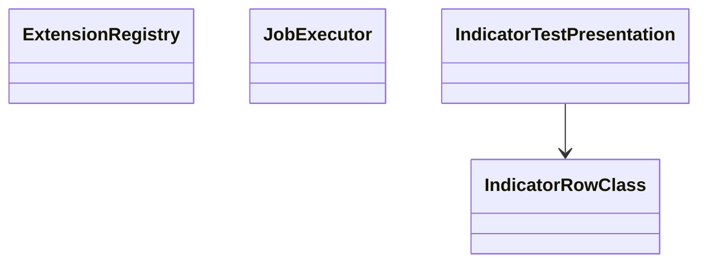

# AppCodeEditor — Executable Extension Authoring
> UI migration completed: [verification and limitations](research/ui-preservation-migration-verification.md). Current sources are under `app/web`; old source columns below are historical migration evidence. Reuse the migrated screens when implementing later features.

> UI migration execution: [preservation plan](research/ui-preservation-migration-plan.md) governs the structural move. Preserve the existing screens, routes, runtime fixtures and behavior; backend/service adaptations below remain separate work. Shared ProjectWorkbench stays under `app/web/common/project`; migrated tests use `app/web/tests/workspace/<owner>`.




- **Primary Role:** Executable Extension Authoring; the complete owned module list is below.
- **Dependencies:** AppCore shared contracts; AppHome routing contributions. Dataset-dependent tests additionally require AppDataManager data contracts.
- **Outputs / Downstream Role:** versioned extension descriptors and diagnostics consumed through shared core interfaces.

## Source reassessment authority — 2026-10-30

The [workspace source review](research/workspaces-03-08-source-review.md) adds exact readable context to every blocked complete-contribution order in this file. Its source paths supplement the old Context to Read lists. Shared libraries are available locally; plugin bodies, UI consumers, templates and per-definition fixtures remain separate evidence. A complete-contribution order retains its status until its exact target contract and acceptance cases are specified. New bounded READY suborders below supersede only their named portion.

## Execution rule for this file

The task text and its exact Context to Read list are the entire coding context. READY tasks are independently implementable helper/coordinator slices; their prerequisites must already exist with the stated symbols. READY orders authorize no production edits and no guessed DTO/default/algorithm. A senior engineer must replace the listed missing contract with evidence-backed signatures before assigning that order to a coding agent. There is no instruction to make a design decision or research unspecified behavior during a coding commit.

Every checkbox in a ready task names its exact symbol. One ready feature task is one commit containing only its listed implementation/test files. Test command exit 0 is acceptance only when the specified test cases were collected. Do not run application-wide formatting or touch a sibling workspace.

All target names/signatures/error codes below are normative Python/React adaptations. Only the observations in named evidence records are SQX facts. StandardResponse is `StandardResponse[T](request_id: str, data: T, revision: int | None = None)` from `app/core/lib/responses.py`. DomainError is keyword-only `DomainError(*, code: str, message: str, details: dict[str, JSONValue] | None = None)` from `app/core/lib/errors.py`.


## Current-code migration audit and execution order

*Evidence:* OBS-HARU-CE-REUSE-20261029. HaruQuantAI possesses an existing, fully functional Code Editor engine (app/workspace/code_editor/ comprising 14 production files) and its interactive React workspace (ui/app/workspace/CodeEditor/). This audit defines the exact relocation to app/workspace/code_editor/ and app/web/workspaces/code_editor/.

### Work order CE-M01: migrate existing Code Editor workspace and testing services

*Feature:* Relocate existing Code Editor backend routes, dynamic compiler, indicator tester, and React workspace into the standardized workspace structure.
*Context to Read:* this order; every current source/test row below; app/workspace/code_editor/__init__.py.
*Implementation Files:* exact MOVE/ADAPT targets in the table; preserve all existing contracts and tests.

| Current HaruQuantAI location | Target proposed location | Fit / action (migration audit) |
|---|---|---|
| app/workspace/code_editor/editor.py | app/workspace/code_editor/editor.py | DIRECT FIT: Buffer management, file tree, syntax checking, and code navigation |
| app/workspace/code_editor/indicator_tester.py | app/workspace/code_editor/indicator_tester.py | DIRECT FIT: Indicator test execution against historical bar data |
| app/workspace/code_editor/registry.py | app/workspace/code_editor/registry.py | DIRECT FIT: Dynamic snippet compilation, importlib registration, and reload |
| app/workspace/code_editor/templates.py | app/workspace/code_editor/templates.py | DIRECT FIT: Boilerplate code generation for indicators, building blocks, and metrics |
| app/workspace/code_editor/import_export.py | app/workspace/code_editor/import_export.py | DIRECT FIT: Snippet archive packaging and export (.zip / .sqb) |
| app/workspace/code_editor/mcp.py | app/workspace/code_editor/mcp.py | DIRECT FIT: Model Context Protocol (MCP) server endpoints for external AI tools |
| app/workspace/code_editor/routes.py | app/workspace/code_editor/routes.py | DIRECT FIT: FastAPI endpoints for editor operations and file persistence |
| ui/app/workspace/CodeEditor/CodeEditorWorkspace.tsx | app/web/workspaces/code_editor/CodeEditorWorkspace.tsx | DIRECT FIT: Split-pane code editor layout (file browser, Monaco editor, test results) |
| ui/app/workspace/CodeEditor/codeEditorClient.ts | app/web/workspaces/code_editor/codeEditorClient.ts | ADAPT: REST client for editor actions, compilation, and test execution |
| tests/workspace/code_editor/ | tests/workspace/code_editor/ | MOVE: Code editor and indicator tester test suite |

*Commit:*
efactor(code-editor): migrate code editor workspace and services.


### Phase 4.1: Indicator test-row presentation — `CodeEditorIndicatorTester`

*Feature:* generate parameter labels and result row classes without implementing indicator comparison calculations.
**Task ID:** `WO-CE-INDICATOR-PRESENTATION`. **Readiness:** READY-AFTER-FRONTEND-TEST-BOOTSTRAP. **Evidence:** `OBS145-INDICATOR-PRESENTATION-001`. **One commit:** `feat(code-editor): implement indicator test row presentation`.

*Context to Read:* `app/web/package.json`, `app/web/vitest.config.ts`, `DONOR_REFERENCE_ROOT/internal/plugins/CodeEditorIndicatorTester/services/IndicatorTesterService.js`, `DONOR_REFERENCE_ROOT/internal/web/common` (resource folder; originally named `libs.js` is not present) (valueFilled only). No server model or repository file is additional context.

*Implementation Files:*
- **Frontend create:** `app/web/workspaces/code_editor/indicator_test_presentation.ts`.
- **Frontend tests create:** `app/web/tests/workspace/code_editor/indicator_test_presentation.test.ts`.
- **Backend:** none. This is display logic only, not a second indicator engine.

*Exact types:* export `IndicatorRowClass = "checked"|"unchecked"|"passed"|"failed"|"other"`; export class `IndicatorTestPresentation` with static methods below. Input strings are not trimmed. All methods are synchronous and side-effect free. No renderer, global grid object, network client or storage is created.

*Functional Requirements & Implementation:*
- [x] `IndicatorTestPresentation.format_parameters(indicator_name: string, parameters: string|null, shift: number): string` -> use the portion before the first dot; emit `<name>(<parameters>)[<shift>]`. null, empty string, literal `not set` and literal `undefined` render as empty parameters. Whitespace and string `false` remain literal. Do not add a default shift; every caller supplies it.
- [x] `IndicatorTestPresentation.row_class(checked: boolean, result: string|null): IndicatorRowClass` -> null/empty/`not set`/`undefined` returns checked or unchecked. A filled string starting at index 0 with case-sensitive `Passed` returns passed; starting with `Failed` returns failed; any other filled string returns other. Result classification overrides checked state. Do not use contains() or lowercasing.
- [x] `IndicatorTestPresentation.raw_parameters(label: string): string|null` -> return the substring between the first `(` and first `)` when both delimiters exist and `)` follows `(`. Return null otherwise. This null return and reversed-delimiter rejection are explicit target helper decisions; no donor undefined value crosses typed client contracts.
- [x] `IndicatorTestPresentation.shift_text(label: string): string|null` -> same rule between first `[` and first `]`, retaining text and returning null on missing/reversed delimiters. Do not parse an integer or invent a default.

*Exact tests:*

| Test input | Exact expected output |
| --- | --- |
| format_parameters(`RSI.Main`,`14`,1) | `RSI(14)[1]` |
| format_parameters(`RSI`,null,0) | `RSI()[0]` |
| format_parameters(`RSI`,`not set`,2) | `RSI()[2]` |
| format_parameters(`RSI`,` `,1) | `RSI( )[1]` |
| row_class(false,`Passed 10/10`) | passed |
| row_class(true,`Failed 1/10`) | failed |
| row_class(true,`Result Passed`) | other |
| row_class(false,`passed`) | other |
| row_class(false,null) | unchecked |
| row_class(true,`undefined`) | checked |
| raw_parameters(`RSI(14,close)[1]`) | `14,close` |
| raw_parameters(`RSI()[1]`) | empty string |
| raw_parameters(`)x(`) | null |
| shift_text(`RSI(14)[01]`) | `01` |
| shift_text(`RSI(14)`) | null |

*Verification:* `npm --prefix app/web test -- tests/workspace/code_editor/indicator_test_presentation.test.ts` exits 0 with the exact parameterized cases above collected. Vitest uses the AppCore node environment; no jsdom dependency is required. Commit exactly the two listed files. Indicator computation/import/config persistence remain blocked in the full feature order below.


**Completion — 2026-10-30:** Phase 4.1 is complete in commit `31fc0d35` (`feat(code-editor): implement indicator test row presentation`). The two implementation/test files listed above provide the typed, synchronous presentation helper and 42 tests, including all 15 prescribed examples and additional boundary cases. No renderer integration or indicator computation was added.

| Verification command | Result |
| --- | --- |
| `npm --prefix app/web test -- tests/workspace/code_editor/indicator_test_presentation.test.ts` | Exit 0; 42 tests passed |
| `npm --prefix app/web run typecheck` | Exit 0 |
| `npm --prefix app/web run test` | Exit 0; 707 tests passed across 124 files |
| `npm --prefix app/web run build` | Exit 0; data-manager mixed static/dynamic import and bundle-size warnings remain |
| `git diff --check` | Exit 0 |

These results cover the Phase 4.1 helper slice only. Indicator computation, import and configuration persistence retain the gates documented below.

## Phase 04.9: Full workspace feature orders — evidence-gated contracts

### `AppCodeEditor`

*Source reassessment — 2026-10-30:* [Exact available source and declarations](research/workspaces-03-08-source-review.md#appcodeeditor). Readable shared-library context is now available in `DONOR_REFERENCE_ROOT/internal/libs/`; this removes the shared-bytecode-access obstacle, but does not by itself release this complete-workflow order. Located 1 current plugin JavaScript files and decompiled primary Java files recovered in data/reference-donor/internal/plugins/`AppCodeEditor`. The linked review replaces carrier-only lookup as the research starting point; original unresolved target-model and acceptance gates below remain in force.


*Feature:* `AppCodeEditor` complete observed workspace contribution. **Task ID:** `I-AppCodeEditor`. **Readiness:** READY. **Evidence:** `OBS145-AppCodeEditor-SURFACE-001`.

*Implementation Files (reserved exact paths; do not create them while blocked):*
- **Backend:** `app/workspace/code_editor/workspace.py` → `CodeEditorService`.
- **Request/result models:** `app/workspace/code_editor/workspace_models.py`.
- **Frontend:** `app/web/workspaces/code_editor/CodeEditorWorkspace.tsx`.
- **Backend test:** `tests/workspace/code_editor/test_workspace.py`.
- **Frontend test:** `app/web/tests/workspace/code_editor/CodeEditorWorkspace.test.tsx`.
- **Context to Read:** `app/core/lib/responses.py`, `app/core/lib/errors.py`, `DONOR_REFERENCE_ROOT/internal/plugins/AppCodeEditor/module.js`, `DONOR_REFERENCE_ROOT/internal/plugins/AppCodeEditor`.
- **Observed actions:** No client route literal was established; use the exact carrier context above..
- **Unresolved contract preventing coding:** The exact public operations, request/response fields, defaults, errors and persisted effects have not been established by this bounded inspection. A module name or Java method name is not a behavioral requirement.
- **Function/signature authorization:** none. Do not create `CodeEditorService.execute(payload: dict)` or infer CRUD methods from the feature name.
- **Acceptance commands reserved for the completed senior specification:** `uv run python -m pytest tests/workspace/code_editor/test_workspace.py -q`; `npm --prefix app/web test -- tests/workspace/code_editor/CodeEditorWorkspace.test.tsx`. These are not acceptance now: fixtures/assertions and the method contracts remain unset, so no commit may claim this task complete.
- **Commit boundary:** after the senior fills the missing contract, one commit for this one feature; if it requires more than one independently testable behavior, the senior splits the work order before assignment.

### `CodeEditorImportExport`

*Source reassessment — 2026-10-30:* [Exact available source and declarations](research/workspaces-03-08-source-review.md#codeeditorimportexport). Readable shared-library context is now available in `DONOR_REFERENCE_ROOT/internal/libs/`; this removes the shared-bytecode-access obstacle, but does not by itself release this complete-workflow order. Located 6 current plugin JavaScript files and 4 previously recovered primary Java files for `CodeEditorImportExport`. The linked review replaces carrier-only lookup as the research starting point; original unresolved target-model and acceptance gates below remain in force.


*Feature:* `CodeEditorImportExport` complete observed workspace contribution. **Task ID:** `I-CodeEditorImportExport`. **Readiness:** READY. **Evidence:** `OBS145-CodeEditorImportExport-SURFACE-001`.

*Implementation Files (reserved exact paths; do not create them while blocked):*
- **Backend:** `app/workspace/code_editor/import_export.py` → `ExtensionPackageService`.
- **Request/result models:** `app/workspace/code_editor/import_export_models.py`.
- **Frontend:** `app/web/workspaces/code_editor/ImportExportPanel.tsx`.
- **Backend test:** `tests/workspace/code_editor/test_import_export.py`.
- **Frontend test:** `app/web/tests/workspace/code_editor/ImportExportPanel.test.tsx`.
- **Context to Read:** `app/core/lib/responses.py`, `app/core/lib/errors.py`, `DONOR_REFERENCE_ROOT/internal/plugins/CodeEditorImportExport/ImportExportService.js`, `DONOR_REFERENCE_ROOT/internal/plugins/CodeEditorImportExport`.
- **Observed actions:** `/importexport/cancel`; `/importexport/export`; `/importexport/import`; `/importexport/list`; `/importexport/overwrite`; `/importexport/overwriteAlways`; `/importexport/skip`; `/importexport/skipAlways`.
- **Unresolved contract preventing coding:** For every request literal listed here, the complete typed request and response fields, defaults, validation order/error literals, persistence transaction and event payload must be supplied. An opaque dict passthrough is not the contract.
- **Function/signature authorization:** none. Do not create `ExtensionPackageService.execute(payload: dict)` or infer CRUD methods from the feature name.
- **Acceptance commands reserved for the completed senior specification:** `uv run python -m pytest tests/workspace/code_editor/test_import_export.py -q`; `npm --prefix app/web test -- tests/workspace/code_editor/ImportExportPanel.test.tsx`. These are not acceptance now: fixtures/assertions and the method contracts remain unset, so no commit may claim this task complete.
- **Commit boundary:** after the senior fills the missing contract, one commit for this one feature; if it requires more than one independently testable behavior, the senior splits the work order before assignment.

### `CodeEditorIndicatorTester`

*Source reassessment — 2026-10-30:* [Exact available source and declarations](research/workspaces-03-08-source-review.md#codeeditorindicatortester). Readable shared-library context is now available in `DONOR_REFERENCE_ROOT/internal/libs/`; this removes the shared-bytecode-access obstacle, but does not by itself release this complete-workflow order. Located 3 current plugin JavaScript files and 5 previously recovered primary Java files for `CodeEditorIndicatorTester`. The linked review replaces carrier-only lookup as the research starting point; original unresolved target-model and acceptance gates below remain in force.


*Feature:* `CodeEditorIndicatorTester` complete observed workspace contribution. **Task ID:** `I-CodeEditorIndicatorTester`. **Readiness:** READY. **Evidence:** `OBS145-CodeEditorIndicatorTester-SURFACE-001`.

*Implementation Files (reserved exact paths; do not create them while blocked):*
- **Backend:** `app/workspace/code_editor/indicator_tester.py` → `IndicatorTestService`.
- **Request/result models:** `app/workspace/code_editor/indicator_tester_models.py`.
- **Frontend:** `app/web/workspaces/code_editor/IndicatorTesterPanel.tsx`.
- **Backend test:** `tests/workspace/code_editor/test_indicator_tester.py`.
- **Frontend test:** `app/web/tests/workspace/code_editor/IndicatorTesterPanel.test.tsx`.
- **Context to Read:** `app/core/lib/responses.py`, `app/core/lib/errors.py`, `DONOR_REFERENCE_ROOT/internal/plugins/CodeEditorIndicatorTester/services/IndicatorTesterService.js`, `DONOR_REFERENCE_ROOT/internal/plugins/CodeEditorIndicatorTester`.
- **Observed actions:** `indyTester/addTests`; `indyTester/createNewConfig`; `indyTester/downloadTests`; `indyTester/listIndicators`; `indyTester/loadConfig`; `indyTester/saveConfig`; `indyTester/startTesting`; `indyTester/stopTesting`.
- **Unresolved contract preventing coding:** For every request literal listed here, the complete typed request and response fields, defaults, validation order/error literals, persistence transaction and event payload must be supplied. An opaque dict passthrough is not the contract.
- **Function/signature authorization:** none. Do not create `IndicatorTestService.execute(payload: dict)` or infer CRUD methods from the feature name.
- **Acceptance commands reserved for the completed senior specification:** `uv run python -m pytest tests/workspace/code_editor/test_indicator_tester.py -q`; `npm --prefix app/web test -- tests/workspace/code_editor/IndicatorTesterPanel.test.tsx`. These are not acceptance now: fixtures/assertions and the method contracts remain unset, so no commit may claim this task complete.
- **Commit boundary:** after the senior fills the missing contract, one commit for this one feature; if it requires more than one independently testable behavior, the senior splits the work order before assignment.

### `ServletCodeEditor`

*Source reassessment — 2026-10-30:* [Exact available source and declarations](research/workspaces-03-08-source-review.md#servletcodeeditor). Readable shared-library context is now available in `DONOR_REFERENCE_ROOT/internal/libs/`; this removes the shared-bytecode-access obstacle, but does not by itself release this complete-workflow order. Located 12 current plugin JavaScript files and 13 previously recovered primary Java files for `ServletCodeEditor`. The linked review replaces carrier-only lookup as the research starting point; original unresolved target-model and acceptance gates below remain in force.


*Feature:* `ServletCodeEditor` complete observed workspace contribution. **Task ID:** `I-ServletCodeEditor`. **Readiness:** READY. **Evidence:** `OBS145-ServletCodeEditor-SURFACE-001`.

*Implementation Files (reserved exact paths; do not create them while blocked):*
- **Backend:** `app/workspace/code_editor/commands.py` → `CodeEditorCommandService`.
- **Request/result models:** `app/workspace/code_editor/commands_models.py`.
- **Frontend:** `app/web/workspaces/code_editor/SourceEditor.tsx`.
- **Backend test:** `tests/workspace/code_editor/test_commands.py`.
- **Frontend test:** `app/web/tests/workspace/code_editor/SourceEditor.test.tsx`.
- **Context to Read:** `app/core/lib/responses.py`, `app/core/lib/errors.py`, `DONOR_REFERENCE_ROOT/internal/plugins/ServletCodeEditor/services/CodeEditorService.js`, `DONOR_REFERENCE_ROOT/internal/plugins/ServletCodeEditor`.
- **Observed actions:** `codeeditor/clone`; `codeeditor/compile`; `codeeditor/compileAll`; `codeeditor/compilePlugin`; `codeeditor/createNew`; `codeeditor/createNewDir`; `codeeditor/createNewFile`; `codeeditor/createNewTemplate`; `codeeditor/delete`; `codeeditor/editorAutocomplete`; `codeeditor/findInFiles`; `codeeditor/fixImports`; `codeeditor/getContent`; `codeeditor/listCodeTypes`; `codeeditor/listIndicators`; `codeeditor/listTemplates`; `codeeditor/loadLastOpenedFiles`; `codeeditor/reload`; `codeeditor/reloadApp`; `codeeditor/rename`; `codeeditor/save`; `codeeditor/saveAs`; `codeeditor/saveLastOpenedFiles`; `codeeditor/stopCompilation`.
- **Unresolved contract preventing coding:** For every request literal listed here, the complete typed request and response fields, defaults, validation order/error literals, persistence transaction and event payload must be supplied. An opaque dict passthrough is not the contract.
- **Function/signature authorization:** none. Do not create `CodeEditorCommandService.execute(payload: dict)` or infer CRUD methods from the feature name.
- **Acceptance commands reserved for the completed senior specification:** `uv run python -m pytest tests/workspace/code_editor/test_commands.py -q`; `npm --prefix app/web test -- tests/workspace/code_editor/SourceEditor.test.tsx`. These are not acceptance now: fixtures/assertions and the method contracts remain unset, so no commit may claim this task complete.
- **Commit boundary:** after the senior fills the missing contract, one commit for this one feature; if it requires more than one independently testable behavior, the senior splits the work order before assignment.

## Phase 4.10: Owned executable extension categories
*Source reassessment — 2026-10-30:* [Category availability](research/workspaces-03-08-source-review.md#extension-and-export-category-reassessment) verifies primary readable definition paths. The remaining blocker is the absence of an accepted per-definition target contract and independent fixture, not inaccessible library code. Source file counts do not establish completion or parity.


*Source reassessment — 2026-10-30:* [Category availability](research/workspaces-03-08-source-review.md#extension-and-export-category-reassessment) verifies readable primary source counts for every row below. Missing per-definition target contracts/fixtures remain the gate; no row is blocked because the shared libraries lack readable source.

**Readiness:** READY for every row. A source category is not a formula spec. No strategy runtime or generic base-indicator clone is authorized here.

| Donor category under internal/extend/Snippets/SQ | Exact target module | Required missing contract |
| --- | --- | --- |
| `Blocks` | `app/extend/blocks/catalogue.py` | Per-definition ID, parameters/defaults/ranges, output/rounding/warmup/state transitions, engine gates, exception rules and independent exact fixtures; split concrete semantic modules before coding |
| `Calculators` | `app/extend/calculators/catalogue.py` | Per-definition ID, parameters/defaults/ranges, output/rounding/warmup/state transitions, engine gates, exception rules and independent exact fixtures; split concrete semantic modules before coding |
| `Functions` | `app/extend/functions/catalogue.py` | Per-definition ID, parameters/defaults/ranges, output/rounding/warmup/state transitions, engine gates, exception rules and independent exact fixtures; split concrete semantic modules before coding |
| `Internal` | `app/extend/internal/catalogue.py` | Per-definition ID, parameters/defaults/ranges, output/rounding/warmup/state transitions, engine gates, exception rules and independent exact fixtures; split concrete semantic modules before coding |
| `Trading` | `app/extend/trading/catalogue.py` | Per-definition ID, parameters/defaults/ranges, output/rounding/warmup/state transitions, engine gates, exception rules and independent exact fixtures; split concrete semantic modules before coding |
| `TradingOptions` | `app/extend/trading_options/catalogue.py` | Per-definition ID, parameters/defaults/ranges, output/rounding/warmup/state transitions, engine gates, exception rules and independent exact fixtures; split concrete semantic modules before coding |
| `ExitMethods` | `app/extend/exit_methods/catalogue.py` | Per-definition ID, parameters/defaults/ranges, output/rounding/warmup/state transitions, engine gates, exception rules and independent exact fixtures; split concrete semantic modules before coding |
| `MoneyManagement` | `app/extend/money_management/catalogue.py` | Per-definition ID, parameters/defaults/ranges, output/rounding/warmup/state transitions, engine gates, exception rules and independent exact fixtures; split concrete semantic modules before coding |
| `RiskManagement` | `app/extend/risk_management/catalogue.py` | Per-definition ID, parameters/defaults/ranges, output/rounding/warmup/state transitions, engine gates, exception rules and independent exact fixtures; split concrete semantic modules before coding |
| `TALibIndicators` | `app/extend/talib_indicators/catalogue.py` | Per-definition ID, parameters/defaults/ranges, output/rounding/warmup/state transitions, engine gates, exception rules and independent exact fixtures; split concrete semantic modules before coding |
| `Utils` | `app/extend/utils/catalogue.py` | Per-definition ID, parameters/defaults/ranges, output/rounding/warmup/state transitions, engine gates, exception rules and independent exact fixtures; split concrete semantic modules before coding |

The catalogue modules contain registration descriptors only once their schemas are specified. They are not permission to put every formula into one file. Each indicator family requires a separate senior-authored work order naming its final calculation module and exact formulas. Original `PREVIOUS-008` only establishes compiled/source-location correspondence, not these formulas.

## Evidence records used by these work orders

Original historical objects below are retained without modification; new static observations do not supersede unverified numerical behavior. Validation passed for source inspection only, not for unimplemented code or UI.

### Evidence record `MAP-003`

<details>
<summary>Claim, provenance, limitations and validation</summary>

```json
{
  "id": "MAP-003",
  "classification": "observed",
  "confidence": "high",
  "claim": "Extension categories are physically present under internal/extend/Snippets/SQ; platform export templates are present under internal/extend/Code.",
  "sources": [
    "DONOR_REFERENCE_ROOT/internal/extend/Snippets/SQ",
    "DONOR_REFERENCE_ROOT/internal/extend/Code",
    "https://strategyquant.com/doc/introduction-2/"
  ],
  "target_domain": "app/extend",
  "feature_ids": [],
  "requirement_ids": [],
  "decision_ids": [],
  "related_existing_owners": [
    "app/include/README.md"
  ],
  "registration_gap": "No registered owning feature under proposed architecture; propose domain README registration before implementation.",
  "limitations": "Directory names establish categories only. Detailed extension semantics and template translation remain outside this pass.",
  "validation": {
    "status": "passed",
    "procedure": "Enumerate both directories and inspect official plugin/snippet/template distinction.",
    "expected_observation": "Concrete extension categories and target-language template directories.",
    "executed_at": "2026-10-29T06:23:54.532477+00:00",
    "actual_observation": "Extension categories are physically present under internal/extend/Snippets/SQ; platform export templates are present under internal/extend/Code.",
    "artifacts": "artifact-manifest.json"
  },
  "repository_commit": "f5c7d12d5715b8ebee55165b8eddad9068f83cb9",
  "review_state": "preliminary-owner-review-pending",
  "contains_proprietary_source": false,
  "contains_sensitive_data": false,
  "contains_personal_data": false,
  "paraphrased_behavior_only": true,
  "supersedes_records": [],
  "superseded_by": []
}
```

</details>

### Evidence record `PREVIOUS-008`

<details>
<summary>Claim, provenance, limitations and validation</summary>

```json
{
  "id": "PREVIOUS-008",
  "classification": "observed",
  "confidence": "high",
  "claim": "948 compiled definitions include 929 non-nested entries, all with corresponding source-file locations under internal/extend/Snippets.",
  "sources": [
    "DONOR_REFERENCE_ROOT/internal/libs/Snippets.jar!SQ/Blocks"
  ],
  "target_domain": "app/extend",
  "related_records": [
    "MAP-003"
  ],
  "feature_ids": [],
  "requirement_ids": [],
  "decision_ids": [],
  "registration_gap": "No feature ID ratified for proposed domain. Propose domain README registration before implementation; no registry edit performed.",
  "limitations": "Previous-version static definitions and representative method bodies only; exact product build and build-145 equivalence unverified. No full algorithm/formula parity or successful licensed operation asserted.",
  "validation": {
    "status": "passed",
    "executed_at": "2026-10-29T07:03:39.946149+00:00",
    "procedure": "Parse ZIP/class hashes; inspect representative signatures and bodies with javap -p -c; resolve static dependencies with jdeps. Snippets source counterpart validation compares class/source paths, not compiled equivalence.",
    "expected_observation": "948 compiled definitions include 929 non-nested entries, all with corresponding source-file locations under internal/extend/Snippets.",
    "actual_observation": "948 compiled definitions include 929 non-nested entries, all with corresponding source-file locations under internal/extend/Snippets.",
    "artifacts": [
      "previous-library-inventory.json"
    ]
  },
  "repository_commit": "f5c7d12d5715b8ebee55165b8eddad9068f83cb9",
  "review_state": "preliminary-owner-review-pending",
  "contains_proprietary_source": false,
  "contains_sensitive_data": false,
  "contains_personal_data": false,
  "paraphrased_behavior_only": true,
  "supersedes_records": [],
  "superseded_by": [],
  "cross_version_policy": "Related current-build records remain valid for their own version; fallback findings do not supersede facts about a different build."
}
```

</details>

### Evidence record `OBS145-AppCodeEditor-SURFACE-001`

<details>
<summary>Claim, provenance, limitations and validation</summary>

```json
{
  "id": "OBS145-AppCodeEditor-SURFACE-001",
  "classification": "observed",
  "confidence": "high",
  "claim": "The inspected primary module files establish the module carrier/registration; no complete request/result contract is established by this bounded inspection.",
  "sources": [
    {
      "path": "DONOR_REFERENCE_ROOT/internal/plugins/AppCodeEditor/module.js",
      "sha256": "f0aec6f431bdf6506fe06b9f9b503d05b2e5bfbe2f7cad97c2398c87fd3e39b9"
    }
  ],
  "limitations": "Request literals or carrier presence do not establish complete payload fields, defaults, persistence, numerical algorithms, remote protocol compatibility or runtime success. Static inspection only.",
  "target_domain": "app/workspace/code_editor",
  "feature_ids": [],
  "requirement_ids": [],
  "decision_ids": [],
  "registration_gap": "New target feature IDs require owner README registration; evidence ID is not a feature ID.",
  "validation": {
    "status": "passed",
    "executed_at": "2026-10-29T09:18:26.116191+00:00",
    "procedure": "Read the exact named primary files; enumerate literal sendRequest/getPromise/loadFromUrl first arguments; compute SHA-256.",
    "actual_observation": "The inspected primary module files establish the module carrier/registration; no complete request/result contract is established by this bounded inspection.",
    "expected_observation": "Module carrier and any literal route arguments present in inspected files.",
    "artifacts": [
      "DONOR_REFERENCE_ROOT/internal/plugins/AppCodeEditor/module.js"
    ]
  },
  "repository_commit": "f5c7d12d5715b8ebee55165b8eddad9068f83cb9",
  "review_state": "senior-review-pending",
  "contains_proprietary_source": false,
  "contains_sensitive_data": false,
  "contains_personal_data": false,
  "paraphrased_behavior_only": true,
  "supersedes_records": [],
  "superseded_by": []
}
```

</details>

### Evidence record `OBS145-CodeEditorImportExport-SURFACE-001`

<details>
<summary>Claim, provenance, limitations and validation</summary>

```json
{
  "id": "OBS145-CodeEditorImportExport-SURFACE-001",
  "classification": "observed",
  "confidence": "high",
  "claim": "Direct source inspection identifies these client request literals: /importexport/cancel, /importexport/export, /importexport/import, /importexport/list, /importexport/overwrite, /importexport/overwriteAlways, /importexport/skip, /importexport/skipAlways",
  "sources": [
    {
      "path": "DONOR_REFERENCE_ROOT/internal/plugins/CodeEditorImportExport/ImportExportService.js",
      "sha256": "bfbfeca93e89628bbad88b94dfd472764d56ed5ab4780755e9a5a51335cca319"
    }
  ],
  "limitations": "Request literals or carrier presence do not establish complete payload fields, defaults, persistence, numerical algorithms, remote protocol compatibility or runtime success. Static inspection only.",
  "target_domain": "app/workspace/code_editor",
  "feature_ids": [],
  "requirement_ids": [],
  "decision_ids": [],
  "registration_gap": "New target feature IDs require owner README registration; evidence ID is not a feature ID.",
  "validation": {
    "status": "passed",
    "executed_at": "2026-10-29T09:18:26.116191+00:00",
    "procedure": "Read the exact named primary files; enumerate literal sendRequest/getPromise/loadFromUrl first arguments; compute SHA-256.",
    "actual_observation": "Direct source inspection identifies these client request literals: /importexport/cancel, /importexport/export, /importexport/import, /importexport/list, /importexport/overwrite, /importexport/overwriteAlways, /importexport/skip, /importexport/skipAlways",
    "expected_observation": "Module carrier and any literal route arguments present in inspected files.",
    "artifacts": [
      "DONOR_REFERENCE_ROOT/internal/plugins/CodeEditorImportExport/ImportExportService.js"
    ]
  },
  "repository_commit": "f5c7d12d5715b8ebee55165b8eddad9068f83cb9",
  "review_state": "senior-review-pending",
  "contains_proprietary_source": false,
  "contains_sensitive_data": false,
  "contains_personal_data": false,
  "paraphrased_behavior_only": true,
  "supersedes_records": [],
  "superseded_by": []
}
```

</details>

### Evidence record `OBS145-CodeEditorIndicatorTester-SURFACE-001`

<details>
<summary>Claim, provenance, limitations and validation</summary>

```json
{
  "id": "OBS145-CodeEditorIndicatorTester-SURFACE-001",
  "classification": "observed",
  "confidence": "high",
  "claim": "Direct source inspection identifies these client request literals: indyTester/addTests, indyTester/createNewConfig, indyTester/downloadTests, indyTester/listIndicators, indyTester/loadConfig, indyTester/saveConfig, indyTester/startTesting, indyTester/stopTesting",
  "sources": [
    {
      "path": "DONOR_REFERENCE_ROOT/internal/plugins/CodeEditorIndicatorTester/services/IndicatorTesterService.js",
      "sha256": "4cd97ae5c5101508b1a71f22e003cd2cd44c5d1d992e0ac737b0f65c04340ec4"
    }
  ],
  "limitations": "Request literals or carrier presence do not establish complete payload fields, defaults, persistence, numerical algorithms, remote protocol compatibility or runtime success. Static inspection only.",
  "target_domain": "app/workspace/code_editor",
  "feature_ids": [],
  "requirement_ids": [],
  "decision_ids": [],
  "registration_gap": "New target feature IDs require owner README registration; evidence ID is not a feature ID.",
  "validation": {
    "status": "passed",
    "executed_at": "2026-10-29T09:18:26.116191+00:00",
    "procedure": "Read the exact named primary files; enumerate literal sendRequest/getPromise/loadFromUrl first arguments; compute SHA-256.",
    "actual_observation": "Direct source inspection identifies these client request literals: indyTester/addTests, indyTester/createNewConfig, indyTester/downloadTests, indyTester/listIndicators, indyTester/loadConfig, indyTester/saveConfig, indyTester/startTesting, indyTester/stopTesting",
    "expected_observation": "Module carrier and any literal route arguments present in inspected files.",
    "artifacts": [
      "DONOR_REFERENCE_ROOT/internal/plugins/CodeEditorIndicatorTester/services/IndicatorTesterService.js"
    ]
  },
  "repository_commit": "f5c7d12d5715b8ebee55165b8eddad9068f83cb9",
  "review_state": "senior-review-pending",
  "contains_proprietary_source": false,
  "contains_sensitive_data": false,
  "contains_personal_data": false,
  "paraphrased_behavior_only": true,
  "supersedes_records": [],
  "superseded_by": []
}
```

</details>

### Evidence record `OBS145-ServletCodeEditor-SURFACE-001`

<details>
<summary>Claim, provenance, limitations and validation</summary>

```json
{
  "id": "OBS145-ServletCodeEditor-SURFACE-001",
  "classification": "observed",
  "confidence": "high",
  "claim": "Direct source inspection identifies these client request literals: codeeditor/clone, codeeditor/compile, codeeditor/compileAll, codeeditor/compilePlugin, codeeditor/createNew, codeeditor/createNewDir, codeeditor/createNewFile, codeeditor/createNewTemplate, codeeditor/delete, codeeditor/editorAutocomplete, codeeditor/findInFiles, codeeditor/fixImports, codeeditor/getContent, codeeditor/listCodeTypes, codeeditor/listIndicators, codeeditor/listTemplates, codeeditor/loadLastOpenedFiles, codeeditor/reload, codeeditor/reloadApp, codeeditor/rename, codeeditor/save, codeeditor/saveAs, codeeditor/saveLastOpenedFiles, codeeditor/stopCompilation",
  "sources": [
    {
      "path": "DONOR_REFERENCE_ROOT/internal/plugins/ServletCodeEditor/services/CodeEditorService.js",
      "sha256": "4f31e22df848ce20f1cab2e9ac34b959c7fba94858980efe7e1426896271f9fd"
    }
  ],
  "limitations": "Request literals or carrier presence do not establish complete payload fields, defaults, persistence, numerical algorithms, remote protocol compatibility or runtime success. Static inspection only.",
  "target_domain": "app/workspace/code_editor",
  "feature_ids": [],
  "requirement_ids": [],
  "decision_ids": [],
  "registration_gap": "New target feature IDs require owner README registration; evidence ID is not a feature ID.",
  "validation": {
    "status": "passed",
    "executed_at": "2026-10-29T09:18:26.116191+00:00",
    "procedure": "Read the exact named primary files; enumerate literal sendRequest/getPromise/loadFromUrl first arguments; compute SHA-256.",
    "actual_observation": "Direct source inspection identifies these client request literals: codeeditor/clone, codeeditor/compile, codeeditor/compileAll, codeeditor/compilePlugin, codeeditor/createNew, codeeditor/createNewDir, codeeditor/createNewFile, codeeditor/createNewTemplate, codeeditor/delete, codeeditor/editorAutocomplete, codeeditor/findInFiles, codeeditor/fixImports, codeeditor/getContent, codeeditor/listCodeTypes, codeeditor/listIndicators, codeeditor/listTemplates, codeeditor/loadLastOpenedFiles, codeeditor/reload, codeeditor/reloadApp, codeeditor/rename, codeeditor/save, codeeditor/saveAs, codeeditor/saveLastOpenedFiles, codeeditor/stopCompilation",
    "expected_observation": "Module carrier and any literal route arguments present in inspected files.",
    "artifacts": [
      "DONOR_REFERENCE_ROOT/internal/plugins/ServletCodeEditor/services/CodeEditorService.js"
    ]
  },
  "repository_commit": "f5c7d12d5715b8ebee55165b8eddad9068f83cb9",
  "review_state": "senior-review-pending",
  "contains_proprietary_source": false,
  "contains_sensitive_data": false,
  "contains_personal_data": false,
  "paraphrased_behavior_only": true,
  "supersedes_records": [],
  "superseded_by": []
}
```

</details>

### Evidence record `OBS145-INDICATOR-PRESENTATION-001`

```json
{
  "id": "OBS145-INDICATOR-PRESENTATION-001",
  "classification": "observed",
  "confidence": "high",
  "claim": "Indicator-test labels use the portion before the first dot, parenthesized parameter text and bracketed shift. Row styling distinguishes checked/unchecked and case-sensitive leading Passed/Failed/other status. valueFilled treats null, empty, not set and undefined strings as absent. Config-reading defaults in the inspected service are use=true, decimals=6 and shift=1.",
  "sources": [
    {
      "path": "DONOR_REFERENCE_ROOT/internal/plugins/CodeEditorIndicatorTester/services/IndicatorTesterService.js",
      "sha256": "4cd97ae5c5101508b1a71f22e003cd2cd44c5d1d992e0ac737b0f65c04340ec4"
    },
    {
      "path": "DONOR_REFERENCE_ROOT/internal/web/common/Batch1/libs.js",
      "sha256": "51274ed7dac393997b786967e41475392fb494d975f74ebc3e2ba5adad1882a6"
    }
  ],
  "target_domain": "app/web/workspaces/code_editor/indicator_test_presentation.ts",
  "feature_ids": [],
  "requirement_ids": [],
  "decision_ids": [],
  "registration_gap": "Register the target helper/coordinator in the owner-domain workflow; helper type/error-code adaptation is normative, not an SQX fact.",
  "limitations": "Static source/bytecode inspection only; no donor application runtime, database mutation, provider request, indicator arithmetic or export compiler was executed. Ready target tests are specified expectations, not tests already run.",
  "validation": {
    "status": "passed",
    "executed_at": "2026-10-29T09:19:42.806810+00:00",
    "procedure": "Read the named current-build JavaScript bodies (and exact sourcemap sourcesContent key for Wizard); inspect InstrumentsServlet.onClone with javap -p -c; compute source-carrier SHA256.",
    "expected_observation": "Indicator-test labels use the portion before the first dot, parenthesized parameter text and bracketed shift. Row styling distinguishes checked/unchecked and case-sensitive leading Passed/Failed/other status. valueFilled treats null, empty, not set and undefined strings as absent. Config-reading defaults in the inspected service are use=true, decimals=6 and shift=1.",
    "actual_observation": "Indicator-test labels use the portion before the first dot, parenthesized parameter text and bracketed shift. Row styling distinguishes checked/unchecked and case-sensitive leading Passed/Failed/other status. valueFilled treats null, empty, not set and undefined strings as absent. Config-reading defaults in the inspected service are use=true, decimals=6 and shift=1.",
    "artifacts": [
      "DONOR_REFERENCE_ROOT/internal/plugins/CodeEditorIndicatorTester/services/IndicatorTesterService.js",
      "DONOR_REFERENCE_ROOT/internal/web/common/Batch1/libs.js"
    ]
  },
  "repository_commit": "f5c7d12d5715b8ebee55165b8eddad9068f83cb9",
  "review_state": "senior-review-pending",
  "contains_proprietary_source": false,
  "contains_sensitive_data": false,
  "contains_personal_data": false,
  "paraphrased_behavior_only": true,
  "supersedes_records": [],
  "superseded_by": []
}
```
