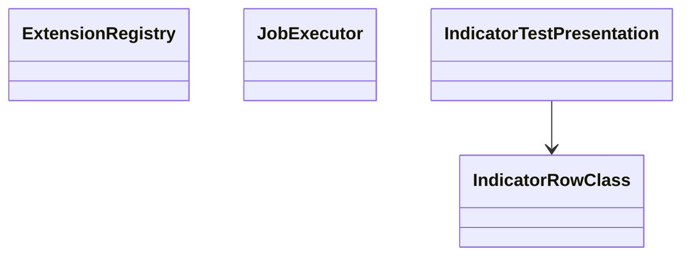

# AppCodeEditor — Executable Extension Authoring
> UI migration completed: [verification and limitations](research/ui-preservation-migration-verification.md). Current sources are under `app/web`; old source columns below are historical migration evidence. Reuse the migrated screens when implementing later features.

> UI migration execution: [preservation plan](research/ui-preservation-migration-plan.md) governs the structural move. Preserve the existing screens, routes, runtime fixtures and behavior; backend/service adaptations below remain separate work. Shared ProjectWorkbench stays under `app/web/common/project`; migrated tests use `app/web/tests/workspace/<owner>`.




- **Primary Role:** Executable Extension Authoring; the complete owned module list is below.
- **Dependencies:** AppCore shared contracts; AppHome routing contributions. Dataset-dependent tests additionally require AppDataManager data contracts.
- **Outputs / Downstream Role:** versioned extension descriptors and diagnostics consumed through shared core interfaces.

## Source reassessment authority — 2026-10-30

**Current completion authority:** [Code Editor completion audit](research/code-editor-completion-audit.md), recorded against HEAD `bf6db55e92d70d8cabedd1871ed8c42b45a672f8`, supersedes the generic readiness labels and proposed replacement-file assumptions in this document. Donor root is `data/reference-donor`. Phase 4.1 is complete; remaining workspace and extension work is not complete. The audit maps all 43 commands dispatched by the three donor servlets and inventories 751 Java source files in the 11 owned extension categories. Counts are inventory evidence, not executable-definition or parity counts.

The [workspace source review](research/workspaces-03-08-source-review.md) adds exact readable context to every blocked complete-contribution order in this file. Its source paths supplement the old Context to Read lists. Shared libraries are available locally; plugin bodies, UI consumers, templates and per-definition fixtures remain separate evidence. A complete-contribution order retains its status until its exact target contract and acceptance cases are specified. New bounded READY suborders below supersede only their named portion.

## Execution rule for this file

The task text and its exact Context to Read list are the entire coding context. READY tasks are independently implementable helper/coordinator slices; their prerequisites must already exist with the stated symbols. READY orders authorize no production edits and no guessed DTO/default/algorithm. A senior engineer must replace the listed missing contract with evidence-backed signatures before assigning that order to a coding agent. There is no instruction to make a design decision or research unspecified behavior during a coding commit.

Every checkbox in a ready task names its exact symbol. One ready feature task is one commit containing only its listed implementation/test files. Test command exit 0 is acceptance only when the specified test cases were collected. Do not run application-wide formatting or touch a sibling workspace.

All target names/signatures/error codes below are normative Python/React adaptations. Only the observations in named evidence records are SQX facts. StandardResponse is `StandardResponse[T](request_id: str, data: T, revision: int | None = None)` from `app/core/lib/responses.py`. DomainError is keyword-only `DomainError(*, code: str, message: str, details: dict[str, JSONValue] | None = None)` from `app/core/lib/errors.py`.


## Current-code migration audit and execution order

**CE-M01 status: migrated implementation present; current backend baseline verified.** The 14 Python modules and migrated React workspace exist at the target locations. `uv run python -m pytest tests/workspace/code_editor -q --no-cov` passed all 77 tests during the 2026-10-30 audit. Browser migration evidence remains in the preservation record linked above; browser tests were inspected but not rerun in this documentation stage. This establishes retained implementation coverage, not complete donor feature parity. The current source editor uses CodeMirror, not Monaco. Reuse these implementations rather than recreating the historical paths below.

*Evidence:* OBS-HARU-CE-REUSE-20261029. HaruQuantAI possesses an existing, fully functional Code Editor engine (app/workspace/code_editor/ comprising 14 production files) and its interactive React workspace (ui/app/workspace/CodeEditor/). This audit defines the exact relocation to app/workspace/code_editor/ and app/web/workspaces/code_editor/.

### Work order CE-M01: migrate existing Code Editor workspace and testing services

*Feature:* Relocate existing Code Editor backend routes, dynamic compiler, indicator tester, and React workspace into the standardized workspace structure.
*Context to Read:* this order; every current source/test row below; app/workspace/code_editor/__init__.py.
*Implementation Files:* exact MOVE/ADAPT targets in the table; preserve all existing contracts and tests.

| Current HaruQuantAI location | Target proposed location | Fit / action (migration audit) |
|---|---|---|
| app/workspace/code_editor/editor.py | app/workspace/code_editor/editor.py | DIRECT FIT: Buffer management, file tree, syntax checking, and code navigation |
| app/workspace/code_editor/indicator_tester.py | app/workspace/code_editor/indicator_tester.py | DIRECT FIT: Indicator test execution against historical bar data |
| app/workspace/code_editor/registry.py | app/workspace/code_editor/registry.py | DIRECT FIT: Dynamic snippet compilation, importlib registration, and reload |
| app/workspace/code_editor/templates.py | app/workspace/code_editor/templates.py | DIRECT FIT: Boilerplate code generation for indicators, building blocks, and metrics |
| app/workspace/code_editor/import_export.py | app/workspace/code_editor/import_export.py | DIRECT FIT: Snippet archive packaging and export (.zip / .sqb) |
| app/workspace/code_editor/mcp.py | app/workspace/code_editor/mcp.py | DIRECT FIT: Model Context Protocol (MCP) server endpoints for external AI tools |
| app/workspace/code_editor/routes.py | app/workspace/code_editor/routes.py | DIRECT FIT: FastAPI endpoints for editor operations and file persistence |
| ui/app/workspace/CodeEditor/CodeEditorWorkspace.tsx | app/web/workspaces/code_editor/CodeEditorWorkspace.tsx | DIRECT FIT: Split-pane code editor layout (file browser, Monaco editor, test results) |
| ui/app/workspace/CodeEditor/codeEditorClient.ts | app/web/workspaces/code_editor/codeEditorClient.ts | ADAPT: REST client for editor actions, compilation, and test execution |
| tests/workspace/code_editor/ | tests/workspace/code_editor/ | MOVE: Code editor and indicator tester test suite |

*Commit:*
`refactor(code-editor): migrate code editor workspace and services` (historical proposal; no new migration commit is authorized).


### Phase 4.1: Indicator test-row presentation — `CodeEditorIndicatorTester`

*Feature:* generate parameter labels and result row classes without implementing indicator comparison calculations.
**Task ID:** `WO-CE-INDICATOR-PRESENTATION`. **Status:** COMPLETE. **Evidence:** `OBS145-INDICATOR-PRESENTATION-001`. **Implementation commit:** `31fc0d35` — `feat(code-editor): implement indicator test row presentation`.

*Context to Read:* `app/web/package.json`, `app/web/vitest.config.ts`, `DONOR_REFERENCE_ROOT/internal/plugins/CodeEditorIndicatorTester/services/IndicatorTesterService.js`, `DONOR_REFERENCE_ROOT/internal/web/common` (resource folder; originally named `libs.js` is not present) (valueFilled only). No server model or repository file is additional context.

*Implementation Files:*
- **Frontend create:** `app/web/workspaces/code_editor/indicator_test_presentation.ts`.
- **Frontend tests create:** `app/web/tests/workspace/code_editor/indicator_test_presentation.test.ts`.
- **Backend:** none. This is display logic only, not a second indicator engine.

*Exact types:* export `IndicatorRowClass = "checked"|"unchecked"|"passed"|"failed"|"other"`; export class `IndicatorTestPresentation` with static methods below. Input strings are not trimmed. All methods are synchronous and side-effect free. No renderer, global grid object, network client or storage is created.

*Functional Requirements & Implementation:*
- [x] `IndicatorTestPresentation.format_parameters(indicator_name: string, parameters: string|null, shift: number): string` -> use the portion before the first dot; emit `<name>(<parameters>)[<shift>]`. null, empty string, literal `not set` and literal `undefined` render as empty parameters. Whitespace and string `false` remain literal. Do not add a default shift; every caller supplies it.
- [x] `IndicatorTestPresentation.row_class(checked: boolean, result: string|null): IndicatorRowClass` -> null/empty/`not set`/`undefined` returns checked or unchecked. A filled string starting at index 0 with case-sensitive `Passed` returns passed; starting with `Failed` returns failed; any other filled string returns other. Result classification overrides checked state. Do not use contains() or lowercasing.
- [x] `IndicatorTestPresentation.raw_parameters(label: string): string|null` -> return the substring between the first `(` and first `)` when both delimiters exist and `)` follows `(`. Return null otherwise. This null return and reversed-delimiter rejection are explicit target helper decisions; no donor undefined value crosses typed client contracts.
- [x] `IndicatorTestPresentation.shift_text(label: string): string|null` -> same rule between first `[` and first `]`, retaining text and returning null on missing/reversed delimiters. Do not parse an integer or invent a default.

*Exact tests:*

| Test input | Exact expected output |
| --- | --- |
| format_parameters(`RSI.Main`,`14`,1) | `RSI(14)[1]` |
| format_parameters(`RSI`,null,0) | `RSI()[0]` |
| format_parameters(`RSI`,`not set`,2) | `RSI()[2]` |
| format_parameters(`RSI`,` `,1) | `RSI( )[1]` |
| row_class(false,`Passed 10/10`) | passed |
| row_class(true,`Failed 1/10`) | failed |
| row_class(true,`Result Passed`) | other |
| row_class(false,`passed`) | other |
| row_class(false,null) | unchecked |
| row_class(true,`undefined`) | checked |
| raw_parameters(`RSI(14,close)[1]`) | `14,close` |
| raw_parameters(`RSI()[1]`) | empty string |
| raw_parameters(`)x(`) | null |
| shift_text(`RSI(14)[01]`) | `01` |
| shift_text(`RSI(14)`) | null |

*Verification:* `npm --prefix app/web test -- tests/workspace/code_editor/indicator_test_presentation.test.ts` exits 0 with the exact parameterized cases above collected. Vitest uses the AppCore node environment; no jsdom dependency is required. Commit exactly the two listed files. Indicator computation/import/config persistence remain blocked in the full feature order below.


**Completion — 2026-10-30:** Phase 4.1 is complete in commit `31fc0d35` (`feat(code-editor): implement indicator test row presentation`). The two implementation/test files listed above provide the typed, synchronous presentation helper and 42 tests, including all 15 prescribed examples and additional boundary cases. No renderer integration or indicator computation was added.

| Verification command | Result |
| --- | --- |
| `npm --prefix app/web test -- tests/workspace/code_editor/indicator_test_presentation.test.ts` | Exit 0; 42 tests passed |
| `npm --prefix app/web run typecheck` | Exit 0 |
| `npm --prefix app/web run test` | Exit 0; 707 tests passed across 124 files |
| `npm --prefix app/web run build` | Exit 0; data-manager mixed static/dynamic import and bundle-size warnings remain |
| `git diff --check` | Exit 0 |

These results cover the Phase 4.1 helper slice only. Indicator computation, import and configuration persistence retain the gates documented below.

## Remaining implementation sequence

These orders split the historical full-feature orders below. SPECIFIED means a bounded target contract is written; it still needs an implementation plan and owner approval before source edits. NEEDS-SPEC means the named contract must be completed first. No full-feature order is released by an inventory count or a passing baseline suite.

| Order | Status | Scope and dependency |
| --- | --- | --- |
| `WO-CE-CLIENT-DEFAULTS` (Phase 4.2) | COMPLETE | Preserve omitted, null and explicit indicator parameters across the existing client boundary; no backend changes |
| `WO-CE-TESTER-REQUEST-LIFECYCLE` (Phase 4.3) | COMPLETE | Ignore stale or unmounted tester requests; follows 4.2 |
| `WO-CE-PACK-UI-CONTRACT` (Phase 4.4) | COMPLETE | Make existing import/export controls reflect the current Python package API; no new archive format or import destination |
| `WO-CE-TYPED-WORKSPACE-CONTRACTS` | COMPLETE | Type existing service results and errors, audit host persistence/lifecycle ownership, preserve compatibility before adding commands |
| `WO-CE-COMMAND-GAPS` | COMPLETE | All fourteen native Python editor command gaps implemented and verified in Phase 4.7; documented cancellation, autocomplete and export-format limits apply |
| `WO-CE-INDICATOR-SUITE` | NEEDS-SPEC | Batch XML/config mapping, reference-file comparison, row selection, status/errors and cancellation; preserve single-indicator history tester |
| `WO-CE-IMPORT-SESSION` | NEEDS-SPEC | Per-conflict overwrite/skip/always/cancel, protected files and typed progress; current batch rules are only partial coverage |
| `WO-CE-TEST-DISTRIBUTION` | NEEDS-SPEC | Offline archive fixtures and host-owned transport policy before any provider download |
| `WO-CE-CALIBRATION` | NEEDS-SPEC | Engine/project capabilities, algorithm and fixtures for newly inventoried `indyTester/calibrate` |
| `WO-CE-EXTENSION-COHORTS` | NEEDS-SPEC | Per-definition reconciliation against existing Python owners, descriptors and independent numerical/state fixtures |
| `WO-CE-WORKSPACE-ACCEPTANCE` | NEEDS-SPEC | Integrated UI/backend checks and requirement logging/coverage evidence after constituent orders pass |

### Phase 4.2: Preserve selected-indicator defaults — `WO-CE-CLIENT-DEFAULTS`

**Status:** COMPLETE; verified 2026-10-30. **Donor evidence:** parameter defaults are indicator-specific in `internal/libs/tradinglib/indicatorTester/IndicatorInfo.java`. **Target authority:** existing `IndicatorTestRunRequest.params = None` and `IndicatorTester.indicator_tester` derive defaults only for null parameters. This is an explicit Python client adaptation, not a donor wire-format claim.

*Context to Read:* this order; `app/web/workspaces/code_editor/codeEditorClient.ts`; `app/web/tests/workspace/code_editor/codeEditorClient.test.ts`; `app/workspace/code_editor/http.py` (`IndicatorTestRunRequest`); `app/workspace/code_editor/indicator_tester.py` (`indicator_tester`); `app/workspace/code_editor/_indicator_data.py` (`indicator_defaults`); the donor `IndicatorInfo.java` named above. All donor paths are relative to `data/reference-donor`.

*Allowed implementation/test paths:* `app/web/workspaces/code_editor/codeEditorClient.ts`; `app/web/tests/workspace/code_editor/codeEditorClient.test.ts`. Update this document's status only after verified completion under the implementation plan.

- [x] `createCodeEditorClient().runIndicatorTest`: change input `params` to `Record<string, unknown> | null` (still optional). Send `params: null` for omitted or null input; preserve an explicit object, including `{}`. Remove the invented `{ period: 14 }` fallback.
- [x] Preserve endpoint `/indicator-test/run`, casing conversion, symbol/timeframe defaults, reserve/count defaults, reference values and existing return type. No hook, renderer, backend, dependency or public route change.
- [x] Add request-body assertions: omitted params -> null; null -> null; `{}` -> `{}`; `{ period: 20 }` preserved; non-period parameters such as `{ fast_period: 12, slow_period: 26 }` preserved; omitted symbol/timeframe/reserve/count remain `EURUSD`/`H1`/50/150; explicit zero reserve and reference arrays remain unchanged. Tests use the existing mock fetch; no stored history or database needed.

*Acceptance:* `npm --prefix app/web test -- tests/workspace/code_editor/codeEditorClient.test.ts`; `npm --prefix app/web run typecheck`; UI package test/build baseline as required by the owner plan. Proposed commit: `fix(code-editor): preserve indicator-specific parameter defaults`.

**Completion evidence — 2026-10-30:** Approved Phase 4.2 plan, iteration 1, executed against HEAD `bf6db55e`. The omitted/null regression cases failed with the former `{ period: 14 }` fallback before the fix. The client now sends null so the backend derives the selected indicator's defaults; explicit objects remain unchanged. Seven request-mapping regressions were added. No backend, hook, renderer, dependency or persistence change was made.

| Verification command | Result |
| --- | --- |
| `npm --prefix app/web test -- tests/workspace/code_editor/codeEditorClient.test.ts` | Exit 0; 15 tests passed |
| `npm --prefix app/web run typecheck` | Exit 0 |
| `npm --prefix app/web run test` | Exit 0; 714 tests passed across 124 files |
| `npm --prefix app/web run build` | Exit 0; existing data-manager mixed import and bundle-size warnings remain |
| `git diff --check` | Exit 0 |

### Phase 4.3: Tester request lifecycle — `WO-CE-TESTER-REQUEST-LIFECYCLE`

**Status:** COMPLETE; verified 2026-10-30. *Context to Read:* this order; `useIndicatorTest.ts`, `IndicatorTesterModal.tsx`, `codeEditorClient.ts` under `app/web/workspaces/code_editor`; `app/web/tests/e2e/code-editor-regressions.spec.ts`; `app/web/playwright.config.ts`.

*Allowed implementation/test paths:* `app/web/workspaces/code_editor/useIndicatorTest.ts`; `app/web/tests/e2e/code-editor-regressions.spec.ts`.

- [x] `useIndicatorTest`: invalidate the current run when the selected indicator, parameters, symbol, timeframe or test window changes and on unmount, before the debounce starts another request. A response for the old inputs must never replace the current result/error/log/running state during that interval.
- [x] The defaults request effect must guard both success and failure using its existing cleanup flag. An old defaults failure must not set the new indicator's error or append a stale log entry.
- [x] Keep the current 250 ms debounce and public hook return shape. Cleanup clears the scheduled timer. This is client response ownership only; do not claim that it cancels Python computation or implements `stopTesting`.
- [x] Browser acceptance with controlled delayed responses: old run resolves within the debounce interval after an input change; old run rejects after a newer run; defaults request rejects after indicator change; modal closes while requests are pending. No stale chart, error or log update may be applied. Verify normal current-input results and missing-history errors still render.

*Acceptance:* `npm --prefix app/web run test:ui -- tests/e2e/code-editor-regressions.spec.ts`; `npm --prefix app/web run typecheck`; scoped unit checks plus package test/build under the owner plan. Existing intercepted browser tests prove UI behavior, not Python integration. Proposed commit: `fix(code-editor): discard stale indicator tester responses`.

**Completion evidence — 2026-10-30:** Approved Phase 4.3 plan, iteration 1, executed against HEAD `7c54ed12`. A layout-effect cleanup invalidates in-flight run identities at input-change commits and unmount; effect setup retires the obsolete running state. Defaults-request rejection now respects the existing cancellation flag. The 250 ms debounce, public hook return shape and backend execution remain unchanged. Five browser regressions cover stale success/failure within debounce, failure while a newer run is active, obsolete defaults after configuration loading, and close/reopen with defaults/run requests pending. The stale debounce and defaults cases reproduced the defects before the fix. Browser tests account for the development shell's StrictMode effect replay and use intercepted responses plus a controlled clock; they do not prove backend cancellation.

| Verification command | Result |
| --- | --- |
| `npm --prefix app/web run test:ui -- tests/e2e/code-editor-regressions.spec.ts` | Exit 0; 17 browser tests passed, including five new lifecycle cases |
| `npm --prefix app/web run typecheck` | Exit 0 |
| `npm --prefix app/web run test` | Exit 0; 714 tests passed across 124 files |
| `npm --prefix app/web run build` | Exit 0; existing data-manager mixed import and bundle-size warnings remain |
| `git diff --check` | Exit 0 |

### Phase 4.4: Existing package UI contract — `WO-CE-PACK-UI-CONTRACT`

**Status:** COMPLETE; verified 2026-10-30. This bounded repair supports the current Python `.zip`/`.sxp` package API, not Java source-package interchange. *Context to Read:* this order; `app/web/workspaces/code_editor/ImportExportModal.tsx`; `CodeEditorWorkspace.tsx` (modal props only); `codeEditorClient.ts`; `app/workspace/code_editor/import_export.py`; `app/web/tests/e2e/code-editor-regressions.spec.ts`; donor `internal/plugins/CodeEditorImportExport/ImportExportService.js` and `ImportExport/ExtensionManager.java`.

*Allowed implementation/test paths:* `app/web/workspaces/code_editor/ImportExportModal.tsx`; `app/web/tests/e2e/code-editor-regressions.spec.ts`. Existing `exportPack`, `inspectPack`, and `importPack` client signatures stay unchanged.

- [x] `ImportExportModal.handleExport`: use only nonempty `openFiles`; if none are supplied, disable export and show an explanation. Do not substitute an indicator directory where the backend requires existing `.py` files. Export remains disk-based; state this beside the control so unsaved buffers are not implied to be included.
- [x] Remove the source/metadata inclusion checkboxes: the current API always packages source and a manifest, and storing checkbox booleans as metadata does not implement inclusion behavior. Keep actual pack name/description metadata.
- [x] Replace the editable target-directory control with text explaining that archive-relative paths determine destinations within the authorized snippet roots. No destination argument is supported by the current API.
- [x] Preserve conflict mapping: `merge` -> `skip`, `overwrite` -> `overwrite`, `rename` -> `rename` for every preview record. Invalidate the preview when its archive input changes; do not allow importing an uninspected archive using another archive's conflict decisions.
- [x] Browser acceptance: no-open-files export sends no request; export of two open paths sends those exact paths and name/description; changing archive invalidates preview; three conflict options send exact rule maps; inspection/import/export rejection is visible; completion callback refreshes navigator only on successful import. Add accessible labels as needed to operate changed controls.

*Acceptance:* `npm --prefix app/web run test:ui -- tests/e2e/code-editor-regressions.spec.ts`; `npm --prefix app/web run typecheck`; package test/build under the owner plan. No backend mutation or archive extraction is performed by the intercepted browser test. Proposed commit: `fix(code-editor): align package controls with supported operations`.

**Completion evidence — 2026-10-30:** Approved Phase 4.4 plan, iteration 1, executed against HEAD `7474daf6`. Export now requires open files and sends their exact paths with name/description metadata; the modal explains saved-disk export and removes nonfunctional inclusion/destination controls. Accessible labels identify the supported fields. Archive changes invalidate the preview and inspection identity; obsolete inspection success/failure cannot restore another archive's preview. Import requires a nonempty current successful inspection and uses its captured archive path, retaining merge/overwrite/rename rule mapping. Eleven browser regressions verify these controls, exact request payloads, all conflict rules, empty previews, stale inspection responses, visible operation failures, and navigator refresh only after successful import. The no-open-files export regression failed before the fix. No backend/client signature, archive-format, persistence or dependency change was made.

| Verification command | Result |
| --- | --- |
| `npm --prefix app/web run test:ui -- tests/e2e/code-editor-regressions.spec.ts` | Exit 0; 28 browser tests passed, including eleven new package cases |
| `npm --prefix app/web run typecheck` | Exit 0 |
| `npm --prefix app/web run test` | Exit 0; 714 tests passed across 124 files |
| `npm --prefix app/web run build` | Exit 0; existing data-manager mixed import and bundle-size warnings remain |
| `git diff --check` | Exit 0 |

Browser tests intercept package requests; they do not extract archives, mutate application storage or establish donor Java package compatibility. Full import sessions and backend package hardening remain separate work orders.

### Phase 4.5: Typed workspace contracts — `WO-CE-TYPED-WORKSPACE-CONTRACTS`

**Status:** COMPLETE; verified 2026-10-30 against source HEAD `517a1c91`. Implementation plan iteration 1 and its bounded iteration 2 were explicitly approved with `APPROVED: EXECUTE`. Owner authorized the implementation commit after walkthrough review.

- [x] `requests.py`: explicit inputs for current operations, nested Save All/session records, finite JSON and existing window/conflict rules. Extra session fields, empty buffers, current defaults, null/default parameter semantics and compatibility imports from `http.py` remain supported.
- [x] `results.py`: named dictionary-compatible service/state/diagnostic records; all current editor HTTP success operations declare schemas. Unknown result fields fail validation rather than disappearing; absent optional fields remain absent. Frontend types reflect saved configs, compilation/package results and all diagnostic variants.
- [x] `errors.py:CodeEditorError`: retains message-first construction and adds explicit domain/host categories. Invalid requests use the host validation envelope; malformed results, corrupt state and unexpected failures return safe internal errors. Expected validation remains HTTP 422; host unavailable/internal categories retain the host's current HTTP 503 mapping.
- [x] `_storage.py:StateStore`, `editor.py:AppCodeEditor._restore`, `indicator_tester.py:IndicatorTester.load_test_config`: validate finite stored JSON and domain records before publishing restored state. Corrupt state is not deleted/reset/rewritten. Schema installation, transactions and keys remain with existing host capabilities; no new SQL, migration, worker, job or event channel was introduced.
- [x] Package Python modules have the required documentation sections and typed signatures. Workspace logging uses standard named loggers without installing handlers/listeners; fixed requirement labels and success/failure records exclude payloads, queries and raw unexpected exceptions. The feature/ownership record is `app/workspace/code_editor/README.md`.
- [x] Approved iteration 2 repairs `IndicatorTesterModal.tsx` to render a null reference difference as an em dash. The new browser regression reproduced the prior crash and now passes. This is a display repair, not a comparator change.

| Exact verification command | Result |
| --- | --- |
| `uv run python -m pytest tests/workspace/code_editor -q --no-cov` | Exit 0; 127 tests passed |
| `uv run mypy --strict app/workspace/code_editor` | Exit 0; all 17 production modules passed |
| `uv run ruff check app/workspace/code_editor tests/workspace/code_editor` | Exit 0 |
| `uv run ruff format --check app/workspace/code_editor tests/workspace/code_editor` | Exit 0 |
| `uv run python -m pytest tests/workspace/code_editor --cov=app.workspace.code_editor --cov-branch --cov-report=term-missing --cov-fail-under=80 -q` | Exit 0; 127 tests passed; 86.86% branch-aware package coverage |
| `npm --prefix app/web test -- tests/workspace/code_editor/codeEditorClient.test.ts` | Exit 0; 17 client tests passed |
| `npm --prefix app/web run test:ui -- tests/e2e/code-editor-regressions.spec.ts` | Exit 0; 29 browser tests passed |
| `npm --prefix app/web run typecheck` | Exit 0 |
| `npm --prefix app/web run test` | Exit 0; 716 tests passed across 124 files |
| `npm --prefix app/web run build` | Exit 0; existing data-manager mixed import and bundle-size warnings remain |
| `git diff --check` | Exit 0 |

Backend tests use isolated temporary host stores/history. Browser requests are intercepted; coverage above is scoped to the editor package and does not establish the repository-wide coverage floor or full donor runtime parity. Asynchronous jobs/events, remaining editor commands, batch suites, distribution, calibration and extension reconciliation retain their separate work orders.

### Phase 4.6: Save As — first slice of `WO-CE-COMMAND-GAPS`

**Status:** COMPLETE for Save As; verified 2026-10-30 against shared-checkout
HEAD `b7197e19`. Included in the owner-authorized consolidated implementation.
Historical Save As-only slice. The owner subsequently approved consolidated
iteration 2 covering all fourteen command gaps below.

- [x] Typed `SaveAsRequest`/`SaveAsResult`, `AppCodeEditor.save_as` and
  `POST /api/v1/code-editor/file/save-as` publish the supplied buffer to a new
  authorized snippet path. Empty and UTF-8 buffers are supported.
- [x] Existing files, protected paths, source aliases and another open tab's
  identity are rejected. Same-directory staging and exclusive publication prevent
  overwriting a competing destination. No compilation or class rewriting occurs.
- [x] The destination replaces the source tab in place and becomes active/clean;
  other dirty buffers and the source disk file are preserved. The candidate
  session is persisted before publishing the new in-memory identity.
- [x] A session-persistence failure after file publication explicitly reports
  that the new file remains while the original session is retained. This is not
  an atomic filesystem/database transaction.
- [x] The Save As toolbar action serializes with session synchronization and
  freezes edits/conflicting actions until completion. Cancellation and errors
  retain the original buffer. Ownership/semantics are registered in the editor README.

| Exact verification command | Result |
| --- | --- |
| `uv run python -m pytest tests/workspace/code_editor --cov=app.workspace.code_editor --cov-branch --cov-report=term-missing --cov-fail-under=80 -q` | Exit 0; 145 tests passed; 87.46% configured branch-aware coverage (editor plus configured grid sources) |
| `uv run mypy --strict app/workspace/code_editor` | Exit 0; 17 modules passed |
| `uv run ruff check app/workspace/code_editor tests/workspace/code_editor` | Exit 0 |
| `uv run ruff format --check app/workspace/code_editor tests/workspace/code_editor` | Exit 0; 32 files formatted |
| `uv run python scripts/check_architecture.py` | Exit 0; all five gates passed |
| `npm --prefix app/web run test` | Exit 0; 719 tests passed across 125 files in the shared checkout |
| `npm --prefix app/web run typecheck` | Exit 0 |
| `npm --prefix app/web run build` | Exit 0; existing data-manager mixed-import and bundle-size warnings remain |
| `npm --prefix app/web run test:ui -- tests/e2e/code-editor-regressions.spec.ts` | Exit 0; 36 browser tests passed, including seven Save As regressions |
| `git diff --check` | Exit 0 |

Backend tests use isolated temporary stores. Browser requests are intercepted.
Coverage is scoped evidence, not
repository-wide acceptance. The remaining command gaps at this historical slice
were subsequently implemented together under approved iteration 2 in Phase 4.7.

### Phase 4.7: Complete editor command gaps — `WO-CE-COMMAND-GAPS`

**Status:** COMPLETE for all fourteen native editor command gaps; verified 2026-10-30.
Owner approved iteration 2 as one scope covering all fourteen items; the earlier
Save As-only boundary was superseded. The owner authorized execution after the
consolidated walkthrough; this changeset contains the reviewed implementation.

| Owner item | Implemented target behavior |
| --- | --- |
| Save As | Typed exclusive publication, collision/protected/open-tab checks, replacement identity and preserved source/other buffers |
| Explicit disk reload | `/file/reload`, dirty confirmation, persisted candidate before replacement, visible failures with retained buffer |
| Indicator catalogue/autocomplete | Typed canonical `file_path::ClassName` identities, defaults/outputs/protection; public symbol/member index, live compiled-class overlay, class/alias/simple-instance completions |
| Code-type/path template catalogues | `/code-types`, twelve generator families, MonteCarlo alias/subtypes and CodeExport formats; path-filtered `/templates` and server-driven modal choices |
| Snippet subtypes/derived signals | Open/Modify/Close order mapping; Manipulation/Retest mapping; validated indicator-derived signal output and evaluation helper |
| Code-export templates | Explicit Python `.py.tpl` and pseudocode `.txt.tpl` formats, path-aware format filtering and exclusive new template publication |
| Python package/plugin compilation | Host job compiles an explicit include package/directory, including initializers and relative imports; per-file diagnostics/registration |
| Compilation lifecycle | File/package/all/registered scopes; host job identity and progress, typed polling delivery, cooperative cancellation and truthful terminal outcomes |
| Python import repair | Proposed buffer with unique imports, preserved docstring/future imports, explicit ambiguity selection and rejection of unknown candidates |
| Diagnostic restoration | Per-job/latest snapshots through host storage; restart interruption, source hashes and stale reconnect/poll protection |
| Reload registered extensions | Compiles workspace registry paths including tools; removes failed/missing registrations and reports individual results |
| Search controls | Case sensitivity, regular expression, whole word and directory scope wired to backend; safe regex rejection |
| Builtin/user protection | Versioned shipped-file inventory, shared path policy, mutation protection, navigator metadata/filtering, readonly builtin buffers and user clone destinations |
| Missing/corrupt session recovery | Missing files retain dirty buffers with visible Save As warnings; corrupt snapshots fail visibly without reset; duplicate/canonical identity validation |

New implementation contracts and limits are registered in
`app/workspace/code_editor/README.md`. Host persistence owns additive job/event
schema installation and compatibility checks; application lifespan owns worker
shutdown. No workspace SQL, new dependency or active database reset was introduced.

Cancellation waits for the current Python import to return and does not undo
completed registrations or import side effects. Export templates are source
authoring, not a claim of SQX/Java or trading-platform compiler parity. Autocomplete
supports the documented static/simple binding cases rather than full Python type
inference. Browser tests intercept HTTP; separate tests use real host jobs and
isolated stores to establish backend lifecycle and restart behavior.

#### Consolidated verification

Concurrent activity temporarily replaced unstaged checkout sources during live
verification, producing import/browser failures against older source. Final checks
therefore used a frozen, non-Git source copy at
`C:/Users/rharu/AppData/Local/Temp/hqa-editor-python-verify-1bocrlre`.
No branch/worktree/history change or active database copy was made. Only the
snapshot's Vite cache location was redirected; production source was unchanged.

The 67 relevant source/test files matched the checkout byte-for-byte. Their
SHA-256 manifest fingerprint is
`26f9b747fc0f91eeea9c05e506dd38588ea4e4424e4a2a86bf8c3785b8f707b6`.
The manifest is `editor-candidate-manifest.json` in that temporary directory.
Backend verification used the repository's `.venv/Scripts/python.exe`, Ruff and
mypy executables; npm commands ran from the copied `app/web` directory.

| Verification command | Result |
| --- | --- |
| `python -m pytest tests/workspace/code_editor --cov=app.workspace.code_editor --cov-branch --cov-report=term-missing --cov-fail-under=80 -q` | Exit 0; 174 passed; 87.13% branch-aware editor package coverage |
| `python -m pytest tests/core/host/test_editor_job_schema.py tests/core/host/test_persistance.py tests/core/jobs/test_manager.py tests/host/test_main.py -q --no-cov` | Exit 0; 62 passed |
| `python -m pytest tests/workspace/code_editor/test_commands.py tests/workspace/code_editor/test_http.py tests/host/test_main.py -q --no-cov` | Exit 0; 57 passed after incorporating concurrent AI-router bootstrap registration into the verification snapshot |
| `mypy --strict app/workspace/code_editor app/core/host/persistence.py app/main.py` | Exit 0; 26 production modules passed |
| `ruff check app/workspace/code_editor app/core/host/persistence.py app/main.py tests/workspace/code_editor tests/core/host/test_editor_job_schema.py` | Exit 0 |
| `ruff format --check app/workspace/code_editor app/core/host/persistence.py app/main.py tests/workspace/code_editor tests/core/host/test_editor_job_schema.py` | Exit 0 |
| `npm run typecheck` | Exit 0 |
| `npm run test -- tests/workspace/code_editor` | Exit 0; 69 passed across four files |
| `npm run test:ui -- tests/e2e/code-editor-regressions.spec.ts` | Exit 0; all 51 browser tests passed |
| `npm run test` | Exit 0; 752 passed across 134 files |
| `npm run build` | Exit 0; existing data-manager mixed-import and bundle-size warnings remain |
| `uv run python scripts/check_architecture.py` (shared checkout) | Exit 0; all five gates passed |
| `git diff --check` (shared checkout) | Exit 0 |

The shared-checkout full frontend unit suite/build also passed, and all five
architecture gates passed. Final diff review is recorded in the walkthrough.
Coverage above does not claim the repository-wide Python coverage floor or donor
runtime parity. Other parent orders, including batch tester suites, distribution,
calibration and complete extension reconciliation, remain separate.

## Phase 04.9: Full workspace feature orders — evidence-gated contracts

The four orders below remain parent acceptance boundaries. Their historical replacement class/file names are candidates, not mandatory parallel implementations. Preserve existing `AppCodeEditor`, `CodeEditor`, `ImportExport`, `IndicatorTester`, CodeMirror editor and modal consumers; a future approved plan must enumerate any relocation. See the audit for exact donor request fields, effects, current matches and missing contracts.

### `AppCodeEditor`

*Source reassessment — 2026-10-30:* [Exact available source and declarations](research/workspaces-03-08-source-review.md#appcodeeditor). Readable shared-library context is now available in `DONOR_REFERENCE_ROOT/internal/libs/`; this removes the shared-bytecode-access obstacle, but does not by itself release this complete-workflow order. Located 1 current plugin JavaScript files and decompiled primary Java files recovered in data/reference-donor/internal/plugins/`AppCodeEditor`. The linked review replaces carrier-only lookup as the research starting point; original unresolved target-model and acceptance gates below remain in force.


*Feature:* `AppCodeEditor` complete observed workspace contribution. **Task ID:** `I-AppCodeEditor`. **Readiness:** NEEDS-SPEC for the complete contribution; reuse/gaps are mapped in the [completion audit](research/code-editor-completion-audit.md). **Evidence:** `OBS145-AppCodeEditor-SURFACE-001`.

*Historical candidate files (not an allowed write list; current services and screens take precedence as mapped in the completion audit):*
- **Backend:** `app/workspace/code_editor/workspace.py` → `CodeEditorService`.
- **Request/result models:** `app/workspace/code_editor/workspace_models.py`.
- **Frontend:** `app/web/workspaces/code_editor/CodeEditorWorkspace.tsx`.
- **Backend test:** `tests/workspace/code_editor/test_workspace.py`.
- **Frontend test:** `app/web/tests/workspace/code_editor/CodeEditorWorkspace.test.tsx`.
- **Context to Read:** `app/core/lib/responses.py`, `app/core/lib/errors.py`, `DONOR_REFERENCE_ROOT/internal/plugins/AppCodeEditor/module.js`, `DONOR_REFERENCE_ROOT/internal/plugins/AppCodeEditor`.
- **Observed contribution:** navigation/program registration and donor desktop `open`; the React workspace already exists. No generic CRUD service is implied. See the completion audit for current lifecycle coverage.
- **Unresolved contract preventing coding:** The exact public operations, request/response fields, defaults, errors and persisted effects have not been established by this bounded inspection. A module name or Java method name is not a behavioral requirement.
- **Function/signature authorization:** none. Do not create `CodeEditorService.execute(payload: dict)` or infer CRUD methods from the feature name.
- **Acceptance commands reserved for the completed senior specification:** `uv run python -m pytest tests/workspace/code_editor/test_workspace.py -q`; `npm --prefix app/web test -- tests/workspace/code_editor/CodeEditorWorkspace.test.tsx`. These are not acceptance now: fixtures/assertions and the method contracts remain unset, so no commit may claim this task complete.
- **Commit boundary:** after the senior fills the missing contract, one commit for this one feature; if it requires more than one independently testable behavior, the senior splits the work order before assignment.

### `CodeEditorImportExport`

*Source reassessment — 2026-10-30:* [Exact available source and declarations](research/workspaces-03-08-source-review.md#codeeditorimportexport). Readable shared-library context is now available in `DONOR_REFERENCE_ROOT/internal/libs/`; this removes the shared-bytecode-access obstacle, but does not by itself release this complete-workflow order. Located 6 current plugin JavaScript files and 4 previously recovered primary Java files for `CodeEditorImportExport`. The linked review replaces carrier-only lookup as the research starting point; original unresolved target-model and acceptance gates below remain in force.


*Feature:* `CodeEditorImportExport` complete observed workspace contribution. **Task ID:** `I-CodeEditorImportExport`. **Readiness:** NEEDS-SPEC for the complete contribution; reuse/gaps are mapped in the [completion audit](research/code-editor-completion-audit.md). **Evidence:** `OBS145-CodeEditorImportExport-SURFACE-001`.

*Historical candidate files (not an allowed write list; current services and screens take precedence as mapped in the completion audit):*
- **Backend:** `app/workspace/code_editor/import_export.py` → `ExtensionPackageService`.
- **Request/result models:** `app/workspace/code_editor/import_export_models.py`.
- **Frontend:** `app/web/workspaces/code_editor/ImportExportPanel.tsx`.
- **Backend test:** `tests/workspace/code_editor/test_import_export.py`.
- **Frontend test:** `app/web/tests/workspace/code_editor/ImportExportPanel.test.tsx`.
- **Context to Read:** `app/core/lib/responses.py`, `app/core/lib/errors.py`, `DONOR_REFERENCE_ROOT/internal/plugins/CodeEditorImportExport/ImportExportService.js`, `DONOR_REFERENCE_ROOT/internal/plugins/CodeEditorImportExport`.
- **Observed actions:** `/importexport/cancel`; `/importexport/export`; `/importexport/import`; `/importexport/list`; `/importexport/overwrite`; `/importexport/overwriteAlways`; `/importexport/skip`; `/importexport/skipAlways`.
- **Unresolved contract preventing coding:** For every request literal listed here, the complete typed request and response fields, defaults, validation order/error literals, persistence transaction and event payload must be supplied. An opaque dict passthrough is not the contract.
- **Function/signature authorization:** none. Do not create `ExtensionPackageService.execute(payload: dict)` or infer CRUD methods from the feature name.
- **Acceptance commands reserved for the completed senior specification:** `uv run python -m pytest tests/workspace/code_editor/test_import_export.py -q`; `npm --prefix app/web test -- tests/workspace/code_editor/ImportExportPanel.test.tsx`. These are not acceptance now: fixtures/assertions and the method contracts remain unset, so no commit may claim this task complete.
- **Commit boundary:** after the senior fills the missing contract, one commit for this one feature; if it requires more than one independently testable behavior, the senior splits the work order before assignment.

### `CodeEditorIndicatorTester`

*Source reassessment — 2026-10-30:* [Exact available source and declarations](research/workspaces-03-08-source-review.md#codeeditorindicatortester). Readable shared-library context is now available in `DONOR_REFERENCE_ROOT/internal/libs/`; this removes the shared-bytecode-access obstacle, but does not by itself release this complete-workflow order. Located 3 current plugin JavaScript files and 5 previously recovered primary Java files for `CodeEditorIndicatorTester`. The linked review replaces carrier-only lookup as the research starting point; original unresolved target-model and acceptance gates below remain in force.


*Feature:* `CodeEditorIndicatorTester` complete observed workspace contribution. **Task ID:** `I-CodeEditorIndicatorTester`. **Readiness:** NEEDS-SPEC for the complete contribution; reuse/gaps are mapped in the [completion audit](research/code-editor-completion-audit.md). **Evidence:** `OBS145-CodeEditorIndicatorTester-SURFACE-001`.

*Historical candidate files (not an allowed write list; current services and screens take precedence as mapped in the completion audit):*
- **Backend:** `app/workspace/code_editor/indicator_tester.py` → `IndicatorTestService`.
- **Request/result models:** `app/workspace/code_editor/indicator_tester_models.py`.
- **Frontend:** `app/web/workspaces/code_editor/IndicatorTesterPanel.tsx`.
- **Backend test:** `tests/workspace/code_editor/test_indicator_tester.py`.
- **Frontend test:** `app/web/tests/workspace/code_editor/IndicatorTesterPanel.test.tsx`.
- **Context to Read:** `app/core/lib/responses.py`, `app/core/lib/errors.py`, `DONOR_REFERENCE_ROOT/internal/plugins/CodeEditorIndicatorTester/services/IndicatorTesterService.js`, `DONOR_REFERENCE_ROOT/internal/plugins/CodeEditorIndicatorTester`.
- **Observed actions:** `indyTester/addTests`; `indyTester/createNewConfig`; `indyTester/downloadTests`; `indyTester/listIndicators`; `indyTester/loadConfig`; `indyTester/saveConfig`; `indyTester/startTesting`; `indyTester/stopTesting`; `indyTester/calibrate` (new servlet-source observation in the completion audit).
- **Unresolved contract preventing coding:** For every request literal listed here, the complete typed request and response fields, defaults, validation order/error literals, persistence transaction and event payload must be supplied. An opaque dict passthrough is not the contract.
- **Function/signature authorization:** none. Do not create `IndicatorTestService.execute(payload: dict)` or infer CRUD methods from the feature name.
- **Acceptance commands reserved for the completed senior specification:** `uv run python -m pytest tests/workspace/code_editor/test_indicator_tester.py -q`; `npm --prefix app/web test -- tests/workspace/code_editor/IndicatorTesterPanel.test.tsx`. These are not acceptance now: fixtures/assertions and the method contracts remain unset, so no commit may claim this task complete.
- **Commit boundary:** after the senior fills the missing contract, one commit for this one feature; if it requires more than one independently testable behavior, the senior splits the work order before assignment.

### `ServletCodeEditor`

*Source reassessment — 2026-10-30:* [Exact available source and declarations](research/workspaces-03-08-source-review.md#servletcodeeditor). Readable shared-library context is now available in `DONOR_REFERENCE_ROOT/internal/libs/`; this removes the shared-bytecode-access obstacle, but does not by itself release this complete-workflow order. Located 12 current plugin JavaScript files and 13 previously recovered primary Java files for `ServletCodeEditor`. The linked review replaces carrier-only lookup as the research starting point; original unresolved target-model and acceptance gates below remain in force.


*Feature:* `ServletCodeEditor` complete observed workspace contribution. **Task ID:** `I-ServletCodeEditor`. **Readiness:** NEEDS-SPEC for the complete contribution; reuse/gaps are mapped in the [completion audit](research/code-editor-completion-audit.md). **Evidence:** `OBS145-ServletCodeEditor-SURFACE-001`.

*Historical candidate files (not an allowed write list; current services and screens take precedence as mapped in the completion audit):*
- **Backend:** `app/workspace/code_editor/commands.py` → `CodeEditorCommandService`.
- **Request/result models:** `app/workspace/code_editor/commands_models.py`.
- **Frontend:** `app/web/workspaces/code_editor/SourceEditor.tsx`.
- **Backend test:** `tests/workspace/code_editor/test_commands.py`.
- **Frontend test:** `app/web/tests/workspace/code_editor/SourceEditor.test.tsx`.
- **Context to Read:** `app/core/lib/responses.py`, `app/core/lib/errors.py`, `DONOR_REFERENCE_ROOT/internal/plugins/ServletCodeEditor/services/CodeEditorService.js`, `DONOR_REFERENCE_ROOT/internal/plugins/ServletCodeEditor`.
- **Observed actions:** `codeeditor/clone`; `codeeditor/compile`; `codeeditor/compileAll`; `codeeditor/compilePlugin`; `codeeditor/createNew`; `codeeditor/createNewDir`; `codeeditor/createNewFile`; `codeeditor/createNewTemplate`; `codeeditor/delete`; `codeeditor/editorAutocomplete`; `codeeditor/findInFiles`; `codeeditor/fixImports`; `codeeditor/getContent`; `codeeditor/listCodeTypes`; `codeeditor/listIndicators`; `codeeditor/listTemplates`; `codeeditor/loadLastOpenedFiles`; `codeeditor/reload`; `codeeditor/reloadApp`; `codeeditor/rename`; `codeeditor/save`; `codeeditor/saveAs`; `codeeditor/saveLastOpenedFiles`; `codeeditor/stopCompilation`; `codeeditor/list`; `codeeditor/getInfo` (last two established by servlet source in the completion audit).
- **Unresolved contract preventing coding:** For every request literal listed here, the complete typed request and response fields, defaults, validation order/error literals, persistence transaction and event payload must be supplied. An opaque dict passthrough is not the contract.
- **Function/signature authorization:** none. Do not create `CodeEditorCommandService.execute(payload: dict)` or infer CRUD methods from the feature name.
- **Acceptance commands reserved for the completed senior specification:** `uv run python -m pytest tests/workspace/code_editor/test_commands.py -q`; `npm --prefix app/web test -- tests/workspace/code_editor/SourceEditor.test.tsx`. These are not acceptance now: fixtures/assertions and the method contracts remain unset, so no commit may claim this task complete.
- **Commit boundary:** after the senior fills the missing contract, one commit for this one feature; if it requires more than one independently testable behavior, the senior splits the work order before assignment.

## Phase 4.10: Owned executable extension categories
*Source reassessment — 2026-10-30:* [Category availability](research/workspaces-03-08-source-review.md#extension-and-export-category-reassessment) verifies primary readable definition paths. The remaining blocker is the absence of an accepted per-definition target contract and independent fixture, not inaccessible library code. Source file counts do not establish completion or parity.


*Source reassessment — 2026-10-30:* [Category availability](research/workspaces-03-08-source-review.md#extension-and-export-category-reassessment) verifies readable primary source counts for every row below. Missing per-definition target contracts/fixtures remain the gate; no row is blocked because the shared libraries lack readable source.

**Readiness:** NEEDS-SPEC for every row. The [completion audit](research/code-editor-completion-audit.md#extension-inventory-and-reconciliation-cohorts) records counts, source fingerprints, reuse owners and cohort boundaries for all 11 categories. The 751 Java files include support/package files; they are not 751 independent formulas. No strategy runtime or generic base-indicator clone is authorized here.

| Donor category under internal/extend/Snippets/SQ | Exact target module | Required missing contract |
| --- | --- | --- |
| `Blocks` | `app/extend/blocks/catalogue.py` | Per-definition ID, parameters/defaults/ranges, output/rounding/warmup/state transitions, engine gates, exception rules and independent exact fixtures; split concrete semantic modules before coding |
| `Calculators` | `app/extend/calculators/catalogue.py` | Per-definition ID, parameters/defaults/ranges, output/rounding/warmup/state transitions, engine gates, exception rules and independent exact fixtures; split concrete semantic modules before coding |
| `Functions` | `app/extend/functions/catalogue.py` | Per-definition ID, parameters/defaults/ranges, output/rounding/warmup/state transitions, engine gates, exception rules and independent exact fixtures; split concrete semantic modules before coding |
| `Internal` | `app/extend/internal/catalogue.py` | Per-definition ID, parameters/defaults/ranges, output/rounding/warmup/state transitions, engine gates, exception rules and independent exact fixtures; split concrete semantic modules before coding |
| `Trading` | `app/extend/trading/catalogue.py` | Per-definition ID, parameters/defaults/ranges, output/rounding/warmup/state transitions, engine gates, exception rules and independent exact fixtures; split concrete semantic modules before coding |
| `TradingOptions` | `app/extend/trading_options/catalogue.py` | Per-definition ID, parameters/defaults/ranges, output/rounding/warmup/state transitions, engine gates, exception rules and independent exact fixtures; split concrete semantic modules before coding |
| `ExitMethods` | `app/extend/exit_methods/catalogue.py` | Per-definition ID, parameters/defaults/ranges, output/rounding/warmup/state transitions, engine gates, exception rules and independent exact fixtures; split concrete semantic modules before coding |
| `MoneyManagement` | `app/extend/money_management/catalogue.py` | Per-definition ID, parameters/defaults/ranges, output/rounding/warmup/state transitions, engine gates, exception rules and independent exact fixtures; split concrete semantic modules before coding |
| `RiskManagement` | `app/extend/risk_management/catalogue.py` | Per-definition ID, parameters/defaults/ranges, output/rounding/warmup/state transitions, engine gates, exception rules and independent exact fixtures; split concrete semantic modules before coding |
| `TALibIndicators` | `app/extend/talib_indicators/catalogue.py` | Per-definition ID, parameters/defaults/ranges, output/rounding/warmup/state transitions, engine gates, exception rules and independent exact fixtures; split concrete semantic modules before coding |
| `Utils` | `app/extend/utils/catalogue.py` | Per-definition ID, parameters/defaults/ranges, output/rounding/warmup/state transitions, engine gates, exception rules and independent exact fixtures; split concrete semantic modules before coding |

The catalogue modules contain registration descriptors only once their schemas are specified. They are not permission to put every formula into one file. Each indicator family requires a separate senior-authored work order naming its final calculation module and exact formulas. Original `PREVIOUS-008` only establishes compiled/source-location correspondence, not these formulas.

## Evidence records used by these work orders

Original historical objects below are retained without modification; new static observations do not supersede unverified numerical behavior. Validation passed for source inspection only, not for unimplemented code or UI.

### Evidence record `MAP-003`

<details>
<summary>Claim, provenance, limitations and validation</summary>

```json
{
  "id": "MAP-003",
  "classification": "observed",
  "confidence": "high",
  "claim": "Extension categories are physically present under internal/extend/Snippets/SQ; platform export templates are present under internal/extend/Code.",
  "sources": [
    "DONOR_REFERENCE_ROOT/internal/extend/Snippets/SQ",
    "DONOR_REFERENCE_ROOT/internal/extend/Code",
    "https://strategyquant.com/doc/introduction-2/"
  ],
  "target_domain": "app/extend",
  "feature_ids": [],
  "requirement_ids": [],
  "decision_ids": [],
  "related_existing_owners": [
    "app/include/README.md"
  ],
  "registration_gap": "No registered owning feature under proposed architecture; propose domain README registration before implementation.",
  "limitations": "Directory names establish categories only. Detailed extension semantics and template translation remain outside this pass.",
  "validation": {
    "status": "passed",
    "procedure": "Enumerate both directories and inspect official plugin/snippet/template distinction.",
    "expected_observation": "Concrete extension categories and target-language template directories.",
    "executed_at": "2026-10-29T06:23:54.532477+00:00",
    "actual_observation": "Extension categories are physically present under internal/extend/Snippets/SQ; platform export templates are present under internal/extend/Code.",
    "artifacts": "artifact-manifest.json"
  },
  "repository_commit": "f5c7d12d5715b8ebee55165b8eddad9068f83cb9",
  "review_state": "preliminary-owner-review-pending",
  "contains_proprietary_source": false,
  "contains_sensitive_data": false,
  "contains_personal_data": false,
  "paraphrased_behavior_only": true,
  "supersedes_records": [],
  "superseded_by": []
}
```

</details>

### Evidence record `PREVIOUS-008`

<details>
<summary>Claim, provenance, limitations and validation</summary>

```json
{
  "id": "PREVIOUS-008",
  "classification": "observed",
  "confidence": "high",
  "claim": "948 compiled definitions include 929 non-nested entries, all with corresponding source-file locations under internal/extend/Snippets.",
  "sources": [
    "DONOR_REFERENCE_ROOT/internal/libs/Snippets.jar!SQ/Blocks"
  ],
  "target_domain": "app/extend",
  "related_records": [
    "MAP-003"
  ],
  "feature_ids": [],
  "requirement_ids": [],
  "decision_ids": [],
  "registration_gap": "No feature ID ratified for proposed domain. Propose domain README registration before implementation; no registry edit performed.",
  "limitations": "Previous-version static definitions and representative method bodies only; exact product build and build-145 equivalence unverified. No full algorithm/formula parity or successful licensed operation asserted.",
  "validation": {
    "status": "passed",
    "executed_at": "2026-10-29T07:03:39.946149+00:00",
    "procedure": "Parse ZIP/class hashes; inspect representative signatures and bodies with javap -p -c; resolve static dependencies with jdeps. Snippets source counterpart validation compares class/source paths, not compiled equivalence.",
    "expected_observation": "948 compiled definitions include 929 non-nested entries, all with corresponding source-file locations under internal/extend/Snippets.",
    "actual_observation": "948 compiled definitions include 929 non-nested entries, all with corresponding source-file locations under internal/extend/Snippets.",
    "artifacts": [
      "previous-library-inventory.json"
    ]
  },
  "repository_commit": "f5c7d12d5715b8ebee55165b8eddad9068f83cb9",
  "review_state": "preliminary-owner-review-pending",
  "contains_proprietary_source": false,
  "contains_sensitive_data": false,
  "contains_personal_data": false,
  "paraphrased_behavior_only": true,
  "supersedes_records": [],
  "superseded_by": [],
  "cross_version_policy": "Related current-build records remain valid for their own version; fallback findings do not supersede facts about a different build."
}
```

</details>

### Evidence record `OBS145-AppCodeEditor-SURFACE-001`

<details>
<summary>Claim, provenance, limitations and validation</summary>

```json
{
  "id": "OBS145-AppCodeEditor-SURFACE-001",
  "classification": "observed",
  "confidence": "high",
  "claim": "The inspected primary module files establish the module carrier/registration; no complete request/result contract is established by this bounded inspection.",
  "sources": [
    {
      "path": "DONOR_REFERENCE_ROOT/internal/plugins/AppCodeEditor/module.js",
      "sha256": "f0aec6f431bdf6506fe06b9f9b503d05b2e5bfbe2f7cad97c2398c87fd3e39b9"
    }
  ],
  "limitations": "Request literals or carrier presence do not establish complete payload fields, defaults, persistence, numerical algorithms, remote protocol compatibility or runtime success. Static inspection only.",
  "target_domain": "app/workspace/code_editor",
  "feature_ids": [],
  "requirement_ids": [],
  "decision_ids": [],
  "registration_gap": "New target feature IDs require owner README registration; evidence ID is not a feature ID.",
  "validation": {
    "status": "passed",
    "executed_at": "2026-10-29T09:18:26.116191+00:00",
    "procedure": "Read the exact named primary files; enumerate literal sendRequest/getPromise/loadFromUrl first arguments; compute SHA-256.",
    "actual_observation": "The inspected primary module files establish the module carrier/registration; no complete request/result contract is established by this bounded inspection.",
    "expected_observation": "Module carrier and any literal route arguments present in inspected files.",
    "artifacts": [
      "DONOR_REFERENCE_ROOT/internal/plugins/AppCodeEditor/module.js"
    ]
  },
  "repository_commit": "f5c7d12d5715b8ebee55165b8eddad9068f83cb9",
  "review_state": "senior-review-pending",
  "contains_proprietary_source": false,
  "contains_sensitive_data": false,
  "contains_personal_data": false,
  "paraphrased_behavior_only": true,
  "supersedes_records": [],
  "superseded_by": []
}
```

</details>

### Evidence record `OBS145-CodeEditorImportExport-SURFACE-001`

<details>
<summary>Claim, provenance, limitations and validation</summary>

```json
{
  "id": "OBS145-CodeEditorImportExport-SURFACE-001",
  "classification": "observed",
  "confidence": "high",
  "claim": "Direct source inspection identifies these client request literals: /importexport/cancel, /importexport/export, /importexport/import, /importexport/list, /importexport/overwrite, /importexport/overwriteAlways, /importexport/skip, /importexport/skipAlways",
  "sources": [
    {
      "path": "DONOR_REFERENCE_ROOT/internal/plugins/CodeEditorImportExport/ImportExportService.js",
      "sha256": "bfbfeca93e89628bbad88b94dfd472764d56ed5ab4780755e9a5a51335cca319"
    }
  ],
  "limitations": "Request literals or carrier presence do not establish complete payload fields, defaults, persistence, numerical algorithms, remote protocol compatibility or runtime success. Static inspection only.",
  "target_domain": "app/workspace/code_editor",
  "feature_ids": [],
  "requirement_ids": [],
  "decision_ids": [],
  "registration_gap": "New target feature IDs require owner README registration; evidence ID is not a feature ID.",
  "validation": {
    "status": "passed",
    "executed_at": "2026-10-29T09:18:26.116191+00:00",
    "procedure": "Read the exact named primary files; enumerate literal sendRequest/getPromise/loadFromUrl first arguments; compute SHA-256.",
    "actual_observation": "Direct source inspection identifies these client request literals: /importexport/cancel, /importexport/export, /importexport/import, /importexport/list, /importexport/overwrite, /importexport/overwriteAlways, /importexport/skip, /importexport/skipAlways",
    "expected_observation": "Module carrier and any literal route arguments present in inspected files.",
    "artifacts": [
      "DONOR_REFERENCE_ROOT/internal/plugins/CodeEditorImportExport/ImportExportService.js"
    ]
  },
  "repository_commit": "f5c7d12d5715b8ebee55165b8eddad9068f83cb9",
  "review_state": "senior-review-pending",
  "contains_proprietary_source": false,
  "contains_sensitive_data": false,
  "contains_personal_data": false,
  "paraphrased_behavior_only": true,
  "supersedes_records": [],
  "superseded_by": []
}
```

</details>

### Evidence record `OBS145-CodeEditorIndicatorTester-SURFACE-001`

<details>
<summary>Claim, provenance, limitations and validation</summary>

```json
{
  "id": "OBS145-CodeEditorIndicatorTester-SURFACE-001",
  "classification": "observed",
  "confidence": "high",
  "claim": "Direct source inspection identifies these client request literals: indyTester/addTests, indyTester/createNewConfig, indyTester/downloadTests, indyTester/listIndicators, indyTester/loadConfig, indyTester/saveConfig, indyTester/startTesting, indyTester/stopTesting",
  "sources": [
    {
      "path": "DONOR_REFERENCE_ROOT/internal/plugins/CodeEditorIndicatorTester/services/IndicatorTesterService.js",
      "sha256": "4cd97ae5c5101508b1a71f22e003cd2cd44c5d1d992e0ac737b0f65c04340ec4"
    }
  ],
  "limitations": "Request literals or carrier presence do not establish complete payload fields, defaults, persistence, numerical algorithms, remote protocol compatibility or runtime success. Static inspection only.",
  "target_domain": "app/workspace/code_editor",
  "feature_ids": [],
  "requirement_ids": [],
  "decision_ids": [],
  "registration_gap": "New target feature IDs require owner README registration; evidence ID is not a feature ID.",
  "validation": {
    "status": "passed",
    "executed_at": "2026-10-29T09:18:26.116191+00:00",
    "procedure": "Read the exact named primary files; enumerate literal sendRequest/getPromise/loadFromUrl first arguments; compute SHA-256.",
    "actual_observation": "Direct source inspection identifies these client request literals: indyTester/addTests, indyTester/createNewConfig, indyTester/downloadTests, indyTester/listIndicators, indyTester/loadConfig, indyTester/saveConfig, indyTester/startTesting, indyTester/stopTesting",
    "expected_observation": "Module carrier and any literal route arguments present in inspected files.",
    "artifacts": [
      "DONOR_REFERENCE_ROOT/internal/plugins/CodeEditorIndicatorTester/services/IndicatorTesterService.js"
    ]
  },
  "repository_commit": "f5c7d12d5715b8ebee55165b8eddad9068f83cb9",
  "review_state": "senior-review-pending",
  "contains_proprietary_source": false,
  "contains_sensitive_data": false,
  "contains_personal_data": false,
  "paraphrased_behavior_only": true,
  "supersedes_records": [],
  "superseded_by": []
}
```

</details>

### Evidence record `OBS145-ServletCodeEditor-SURFACE-001`

<details>
<summary>Claim, provenance, limitations and validation</summary>

```json
{
  "id": "OBS145-ServletCodeEditor-SURFACE-001",
  "classification": "observed",
  "confidence": "high",
  "claim": "Direct source inspection identifies these client request literals: codeeditor/clone, codeeditor/compile, codeeditor/compileAll, codeeditor/compilePlugin, codeeditor/createNew, codeeditor/createNewDir, codeeditor/createNewFile, codeeditor/createNewTemplate, codeeditor/delete, codeeditor/editorAutocomplete, codeeditor/findInFiles, codeeditor/fixImports, codeeditor/getContent, codeeditor/listCodeTypes, codeeditor/listIndicators, codeeditor/listTemplates, codeeditor/loadLastOpenedFiles, codeeditor/reload, codeeditor/reloadApp, codeeditor/rename, codeeditor/save, codeeditor/saveAs, codeeditor/saveLastOpenedFiles, codeeditor/stopCompilation",
  "sources": [
    {
      "path": "DONOR_REFERENCE_ROOT/internal/plugins/ServletCodeEditor/services/CodeEditorService.js",
      "sha256": "4f31e22df848ce20f1cab2e9ac34b959c7fba94858980efe7e1426896271f9fd"
    }
  ],
  "limitations": "Request literals or carrier presence do not establish complete payload fields, defaults, persistence, numerical algorithms, remote protocol compatibility or runtime success. Static inspection only.",
  "target_domain": "app/workspace/code_editor",
  "feature_ids": [],
  "requirement_ids": [],
  "decision_ids": [],
  "registration_gap": "New target feature IDs require owner README registration; evidence ID is not a feature ID.",
  "validation": {
    "status": "passed",
    "executed_at": "2026-10-29T09:18:26.116191+00:00",
    "procedure": "Read the exact named primary files; enumerate literal sendRequest/getPromise/loadFromUrl first arguments; compute SHA-256.",
    "actual_observation": "Direct source inspection identifies these client request literals: codeeditor/clone, codeeditor/compile, codeeditor/compileAll, codeeditor/compilePlugin, codeeditor/createNew, codeeditor/createNewDir, codeeditor/createNewFile, codeeditor/createNewTemplate, codeeditor/delete, codeeditor/editorAutocomplete, codeeditor/findInFiles, codeeditor/fixImports, codeeditor/getContent, codeeditor/listCodeTypes, codeeditor/listIndicators, codeeditor/listTemplates, codeeditor/loadLastOpenedFiles, codeeditor/reload, codeeditor/reloadApp, codeeditor/rename, codeeditor/save, codeeditor/saveAs, codeeditor/saveLastOpenedFiles, codeeditor/stopCompilation",
    "expected_observation": "Module carrier and any literal route arguments present in inspected files.",
    "artifacts": [
      "DONOR_REFERENCE_ROOT/internal/plugins/ServletCodeEditor/services/CodeEditorService.js"
    ]
  },
  "repository_commit": "f5c7d12d5715b8ebee55165b8eddad9068f83cb9",
  "review_state": "senior-review-pending",
  "contains_proprietary_source": false,
  "contains_sensitive_data": false,
  "contains_personal_data": false,
  "paraphrased_behavior_only": true,
  "supersedes_records": [],
  "superseded_by": []
}
```

</details>

### Evidence record `OBS145-INDICATOR-PRESENTATION-001`

```json
{
  "id": "OBS145-INDICATOR-PRESENTATION-001",
  "classification": "observed",
  "confidence": "high",
  "claim": "Indicator-test labels use the portion before the first dot, parenthesized parameter text and bracketed shift. Row styling distinguishes checked/unchecked and case-sensitive leading Passed/Failed/other status. valueFilled treats null, empty, not set and undefined strings as absent. Config-reading defaults in the inspected service are use=true, decimals=6 and shift=1.",
  "sources": [
    {
      "path": "DONOR_REFERENCE_ROOT/internal/plugins/CodeEditorIndicatorTester/services/IndicatorTesterService.js",
      "sha256": "4cd97ae5c5101508b1a71f22e003cd2cd44c5d1d992e0ac737b0f65c04340ec4"
    },
    {
      "path": "DONOR_REFERENCE_ROOT/internal/web/common/Batch1/libs.js",
      "sha256": "51274ed7dac393997b786967e41475392fb494d975f74ebc3e2ba5adad1882a6"
    }
  ],
  "target_domain": "app/web/workspaces/code_editor/indicator_test_presentation.ts",
  "feature_ids": [],
  "requirement_ids": [],
  "decision_ids": [],
  "registration_gap": "Register the target helper/coordinator in the owner-domain workflow; helper type/error-code adaptation is normative, not an SQX fact.",
  "limitations": "Static source/bytecode inspection only; no donor application runtime, database mutation, provider request, indicator arithmetic or export compiler was executed. Ready target tests are specified expectations, not tests already run.",
  "validation": {
    "status": "passed",
    "executed_at": "2026-10-29T09:19:42.806810+00:00",
    "procedure": "Read the named current-build JavaScript bodies (and exact sourcemap sourcesContent key for Wizard); inspect InstrumentsServlet.onClone with javap -p -c; compute source-carrier SHA256.",
    "expected_observation": "Indicator-test labels use the portion before the first dot, parenthesized parameter text and bracketed shift. Row styling distinguishes checked/unchecked and case-sensitive leading Passed/Failed/other status. valueFilled treats null, empty, not set and undefined strings as absent. Config-reading defaults in the inspected service are use=true, decimals=6 and shift=1.",
    "actual_observation": "Indicator-test labels use the portion before the first dot, parenthesized parameter text and bracketed shift. Row styling distinguishes checked/unchecked and case-sensitive leading Passed/Failed/other status. valueFilled treats null, empty, not set and undefined strings as absent. Config-reading defaults in the inspected service are use=true, decimals=6 and shift=1.",
    "artifacts": [
      "DONOR_REFERENCE_ROOT/internal/plugins/CodeEditorIndicatorTester/services/IndicatorTesterService.js",
      "DONOR_REFERENCE_ROOT/internal/web/common/Batch1/libs.js"
    ]
  },
  "repository_commit": "f5c7d12d5715b8ebee55165b8eddad9068f83cb9",
  "review_state": "senior-review-pending",
  "contains_proprietary_source": false,
  "contains_sensitive_data": false,
  "contains_personal_data": false,
  "paraphrased_behavior_only": true,
  "supersedes_records": [],
  "superseded_by": []
}
```
