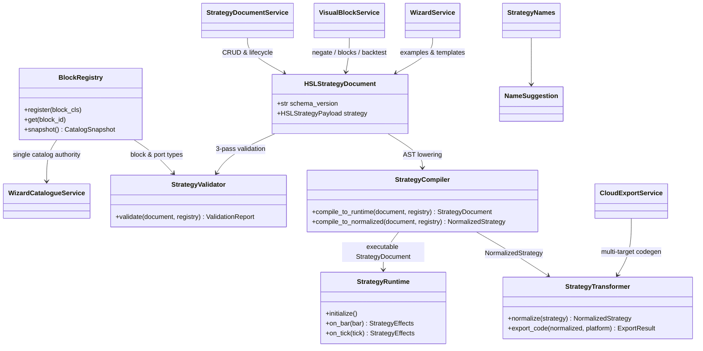
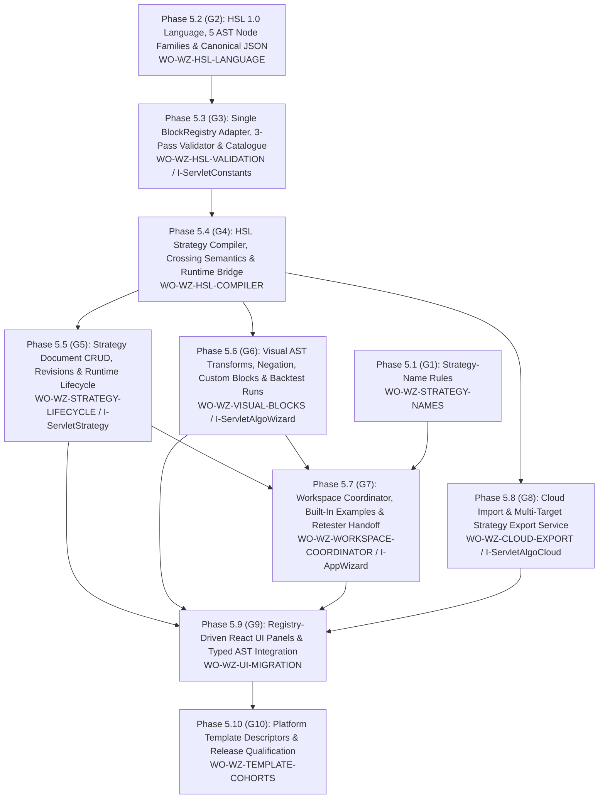

# AppWizard — Visual Strategy Authoring, HaruQuant Strategy Language (HSL 1.0), and Export
> UI migration completed: [verification and limitations](research/ui-preservation-migration-verification.md). Current sources are under `app/web`; old source columns below are historical migration evidence. Reuse the migrated screens when implementing later features.

> UI migration execution: [preservation plan](research/ui-preservation-migration-plan.md) governs the structural move. Preserve the existing screens, routes, runtime fixtures and behavior; backend/service adaptations below remain separate work. Shared ProjectWorkbench stays under `app/web/common/project`; migrated tests use `app/web/tests/workspace/<owner>`.
> Use `app/workspace/algo_wizard`, `app/web/workspaces/algo_wizard`, `tests/workspace/algo_wizard`, and `app/web/tests/workspace/algo_wizard` for all Wizard backend, frontend, and test modules; retain `/algowizard`.




- **Primary Role:** Visual Strategy Authoring, Canonical Strategy AST (**HaruQuant Strategy Language — HSL 1.0**), Static Type/Registry Validation, Runtime Compilation, and Multi-Platform Export; the complete owned module list is below.
- **Dependencies:** AppCore shared contracts (`app/core/trading/blocks/registry.py`, `app/core/trading/strategy/contracts.py`, `app/core/trading/strategy/runtime.py`, `app/core/wizard/transform.py`); AppHome routing contributions. Dataset-dependent tests additionally require AppDataManager data contracts.
- **Outputs / Downstream Role:** Versioned **HSL 1.0** strategy AST documents (`HSLStrategyDocument`), reusable custom blocks/compositions, compiled runtime specifications (`StrategyDocument`), and normalized platform export artifacts (`NormalizedStrategy`, `ExportResult`) consumed by the Visual Strategy Builder (`05-AppWizard`), Genetic/Random Builder (`08-AppBuilder`), Optimizer (`14-AppGridControl`), Retester (`15-AppGridTest`), Live Trader, and AI Strategy Agent (`19-AppAI`).

---

## Phased Implementation Roadmap & Dispatch Sequence (Phase 5.1 – Phase 5.10)

Every implementation task in `AppWizard` follows this strict 10-phase sequence. Each phase is a self-contained commit slice with an explicit prerequisite gate (`G1`–`G10`), allowed file paths, and deterministic verification commands.



| Phase | Work Order / Task ID | Status | Prerequisite / Exit Gate | Primary Deliverable & Owned Modules | Verification Command |
|---|---|---|---|---|---|
| **Phase 5.1** | `WO-WZ-STRATEGY-NAMES` | READY | `WO-C00` $\rightarrow$ **G1** | Strategy-name sanitization & collision-free display naming (`app/web/workspaces/algo_wizard/strategy_names.ts`) | `npm --prefix app/web test -- tests/workspace/algo_wizard/strategy_names.test.ts` |
| **Phase 5.2** | `WO-WZ-HSL-LANGUAGE` | READY | `WO-C01`, `WO-C02` $\rightarrow$ **G2** | HSL 1.0 JSON envelope, 5 AST node families (`VALUE`, `EXPRESSION`, `CONDITION`, `ACTION`, `RULE`), canonical hashing, legacy upgrade (`value_models.py`, `models.py`, `documents.py`) | `uv run python -m pytest tests/workspace/algo_wizard/test_hsl_documents.py --no-cov -q` |
| **Phase 5.3** | `WO-WZ-HSL-VALIDATION` (`I-ServletConstants`) | READY | **G2** $\rightarrow$ **G3** | Single `BlockRegistry` projection (`library.py`), 3-pass `StrategyValidator` (`validation.py`), and `WizardCatalogueService` (`catalogue_models.py`, `catalogue.py`) | `uv run python -m pytest tests/workspace/algo_wizard/test_validation_and_catalogue.py --no-cov -q` |
| **Phase 5.4** | `WO-WZ-HSL-COMPILER` | READY | **G3** $\rightarrow$ **G4** | `StrategyCompiler` lowering HSL AST to `StrategyDocument` (`StrategyRuntime`) and `NormalizedStrategy` (`StrategyTransformer`), inclusive prior-bar crossings, lookahead safety (`compiler.py`) | `uv run python -m pytest tests/workspace/algo_wizard/test_compiler_and_runtime.py --no-cov -q` |
| **Phase 5.5** | `WO-WZ-STRATEGY-LIFECYCLE` (`I-ServletStrategy`) | READY | **G4** $\rightarrow$ **G5** | `StrategyDocumentService` CRUD, optimistic revisions, and `add`/`start`/`stop`/`remove`/`list` lifecycle (`strategies_models.py`, `strategies.py`) | `uv run python -m pytest tests/workspace/algo_wizard/test_strategies.py --no-cov -q` |
| **Phase 5.6** | `WO-WZ-VISUAL-BLOCKS` (`I-ServletAlgoWizard`) | READY | **G4** $\rightarrow$ **G6** | `VisualBlockService` condition negation, custom blocks (`CompositionSpec`), block groups, resource checks, and wizard simulation runs (`visual_blocks_models.py`, `visual_blocks.py`) | `uv run python -m pytest tests/workspace/algo_wizard/test_visual_blocks.py --no-cov -q` |
| **Phase 5.7** | `WO-WZ-WORKSPACE-COORDINATOR` (`I-AppWizard`) | READY | **G1**, **G5**, **G6** $\rightarrow$ **G7** | `WizardService` built-in HSL 1.0 examples (`/AlgoWizard/examples/examples.json`, `/algowizard/loadExample`), `.hsl.json` file save/load, Retester handoff, HTTP/CLI routes (`workspace_models.py`, `workspace.py`, `routes.py`) | `uv run python -m pytest tests/workspace/algo_wizard/test_workspace.py --no-cov -q` |
| **Phase 5.8** | `WO-WZ-CLOUD-EXPORT` (`I-ServletAlgoCloud`) | READY | **G4** $\rightarrow$ **G8** | `CloudExportService` strategy import (`editor \| file \| databank \| backtest_id`) and multi-target platform export (`cloud_export_models.py`, `cloud_export.py`) | `uv run python -m pytest tests/workspace/algo_wizard/test_cloud_export.py --no-cov -q` |
| **Phase 5.9** | `WO-WZ-UI-MIGRATION` | READY | **G5**, **G6**, **G7**, **G8** $\rightarrow$ **G9** | Registry-driven React UI panels (`WizardCataloguePanel.tsx`, `StrategyDocumentPanel.tsx`, `VisualBlockPanel.tsx`, `WizardWorkspace.tsx`, `CloudExportPanel.tsx`) and typed HSL client bindings | `npm --prefix app/web test -- tests/workspace/algo_wizard/` |
| **Phase 5.10** | `WO-WZ-TEMPLATE-COHORTS` | READY | **G8**, **G9** $\rightarrow$ **G10** | Platform export descriptors (`easylanguage`, `jforex`, `mql4`, `mql5`, `ninjatrader`, `pseudo_code`), `app/core/wizard/template_helpers.py`, and end-to-end workspace qualification | `uv run python -m pytest tests/workspace/algo_wizard/ --cov=app.workspace.algo_wizard --cov-branch --cov-fail-under=80 -q` |

---

## HaruQuant Strategy Language (HSL 1.0) Canonical Architecture & Specification

### 1. Foundational Design Principle & Canonical Envelope

**JSON describes strategy meaning, never Python implementation.** Python is one compiler/runtime target for the strategy AST. Every producer and consumer—Visual Strategy Builder, Backtester, Genetic Builder, Optimizer, Live Execution Engine, Platform Code Exporter, and AI Agent—creates, validates, and consumes the exact same canonical **HSL 1.0** JSON structure (`HSLStrategyDocument`):

```json
{
  "schema_version": "1.0.0",
  "strategy": {
    "id": "ma-crossover-001",
    "name": "EMA Crossover",
    "description": "Buy when fast EMA crosses above slow EMA.",
    "enabled": true,
    "metadata": {
      "author": "haruquant",
      "tags": ["trend", "crossover"],
      "created_at": "2026-10-31T00:00:00Z"
    },
    "universe": {
      "mode": "explicit",
      "symbols": ["EURUSD"]
    },
    "timeframe": {
      "primary": "H1",
      "additional": ["D1"]
    },
    "parameters": {},
    "variables": {},
    "money_management": {},
    "risk_management": {},
    "trade_management": {},
    "trading_options": {},
    "rules": []
  }
}
```

### 2. Five Fundamental Semantic Node Families

Every AST building block in HSL 1.0 belongs to one of five disjoint semantic families enforced by Pydantic discriminated unions in `app/workspace/algo_wizard/models.py` and `app/workspace/algo_wizard/value_models.py`:

| Semantic Family | Role & Static Return Type | Canonical Discriminated Node Types (`type`) |
|---|---|---|
| **`VALUE`** | Typed constants, external parameter references, mutable variable references, and bar price/time fields. | `value` (`ValueLiteralNode`: `int \| float \| bool \| str`), `parameter` (`ParameterRefNode`: `name`), `variable` (`VariableRefNode`: `name`), `price` (`MarketPriceNode`: `field` in `open \| high \| low \| close \| volume \| typical \| median \| weighted`, optional `context`). |
| **`EXPRESSION`** | Recursively composable side-effect-free computations returning typed values (`float`, `int`, `bool`, `price`, `series`). | `indicator` (`IndicatorExpressionNode`: semantic `name` e.g. `"indicator.rsi"` or `"rsi"`, `inputs`, `params`, `output`, `context`), `math` (`MathExpressionNode`: `operator` in `add \| subtract \| multiply \| divide \| min \| max \| abs`, `left`, `right`), `function` (`FunctionExpressionNode`: semantic `name`, `args`), `position_attr` (`PositionAttrNode`: `field` in `open_price \| unrealized_pnl \| bars_held \| size \| side`). |
| **`CONDITION`** | Composable boolean trees (`bool`) replacing legacy nested XML `<If>` blocks. | `logical` (`LogicalConditionNode`: `operator` in `and \| or`, `conditions: list[ConditionNode]`), `not` (`NotConditionNode`: `condition: ConditionNode`), `comparison` (`ComparisonConditionNode`: `operator` in `greater_than \| greater_or_equal \| less_than \| less_or_equal \| equal \| not_equal \| crosses_above \| crosses_below`, `left: OperandNode`, `right: OperandNode`), `state` (`StateConditionNode`: semantic `state` e.g. `position.is_flat \| position.is_long \| position.is_short \| session.is_open`), `temporal` (`TemporalConditionNode`: `operator` in `remains_true_for \| occurred_within`, `condition`, `bars`). |
| **`ACTION`** | Explicit state mutations or order instructions executed when a rule's condition tree evaluates to `true`. | `enter_market` (`OrderMarketActionNode`: `side`, `size`, `stop_loss`, `take_profit`, `comment`, `magic_number`), `enter_stop` / `enter_limit` (`OrderPendingActionNode`: `side`, `entry_price: OperandNode`, `expiration_bars`, `size`, `stop_loss`, `take_profit`), `exit_position` (`PositionCloseActionNode`: `target_side`, `quantity_pct`, `reason`), `modify_stop_loss` / `modify_take_profit` (`OrderModifyActionNode`), `cancel_orders` (`OrderCancelActionNode`), `set_variable` (`VariableSetActionNode`: `name`, `value: OperandNode`), `emit_alert` (`AlertActionNode`: `level`, `message`). |
| **`RULE`** | Event-driven, priority-ordered `WHEN -> THEN -> ELSE` execution units (`RuleNode`). | `rule` (`RuleNode`: `id: str`, `name: str`, `priority: int`, `enabled: bool = True`, `event: LifecycleEventSpec`, `when: ConditionNode`, `then: list[ActionNode]`, `else_then: list[ActionNode] = []`). |

### 3. Semantic Block Identifiers & Single BlockRegistry Authority

1. **Semantic Identifiers:** HSL 1.0 uses implementation-independent semantic identifiers:
   - Indicators: `indicator.rsi`, `indicator.ema`, `indicator.sma`, `indicator.atr`, `indicator.macd`, `indicator.bollinger_bands`, `indicator.adx`, `indicator.stochastic`, `indicator.cci`, `indicator.vwap`, `indicator.highest`, `indicator.lowest`
   - Comparisons & Crossings: `comparison.greater_than`, `comparison.greater_or_equal`, `comparison.less_than`, `comparison.less_or_equal`, `comparison.equal`, `comparison.not_equal`, `comparison.crosses_above`, `comparison.crosses_below`
   - Math: `math.add`, `math.subtract`, `math.multiply`, `math.divide`, `math.abs`, `math.min`, `math.max`
   - Market & Position State: `market.open`, `market.high`, `market.low`, `market.close`, `market.volume`, `position.is_flat`, `position.is_long`, `position.is_short`
   - Orders, Exits & Sizing: `order.enter_market`, `order.enter_stop`, `order.enter_limit`, `order.exit_position`, `stop_loss.none`, `stop_loss.fixed_pips`, `stop_loss.fixed_points`, `stop_loss.atr`, `stop_loss.percent`, `stop_loss.expression`, `take_profit.none`, `take_profit.fixed_pips`, `take_profit.atr`, `take_profit.risk_multiple`, `take_profit.expression`, `position_size.fixed_size`, `position_size.fixed_cash`, `position_size.percent_equity`, `position_size.risk_percent`
2. **Single BlockRegistry Source of Truth:** `app/core/trading/blocks/registry.py` (`BlockRegistry`, `block_registry`) and `app/core/trading/blocks/composition.py` (`CompositionSpec`) are the **sole authoritative block catalog**. `app/workspace/algo_wizard/` must never maintain a disconnected static JSON block registry; `WizardCatalogueService` and `StrategyValidator` query `block_registry.snapshot()` and map semantic IDs (e.g. `indicator.rsi` $\leftrightarrow$ registered block ID `rsi`) deterministically.
3. **Crossing Semantics:**
   - `crosses_above`: `left[shift] > right[shift]` AND `left[shift + 1] <= right[shift + 1]` (inclusive equality on the prior bar).
   - `crosses_below`: `left[shift] < right[shift]` AND `left[shift + 1] >= right[shift + 1]` (inclusive equality on the prior bar).

### 4. Multi-Symbol, Multi-Timeframe, and Lookahead-Safe Context

Every `IndicatorExpressionNode` and `MarketPriceNode` carries an explicit `EvaluationContext`:
```json
{
  "symbol": "$current_symbol",
  "timeframe": "$current_timeframe",
  "shift": 0
}
```
- `symbol`: `"$current_symbol"` or an explicit symbol declared in `strategy.universe.symbols` (e.g. `"EURUSD"`).
- `timeframe`: `"$current_timeframe"` or an explicit timeframe declared in `strategy.timeframe` (e.g. `"H1"`, `"D1"`).
- `shift`: Non-negative integer (`shift >= 0`). Negative shifts (`shift < 0`) are rejected at validation time with `WIZARD_LOOKAHEAD_SHIFT_INVALID` to guarantee zero future lookahead. When referencing a higher timeframe inside a `on_bar_open` rule, `shift >= 1` is enforced unless explicitly overridden, preventing unclosed higher-timeframe bar leakage.

### 5. Lifecycle Events & Deterministic Priority-Ordered Rules

1. **Standardized Lifecycle Events (`LifecycleEventType`):**
   - Engine lifecycle: `on_start`, `on_stop`, `on_timer`
   - Market data: `on_tick`, `on_bar_open`, `on_bar_close`
   - Order lifecycle: `on_order_submitted`, `on_order_filled`, `on_order_cancelled`, `on_order_rejected`
   - Position lifecycle: `on_position_opened`, `on_position_closed`
   - Session lifecycle: `on_session_open`, `on_session_close`
2. **Priority-Ordered Rules Array:** `strategy.rules` is an explicit JSON array `list[RuleNode]`. During compilation and runtime evaluation, rules are sorted deterministically by `(rule.priority, rule.id)` ascending—never relying on JSON key order or registration order. Duplicate `rule.id` values fail validation with `WIZARD_DUPLICATE_RULE_ID`.

### 6. Parameters vs. Variables & Typed Domain Sub-DSLs

1. **`parameters` (Externally Configurable & Optimizable):**
   - Keyed dictionary `dict[str, ParameterSpec]` where `ParameterSpec` has `type: "int" | "float" | "bool" | "str"`, `default`, optional `min`, `max`, `step`, `optimize: bool = False`, and `description: str = ""`.
   - Referenced anywhere in expressions, indicator params, or sizing via `{"type": "parameter", "name": "<param_key>"}`.
2. **`variables` (Mutable Runtime State):**
   - Keyed dictionary `dict[str, VariableSpec]` where `VariableSpec` has `type: "int" | "float" | "bool" | "str"`, `initial`, and `scope: "strategy" | "session" = "strategy"`.
   - Read via `{"type": "variable", "name": "<var_key>"}` and mutated via `{"type": "action", "action": "set_variable", "name": "<var_key>", "value": <OperandNode>}`.
3. **Typed Sub-DSLs (No Raw String Formulas, No Raw Python Code):**
   - **`StopLossSpec`:** Discriminated union on `type`: `none`, `fixed_pips` (`value: OperandNode`), `fixed_points` (`value: OperandNode`), `percent` (`value: OperandNode`), `atr` (`period: OperandNode`, `multiplier: OperandNode`), `indicator` (`indicator: IndicatorExpressionNode`), `expression` (`expression: OperandNode`).
   - **`TakeProfitSpec`:** Discriminated union on `type`: `none`, `fixed_pips` (`value: OperandNode`), `fixed_points` (`value: OperandNode`), `percent` (`value: OperandNode`), `atr` (`period: OperandNode`, `multiplier: OperandNode`), `risk_multiple` (`multiple: OperandNode`), `expression` (`expression: OperandNode`).
   - **`MoneyManagementSpec` (`strategy.money_management`):** `type` in `fixed_size` (`size: OperandNode`), `fixed_cash` (`amount: OperandNode`), `percent_equity` (`percent: OperandNode`), `risk_percent` (`risk_pct: OperandNode`, `max_lots: float | None = None`).
   - **`RiskManagementSpec` (`strategy.risk_management`):** `max_open_positions: int = 1`, `max_daily_loss_pct: float | None = None`, `max_drawdown_pct: float | None = None`, `allow_opposite_signals: bool = False`.
   - **`TradeManagementSpec` (`strategy.trade_management`):** `breakeven: BreakevenSpec | None = None`, `trailing_stop: TrailingStopSpec | None = None`, `time_stop_bars: int | None = None`, `partial_exits: list[PartialExitSpec] = []`.
   - **`TradingOptionsSpec` (`strategy.trading_options`):** `exit_at_end_of_day: bool = False`, `end_of_day_time: str | None = None`, `exit_on_friday: bool = False`, `friday_exit_time: str | None = None`, `limit_time_range: bool = False`, `time_range_start: str | None = None`, `time_range_end: str | None = None`, `max_trades_per_day: int | None = None`, `min_distance_from_market_pips: float = 0.0`.
   - **Prohibition of Arbitrary Code Nodes:** Nodes with `type == "python"` or raw code evaluation strings are strictly forbidden and rejected with `WIZARD_RAW_CODE_PROHIBITED`.

### 7. Three-Pass Validation & Compiler Pipeline

1. **`StrategyValidator` (`app/workspace/algo_wizard/validation.py`):**
   - **Pass 1 (Structural & Schema Validation):** Validates JSON against `HSLStrategyDocument`, checks unique `rule.id`, non-empty `strategy.id`/`strategy.name`, valid parameter bounds (`min <= default <= max`), and rejects raw code nodes (`WIZARD_RAW_CODE_PROHIBITED`).
   - **Pass 2 (Registry & Reference Integrity):** Verifies every indicator/function node exists in `BlockRegistry`, every required parameter is supplied and within bounds (`WIZARD_UNKNOWN_BLOCK_ID`, `WIZARD_INVALID_BLOCK_PARAM`), every `ParameterRefNode` exists in `strategy.parameters` (`WIZARD_UNKNOWN_PARAMETER_REF`), and every `VariableRefNode`/`VariableSetActionNode` exists in `strategy.variables` (`WIZARD_UNKNOWN_VARIABLE_REF`).
   - **Pass 3 (Static Type & Temporal Safety):** Infers return types bottom-up across `VALUE`, `EXPRESSION`, `CONDITION`, and `ACTION` nodes (`WIZARD_TYPE_MISMATCH`), verifies `shift >= 0` (`WIZARD_LOOKAHEAD_SHIFT_INVALID`), and checks that referenced explicit symbols/timeframes are declared in `universe`/`timeframe`.
2. **`StrategyCompiler` (`app/workspace/algo_wizard/compiler.py`):**
   - `compile_to_runtime(document: HSLStrategyDocument, registry: BlockRegistry | None = None) -> StrategyDocument`: Lowers recursive HSL expression trees into synthesized deterministic runtime series keys, binds parameters/variables/trading setup, orders rules by `(priority, id)`, and emits an executable Core `StrategyDocument` (`app/core/trading/strategy/contracts.py`) consumable by `StrategyRuntime` (`app/core/trading/strategy/runtime.py`).
   - `compile_to_normalized(document: HSLStrategyDocument, registry: BlockRegistry | None = None) -> NormalizedStrategy`: Lowers HSL AST into `NormalizedStrategy` (`app/core/wizard/transform.py`) for multi-platform code generation (`MQL4`, `MQL5`, `EasyLanguage`, `NinjaTrader`, `JForex`, `PseudoCode`, `Python`).

---

## Source reassessment authority — 2026-10-30

The [workspace source review](research/workspaces-03-08-source-review.md) adds exact readable context to every contribution order in this file. Its source paths supplement the Context to Read lists. Shared libraries and decompiled servlet sources are available locally in `data/reference-donor/internal/plugins/` (`AppWizard`, `ServletAlgoWizard`, `ServletConstants`, `ServletStrategy`, `ServletAlgoCloud`) and `data/reference-donor/internal/libs/business/loader/`. All work orders below have been reconciled with the **HSL 1.0** architecture and structured into sequential **Phases 5.1–5.10**.

## Execution rule for this file

The task text and its exact Context to Read list are the entire coding context. READY tasks are independently implementable slices; their prerequisites must already exist with the stated symbols. Every checkbox in a ready task names its exact symbol. One ready feature task is one commit containing only its listed implementation/test files. Test command exit 0 is acceptance only when the specified test cases were collected. Do not run application-wide formatting or touch a sibling workspace.

All target names/signatures/error codes below are normative Python/React adaptations. Only the observations in named evidence records are SQX facts. `StandardResponse` is `StandardResponse[T](request_id: str, data: T, revision: int | None = None)` from `app/core/lib/responses.py`. `DomainError` is keyword-only `DomainError(*, code: str, message: str, details: dict[str, JSONValue] | None = None)` from `app/core/lib/errors.py`.

<details>
<summary>Historical WIZ-M01 migration sketch — superseded by Phases 5.1–5.10 below</summary>

*Evidence:* `OBS-HARU-WIZ-REUSE-20261029`. Frontend migration to `app/web/workspaces/algo_wizard/` was completed in `e97603d5`. Backend HSL modules are decomposed across Phases 5.2–5.8 below.

| Current HaruQuantAI location | Target proposed location | Fit / action (migration audit) |
|---|---|---|
| `app/workspace/algo_wizard/documents.py` | `app/workspace/algo_wizard/documents.py` | Phase 5.2: HSL 1.0 document parser, canonicalizer, and legacy upgrade |
| `app/workspace/algo_wizard/library.py` | `app/workspace/algo_wizard/library.py` | Phase 5.3: Single `BlockRegistry` adapter and semantic block catalog |
| `app/workspace/algo_wizard/validation.py` | `app/workspace/algo_wizard/validation.py` | Phase 5.3: 3-pass HSL schema, registry, and static type validator |
| `app/workspace/algo_wizard/compiler.py` | `app/workspace/algo_wizard/compiler.py` | Phase 5.4: HSL AST compiler to `StrategyDocument` and `NormalizedStrategy` |
| `ui/app/workspace/AlgoWizard/*` | `app/web/workspaces/algo_wizard/*` | Completed in `e97603d5`; typed HSL bindings added in Phase 5.9 |
| `tests/workspace/algo_wizard/` | `tests/workspace/algo_wizard/` | Phases 5.2–5.10 backend test suites |

</details>

---

## Sequential Implementation Phases (Phase 5.1 – Phase 5.10)

### Phase 5.1: Strategy-name rules — `AppWizard`

*Feature:* sanitize suggested strategy names and generate collision-free display names using the observed naming convention.
**Task ID:** `WO-WZ-STRATEGY-NAMES`. **Readiness:** READY (Prerequisite: `WO-C00`; Exit Gate: **G1**). **Evidence:** `OBS145-WIZARD-NAMES-001`. **One commit:** `feat(wizard): implement strategy name rules`.

*Context to Read:* `app/web/package.json`, `app/web/vitest.config.ts`, `DONOR_REFERENCE_ROOT/internal/web/AlgoWizard/assets` (resource folder; originally named `index-C12ZW4O3.js.map` is not present) sources entry `../../../src/helpers/strategyName.ts`. Read sourcesContent for that exact source key; do not copy its text to the repository or port unrelated store code.

*Implementation Files:*
- **Frontend create:** `app/web/workspaces/algo_wizard/strategy_names.ts`.
- **Frontend test create:** `app/web/tests/workspace/algo_wizard/strategy_names.test.ts`.
- **Backend:** none in this commit. The helper proposes display names; it does not grant persistence uniqueness or change core IDs.

*Functional Requirements & Implementation:*
- [ ] `StrategyNames.sanitize(name: string, replace_with: string = ""): string` -> retain only ASCII A-Z, a-z, digits, ordinary space, underscore, hyphen and dot. Replace each disallowed UTF-16 code unit separately. Use ECMAScript String.replace replacement-string semantics: replace_with=`$&` retains the matched disallowed unit; do not switch to literal callback substitution. Do not trim, collapse runs, normalize Unicode, reject empty output or sanitize replace_with.
- [ ] `StrategyNames.unique(base_name: string, existing_names: readonly string[]): string` -> if exact case-sensitive base_name is absent, return it unchanged even if numbered variants exist. Otherwise initialize maximum suffix to 1, inspect exact `<base_name> (<digits>)` matches, take the largest decimal suffix above 1, and return `<base_name> (<maximum+1>)`. Treat regex-special characters in base_name literally. Do not fill numerical gaps or call sanitize implicitly.

*Exact tests:*

| Input | Expected |
| --- | --- |
| sanitize(`A/B:C`) | `ABC` |
| sanitize(`A/B:C`,`_`) | `A_B_C` |
| sanitize(`éΑA 1_.-`) | `A 1_.-` |
| sanitize(`  A  `) | preserve both leading/trailing pairs of spaces |
| sanitize(`///`) | empty string |
| sanitize(`A/B`,`$&`) | `A/B` |
| sanitize(`A😀B`,`_`) | `A__B` |
| unique(`A`,[]) | A |
| unique(`A`,[`A (9)`]) | A |
| unique(`A`,[`A`]) | `A (2)` |
| unique(`A`,[`A`,`A (2)`,`A (9)`]) | `A (10)` |
| unique(`A`,[`A`,`A (0)`,`A (01)`]) | `A (2)` |
| unique(`A.B`,[`A.B`,`AxB (90)`,`A.B (3)`]) | `A.B (4)` |
| unique(`A`,[`a`]) | A |

Use test name `StrategyNames.sanitize` and `StrategyNames.unique` with table cases. Suffix conversion uses Number.parseInt(text,10) and JavaScript Number addition, not BigInt. A suffix that parses as Infinity therefore yields the string `A (Infinity)` for base A; do not add a safe-integer rejection to this display helper. A later public persistence API requires a separate accepted name-validation contract.

*Verification:* `npm --prefix app/web test -- tests/workspace/algo_wizard/strategy_names.test.ts` exits 0. Commit only the two named files. No API endpoint, store migration, core strategy ID change or backend name-allocation service belongs in this commit.

---

### Phase 5.2: HSL 1.0 language envelopes, 5 AST node families, and canonical documents

*Feature:* Implement the canonical **HSL 1.0** Pydantic v2 AST models covering the 5 node families (`VALUE`, `EXPRESSION`, `CONDITION`, `ACTION`, `RULE`), `parameters` vs. `variables`, typed sub-DSLs (`StopLossSpec`, `TakeProfitSpec`, `MoneyManagementSpec`, `RiskManagementSpec`, `TradeManagementSpec`, `TradingOptionsSpec`), canonical UTF-8 JSON hashing, and lossless legacy document upgrade.
**Task ID:** `WO-WZ-HSL-LANGUAGE`. **Readiness:** READY (Prerequisites: `WO-C01`, `WO-C02`; Exit Gate: **G2**). **Evidence:** `OBS-HARU-WIZ-REUSE-20261029`, `PREVIOUS-007`. **One commit:** `feat(wizard): implement HSL 1.0 AST models, canonical serializer, and legacy document upgrade`.

*Context to Read:* `app/core/lib/errors.py`, `app/core/lib/responses.py`, `app/core/trading/strategy/contracts.py`, `app/web/workspaces/algo_wizard/algoWizardModel.ts`.

*Implementation Files:*
- **Backend create:** `app/workspace/algo_wizard/__init__.py`, `app/workspace/algo_wizard/value_models.py`, `app/workspace/algo_wizard/models.py`, `app/workspace/algo_wizard/documents.py`.
- **Backend test create:** `tests/workspace/algo_wizard/test_hsl_documents.py`.
- **Frontend:** none in this commit.

*Functional Requirements & Authorized Contract:*
- [ ] `EvaluationContext(symbol: str = "$current_symbol", timeframe: str = "$current_timeframe", shift: int = 0)` and the `VALUE` / `EXPRESSION` discriminated union `OperandNode` (`ValueLiteralNode`, `ParameterRefNode`, `VariableRefNode`, `MarketPriceNode`, `IndicatorExpressionNode`, `MathExpressionNode`, `FunctionExpressionNode`, `PositionAttrNode`) in `app/workspace/algo_wizard/value_models.py`.
- [ ] Typed domain sub-DSLs `StopLossSpec`, `TakeProfitSpec`, `MoneyManagementSpec`, `RiskManagementSpec`, `TradeManagementSpec`, and `TradingOptionsSpec` in `app/workspace/algo_wizard/value_models.py`.
- [ ] `ParameterSpec`, `VariableSpec`, `UniverseSpec`, `TimeframeSpec`, `LifecycleEventType`, `LifecycleEventSpec`, `ConditionNode` (`LogicalConditionNode`, `NotConditionNode`, `ComparisonConditionNode`, `StateConditionNode`, `TemporalConditionNode`), `ActionNode` (`OrderMarketActionNode`, `OrderPendingActionNode`, `PositionCloseActionNode`, `OrderModifyActionNode`, `OrderCancelActionNode`, `VariableSetActionNode`, `AlertActionNode`), `RuleNode`, `HSLStrategyPayload`, and `HSLStrategyDocument` in `app/workspace/algo_wizard/models.py`.
- [ ] `parse_hsl_document(raw: Mapping[str, Any] | bytes | str) -> HSLStrategyDocument` in `app/workspace/algo_wizard/documents.py`: enforces `schema_version == "1.0.0"`, rejects raw code nodes (`type == "python"`) with `DomainError(code="WIZARD_RAW_CODE_PROHIBITED")`, and rejects malformed schemas with `DomainError(code="WIZARD_SCHEMA_INVALID")`.
- [ ] `canonical_hsl_bytes(document: HSLStrategyDocument) -> bytes` and `compute_document_hash(document: HSLStrategyDocument) -> str` in `app/workspace/algo_wizard/documents.py`: sorts rules deterministically by `(rule.priority, rule.id)`, serializes deterministic UTF-8 JSON, and computes SHA-256 hex digest.
- [ ] `upgrade_legacy_wizard_document(raw: Mapping[str, Any]) -> HSLStrategyDocument` in `app/workspace/algo_wizard/documents.py`: converts flat `StrategyDocument` or UI `StrategyDocumentModel` payloads into canonical `HSLStrategyDocument`.

*Verification:* `uv run python -m pytest tests/workspace/algo_wizard/test_hsl_documents.py --no-cov -q` exits 0; `uv run mypy --strict app/workspace/algo_wizard` exits 0; `uv run ruff check app/workspace/algo_wizard tests/workspace/algo_wizard` exits 0.

---

### Phase 5.3: Single BlockRegistry projection, 3-pass validator, and `ServletConstants` (`WizardCatalogueService`)

*Source reassessment — 2026-10-31:* [Exact available source and declarations](research/workspaces-03-08-source-review.md#servletconstants). Inspected `data/reference-donor/internal/plugins/ServletConstants/Constants/ConstantsServlet.java` (`/constants/getAll`, `/constants/listCommissionMethods`) and reconciled with `app/core/trading/blocks/registry.py` (`BlockRegistry`).

*Feature:* Connect `app/core/trading/blocks/registry.py` (`block_registry`) as the single source of truth via `WizardBlockLibrary`, implement the 3-pass `StrategyValidator`, and expose `WizardCatalogueService` (`ServletConstants`).
**Task ID:** `WO-WZ-HSL-VALIDATION` (`I-ServletConstants`). **Readiness:** READY (Prerequisite: **G2**; Exit Gate: **G3**). **Evidence:** `OBS145-ServletConstants-SURFACE-001`, `PREVIOUS-007`. **One commit:** `feat(wizard): implement WizardBlockLibrary, 3-pass StrategyValidator, and WizardCatalogueService`.

*Context to Read:* `app/core/lib/responses.py`, `app/core/lib/errors.py`, `app/core/trading/blocks/registry.py`, `app/core/trading/blocks/metadata.py`, `app/core/trading/blocks/composition.py`, `app/workspace/algo_wizard/models.py`, `data/reference-donor/internal/plugins/ServletConstants/Constants/ConstantsServlet.java`.

*Implementation Files:*
- **Backend create:** `app/workspace/algo_wizard/library.py`, `app/workspace/algo_wizard/validation.py`, `app/workspace/algo_wizard/catalogue_models.py`, `app/workspace/algo_wizard/catalogue.py`.
- **Backend edit:** `app/workspace/algo_wizard/__init__.py`.
- **Backend test create:** `tests/workspace/algo_wizard/test_validation_and_catalogue.py`.
- **Frontend:** UI panel deferred to Phase 5.9.

*Functional Requirements & Authorized Contract:*
- [ ] `WizardBlockLibrary(registry: BlockRegistry | None = None)` in `app/workspace/algo_wizard/library.py`: queries `block_registry.snapshot()` directly without a duplicate static JSON registry, maps semantic block IDs (`indicator.rsi` $\leftrightarrow$ `rsi`, `comparison.crosses_above`, `math.subtract`, `market.close`, `position.is_flat`, `order.enter_market`, `stop_loss.atr`, `position_size.risk_percent`), and exposes parameter bounds and return types.
- [ ] `ValidationIssue(code: str, message: str, path: str, node_id: str | None = None)` and `ValidationReport(valid: bool, issues: tuple[ValidationIssue, ...])` in `app/workspace/algo_wizard/validation.py`.
- [ ] `StrategyValidator(library: WizardBlockLibrary | None = None).validate(document: HSLStrategyDocument | Mapping[str, Any], *, raise_on_error: bool = False) -> ValidationReport` in `app/workspace/algo_wizard/validation.py`:
  - Pass 1: Structural & schema integrity (`WIZARD_SCHEMA_INVALID`, `WIZARD_RAW_CODE_PROHIBITED`, `WIZARD_DUPLICATE_RULE_ID`).
  - Pass 2: Registry & reference integrity (`WIZARD_UNKNOWN_BLOCK_ID`, `WIZARD_INVALID_BLOCK_PARAM`, `WIZARD_UNKNOWN_PARAMETER_REF`, `WIZARD_UNKNOWN_VARIABLE_REF`).
  - Pass 3: Bottom-up static type checking and lookahead shift safety (`WIZARD_TYPE_MISMATCH`, `WIZARD_LOOKAHEAD_SHIFT_INVALID` for `shift < 0`).
- [ ] `CatalogueOptionItem`, `CommissionMethodDescriptor`, `HSLBlockCatalogueEntry`, and `WizardConstantsBundle` in `app/workspace/algo_wizard/catalogue_models.py`.
- [ ] `WizardCatalogueService` in `app/workspace/algo_wizard/catalogue.py` implementing `get_all(request: GetCatalogueRequest) -> StandardResponse[WizardConstantsBundle]`, `list_commission_methods(request: ListCommissionMethodsRequest) -> StandardResponse[tuple[CommissionMethodDescriptor, ...]]`, and `get_block_descriptor(request: GetBlockDescriptorRequest) -> StandardResponse[HSLBlockCatalogueEntry]`.

*Verification:* `uv run python -m pytest tests/workspace/algo_wizard/test_validation_and_catalogue.py --no-cov -q` exits 0; `uv run mypy --strict app/workspace/algo_wizard` exits 0.

---

### Phase 5.4: HSL strategy compiler, causal crossing semantics, and runtime bridge

*Feature:* Implement `StrategyCompiler` lowering validated `HSLStrategyDocument` ASTs into executable Core `StrategyDocument` (`StrategyRuntime`) and `NormalizedStrategy` (`StrategyTransformer`), including inclusive prior-bar crossing evaluation (`<=` / `>=`), priority-ordered rule execution, and lookahead-safe `shift` evaluation.
**Task ID:** `WO-WZ-HSL-COMPILER`. **Readiness:** READY (Prerequisite: **G3**; Exit Gate: **G4**). **Evidence:** `OBS-HARU-WIZ-REUSE-20261029`, `PREVIOUS-007`. **One commit:** `feat(wizard): implement StrategyCompiler lowering HSL 1.0 AST to StrategyRuntime and StrategyTransformer`.

*Context to Read:* `app/core/trading/strategy/contracts.py`, `app/core/trading/strategy/runtime.py`, `app/core/wizard/transform.py`, `app/workspace/algo_wizard/models.py`, `app/workspace/algo_wizard/validation.py`.

*Implementation Files:*
- **Backend create:** `app/workspace/algo_wizard/compiler.py`.
- **Backend edit:** `app/workspace/algo_wizard/__init__.py`.
- **Backend test create:** `tests/workspace/algo_wizard/test_compiler_and_runtime.py`.
- **Frontend:** none in this commit.

*Functional Requirements & Authorized Contract:*
- [ ] `StrategyCompiler(library: WizardBlockLibrary | None = None, validator: StrategyValidator | None = None)` in `app/workspace/algo_wizard/compiler.py`.
- [ ] `StrategyCompiler.compile_to_runtime(document: HSLStrategyDocument) -> StrategyDocument`: validates `document`, lowers nested HSL `EXPRESSION` and `VALUE` nodes into deterministic runtime series/context bindings, lowers `crosses_above` (`left[shift] > right[shift]` and `left[shift+1] <= right[shift+1]`) and `crosses_below` (`left[shift] < right[shift]` and `left[shift+1] >= right[shift+1]`), sorts `rules` by `(priority, id)`, maps `parameters`, `variables`, and `TradingSetupConfig`, and returns a Core `StrategyDocument` executable by `StrategyRuntime`.
- [ ] `StrategyCompiler.evaluate_hsl_on_bars(document: HSLStrategyDocument, bars: Sequence[BarEvent]) -> tuple[StrategyEffects, ...]`: evaluates a compiled `HSLStrategyDocument` bar-by-bar across a `BarEvent` sequence, computing indicator/math/price expressions causally (`shift >= 0`) and returning the emitted `StrategyEffects` per bar.
- [ ] `StrategyCompiler.compile_to_normalized(document: HSLStrategyDocument) -> NormalizedStrategy`: lowers `HSLStrategyDocument` into `app/core/wizard/transform.py:NormalizedStrategy` for multi-platform code generation via `StrategyTransformer.export_code`.

*Verification:* `uv run python -m pytest tests/workspace/algo_wizard/test_compiler_and_runtime.py --no-cov -q` exits 0; `uv run mypy --strict app/workspace/algo_wizard` exits 0.

---

### Phase 5.5: Persistent strategy authoring and runtime lifecycle — `ServletStrategy` (`StrategyDocumentService`)

*Source reassessment — 2026-10-31:* [Exact available source and declarations](research/workspaces-03-08-source-review.md#servletstrategy). Inspected `data/reference-donor/internal/plugins/ServletStrategy/Strategy/StrategyServlet.java` (`/strategy/add`, `/strategy/start`, `/strategy/stop`, `/strategy/remove`, `/strategy/list`) and reconciled with `HSLStrategyDocument`, `StrategyValidator`, `StrategyCompiler`, and `StrategyRuntime`.

*Feature:* `ServletStrategy` HSL strategy document CRUD, optimistic revision control, validation, compilation, and trading setup lifecycle management.
**Task ID:** `WO-WZ-STRATEGY-LIFECYCLE` (`I-ServletStrategy`). **Readiness:** READY (Prerequisite: **G4**; Exit Gate: **G5**). **Evidence:** `OBS145-ServletStrategy-SURFACE-001`. **One commit:** `feat(wizard): implement StrategyDocumentService for HSL documents and runtime lifecycle`.

*Implementation Files:*
- **Backend create:** `app/workspace/algo_wizard/strategies_models.py`, `app/workspace/algo_wizard/strategies.py`.
- **Backend edit:** `app/workspace/algo_wizard/__init__.py`.
- **Backend test create:** `tests/workspace/algo_wizard/test_strategies.py`.
- **Frontend:** UI panel integrated in Phase 5.9.
- **Context to Read:** `app/core/lib/responses.py`, `app/core/lib/errors.py`, `app/core/trading/strategy/contracts.py`, `app/core/trading/strategy/runtime.py`, `app/workspace/algo_wizard/models.py`, `app/workspace/algo_wizard/validation.py`, `app/workspace/algo_wizard/compiler.py`, `data/reference-donor/internal/plugins/ServletStrategy/Strategy/StrategyServlet.java`.

*Functional Requirements & Authorized Contract:*
- [ ] `StrategyRuntimeStatus = Literal["IDLE", "RUNNING", "STOPPED", "ERROR"]` and `ManagedStrategyRecord(strategy_id: str, name: str, status: StrategyRuntimeStatus, revision: int, document_hash: str, document: HSLStrategyDocument, validation: ValidationReport, updated_at: str)` in `app/workspace/algo_wizard/strategies_models.py`.
- [ ] `StrategyDocumentService.add_strategy(request: AddStrategyRequest) -> StandardResponse[ManagedStrategyRecord]`: normalizes and validates the `HSLStrategyDocument` via `StrategyValidator`; rejects invalid ASTs when `strict=True` with `DomainError(code="WIZARD_STRATEGY_INVALID")`; checks `expected_revision` when updating an existing strategy (raising `DomainError(code="WIZARD_REVISION_CONFLICT")` on mismatch); stores the versioned record and increments `revision`.
- [ ] `StrategyDocumentService.get_strategy(request: StrategyIdRequest) -> StandardResponse[ManagedStrategyRecord]`: returns the stored record or raises `DomainError(code="WIZARD_STRATEGY_NOT_FOUND")`.
- [ ] `StrategyDocumentService.list_strategies(request: ListStrategiesRequest) -> StandardResponse[tuple[ManagedStrategyRecord, ...]]`: returns all registered strategies ordered by `strategy_id`.
- [ ] `StrategyDocumentService.start_strategy(request: StartStrategyRequest) -> StandardResponse[ManagedStrategyRecord]`: validates the HSL document, compiles it to Core `StrategyDocument` via `StrategyCompiler.compile_to_runtime`, initializes `StrategyRuntime`, and transitions status to `"RUNNING"`. Raises `DomainError(code="WIZARD_STRATEGY_INVALID")` if validation fails.
- [ ] `StrategyDocumentService.stop_strategy(request: StopStrategyRequest) -> StandardResponse[ManagedStrategyRecord]`: stops active execution (`"STOPPED"`).
- [ ] `StrategyDocumentService.remove_strategy(request: RemoveStrategyRequest) -> StandardResponse[RemoveStrategyResult]`: stops if running and removes the strategy record.

*Verification:* `uv run python -m pytest tests/workspace/algo_wizard/test_strategies.py --no-cov -q` exits 0; `uv run mypy --strict app/workspace/algo_wizard` exits 0.

---

### Phase 5.6: Visual AST operations, custom blocks, and wizard backtest runs — `ServletAlgoWizard` (`VisualBlockService`)

*Source reassessment — 2026-10-31:* [Exact available source and declarations](research/workspaces-03-08-source-review.md#servletalgowizard). Inspected `data/reference-donor/internal/plugins/ServletAlgoWizard/AlgoWizard/AlgoWizardServlet.java` and `data/reference-donor/internal/plugins/AppWizard/AlgoWizardService.js` (`/algowizard/getConfig`, `validate`, `negate`, `negateCustomBlock`, `loadBlockGroups`, `saveBlockGroups`, `loadCustomBlocks`, `saveCustomBlocks`, `addNewTimeframe`, `backtest`, `stopBacktest`, `getBacktestResults`, `checkResources`, `resolveResources`).

*Feature:* `ServletAlgoWizard` visual AST operations, condition negation, custom block/group persistence, resource resolution, and wizard backtest execution.
**Task ID:** `WO-WZ-VISUAL-BLOCKS` (`I-ServletAlgoWizard`). **Readiness:** READY (Prerequisite: **G4**; Exit Gate: **G6**). **Evidence:** `OBS145-ServletAlgoWizard-SURFACE-001`. **One commit:** `feat(wizard): implement VisualBlockService for HSL AST manipulation, custom blocks, and backtest`.

*Implementation Files:*
- **Backend create:** `app/workspace/algo_wizard/visual_blocks_models.py`, `app/workspace/algo_wizard/visual_blocks.py`.
- **Backend edit:** `app/workspace/algo_wizard/__init__.py`.
- **Backend test create:** `tests/workspace/algo_wizard/test_visual_blocks.py`.
- **Frontend:** UI panel integrated in Phase 5.9.
- **Context to Read:** `app/core/lib/responses.py`, `app/core/lib/errors.py`, `app/core/trading/blocks/composition.py`, `app/workspace/algo_wizard/models.py`, `app/workspace/algo_wizard/validation.py`, `app/workspace/algo_wizard/compiler.py`, `data/reference-donor/internal/plugins/ServletAlgoWizard/AlgoWizard/AlgoWizardServlet.java`, `data/reference-donor/internal/plugins/AppWizard/AlgoWizardService.js`.

*Functional Requirements & Authorized Contract:*
- [ ] `VisualBlockService.get_config(request: GetWizardConfigRequest) -> StandardResponse[WizardConfigResult]`: returns default HSL schema version (`"1.0.0"`), supported lifecycle events, default universe/timeframe settings, and active custom block groups.
- [ ] `VisualBlockService.validate_document(request: ValidateDocumentRequest) -> StandardResponse[ValidationReport]`: executes the 3-pass `StrategyValidator` on an `HSLStrategyDocument` and returns structured `ValidationIssue` items without mutating state.
- [ ] `VisualBlockService.negate_condition(request: NegateConditionRequest) -> StandardResponse[ConditionNode]`: deterministically negates an HSL `ConditionNode` (`greater_than` $\leftrightarrow$ `less_or_equal`, `greater_or_equal` $\leftrightarrow$ `less_than`, `equal` $\leftrightarrow$ `not_equal`, `crosses_above` $\leftrightarrow$ `crosses_below`, `not(X)` $\rightarrow$ `X`, and wraps compound `logical` / `state` / `temporal` nodes in `NotConditionNode` or applies De Morgan's law when `distribute_logical=True`).
- [ ] `VisualBlockService.save_custom_blocks(request: SaveCustomBlocksRequest) -> StandardResponse[tuple[CustomBlockDefinition, ...]]` and `load_custom_blocks(request: LoadCustomBlocksRequest) -> StandardResponse[tuple[CustomBlockDefinition, ...]]`: validates and persists reusable parameterized HSL condition/expression/action subtrees (`CustomBlockDefinition` backed by `CompositionSpec`).
- [ ] `VisualBlockService.save_block_groups(request: SaveBlockGroupsRequest) -> StandardResponse[tuple[BlockGroupDefinition, ...]]` and `load_block_groups(request: LoadBlockGroupsRequest) -> StandardResponse[tuple[BlockGroupDefinition, ...]]`: manages named rule/condition groups for the visual builder palette.
- [ ] `VisualBlockService.add_timeframe(request: AddTimeframeRequest) -> StandardResponse[HSLStrategyDocument]`: adds a validated timeframe to `strategy.timeframe.additional` without duplicates.
- [ ] `VisualBlockService.check_resources(request: CheckResourcesRequest) -> StandardResponse[ResourceCheckResult]`: inspects all `IndicatorExpressionNode` and `MarketPriceNode` contexts against available symbols/timeframes/custom blocks and reports missing dependencies.
- [ ] `VisualBlockService.run_backtest(request: WizardBacktestRequest) -> StandardResponse[WizardBacktestResult]`, `stop_backtest(request: StopWizardBacktestRequest) -> StandardResponse[WizardBacktestStatus]`, and `get_backtest_results(request: GetWizardBacktestRequest) -> StandardResponse[WizardBacktestResult]`: compiles `HSLStrategyDocument` via `StrategyCompiler`, runs deterministic bar-by-bar simulation on the provided `BarEvent` series via `StrategyRuntime`, and records resulting orders, positions, equity delta, and trade log.

*Verification:* `uv run python -m pytest tests/workspace/algo_wizard/test_visual_blocks.py --no-cov -q` exits 0; `uv run mypy --strict app/workspace/algo_wizard` exits 0.

---

### Phase 5.7: Workspace coordinator, built-in HSL examples, file exchange, and Retester handoff — `AppWizard` (`WizardService`)

*Source reassessment — 2026-10-31:* [Exact available source and declarations](research/workspaces-03-08-source-review.md#appwizard). Inspected `data/reference-donor/internal/plugins/AppWizard/AlgoWizardService.js` and `data/reference-donor/internal/plugins/AppWizard/Wizard/WizardAppPlugin.java` (`/AlgoWizard/examples/examples.json`, `/algowizard/loadExample`, `/algowizard/loadFile`, `/algowizard/saveFile`, `/algowizard/saveToRetester`).

*Feature:* `AppWizard` workspace coordinator, canonical HSL strategy examples catalog, file import/save, Retester handoff, and FastAPI route mounting.
**Task ID:** `WO-WZ-WORKSPACE-COORDINATOR` (`I-AppWizard`). **Readiness:** READY (Prerequisites: **G1**, **G5**, **G6**; Exit Gate: **G7**). **Evidence:** `OBS145-AppWizard-SURFACE-001`. **One commit:** `feat(wizard): implement WizardService examples, file persistence, Retester handoff, and HTTP routes`.

*Implementation Files:*
- **Backend create:** `app/workspace/algo_wizard/workspace_models.py`, `app/workspace/algo_wizard/workspace.py`, `app/workspace/algo_wizard/routes.py`.
- **Backend edit:** `app/workspace/algo_wizard/__init__.py`.
- **Backend test create:** `tests/workspace/algo_wizard/test_workspace.py`.
- **Frontend:** UI workspace integration in Phase 5.9.
- **Context to Read:** `app/core/lib/responses.py`, `app/core/lib/errors.py`, `app/workspace/algo_wizard/models.py`, `app/workspace/algo_wizard/documents.py`, `app/workspace/algo_wizard/validation.py`, `data/reference-donor/internal/plugins/AppWizard/AlgoWizardService.js`, `data/reference-donor/internal/plugins/AppWizard/Wizard/WizardAppPlugin.java`.

*Functional Requirements & Authorized Contract:*
- [ ] `WizardExampleSummary(example_id: str, name: str, category: str, description: str, tags: tuple[str, ...])` and `WizardExamplePayload(summary: WizardExampleSummary, document: HSLStrategyDocument)` in `app/workspace/algo_wizard/workspace_models.py`.
- [ ] `WizardService.list_examples(request: ListWizardExamplesRequest) -> StandardResponse[tuple[WizardExampleSummary, ...]]`: serves the `/AlgoWizard/examples/examples.json` catalog of built-in canonical HSL 1.0 strategy templates (EMA Crossover, RSI Mean Reversion, ATR Breakout, Multi-Timeframe Trend Filter).
- [ ] `WizardService.load_example(request: LoadWizardExampleRequest) -> StandardResponse[WizardExamplePayload]`: serves `/algowizard/loadExample`, returning a validated clone of the requested built-in `HSLStrategyDocument` (or raising `DomainError(code="WIZARD_EXAMPLE_NOT_FOUND")`).
- [ ] `WizardService.load_file(request: LoadStrategyFileRequest) -> StandardResponse[HSLStrategyDocument]`: loads a saved strategy JSON payload (supporting both canonical HSL 1.0 and legacy wizard documents via `upgrade_legacy_wizard_document`) and validates it.
- [ ] `WizardService.save_file(request: SaveStrategyFileRequest) -> StandardResponse[SavedStrategyFileResult]`: validates the `HSLStrategyDocument`, sanitizes the target filename, persists to the workspace store, and returns revision and `document_hash` metadata.
- [ ] `WizardService.save_to_retester(request: SaveToRetesterRequest) -> StandardResponse[RetesterHandoffResult]`: validates and compiles the `HSLStrategyDocument` into a Retester-ready bundle containing both the canonical `HSLStrategyDocument` and compiled `StrategyDocument`.
- [ ] `create_wizard_router(...) -> APIRouter` in `app/workspace/algo_wizard/routes.py`: mounts `/algowizard/*`, `/constants/*`, and `/strategy/*` endpoints on the shared services.

*Verification:* `uv run python -m pytest tests/workspace/algo_wizard/test_workspace.py --no-cov -q` exits 0; `uv run mypy --strict app/workspace/algo_wizard` exits 0.

---

### Phase 5.8: Cloud import and multi-target strategy export — `ServletAlgoCloud` (`CloudExportService`)

*Source reassessment — 2026-10-31:* [Exact available source and declarations](research/workspaces-03-08-source-review.md#servletalgocloud). Inspected `data/reference-donor/internal/plugins/ServletAlgoCloud/AlgoCloud/AlgoCloudServlet.java` (`/algocloud/import` supporting `source="editor" | "file" | "databank" | "backtestId"`) and reconciled with `StrategyCompiler` and `app/core/wizard/transform.py` (`StrategyTransformer`).

*Feature:* `ServletAlgoCloud` strategy import/handoff and multi-platform code export from HSL 1.0 AST.
**Task ID:** `WO-WZ-CLOUD-EXPORT` (`I-ServletAlgoCloud`). **Readiness:** READY (Prerequisite: **G4**; Exit Gate: **G8**). **Evidence:** `OBS145-ServletAlgoCloud-SURFACE-001`. **One commit:** `feat(wizard): implement CloudExportService for HSL strategy import and multi-target export`.

*Implementation Files:*
- **Backend create:** `app/workspace/algo_wizard/cloud_export_models.py`, `app/workspace/algo_wizard/cloud_export.py`.
- **Backend edit:** `app/workspace/algo_wizard/__init__.py`, `app/workspace/algo_wizard/routes.py`.
- **Backend test create:** `tests/workspace/algo_wizard/test_cloud_export.py`.
- **Frontend:** UI panel integrated in Phase 5.9.
- **Context to Read:** `app/core/lib/responses.py`, `app/core/lib/errors.py`, `app/core/wizard/transform.py`, `app/workspace/algo_wizard/models.py`, `app/workspace/algo_wizard/compiler.py`, `data/reference-donor/internal/plugins/ServletAlgoCloud/AlgoCloud/AlgoCloudServlet.java`.

*Functional Requirements & Authorized Contract:*
- [ ] `CloudImportSource = Literal["editor", "file", "databank", "backtest_id"]` and `ExportTargetPlatform = Literal["python", "mql4", "mql5", "easylanguage", "ninjatrader", "jforex", "pseudo_code", "hsl_json"]` in `app/workspace/algo_wizard/cloud_export_models.py`.
- [ ] `CloudExportService.import_strategy(request: CloudImportRequest) -> StandardResponse[CloudImportResult]`: implements `/algocloud/import` by resolving the strategy from `editor` (inline `HSLStrategyDocument` or legacy payload), `file` (`file_id`), `databank` (`databank_name` + `strategy_name`), or `backtest_id`, upgrading/normalizing to canonical `HSLStrategyDocument`, validating via `StrategyValidator`, and returning `CloudImportResult(source, document, validation)`. Raises `DomainError(code="WIZARD_IMPORT_SOURCE_NOT_FOUND")` when the referenced source is missing.
- [ ] `CloudExportService.export_strategy(request: ExportStrategyRequest) -> StandardResponse[ExportStrategyResult]`: validates the `HSLStrategyDocument`, compiles it to `NormalizedStrategy` via `StrategyCompiler.compile_to_normalized`, invokes `StrategyTransformer.export_code` for the target platform (or emits canonical pretty-printed JSON for `hsl_json`), and returns `ExportStrategyResult(strategy_id, target_platform, filename, content, sha256)`.
- [ ] `CloudExportService.list_export_targets() -> StandardResponse[tuple[ExportTargetDescriptor, ...]]`: returns metadata and file extensions (`.py`, `.mq4`, `.mq5`, `.eld`, `.cs`, `.java`, `.txt`, `.json`) for all supported targets.

*Verification:* `uv run python -m pytest tests/workspace/algo_wizard/test_cloud_export.py --no-cov -q` exits 0; `uv run mypy --strict app/workspace/algo_wizard` exits 0.

---

### Phase 5.9: Registry-driven React UI panels and typed HSL AST integration

*Feature:* Implement and wire the five React panels and typed HSL client bindings under `app/web/workspaces/algo_wizard/` to consume the Phase 5.1–5.8 services (`WizardCatalogueService`, `StrategyDocumentService`, `VisualBlockService`, `WizardService`, `CloudExportService`).
**Task ID:** `WO-WZ-UI-MIGRATION`. **Readiness:** READY (Prerequisites: **G5**, **G6**, **G7**, **G8**; Exit Gate: **G9**). **Evidence:** `OBS145-AppWizard-SURFACE-001`, `OBS145-ServletAlgoWizard-SURFACE-001`, `OBS145-ServletConstants-SURFACE-001`, `OBS145-ServletStrategy-SURFACE-001`, `OBS145-ServletAlgoCloud-SURFACE-001`. **One commit:** `feat(wizard-ui): implement registry-driven HSL panels and typed workspace integration`.

*Implementation Files:*
- **Frontend create/edit:**
  - `app/web/workspaces/algo_wizard/WizardCataloguePanel.tsx`
  - `app/web/workspaces/algo_wizard/StrategyDocumentPanel.tsx`
  - `app/web/workspaces/algo_wizard/VisualBlockPanel.tsx`
  - `app/web/workspaces/algo_wizard/WizardWorkspace.tsx`
  - `app/web/workspaces/algo_wizard/CloudExportPanel.tsx`
  - `app/web/workspaces/algo_wizard/algoWizardModel.ts`
- **Frontend tests create:**
  - `app/web/tests/workspace/algo_wizard/WizardCataloguePanel.test.tsx`
  - `app/web/tests/workspace/algo_wizard/StrategyDocumentPanel.test.tsx`
  - `app/web/tests/workspace/algo_wizard/VisualBlockPanel.test.tsx`
  - `app/web/tests/workspace/algo_wizard/WizardWorkspace.test.tsx`
  - `app/web/tests/workspace/algo_wizard/CloudExportPanel.test.tsx`

*Functional Requirements & Authorized Contract:*
- [ ] `WizardCataloguePanel.tsx`: renders searchable HSL block categories (`VALUE`, `EXPRESSION`, `CONDITION`, `ACTION`, `RULE`), parameter metadata from `BlockRegistry`, and wizard environment constants (`timeframes`, `precisions`, `commission_methods`, `lifecycle_events`).
- [ ] `StrategyDocumentPanel.tsx`: displays HSL document validation status, `parameters` vs. `variables` editors, priority-ordered rule list, and `start`/`stop`/`remove` strategy lifecycle controls.
- [ ] `VisualBlockPanel.tsx`: provides interactive condition negation, custom block/group management, resource check diagnostics, and wizard backtest preview.
- [ ] `CloudExportPanel.tsx`: provides source import picker (`editor`, `file`, `databank`, `backtest_id`), target platform selection (`python`, `mql4`, `mql5`, `easylanguage`, `ninjatrader`, `jforex`, `pseudo_code`, `hsl_json`), code preview, and copy/download actions.
- [ ] `WizardWorkspace.tsx`: coordinates the example loader (`/AlgoWizard/examples/examples.json`, `/algowizard/loadExample`), `StrategyNames` sanitization/uniqueness helper, visual rule editor, and Retester handoff.

*Verification:*
- `npm --prefix app/web test -- tests/workspace/algo_wizard/WizardCataloguePanel.test.tsx`
- `npm --prefix app/web test -- tests/workspace/algo_wizard/StrategyDocumentPanel.test.tsx`
- `npm --prefix app/web test -- tests/workspace/algo_wizard/VisualBlockPanel.test.tsx`
- `npm --prefix app/web test -- tests/workspace/algo_wizard/WizardWorkspace.test.tsx`
- `npm --prefix app/web test -- tests/workspace/algo_wizard/CloudExportPanel.test.tsx`
- `npm --prefix app/web run typecheck` and `npm --prefix app/web run build` exit 0.

---

### Phase 5.10: Complete platform template coverage and workspace qualification

*Source reassessment — 2026-10-31:* [Export source availability](research/workspaces-03-08-source-review.md#extension-and-export-category-reassessment) records readable templates for all six donor targets plus HaruQuant Python. The shared loader context is `DONOR_REFERENCE_ROOT/internal/libs/business/loader/TransformEngineLoader.java` and `DONOR_REFERENCE_ROOT/internal/libs/business/loader/StrategyLoader.java`, bridged in HaruQuantAI by `StrategyCompiler.compile_to_normalized(hsl_doc) -> NormalizedStrategy` (`app/workspace/algo_wizard/compiler.py`) and `StrategyTransformer.export_code(normalized, platform)` (`app/core/wizard/transform.py`).

**Task ID:** `WO-WZ-TEMPLATE-COHORTS`. **Readiness:** READY (Prerequisites: **G8**, **G9**; Exit Gate: **G10**). **Evidence:** `PREVIOUS-007`. **One commit:** `feat(wizard): implement platform export descriptors, template helpers, and workspace qualification`.

| Donor target | Exact target descriptor module | Target platform ID & extension |
| --- | --- | --- |
| `DONOR_REFERENCE_ROOT/internal/extend/Code/EasyLanguage/Main.tpl` | `app/extend/code/easylanguage/descriptor.py` | `easylanguage` (`.eld`) |
| `DONOR_REFERENCE_ROOT/internal/extend/Code/JForex/Main.tpl` | `app/extend/code/jforex/descriptor.py` | `jforex` (`.java`) |
| `DONOR_REFERENCE_ROOT/internal/extend/Code/MetaTrader4/Main.tpl` | `app/extend/code/mql4/descriptor.py` | `mql4` (`.mq4`) |
| `DONOR_REFERENCE_ROOT/internal/extend/Code/MetaTrader5/Main.tpl` | `app/extend/code/mql5/descriptor.py` | `mql5` (`.mq5`) |
| `DONOR_REFERENCE_ROOT/internal/extend/Code/NinjaTrader/Main.tpl` | `app/extend/code/ninjatrader/descriptor.py` | `ninjatrader` (`.cs`) |
| `DONOR_REFERENCE_ROOT/internal/extend/Code/PseudoCode/Main.tpl` | `app/extend/code/pseudo_code/descriptor.py` | `pseudo_code` (`.txt`) |

*Functional Requirements & Qualification Gate (G10):*
- [ ] `app/core/wizard/template_helpers.py`: shared pure formatting helpers operating on `NormalizedStrategy` and `HSLStrategyDocument` AST nodes without evaluating arbitrary strings.
- [ ] Each target descriptor module (`easylanguage`, `jforex`, `mql4`, `mql5`, `ninjatrader`, `pseudo_code`) registers its template capabilities, options, and file extension and renders deterministic platform source from `NormalizedStrategy`.
- [ ] `tests/workspace/algo_wizard/test_workspace_acceptance.py`: end-to-end qualification verifying `BlockRegistry` $\rightarrow$ `HSLStrategyDocument` $\rightarrow$ `StrategyValidator` $\rightarrow$ `StrategyCompiler` $\rightarrow$ `StrategyRuntime` backtest & `CloudExportService` multi-platform export across all supported targets with $\ge 80\%$ branch-aware coverage.

*Verification:*
- `uv run python -m pytest tests/workspace/algo_wizard --cov=app.workspace.algo_wizard --cov-branch --cov-report=term-missing --cov-fail-under=80 -q`
- `uv run mypy --strict app/workspace/algo_wizard`
- `uv run ruff check app/workspace/algo_wizard tests/workspace/algo_wizard`
- `npm --prefix app/web test -- tests/workspace/algo_wizard/`

---

## Evidence records used by these work orders

Original historical objects below are retained without modification; new static observations do not supersede unverified numerical behavior. Validation passed for source inspection only, not for unimplemented code or UI.

### Evidence record `PREVIOUS-007`

<details>
<summary>Claim, provenance, limitations and validation</summary>

```json
{
  "id": "PREVIOUS-007",
  "classification": "observed",
  "confidence": "high",
  "claim": "24 definitions include template transformation and custom-indicator import/parsing support.",
  "sources": [
    "DONOR_REFERENCE_ROOT/internal/libs/SQWizardBusiness.jar!com/strategyquant/wizard/desktop/indicators/SCustomIndicatorFileParser.class"
  ],
  "target_domain": "app/core/wizard",
  "related_records": [],
  "feature_ids": [],
  "requirement_ids": [],
  "decision_ids": [],
  "registration_gap": "No feature ID ratified for proposed domain. Propose domain README registration before implementation; no registry edit performed.",
  "limitations": "Previous-version static definitions and representative method bodies only; exact product build and build-145 equivalence unverified. No full algorithm/formula parity or successful licensed operation asserted.",
  "validation": {
    "status": "passed",
    "executed_at": "2026-10-29T07:03:39.946149+00:00",
    "procedure": "Parse ZIP/class hashes; inspect representative signatures and bodies with javap -p -c; resolve static dependencies with jdeps. Snippets source counterpart validation compares class/source paths, not compiled equivalence.",
    "expected_observation": "24 definitions include template transformation and custom-indicator import/parsing support.",
    "actual_observation": "24 definitions include template transformation and custom-indicator import/parsing support.",
    "artifacts": [
      "previous-library-inventory.json"
    ]
  },
  "repository_commit": "f5c7d12d5715b8ebee55165b8eddad9068f83cb9",
  "review_state": "preliminary-owner-review-pending",
  "contains_proprietary_source": false,
  "contains_sensitive_data": false,
  "contains_personal_data": false,
  "paraphrased_behavior_only": true,
  "supersedes_records": [],
  "superseded_by": [],
  "cross_version_policy": "Related current-build records remain valid for their own version; fallback findings do not supersede facts about a different build."
}
```

</details>

### Evidence record `OBS145-AppWizard-SURFACE-001`

<details>
<summary>Claim, provenance, limitations and validation</summary>

```json
{
  "id": "OBS145-AppWizard-SURFACE-001",
  "classification": "observed",
  "confidence": "high",
  "claim": "Direct source inspection identifies these client request literals: /AlgoWizard/examples/examples.json, /algowizard/loadExample",
  "sources": [
    {
      "path": "DONOR_REFERENCE_ROOT/internal/plugins/AppWizard/AlgoWizardService.js",
      "sha256": "494a9aee7f4bded38f81c68f35521a5a5b7013f93d2f9edf2e5485c8e83ef6a0"
    }
  ],
  "limitations": "Request literals or carrier presence do not establish complete payload fields, defaults, persistence, numerical algorithms, remote protocol compatibility or runtime success. Static inspection only.",
  "target_domain": "app/workspace/wizard",
  "feature_ids": [],
  "requirement_ids": [],
  "decision_ids": [],
  "registration_gap": "New target feature IDs require owner README registration; evidence ID is not a feature ID.",
  "validation": {
    "status": "passed",
    "executed_at": "2026-10-29T09:18:26.116191+00:00",
    "procedure": "Read the exact named primary files; enumerate literal sendRequest/getPromise/loadFromUrl first arguments; compute SHA-256.",
    "actual_observation": "Direct source inspection identifies these client request literals: /AlgoWizard/examples/examples.json, /algowizard/loadExample",
    "expected_observation": "Module carrier and any literal route arguments present in inspected files.",
    "artifacts": [
      "DONOR_REFERENCE_ROOT/internal/plugins/AppWizard/AlgoWizardService.js"
    ]
  },
  "repository_commit": "f5c7d12d5715b8ebee55165b8eddad9068f83cb9",
  "review_state": "senior-review-pending",
  "contains_proprietary_source": false,
  "contains_sensitive_data": false,
  "contains_personal_data": false,
  "paraphrased_behavior_only": true,
  "supersedes_records": [],
  "superseded_by": []
}
```

</details>

### Evidence record `OBS145-ServletAlgoCloud-SURFACE-001`

<details>
<summary>Claim, provenance, limitations and validation</summary>

```json
{
  "id": "OBS145-ServletAlgoCloud-SURFACE-001",
  "classification": "observed",
  "confidence": "high",
  "claim": "The inspected primary module files establish the module carrier/registration; no complete request/result contract is established by this bounded inspection.",
  "sources": [
    {
      "path": "DONOR_REFERENCE_ROOT/internal/plugins/ServletAlgoCloud/ServletAlgoCloud.jar",
      "sha256": "bd40d7d7d7f71c7e7553bbfb3e08f5b700038e8d98263d3ac5dc78a4d4fdc7b7"
    }
  ],
  "limitations": "Request literals or carrier presence do not establish complete payload fields, defaults, persistence, numerical algorithms, remote protocol compatibility or runtime success. Static inspection only.",
  "target_domain": "app/workspace/wizard",
  "feature_ids": [],
  "requirement_ids": [],
  "decision_ids": [],
  "registration_gap": "New target feature IDs require owner README registration; evidence ID is not a feature ID.",
  "validation": {
    "status": "passed",
    "executed_at": "2026-10-29T09:18:26.116191+00:00",
    "procedure": "Read the exact named primary files; enumerate literal sendRequest/getPromise/loadFromUrl first arguments; compute SHA-256.",
    "actual_observation": "The inspected primary module files establish the module carrier/registration; no complete request/result contract is established by this bounded inspection.",
    "expected_observation": "Module carrier and any literal route arguments present in inspected files.",
    "artifacts": [
      "DONOR_REFERENCE_ROOT/internal/plugins/ServletAlgoCloud/ServletAlgoCloud.jar"
    ]
  },
  "repository_commit": "f5c7d12d5715b8ebee55165b8eddad9068f83cb9",
  "review_state": "senior-review-pending",
  "contains_proprietary_source": false,
  "contains_sensitive_data": false,
  "contains_personal_data": false,
  "paraphrased_behavior_only": true,
  "supersedes_records": [],
  "superseded_by": []
}
```

</details>

### Evidence record `OBS145-ServletAlgoWizard-SURFACE-001`

<details>
<summary>Claim, provenance, limitations and validation</summary>

```json
{
  "id": "OBS145-ServletAlgoWizard-SURFACE-001",
  "classification": "observed",
  "confidence": "high",
  "claim": "The inspected primary module files establish the module carrier/registration; no complete request/result contract is established by this bounded inspection.",
  "sources": [
    {
      "path": "DONOR_REFERENCE_ROOT/internal/plugins/ServletAlgoWizard/ServletAlgoWizard.jar",
      "sha256": "f0ff394bb1b905f4e396b6245edd02dec2ddbe99290fb0a12039e71a65ed63cc"
    }
  ],
  "limitations": "Request literals or carrier presence do not establish complete payload fields, defaults, persistence, numerical algorithms, remote protocol compatibility or runtime success. Static inspection only.",
  "target_domain": "app/workspace/wizard",
  "feature_ids": [],
  "requirement_ids": [],
  "decision_ids": [],
  "registration_gap": "New target feature IDs require owner README registration; evidence ID is not a feature ID.",
  "validation": {
    "status": "passed",
    "executed_at": "2026-10-29T09:18:26.116191+00:00",
    "procedure": "Read the exact named primary files; enumerate literal sendRequest/getPromise/loadFromUrl first arguments; compute SHA-256.",
    "actual_observation": "The inspected primary module files establish the module carrier/registration; no complete request/result contract is established by this bounded inspection.",
    "expected_observation": "Module carrier and any literal route arguments present in inspected files.",
    "artifacts": [
      "DONOR_REFERENCE_ROOT/internal/plugins/ServletAlgoWizard/ServletAlgoWizard.jar"
    ]
  },
  "repository_commit": "f5c7d12d5715b8ebee55165b8eddad9068f83cb9",
  "review_state": "senior-review-pending",
  "contains_proprietary_source": false,
  "contains_sensitive_data": false,
  "contains_personal_data": false,
  "paraphrased_behavior_only": true,
  "supersedes_records": [],
  "superseded_by": []
}
```

</details>

### Evidence record `OBS145-ServletConstants-SURFACE-001`

<details>
<summary>Claim, provenance, limitations and validation</summary>

```json
{
  "id": "OBS145-ServletConstants-SURFACE-001",
  "classification": "observed",
  "confidence": "high",
  "claim": "The inspected primary module files establish the module carrier/registration; no complete request/result contract is established by this bounded inspection.",
  "sources": [
    {
      "path": "DONOR_REFERENCE_ROOT/internal/plugins/ServletConstants/ServletConstants.jar",
      "sha256": "188e5c2312faf36246d0c7d71a2312a9a51f21c2049bec9cd30b98fedec07e24"
    }
  ],
  "limitations": "Request literals or carrier presence do not establish complete payload fields, defaults, persistence, numerical algorithms, remote protocol compatibility or runtime success. Static inspection only.",
  "target_domain": "app/workspace/wizard",
  "feature_ids": [],
  "requirement_ids": [],
  "decision_ids": [],
  "registration_gap": "New target feature IDs require owner README registration; evidence ID is not a feature ID.",
  "validation": {
    "status": "passed",
    "executed_at": "2026-10-29T09:18:26.116191+00:00",
    "procedure": "Read the exact named primary files; enumerate literal sendRequest/getPromise/loadFromUrl first arguments; compute SHA-256.",
    "actual_observation": "The inspected primary module files establish the module carrier/registration; no complete request/result contract is established by this bounded inspection.",
    "expected_observation": "Module carrier and any literal route arguments present in inspected files.",
    "artifacts": [
      "DONOR_REFERENCE_ROOT/internal/plugins/ServletConstants/ServletConstants.jar"
    ]
  },
  "repository_commit": "f5c7d12d5715b8ebee55165b8eddad9068f83cb9",
  "review_state": "senior-review-pending",
  "contains_proprietary_source": false,
  "contains_sensitive_data": false,
  "contains_personal_data": false,
  "paraphrased_behavior_only": true,
  "supersedes_records": [],
  "superseded_by": []
}
```

</details>

### Evidence record `OBS145-ServletStrategy-SURFACE-001`

<details>
<summary>Claim, provenance, limitations and validation</summary>

```json
{
  "id": "OBS145-ServletStrategy-SURFACE-001",
  "classification": "observed",
  "confidence": "high",
  "claim": "The inspected primary module files establish the module carrier/registration; no complete request/result contract is established by this bounded inspection.",
  "sources": [
    {
      "path": "DONOR_REFERENCE_ROOT/internal/plugins/ServletStrategy/ServletStrategy.jar",
      "sha256": "ad58850406ffb2bcdf01773459b48bae65a95737a30d023f0442f7fb35bbb5e6"
    }
  ],
  "limitations": "Request literals or carrier presence do not establish complete payload fields, defaults, persistence, numerical algorithms, remote protocol compatibility or runtime success. Static inspection only.",
  "target_domain": "app/workspace/wizard",
  "feature_ids": [],
  "requirement_ids": [],
  "decision_ids": [],
  "registration_gap": "New target feature IDs require owner README registration; evidence ID is not a feature ID.",
  "validation": {
    "status": "passed",
    "executed_at": "2026-10-29T09:18:26.116191+00:00",
    "procedure": "Read the exact named primary files; enumerate literal sendRequest/getPromise/loadFromUrl first arguments; compute SHA-256.",
    "actual_observation": "The inspected primary module files establish the module carrier/registration; no complete request/result contract is established by this bounded inspection.",
    "expected_observation": "Module carrier and any literal route arguments present in inspected files.",
    "artifacts": [
      "DONOR_REFERENCE_ROOT/internal/plugins/ServletStrategy/ServletStrategy.jar"
    ]
  },
  "repository_commit": "f5c7d12d5715b8ebee55165b8eddad9068f83cb9",
  "review_state": "senior-review-pending",
  "contains_proprietary_source": false,
  "contains_sensitive_data": false,
  "contains_personal_data": false,
  "paraphrased_behavior_only": true,
  "supersedes_records": [],
  "superseded_by": []
}
```

</details>

### Evidence record `OBS145-WIZARD-NAMES-001`

```json
{
  "id": "OBS145-WIZARD-NAMES-001",
  "classification": "observed",
  "confidence": "high",
  "claim": "Embedded source ../../../src/helpers/strategyName.ts defines ASCII name sanitization retaining letters/digits/space/underscore/hyphen/dot, with empty replacement default. Name allocation returns an unused base unchanged; when base exists it starts maximum suffix at 1 and returns one above the largest matching parenthesized decimal suffix. These are frontend helper observations, not persistence uniqueness guarantees.",
  "sources": [
    {
      "path": "DONOR_REFERENCE_ROOT/internal/web/AlgoWizard/assets/index-C12ZW4O3.js.map",
      "sha256": "3e2267455244c03bec2e07ced841e1f10afd9cbba241d32e7cd406d72f0e903c"
    }
  ],
  "target_domain": "app/web/workspaces/wizard/strategy_names.ts",
  "feature_ids": [],
  "requirement_ids": [],
  "decision_ids": [],
  "registration_gap": "Register the target helper/coordinator in the owner-domain workflow; helper type/error-code adaptation is normative, not an SQX fact.",
  "limitations": "Static source/bytecode inspection only; no donor application runtime, database mutation, provider request, indicator arithmetic or export compiler was executed. Ready target tests are specified expectations, not tests already run.",
  "validation": {
    "status": "passed",
    "executed_at": "2026-10-29T09:19:42.806810+00:00",
    "procedure": "Read the named current-build JavaScript bodies (and exact sourcemap sourcesContent key for Wizard); inspect InstrumentsServlet.onClone with javap -p -c; compute source-carrier SHA256.",
    "expected_observation": "Embedded source ../../../src/helpers/strategyName.ts defines ASCII name sanitization retaining letters/digits/space/underscore/hyphen/dot, with empty replacement default. Name allocation returns an unused base unchanged; when base exists it starts maximum suffix at 1 and returns one above the largest matching parenthesized decimal suffix. These are frontend helper observations, not persistence uniqueness guarantees.",
    "actual_observation": "Embedded source ../../../src/helpers/strategyName.ts defines ASCII name sanitization retaining letters/digits/space/underscore/hyphen/dot, with empty replacement default. Name allocation returns an unused base unchanged; when base exists it starts maximum suffix at 1 and returns one above the largest matching parenthesized decimal suffix. These are frontend helper observations, not persistence uniqueness guarantees.",
    "artifacts": [
      "DONOR_REFERENCE_ROOT/internal/web/AlgoWizard/assets/index-C12ZW4O3.js.map"
    ]
  },
  "repository_commit": "f5c7d12d5715b8ebee55165b8eddad9068f83cb9",
  "review_state": "senior-review-pending",
  "contains_proprietary_source": false,
  "contains_sensitive_data": false,
  "contains_personal_data": false,
  "paraphrased_behavior_only": true,
  "supersedes_records": [],
  "superseded_by": []
}
```
