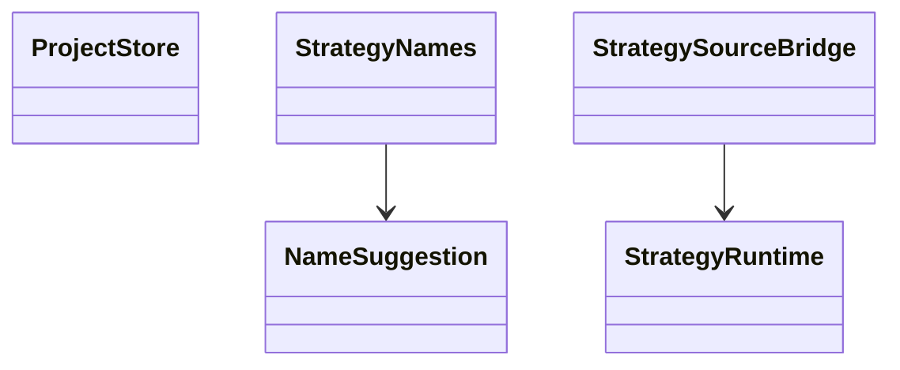

# AppWizard — Visual Strategy Authoring and Export



- **Primary Role:** Visual Strategy Authoring and Export; the complete owned module list is below.
- **Dependencies:** AppCore shared contracts; AppHome routing contributions. Dataset-dependent tests additionally require AppDataManager data contracts.
- **Outputs / Downstream Role:** versioned strategy documents, templates and export artifacts consumed through shared core interfaces.

## Execution rule for this file

The task text and its exact Context to Read list are the entire coding context. READY tasks are independently implementable helper/coordinator slices; their prerequisites must already exist with the stated symbols. BLOCKED-NOT-EXECUTABLE orders authorize no production edits and no guessed DTO/default/algorithm. A senior engineer must replace the listed missing contract with evidence-backed signatures before assigning that order to a coding agent. There is no instruction to make a design decision or research unspecified behavior during a coding commit.

Every checkbox in a ready task names its exact symbol. One ready feature task is one commit containing only its listed implementation/test files. Test command exit 0 is acceptance only when the specified test cases were collected. Do not run application-wide formatting or touch a sibling workspace.

All target names/signatures/error codes below are normative Python/React adaptations. Only the observations in named evidence records are SQX facts. StandardResponse is `StandardResponse[T](request_id: str, data: T, revision: int | None = None)` from `app/core/lib/responses.py`. DomainError is keyword-only `DomainError(*, code: str, message: str, details: dict[str, JSONValue] | None = None)` from `app/core/lib/errors.py`.


### Phase 5.1: Strategy-name rules — `AppWizard`

*Feature:* sanitize suggested strategy names and generate collision-free display names using the observed naming convention.
**Task ID:** `WO-WZ-STRATEGY-NAMES`. **Readiness:** READY-AFTER-FRONTEND-TEST-BOOTSTRAP. **Evidence:** `OBS145-WIZARD-NAMES-001`. **One commit:** `feat(wizard): implement strategy name rules`.

*Context to Read:* `app/web/package.json`, `app/web/vitest.config.ts`, `SQX_REFERENCE_ROOT/internal/web/AlgoWizard/assets/index-C12ZW4O3.js.map` sources entry `../../../src/helpers/strategyName.ts`. Read sourcesContent for that exact source key; do not copy its text to the repository or port unrelated store code.

*Implementation Files:*
- **Frontend create:** `app/web/workspaces/wizard/strategy_names.ts`.
- **Frontend test create:** `app/web/tests/workspaces/wizard/strategy_names.test.ts`.
- **Backend:** none in this commit. The helper proposes display names; it does not grant persistence uniqueness or change core IDs.

*Functional Requirements & Implementation:*
- [ ] `StrategyNames.sanitize(name: string, replace_with: string = ""): string` -> retain only ASCII A-Z, a-z, digits, ordinary space, underscore, hyphen and dot. Replace each disallowed UTF-16 code unit separately. Use ECMAScript String.replace replacement-string semantics: replace_with=`$&` retains the matched disallowed unit; do not switch to literal callback substitution. Do not trim, collapse runs, normalize Unicode, reject empty output or sanitize replace_with.
- [ ] `StrategyNames.unique(base_name: string, existing_names: readonly string[]): string` -> if exact case-sensitive base_name is absent, return it unchanged even if numbered variants exist. Otherwise initialize maximum suffix to 1, inspect exact `<base_name> (<digits>)` matches, take the largest decimal suffix above 1, and return `<base_name> (<maximum+1>)`. Treat regex-special characters in base_name literally. Do not fill numerical gaps or call sanitize implicitly.

*Exact tests:*

| Input | Expected |
| --- | --- |
| sanitize(`A/B:C`) | `ABC` |
| sanitize(`A/B:C`,`_`) | `A_B_C` |
| sanitize(`éΑA 1_.-`) | `A 1_.-` |
| sanitize(`  A  `) | preserve both leading/trailing pairs of spaces |
| sanitize(`///`) | empty string |
| sanitize(`A/B`,`$&`) | `A/B` |
| sanitize(`A😀B`,`_`) | `A__B` |
| unique(`A`,[]) | A |
| unique(`A`,[`A (9)`]) | A |
| unique(`A`,[`A`]) | `A (2)` |
| unique(`A`,[`A`,`A (2)`,`A (9)`]) | `A (10)` |
| unique(`A`,[`A`,`A (0)`,`A (01)`]) | `A (2)` |
| unique(`A.B`,[`A.B`,`AxB (90)`,`A.B (3)`]) | `A.B (4)` |
| unique(`A`,[`a`]) | A |

Use test name `StrategyNames.sanitize` and `StrategyNames.unique` with table cases. Suffix conversion uses Number.parseInt(text,10) and JavaScript Number addition, not BigInt. A suffix that parses as Infinity therefore yields the string `A (Infinity)` for base A; do not add a safe-integer rejection to this display helper. A later public persistence API requires a separate accepted name-validation contract.

*Verification:* `npm --prefix app/web test -- tests/workspaces/wizard/strategy_names.test.ts` exits 0. Commit only the two named files. No API endpoint, store migration, core strategy ID change or backend name-allocation service belongs in this commit.


## Phase 05.9: Full workspace feature orders — evidence-gated contracts

### `AppWizard`

*Feature:* `AppWizard` complete observed workspace contribution. **Task ID:** `I-AppWizard`. **Readiness:** BLOCKED-NOT-EXECUTABLE. **Evidence:** `OBS145-AppWizard-SURFACE-001`.

*Implementation Files (reserved exact paths; do not create them while blocked):*
- **Backend:** `app/workspaces/wizard/workspace.py` → `WizardService`.
- **Request/result models:** `app/workspaces/wizard/workspace_models.py`.
- **Frontend:** `app/web/workspaces/wizard/WizardWorkspace.tsx`.
- **Backend test:** `tests/workspaces/wizard/test_workspace.py`.
- **Frontend test:** `app/web/tests/workspaces/wizard/WizardWorkspace.test.tsx`.
- **Context to Read:** `app/core/lib/responses.py`, `app/core/lib/errors.py`, `SQX_REFERENCE_ROOT/internal/plugins/AppWizard/AlgoWizardService.js`, `SQX_REFERENCE_ROOT/internal/plugins/AppWizard/AppWizard.jar`.
- **Observed actions:** `/AlgoWizard/examples/examples.json`; `/algowizard/loadExample`.
- **Unresolved contract preventing coding:** For every request literal listed here, the complete typed request and response fields, defaults, validation order/error literals, persistence transaction and event payload must be supplied. An opaque dict passthrough is not the contract. Strategy XML node/parameter schemas, conversions and export templates require per-field/per-node fixtures; naming-helper acceptance does not satisfy these contracts.
- **Function/signature authorization:** none. Do not create `WizardService.execute(payload: dict)` or infer CRUD methods from the feature name.
- **Acceptance commands reserved for the completed senior specification:** `uv run python -m pytest tests/workspaces/wizard/test_workspace.py -q`; `npm --prefix app/web test -- tests/workspaces/wizard/WizardWorkspace.test.tsx`. These are not acceptance now: fixtures/assertions and the method contracts remain unset, so no commit may claim this task complete.
- **Commit boundary:** after the senior fills the missing contract, one commit for this one feature; if it requires more than one independently testable behavior, the senior splits the work order before assignment.

### `ServletAlgoCloud`

*Feature:* `ServletAlgoCloud` complete observed workspace contribution. **Task ID:** `I-ServletAlgoCloud`. **Readiness:** BLOCKED-NOT-EXECUTABLE. **Evidence:** `OBS145-ServletAlgoCloud-SURFACE-001`.

*Implementation Files (reserved exact paths; do not create them while blocked):*
- **Backend:** `app/workspaces/wizard/cloud_export.py` → `CloudExportService`.
- **Request/result models:** `app/workspaces/wizard/cloud_export_models.py`.
- **Frontend:** `app/web/workspaces/wizard/CloudExportPanel.tsx`.
- **Backend test:** `tests/workspaces/wizard/test_cloud_export.py`.
- **Frontend test:** `app/web/tests/workspaces/wizard/CloudExportPanel.test.tsx`.
- **Context to Read:** `app/core/lib/responses.py`, `app/core/lib/errors.py`, `SQX_REFERENCE_ROOT/internal/plugins/ServletAlgoCloud/ServletAlgoCloud.jar`.
- **Observed actions:** No client route literal was established; use the exact carrier context above..
- **Unresolved contract preventing coding:** The exact public operations, request/response fields, defaults, errors and persisted effects have not been established by this bounded inspection. A module name or Java method name is not a behavioral requirement. Strategy XML node/parameter schemas, conversions and export templates require per-field/per-node fixtures; naming-helper acceptance does not satisfy these contracts.
- **Function/signature authorization:** none. Do not create `CloudExportService.execute(payload: dict)` or infer CRUD methods from the feature name.
- **Acceptance commands reserved for the completed senior specification:** `uv run python -m pytest tests/workspaces/wizard/test_cloud_export.py -q`; `npm --prefix app/web test -- tests/workspaces/wizard/CloudExportPanel.test.tsx`. These are not acceptance now: fixtures/assertions and the method contracts remain unset, so no commit may claim this task complete.
- **Commit boundary:** after the senior fills the missing contract, one commit for this one feature; if it requires more than one independently testable behavior, the senior splits the work order before assignment.

### `ServletAlgoWizard`

*Feature:* `ServletAlgoWizard` complete observed workspace contribution. **Task ID:** `I-ServletAlgoWizard`. **Readiness:** BLOCKED-NOT-EXECUTABLE. **Evidence:** `OBS145-ServletAlgoWizard-SURFACE-001`.

*Implementation Files (reserved exact paths; do not create them while blocked):*
- **Backend:** `app/workspaces/wizard/visual_blocks.py` → `VisualBlockService`.
- **Request/result models:** `app/workspaces/wizard/visual_blocks_models.py`.
- **Frontend:** `app/web/workspaces/wizard/VisualBlockPanel.tsx`.
- **Backend test:** `tests/workspaces/wizard/test_visual_blocks.py`.
- **Frontend test:** `app/web/tests/workspaces/wizard/VisualBlockPanel.test.tsx`.
- **Context to Read:** `app/core/lib/responses.py`, `app/core/lib/errors.py`, `SQX_REFERENCE_ROOT/internal/plugins/ServletAlgoWizard/ServletAlgoWizard.jar`.
- **Observed actions:** No client route literal was established; use the exact carrier context above..
- **Unresolved contract preventing coding:** The exact public operations, request/response fields, defaults, errors and persisted effects have not been established by this bounded inspection. A module name or Java method name is not a behavioral requirement. Strategy XML node/parameter schemas, conversions and export templates require per-field/per-node fixtures; naming-helper acceptance does not satisfy these contracts.
- **Function/signature authorization:** none. Do not create `VisualBlockService.execute(payload: dict)` or infer CRUD methods from the feature name.
- **Acceptance commands reserved for the completed senior specification:** `uv run python -m pytest tests/workspaces/wizard/test_visual_blocks.py -q`; `npm --prefix app/web test -- tests/workspaces/wizard/VisualBlockPanel.test.tsx`. These are not acceptance now: fixtures/assertions and the method contracts remain unset, so no commit may claim this task complete.
- **Commit boundary:** after the senior fills the missing contract, one commit for this one feature; if it requires more than one independently testable behavior, the senior splits the work order before assignment.

### `ServletConstants`

*Feature:* `ServletConstants` complete observed workspace contribution. **Task ID:** `I-ServletConstants`. **Readiness:** BLOCKED-NOT-EXECUTABLE. **Evidence:** `OBS145-ServletConstants-SURFACE-001`.

*Implementation Files (reserved exact paths; do not create them while blocked):*
- **Backend:** `app/workspaces/wizard/catalogue.py` → `WizardCatalogueService`.
- **Request/result models:** `app/workspaces/wizard/catalogue_models.py`.
- **Frontend:** `app/web/workspaces/wizard/WizardCataloguePanel.tsx`.
- **Backend test:** `tests/workspaces/wizard/test_catalogue.py`.
- **Frontend test:** `app/web/tests/workspaces/wizard/WizardCataloguePanel.test.tsx`.
- **Context to Read:** `app/core/lib/responses.py`, `app/core/lib/errors.py`, `SQX_REFERENCE_ROOT/internal/plugins/ServletConstants/ServletConstants.jar`.
- **Observed actions:** No client route literal was established; use the exact carrier context above..
- **Unresolved contract preventing coding:** The exact public operations, request/response fields, defaults, errors and persisted effects have not been established by this bounded inspection. A module name or Java method name is not a behavioral requirement. Strategy XML node/parameter schemas, conversions and export templates require per-field/per-node fixtures; naming-helper acceptance does not satisfy these contracts.
- **Function/signature authorization:** none. Do not create `WizardCatalogueService.execute(payload: dict)` or infer CRUD methods from the feature name.
- **Acceptance commands reserved for the completed senior specification:** `uv run python -m pytest tests/workspaces/wizard/test_catalogue.py -q`; `npm --prefix app/web test -- tests/workspaces/wizard/WizardCataloguePanel.test.tsx`. These are not acceptance now: fixtures/assertions and the method contracts remain unset, so no commit may claim this task complete.
- **Commit boundary:** after the senior fills the missing contract, one commit for this one feature; if it requires more than one independently testable behavior, the senior splits the work order before assignment.

### `ServletStrategy`

*Feature:* `ServletStrategy` complete observed workspace contribution. **Task ID:** `I-ServletStrategy`. **Readiness:** BLOCKED-NOT-EXECUTABLE. **Evidence:** `OBS145-ServletStrategy-SURFACE-001`.

*Implementation Files (reserved exact paths; do not create them while blocked):*
- **Backend:** `app/workspaces/wizard/strategies.py` → `StrategyDocumentService`.
- **Request/result models:** `app/workspaces/wizard/strategies_models.py`.
- **Frontend:** `app/web/workspaces/wizard/StrategyDocumentPanel.tsx`.
- **Backend test:** `tests/workspaces/wizard/test_strategies.py`.
- **Frontend test:** `app/web/tests/workspaces/wizard/StrategyDocumentPanel.test.tsx`.
- **Context to Read:** `app/core/lib/responses.py`, `app/core/lib/errors.py`, `SQX_REFERENCE_ROOT/internal/plugins/ServletStrategy/ServletStrategy.jar`.
- **Observed actions:** No client route literal was established; use the exact carrier context above..
- **Unresolved contract preventing coding:** The exact public operations, request/response fields, defaults, errors and persisted effects have not been established by this bounded inspection. A module name or Java method name is not a behavioral requirement. Strategy XML node/parameter schemas, conversions and export templates require per-field/per-node fixtures; naming-helper acceptance does not satisfy these contracts.
- **Function/signature authorization:** none. Do not create `StrategyDocumentService.execute(payload: dict)` or infer CRUD methods from the feature name.
- **Acceptance commands reserved for the completed senior specification:** `uv run python -m pytest tests/workspaces/wizard/test_strategies.py -q`; `npm --prefix app/web test -- tests/workspaces/wizard/StrategyDocumentPanel.test.tsx`. These are not acceptance now: fixtures/assertions and the method contracts remain unset, so no commit may claim this task complete.
- **Commit boundary:** after the senior fills the missing contract, one commit for this one feature; if it requires more than one independently testable behavior, the senior splits the work order before assignment.

## Phase 5.10: Complete template coverage

**Readiness:** BLOCKED-NOT-EXECUTABLE for export implementation. Donor `internal/ctemplate` and `internal/extend/Code` require structural/semantic fixtures, not generic string replacement. The exact category target catalog is:

| Donor target | Exact target descriptor module |
| --- | --- |
| `SQX_REFERENCE_ROOT/internal/extend/Code/EasyLanguage/Main.tpl` | `app/extend/code/easylanguage/descriptor.py` |
| `SQX_REFERENCE_ROOT/internal/extend/Code/JForex/Main.tpl` | `app/extend/code/jforex/descriptor.py` |
| `SQX_REFERENCE_ROOT/internal/extend/Code/MetaTrader4/Main.tpl` | `app/extend/code/mql4/descriptor.py` |
| `SQX_REFERENCE_ROOT/internal/extend/Code/MetaTrader5/Main.tpl` | `app/extend/code/mql5/descriptor.py` |
| `SQX_REFERENCE_ROOT/internal/extend/Code/NinjaTrader/Main.tpl` | `app/extend/code/ninjatrader/descriptor.py` |
| `SQX_REFERENCE_ROOT/internal/extend/Code/PseudoCode/Main.tpl` | `app/extend/code/pseudo_code/descriptor.py` |

No descriptor.py file is authorized until its exact template IDs/options/capability fields are specified. Shared global includes have one owner `app/core/wizard/template_helpers.py`, but their functions remain blocked until each used include helper is independently specified. Visual custom blocks/groups and executable Python snippets remain separate contracts.

## Evidence records used by these work orders

Original historical objects below are retained without modification; new static observations do not supersede unverified numerical behavior. Validation passed for source inspection only, not for unimplemented code or UI.

### Evidence record `PREVIOUS-007`

<details>
<summary>Claim, provenance, limitations and validation</summary>

```json
{
  "id": "PREVIOUS-007",
  "classification": "observed",
  "confidence": "high",
  "claim": "24 definitions include template transformation and custom-indicator import/parsing support.",
  "sources": [
    "SQX_PREVIOUS_REFERENCE_ROOT/internal/libs/SQWizardBusiness.jar!com/strategyquant/wizard/desktop/indicators/SCustomIndicatorFileParser.class"
  ],
  "target_domain": "app/core/wizard",
  "related_records": [],
  "feature_ids": [],
  "requirement_ids": [],
  "decision_ids": [],
  "registration_gap": "No feature ID ratified for proposed domain. Propose domain README registration before implementation; no registry edit performed.",
  "limitations": "Previous-version static definitions and representative method bodies only; exact product build and build-145 equivalence unverified. No full algorithm/formula parity or successful licensed operation asserted.",
  "validation": {
    "status": "passed",
    "executed_at": "2026-10-29T07:03:39.946149+00:00",
    "procedure": "Parse ZIP/class hashes; inspect representative signatures and bodies with javap -p -c; resolve static dependencies with jdeps. Snippets source counterpart validation compares class/source paths, not compiled equivalence.",
    "expected_observation": "24 definitions include template transformation and custom-indicator import/parsing support.",
    "actual_observation": "24 definitions include template transformation and custom-indicator import/parsing support.",
    "artifacts": [
      "previous-library-inventory.json"
    ]
  },
  "repository_commit": "f5c7d12d5715b8ebee55165b8eddad9068f83cb9",
  "review_state": "preliminary-owner-review-pending",
  "contains_proprietary_source": false,
  "contains_sensitive_data": false,
  "contains_personal_data": false,
  "paraphrased_behavior_only": true,
  "supersedes_records": [],
  "superseded_by": [],
  "cross_version_policy": "Related current-build records remain valid for their own version; fallback findings do not supersede facts about a different build."
}
```

</details>

### Evidence record `OBS145-AppWizard-SURFACE-001`

<details>
<summary>Claim, provenance, limitations and validation</summary>

```json
{
  "id": "OBS145-AppWizard-SURFACE-001",
  "classification": "observed",
  "confidence": "high",
  "claim": "Direct source inspection identifies these client request literals: /AlgoWizard/examples/examples.json, /algowizard/loadExample",
  "sources": [
    {
      "path": "SQX_REFERENCE_ROOT/internal/plugins/AppWizard/AlgoWizardService.js",
      "sha256": "494a9aee7f4bded38f81c68f35521a5a5b7013f93d2f9edf2e5485c8e83ef6a0"
    }
  ],
  "limitations": "Request literals or carrier presence do not establish complete payload fields, defaults, persistence, numerical algorithms, remote protocol compatibility or runtime success. Static inspection only.",
  "target_domain": "app/workspaces/wizard",
  "feature_ids": [],
  "requirement_ids": [],
  "decision_ids": [],
  "registration_gap": "New target feature IDs require owner README registration; evidence ID is not a feature ID.",
  "validation": {
    "status": "passed",
    "executed_at": "2026-10-29T09:18:26.116191+00:00",
    "procedure": "Read the exact named primary files; enumerate literal sendRequest/getPromise/loadFromUrl first arguments; compute SHA-256.",
    "actual_observation": "Direct source inspection identifies these client request literals: /AlgoWizard/examples/examples.json, /algowizard/loadExample",
    "expected_observation": "Module carrier and any literal route arguments present in inspected files.",
    "artifacts": [
      "SQX_REFERENCE_ROOT/internal/plugins/AppWizard/AlgoWizardService.js"
    ]
  },
  "repository_commit": "f5c7d12d5715b8ebee55165b8eddad9068f83cb9",
  "review_state": "senior-review-pending",
  "contains_proprietary_source": false,
  "contains_sensitive_data": false,
  "contains_personal_data": false,
  "paraphrased_behavior_only": true,
  "supersedes_records": [],
  "superseded_by": []
}
```

</details>

### Evidence record `OBS145-ServletAlgoCloud-SURFACE-001`

<details>
<summary>Claim, provenance, limitations and validation</summary>

```json
{
  "id": "OBS145-ServletAlgoCloud-SURFACE-001",
  "classification": "observed",
  "confidence": "high",
  "claim": "The inspected primary module files establish the module carrier/registration; no complete request/result contract is established by this bounded inspection.",
  "sources": [
    {
      "path": "SQX_REFERENCE_ROOT/internal/plugins/ServletAlgoCloud/ServletAlgoCloud.jar",
      "sha256": "bd40d7d7d7f71c7e7553bbfb3e08f5b700038e8d98263d3ac5dc78a4d4fdc7b7"
    }
  ],
  "limitations": "Request literals or carrier presence do not establish complete payload fields, defaults, persistence, numerical algorithms, remote protocol compatibility or runtime success. Static inspection only.",
  "target_domain": "app/workspaces/wizard",
  "feature_ids": [],
  "requirement_ids": [],
  "decision_ids": [],
  "registration_gap": "New target feature IDs require owner README registration; evidence ID is not a feature ID.",
  "validation": {
    "status": "passed",
    "executed_at": "2026-10-29T09:18:26.116191+00:00",
    "procedure": "Read the exact named primary files; enumerate literal sendRequest/getPromise/loadFromUrl first arguments; compute SHA-256.",
    "actual_observation": "The inspected primary module files establish the module carrier/registration; no complete request/result contract is established by this bounded inspection.",
    "expected_observation": "Module carrier and any literal route arguments present in inspected files.",
    "artifacts": [
      "SQX_REFERENCE_ROOT/internal/plugins/ServletAlgoCloud/ServletAlgoCloud.jar"
    ]
  },
  "repository_commit": "f5c7d12d5715b8ebee55165b8eddad9068f83cb9",
  "review_state": "senior-review-pending",
  "contains_proprietary_source": false,
  "contains_sensitive_data": false,
  "contains_personal_data": false,
  "paraphrased_behavior_only": true,
  "supersedes_records": [],
  "superseded_by": []
}
```

</details>

### Evidence record `OBS145-ServletAlgoWizard-SURFACE-001`

<details>
<summary>Claim, provenance, limitations and validation</summary>

```json
{
  "id": "OBS145-ServletAlgoWizard-SURFACE-001",
  "classification": "observed",
  "confidence": "high",
  "claim": "The inspected primary module files establish the module carrier/registration; no complete request/result contract is established by this bounded inspection.",
  "sources": [
    {
      "path": "SQX_REFERENCE_ROOT/internal/plugins/ServletAlgoWizard/ServletAlgoWizard.jar",
      "sha256": "f0ff394bb1b905f4e396b6245edd02dec2ddbe99290fb0a12039e71a65ed63cc"
    }
  ],
  "limitations": "Request literals or carrier presence do not establish complete payload fields, defaults, persistence, numerical algorithms, remote protocol compatibility or runtime success. Static inspection only.",
  "target_domain": "app/workspaces/wizard",
  "feature_ids": [],
  "requirement_ids": [],
  "decision_ids": [],
  "registration_gap": "New target feature IDs require owner README registration; evidence ID is not a feature ID.",
  "validation": {
    "status": "passed",
    "executed_at": "2026-10-29T09:18:26.116191+00:00",
    "procedure": "Read the exact named primary files; enumerate literal sendRequest/getPromise/loadFromUrl first arguments; compute SHA-256.",
    "actual_observation": "The inspected primary module files establish the module carrier/registration; no complete request/result contract is established by this bounded inspection.",
    "expected_observation": "Module carrier and any literal route arguments present in inspected files.",
    "artifacts": [
      "SQX_REFERENCE_ROOT/internal/plugins/ServletAlgoWizard/ServletAlgoWizard.jar"
    ]
  },
  "repository_commit": "f5c7d12d5715b8ebee55165b8eddad9068f83cb9",
  "review_state": "senior-review-pending",
  "contains_proprietary_source": false,
  "contains_sensitive_data": false,
  "contains_personal_data": false,
  "paraphrased_behavior_only": true,
  "supersedes_records": [],
  "superseded_by": []
}
```

</details>

### Evidence record `OBS145-ServletConstants-SURFACE-001`

<details>
<summary>Claim, provenance, limitations and validation</summary>

```json
{
  "id": "OBS145-ServletConstants-SURFACE-001",
  "classification": "observed",
  "confidence": "high",
  "claim": "The inspected primary module files establish the module carrier/registration; no complete request/result contract is established by this bounded inspection.",
  "sources": [
    {
      "path": "SQX_REFERENCE_ROOT/internal/plugins/ServletConstants/ServletConstants.jar",
      "sha256": "188e5c2312faf36246d0c7d71a2312a9a51f21c2049bec9cd30b98fedec07e24"
    }
  ],
  "limitations": "Request literals or carrier presence do not establish complete payload fields, defaults, persistence, numerical algorithms, remote protocol compatibility or runtime success. Static inspection only.",
  "target_domain": "app/workspaces/wizard",
  "feature_ids": [],
  "requirement_ids": [],
  "decision_ids": [],
  "registration_gap": "New target feature IDs require owner README registration; evidence ID is not a feature ID.",
  "validation": {
    "status": "passed",
    "executed_at": "2026-10-29T09:18:26.116191+00:00",
    "procedure": "Read the exact named primary files; enumerate literal sendRequest/getPromise/loadFromUrl first arguments; compute SHA-256.",
    "actual_observation": "The inspected primary module files establish the module carrier/registration; no complete request/result contract is established by this bounded inspection.",
    "expected_observation": "Module carrier and any literal route arguments present in inspected files.",
    "artifacts": [
      "SQX_REFERENCE_ROOT/internal/plugins/ServletConstants/ServletConstants.jar"
    ]
  },
  "repository_commit": "f5c7d12d5715b8ebee55165b8eddad9068f83cb9",
  "review_state": "senior-review-pending",
  "contains_proprietary_source": false,
  "contains_sensitive_data": false,
  "contains_personal_data": false,
  "paraphrased_behavior_only": true,
  "supersedes_records": [],
  "superseded_by": []
}
```

</details>

### Evidence record `OBS145-ServletStrategy-SURFACE-001`

<details>
<summary>Claim, provenance, limitations and validation</summary>

```json
{
  "id": "OBS145-ServletStrategy-SURFACE-001",
  "classification": "observed",
  "confidence": "high",
  "claim": "The inspected primary module files establish the module carrier/registration; no complete request/result contract is established by this bounded inspection.",
  "sources": [
    {
      "path": "SQX_REFERENCE_ROOT/internal/plugins/ServletStrategy/ServletStrategy.jar",
      "sha256": "ad58850406ffb2bcdf01773459b48bae65a95737a30d023f0442f7fb35bbb5e6"
    }
  ],
  "limitations": "Request literals or carrier presence do not establish complete payload fields, defaults, persistence, numerical algorithms, remote protocol compatibility or runtime success. Static inspection only.",
  "target_domain": "app/workspaces/wizard",
  "feature_ids": [],
  "requirement_ids": [],
  "decision_ids": [],
  "registration_gap": "New target feature IDs require owner README registration; evidence ID is not a feature ID.",
  "validation": {
    "status": "passed",
    "executed_at": "2026-10-29T09:18:26.116191+00:00",
    "procedure": "Read the exact named primary files; enumerate literal sendRequest/getPromise/loadFromUrl first arguments; compute SHA-256.",
    "actual_observation": "The inspected primary module files establish the module carrier/registration; no complete request/result contract is established by this bounded inspection.",
    "expected_observation": "Module carrier and any literal route arguments present in inspected files.",
    "artifacts": [
      "SQX_REFERENCE_ROOT/internal/plugins/ServletStrategy/ServletStrategy.jar"
    ]
  },
  "repository_commit": "f5c7d12d5715b8ebee55165b8eddad9068f83cb9",
  "review_state": "senior-review-pending",
  "contains_proprietary_source": false,
  "contains_sensitive_data": false,
  "contains_personal_data": false,
  "paraphrased_behavior_only": true,
  "supersedes_records": [],
  "superseded_by": []
}
```

</details>

### Evidence record `OBS145-WIZARD-NAMES-001`

```json
{
  "id": "OBS145-WIZARD-NAMES-001",
  "classification": "observed",
  "confidence": "high",
  "claim": "Embedded source ../../../src/helpers/strategyName.ts defines ASCII name sanitization retaining letters/digits/space/underscore/hyphen/dot, with empty replacement default. Name allocation returns an unused base unchanged; when base exists it starts maximum suffix at 1 and returns one above the largest matching parenthesized decimal suffix. These are frontend helper observations, not persistence uniqueness guarantees.",
  "sources": [
    {
      "path": "SQX_REFERENCE_ROOT/internal/web/AlgoWizard/assets/index-C12ZW4O3.js.map",
      "sha256": "3e2267455244c03bec2e07ced841e1f10afd9cbba241d32e7cd406d72f0e903c"
    }
  ],
  "target_domain": "app/web/workspaces/wizard/strategy_names.ts",
  "feature_ids": [],
  "requirement_ids": [],
  "decision_ids": [],
  "registration_gap": "Register the target helper/coordinator in the owner-domain workflow; helper type/error-code adaptation is normative, not an SQX fact.",
  "limitations": "Static source/bytecode inspection only; no donor application runtime, database mutation, provider request, indicator arithmetic or export compiler was executed. Ready target tests are specified expectations, not tests already run.",
  "validation": {
    "status": "passed",
    "executed_at": "2026-10-29T09:19:42.806810+00:00",
    "procedure": "Read the named current-build JavaScript bodies (and exact sourcemap sourcesContent key for Wizard); inspect InstrumentsServlet.onClone with javap -p -c; compute source-carrier SHA256.",
    "expected_observation": "Embedded source ../../../src/helpers/strategyName.ts defines ASCII name sanitization retaining letters/digits/space/underscore/hyphen/dot, with empty replacement default. Name allocation returns an unused base unchanged; when base exists it starts maximum suffix at 1 and returns one above the largest matching parenthesized decimal suffix. These are frontend helper observations, not persistence uniqueness guarantees.",
    "actual_observation": "Embedded source ../../../src/helpers/strategyName.ts defines ASCII name sanitization retaining letters/digits/space/underscore/hyphen/dot, with empty replacement default. Name allocation returns an unused base unchanged; when base exists it starts maximum suffix at 1 and returns one above the largest matching parenthesized decimal suffix. These are frontend helper observations, not persistence uniqueness guarantees.",
    "artifacts": [
      "SQX_REFERENCE_ROOT/internal/web/AlgoWizard/assets/index-C12ZW4O3.js.map"
    ]
  },
  "repository_commit": "f5c7d12d5715b8ebee55165b8eddad9068f83cb9",
  "review_state": "senior-review-pending",
  "contains_proprietary_source": false,
  "contains_sensitive_data": false,
  "contains_personal_data": false,
  "paraphrased_behavior_only": true,
  "supersedes_records": [],
  "superseded_by": []
}
```
