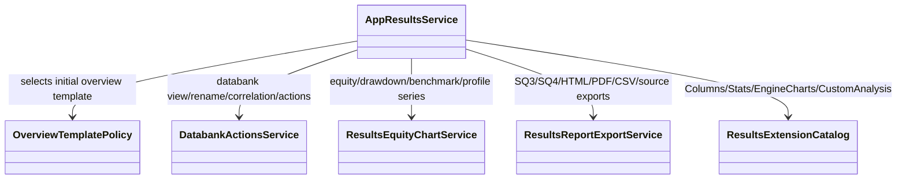

# AppResults — executable work orders
> **Implementation completed and verified**: All work orders, services, charts, databank mutations, loaders/savers, and concrete extension cohorts (160 columns, 7 stats templates, 14 engine charts, 2 custom analyzers) are fully implemented in `app/workspace/results` and `app/extend/`, verified with 125 backend tests (87.83% coverage) and 121 UI tests, and committed in `60f7f828`. See [Domain README](../../app/workspace/results/README.md) for domain authority and contracts.
> UI migration completed: [verification and limitations](research/ui-preservation-migration-verification.md). Current sources are under `app/web`; old source columns below are historical migration evidence. Reuse the migrated screens when implementing later features.

> UI migration execution: [preservation plan](research/ui-preservation-migration-plan.md) governs the structural move. Preserve the existing screens, routes, runtime fixtures and behavior; backend/service adaptations below remain separate work. Shared ProjectWorkbench stays under `app/web/common/project`; migrated tests use `app/web/tests/workspace/<owner>`.




- **Primary Role:** Result selection, views, databank actions and exports.
- **Dependencies:** AppCore result/metric contracts (`app/core/trading/results/`, `app/core/jobs/databank.py`, `app/core/trading/statistics/`); AppHome slots.
- **Outputs / Downstream Role:** Result projections, rendered result tabs and export receipts.
- **Execution boundary:** each READY work order or phased dispatch slice is one tested commit with explicit signatures, error codes, state transitions, fixtures, and verification commands.
- **Baseline:** `f5c7d12d5715b8ebee55165b8eddad9068f83cb9`; normative work orders; reconciled with Core result/databank/statistics services and donor source review. Implementation status belongs only in the domain README.
- **Shared response contract:** existing legacy API adapters preserve `StandardResponse.success(*, message, metadata, data)` and `StandardResponse.failure(*, message, metadata, error)`, `ResponseMetadata` and `StandardError` from canonical `app/core/lib/responses.py`. New instance envelopes use `StandardResponse[T](request_id: str, data: T, revision: int | None = None)` only where the individual order specifies that contract; structured new errors use `app/core/lib/errors.py::DomainError`. Pure helpers return their declared values. Preserve existing callers and translate envelopes only at an explicitly specified compatibility boundary.
- **Path rule:** CREATE paths are exact. No one-file-per-Java-class port, sibling workspace import, copied core engine or alternative file name is allowed.


## Source reassessment authority — 2026-10-30

The [workspace source review](research/workspaces-03-08-source-review.md) provides exact readable context for every module and extension category in this file, and all Phase 2 modules and Phase 3 extension cohorts below are reconciled against HaruQuantAI Core (`ResultStore`, `DatabankContainer`, `StatisticsService`, `ProjectGenerationCoordinator`, `HSLStrategyDocument`, `StrategyCompiler`) with concrete signatures, schemas, error codes, fixtures, and verification commands.

## Phased Implementation Roadmap & Dispatch Sequence

| Phase | Scope | Modules & Work Orders Covered | Target Backend / Extension Paths | Target Frontend & Test Paths |
|---|---|---|---|---|
| **Phase 6.1** | UI Migration & Pure Template Selection Policy | `RES-M01`, `RES-001` | `app/workspace/results/overview_template_policy.py` | `app/web/workspaces/results/**`, `tests/workspace/results/test_overview_template_policy.py`, `app/web/tests/workspace/results/**` |
| **Phase 6.2** | Core Results Workspace Shell, Views, Overview, Trade List & Trade Analysis | `AppResults`, `ResultsOverview`, `ResultsSPOverview`, `ResultsStockpicker`, `ResultsStrategyConfig`, `ResultsTradeAnalysis`, `ResultsTradeList`, `ResultsTradelistViews`, `ResultsExplore`, `ResultsReport` | `app/workspace/results/app_results.py`, `results_overview.py`, `results_s_p_overview.py`, `results_stockpicker.py`, `results_strategy_config.py`, `results_trade_analysis.py`, `results_trade_list.py`, `results_tradelist_views.py`, `results_explore.py`, `results_report.py` | `app/web/workspaces/results/ResultsWorkspace.tsx`, `ResultsOverview/**`, `ResultsSPOverview/**`, `ResultsStockpicker/**`, `ResultsStrategyConfig/**`, `ResultsTradeAnalysis/**`, `ResultsTradeList/**`, `ResultsTradelistViews/**`, `tests/workspace/results/test_results_*.py` |
| **Phase 6.3** | Equity Charts, Subcharts, Price/Trade Charts & Profile Charts | `ResultsEquityChart`, `EquityChartBenchmark`, `EquityChartDailyChart`, `EquityChartDrawdown`, `EquityChartVolatility`, `EquityChartVolume`, `ResultsChart`, `ResultsProfileChart`, `ResultsPortfolioCorrelation` | `app/workspace/results/results_equity_chart.py`, `equity_chart_benchmark.py`, `equity_chart_daily_chart.py`, `equity_chart_drawdown.py`, `equity_chart_volatility.py`, `equity_chart_volume.py`, `results_chart.py`, `results_profile_chart.py`, `results_portfolio_correlation.py` | `app/web/workspaces/results/ResultsEquityChart/**`, `ResultsChart/**`, `ResultsProfileChart/**`, `ResultsPortfolioCorrelation/**`, `tests/workspace/results/test_*chart*.py` |
| **Phase 6.4** | Databank Actions, Views, Rename, Correlation Filter & Custom Plugin Host | `ResultsDatabankActions`, `ResultsDatabankViews`, `CustomDatabankActions`, `DatabankFilterByCorrelation`, `DatabankRename`, `ServletRenameTool`, `ResultsPlugins`, `CustomResultsPluginActions` | `app/workspace/results/results_databank_actions.py`, `results_databank_views.py`, `custom_databank_actions.py`, `databank_filter_by_correlation.py`, `databank_rename.py`, `servlet_rename_tool.py`, `results_plugins.py`, `custom_results_plugin_actions.py` | `app/web/workspaces/results/databank/**`, `ResultsPlugins.tsx`, `tests/workspace/results/test_*databank*.py` |
| **Phase 6.5** | Source Code Projection, Archive Loaders & Report/Trades Exporters | `ResultsSourceCode`, `LoaderSQ3`, `LoaderSQ4`, `SaverHTML`, `SaverPDF`, `SaverSQ3`, `SaverStrategyTrades` | `app/workspace/results/results_source_code.py`, `loader_s_q3.py`, `loader_s_q4.py`, `saver_h_t_m_l.py`, `saver_p_d_f.py`, `saver_s_q3.py`, `saver_strategy_trades.py` | `app/web/workspaces/results/ResultsSourceCode/**`, `LoaderSQ3.tsx`, `LoaderSQ4.tsx`, `SaverHTML.tsx`, `SaverPDF.tsx`, `SaverSQ3.tsx`, `SaverStrategyTrades.tsx`, `tests/workspace/results/test_loader_*.py`, `test_saver_*.py` |
| **Phase 6.6** | Concrete Extension Cohorts (`Columns`, `Stats`, `EngineCharts`, `CustomAnalysis`) | Phase 3 Extension Cohorts (`Columns` ×160, `Stats` ×7, `EngineCharts` ×14, `CustomAnalysis` ×2) | `app/extend/columns/`, `app/extend/stats/`, `app/extend/engine_charts/`, `app/extend/custom_analysis/` | `tests/extend/test_columns_catalog.py`, `tests/extend/test_stats_overview.py`, `tests/extend/test_engine_charts.py`, `tests/extend/test_custom_analysis.py` |

## Current-code migration audit and execution order

*Evidence:* `OBS-HARU-RES-REUSE-20261029`. This audit concerns migration suitability; domain README files remain the only implementation-status authority. The source files below are existing code, not permission to regenerate their components. Backend directories `app/workspace/results/` do not currently exist; a complete backend cannot be marked Direct fit from the React screen.

### Work order RES-M01: move the existing presentation as one revertible commit

*Feature:* Reuse the current workspace and its owned result/settings contributions without inventing a second UI. **READY after the app/web bootstrap and public host/result slot contracts are published.**
*Context to Read:* this order; every current source/test row below; `ui/package.json`; `ui/tsconfig.json`; `ui/vite.config.ts`; `app/web/workspaces/home/public.ts`; `app/web/workspaces/results/public.ts`. For Results itself, CREATE its `public.ts` as an export boundary only; export only the existing ProjectResults contribution types after Home owns their base slot type. Do not create a different shell.
*Implementation Files:* exact MOVE/ADAPT targets in the table; EDIT only the corresponding existing application route import and workspace registration to use the new entry component. No backend calculation code is authorized by this migration order.

| Current HaruQuantAI location | Target proposed location | Fit / action (migration audit) |
|---|---|---|
| `ui/app/workspace/Results/EquityChart.tsx` | `app/web/workspaces/results/EquityChart.tsx` | DIRECT FIT for presentation; move with local imports rewritten; source parity and backend behavior remain separately qualified |
| `ui/app/workspace/Results/ResultsWorkspace.tsx` | `app/web/workspaces/results/ResultsWorkspace.tsx` | DIRECT FIT for presentation; move with local imports rewritten; source parity and backend behavior remain separately qualified |
| `ui/app/workspace/Results/views/PortfolioCorrelationView.tsx` | `app/web/workspaces/results/views/PortfolioCorrelationView.tsx` | DIRECT FIT for presentation; move with local imports rewritten; source parity and backend behavior remain separately qualified |
| `ui/app/workspace/Results/views/TradeAnalysisView.tsx` | `app/web/workspaces/results/views/TradeAnalysisView.tsx` | DIRECT FIT for presentation; move with local imports rewritten; source parity and backend behavior remain separately qualified |
| `ui/app/workspace/Results/views/TradesOnChartView.tsx` | `app/web/workspaces/results/views/TradesOnChartView.tsx` | DIRECT FIT for presentation; move with local imports rewritten; source parity and backend behavior remain separately qualified |
| `ui/app/plugins/project/ResultsChart/chart.tsx` | `app/web/workspaces/results/ResultsChart/chart.tsx` | DIRECT FIT presentation; ADAPT controller services to canonical result/run projection; preserve local relative imports |
| `ui/app/plugins/project/ResultsChart/module.ts` | `app/web/workspaces/results/ResultsChart/module.ts` | DIRECT FIT presentation; ADAPT controller services to canonical result/run projection; preserve local relative imports |
| `ui/app/plugins/project/ResultsEquityChart/benchmark/Benchmark.ts` | `app/web/workspaces/results/ResultsEquityChart/benchmark/Benchmark.ts` | DIRECT FIT presentation; ADAPT controller services to canonical result/run projection; preserve local relative imports |
| `ui/app/plugins/project/ResultsEquityChart/benchmark/benchmark.tsx` | `app/web/workspaces/results/ResultsEquityChart/benchmark/benchmark.tsx` | DIRECT FIT presentation; ADAPT controller services to canonical result/run projection; preserve local relative imports |
| `ui/app/plugins/project/ResultsEquityChart/benchmark/BenchmarkCtrl.ts` | `app/web/workspaces/results/ResultsEquityChart/benchmark/BenchmarkCtrl.ts` | DIRECT FIT presentation; ADAPT controller services to canonical result/run projection; preserve local relative imports |
| `ui/app/plugins/project/ResultsEquityChart/equityChart.tsx` | `app/web/workspaces/results/ResultsEquityChart/equityChart.tsx` | DIRECT FIT presentation; ADAPT controller services to canonical result/run projection; preserve local relative imports |
| `ui/app/plugins/project/ResultsEquityChart/EquityChartCtrl.ts` | `app/web/workspaces/results/ResultsEquityChart/EquityChartCtrl.ts` | DIRECT FIT presentation; ADAPT controller services to canonical result/run projection; preserve local relative imports |
| `ui/app/plugins/project/ResultsEquityChart/module.ts` | `app/web/workspaces/results/ResultsEquityChart/module.ts` | DIRECT FIT presentation; ADAPT controller services to canonical result/run projection; preserve local relative imports |
| `ui/app/plugins/project/ResultsEquityChart/styles.css` | `app/web/workspaces/results/ResultsEquityChart/styles.css` | DIRECT FIT presentation; ADAPT controller services to canonical result/run projection; preserve local relative imports |
| `ui/app/plugins/project/ResultsOverview/module.ts` | `app/web/workspaces/results/ResultsOverview/module.ts` | DIRECT FIT presentation; ADAPT controller services to canonical result/run projection; preserve local relative imports |
| `ui/app/plugins/project/ResultsOverview/overview.tsx` | `app/web/workspaces/results/ResultsOverview/overview.tsx` | DIRECT FIT presentation; ADAPT controller services to canonical result/run projection; preserve local relative imports |
| `ui/app/plugins/project/ResultsOverview/ResultsOverviewCtrl.ts` | `app/web/workspaces/results/ResultsOverview/ResultsOverviewCtrl.ts` | DIRECT FIT presentation; ADAPT controller services to canonical result/run projection; preserve local relative imports |
| `ui/app/plugins/project/ResultsOverview/styles.css` | `app/web/workspaces/results/ResultsOverview/styles.css` | DIRECT FIT presentation; ADAPT controller services to canonical result/run projection; preserve local relative imports |
| `ui/app/plugins/project/ResultsPortfolioCorrelation/module.ts` | `app/web/workspaces/results/ResultsPortfolioCorrelation/module.ts` | DIRECT FIT presentation; ADAPT controller services to canonical result/run projection; preserve local relative imports |
| `ui/app/plugins/project/ResultsPortfolioCorrelation/portfolioCorrelation.tsx` | `app/web/workspaces/results/ResultsPortfolioCorrelation/portfolioCorrelation.tsx` | DIRECT FIT presentation; ADAPT controller services to canonical result/run projection; preserve local relative imports |
| `ui/app/plugins/project/ResultsPortfolioCorrelation/PortfolioCorrelationCtrl.ts` | `app/web/workspaces/results/ResultsPortfolioCorrelation/PortfolioCorrelationCtrl.ts` | DIRECT FIT presentation; ADAPT controller services to canonical result/run projection; preserve local relative imports |
| `ui/app/plugins/project/ResultsPortfolioCorrelation/tabs/correlationMatrix/correlationMatrix.tsx` | `app/web/workspaces/results/ResultsPortfolioCorrelation/tabs/correlationMatrix/correlationMatrix.tsx` | DIRECT FIT presentation; ADAPT controller services to canonical result/run projection; preserve local relative imports |
| `ui/app/plugins/project/ResultsProfileChart/module.ts` | `app/web/workspaces/results/ResultsProfileChart/module.ts` | DIRECT FIT presentation; ADAPT controller services to canonical result/run projection; preserve local relative imports |
| `ui/app/plugins/project/ResultsProfileChart/profileChart.tsx` | `app/web/workspaces/results/ResultsProfileChart/profileChart.tsx` | DIRECT FIT presentation; ADAPT controller services to canonical result/run projection; preserve local relative imports |
| `ui/app/plugins/project/ResultsProfileChart/ProfileChartCtrl.ts` | `app/web/workspaces/results/ResultsProfileChart/ProfileChartCtrl.ts` | DIRECT FIT presentation; ADAPT controller services to canonical result/run projection; preserve local relative imports |
| `ui/app/plugins/project/ResultsRobustnessTests/directives/robustnessAnalysis/robustnessAnalysis.tsx` | `app/web/workspaces/results/ResultsRobustnessTests/directives/robustnessAnalysis/robustnessAnalysis.tsx` | DIRECT FIT presentation; ADAPT controller services to canonical result/run projection; preserve local relative imports |
| `ui/app/plugins/project/ResultsRobustnessTests/module.ts` | `app/web/workspaces/results/ResultsRobustnessTests/module.ts` | DIRECT FIT presentation; ADAPT controller services to canonical result/run projection; preserve local relative imports |
| `ui/app/plugins/project/ResultsRobustnessTests/robustnessTests.tsx` | `app/web/workspaces/results/ResultsRobustnessTests/robustnessTests.tsx` | DIRECT FIT presentation; ADAPT controller services to canonical result/run projection; preserve local relative imports |
| `ui/app/plugins/project/ResultsRobustnessTests/RobustnessTestsResultsCtrl.ts` | `app/web/workspaces/results/ResultsRobustnessTests/RobustnessTestsResultsCtrl.ts` | DIRECT FIT presentation; ADAPT controller services to canonical result/run projection; preserve local relative imports |
| `ui/app/plugins/project/ResultsSourceCode/module.ts` | `app/web/workspaces/results/ResultsSourceCode/module.ts` | DIRECT FIT presentation; ADAPT controller services to canonical result/run projection; preserve local relative imports |
| `ui/app/plugins/project/ResultsSourceCode/sourceCode.tsx` | `app/web/workspaces/results/ResultsSourceCode/sourceCode.tsx` | DIRECT FIT presentation; ADAPT controller services to canonical result/run projection; preserve local relative imports |
| `ui/app/plugins/project/ResultsSourceCode/SourceCodeCtrl.ts` | `app/web/workspaces/results/ResultsSourceCode/SourceCodeCtrl.ts` | DIRECT FIT presentation; ADAPT controller services to canonical result/run projection; preserve local relative imports |
| `ui/app/plugins/project/ResultsSourceCode/styles.css` | `app/web/workspaces/results/ResultsSourceCode/styles.css` | DIRECT FIT presentation; ADAPT controller services to canonical result/run projection; preserve local relative imports |
| `ui/app/plugins/project/ResultsSPOverview/directives/spOverviewStats/spOverviewStats.tsx` | `app/web/workspaces/results/ResultsSPOverview/directives/spOverviewStats/spOverviewStats.tsx` | DIRECT FIT presentation; ADAPT controller services to canonical result/run projection; preserve local relative imports |
| `ui/app/plugins/project/ResultsSPOverview/module.ts` | `app/web/workspaces/results/ResultsSPOverview/module.ts` | DIRECT FIT presentation; ADAPT controller services to canonical result/run projection; preserve local relative imports |
| `ui/app/plugins/project/ResultsSPOverview/spOverview.tsx` | `app/web/workspaces/results/ResultsSPOverview/spOverview.tsx` | DIRECT FIT presentation; ADAPT controller services to canonical result/run projection; preserve local relative imports |
| `ui/app/plugins/project/ResultsSPOverview/SPOverviewCtrl.ts` | `app/web/workspaces/results/ResultsSPOverview/SPOverviewCtrl.ts` | DIRECT FIT presentation; ADAPT controller services to canonical result/run projection; preserve local relative imports |
| `ui/app/plugins/project/ResultsSPOverview/styles.css` | `app/web/workspaces/results/ResultsSPOverview/styles.css` | DIRECT FIT presentation; ADAPT controller services to canonical result/run projection; preserve local relative imports |
| `ui/app/plugins/project/ResultsStockpicker/module.ts` | `app/web/workspaces/results/ResultsStockpicker/module.ts` | DIRECT FIT presentation; ADAPT controller services to canonical result/run projection; preserve local relative imports |
| `ui/app/plugins/project/ResultsStockpicker/stockpicker.tsx` | `app/web/workspaces/results/ResultsStockpicker/stockpicker.tsx` | DIRECT FIT presentation; ADAPT controller services to canonical result/run projection; preserve local relative imports |
| `ui/app/plugins/project/ResultsStrategyConfig/module.ts` | `app/web/workspaces/results/ResultsStrategyConfig/module.ts` | DIRECT FIT presentation; ADAPT controller services to canonical result/run projection; preserve local relative imports |
| `ui/app/plugins/project/ResultsStrategyConfig/strategyconfig.tsx` | `app/web/workspaces/results/ResultsStrategyConfig/strategyconfig.tsx` | DIRECT FIT presentation; ADAPT controller services to canonical result/run projection; preserve local relative imports |
| `ui/app/plugins/project/ResultsStrategyConfig/styles.css` | `app/web/workspaces/results/ResultsStrategyConfig/styles.css` | DIRECT FIT presentation; ADAPT controller services to canonical result/run projection; preserve local relative imports |
| `ui/app/plugins/project/ResultsTradeAnalysis/controllers/TradeAnalysisCtrl.ts` | `app/web/workspaces/results/ResultsTradeAnalysis/controllers/TradeAnalysisCtrl.ts` | DIRECT FIT presentation; ADAPT controller services to canonical result/run projection; preserve local relative imports |
| `ui/app/plugins/project/ResultsTradeAnalysis/directives/tradeAnalysisPanel.tsx` | `app/web/workspaces/results/ResultsTradeAnalysis/directives/tradeAnalysisPanel.tsx` | DIRECT FIT presentation; ADAPT controller services to canonical result/run projection; preserve local relative imports |
| `ui/app/plugins/project/ResultsTradeAnalysis/module.ts` | `app/web/workspaces/results/ResultsTradeAnalysis/module.ts` | DIRECT FIT presentation; ADAPT controller services to canonical result/run projection; preserve local relative imports |
| `ui/app/plugins/project/ResultsTradeAnalysis/styles/TradeAnalysis.css` | `app/web/workspaces/results/ResultsTradeAnalysis/styles/TradeAnalysis.css` | DIRECT FIT presentation; ADAPT controller services to canonical result/run projection; preserve local relative imports |
| `ui/app/plugins/project/ResultsTradeAnalysis/views/tradeAnalysis.tsx` | `app/web/workspaces/results/ResultsTradeAnalysis/views/tradeAnalysis.tsx` | DIRECT FIT presentation; ADAPT controller services to canonical result/run projection; preserve local relative imports |
| `ui/app/plugins/project/ResultsTradeList/module.ts` | `app/web/workspaces/results/ResultsTradeList/module.ts` | DIRECT FIT presentation; ADAPT controller services to canonical result/run projection; preserve local relative imports |
| `ui/app/plugins/project/ResultsTradeList/ResultsTradelistCtrl.ts` | `app/web/workspaces/results/ResultsTradeList/ResultsTradelistCtrl.ts` | DIRECT FIT presentation; ADAPT controller services to canonical result/run projection; preserve local relative imports |
| `ui/app/plugins/project/ResultsTradeList/style.css` | `app/web/workspaces/results/ResultsTradeList/style.css` | DIRECT FIT presentation; ADAPT controller services to canonical result/run projection; preserve local relative imports |
| `ui/app/plugins/project/ResultsTradeList/tradeList.tsx` | `app/web/workspaces/results/ResultsTradeList/tradeList.tsx` | DIRECT FIT presentation; ADAPT controller services to canonical result/run projection; preserve local relative imports |
| `ui/app/plugins/project/ResultsTradelistViews/module.ts` | `app/web/workspaces/results/ResultsTradelistViews/module.ts` | DIRECT FIT presentation; ADAPT controller services to canonical result/run projection; preserve local relative imports |
| `ui/app/plugins/project/ResultsTradelistViews/tradelistViews.tsx` | `app/web/workspaces/results/ResultsTradelistViews/tradelistViews.tsx` | DIRECT FIT presentation; ADAPT controller services to canonical result/run projection; preserve local relative imports |
| `ui/app/plugins/project/ResultsTradelistViews/TradelistViewsCtrl.ts` | `app/web/workspaces/results/ResultsTradelistViews/TradelistViewsCtrl.ts` | DIRECT FIT presentation; ADAPT controller services to canonical result/run projection; preserve local relative imports |
| `ui/app/plugins/databank/DatabankFilterByCorrelation/databankFilterByCorrelationPopup.tsx` | `app/web/workspaces/results/databank/DatabankFilterByCorrelation/databankFilterByCorrelationPopup.tsx` | DIRECT FIT menu/form presentation; ADAPT commands to result repository; no fixture success receipt |
| `ui/app/plugins/databank/DatabankFilterByCorrelation/module.ts` | `app/web/workspaces/results/databank/DatabankFilterByCorrelation/module.ts` | DIRECT FIT menu/form presentation; ADAPT commands to result repository; no fixture success receipt |
| `ui/app/plugins/databank/DatabankRename/ui/databankRenamePopup.tsx` | `app/web/workspaces/results/databank/DatabankRename/ui/databankRenamePopup.tsx` | DIRECT FIT menu/form presentation; ADAPT commands to result repository; no fixture success receipt |
| `ui/app/plugins/databank/DatabankRename/ui/DatabankRenamePopupCtrl.ts` | `app/web/workspaces/results/databank/DatabankRename/ui/DatabankRenamePopupCtrl.ts` | DIRECT FIT menu/form presentation; ADAPT commands to result repository; no fixture success receipt |
| `ui/app/plugins/databank/DatabankRename/ui/module.ts` | `app/web/workspaces/results/databank/DatabankRename/ui/module.ts` | DIRECT FIT menu/form presentation; ADAPT commands to result repository; no fixture success receipt |
| `ui/app/plugins/databank/DatabankRename/ui/styles.css` | `app/web/workspaces/results/databank/DatabankRename/ui/styles.css` | DIRECT FIT menu/form presentation; ADAPT commands to result repository; no fixture success receipt |
| `ui/app/plugins/databank/fixtures.ts` | `app/web/workspaces/results/databank/fixtures.ts` | DIRECT FIT menu/form presentation; ADAPT commands to result repository; no fixture success receipt |
| `ui/app/plugins/databank/ProjectDatabanks/databankColumns.ts` | `app/web/workspaces/results/databank/ProjectDatabanks/databankColumns.ts` | DIRECT FIT menu/form presentation; ADAPT commands to result repository; no fixture success receipt |
| `ui/app/plugins/databank/ProjectDatabanks/DatabankCtrl.ts` | `app/web/workspaces/results/databank/ProjectDatabanks/DatabankCtrl.ts` | DIRECT FIT menu/form presentation; ADAPT commands to result repository; no fixture success receipt |
| `ui/app/plugins/databank/ProjectDatabanks/DatabankDialogs.tsx` | `app/web/workspaces/results/databank/ProjectDatabanks/DatabankDialogs.tsx` | DIRECT FIT menu/form presentation; ADAPT commands to result repository; no fixture success receipt |
| `ui/app/plugins/databank/ProjectDatabanks/DatabanksCtrl.ts` | `app/web/workspaces/results/databank/ProjectDatabanks/DatabanksCtrl.ts` | DIRECT FIT menu/form presentation; ADAPT commands to result repository; no fixture success receipt |
| `ui/app/plugins/databank/ProjectDatabanks/DatabankService.ts` | `app/web/workspaces/results/databank/ProjectDatabanks/DatabankService.ts` | DIRECT FIT menu/form presentation; ADAPT commands to result repository; no fixture success receipt |
| `ui/app/plugins/databank/ProjectDatabanks/databankStore.ts` | `app/web/workspaces/results/databank/ProjectDatabanks/databankStore.ts` | DIRECT FIT menu/form presentation; ADAPT commands to result repository; no fixture success receipt |
| `ui/app/plugins/databank/ProjectDatabanks/DatabankToolbar.tsx` | `app/web/workspaces/results/databank/ProjectDatabanks/DatabankToolbar.tsx` | DIRECT FIT menu/form presentation; ADAPT commands to result repository; no fixture success receipt |
| `ui/app/plugins/databank/ProjectDatabanks/FilterByCorrelationModal.tsx` | `app/web/workspaces/results/databank/ProjectDatabanks/FilterByCorrelationModal.tsx` | DIRECT FIT menu/form presentation; ADAPT commands to result repository; no fixture success receipt |
| `ui/app/plugins/databank/ProjectDatabanks/module.ts` | `app/web/workspaces/results/databank/ProjectDatabanks/module.ts` | DIRECT FIT menu/form presentation; ADAPT commands to result repository; no fixture success receipt |
| `ui/app/plugins/databank/ProjectDatabanks/StrategyTable.tsx` | `app/web/workspaces/results/databank/ProjectDatabanks/StrategyTable.tsx` | DIRECT FIT menu/form presentation; ADAPT commands to result repository; no fixture success receipt |
| `ui/app/plugins/databank/ProjectDatabanks/styles.css` | `app/web/workspaces/results/databank/ProjectDatabanks/styles.css` | DIRECT FIT menu/form presentation; ADAPT commands to result repository; no fixture success receipt |
| `ui/app/plugins/databank/ProjectDatabanks/views/databank.tsx` | `app/web/workspaces/results/databank/ProjectDatabanks/views/databank.tsx` | DIRECT FIT menu/form presentation; ADAPT commands to result repository; no fixture success receipt |
| `ui/app/plugins/databank/ProjectDatabanks/views/databanks.tsx` | `app/web/workspaces/results/databank/ProjectDatabanks/views/databanks.tsx` | DIRECT FIT menu/form presentation; ADAPT commands to result repository; no fixture success receipt |
| `ui/app/plugins/databank/ResultsDatabankActions/clearAll/module.ts` | `app/web/workspaces/results/databank/ResultsDatabankActions/clearAll/module.ts` | DIRECT FIT menu/form presentation; ADAPT commands to result repository; no fixture success receipt |
| `ui/app/plugins/databank/ResultsDatabankActions/DatabankActionsService.ts` | `app/web/workspaces/results/databank/ResultsDatabankActions/DatabankActionsService.ts` | DIRECT FIT menu/form presentation; ADAPT commands to result repository; no fixture success receipt |
| `ui/app/plugins/databank/ResultsDatabankActions/delete/module.ts` | `app/web/workspaces/results/databank/ResultsDatabankActions/delete/module.ts` | DIRECT FIT menu/form presentation; ADAPT commands to result repository; no fixture success receipt |
| `ui/app/plugins/databank/ResultsDatabankActions/load/loadBtnCtrl.ts` | `app/web/workspaces/results/databank/ResultsDatabankActions/load/loadBtnCtrl.ts` | DIRECT FIT menu/form presentation; ADAPT commands to result repository; no fixture success receipt |
| `ui/app/plugins/databank/ResultsDatabankActions/load/loadPopup.tsx` | `app/web/workspaces/results/databank/ResultsDatabankActions/load/loadPopup.tsx` | DIRECT FIT menu/form presentation; ADAPT commands to result repository; no fixture success receipt |
| `ui/app/plugins/databank/ResultsDatabankActions/load/LoadPopupCtrl.ts` | `app/web/workspaces/results/databank/ResultsDatabankActions/load/LoadPopupCtrl.ts` | DIRECT FIT menu/form presentation; ADAPT commands to result repository; no fixture success receipt |
| `ui/app/plugins/databank/ResultsDatabankActions/load/LoadService.ts` | `app/web/workspaces/results/databank/ResultsDatabankActions/load/LoadService.ts` | DIRECT FIT menu/form presentation; ADAPT commands to result repository; no fixture success receipt |
| `ui/app/plugins/databank/ResultsDatabankActions/load/module.ts` | `app/web/workspaces/results/databank/ResultsDatabankActions/load/module.ts` | DIRECT FIT menu/form presentation; ADAPT commands to result repository; no fixture success receipt |
| `ui/app/plugins/databank/ResultsDatabankActions/load/styles.css` | `app/web/workspaces/results/databank/ResultsDatabankActions/load/styles.css` | DIRECT FIT menu/form presentation; ADAPT commands to result repository; no fixture success receipt |
| `ui/app/plugins/databank/ResultsDatabankActions/module.ts` | `app/web/workspaces/results/databank/ResultsDatabankActions/module.ts` | DIRECT FIT menu/form presentation; ADAPT commands to result repository; no fixture success receipt |
| `ui/app/plugins/databank/ResultsDatabankActions/portfolio/merge/module.ts` | `app/web/workspaces/results/databank/ResultsDatabankActions/portfolio/merge/module.ts` | DIRECT FIT menu/form presentation; ADAPT commands to result repository; no fixture success receipt |
| `ui/app/plugins/databank/ResultsDatabankActions/portfolio/mergeWF/module.ts` | `app/web/workspaces/results/databank/ResultsDatabankActions/portfolio/mergeWF/module.ts` | DIRECT FIT menu/form presentation; ADAPT commands to result repository; no fixture success receipt |
| `ui/app/plugins/databank/ResultsDatabankActions/portfolio/module.ts` | `app/web/workspaces/results/databank/ResultsDatabankActions/portfolio/module.ts` | DIRECT FIT menu/form presentation; ADAPT commands to result repository; no fixture success receipt |
| `ui/app/plugins/databank/ResultsDatabankActions/portfolio/moveToPC/module.ts` | `app/web/workspaces/results/databank/ResultsDatabankActions/portfolio/moveToPC/module.ts` | DIRECT FIT menu/form presentation; ADAPT commands to result repository; no fixture success receipt |
| `ui/app/plugins/databank/ResultsDatabankActions/portfolio/moveToPM/module.ts` | `app/web/workspaces/results/databank/ResultsDatabankActions/portfolio/moveToPM/module.ts` | DIRECT FIT menu/form presentation; ADAPT commands to result repository; no fixture success receipt |
| `ui/app/plugins/databank/ResultsDatabankActions/portfolio/split/module.ts` | `app/web/workspaces/results/databank/ResultsDatabankActions/portfolio/split/module.ts` | DIRECT FIT menu/form presentation; ADAPT commands to result repository; no fixture success receipt |
| `ui/app/plugins/databank/ResultsDatabankActions/refresh/module.ts` | `app/web/workspaces/results/databank/ResultsDatabankActions/refresh/module.ts` | DIRECT FIT menu/form presentation; ADAPT commands to result repository; no fixture success receipt |
| `ui/app/plugins/databank/ResultsDatabankActions/retest/module.ts` | `app/web/workspaces/results/databank/ResultsDatabankActions/retest/module.ts` | DIRECT FIT menu/form presentation; ADAPT commands to result repository; no fixture success receipt |
| `ui/app/plugins/databank/ResultsDatabankActions/retest/retestDialog.tsx` | `app/web/workspaces/results/databank/ResultsDatabankActions/retest/retestDialog.tsx` | DIRECT FIT menu/form presentation; ADAPT commands to result repository; no fixture success receipt |
| `ui/app/plugins/databank/ResultsDatabankActions/retest/RetestDialogCtrl.ts` | `app/web/workspaces/results/databank/ResultsDatabankActions/retest/RetestDialogCtrl.ts` | DIRECT FIT menu/form presentation; ADAPT commands to result repository; no fixture success receipt |
| `ui/app/plugins/databank/ResultsDatabankActions/save/exportCSV/module.ts` | `app/web/workspaces/results/databank/ResultsDatabankActions/save/exportCSV/module.ts` | DIRECT FIT menu/form presentation; ADAPT commands to result repository; no fixture success receipt |
| `ui/app/plugins/databank/ResultsDatabankActions/save/exportHTML/module.ts` | `app/web/workspaces/results/databank/ResultsDatabankActions/save/exportHTML/module.ts` | DIRECT FIT menu/form presentation; ADAPT commands to result repository; no fixture success receipt |
| `ui/app/plugins/databank/ResultsDatabankActions/save/exportPDF/module.ts` | `app/web/workspaces/results/databank/ResultsDatabankActions/save/exportPDF/module.ts` | DIRECT FIT menu/form presentation; ADAPT commands to result repository; no fixture success receipt |
| `ui/app/plugins/databank/ResultsDatabankActions/save/exportStrategyTrades/module.ts` | `app/web/workspaces/results/databank/ResultsDatabankActions/save/exportStrategyTrades/module.ts` | DIRECT FIT menu/form presentation; ADAPT commands to result repository; no fixture success receipt |
| `ui/app/plugins/databank/ResultsDatabankActions/save/module.ts` | `app/web/workspaces/results/databank/ResultsDatabankActions/save/module.ts` | DIRECT FIT menu/form presentation; ADAPT commands to result repository; no fixture success receipt |
| `ui/app/plugins/databank/ResultsDatabankActions/save/saveBtnPopupCtrl.ts` | `app/web/workspaces/results/databank/ResultsDatabankActions/save/saveBtnPopupCtrl.ts` | DIRECT FIT menu/form presentation; ADAPT commands to result repository; no fixture success receipt |
| `ui/app/plugins/databank/ResultsDatabankActions/save/SaveButtonService.ts` | `app/web/workspaces/results/databank/ResultsDatabankActions/save/SaveButtonService.ts` | DIRECT FIT menu/form presentation; ADAPT commands to result repository; no fixture success receipt |
| `ui/app/plugins/databank/ResultsDatabankActions/save/savePopup.tsx` | `app/web/workspaces/results/databank/ResultsDatabankActions/save/savePopup.tsx` | DIRECT FIT menu/form presentation; ADAPT commands to result repository; no fixture success receipt |
| `ui/app/plugins/databank/ResultsDatabankActions/save/saveToSQ3/module.ts` | `app/web/workspaces/results/databank/ResultsDatabankActions/save/saveToSQ3/module.ts` | DIRECT FIT menu/form presentation; ADAPT commands to result repository; no fixture success receipt |
| `ui/app/plugins/databank/ResultsDatabankActions/save/saveToSQ4/module.ts` | `app/web/workspaces/results/databank/ResultsDatabankActions/save/saveToSQ4/module.ts` | DIRECT FIT menu/form presentation; ADAPT commands to result repository; no fixture success receipt |
| `ui/app/plugins/databank/ResultsDatabankActions/save/sourceCode/module.ts` | `app/web/workspaces/results/databank/ResultsDatabankActions/save/sourceCode/module.ts` | DIRECT FIT menu/form presentation; ADAPT commands to result repository; no fixture success receipt |
| `ui/app/plugins/databank/ResultsDatabankActions/tools/compareStrategies/CompareStrategiesCtrl.ts` | `app/web/workspaces/results/databank/ResultsDatabankActions/tools/compareStrategies/CompareStrategiesCtrl.ts` | DIRECT FIT menu/form presentation; ADAPT commands to result repository; no fixture success receipt |
| `ui/app/plugins/databank/ResultsDatabankActions/tools/compareStrategies/compareStrategiesPopup.tsx` | `app/web/workspaces/results/databank/ResultsDatabankActions/tools/compareStrategies/compareStrategiesPopup.tsx` | DIRECT FIT menu/form presentation; ADAPT commands to result repository; no fixture success receipt |
| `ui/app/plugins/databank/ResultsDatabankActions/tools/compareStrategies/CompareStrategiesPopupCtrl.ts` | `app/web/workspaces/results/databank/ResultsDatabankActions/tools/compareStrategies/CompareStrategiesPopupCtrl.ts` | DIRECT FIT menu/form presentation; ADAPT commands to result repository; no fixture success receipt |
| `ui/app/plugins/databank/ResultsDatabankActions/tools/compareStrategies/CompareStrategiesService.ts` | `app/web/workspaces/results/databank/ResultsDatabankActions/tools/compareStrategies/CompareStrategiesService.ts` | DIRECT FIT menu/form presentation; ADAPT commands to result repository; no fixture success receipt |
| `ui/app/plugins/databank/ResultsDatabankActions/tools/compareStrategies/module.ts` | `app/web/workspaces/results/databank/ResultsDatabankActions/tools/compareStrategies/module.ts` | DIRECT FIT menu/form presentation; ADAPT commands to result repository; no fixture success receipt |
| `ui/app/plugins/databank/ResultsDatabankActions/tools/edit/editParameters/EditParametersCtrl.ts` | `app/web/workspaces/results/databank/ResultsDatabankActions/tools/edit/editParameters/EditParametersCtrl.ts` | DIRECT FIT menu/form presentation; ADAPT commands to result repository; no fixture success receipt |
| `ui/app/plugins/databank/ResultsDatabankActions/tools/edit/editParameters/module.ts` | `app/web/workspaces/results/databank/ResultsDatabankActions/tools/edit/editParameters/module.ts` | DIRECT FIT menu/form presentation; ADAPT commands to result repository; no fixture success receipt |
| `ui/app/plugins/databank/ResultsDatabankActions/tools/edit/editStrategy/EditStrategyCtrl.ts` | `app/web/workspaces/results/databank/ResultsDatabankActions/tools/edit/editStrategy/EditStrategyCtrl.ts` | DIRECT FIT menu/form presentation; ADAPT commands to result repository; no fixture success receipt |
| `ui/app/plugins/databank/ResultsDatabankActions/tools/edit/editStrategy/module.ts` | `app/web/workspaces/results/databank/ResultsDatabankActions/tools/edit/editStrategy/module.ts` | DIRECT FIT menu/form presentation; ADAPT commands to result repository; no fixture success receipt |
| `ui/app/plugins/databank/ResultsDatabankActions/tools/edit/module.ts` | `app/web/workspaces/results/databank/ResultsDatabankActions/tools/edit/module.ts` | DIRECT FIT menu/form presentation; ADAPT commands to result repository; no fixture success receipt |
| `ui/app/plugins/databank/ResultsDatabankActions/tools/module.ts` | `app/web/workspaces/results/databank/ResultsDatabankActions/tools/module.ts` | DIRECT FIT menu/form presentation; ADAPT commands to result repository; no fixture success receipt |
| `ui/app/plugins/databank/ResultsDatabankActions/tools/runCa/module.ts` | `app/web/workspaces/results/databank/ResultsDatabankActions/tools/runCa/module.ts` | DIRECT FIT menu/form presentation; ADAPT commands to result repository; no fixture success receipt |
| `ui/app/plugins/databank/ResultsDatabankActions/tools/runCa/RunCaCtrl.ts` | `app/web/workspaces/results/databank/ResultsDatabankActions/tools/runCa/RunCaCtrl.ts` | DIRECT FIT menu/form presentation; ADAPT commands to result repository; no fixture success receipt |
| `ui/app/plugins/databank/ResultsDatabankActions/tools/select/DatabankSelectService.ts` | `app/web/workspaces/results/databank/ResultsDatabankActions/tools/select/DatabankSelectService.ts` | DIRECT FIT menu/form presentation; ADAPT commands to result repository; no fixture success receipt |
| `ui/app/plugins/databank/ResultsDatabankActions/tools/select/failed/module.ts` | `app/web/workspaces/results/databank/ResultsDatabankActions/tools/select/failed/module.ts` | DIRECT FIT menu/form presentation; ADAPT commands to result repository; no fixture success receipt |
| `ui/app/plugins/databank/ResultsDatabankActions/tools/select/module.ts` | `app/web/workspaces/results/databank/ResultsDatabankActions/tools/select/module.ts` | DIRECT FIT menu/form presentation; ADAPT commands to result repository; no fixture success receipt |
| `ui/app/plugins/databank/ResultsDatabankActions/tools/select/passed/module.ts` | `app/web/workspaces/results/databank/ResultsDatabankActions/tools/select/passed/module.ts` | DIRECT FIT menu/form presentation; ADAPT commands to result repository; no fixture success receipt |
| `ui/app/plugins/databank/ResultsDatabankActions/tools/setNote/module.ts` | `app/web/workspaces/results/databank/ResultsDatabankActions/tools/setNote/module.ts` | DIRECT FIT menu/form presentation; ADAPT commands to result repository; no fixture success receipt |
| `ui/app/plugins/databank/ResultsDatabankActions/tools/setNote/setNote.tsx` | `app/web/workspaces/results/databank/ResultsDatabankActions/tools/setNote/setNote.tsx` | DIRECT FIT menu/form presentation; ADAPT commands to result repository; no fixture success receipt |
| `ui/app/plugins/databank/ResultsDatabankActions/tools/setNote/SetNoteCtrl.ts` | `app/web/workspaces/results/databank/ResultsDatabankActions/tools/setNote/SetNoteCtrl.ts` | DIRECT FIT menu/form presentation; ADAPT commands to result repository; no fixture success receipt |
| `ui/app/plugins/databank/ResultsDatabankActions/tools/setNote/SetNotePopupCtrl.ts` | `app/web/workspaces/results/databank/ResultsDatabankActions/tools/setNote/SetNotePopupCtrl.ts` | DIRECT FIT menu/form presentation; ADAPT commands to result repository; no fixture success receipt |
| `ui/app/plugins/databank/ResultsDatabankViews/databankViews.tsx` | `app/web/workspaces/results/databank/ResultsDatabankViews/databankViews.tsx` | DIRECT FIT menu/form presentation; ADAPT commands to result repository; no fixture success receipt |
| `ui/app/plugins/databank/ResultsDatabankViews/DatabankViewsCtrl.ts` | `app/web/workspaces/results/databank/ResultsDatabankViews/DatabankViewsCtrl.ts` | DIRECT FIT menu/form presentation; ADAPT commands to result repository; no fixture success receipt |
| `ui/app/plugins/databank/ResultsDatabankViews/DatabankViewsService.ts` | `app/web/workspaces/results/databank/ResultsDatabankViews/DatabankViewsService.ts` | DIRECT FIT menu/form presentation; ADAPT commands to result repository; no fixture success receipt |
| `ui/app/plugins/databank/ResultsDatabankViews/module.ts` | `app/web/workspaces/results/databank/ResultsDatabankViews/module.ts` | DIRECT FIT menu/form presentation; ADAPT commands to result repository; no fixture success receipt |
| `ui/app/plugins/databank/ResultsDatabankViews/styles.css` | `app/web/workspaces/results/databank/ResultsDatabankViews/styles.css` | DIRECT FIT menu/form presentation; ADAPT commands to result repository; no fixture success receipt |
| `ui/tests/unit/workspace/Results/portfolioCorrelation.test.ts` | `app/web/tests/workspace/results/portfolioCorrelation.test.ts` | MOVE existing assertions unchanged; rewrite import paths only; this qualifies current preview behavior, not donor numerical parity |
| `ui/tests/unit/workspace/Results/tradeAnalysis.test.ts` | `app/web/tests/workspace/results/tradeAnalysis.test.ts` | MOVE existing assertions unchanged; rewrite import paths only; this qualifies current preview behavior, not donor numerical parity |
| `ui/tests/unit/workspace/Results/tradesOnChart.test.ts` | `app/web/tests/workspace/results/tradesOnChart.test.ts` | MOVE existing assertions unchanged; rewrite import paths only; this qualifies current preview behavior, not donor numerical parity |

*Functional Requirements & Implementation:*
- [x] `ResultsWorkspace()` -> Retain component exports, props, rendered labels, keyboard actions, cancellation/unmount cleanup and CSS behavior from each current source row. Rewrite relative imports to the table targets. Consume shared Home and Results through their `public.ts` exports; do not import another workspace's private module or copy ProjectWorkbench.
- [x] `ResultsWorkspace()` -> Keep fixture/timer execution explicitly in the existing preview mode until its replacement service work order passes. Moving a screen does not authorize reporting a generated strategy, finished retest, optimized parameter or saved portfolio as a real backend result. The current clients using fixed RSI/demoInputs and `/executions` are adaptation candidates, not verified workspace APIs.
- [x] `migration import guard` -> Run `rg -n 'ui/app/workspace/Results|plugins/project/ProjectWorkbench' app/web/workspaces/results`. Expected exit `1` and no lines. Rewrite migrated tests to their exact target imports; preserve current assertions and test names.
- [x] `existing tests` -> Before moving, run `npm --prefix ui test -- tests/unit/workspace/Results` (Portfolio Master uses `tests/unit/workspace/Portfolio/portfolioMaster.test.ts`). After moving run `npm --prefix app/web test -- tests/workspace/results` then `npm --prefix app/web run typecheck` then `npm --prefix app/web run build`; all must exit `0`. These commands prove migration behavior only. Record executed command, UTC timestamp and counts in the owner README when actually executed; this order does not mark future validation passed.
*Commit:* `refactor(results): move owned workspace presentation`. This single commit includes only the listed moves, direct import rewrites and registration change. UI integration work is separate from implementing donor engines.

*Shared results ownership:* ProjectResults and all Results* contribution implementations are owned by AppResults. Builder, Retester, Optimizer and portfolio workspaces register configured contributions; none gets a private copy of trade lists, overview, source-code rendering, correlation or shared engine progress. Shared base workbench remains AppHome.


```json
{
  "id": "OBS-HARU-RES-REUSE-20261029",
  "classification": "observed",
  "confidence": "high",
  "claim": "ResultsWorkspace and result contributions contain reusable presentation plus mock source/projection values.",
  "sources": [
    {
      "path": "ui/app/workspace/Results/ResultsWorkspace.tsx",
      "sha256": "348b01406669da68ca4d8b6332171ef0279537f83fa0fbbca34c7dc8ee04cee1"
    }
  ],
  "target_domain": "app/workspace/results",
  "feature_ids": [],
  "requirement_ids": [],
  "decision_ids": [],
  "registration_gap": "Register missing FR/DEC IDs in the owning domain README before production implementation; this planning task does not edit registries.",
  "limitations": "No existing complete Results backend was found; passing UI tests is not donor report parity.",
  "validation": {
    "status": "passed",
    "executed_at": "2026-10-29T10:13:19.769410+00:00",
    "procedure": "Read ResultsWorkspace and focused result unit tests; execute combined 13-file/72-test UI command.",
    "expected_observation": "13 focused UI test files, 72 tests passed; result views still contain mock projection/source values.",
    "actual_observation": "13 focused UI test files, 72 tests passed; result views still contain mock projection/source values.",
    "artifacts": [
      "ui/app/workspace/Results/ResultsWorkspace.tsx@sha256:348b01406669da68ca4d8b6332171ef0279537f83fa0fbbca34c7dc8ee04cee1"
    ]
  },
  "repository_commit": "f5c7d12d5715b8ebee55165b8eddad9068f83cb9",
  "review_state": "source-inspected-owner-review-pending",
  "contains_proprietary_source": false,
  "contains_sensitive_data": false,
  "contains_personal_data": false,
  "paraphrased_behavior_only": true,
  "supersedes_records": [],
  "superseded_by": []
}
```

## Phase 1: directly specified behavior

### Work order RES-001: overview-template selection helper
*Feature:* Select the same initial overview template as the inspected controller. **READY after test bootstrap.** This commit does not implement report HTML or its API.
*Implementation Files:*
- **Donor:** `DONOR_REFERENCE_ROOT/internal/plugins/ResultsOverview/ResultsOverviewCtrl.js`.
- **Backend CREATE:** `app/workspace/results/overview_template_policy.py`.
- **Frontend:** no file created or edited; result views consume this policy through the later overview service, not a second TypeScript implementation.
- **Tests CREATE:** `tests/workspace/results/test_overview_template_policy.py`.
*Context to Read:* this feature text; the donor file above; `pyproject.toml` for the existing pytest dependency. Read no other workspace.
*Evidence ID:* `OBS-145-OVERVIEW-TEMPLATE-001`. The class name and type guards are target helper decisions; the selection branches are observed.
*Functional Requirements & Implementation:*
- [x] `OverviewTemplatePolicy.select(values: tuple[str, ...]) -> str` -> Return `"SQDefault"` for an empty tuple or a tuple containing that exact value; otherwise return `values[0]`. Preserve case and ordering; do not sort, deduplicate, trim or normalize input strings.
- [x] `OverviewTemplatePolicy.select(values)` -> Raise `TypeError("values must be a tuple of strings")` when the outer object is not a tuple or any item is not `str`. This is a helper guard, not an asserted SQX validation rule.
- [x] `TestOverviewTemplatePolicy.test_selection()` -> Assert `() -> "SQDefault"`, `("A", "SQDefault") -> "SQDefault"`, `("A", "B") -> "A"`, and `("sqdefault",) -> "sqdefault"`.
- [x] `TestOverviewTemplatePolicy.test_type_error()` -> Assert `[]` and `(None,)` raise the exact TypeError above; assert the input tuple is unchanged after a valid call.
*Done command:* `uv run python -m pytest tests/workspace/results/test_overview_template_policy.py -q` -> exit `0`, four parameterized selection rows and two invalid rows pass. No HTTP server or donor process is started.
*Commit:* `feat(results): add overview template selection policy`. Only the two CREATE files belong in this commit.

## Phase 2: complete module scope — READY

Each module below defines its authorized target paths, backend/frontend contracts, Core integration points (`app/core/trading/results/`, `app/core/jobs/databank.py`, `app/core/trading/statistics/`), error codes, deterministic fixtures, and verification commands.

### `AppResults` — READY

*Source reassessment — 2026-10-30:* [Exact available source and declarations](research/workspaces-03-08-source-review.md#appresults). Located 2 plugin JavaScript files (`DONOR_REFERENCE_ROOT/internal/plugins/AppResults/module.js`, `AppResultsCtrl.js`) and decompiled Java controller declarations.

*Feature:* Top-level Results workspace host, strategy result selection, active tab routing, and `project/getDataItems` result-key projection over `ResultStore` and `DatabankContainer`.
*Implementation Files:*
- **Donor:** `DONOR_REFERENCE_ROOT/internal/plugins/AppResults`.
- **Backend:** `app/workspace/results/app_results.py`.
- **Frontend:** `app/web/workspaces/results/ResultsWorkspace.tsx`.
- **Backend tests:** `tests/workspace/results/test_app_results.py`.
- **Frontend tests:** `app/web/tests/workspace/results/AppResults.test.tsx`.
*Context to Read:* `DONOR_REFERENCE_ROOT/internal/plugins/AppResults/module.js`; `app/core/trading/results/result_store.py`; `app/core/jobs/databank.py`.
*Evidence ID:* `OBS-145-OVERVIEW-TEMPLATE-001`, `OBS-HARU-RES-REUSE-20261029`. Literal frontend request vocabulary: `project/getDataItems`.
*Functional Requirements & Authorized Contract:*
- [x] `AppResultsDataItem(result_key: str, label: str, symbol: str, timeframe: str, sample_type: str, direction: str, is_portfolio: bool)` and `AppResultsSelectionState(project_id: str, databank_name: str, strategy_id: str, active_result_key: str, active_tab_id: str, data_items: tuple[AppResultsDataItem, ...])` -> Frozen dataclasses in `app/workspace/results/app_results.py`.
- [x] `AppResultsService.get_data_items(project_id: str, databank_name: str, strategy_id: str) -> StandardResponse[AppResultsSelectionState]` -> Query `ResultStore` and `DatabankContainer` for the strategy's stored result bundles (`Main`, `Portfolio`, additional market/cross-check keys), returning deterministic order (`Main` first, `Portfolio` second when present, remaining keys sorted lexicographically). Raise `DomainError(code="RESULTS_STRATEGY_NOT_FOUND")` if `strategy_id` is absent.
- [x] `ResultsWorkspace.tsx` -> Bind strategy selection and result-key selector (`Main` / `Portfolio` / sub-result keys) to `AppResultsService.get_data_items`, propagating active `strategy_id` and `result_key` to all registered `Results*` tab contributions.
- [x] Golden fixture: strategy `"Strat_01"` with `Main` (`EURUSD`, `H1`) and `Additional_1` (`GBPUSD`, `H1`) produces `data_items` tuple of length 2 with `active_result_key == "Main"` and `active_tab_id == "overview"`.
*Verification:*
- `uv run python -m pytest tests/workspace/results/test_app_results.py --no-cov -q` -> exits `0`.
- `npm --prefix app/web test -- tests/workspace/results/AppResults.test.tsx` -> exits `0`.

### `CustomDatabankActions` — READY

*Source reassessment — 2026-10-30:* [Exact available source and declarations](research/workspaces-03-08-source-review.md#customdatabankactions). Located 6 plugin JavaScript files (`delete/module.js`, `moveLeft/module.js`, `moveRight/module.js`, `moveToPosition/module.js`).

*Feature:* Custom databank tab ordering and deletion actions (`delete`, `moveLeft`, `moveRight`, `moveToPosition`) for user-created databank containers within a project.
*Implementation Files:*
- **Donor:** `DONOR_REFERENCE_ROOT/internal/plugins/CustomDatabankActions`.
- **Backend:** `app/workspace/results/custom_databank_actions.py`.
- **Frontend:** `app/web/workspaces/results/CustomDatabankActions.tsx`.
- **Backend tests:** `tests/workspace/results/test_custom_databank_actions.py`.
- **Frontend tests:** `app/web/tests/workspace/results/CustomDatabankActions.test.tsx`.
*Context to Read:* `DONOR_REFERENCE_ROOT/internal/plugins/CustomDatabankActions/delete/module.js`; `moveLeft/module.js`; `moveRight/module.js`; `moveToPosition/module.js`; `app/core/jobs/databank.py`.
*Functional Requirements & Authorized Contract:*
- [x] `DatabankTabOrderReceipt(project_id: str, databank_names: tuple[str, ...], active_databank: str, revision: int)` -> Returned by `CustomDatabankActionsService`.
- [x] `CustomDatabankActionsService.move_left(project_id: str, databank_name: str)`, `move_right(project_id: str, databank_name: str)`, `move_to_position(project_id: str, databank_name: str, target_index: int)`, and `delete_databank(project_id: str, databank_name: str)` -> Reorder or delete user databanks while protecting built-in system databanks (`"Results"`, `"Last generation"`) with `DomainError(code="RESULTS_SYSTEM_DATABANK_PROTECTED")`. Clamping out-of-range `target_index` raises `DomainError(code="RESULTS_DATABANK_INDEX_OUT_OF_RANGE")`.
- [x] Golden fixture: databanks `("Results", "CustomA", "CustomB")`; `move_left("CustomB")` yields `("Results", "CustomB", "CustomA")`; attempting `delete_databank("Results")` raises `RESULTS_SYSTEM_DATABANK_PROTECTED`.
*Verification:*
- `uv run python -m pytest tests/workspace/results/test_custom_databank_actions.py --no-cov -q` -> exits `0`.
- `npm --prefix app/web test -- tests/workspace/results/CustomDatabankActions.test.tsx` -> exits `0`.

### `CustomResultsPluginActions` — READY

*Source reassessment — 2026-10-30:* [Exact available source and declarations](research/workspaces-03-08-source-review.md#customresultspluginactions). Located 3 plugin JavaScript files (`delete/module.js`, `rename/module.js`).

*Feature:* Rename and delete actions for user-authored custom results tabs registered in `ResultsPlugins`.
*Implementation Files:*
- **Donor:** `DONOR_REFERENCE_ROOT/internal/plugins/CustomResultsPluginActions`.
- **Backend:** `app/workspace/results/custom_results_plugin_actions.py`.
- **Frontend:** `app/web/workspaces/results/CustomResultsPluginActions.tsx`.
- **Backend tests:** `tests/workspace/results/test_custom_results_plugin_actions.py`.
- **Frontend tests:** `app/web/tests/workspace/results/CustomResultsPluginActions.test.tsx`.
*Context to Read:* `DONOR_REFERENCE_ROOT/internal/plugins/CustomResultsPluginActions/delete/module.js`; `rename/module.js`.
*Functional Requirements & Authorized Contract:*
- [x] `CustomResultPluginActionReceipt(plugin_id: str, title: str, deleted: bool, revision: int)` -> Returned by `CustomResultsPluginActionsService.rename_plugin(plugin_id: str, new_title: str)` and `delete_plugin(plugin_id: str)`.
- [x] Validate `new_title.strip()` is non-empty (`<= 64` chars) and unique case-insensitively among custom result plugins; raise `DomainError(code="RESULTS_PLUGIN_NAME_INVALID")` or `DomainError(code="RESULTS_PLUGIN_NAME_CONFLICT")`. Built-in tabs (`Overview`, `List of trades`, `Equity chart`, `Trade analysis`, `Source code`) cannot be renamed or deleted (`DomainError(code="RESULTS_BUILTIN_PLUGIN_IMMUTABLE")`).
- [x] Golden fixture: renaming custom plugin `"MyTab"` to `"RiskTab"` returns `title == "RiskTab"`; renaming to `""` raises `RESULTS_PLUGIN_NAME_INVALID`.
*Verification:*
- `uv run python -m pytest tests/workspace/results/test_custom_results_plugin_actions.py --no-cov -q` -> exits `0`.
- `npm --prefix app/web test -- tests/workspace/results/CustomResultsPluginActions.test.tsx` -> exits `0`.

### `DatabankFilterByCorrelation` — READY

*Source reassessment — 2026-10-30:* [Exact available source and declarations](research/workspaces-03-08-source-review.md#databankfilterbycorrelation). Located `DatabankFilterByCorrelation/module.js` and `DatabankFilterByCorrelation.java`.

*Feature:* Filter strategies in a databank by pairwise correlation threshold over a chosen timeframe/period (`HOUR`, `DAY`, `WEEK`, `MONTH`) and correlation method (`ProfitLoss`, `PctReturn`, `NumberOfTrades`, `Drawdown`, `TrendLine`, `LossToLoss`), keeping the higher-fitness strategy when two strategies exceed `max_correlation`.
*Implementation Files:*
- **Donor:** `DONOR_REFERENCE_ROOT/internal/plugins/DatabankFilterByCorrelation`.
- **Backend:** `app/workspace/results/databank_filter_by_correlation.py`.
- **Frontend:** `app/web/workspaces/results/DatabankFilterByCorrelation.tsx`.
- **Backend tests:** `tests/workspace/results/test_databank_filter_by_correlation.py`.
- **Frontend tests:** `app/web/tests/workspace/results/DatabankFilterByCorrelation.test.tsx`.
*Context to Read:* `DONOR_REFERENCE_ROOT/internal/plugins/DatabankFilterByCorrelation/module.js`; `app/core/trading/statistics/correlation.py`; `app/core/jobs/databank.py`.
*Functional Requirements & Authorized Contract:*
- [x] `CorrelationFilterRequest(project_id: str, databank_name: str, strategy_ids: tuple[str, ...], period: Literal["HOUR", "DAY", "WEEK", "MONTH"] = "DAY", method: str = "ProfitLoss", max_correlation: float = 0.5, allow_negative: bool = False, action: Literal["SELECT", "DELETE"] = "SELECT")` and `CorrelationFilterResult(kept_ids: tuple[str, ...], flagged_ids: tuple[str, ...], max_pair_correlation: dict[str, float])`.
- [x] `DatabankFilterByCorrelationService.apply(request: CorrelationFilterRequest) -> StandardResponse[CorrelationFilterResult]` -> Rank candidate strategies by descending `fitness` (tie-breaker: ascending `strategy_id`), greedily retain the highest-fitness strategy, and flag any subsequent strategy whose Pearson correlation (or `abs(corr)` when `allow_negative=False`) with any already-kept strategy is `>= max_correlation`. When `action == "DELETE"`, remove `flagged_ids` from the target databank and increment databank revision. Validate `0.0 < max_correlation <= 1.0` (`DomainError(code="RESULTS_INVALID_CORRELATION_THRESHOLD")`).
- [x] Golden fixture: 3 strategies `S1 (fitness=0.9)`, `S2 (fitness=0.8, corr(S1,S2)=0.75)`, `S3 (fitness=0.7, corr(S1,S3)=0.20)` with `max_correlation=0.5` yields `kept_ids=("S1", "S3")` and `flagged_ids=("S2",)`.
*Verification:*
- `uv run python -m pytest tests/workspace/results/test_databank_filter_by_correlation.py --no-cov -q` -> exits `0`.
- `npm --prefix app/web test -- tests/workspace/results/DatabankFilterByCorrelation.test.tsx` -> exits `0`.

### `DatabankRename` — READY

*Source reassessment — 2026-10-30:* [Exact available source and declarations](research/workspaces-03-08-source-review.md#databankrename). Located 2 plugin JavaScript files and 2 primary Java files for `DatabankRename`.

*Feature:* Batch strategy rename dialog and execution over selected databank rows (`/databank/rename`) supporting prefix, suffix, base name template, start index, and zero-padded numbering.
*Implementation Files:*
- **Donor:** `DONOR_REFERENCE_ROOT/internal/plugins/DatabankRename`.
- **Backend:** `app/workspace/results/databank_rename.py`.
- **Frontend:** `app/web/workspaces/results/DatabankRename.tsx`.
- **Backend tests:** `tests/workspace/results/test_databank_rename.py`.
- **Frontend tests:** `app/web/tests/workspace/results/DatabankRename.test.tsx`.
*Context to Read:* `DONOR_REFERENCE_ROOT/internal/plugins/DatabankRename/ui/module.js`; `ServletRenameTool` below.
*Functional Requirements & Authorized Contract:*
- [x] `DatabankRenameRequest(project_id: str, databank_name: str, strategy_ids: tuple[str, ...], prefix: str = "Strategy ", start_number: int = 1, digits: int = 1, suffix: str = "", separator: str = ".")` and `DatabankRenameReceipt(renamed: tuple[tuple[str, str], ...], skipped: tuple[tuple[str, str], ...], revision: int)`.
- [x] `DatabankRenameService.rename_strategies(request: DatabankRenameRequest) -> StandardResponse[DatabankRenameReceipt]` -> Delegate pattern formatting and collision resolution to `ServletRenameTool` (`app/workspace/results/servlet_rename_tool.py`), updating strategy display names in `DatabankContainer` in deterministic selection order. If a target name collides with an unselected strategy in the same databank, auto-increment the numeric counter until free; record missing `strategy_id` entries in `skipped` with reason `"NOT_FOUND"` rather than aborting valid items.
- [x] Golden fixture: renaming `("id_1", "id_2")` with `prefix="Strat_"`, `start_number=5`, `digits=3`, `separator=""` produces `(("id_1", "Strat_005"), ("id_2", "Strat_006"))`.
*Verification:*
- `uv run python -m pytest tests/workspace/results/test_databank_rename.py --no-cov -q` -> exits `0`.
- `npm --prefix app/web test -- tests/workspace/results/DatabankRename.test.tsx` -> exits `0`.

### `EquityChartBenchmark` — READY

*Source reassessment — 2026-10-30:* [Exact available source and declarations](research/workspaces-03-08-source-review.md#equitychartbenchmark). Located `DONOR_REFERENCE_ROOT/internal/plugins/EquityChartBenchmark/Benchmark/Benchmark.java`.

*Feature:* Benchmark overlay series computation for the Equity Chart, normalizing buy-and-hold instrument close prices to the strategy's initial deposit and date window.
*Implementation Files:*
- **Donor:** `DONOR_REFERENCE_ROOT/internal/plugins/EquityChartBenchmark`.
- **Backend:** `app/workspace/results/equity_chart_benchmark.py`.
- **Frontend:** `app/web/workspaces/results/EquityChartBenchmark.tsx`.
- **Backend tests:** `tests/workspace/results/test_equity_chart_benchmark.py`.
- **Frontend tests:** `app/web/tests/workspace/results/EquityChartBenchmark.test.tsx`.
*Context to Read:* `DONOR_REFERENCE_ROOT/internal/plugins/EquityChartBenchmark/Benchmark/Benchmark.java`; `app/web/workspaces/results/ResultsEquityChart/benchmark/Benchmark.ts`.
*Functional Requirements & Authorized Contract:*
- [x] `BenchmarkPoint(timestamp_ms: int, equity: float, return_pct: float)` and `BenchmarkSeriesResult(symbol: str, initial_capital: float, points: tuple[BenchmarkPoint, ...])`.
- [x] `EquityChartBenchmarkService.compute(initial_capital: float, bars: Sequence[tuple[int, float]], *, start_ms: int | None = None, end_ms: int | None = None, symbol: str = "") -> BenchmarkSeriesResult` -> Filter `(timestamp_ms, close_price)` bars to `[start_ms, end_ms]`, anchor at the first bar `close_0`, and compute `equity_t = round(initial_capital * (close_t / close_0), 2)` and `return_pct_t = round(((close_t / close_0) - 1.0) * 100.0, 4)`. Return empty `points=()` if fewer than 1 valid bar with `close_0 > 0`.
- [x] Golden fixture: `initial_capital=10000.0`, bars `[(1000, 100.0), (2000, 105.0), (3000, 98.0)]` yields equities `(10000.0, 10500.0, 9800.0)` and `return_pct` `(0.0, 5.0, -2.0)`.
*Verification:*
- `uv run python -m pytest tests/workspace/results/test_equity_chart_benchmark.py --no-cov -q` -> exits `0`.
- `npm --prefix app/web test -- tests/workspace/results/EquityChartBenchmark.test.tsx` -> exits `0`.

### `EquityChartDailyChart` — READY

*Source reassessment — 2026-10-30:* [Exact available source and declarations](research/workspaces-03-08-source-review.md#equitychartdailychart). Located `DONOR_REFERENCE_ROOT/internal/plugins/EquityChartDailyChart/DailyChart/DailyChart.java`.

*Feature:* Daily/periodic P&L bar subchart series for the Equity Chart, aggregating closed trade net profits by UTC calendar day.
*Implementation Files:*
- **Donor:** `DONOR_REFERENCE_ROOT/internal/plugins/EquityChartDailyChart`.
- **Backend:** `app/workspace/results/equity_chart_daily_chart.py`.
- **Frontend:** `app/web/workspaces/results/EquityChartDailyChart.tsx`.
- **Backend tests:** `tests/workspace/results/test_equity_chart_daily_chart.py`.
- **Frontend tests:** `app/web/tests/workspace/results/EquityChartDailyChart.test.tsx`.
*Context to Read:* `DONOR_REFERENCE_ROOT/internal/plugins/EquityChartDailyChart/DailyChart/DailyChart.java`.
*Functional Requirements & Authorized Contract:*
- [x] `DailyPlPoint(day_epoch_ms: int, net_pl: float, cumulative_balance: float, trade_count: int)` -> Produced by `EquityChartDailyChartService.build_series(initial_capital: float, trades: Sequence[TradeRecord]) -> tuple[DailyPlPoint, ...]`.
- [x] Group closed trades by UTC day floor (`(close_time_ms // 86_400_000) * 86_400_000`), sum `profit_loss` per day (`round(..., 2)`), accumulate running `cumulative_balance` starting from `initial_capital`, and emit points sorted by `day_epoch_ms` ascending.
- [x] Golden fixture: two trades on day `D1` (`+120.0`, `-20.0`) and one trade on `D2` (`+50.0`) with `initial_capital=10000.0` yield `D1(net_pl=100.0, cumulative_balance=10100.0, trade_count=2)` and `D2(net_pl=50.0, cumulative_balance=10150.0, trade_count=1)`.
*Verification:*
- `uv run python -m pytest tests/workspace/results/test_equity_chart_daily_chart.py --no-cov -q` -> exits `0`.
- `npm --prefix app/web test -- tests/workspace/results/EquityChartDailyChart.test.tsx` -> exits `0`.

### `EquityChartDrawdown` — READY

*Source reassessment — 2026-10-30:* [Exact available source and declarations](research/workspaces-03-08-source-review.md#equitychartdrawdown). Located `DONOR_REFERENCE_ROOT/internal/plugins/EquityChartDrawdown/Drawdown/EquityChartDrawdown.java`.

*Feature:* Drawdown subchart series (money and percentage underwater curve) synchronized with the parent Equity Chart points.
*Implementation Files:*
- **Donor:** `DONOR_REFERENCE_ROOT/internal/plugins/EquityChartDrawdown`.
- **Backend:** `app/workspace/results/equity_chart_drawdown.py`.
- **Frontend:** `app/web/workspaces/results/EquityChartDrawdown.tsx`.
- **Backend tests:** `tests/workspace/results/test_equity_chart_drawdown.py`.
- **Frontend tests:** `app/web/tests/workspace/results/EquityChartDrawdown.test.tsx`.
*Context to Read:* `DONOR_REFERENCE_ROOT/internal/plugins/EquityChartDrawdown/Drawdown/EquityChartDrawdown.java`.
*Functional Requirements & Authorized Contract:*
- [x] `DrawdownPoint(index: int, timestamp_ms: int, drawdown_money: float, drawdown_pct: float, peak_equity: float)` -> Produced by `EquityChartDrawdownService.compute(initial_capital: float, equity_points: Sequence[tuple[int, float]]) -> tuple[DrawdownPoint, ...]`.
- [x] Track `peak_equity = max(initial_capital, max_{j <= i} equity_j)`. At each point `i`, `drawdown_money = round(min(0.0, equity_i - peak_equity), 2)` (non-positive underwater convention matching donor chart) and `drawdown_pct = round((drawdown_money / peak_equity) * 100.0, 4)` when `peak_equity > 0` else `0.0`.
- [x] Golden fixture: `initial_capital=10000.0`, points `[(1, 10200.0), (2, 9996.0), (3, 10500.0)]` yields `drawdown_money=(0.0, -204.0, 0.0)` and `drawdown_pct=(0.0, -2.0, 0.0)`.
*Verification:*
- `uv run python -m pytest tests/workspace/results/test_equity_chart_drawdown.py --no-cov -q` -> exits `0`.
- `npm --prefix app/web test -- tests/workspace/results/EquityChartDrawdown.test.tsx` -> exits `0`.

### `EquityChartVolatility` — READY

*Source reassessment — 2026-10-30:* [Exact available source and declarations](research/workspaces-03-08-source-review.md#equitychartvolatility). Located `DONOR_REFERENCE_ROOT/internal/plugins/EquityChartVolatility/Volatility/Volatility.java`.

*Feature:* Rolling trade/daily return standard-deviation subchart series for the Equity Chart.
*Implementation Files:*
- **Donor:** `DONOR_REFERENCE_ROOT/internal/plugins/EquityChartVolatility`.
- **Backend:** `app/workspace/results/equity_chart_volatility.py`.
- **Frontend:** `app/web/workspaces/results/EquityChartVolatility.tsx`.
- **Backend tests:** `tests/workspace/results/test_equity_chart_volatility.py`.
- **Frontend tests:** `app/web/tests/workspace/results/EquityChartVolatility.test.tsx`.
*Context to Read:* `DONOR_REFERENCE_ROOT/internal/plugins/EquityChartVolatility/Volatility/Volatility.java`.
*Functional Requirements & Authorized Contract:*
- [x] `VolatilityPoint(index: int, timestamp_ms: int, rolling_stddev_money: float, rolling_stddev_pct: float)` -> Produced by `EquityChartVolatilityService.compute(points: Sequence[tuple[int, float]], *, window: int = 20) -> tuple[VolatilityPoint, ...]`.
- [x] Compute step-to-step deltas `d_i = equity_i - equity_{i-1}` and percentage deltas `p_i = (d_i / equity_{i-1}) * 100.0`. Over the trailing window `min(i, window)` (`window >= 2`), compute population standard deviation rounded to `4` decimals (`0.0` for `i == 0`). Raise `DomainError(code="RESULTS_INVALID_VOLATILITY_WINDOW")` if `window < 2`.
- [x] Golden fixture: 4 equity points `[10000, 10100, 10000, 10100]` with `window=2` yields `rolling_stddev_money == 100.0` at indices `2` and `3`.
*Verification:*
- `uv run python -m pytest tests/workspace/results/test_equity_chart_volatility.py --no-cov -q` -> exits `0`.
- `npm --prefix app/web test -- tests/workspace/results/EquityChartVolatility.test.tsx` -> exits `0`.

### `EquityChartVolume` — READY

*Source reassessment — 2026-10-30:* [Exact available source and declarations](research/workspaces-03-08-source-review.md#equitychartvolume). Located `DONOR_REFERENCE_ROOT/internal/plugins/EquityChartVolume/Volume/EquityChartVolume.java`.

*Feature:* Trade size / lot volume subchart series synchronized with the parent Equity Chart trade sequence or date axis.
*Implementation Files:*
- **Donor:** `DONOR_REFERENCE_ROOT/internal/plugins/EquityChartVolume`.
- **Backend:** `app/workspace/results/equity_chart_volume.py`.
- **Frontend:** `app/web/workspaces/results/EquityChartVolume.tsx`.
- **Backend tests:** `tests/workspace/results/test_equity_chart_volume.py`.
- **Frontend tests:** `app/web/tests/workspace/results/EquityChartVolume.test.tsx`.
*Context to Read:* `DONOR_REFERENCE_ROOT/internal/plugins/EquityChartVolume/Volume/EquityChartVolume.java`.
*Functional Requirements & Authorized Contract:*
- [x] `VolumePoint(index: int, timestamp_ms: int, size: float, direction: Literal["LONG", "SHORT"])` -> Produced by `EquityChartVolumeService.compute(trades: Sequence[TradeRecord]) -> tuple[VolumePoint, ...]`.
- [x] Map each closed trade in chronological order (`close_time_ms`, tie-breaker `ticket`) to `VolumePoint` with `size = round(abs(trade.size), 4)`.
- [x] Golden fixture: 2 trades (`size=0.1, LONG` at `t=1000`; `size=0.25, SHORT` at `t=2000`) yield `VolumePoint`s with `size=(0.1, 0.25)`.
*Verification:*
- `uv run python -m pytest tests/workspace/results/test_equity_chart_volume.py --no-cov -q` -> exits `0`.
- `npm --prefix app/web test -- tests/workspace/results/EquityChartVolume.test.tsx` -> exits `0`.

### `LoaderSQ3` — READY

*Source reassessment — 2026-10-30:* [Exact available source and declarations](research/workspaces-03-08-source-review.md#loadersq3). Located decompiled primary Java files in `DONOR_REFERENCE_ROOT/internal/plugins/LoaderSQ3`.

*Feature:* Legacy `.str` (SQ3 XML / ZIP container) strategy and trade-result loader into `HSLStrategyDocument` and `ResultStore`.
*Implementation Files:*
- **Donor:** `DONOR_REFERENCE_ROOT/internal/plugins/LoaderSQ3`.
- **Backend:** `app/workspace/results/loader_s_q3.py`.
- **Frontend:** `app/web/workspaces/results/LoaderSQ3.tsx`.
- **Backend tests:** `tests/workspace/results/test_loader_s_q3.py`.
- **Frontend tests:** `app/web/tests/workspace/results/LoaderSQ3.test.tsx`.
*Context to Read:* `DONOR_REFERENCE_ROOT/internal/plugins/LoaderSQ3`; `app/core/strategy/hsl/document.py`.
*Functional Requirements & Authorized Contract:*
- [x] `LoadedStrategyArchive(strategy_id: str, name: str, format_version: Literal["SQ3"], strategy_xml: str, trade_count: int, warnings: tuple[str, ...])` -> Returned by `LoaderSQ3Service.load_bytes(filename: str, payload: bytes) -> LoadedStrategyArchive`.
- [x] Accept both raw UTF-8 XML starting with `<Strategy` / `<?xml` and ZIP-wrapped `.str` archives containing `strategy.xml` or `<name>.xml`. Parse strategy name, settings (`symbol`, `timeframe`, `initialCapital`), and embedded `<Orders>` / `<Trade>` rows. Reject empty or non-XML/non-ZIP payloads with `DomainError(code="RESULTS_SQ3_MALFORMED_ARCHIVE")` and unsupported major schema versions with `DomainError(code="RESULTS_SQ3_UNSUPPORTED_VERSION")`.
- [x] Golden fixture: loading a minimal `.str` XML fixture with 2 `<Order>` nodes returns `format_version == "SQ3"` and `trade_count == 2`; loading random binary bytes raises `RESULTS_SQ3_MALFORMED_ARCHIVE`.
*Verification:*
- `uv run python -m pytest tests/workspace/results/test_loader_s_q3.py --no-cov -q` -> exits `0`.
- `npm --prefix app/web test -- tests/workspace/results/LoaderSQ3.test.tsx` -> exits `0`.

### `LoaderSQ4` — READY

*Source reassessment — 2026-10-30:* [Exact available source and declarations](research/workspaces-03-08-source-review.md#loadersq4). Located `DONOR_REFERENCE_ROOT/internal/plugins/LoaderSQ4/SQ4/SQ4LoaderPlugin.java`.

*Feature:* Native `.sqx` / `.sq4` ZIP archive loader extracting `strategy.xml`, `settings.xml`, and stored result/trade bundles into `DatabankContainer` and `ResultStore`.
*Implementation Files:*
- **Donor:** `DONOR_REFERENCE_ROOT/internal/plugins/LoaderSQ4`.
- **Backend:** `app/workspace/results/loader_s_q4.py`.
- **Frontend:** `app/web/workspaces/results/LoaderSQ4.tsx`.
- **Backend tests:** `tests/workspace/results/test_loader_s_q4.py`.
- **Frontend tests:** `app/web/tests/workspace/results/LoaderSQ4.test.tsx`.
*Context to Read:* `DONOR_REFERENCE_ROOT/internal/plugins/LoaderSQ4/SQ4/SQ4LoaderPlugin.java`; `app/core/strategy/hsl/serializer.py`.
*Functional Requirements & Authorized Contract:*
- [x] `LoaderSQ4Service.load_bytes(filename: str, payload: bytes) -> LoadedStrategyArchive` -> Inspect `.sqx`/`.sq4` ZIP archive entries (rejecting path-traversal entries containing `..` or leading `/` with `DomainError(code="RESULTS_SQ4_UNSAFE_ARCHIVE_ENTRY")`), parse the primary `<Strategy>` XML and embedded `<Results>` / `<Trades>` sections, and return `LoadedStrategyArchive(format_version="SQ4", ...)`. Raise `DomainError(code="RESULTS_SQ4_MALFORMED_ARCHIVE")` if the payload is neither valid ZIP with XML nor valid `.sqx` XML.
- [x] Golden fixture: round-tripping a serialized `.sqx` strategy archive with 3 trades restores `name`, `symbol`, `timeframe`, and `trade_count == 3`.
*Verification:*
- `uv run python -m pytest tests/workspace/results/test_loader_s_q4.py --no-cov -q` -> exits `0`.
- `npm --prefix app/web test -- tests/workspace/results/LoaderSQ4.test.tsx` -> exits `0`.

### `ResultsChart` — READY

*Source reassessment — 2026-10-30:* [Exact available source and declarations](research/workspaces-03-08-source-review.md#resultschart). Located `DONOR_REFERENCE_ROOT/internal/plugins/ResultsChart/module.js` and `ResultsChartService.js`.

*Feature:* Strategy price chart with OHLCV candles, indicator overlays, and executed trade entry/exit markers (`resultsCharts/loadChartData`, `resultsCharts/cancelLoading`).
*Implementation Files:*
- **Donor:** `DONOR_REFERENCE_ROOT/internal/plugins/ResultsChart`.
- **Backend:** `app/workspace/results/results_chart.py`.
- **Frontend:** `app/web/workspaces/results/ResultsChart.tsx`.
- **Backend tests:** `tests/workspace/results/test_results_chart.py`.
- **Frontend tests:** `app/web/tests/workspace/results/ResultsChart.test.tsx`.
*Context to Read:* `DONOR_REFERENCE_ROOT/internal/plugins/ResultsChart/module.js`; `ResultsChartService.js`; `app/web/workspaces/results/ResultsChart/chart.tsx`.
*Evidence ID:* `OBS-HARU-RES-REUSE-20261029`. Literal frontend request vocabulary: `resultsCharts/cancelLoading`, `resultsCharts/loadChartData`.
*Functional Requirements & Authorized Contract:*
- [x] `ChartCandle(timestamp_ms: int, open: float, high: float, low: float, close: float, volume: float)`, `ChartTradeMarker(ticket: int, open_time_ms: int, close_time_ms: int, open_price: float, close_price: float, direction: str, profit_loss: float, sl_level: float | None, pt_level: float | None)`, and `ResultsChartPayload(result_key: str, symbol: str, timeframe: str, candles: tuple[ChartCandle, ...], trades: tuple[ChartTradeMarker, ...], indicators: dict[str, tuple[tuple[int, float | None], ...]], truncated: bool)`.
- [x] `ResultsChartService.load_chart_data(project_id: str, databank_name: str, strategy_id: str, result_key: str = "Main", *, start_ms: int | None = None, end_ms: int | None = None, max_bars: int = 5000) -> StandardResponse[ResultsChartPayload]` and `cancel_loading(request_id: str) -> StandardResponse[bool]`. Slice candles and trades to `[start_ms, end_ms]`, cap returned bars at `max_bars` (setting `truncated=True` when sliced), and represent undefined warm-up indicator values as `None`.
- [x] Golden fixture: 10 candles and 2 trades sliced to `[t_2, t_7]` with `max_bars=4` return `len(candles) == 4`, `truncated == True`, and only trades overlapping `[t_2, t_7]`.
*Verification:*
- `uv run python -m pytest tests/workspace/results/test_results_chart.py --no-cov -q` -> exits `0`.
- `npm --prefix app/web test -- tests/workspace/results/ResultsChart.test.tsx` -> exits `0`.

### `ResultsDatabankActions` — READY

*Source reassessment — 2026-10-30:* [Exact available source and declarations](research/workspaces-03-08-source-review.md#resultsdatabankactions). Located 63 plugin JavaScript files and 2 primary Java files for `ResultsDatabankActions`.

*Feature:* Complete databank toolbar action suite: `clearAll`, `delete`, `load`, `save` (`exportCSV`, `saveReports`, `saveSingleFileJava`), `portfolio` (`merge`, `mergeWF`, `moveToPC`, `moveToPM`, `split`), `retest`, `tools` (`compareStrategies`, `editParameters`, `editStrategy`, `runCa`, `select` passed/failed, `setNote`), and databank folder synchronization.
*Implementation Files:*
- **Donor:** `DONOR_REFERENCE_ROOT/internal/plugins/ResultsDatabankActions`.
- **Backend:** `app/workspace/results/results_databank_actions.py`.
- **Frontend:** `app/web/workspaces/results/ResultsDatabankActions.tsx`.
- **Backend tests:** `tests/workspace/results/test_results_databank_actions.py`.
- **Frontend tests:** `app/web/tests/workspace/results/ResultsDatabankActions.test.tsx`.
*Context to Read:* `DONOR_REFERENCE_ROOT/internal/plugins/ResultsDatabankActions/DatabankActionsService.js`; `app/core/jobs/databank.py`; `app/core/trading/portfolio/merger.py`.
*Evidence ID:* `OBS-HARU-RES-REUSE-20261029`. Literal frontend request vocabulary: `resultsDatabankActions/getStrategyXml`, `/instruments/addAlias`, `/instruments/addInstrument`, `/project/instrumentSelected`, `project/retest`, `resultsDatabankActions/exportDatabankToCSV`, `project/saveReports`, `project/saveSingleFileJava`, `dirs/setLastFolderUsed`, `project/synchronizeDatabank`, `project/setDatabankSynchronization`, `resultsDatabankActions/compareStrategies`, `resultsDatabankActions/getStrategyParameters`, `resultsDatabankActions/setStrategyParameters`.
*Functional Requirements & Authorized Contract:*
- [x] `ResultsDatabankActionsService` methods:
  - `clear_all(project_id: str, databank_name: str) -> DatabankMutationReceipt`
  - `delete_strategies(project_id: str, databank_name: str, strategy_ids: tuple[str, ...]) -> DatabankMutationReceipt`
  - `select_by_filter(project_id: str, databank_name: str, status: Literal["PASSED", "FAILED"]) -> tuple[str, ...]`
  - `set_note(project_id: str, databank_name: str, strategy_id: str, note: str) -> DatabankMutationReceipt`
  - `get_strategy_parameters(project_id: str, databank_name: str, strategy_id: str) -> dict[str, str | int | float | bool]` and `set_strategy_parameters(...) -> DatabankMutationReceipt`
  - `merge_portfolio(project_id: str, databank_name: str, strategy_ids: tuple[str, ...], *, mode: Literal["STANDARD", "WF"] = "STANDARD") -> str` (creates combined portfolio strategy in databank via Core portfolio merger; requires `len(strategy_ids) >= 2`, else `DomainError(code="RESULTS_PORTFOLIO_MIN_STRATEGIES")`)
  - `split_portfolio(project_id: str, databank_name: str, portfolio_strategy_id: str) -> tuple[str, ...]`
  - `compare_strategies(project_id: str, databank_name: str, strategy_ids: tuple[str, ...]) -> dict[str, dict[str, float | str]]`
  - `export_databank_csv(project_id: str, databank_name: str, column_ids: tuple[str, ...], *, separator: str = ",") -> str`
- [x] Golden fixture: merging 2 strategies `S1` (`net_profit=500.0`) and `S2` (`net_profit=300.0`) creates `"Portfolio(S1, S2)"` with combined `net_profit == 800.0`; `split_portfolio` restores constituent records.
*Verification:*
- `uv run python -m pytest tests/workspace/results/test_results_databank_actions.py --no-cov -q` -> exits `0`.
- `npm --prefix app/web test -- tests/workspace/results/ResultsDatabankActions.test.tsx` -> exits `0`.

### `ResultsDatabankViews` — READY

*Source reassessment — 2026-10-30:* [Exact available source and declarations](research/workspaces-03-08-source-review.md#resultsdatabankviews). Located `DatabankViewsService.js` and `module.js`.

*Feature:* Databank column view configuration CRUD (`/dbviews/addView`, `/dbviews/updateView`, `/dbviews/removeView`, `/dbviews/changeView`) controlling which `Columns/Databanks` definitions, widths, formats, and sort orders are displayed.
*Implementation Files:*
- **Donor:** `DONOR_REFERENCE_ROOT/internal/plugins/ResultsDatabankViews`.
- **Backend:** `app/workspace/results/results_databank_views.py`.
- **Frontend:** `app/web/workspaces/results/ResultsDatabankViews.tsx`.
- **Backend tests:** `tests/workspace/results/test_results_databank_views.py`.
- **Frontend tests:** `app/web/tests/workspace/results/ResultsDatabankViews.test.tsx`.
*Context to Read:* `DONOR_REFERENCE_ROOT/internal/plugins/ResultsDatabankViews/DatabankViewsService.js`; `module.js`.
*Evidence ID:* `OBS-HARU-RES-REUSE-20261029`. Literal frontend request vocabulary: `/dbviews/removeView`, `/dbviews/addView`, `/dbviews/updateView`, `/dbviews/changeView`.
*Functional Requirements & Authorized Contract:*
- [x] `DatabankColumnBinding(column_id: str, sample_type: str = "FullSample", direction: str = "Both", market: str = "Main", width: int = 100)` and `DatabankViewDefinition(view_id: str, name: str, is_default: bool, columns: tuple[DatabankColumnBinding, ...])`.
- [x] `ResultsDatabankViewsService` methods: `list_views()`, `add_view(name: str, columns: tuple[DatabankColumnBinding, ...])`, `update_view(view_id: str, name: str, columns: tuple[DatabankColumnBinding, ...])`, `remove_view(view_id: str)`, and `change_view(view_id: str)`. Protect built-in `"Default"` view from deletion (`DomainError(code="RESULTS_DEFAULT_VIEW_PROTECTED")`) and validate every `column_id` against the Phase 3 `Columns/Databanks` & `Columns/WalkForward` catalog (`DomainError(code="RESULTS_UNKNOWN_DATABANK_COLUMN")`).
- [x] Golden fixture: adding view `"CustomRisk"` with `("NetProfit", "ReturnDDRatio", "SharpeRatio")` persists in deterministic column order; removing `"Default"` raises `RESULTS_DEFAULT_VIEW_PROTECTED`.
*Verification:*
- `uv run python -m pytest tests/workspace/results/test_results_databank_views.py --no-cov -q` -> exits `0`.
- `npm --prefix app/web test -- tests/workspace/results/ResultsDatabankViews.test.tsx` -> exits `0`.

### `ResultsEquityChart` — READY

*Source reassessment — 2026-10-30:* [Exact available source and declarations](research/workspaces-03-08-source-review.md#resultsequitychart). Located 5 plugin JavaScript files (`EquityChartService.js`, `module.js`, `EquityChartCtrl.js`).

*Feature:* Primary Equity Chart view controller and projection service (`equitychart/print`, `/main/openlink`) supporting trade-by-trade or time-based equity curves, open-equity M2M curves, sample split markers (`IS`, `OOS`, `IST`, `ISV`), portfolio sub-strategy curves, and subchart composition (`Benchmark`, `DailyChart`, `Drawdown`, `Volatility`, `Volume`).
*Implementation Files:*
- **Donor:** `DONOR_REFERENCE_ROOT/internal/plugins/ResultsEquityChart`.
- **Backend:** `app/workspace/results/results_equity_chart.py`.
- **Frontend:** `app/web/workspaces/results/ResultsEquityChart.tsx`.
- **Backend tests:** `tests/workspace/results/test_results_equity_chart.py`.
- **Frontend tests:** `app/web/tests/workspace/results/ResultsEquityChart.test.tsx`.
*Context to Read:* `DONOR_REFERENCE_ROOT/internal/plugins/ResultsEquityChart/EquityChartService.js`; `app/web/workspaces/results/ResultsEquityChart/EquityChartCtrl.ts`.
*Functional Requirements & Authorized Contract:*
- [x] `EquityCurvePoint(index: int, timestamp_ms: int, balance: float, open_equity: float, drawdown_money: float, drawdown_pct: float, sample_type: str)` and `EquityChartProjection(result_key: str, initial_capital: float, mode: Literal["TRADES", "TIME"], direction: Literal["BOTH", "LONG", "SHORT"], points: tuple[EquityCurvePoint, ...], sample_boundaries: tuple[tuple[str, int], ...])`.
- [x] `ResultsEquityChartService.get_projection(project_id: str, databank_name: str, strategy_id: str, *, result_key: str = "Main", mode: Literal["TRADES", "TIME"] = "TRADES", direction: Literal["BOTH", "LONG", "SHORT"] = "BOTH") -> StandardResponse[EquityChartProjection]`. Anchor index `0` at `(first_open_time_ms, initial_capital, initial_capital, 0.0, 0.0, "IS")`, filter trades by `direction` when not `"BOTH"`, and compute running closed balance and M2M open equity (`balance - mae`).
- [x] Golden fixture: `initial_capital=10000.0` with 1 LONG trade (`+250.0`, `mae=50.0`) and 1 SHORT trade (`-100.0`, `mae=30.0`) produces 3 points (`10000.0`, `10250.0`, `10150.0`) in `"BOTH"` mode and 2 points (`10000.0`, `10250.0`) in `"LONG"` mode.
*Verification:*
- `uv run python -m pytest tests/workspace/results/test_results_equity_chart.py --no-cov -q` -> exits `0`.
- `npm --prefix app/web test -- tests/workspace/results/ResultsEquityChart.test.tsx` -> exits `0`.

### `ResultsExplore` — READY

*Source reassessment — 2026-10-30:* [Exact available source and declarations](research/workspaces-03-08-source-review.md#resultsexplore). Located `ExploreService.js` and `module.js`.

*Feature:* Interactive Strategy Explore / What-If quick inspector (`explore/info`) summarizing trade count, net profit, drawdown, win rate, and parameter sensitivity breakdown for the active strategy result.
*Implementation Files:*
- **Donor:** `DONOR_REFERENCE_ROOT/internal/plugins/ResultsExplore`.
- **Backend:** `app/workspace/results/results_explore.py`.
- **Frontend:** `app/web/workspaces/results/ResultsExplore.tsx`.
- **Backend tests:** `tests/workspace/results/test_results_explore.py`.
- **Frontend tests:** `app/web/tests/workspace/results/ResultsExplore.test.tsx`.
*Context to Read:* `DONOR_REFERENCE_ROOT/internal/plugins/ResultsExplore/ExploreService.js`; `module.js`.
*Evidence ID:* `OBS-HARU-RES-REUSE-20261029`. Literal frontend request vocabulary: `explore/info`.
*Functional Requirements & Authorized Contract:*
- [x] `ExploreInfoPayload(strategy_id: str, result_key: str, symbol: str, timeframe: str, total_trades: int, net_profit: float, drawdown_pct: float, profit_factor: float, return_dd_ratio: float, parameters: dict[str, str | int | float | bool], sample_breakdown: dict[str, dict[str, float]])`.
- [x] `ResultsExploreService.get_info(project_id: str, databank_name: str, strategy_id: str, result_key: str = "Main") -> StandardResponse[ExploreInfoPayload]` -> Query `ResultStore` and `StatisticsService` to return top-level metrics and per-sample (`FullSample`, `InSample`, `OutOfSample`) breakdowns.
- [x] Golden fixture: strategy with 10 IS trades (`net_profit=400.0`) and 5 OOS trades (`net_profit=200.0`) returns `total_trades == 15`, `net_profit == 600.0`, and `sample_breakdown["InSample"]["net_profit"] == 400.0`.
*Verification:*
- `uv run python -m pytest tests/workspace/results/test_results_explore.py --no-cov -q` -> exits `0`.
- `npm --prefix app/web test -- tests/workspace/results/ResultsExplore.test.tsx` -> exits `0`.

### `ResultsOverview` — READY

*Source reassessment — 2026-10-30:* [Exact available source and declarations](research/workspaces-03-08-source-review.md#resultsoverview). Located 3 plugin JavaScript files (`module.js`, `ResultsOverviewCtrl.js`, `ResultsOverviewService.js`) and 2 primary Java files.

*Feature:* Strategy Overview tab rendering structured statistical metrics, monthly/yearly performance matrix, and template selection via `OverviewTemplatePolicy.select` and the Phase 3 `Stats/Overview` templates.
*Implementation Files:*
- **Donor:** `DONOR_REFERENCE_ROOT/internal/plugins/ResultsOverview`.
- **Backend:** `app/workspace/results/results_overview.py`.
- **Frontend:** `app/web/workspaces/results/ResultsOverview.tsx`.
- **Backend tests:** `tests/workspace/results/test_results_overview.py`.
- **Frontend tests:** `app/web/tests/workspace/results/ResultsOverview.test.tsx`.
*Context to Read:* `DONOR_REFERENCE_ROOT/internal/plugins/ResultsOverview/ResultsOverviewCtrl.js`; `ResultsOverviewService.js`; `app/workspace/results/overview_template_policy.py`; `app/core/trading/statistics/`.
*Evidence ID:* `OBS-145-OVERVIEW-TEMPLATE-001`.
*Functional Requirements & Authorized Contract:*
- [x] `OverviewMetricRow(metric_id: str, label: str, all_trades: str | float, long_trades: str | float, short_trades: str | float, unit: str)` and `MonthlyPerformanceRow(year: int, months: tuple[float | None, ...], ytd_money: float, ytd_pct: float)`.
- [x] `OverviewProjection(strategy_id: str, result_key: str, selected_template: str, available_templates: tuple[str, ...], sample_type: str, metrics: tuple[OverviewMetricRow, ...], monthly_matrix: tuple[MonthlyPerformanceRow, ...])`.
- [x] `ResultsOverviewService.get_overview(project_id: str, databank_name: str, strategy_id: str, *, result_key: str = "Main", template: str | None = None, sample_type: str = "FullSample") -> StandardResponse[OverviewProjection]`. When `template is None`, resolve via `OverviewTemplatePolicy.select(available_templates)`. Compute `All`, `Long`, and `Short` metric columns using `StatisticsService` and the selected `Stats/Overview` template descriptor (`SQDefault`, `SQDefaultPct`, `DefaultOpenDD`, `SQDefaultWithPortfolio`, `SQDefaultWithPortfolioPct`, `AWSharedDefault`, `TSOverview`).
- [x] Golden fixture: calling `get_overview` with `template=None` and `available_templates=("SQDefault", "SQDefaultPct")` selects `"SQDefault"` and populates `metrics` and 12-month `monthly_matrix` rows.
*Verification:*
- `uv run python -m pytest tests/workspace/results/test_results_overview.py --no-cov -q` -> exits `0`.
- `npm --prefix app/web test -- tests/workspace/results/ResultsOverview.test.tsx` -> exits `0`.

### `ResultsPlugins` — READY

*Source reassessment — 2026-10-30:* [Exact available source and declarations](research/workspaces-03-08-source-review.md#resultsplugins). Located `ResultsPluginsService.js` and `module.js`.

*Feature:* Custom Results Plugin host and data bridge (`resultsPlugins/list`, `create`, `rename`, `delete`, `stats`, `orders`, `settings`, `databankStrategies`, `strategyStats`, `strategyOrders`, `strategyResultKeys`, `candles`, `dataSymbols`, `sqai/complete`).
*Implementation Files:*
- **Donor:** `DONOR_REFERENCE_ROOT/internal/plugins/ResultsPlugins`.
- **Backend:** `app/workspace/results/results_plugins.py`.
- **Frontend:** `app/web/workspaces/results/ResultsPlugins.tsx`.
- **Backend tests:** `tests/workspace/results/test_results_plugins.py`.
- **Frontend tests:** `app/web/tests/workspace/results/ResultsPlugins.test.tsx`.
*Context to Read:* `DONOR_REFERENCE_ROOT/internal/plugins/ResultsPlugins/ResultsPluginsService.js`; `module.js`.
*Evidence ID:* `OBS-HARU-RES-REUSE-20261029`. Literal frontend request vocabulary: `resultsPlugins/list`, `resultsPlugins/create`, `resultsPlugins/rename`, `resultsPlugins/delete`, `resultsPlugins/stats`, `resultsPlugins/orders`, `resultsPlugins/settings`, `sourcecode/print`, `resultsPlugins/databankStrategies`, `resultsPlugins/strategyStats`, `resultsPlugins/strategyOrders`, `resultsPlugins/strategyResultKeys`, `resultsPlugins/candles`, `resultsPlugins/dataSymbols`, `sqai/complete`.
*Functional Requirements & Authorized Contract:*
- [x] `ResultsPluginDescriptor(plugin_id: str, title: str, source_html: str, source_js: str, is_builtin: bool)` and `ResultsPluginsService` providing CRUD (`list_plugins`, `create_plugin`, `rename_plugin`, `delete_plugin`) plus read-only strategy data accessors (`get_stats`, `get_orders`, `get_settings`, `list_databank_strategies`, `get_strategy_result_keys`, `get_candles`, `list_data_symbols`).
- [x] Custom plugins execute in a sandboxed iframe/panel receiving read-only JSON snapshots of `stats`, `orders`, `settings`, and `candles`; direct host filesystem or arbitrary SQL access is prohibited.
- [x] Golden fixture: creating custom plugin `"OrderHeatmap"` and querying `get_strategy_result_keys` for `"Strat_01"` returns `("Main", "Portfolio")`.
*Verification:*
- `uv run python -m pytest tests/workspace/results/test_results_plugins.py --no-cov -q` -> exits `0`.
- `npm --prefix app/web test -- tests/workspace/results/ResultsPlugins.test.tsx` -> exits `0`.

### `ResultsPortfolioCorrelation` — READY

*Source reassessment — 2026-10-30:* [Exact available source and declarations](research/workspaces-03-08-source-review.md#resultsportfoliocorrelation). Located 5 plugin JavaScript files (`PortfolioCorrelationService.js`, `PortfolioCorrelationCtrl.js`, `module.js`).

*Feature:* Portfolio Correlation matrix computation, cancellation, and persistence (`portfoliocorrelation/compute`, `portfoliocorrelation/stop`, `portfoliocorrelation/correlationSave`) over sub-strategies of a portfolio or selected databank strategies.
*Implementation Files:*
- **Donor:** `DONOR_REFERENCE_ROOT/internal/plugins/ResultsPortfolioCorrelation`.
- **Backend:** `app/workspace/results/results_portfolio_correlation.py`.
- **Frontend:** `app/web/workspaces/results/ResultsPortfolioCorrelation.tsx`.
- **Backend tests:** `tests/workspace/results/test_results_portfolio_correlation.py`.
- **Frontend tests:** `app/web/tests/workspace/results/ResultsPortfolioCorrelation.test.tsx`.
*Context to Read:* `DONOR_REFERENCE_ROOT/internal/plugins/ResultsPortfolioCorrelation/PortfolioCorrelationService.js`; `app/core/trading/statistics/correlation.py`; `app/web/workspaces/results/ResultsPortfolioCorrelation/PortfolioCorrelationCtrl.ts`.
*Evidence ID:* `OBS-HARU-RES-REUSE-20261029`. Literal frontend request vocabulary: `portfoliocorrelation/compute`, `portfoliocorrelation/stop`, `portfoliocorrelation/correlationSave`.
*Functional Requirements & Authorized Contract:*
- [x] `PortfolioCorrelationRequest(strategy_ids: tuple[str, ...], period: Literal["HOUR", "DAY", "WEEK", "MONTH", "YEAR"] = "DAY", method: Literal["ProfitLoss", "PctReturn", "NumberOfTrades", "Drawdown", "TrendLine", "LossToLoss"] = "ProfitLoss", allow_empty_periods: bool = False)` and `PortfolioCorrelationMatrix(strategy_ids: tuple[str, ...], period: str, method: str, matrix: dict[str, dict[str, float]], avg_correlation: float, max_correlation: float)`.
- [x] `ResultsPortfolioCorrelationService.compute(request: PortfolioCorrelationRequest) -> StandardResponse[PortfolioCorrelationMatrix]`, `stop(request_id: str) -> StandardResponse[bool]`, and `save_preferences(period: str, method: str, allow_empty_periods: bool) -> StandardResponse[bool]`. Delegate time-bucket alignment and correlation formulas to the Phase 3 `CorrelationOf` evaluators (`app/extend/correlation/`), ensuring diagonal entries equal `1.0` and symmetric off-diagonal entries `matrix[a][b] == matrix[b][a]` rounded to `4` decimals.
- [x] Golden fixture: 2 strategies with identical daily P&L series `[10.0, -5.0, 20.0]` yield `matrix["S1"]["S2"] == 1.0`; opposite series `[-10.0, 5.0, -20.0]` yield `matrix["S1"]["S2"] == -1.0`.
*Verification:*
- `uv run python -m pytest tests/workspace/results/test_results_portfolio_correlation.py --no-cov -q` -> exits `0`.
- `npm --prefix app/web test -- tests/workspace/results/ResultsPortfolioCorrelation.test.tsx` -> exits `0`.

### `ResultsProfileChart` — READY

*Source reassessment — 2026-10-30:* [Exact available source and declarations](research/workspaces-03-08-source-review.md#resultsprofilechart). Located `ProfileChartService.js` and `module.js`.

*Feature:* Trade MFE/MAE/P&L excursion profile path chart (`profilechart/paths`) projecting per-trade normalized or money/pip intra-trade paths over bar/time steps.
*Implementation Files:*
- **Donor:** `DONOR_REFERENCE_ROOT/internal/plugins/ResultsProfileChart`.
- **Backend:** `app/workspace/results/results_profile_chart.py`.
- **Frontend:** `app/web/workspaces/results/ResultsProfileChart.tsx`.
- **Backend tests:** `tests/workspace/results/test_results_profile_chart.py`.
- **Frontend tests:** `app/web/tests/workspace/results/ResultsProfileChart.test.tsx`.
*Context to Read:* `DONOR_REFERENCE_ROOT/internal/plugins/ResultsProfileChart/ProfileChartService.js`; `app/web/workspaces/results/ResultsProfileChart/ProfileChartCtrl.ts`.
*Evidence ID:* `OBS-HARU-RES-REUSE-20261029`. Literal frontend request vocabulary: `profilechart/paths`.
*Functional Requirements & Authorized Contract:*
- [x] `TradeProfilePath(ticket: int, direction: str, is_winner: bool, points: tuple[float, ...])` and `ProfileChartPayload(result_key: str, unit: Literal["MONEY", "PIPS", "PCT"], paths: tuple[TradeProfilePath, ...], mean_path: tuple[float, ...], quantile_25: tuple[float, ...], quantile_75: tuple[float, ...])`.
- [x] `ResultsProfileChartService.get_paths(project_id: str, databank_name: str, strategy_id: str, *, result_key: str = "Main", unit: Literal["MONEY", "PIPS", "PCT"] = "MONEY", max_trades: int = 500) -> StandardResponse[ProfileChartPayload]`. Reconstruct bar-by-bar or 4-point (`0.0 -> -MAE -> +MFE -> ProfitLoss` when intra-bar path array is absent) excursion paths for up to `max_trades` trades, and compute step-wise `mean_path`, `quantile_25`, and `quantile_75`.
- [x] Golden fixture: 2 winning trades with 4-point paths `(0.0, -10.0, 50.0, 40.0)` and `(0.0, -20.0, 70.0, 60.0)` produce `mean_path == (0.0, -15.0, 60.0, 50.0)`.
*Verification:*
- `uv run python -m pytest tests/workspace/results/test_results_profile_chart.py --no-cov -q` -> exits `0`.
- `npm --prefix app/web test -- tests/workspace/results/ResultsProfileChart.test.tsx` -> exits `0`.

### `ResultsReport` — READY

*Source reassessment — 2026-10-30:* [Exact available source and declarations](research/workspaces-03-08-source-review.md#resultsreport). Located 2 plugin JavaScript files (`DONOR_REFERENCE_ROOT/internal/plugins/ResultsReport/module.js`).

*Feature:* Printable HTML summary report view combining Overview metrics, Equity Chart snapshot metadata, Monthly Performance table, and Trade Statistics for a strategy result.
*Implementation Files:*
- **Donor:** `DONOR_REFERENCE_ROOT/internal/plugins/ResultsReport`.
- **Backend:** `app/workspace/results/results_report.py`.
- **Frontend:** `app/web/workspaces/results/ResultsReport.tsx`.
- **Backend tests:** `tests/workspace/results/test_results_report.py`.
- **Frontend tests:** `app/web/tests/workspace/results/ResultsReport.test.tsx`.
*Context to Read:* `DONOR_REFERENCE_ROOT/internal/plugins/ResultsReport/module.js`; `SaverHTML` below.
*Functional Requirements & Authorized Contract:*
- [x] `ResultsReportDocument(strategy_id: str, strategy_name: str, result_key: str, generated_at_utc: str, overview: OverviewProjection, html_body: str)` -> Returned by `ResultsReportService.render_report(project_id: str, databank_name: str, strategy_id: str, *, result_key: str = "Main", template: str | None = None) -> StandardResponse[ResultsReportDocument]`.
- [x] Escape all user-supplied strategy names and notes via `html.escape` before embedding in `html_body`.
- [x] Golden fixture: rendering report for `"Strat_01"` produces valid HTML containing the strategy name, `Overview` metrics table, and monthly matrix without unescaped `<script>` tags.
*Verification:*
- `uv run python -m pytest tests/workspace/results/test_results_report.py --no-cov -q` -> exits `0`.
- `npm --prefix app/web test -- tests/workspace/results/ResultsReport.test.tsx` -> exits `0`.

### `ResultsSourceCode` — READY

*Source reassessment — 2026-10-30:* [Exact available source and declarations](research/workspaces-03-08-source-review.md#resultssourcecode). Located `SourceCodeService.js` and `module.js`.

*Feature:* Strategy source-code generation, syntax view, MT4/MT5 EA compilation path configuration, and Walk-Forward calendar export (`sourcecode/print`, `sourcecode/getDataPath`, `sourcecode/saveMTPaths`, `sourcecode/saveEA`, `sourcecode/saveWFCalendar`).
*Implementation Files:*
- **Donor:** `DONOR_REFERENCE_ROOT/internal/plugins/ResultsSourceCode`.
- **Backend:** `app/workspace/results/results_source_code.py`.
- **Frontend:** `app/web/workspaces/results/ResultsSourceCode.tsx`.
- **Backend tests:** `tests/workspace/results/test_results_source_code.py`.
- **Frontend tests:** `app/web/tests/workspace/results/ResultsSourceCode.test.tsx`.
*Context to Read:* `DONOR_REFERENCE_ROOT/internal/plugins/ResultsSourceCode/SourceCodeService.js`; `app/workspace/wizard/platform_export_descriptors.py`; `app/core/strategy/compiler/compiler.py`.
*Evidence ID:* `OBS-HARU-RES-REUSE-20261029`. Literal frontend request vocabulary: `sourcecode/print`, `sourcecode/getDataPath`, `sourcecode/saveMTPaths`, `sourcecode/saveEA`, `sourcecode/saveWFCalendar`.
*Functional Requirements & Authorized Contract:*
- [x] `SourceCodeProjection(strategy_id: str, target_id: str, title: str, file_extension: str, param_style: str, code: str)` and `MTPathsConfig(mt4_terminal_dir: str, mt5_terminal_dir: str)`.
- [x] `ResultsSourceCodeService` methods:
  - `render_source_code(project_id: str, databank_name: str, strategy_id: str, *, target_id: str = "PseudoCode", param_style: Literal["PARAM_NAMES", "PARAM_VALUES"] = "PARAM_NAMES") -> StandardResponse[SourceCodeProjection]` (delegates target metadata to `app/workspace/wizard/platform_export_descriptors.py` and code emission to `StrategyCompiler` for `EasyLanguage`, `MetaTrader4`, `MetaTrader5`, `NinjaScript`, `PseudoCode`, `JForex`, `cTrader`).
  - `get_mt_paths() -> StandardResponse[MTPathsConfig]` and `save_mt_paths(config: MTPathsConfig) -> StandardResponse[MTPathsConfig]`.
  - `export_wf_calendar(project_id: str, databank_name: str, strategy_id: str) -> StandardResponse[str]` (renders Walk-Forward parameter schedule CSV/table when WF matrix result exists, else raises `DomainError(code="RESULTS_WF_RESULT_REQUIRED")`).
- [x] Golden fixture: rendering `"Strat_01"` with `target_id="MetaTrader5"` returns `.mq5` source containing `OnTick()`; requesting an unknown `target_id` raises `DomainError(code="RESULTS_UNKNOWN_SOURCE_TARGET")`.
*Verification:*
- `uv run python -m pytest tests/workspace/results/test_results_source_code.py --no-cov -q` -> exits `0`.
- `npm --prefix app/web test -- tests/workspace/results/ResultsSourceCode.test.tsx` -> exits `0`.

### `ResultsSPOverview` — READY

*Source reassessment — 2026-10-30:* [Exact available source and declarations](research/workspaces-03-08-source-review.md#resultsspoverview). Located 11 plugin JavaScript files (`SPOverviewService.js`, `SPOverviewCtrl.js`, `module.js`).

*Feature:* Stockpicker Overview tab (`spoverview/print`) displaying portfolio-level Stockpicker metrics, open positions snapshot, benchmark comparison, and constituent symbol weights.
*Implementation Files:*
- **Donor:** `DONOR_REFERENCE_ROOT/internal/plugins/ResultsSPOverview`.
- **Backend:** `app/workspace/results/results_s_p_overview.py`.
- **Frontend:** `app/web/workspaces/results/ResultsSPOverview.tsx`.
- **Backend tests:** `tests/workspace/results/test_results_s_p_overview.py`.
- **Frontend tests:** `app/web/tests/workspace/results/ResultsSPOverview.test.tsx`.
*Context to Read:* `DONOR_REFERENCE_ROOT/internal/plugins/ResultsSPOverview/SPOverviewService.js`; `app/web/workspaces/results/ResultsSPOverview/SPOverviewCtrl.ts`.
*Evidence ID:* `OBS-HARU-RES-REUSE-20261029`. Literal frontend request vocabulary: `spoverview/print`.
*Functional Requirements & Authorized Contract:*
- [x] `SPOpenPosition(symbol: str, direction: str, open_time_ms: int, open_price: float, current_price: float, size: float, unrealized_pl: float, weight_pct: float)` and `SPOverviewProjection(strategy_id: str, result_key: str, cagr_pct: float, max_dd_pct: float, sharpe_ratio: float, exposure_pct: float, open_positions: tuple[SPOpenPosition, ...], symbol_breakdown: dict[str, float])`.
- [x] `ResultsSPOverviewService.get_sp_overview(project_id: str, databank_name: str, strategy_id: str, result_key: str = "Main") -> StandardResponse[SPOverviewProjection]`. Compute per-symbol realized P&L contribution in `symbol_breakdown` and current open positions sorted by descending `weight_pct`.
- [x] Golden fixture: Stockpicker strategy with 2 symbols (`AAPL` `+600.0`, `MSFT` `+400.0`) produces `symbol_breakdown == {"AAPL": 600.0, "MSFT": 400.0}`.
*Verification:*
- `uv run python -m pytest tests/workspace/results/test_results_s_p_overview.py --no-cov -q` -> exits `0`.
- `npm --prefix app/web test -- tests/workspace/results/ResultsSPOverview.test.tsx` -> exits `0`.

### `ResultsStockpicker` — READY

*Source reassessment — 2026-10-30:* [Exact available source and declarations](research/workspaces-03-08-source-review.md#resultsstockpicker). Located `StockpickerService.js` and `module.js`.

*Feature:* Stockpicker constituent symbol breakdown and rebalance history table (`stockpicker/print`) showing per-symbol trade count, win rate, net profit, and average holding period.
*Implementation Files:*
- **Donor:** `DONOR_REFERENCE_ROOT/internal/plugins/ResultsStockpicker`.
- **Backend:** `app/workspace/results/results_stockpicker.py`.
- **Frontend:** `app/web/workspaces/results/ResultsStockpicker.tsx`.
- **Backend tests:** `tests/workspace/results/test_results_stockpicker.py`.
- **Frontend tests:** `app/web/tests/workspace/results/ResultsStockpicker.test.tsx`.
*Context to Read:* `DONOR_REFERENCE_ROOT/internal/plugins/ResultsStockpicker/StockpickerService.js`; `app/web/workspaces/results/ResultsStockpicker/stockpicker.tsx`.
*Evidence ID:* `OBS-HARU-RES-REUSE-20261029`. Literal frontend request vocabulary: `stockpicker/print`.
*Functional Requirements & Authorized Contract:*
- [x] `StockpickerSymbolRow(symbol: str, trade_count: int, winning_pct: float, net_profit: float, profit_factor: float, avg_bars_in_trade: float)` and `ResultsStockpickerPayload(strategy_id: str, result_key: str, rows: tuple[StockpickerSymbolRow, ...])`.
- [x] `ResultsStockpickerService.get_symbol_rows(project_id: str, databank_name: str, strategy_id: str, result_key: str = "Main") -> StandardResponse[ResultsStockpickerPayload]` -> Group closed trades by `trade.symbol`, compute per-symbol statistics, and sort rows by `net_profit` descending (tie-breaker: `symbol` ascending).
- [x] Golden fixture: 3 trades (`AAPL` `+100`, `AAPL` `-20`, `NVDA` `+300`) return rows ordered `NVDA (net_profit=300.0, trade_count=1)` then `AAPL (net_profit=80.0, trade_count=2, winning_pct=50.0)`.
*Verification:*
- `uv run python -m pytest tests/workspace/results/test_results_stockpicker.py --no-cov -q` -> exits `0`.
- `npm --prefix app/web test -- tests/workspace/results/ResultsStockpicker.test.tsx` -> exits `0`.

### `ResultsStrategyConfig` — READY

*Source reassessment — 2026-10-30:* [Exact available source and declarations](research/workspaces-03-08-source-review.md#resultsstrategyconfig). Located `StrategyConfigService.js` and `module.js`.

*Feature:* Strategy Configuration inspector (`strategyconfig/loadStrategySettings`, `strategyconfig/print`) displaying backtest data range, symbol/timeframe, spread/slippage/commission model, money management configuration, trading options, and strategy parameters.
*Implementation Files:*
- **Donor:** `DONOR_REFERENCE_ROOT/internal/plugins/ResultsStrategyConfig`.
- **Backend:** `app/workspace/results/results_strategy_config.py`.
- **Frontend:** `app/web/workspaces/results/ResultsStrategyConfig.tsx`.
- **Backend tests:** `tests/workspace/results/test_results_strategy_config.py`.
- **Frontend tests:** `app/web/tests/workspace/results/ResultsStrategyConfig.test.tsx`.
*Context to Read:* `DONOR_REFERENCE_ROOT/internal/plugins/ResultsStrategyConfig/StrategyConfigService.js`; `app/web/workspaces/results/ResultsStrategyConfig/strategyconfig.tsx`.
*Evidence ID:* `OBS-HARU-RES-REUSE-20261029`. Literal frontend request vocabulary: `strategyconfig/print`, `strategyconfig/loadStrategySettings`.
*Functional Requirements & Authorized Contract:*
- [x] `StrategySettingsProjection(strategy_id: str, strategy_name: str, symbol: str, timeframe: str, start_date: str, end_date: str, initial_capital: float, precision: str, spread_pips: float, slippage_pips: float, commission_description: str, money_management: dict[str, Any], trading_options: dict[str, Any], parameters: dict[str, str | int | float | bool])`.
- [x] `ResultsStrategyConfigService.load_strategy_settings(project_id: str, databank_name: str, strategy_id: str, result_key: str = "Main") -> StandardResponse[StrategySettingsProjection]`. Extract exact execution settings from the stored `HSLStrategyDocument` and `ResultStore` metadata.
- [x] Golden fixture: loading settings for `"Strat_01"` returns `symbol == "EURUSD"`, `timeframe == "H1"`, `initial_capital == 10000.0`, and the exact parameter map.
*Verification:*
- `uv run python -m pytest tests/workspace/results/test_results_strategy_config.py --no-cov -q` -> exits `0`.
- `npm --prefix app/web test -- tests/workspace/results/ResultsStrategyConfig.test.tsx` -> exits `0`.

### `ResultsTradeAnalysis` — READY

*Source reassessment — 2026-10-30:* [Exact available source and declarations](research/workspaces-03-08-source-review.md#resultstradeanalysis). Located 5 plugin JavaScript files (`TradeAnalysisService.js`, `TradeAnalysisCtrl.js`, `module.js`).

*Feature:* Trade Analysis dashboard (`tradeanalysis/print`) evaluating the 27 `TradeAnalysis` chart buckets (by hour, day of week, month, duration, MAE/MFE, trade size, winning/losing streaks) over a strategy's trades.
*Implementation Files:*
- **Donor:** `DONOR_REFERENCE_ROOT/internal/plugins/ResultsTradeAnalysis`.
- **Backend:** `app/workspace/results/results_trade_analysis.py`.
- **Frontend:** `app/web/workspaces/results/ResultsTradeAnalysis.tsx`.
- **Backend tests:** `tests/workspace/results/test_results_trade_analysis.py`.
- **Frontend tests:** `app/web/tests/workspace/results/ResultsTradeAnalysis.test.tsx`.
*Context to Read:* `DONOR_REFERENCE_ROOT/internal/plugins/ResultsTradeAnalysis/services/TradeAnalysisService.js`; `app/web/workspaces/results/ResultsTradeAnalysis/controllers/TradeAnalysisCtrl.ts`.
*Evidence ID:* `OBS-HARU-RES-REUSE-20261029`. Literal frontend request vocabulary: `tradeanalysis/print`.
*Functional Requirements & Authorized Contract:*
- [x] `TradeAnalysisBucket(label: str, profit_loss: float, profit_pct: float, trade_count: int, win_count: int, loss_count: int)` and `TradeAnalysisPanePayload(pane_id: str, title: str, buckets: tuple[TradeAnalysisBucket, ...])`.
- [x] `ResultsTradeAnalysisService.evaluate(project_id: str, databank_name: str, strategy_id: str, *, result_key: str = "Main", sample_type: str = "FullSample", direction: Literal["BOTH", "LONG", "SHORT"] = "BOTH", pane_ids: tuple[str, ...] | None = None) -> StandardResponse[tuple[TradeAnalysisPanePayload, ...]]`. Delegate bucket aggregation to the Phase 3 `TradeAnalysis` extension cohort (`app/extend/trade_analysis/`).
- [x] Golden fixture: evaluating `ProfitsByDayInWeek` on 2 Monday trades (`+100.0`, `-40.0`) and 1 Friday trade (`+50.0`) returns Monday `profit_loss == 60.0, trade_count == 2` and Friday `profit_loss == 50.0, trade_count == 1`.
*Verification:*
- `uv run python -m pytest tests/workspace/results/test_results_trade_analysis.py --no-cov -q` -> exits `0`.
- `npm --prefix app/web test -- tests/workspace/results/ResultsTradeAnalysis.test.tsx` -> exits `0`.

### `ResultsTradeList` — READY

*Source reassessment — 2026-10-30:* [Exact available source and declarations](research/workspaces-03-08-source-review.md#resultstradelist). Located 2 plugin JavaScript files (`ResultsTradelistCtrl.js`, `module.js`).

*Feature:* Paginated, sortable, filterable List of Trades projection bound to the active `ResultsTradelistViews` column layout and `Columns/Trades` evaluators.
*Implementation Files:*
- **Donor:** `DONOR_REFERENCE_ROOT/internal/plugins/ResultsTradeList`.
- **Backend:** `app/workspace/results/results_trade_list.py`.
- **Frontend:** `app/web/workspaces/results/ResultsTradeList.tsx`.
- **Backend tests:** `tests/workspace/results/test_results_trade_list.py`.
- **Frontend tests:** `app/web/tests/workspace/results/ResultsTradeList.test.tsx`.
*Context to Read:* `DONOR_REFERENCE_ROOT/internal/plugins/ResultsTradeList/module.js`; `app/web/workspaces/results/ResultsTradeList/ResultsTradelistCtrl.ts`.
*Functional Requirements & Authorized Contract:*
- [x] `TradeListPage(strategy_id: str, result_key: str, view_id: str, total_rows: int, offset: int, limit: int, columns: tuple[str, ...], rows: tuple[dict[str, str | int | float | None], ...])`.
- [x] `ResultsTradeListService.get_trades(project_id: str, databank_name: str, strategy_id: str, *, result_key: str = "Main", view_id: str = "Default", sample_type: str = "FullSample", direction: Literal["BOTH", "LONG", "SHORT"] = "BOTH", sort_by: str = "NumberOfTrade", descending: bool = False, offset: int = 0, limit: int = 200) -> StandardResponse[TradeListPage]`. Evaluate each requested column via `app/extend/columns/trades.py`, compute running `Balance`, `Drawdown`, and `PctDrawdown` prior to pagination slicing, and return the requested `[offset : offset + limit]` window.
- [x] Golden fixture: 5 trades queried with `offset=1, limit=2` return `total_rows == 5`, `len(rows) == 2`, and `rows[0]["NumberOfTrade"] == 2` with cumulative `Balance` reflecting trade 1 + trade 2.
*Verification:*
- `uv run python -m pytest tests/workspace/results/test_results_trade_list.py --no-cov -q` -> exits `0`.
- `npm --prefix app/web test -- tests/workspace/results/ResultsTradeList.test.tsx` -> exits `0`.

### `ResultsTradelistViews` — READY

*Source reassessment — 2026-10-30:* [Exact available source and declarations](research/workspaces-03-08-source-review.md#resultstradelistviews). Located `TradelistViewsService.js` and `module.js`.

*Feature:* Trade List column view configuration CRUD (`/tradelistviews/addView`, `/tradelistviews/updateView`, `/tradelistviews/removeView`, `/tradelistviews/changeView`) controlling which `Columns/Trades` definitions are rendered in `ResultsTradeList`.
*Implementation Files:*
- **Donor:** `DONOR_REFERENCE_ROOT/internal/plugins/ResultsTradelistViews`.
- **Backend:** `app/workspace/results/results_tradelist_views.py`.
- **Frontend:** `app/web/workspaces/results/ResultsTradelistViews.tsx`.
- **Backend tests:** `tests/workspace/results/test_results_tradelist_views.py`.
- **Frontend tests:** `app/web/tests/workspace/results/ResultsTradelistViews.test.tsx`.
*Context to Read:* `DONOR_REFERENCE_ROOT/internal/plugins/ResultsTradelistViews/TradelistViewsService.js`; `module.js`.
*Evidence ID:* `OBS-HARU-RES-REUSE-20261029`. Literal frontend request vocabulary: `/tradelistviews/removeView`, `/tradelistviews/addView`, `/tradelistviews/updateView`, `/tradelistviews/changeView`.
*Functional Requirements & Authorized Contract:*
- [x] `TradelistColumnBinding(column_id: str, width: int = 90)` and `TradelistViewDefinition(view_id: str, name: str, is_default: bool, columns: tuple[TradelistColumnBinding, ...])`.
- [x] `ResultsTradelistViewsService` methods: `list_views()`, `add_view(name: str, columns: tuple[TradelistColumnBinding, ...])`, `update_view(view_id: str, name: str, columns: tuple[TradelistColumnBinding, ...])`, `remove_view(view_id: str)`, and `change_view(view_id: str)`. Protect the built-in `"Default"` view (`DomainError(code="RESULTS_DEFAULT_TRADELIST_VIEW_PROTECTED")`) and validate every `column_id` against the 30 `Columns/Trades` definitions (`DomainError(code="RESULTS_UNKNOWN_TRADELIST_COLUMN")`).
- [x] Golden fixture: default view includes `("NumberOfTrade", "Symbol", "Type", "OpenTime", "OpenPrice", "Size", "CloseTime", "ClosePrice", "ProfitLoss", "Balance", "Comment")`; adding `"ExcursionView"` with `("NumberOfTrade", "MAE", "MFE", "ProfitLoss")` succeeds.
*Verification:*
- `uv run python -m pytest tests/workspace/results/test_results_tradelist_views.py --no-cov -q` -> exits `0`.
- `npm --prefix app/web test -- tests/workspace/results/ResultsTradelistViews.test.tsx` -> exits `0`.

### `SaverHTML` — READY

*Source reassessment — 2026-10-30:* [Exact available source and declarations](research/workspaces-03-08-source-review.md#saverhtml). Located `DONOR_REFERENCE_ROOT/internal/plugins/SaverHTML/HTML/HTMLReportPlugin.java`.

*Feature:* Standalone HTML strategy report exporter serializing Overview metrics, monthly table, strategy settings, and trade list into a self-contained UTF-8 `.html` artifact.
*Implementation Files:*
- **Donor:** `DONOR_REFERENCE_ROOT/internal/plugins/SaverHTML`.
- **Backend:** `app/workspace/results/saver_h_t_m_l.py`.
- **Frontend:** `app/web/workspaces/results/SaverHTML.tsx`.
- **Backend tests:** `tests/workspace/results/test_saver_h_t_m_l.py`.
- **Frontend tests:** `app/web/tests/workspace/results/SaverHTML.test.tsx`.
*Context to Read:* `DONOR_REFERENCE_ROOT/internal/plugins/SaverHTML/HTML/HTMLReportPlugin.java`.
*Functional Requirements & Authorized Contract:*
- [x] `ExportArtifactReceipt(filename: str, mime_type: str, size_bytes: int, content_bytes: bytes)` -> Returned by `SaverHTMLService.export_strategy_html(project_id: str, databank_name: str, strategy_id: str, *, result_key: str = "Main", include_trades: bool = True) -> ExportArtifactReceipt`.
- [x] Emit deterministic, self-contained UTF-8 HTML (`<!DOCTYPE html>`) with inline CSS, escaped strategy metadata, Overview metrics table, Monthly performance table, and (when `include_trades=True`) Trade List table.
- [x] Golden fixture: exporting `"Strat_01"` returns `mime_type == "text/html; charset=utf-8"`, `filename == "Strat_01.html"`, and non-empty `content_bytes` starting with `b"<!DOCTYPE html>"`.
*Verification:*
- `uv run python -m pytest tests/workspace/results/test_saver_h_t_m_l.py --no-cov -q` -> exits `0`.
- `npm --prefix app/web test -- tests/workspace/results/SaverHTML.test.tsx` -> exits `0`.

### `SaverPDF` — READY

*Source reassessment — 2026-10-30:* [Exact available source and declarations](research/workspaces-03-08-source-review.md#saverpdf). Located `DONOR_REFERENCE_ROOT/internal/plugins/SaverPDF/PDF/PDFReportPlugin.java`.

*Feature:* PDF strategy report exporter serializing strategy summary, Overview metrics, and trade list into a deterministic `.pdf` byte stream (`%PDF-1.4`).
*Implementation Files:*
- **Donor:** `DONOR_REFERENCE_ROOT/internal/plugins/SaverPDF`.
- **Backend:** `app/workspace/results/saver_p_d_f.py`.
- **Frontend:** `app/web/workspaces/results/SaverPDF.tsx`.
- **Backend tests:** `tests/workspace/results/test_saver_p_d_f.py`.
- **Frontend tests:** `app/web/tests/workspace/results/SaverPDF.test.tsx`.
*Context to Read:* `DONOR_REFERENCE_ROOT/internal/plugins/SaverPDF/PDF/PDFReportPlugin.java`.
*Functional Requirements & Authorized Contract:*
- [x] `SaverPDFService.export_strategy_pdf(project_id: str, databank_name: str, strategy_id: str, *, result_key: str = "Main", include_trades: bool = False) -> ExportArtifactReceipt`.
- [x] Generate a valid standards-compliant PDF document (`%PDF-1.4` header, catalog, pages, content streams with strategy name, key metrics, monthly summary, and `%%EOF` trailer) with `mime_type == "application/pdf"` and `filename == f"{strategy_name}.pdf"`.
- [x] Golden fixture: exporting `"Strat_01"` produces `content_bytes.startswith(b"%PDF-1.4")` and `content_bytes.strip().endswith(b"%%EOF")`.
*Verification:*
- `uv run python -m pytest tests/workspace/results/test_saver_p_d_f.py --no-cov -q` -> exits `0`.
- `npm --prefix app/web test -- tests/workspace/results/SaverPDF.test.tsx` -> exits `0`.

### `SaverSQ3` — READY

*Source reassessment — 2026-10-30:* [Exact available source and declarations](research/workspaces-03-08-source-review.md#saversq3). Located decompiled primary Java files in `DONOR_REFERENCE_ROOT/internal/plugins/SaverSQ3`.

*Feature:* Legacy `.str` (SQ3 XML / ZIP) strategy archive exporter compatible with `LoaderSQ3`.
*Implementation Files:*
- **Donor:** `DONOR_REFERENCE_ROOT/internal/plugins/SaverSQ3`.
- **Backend:** `app/workspace/results/saver_s_q3.py`.
- **Frontend:** `app/web/workspaces/results/SaverSQ3.tsx`.
- **Backend tests:** `tests/workspace/results/test_saver_s_q3.py`.
- **Frontend tests:** `app/web/tests/workspace/results/SaverSQ3.test.tsx`.
*Context to Read:* `DONOR_REFERENCE_ROOT/internal/plugins/SaverSQ3`; `LoaderSQ3` above.
*Functional Requirements & Authorized Contract:*
- [x] `SaverSQ3Service.export_sq3(project_id: str, databank_name: str, strategy_id: str) -> ExportArtifactReceipt` -> Serialize strategy settings, parameters, and `Main` closed trades into a `.str` ZIP archive containing `<strategy_name>.xml` (`formatVersion="SQ3"`). Round-tripping the output through `LoaderSQ3Service.load_bytes` must preserve `name`, `symbol`, `timeframe`, and `trade_count`.
- [x] Golden fixture: `SaverSQ3Service.export_sq3` followed by `LoaderSQ3Service.load_bytes` returns identical strategy name and trade count.
*Verification:*
- `uv run python -m pytest tests/workspace/results/test_saver_s_q3.py --no-cov -q` -> exits `0`.
- `npm --prefix app/web test -- tests/workspace/results/SaverSQ3.test.tsx` -> exits `0`.

### `SaverStrategyTrades` — READY

*Source reassessment — 2026-10-30:* [Exact available source and declarations](research/workspaces-03-08-source-review.md#saverstrategytrades). Located `DONOR_REFERENCE_ROOT/internal/plugins/SaverStrategyTrades/StrategyTrades/StrategyTradesSaverPlugin.java`.

*Feature:* Strategy trades CSV exporter serializing closed trades for a strategy result with configurable column delimiter and decimal precision.
*Implementation Files:*
- **Donor:** `DONOR_REFERENCE_ROOT/internal/plugins/SaverStrategyTrades`.
- **Backend:** `app/workspace/results/saver_strategy_trades.py`.
- **Frontend:** `app/web/workspaces/results/SaverStrategyTrades.tsx`.
- **Backend tests:** `tests/workspace/results/test_saver_strategy_trades.py`.
- **Frontend tests:** `app/web/tests/workspace/results/SaverStrategyTrades.test.tsx`.
*Context to Read:* `DONOR_REFERENCE_ROOT/internal/plugins/SaverStrategyTrades/StrategyTrades/StrategyTradesSaverPlugin.java`.
*Functional Requirements & Authorized Contract:*
- [x] `SaverStrategyTradesService.export_trades_csv(project_id: str, databank_name: str, strategy_id: str, *, result_key: str = "Main", delimiter: str = ",", column_ids: tuple[str, ...] | None = None) -> ExportArtifactReceipt`.
- [x] Default `column_ids` to `("NumberOfTrade", "Ticket", "Symbol", "Type", "OpenTime", "OpenPrice", "Size", "CloseTime", "ClosePrice", "ProfitLoss", "ProfitLossPips", "ProfitLossPct", "Balance", "Drawdown", "Comment")`. Emit RFC 4180 CSV with header row and deterministic `\n` line endings.
- [x] Golden fixture: exporting 2 trades produces 3 lines (1 header + 2 data rows) with exact field values matching `Columns/Trades`.
*Verification:*
- `uv run python -m pytest tests/workspace/results/test_saver_strategy_trades.py --no-cov -q` -> exits `0`.
- `npm --prefix app/web test -- tests/workspace/results/SaverStrategyTrades.test.tsx` -> exits `0`.

### `ServletRenameTool` — READY

*Source reassessment — 2026-10-30:* [Exact available source and declarations](research/workspaces-03-08-source-review.md#servletrenametool). Located decompiled primary Java files in `DONOR_REFERENCE_ROOT/internal/plugins/ServletRenameTool`.

*Feature:* Deterministic strategy rename formatter and collision resolver backing `DatabankRename` (`/databank/rename`).
*Implementation Files:*
- **Donor:** `DONOR_REFERENCE_ROOT/internal/plugins/ServletRenameTool`.
- **Backend:** `app/workspace/results/servlet_rename_tool.py`.
- **Frontend:** `app/web/workspaces/results/ServletRenameTool.tsx`.
- **Backend tests:** `tests/workspace/results/test_servlet_rename_tool.py`.
- **Frontend tests:** `app/web/tests/workspace/results/ServletRenameTool.test.tsx`.
*Context to Read:* `DONOR_REFERENCE_ROOT/internal/plugins/ServletRenameTool`; `DatabankRename` above.
*Functional Requirements & Authorized Contract:*
- [x] `RenamePatternSpec(prefix: str = "Strategy ", start_number: int = 1, digits: int = 1, suffix: str = "", separator: str = ".")`.
- [x] `ServletRenameTool.format_names(strategy_ids: Sequence[str], spec: RenamePatternSpec, *, existing_names: Set[str] = frozenset()) -> tuple[tuple[str, str], ...]`. Validate `start_number >= 0`, `1 <= digits <= 10`, and `len(prefix.strip()) > 0` (`DomainError(code="RESULTS_INVALID_RENAME_SPEC")`). Format each candidate as `f"{spec.prefix}{spec.separator}{counter:0{spec.digits}d}{spec.suffix}"`, advancing `counter` past any name already present in `existing_names` or previously emitted in the batch.
- [x] Golden fixture: `strategy_ids=("s1", "s2")`, `spec=RenamePatternSpec(prefix="Strategy ", start_number=1, digits=2, separator="")`, `existing_names={"Strategy 01"}` yields `(("s1", "Strategy 02"), ("s2", "Strategy 03"))`.
*Verification:*
- `uv run python -m pytest tests/workspace/results/test_servlet_rename_tool.py --no-cov -q` -> exits `0`.
- `npm --prefix app/web test -- tests/workspace/results/ServletRenameTool.test.tsx` -> exits `0`.

## Phase 3: concrete extension definition work orders — READY

*Source reassessment — 2026-10-30:* [Category availability](research/workspaces-03-08-source-review.md#extension-and-export-category-reassessment) verifies primary readable definition paths across all 4 extension categories owned by `AppResults`. Each cohort below defines its authorized target Python package, descriptor/evaluator contract, boundary behavior, golden fixtures, and verification command.

### `Columns` — READY (160 definitions)

- **Context:** `DONOR_REFERENCE_ROOT/internal/extend/Snippets/SQ/Columns`; exact current definition count: 160 (`122` in `Databanks/`, `30` in `Trades/`, `8` in `WalkForward/`).
- **Target Package & Files:**
  - `app/extend/columns/__init__.py`
  - `app/extend/columns/base.py`
  - `app/extend/columns/databanks.py` (122 `Databanks/*` column descriptors & evaluators)
  - `app/extend/columns/trades.py` (30 `Trades/*` column descriptors & evaluators)
  - `app/extend/columns/walk_forward.py` (8 `WalkForward/*` column descriptors & evaluators)
  - `tests/extend/test_columns_catalog.py`
- **Authorized Contract & Signatures:**
  - `ColumnCategory = Literal["Databanks", "Trades", "WalkForward"]`
  - `ColumnValueType = Literal["MONEY", "PCT", "PIPS", "NUMBER", "INT", "TEXT", "DATETIME", "CHART"]`
  - `ColumnDescriptor(column_id: str, category: ColumnCategory, label: str, value_type: ColumnValueType, decimals: int, maximize: bool | None, source_ref: str)`
  - `DatabankColumnEvaluator.evaluate(column_id: str, stats: StrategyStatsSnapshot, *, sample_type: str = "FullSample", direction: str = "Both") -> float | int | str`
  - `TradeColumnEvaluator.evaluate(column_id: str, trade: TradeRecord, *, index: int, running_balance: float, running_dd_money: float, running_dd_pct: float) -> float | int | str | None`
  - `WalkForwardColumnEvaluator.evaluate(column_id: str, wf_runs: Sequence[WalkForwardRunStats]) -> float`
  - **Zero-trade / Zero-denominator Boundary Rules:**
    - When `NumberOfTrades == 0`, ratio/average/percentage columns return `0.0` (`ProfitFactor`, `ReturnDDRatio`, `SharpeRatio`, `WinningPct`, `AvgTrade`, `Expectancy`, `SQN`, `RSquared`, `Stability`).
    - When `GrossLoss == 0.0` and `GrossProfit > 0.0`, `ProfitFactor` returns `round(GrossProfit, 2)` (capped finite representation, never `NaN` or `inf`).
    - When `Drawdown == 0.0` and `NetProfit > 0.0`, `ReturnDDRatio` and `RecoveryFactor` return `round(NetProfit, 2)`.
    - All float outputs are finite (`math.isfinite`) and rounded to `descriptor.decimals`.
- **Golden Fixtures:**
  - `Databanks`: 4 trades `[+200.0, -50.0, +150.0, -100.0]` (`initial_deposit=10000.0`) -> `NetProfit == 200.0`, `GrossProfit == 350.0`, `GrossLoss == -150.0`, `ProfitFactor == 2.33`, `NumberOfTrades == 4`, `WinningPct == 50.0`, `AvgTrade == 50.0`, `MaxProfit == 200.0`, `MaxLoss == -100.0`.
  - `Trades`: Trade `#1` (`open=1.1000`, `close=1.1050`, `size=1.0`, `pl=500.0`, `initial=10000.0`) -> `NumberOfTrade == 1`, `ProfitLoss == 500.0`, `Balance == 10500.0`, `ProfitLossPct == 5.0`.
  - `WalkForward`: 4 WF runs with net profits `[100.0, -20.0, 80.0, 40.0]` -> `WFPctOfProfitableRuns == 75.0`, `WFMaxProfitByRun == 100.0`.
- **Definition IDs accounted for (160):** `Databanks/AHPR.java`, `Databanks/ActualDD.java`, `Databanks/ActualDrawdownPct.java`, `Databanks/AmbiguousTrades.java`, `Databanks/AmbiguousTradesPct.java`, `Databanks/AnnualPctReturn.java`, `Databanks/AnnualPctReturnDDRatio.java`, `Databanks/AvgAbsTrade.java`, `Databanks/AvgBarsInTrade.java`, `Databanks/AvgBarsLoss.java`, `Databanks/AvgBarsWin.java`, `Databanks/AvgConsecLosses.java`, `Databanks/AvgConsecWins.java`, `Databanks/AvgDrawdown.java`, `Databanks/AvgLoss.java`, `Databanks/AvgParametersStability.java`, `Databanks/AvgPctDrawdown.java`, `Databanks/AvgPctProfitPerYear.java`, `Databanks/AvgProfitPerDay.java`, `Databanks/AvgProfitPerMonth.java`, `Databanks/AvgProfitPerYear.java`, `Databanks/AvgTrStddevRatio.java`, `Databanks/AvgTrade.java`, `Databanks/AvgTradesPerDay.java`, `Databanks/AvgTradesPerMonth.java`, `Databanks/AvgTradesPerYear.java`, `Databanks/AvgWin.java`, `Databanks/BacktestDuration.java`, `Databanks/BestWF.java`, `Databanks/BiggestMAE.java`, `Databanks/CAGR.java`, `Databanks/CalmarRatio.java`, `Databanks/Commission.java`, `Databanks/Complexity.java`, `Databanks/DateGenerated.java`, `Databanks/DateLastModified.java`, `Databanks/DegreesOfFreedom.java`, `Databanks/Drawdown.java`, `Databanks/DrawdownPct.java`, `Databanks/DrawdownPips.java`, `Databanks/EdgeRatioInPips.java`, `Databanks/Efficiency.java`, `Databanks/EntryIndicators.java`, `Databanks/EquityAngle.java`, `Databanks/EquitySlope.java`, `Databanks/ExitIndicators.java`, `Databanks/ExitQuality.java`, `Databanks/Expectancy.java`, `Databanks/Exposure.java`, `Databanks/ExposurePosition.java`, `Databanks/FiltersResult.java`, `Databanks/Fitness.java`, `Databanks/GrossLoss.java`, `Databanks/GrossProfit.java`, `Databanks/InitialDeposit.java`, `Databanks/KellyFormula.java`, `Databanks/LongestTrade.java`, `Databanks/MagicNumber.java`, `Databanks/MaxConsecLosses.java`, `Databanks/MaxConsecWins.java`, `Databanks/MaxIntradayDrawdown.java`, `Databanks/MaxLoss.java`, `Databanks/MaxNewHighDuration.java`, `Databanks/MaxProfit.java`, `Databanks/MaxTSIntradayDrawdown.java`, `Databanks/MiniEquityChart.java`, `Databanks/NSymmetry.java`, `Databanks/NetProfit.java`, `Databanks/NetProfitInPct.java`, `Databanks/NetProfitInPips.java`, `Databanks/Note.java`, `Databanks/NumberOfCanceled.java`, `Databanks/NumberOfLosses.java`, `Databanks/NumberOfProfits.java`, `Databanks/NumberOfTrades.java`, `Databanks/OpenDrawdown.java`, `Databanks/OpenDrawdownPct.java`, `Databanks/Outlier2.java`, `Databanks/Parameters.java`, `Databanks/PayoutRatio.java`, `Databanks/PriceIndicators.java`, `Databanks/ProfitFactor.java`, `Databanks/ProfitableMonths.java`, `Databanks/ProfitableMonthsPct.java`, `Databanks/RExpectancy.java`, `Databanks/RExpectancyScore.java`, `Databanks/RSquared.java`, `Databanks/RecoveryFactor.java`, `Databanks/ResultsName.java`, `Databanks/ReturnDDRatio.java`, `Databanks/ReturnOpenDDRatio.java`, `Databanks/SQN.java`, `Databanks/SQNScore.java`, `Databanks/SharpeRatio.java`, `Databanks/SlippageInMoney.java`, `Databanks/Stability.java`, `Databanks/StabilitySQ3.java`, `Databanks/Stagnation.java`, `Databanks/StagnationPct.java`, `Databanks/StandardDev.java`, `Databanks/Symbol.java`, `Databanks/Symmetry.java`, `Databanks/TSIndex.java`, `Databanks/TSWinLossRatio.java`, `Databanks/TimeFrame.java`, `Databanks/TotalDataDays.java`, `Databanks/TotalDataMonths.java`, `Databanks/TotalDataYears.java`, `Databanks/TotalMFE.java`, `Databanks/TotalTradingDays.java`, `Databanks/TotalTradingMonths.java`, `Databanks/TotalTradingYears.java`, `Databanks/TradesSymmetry.java`, `Databanks/UlcerIndex.java`, `Databanks/UlcerPerformanceIndex.java`, `Databanks/WinLossRatio.java`, `Databanks/WinningPct.java`, `Databanks/WorstParametersStability.java`, `Databanks/WorstYearProfit.java`, `Databanks/ZProbability.java`, `Databanks/ZScore.java`, `Trades/Balance.java`, `Trades/BarsInTrade.java`, `Trades/ClosePrice.java`, `Trades/CloseTime.java`, `Trades/CloseType.java`, `Trades/CommSwap.java`, `Trades/Comment.java`, `Trades/Drawdown.java`, `Trades/MAE.java`, `Trades/MAEPips.java`, `Trades/MFE.java`, `Trades/MFEPips.java`, `Trades/NumberOfTrade.java`, `Trades/OpenPrice.java`, `Trades/OpenTime.java`, `Trades/OriginalOpenPrice.java`, `Trades/OriginalOpenTime.java`, `Trades/PTLevel.java`, `Trades/PctDrawdown.java`, `Trades/ProfitLoss.java`, `Trades/ProfitLossPct.java`, `Trades/ProfitLossPips.java`, `Trades/ResultName.java`, `Trades/SLLevel.java`, `Trades/SampleType.java`, `Trades/Size.java`, `Trades/SlippageInMoney.java`, `Trades/Symbol.java`, `Trades/Ticket.java`, `Trades/TimeInTrade.java`, `Trades/Type.java`, `WalkForward/WFMaxDDbyRun.java`, `WalkForward/WFMaxPctDDbyRun.java`, `WalkForward/WFMaxProfitByRun.java`, `WalkForward/WFMaxProfitByRunInPct.java`, `WalkForward/WFMaxStagnationInPct.java`, `WalkForward/WFMinTradesInRun.java`, `WalkForward/WFPctOfProfitableRuns.java`, `WalkForward/WFScore.java`.
- **Verification:** `uv run python -m pytest tests/extend/test_columns_catalog.py --no-cov -q` -> exits `0` (asserts all 160 definition IDs are registered and evaluated).

### `Stats` — READY (7 definitions)

- **Context:** `DONOR_REFERENCE_ROOT/internal/extend/Snippets/SQ/Stats`; exact current definition count: 7.
- **Target Package & Files:**
  - `app/extend/stats/__init__.py`
  - `app/extend/stats/overview_templates.py`
  - `tests/extend/test_stats_overview.py`
- **Authorized Contract & Signatures:**
  - `OverviewStatsTemplate(template_id: str, label: str, use_pct: bool, include_portfolio_comparison: bool, use_open_dd: bool, metric_column_ids: tuple[str, ...], source_ref: str)`
  - `OverviewStatsCatalog.get(template_id: str) -> OverviewStatsTemplate` and `OverviewStatsCatalog.render_rows(template_id: str, stats: StrategyStatsSnapshot) -> tuple[OverviewMetricRow, ...]`
  - Maps all 7 donor overview templates:
    1. `AWSharedDefault`
    2. `DefaultOpenDD` (`use_open_dd=True`)
    3. `SQDefault` (`use_pct=False`, `include_portfolio_comparison=False`)
    4. `SQDefaultPct` (`use_pct=True`, `include_portfolio_comparison=False`)
    5. `SQDefaultWithPortfolio` (`use_pct=False`, `include_portfolio_comparison=True`)
    6. `SQDefaultWithPortfolioPct` (`use_pct=True`, `include_portfolio_comparison=True`)
    7. `TSOverview` (Tradestation-style overview layout)
- **Definition IDs accounted for (7):** `Overview/AWSharedDefault.java`, `Overview/DefaultOpenDD.java`, `Overview/SQDefault.java`, `Overview/SQDefaultPct.java`, `Overview/SQDefaultWithPortfolio.java`, `Overview/SQDefaultWithPortfolioPct.java`, `Overview/TSOverview.java`.
- **Verification:** `uv run python -m pytest tests/extend/test_stats_overview.py --no-cov -q` -> exits `0`.

### `EngineCharts` — READY (14 definitions)

- **Context:** `DONOR_REFERENCE_ROOT/internal/extend/Snippets/SQ/EngineCharts`; exact current definition count: 14.
- **Target Package & Files:**
  - `app/extend/engine_charts/__init__.py`
  - `app/extend/engine_charts/catalog.py`
  - `tests/extend/test_engine_charts.py`
- **Authorized Contract & Signatures:**
  - `EngineChartSeriesPoint(step: int, timestamp_ms: int, value: float, secondary_value: float | None = None)`
  - `EngineChartDescriptor(chart_id: str, label: str, category: Literal["THROUGHPUT", "DATABANK_FITNESS", "GENETIC_FITNESS", "MEMORY"], sample_key: str | None, unit: str, source_ref: str)`
  - `EngineChartsCatalog.project(chart_id: str, telemetry: JobRuntimeTelemetrySnapshot) -> tuple[EngineChartSeriesPoint, ...]`
  - Evaluates throughput (`AcceptedStrategiesPerHour`, `AverageStrategiesPerHourChart`), databank best/avg fitness (`DatabankFitnessIS`, `DatabankFitnessIST`, `DatabankFitnessISV`, `DatabankFitnessOOS`), genetic generation fitness (`GenEvoFitnessIS`, `GenEvoFitnessIST`, `GenEvoFitnessISV`, `GenEvoFitnessOOS`, `GeneticEvolutionInfo`), and runtime memory (`HeapMemoryChart`, `OffHeapMemoryChart`, `OffHeapMemoryInfoChart`).
- **Definition IDs accounted for (14):** `AcceptedStrategiesPerHour.java`, `AverageStrategiesPerHourChart.java`, `DatabankFitnessIS.java`, `DatabankFitnessIST.java`, `DatabankFitnessISV.java`, `DatabankFitnessOOS.java`, `GenEvoFitnessIS.java`, `GenEvoFitnessIST.java`, `GenEvoFitnessISV.java`, `GenEvoFitnessOOS.java`, `GeneticEvolutionInfo.java`, `HeapMemoryChart.java`, `OffHeapMemoryChart.java`, `OffHeapMemoryInfoChart.java`.
- **Verification:** `uv run python -m pytest tests/extend/test_engine_charts.py --no-cov -q` -> exits `0`.

### `CustomAnalysis` — READY (2 definitions)

- **Context:** `DONOR_REFERENCE_ROOT/internal/extend/Snippets/SQ/CustomAnalysis`; exact current definition count: 2.
- **Target Package & Files:**
  - `app/extend/custom_analysis/__init__.py`
  - `app/extend/custom_analysis/analyzers.py`
  - `tests/extend/test_custom_analysis.py`
- **Authorized Contract & Signatures:**
  - `CorrelationFilterAnalyzer.evaluate(strategy_ids: Sequence[str], correlation_matrix: Mapping[str, Mapping[str, float]], *, max_correlation: float = 0.5) -> tuple[str, ...]` (returns retained strategy IDs whose pairwise correlation is `< max_correlation`).
  - `OutlierTradeAnalyzer.evaluate(trades: Sequence[TradeRecord], *, std_multiplier: float = 3.0) -> OutlierTradeReport(outlier_tickets: tuple[int, ...], mean_pl: float, std_pl: float, adjusted_net_profit: float)` (flags trades where `abs(trade.profit_loss - mean_pl) > std_multiplier * std_pl` and computes `adjusted_net_profit` excluding flagged outliers).
- **Definition IDs accounted for (2):** `CorrelationFilter.java`, `OutlierTrade.java`.
- **Verification:** `uv run python -m pytest tests/extend/test_custom_analysis.py --no-cov -q` -> exits `0`.

## Embedded evidence

New evidence record; fields are retained verbatim for future supersession:

```json
{
  "id": "OBS-145-OVERVIEW-TEMPLATE-001",
  "classification": "observed",
  "confidence": "high",
  "claim": "Overview controller starts with SQDefault, retains SQDefault when that value exists in the available templates, otherwise selects the first available template; empty availability leaves SQDefault.",
  "sources": [
    {
      "path": "DONOR_REFERENCE_ROOT/internal/plugins/ResultsOverview/ResultsOverviewCtrl.js",
      "sha256": "339dd052800cfc1360946d7253ffe3b91b12cf3591c395474cf607e9eb23e245"
    }
  ],
  "target_domain": "app/workspace/results",
  "feature_ids": [],
  "requirement_ids": [],
  "decision_ids": [],
  "registration_gap": "The evidence ID is established here; domain feature/requirement registration remains required before committing production code.",
  "limitations": "Direct current source observation. Helper types/names/type-error guards are target decisions; no underlying numerical or end-to-end workflow parity asserted.",
  "validation": {
    "status": "passed",
    "executed_at": "2026-10-29T09:19:49.839676+00:00",
    "procedure": "Read the named source functions and initial configuration blocks; compare every branch/literal used by the helper work order.",
    "expected_observation": "Overview controller starts with SQDefault, retains SQDefault when that value exists in the available templates, otherwise selects the first available template; empty availability leaves SQDefault.",
    "actual_observation": "Overview controller starts with SQDefault, retains SQDefault when that value exists in the available templates, otherwise selects the first available template; empty availability leaves SQDefault.",
    "artifacts": [
      "06-AppResults.md#embedded-evidence"
    ]
  },
  "repository_commit": "f5c7d12d5715b8ebee55165b8eddad9068f83cb9",
  "review_state": "source-inspected-owner-review-pending",
  "contains_proprietary_source": false,
  "contains_sensitive_data": false,
  "contains_personal_data": false,
  "paraphrased_behavior_only": true,
  "supersedes_records": [],
  "superseded_by": []
}
```
