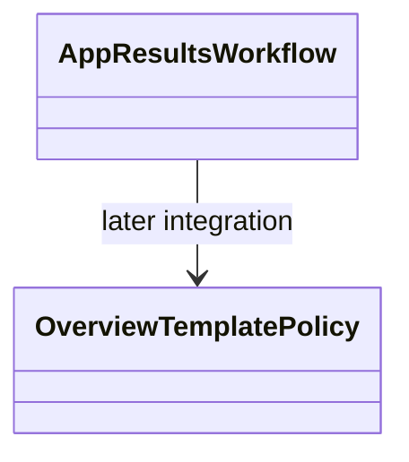

# AppResults — executable work orders



- **Primary Role:** Result selection, views, databank actions and exports.
- **Dependencies:** AppCore result/metric contracts; AppHome slots.
- **Outputs / Downstream Role:** Result projections, rendered result tabs and export receipts.
- **Execution boundary:** each READY work order is one tested commit. A BLOCKED work order authorizes no code, placeholder endpoint, UI success state or feature-completion claim. Source evidence below does not authorize choosing missing behavior.
- **Baseline:** `f5c7d12d5715b8ebee55165b8eddad9068f83cb9`; normative work orders; owner review pending. Implementation status belongs only in the domain README.
- **Shared response contract:** existing legacy API adapters preserve `StandardResponse.success(*, message, metadata, data)` and `StandardResponse.failure(*, message, metadata, error)`, `ResponseMetadata` and `StandardError` from canonical `app/core/lib/responses.py`. New instance envelopes use `StandardResponse[T](request_id: str, data: T, revision: int | None = None)` only where the individual order specifies that contract; structured new errors use `app/core/lib/errors.py::DomainError`. Pure helpers return their declared values. Preserve existing callers and translate envelopes only at an explicitly specified compatibility boundary.
- **Path rule:** CREATE paths are exact. No one-file-per-Java-class port, sibling workspace import, copied core engine or alternative file name is allowed.


## Source reassessment authority — 2026-10-30

The [workspace source review](research/workspaces-03-08-source-review.md) adds exact readable context to every blocked complete-contribution order in this file. Its source paths supplement the old Context to Read lists. Shared libraries are available locally; plugin bodies, UI consumers, templates and per-definition fixtures remain separate evidence. A complete-contribution order retains its status until its exact target contract and acceptance cases are specified. New bounded READY suborders below supersede only their named portion.

## Current-code migration audit and execution order

*Evidence:* `OBS-HARU-RES-REUSE-20261029`. This audit concerns migration suitability; domain README files remain the only implementation-status authority. The source files below are existing code, not permission to regenerate their components. Backend directories `app/workspace/results/` do not currently exist; a complete backend cannot be marked Direct fit from the React screen.

### Work order RES-M01: move the existing presentation as one revertible commit

*Feature:* Reuse the current workspace and its owned result/settings contributions without inventing a second UI. **READY after the app/web bootstrap and public host/result slot contracts are published.**
*Context to Read:* this order; every current source/test row below; `ui/package.json`; `ui/tsconfig.json`; `ui/vite.config.ts`; `app/web/workspaces/home/public.ts`; `app/web/workspaces/results/public.ts`. For Results itself, CREATE its `public.ts` as an export boundary only; export only the existing ProjectResults contribution types after Home owns their base slot type. Do not create a different shell.
*Implementation Files:* exact MOVE/ADAPT targets in the table; EDIT only the corresponding existing application route import and workspace registration to use the new entry component. No backend calculation code is authorized by this migration order.

| Current HaruQuantAI location | Target proposed location | Fit / action (migration audit) |
|---|---|---|
| `ui/app/workspace/Results/EquityChart.tsx` | `app/web/workspaces/results/EquityChart.tsx` | DIRECT FIT for presentation; move with local imports rewritten; source parity and backend behavior remain separately qualified |
| `ui/app/workspace/Results/ResultsWorkspace.tsx` | `app/web/workspaces/results/ResultsWorkspace.tsx` | DIRECT FIT for presentation; move with local imports rewritten; source parity and backend behavior remain separately qualified |
| `ui/app/workspace/Results/views/PortfolioCorrelationView.tsx` | `app/web/workspaces/results/views/PortfolioCorrelationView.tsx` | DIRECT FIT for presentation; move with local imports rewritten; source parity and backend behavior remain separately qualified |
| `ui/app/workspace/Results/views/TradeAnalysisView.tsx` | `app/web/workspaces/results/views/TradeAnalysisView.tsx` | DIRECT FIT for presentation; move with local imports rewritten; source parity and backend behavior remain separately qualified |
| `ui/app/workspace/Results/views/TradesOnChartView.tsx` | `app/web/workspaces/results/views/TradesOnChartView.tsx` | DIRECT FIT for presentation; move with local imports rewritten; source parity and backend behavior remain separately qualified |
| `ui/app/plugins/project/ResultsChart/chart.tsx` | `app/web/workspaces/results/ResultsChart/chart.tsx` | DIRECT FIT presentation; ADAPT controller services to canonical result/run projection; preserve local relative imports |
| `ui/app/plugins/project/ResultsChart/module.ts` | `app/web/workspaces/results/ResultsChart/module.ts` | DIRECT FIT presentation; ADAPT controller services to canonical result/run projection; preserve local relative imports |
| `ui/app/plugins/project/ResultsEquityChart/benchmark/Benchmark.ts` | `app/web/workspaces/results/ResultsEquityChart/benchmark/Benchmark.ts` | DIRECT FIT presentation; ADAPT controller services to canonical result/run projection; preserve local relative imports |
| `ui/app/plugins/project/ResultsEquityChart/benchmark/benchmark.tsx` | `app/web/workspaces/results/ResultsEquityChart/benchmark/benchmark.tsx` | DIRECT FIT presentation; ADAPT controller services to canonical result/run projection; preserve local relative imports |
| `ui/app/plugins/project/ResultsEquityChart/benchmark/BenchmarkCtrl.ts` | `app/web/workspaces/results/ResultsEquityChart/benchmark/BenchmarkCtrl.ts` | DIRECT FIT presentation; ADAPT controller services to canonical result/run projection; preserve local relative imports |
| `ui/app/plugins/project/ResultsEquityChart/equityChart.tsx` | `app/web/workspaces/results/ResultsEquityChart/equityChart.tsx` | DIRECT FIT presentation; ADAPT controller services to canonical result/run projection; preserve local relative imports |
| `ui/app/plugins/project/ResultsEquityChart/EquityChartCtrl.ts` | `app/web/workspaces/results/ResultsEquityChart/EquityChartCtrl.ts` | DIRECT FIT presentation; ADAPT controller services to canonical result/run projection; preserve local relative imports |
| `ui/app/plugins/project/ResultsEquityChart/module.ts` | `app/web/workspaces/results/ResultsEquityChart/module.ts` | DIRECT FIT presentation; ADAPT controller services to canonical result/run projection; preserve local relative imports |
| `ui/app/plugins/project/ResultsEquityChart/styles.css` | `app/web/workspaces/results/ResultsEquityChart/styles.css` | DIRECT FIT presentation; ADAPT controller services to canonical result/run projection; preserve local relative imports |
| `ui/app/plugins/project/ResultsOverview/module.ts` | `app/web/workspaces/results/ResultsOverview/module.ts` | DIRECT FIT presentation; ADAPT controller services to canonical result/run projection; preserve local relative imports |
| `ui/app/plugins/project/ResultsOverview/overview.tsx` | `app/web/workspaces/results/ResultsOverview/overview.tsx` | DIRECT FIT presentation; ADAPT controller services to canonical result/run projection; preserve local relative imports |
| `ui/app/plugins/project/ResultsOverview/ResultsOverviewCtrl.ts` | `app/web/workspaces/results/ResultsOverview/ResultsOverviewCtrl.ts` | DIRECT FIT presentation; ADAPT controller services to canonical result/run projection; preserve local relative imports |
| `ui/app/plugins/project/ResultsOverview/styles.css` | `app/web/workspaces/results/ResultsOverview/styles.css` | DIRECT FIT presentation; ADAPT controller services to canonical result/run projection; preserve local relative imports |
| `ui/app/plugins/project/ResultsPortfolioCorrelation/module.ts` | `app/web/workspaces/results/ResultsPortfolioCorrelation/module.ts` | DIRECT FIT presentation; ADAPT controller services to canonical result/run projection; preserve local relative imports |
| `ui/app/plugins/project/ResultsPortfolioCorrelation/portfolioCorrelation.tsx` | `app/web/workspaces/results/ResultsPortfolioCorrelation/portfolioCorrelation.tsx` | DIRECT FIT presentation; ADAPT controller services to canonical result/run projection; preserve local relative imports |
| `ui/app/plugins/project/ResultsPortfolioCorrelation/PortfolioCorrelationCtrl.ts` | `app/web/workspaces/results/ResultsPortfolioCorrelation/PortfolioCorrelationCtrl.ts` | DIRECT FIT presentation; ADAPT controller services to canonical result/run projection; preserve local relative imports |
| `ui/app/plugins/project/ResultsPortfolioCorrelation/tabs/correlationMatrix/correlationMatrix.tsx` | `app/web/workspaces/results/ResultsPortfolioCorrelation/tabs/correlationMatrix/correlationMatrix.tsx` | DIRECT FIT presentation; ADAPT controller services to canonical result/run projection; preserve local relative imports |
| `ui/app/plugins/project/ResultsProfileChart/module.ts` | `app/web/workspaces/results/ResultsProfileChart/module.ts` | DIRECT FIT presentation; ADAPT controller services to canonical result/run projection; preserve local relative imports |
| `ui/app/plugins/project/ResultsProfileChart/profileChart.tsx` | `app/web/workspaces/results/ResultsProfileChart/profileChart.tsx` | DIRECT FIT presentation; ADAPT controller services to canonical result/run projection; preserve local relative imports |
| `ui/app/plugins/project/ResultsProfileChart/ProfileChartCtrl.ts` | `app/web/workspaces/results/ResultsProfileChart/ProfileChartCtrl.ts` | DIRECT FIT presentation; ADAPT controller services to canonical result/run projection; preserve local relative imports |
| `ui/app/plugins/project/ResultsRobustnessTests/directives/robustnessAnalysis/robustnessAnalysis.tsx` | `app/web/workspaces/results/ResultsRobustnessTests/directives/robustnessAnalysis/robustnessAnalysis.tsx` | DIRECT FIT presentation; ADAPT controller services to canonical result/run projection; preserve local relative imports |
| `ui/app/plugins/project/ResultsRobustnessTests/module.ts` | `app/web/workspaces/results/ResultsRobustnessTests/module.ts` | DIRECT FIT presentation; ADAPT controller services to canonical result/run projection; preserve local relative imports |
| `ui/app/plugins/project/ResultsRobustnessTests/robustnessTests.tsx` | `app/web/workspaces/results/ResultsRobustnessTests/robustnessTests.tsx` | DIRECT FIT presentation; ADAPT controller services to canonical result/run projection; preserve local relative imports |
| `ui/app/plugins/project/ResultsRobustnessTests/RobustnessTestsResultsCtrl.ts` | `app/web/workspaces/results/ResultsRobustnessTests/RobustnessTestsResultsCtrl.ts` | DIRECT FIT presentation; ADAPT controller services to canonical result/run projection; preserve local relative imports |
| `ui/app/plugins/project/ResultsSourceCode/module.ts` | `app/web/workspaces/results/ResultsSourceCode/module.ts` | DIRECT FIT presentation; ADAPT controller services to canonical result/run projection; preserve local relative imports |
| `ui/app/plugins/project/ResultsSourceCode/sourceCode.tsx` | `app/web/workspaces/results/ResultsSourceCode/sourceCode.tsx` | DIRECT FIT presentation; ADAPT controller services to canonical result/run projection; preserve local relative imports |
| `ui/app/plugins/project/ResultsSourceCode/SourceCodeCtrl.ts` | `app/web/workspaces/results/ResultsSourceCode/SourceCodeCtrl.ts` | DIRECT FIT presentation; ADAPT controller services to canonical result/run projection; preserve local relative imports |
| `ui/app/plugins/project/ResultsSourceCode/styles.css` | `app/web/workspaces/results/ResultsSourceCode/styles.css` | DIRECT FIT presentation; ADAPT controller services to canonical result/run projection; preserve local relative imports |
| `ui/app/plugins/project/ResultsSPOverview/directives/spOverviewStats/spOverviewStats.tsx` | `app/web/workspaces/results/ResultsSPOverview/directives/spOverviewStats/spOverviewStats.tsx` | DIRECT FIT presentation; ADAPT controller services to canonical result/run projection; preserve local relative imports |
| `ui/app/plugins/project/ResultsSPOverview/module.ts` | `app/web/workspaces/results/ResultsSPOverview/module.ts` | DIRECT FIT presentation; ADAPT controller services to canonical result/run projection; preserve local relative imports |
| `ui/app/plugins/project/ResultsSPOverview/spOverview.tsx` | `app/web/workspaces/results/ResultsSPOverview/spOverview.tsx` | DIRECT FIT presentation; ADAPT controller services to canonical result/run projection; preserve local relative imports |
| `ui/app/plugins/project/ResultsSPOverview/SPOverviewCtrl.ts` | `app/web/workspaces/results/ResultsSPOverview/SPOverviewCtrl.ts` | DIRECT FIT presentation; ADAPT controller services to canonical result/run projection; preserve local relative imports |
| `ui/app/plugins/project/ResultsSPOverview/styles.css` | `app/web/workspaces/results/ResultsSPOverview/styles.css` | DIRECT FIT presentation; ADAPT controller services to canonical result/run projection; preserve local relative imports |
| `ui/app/plugins/project/ResultsStockpicker/module.ts` | `app/web/workspaces/results/ResultsStockpicker/module.ts` | DIRECT FIT presentation; ADAPT controller services to canonical result/run projection; preserve local relative imports |
| `ui/app/plugins/project/ResultsStockpicker/stockpicker.tsx` | `app/web/workspaces/results/ResultsStockpicker/stockpicker.tsx` | DIRECT FIT presentation; ADAPT controller services to canonical result/run projection; preserve local relative imports |
| `ui/app/plugins/project/ResultsStrategyConfig/module.ts` | `app/web/workspaces/results/ResultsStrategyConfig/module.ts` | DIRECT FIT presentation; ADAPT controller services to canonical result/run projection; preserve local relative imports |
| `ui/app/plugins/project/ResultsStrategyConfig/strategyconfig.tsx` | `app/web/workspaces/results/ResultsStrategyConfig/strategyconfig.tsx` | DIRECT FIT presentation; ADAPT controller services to canonical result/run projection; preserve local relative imports |
| `ui/app/plugins/project/ResultsStrategyConfig/styles.css` | `app/web/workspaces/results/ResultsStrategyConfig/styles.css` | DIRECT FIT presentation; ADAPT controller services to canonical result/run projection; preserve local relative imports |
| `ui/app/plugins/project/ResultsTradeAnalysis/controllers/TradeAnalysisCtrl.ts` | `app/web/workspaces/results/ResultsTradeAnalysis/controllers/TradeAnalysisCtrl.ts` | DIRECT FIT presentation; ADAPT controller services to canonical result/run projection; preserve local relative imports |
| `ui/app/plugins/project/ResultsTradeAnalysis/directives/tradeAnalysisPanel.tsx` | `app/web/workspaces/results/ResultsTradeAnalysis/directives/tradeAnalysisPanel.tsx` | DIRECT FIT presentation; ADAPT controller services to canonical result/run projection; preserve local relative imports |
| `ui/app/plugins/project/ResultsTradeAnalysis/module.ts` | `app/web/workspaces/results/ResultsTradeAnalysis/module.ts` | DIRECT FIT presentation; ADAPT controller services to canonical result/run projection; preserve local relative imports |
| `ui/app/plugins/project/ResultsTradeAnalysis/styles/TradeAnalysis.css` | `app/web/workspaces/results/ResultsTradeAnalysis/styles/TradeAnalysis.css` | DIRECT FIT presentation; ADAPT controller services to canonical result/run projection; preserve local relative imports |
| `ui/app/plugins/project/ResultsTradeAnalysis/views/tradeAnalysis.tsx` | `app/web/workspaces/results/ResultsTradeAnalysis/views/tradeAnalysis.tsx` | DIRECT FIT presentation; ADAPT controller services to canonical result/run projection; preserve local relative imports |
| `ui/app/plugins/project/ResultsTradeList/module.ts` | `app/web/workspaces/results/ResultsTradeList/module.ts` | DIRECT FIT presentation; ADAPT controller services to canonical result/run projection; preserve local relative imports |
| `ui/app/plugins/project/ResultsTradeList/ResultsTradelistCtrl.ts` | `app/web/workspaces/results/ResultsTradeList/ResultsTradelistCtrl.ts` | DIRECT FIT presentation; ADAPT controller services to canonical result/run projection; preserve local relative imports |
| `ui/app/plugins/project/ResultsTradeList/style.css` | `app/web/workspaces/results/ResultsTradeList/style.css` | DIRECT FIT presentation; ADAPT controller services to canonical result/run projection; preserve local relative imports |
| `ui/app/plugins/project/ResultsTradeList/tradeList.tsx` | `app/web/workspaces/results/ResultsTradeList/tradeList.tsx` | DIRECT FIT presentation; ADAPT controller services to canonical result/run projection; preserve local relative imports |
| `ui/app/plugins/project/ResultsTradelistViews/module.ts` | `app/web/workspaces/results/ResultsTradelistViews/module.ts` | DIRECT FIT presentation; ADAPT controller services to canonical result/run projection; preserve local relative imports |
| `ui/app/plugins/project/ResultsTradelistViews/tradelistViews.tsx` | `app/web/workspaces/results/ResultsTradelistViews/tradelistViews.tsx` | DIRECT FIT presentation; ADAPT controller services to canonical result/run projection; preserve local relative imports |
| `ui/app/plugins/project/ResultsTradelistViews/TradelistViewsCtrl.ts` | `app/web/workspaces/results/ResultsTradelistViews/TradelistViewsCtrl.ts` | DIRECT FIT presentation; ADAPT controller services to canonical result/run projection; preserve local relative imports |
| `ui/app/plugins/databank/DatabankFilterByCorrelation/databankFilterByCorrelationPopup.tsx` | `app/web/workspaces/results/databank/DatabankFilterByCorrelation/databankFilterByCorrelationPopup.tsx` | DIRECT FIT menu/form presentation; ADAPT commands to result repository; no fixture success receipt |
| `ui/app/plugins/databank/DatabankFilterByCorrelation/module.ts` | `app/web/workspaces/results/databank/DatabankFilterByCorrelation/module.ts` | DIRECT FIT menu/form presentation; ADAPT commands to result repository; no fixture success receipt |
| `ui/app/plugins/databank/DatabankRename/ui/databankRenamePopup.tsx` | `app/web/workspaces/results/databank/DatabankRename/ui/databankRenamePopup.tsx` | DIRECT FIT menu/form presentation; ADAPT commands to result repository; no fixture success receipt |
| `ui/app/plugins/databank/DatabankRename/ui/DatabankRenamePopupCtrl.ts` | `app/web/workspaces/results/databank/DatabankRename/ui/DatabankRenamePopupCtrl.ts` | DIRECT FIT menu/form presentation; ADAPT commands to result repository; no fixture success receipt |
| `ui/app/plugins/databank/DatabankRename/ui/module.ts` | `app/web/workspaces/results/databank/DatabankRename/ui/module.ts` | DIRECT FIT menu/form presentation; ADAPT commands to result repository; no fixture success receipt |
| `ui/app/plugins/databank/DatabankRename/ui/styles.css` | `app/web/workspaces/results/databank/DatabankRename/ui/styles.css` | DIRECT FIT menu/form presentation; ADAPT commands to result repository; no fixture success receipt |
| `ui/app/plugins/databank/fixtures.ts` | `app/web/workspaces/results/databank/fixtures.ts` | DIRECT FIT menu/form presentation; ADAPT commands to result repository; no fixture success receipt |
| `ui/app/plugins/databank/ProjectDatabanks/databankColumns.ts` | `app/web/workspaces/results/databank/ProjectDatabanks/databankColumns.ts` | DIRECT FIT menu/form presentation; ADAPT commands to result repository; no fixture success receipt |
| `ui/app/plugins/databank/ProjectDatabanks/DatabankCtrl.ts` | `app/web/workspaces/results/databank/ProjectDatabanks/DatabankCtrl.ts` | DIRECT FIT menu/form presentation; ADAPT commands to result repository; no fixture success receipt |
| `ui/app/plugins/databank/ProjectDatabanks/DatabankDialogs.tsx` | `app/web/workspaces/results/databank/ProjectDatabanks/DatabankDialogs.tsx` | DIRECT FIT menu/form presentation; ADAPT commands to result repository; no fixture success receipt |
| `ui/app/plugins/databank/ProjectDatabanks/DatabanksCtrl.ts` | `app/web/workspaces/results/databank/ProjectDatabanks/DatabanksCtrl.ts` | DIRECT FIT menu/form presentation; ADAPT commands to result repository; no fixture success receipt |
| `ui/app/plugins/databank/ProjectDatabanks/DatabankService.ts` | `app/web/workspaces/results/databank/ProjectDatabanks/DatabankService.ts` | DIRECT FIT menu/form presentation; ADAPT commands to result repository; no fixture success receipt |
| `ui/app/plugins/databank/ProjectDatabanks/databankStore.ts` | `app/web/workspaces/results/databank/ProjectDatabanks/databankStore.ts` | DIRECT FIT menu/form presentation; ADAPT commands to result repository; no fixture success receipt |
| `ui/app/plugins/databank/ProjectDatabanks/DatabankToolbar.tsx` | `app/web/workspaces/results/databank/ProjectDatabanks/DatabankToolbar.tsx` | DIRECT FIT menu/form presentation; ADAPT commands to result repository; no fixture success receipt |
| `ui/app/plugins/databank/ProjectDatabanks/FilterByCorrelationModal.tsx` | `app/web/workspaces/results/databank/ProjectDatabanks/FilterByCorrelationModal.tsx` | DIRECT FIT menu/form presentation; ADAPT commands to result repository; no fixture success receipt |
| `ui/app/plugins/databank/ProjectDatabanks/module.ts` | `app/web/workspaces/results/databank/ProjectDatabanks/module.ts` | DIRECT FIT menu/form presentation; ADAPT commands to result repository; no fixture success receipt |
| `ui/app/plugins/databank/ProjectDatabanks/StrategyTable.tsx` | `app/web/workspaces/results/databank/ProjectDatabanks/StrategyTable.tsx` | DIRECT FIT menu/form presentation; ADAPT commands to result repository; no fixture success receipt |
| `ui/app/plugins/databank/ProjectDatabanks/styles.css` | `app/web/workspaces/results/databank/ProjectDatabanks/styles.css` | DIRECT FIT menu/form presentation; ADAPT commands to result repository; no fixture success receipt |
| `ui/app/plugins/databank/ProjectDatabanks/views/databank.tsx` | `app/web/workspaces/results/databank/ProjectDatabanks/views/databank.tsx` | DIRECT FIT menu/form presentation; ADAPT commands to result repository; no fixture success receipt |
| `ui/app/plugins/databank/ProjectDatabanks/views/databanks.tsx` | `app/web/workspaces/results/databank/ProjectDatabanks/views/databanks.tsx` | DIRECT FIT menu/form presentation; ADAPT commands to result repository; no fixture success receipt |
| `ui/app/plugins/databank/ResultsDatabankActions/clearAll/module.ts` | `app/web/workspaces/results/databank/ResultsDatabankActions/clearAll/module.ts` | DIRECT FIT menu/form presentation; ADAPT commands to result repository; no fixture success receipt |
| `ui/app/plugins/databank/ResultsDatabankActions/DatabankActionsService.ts` | `app/web/workspaces/results/databank/ResultsDatabankActions/DatabankActionsService.ts` | DIRECT FIT menu/form presentation; ADAPT commands to result repository; no fixture success receipt |
| `ui/app/plugins/databank/ResultsDatabankActions/delete/module.ts` | `app/web/workspaces/results/databank/ResultsDatabankActions/delete/module.ts` | DIRECT FIT menu/form presentation; ADAPT commands to result repository; no fixture success receipt |
| `ui/app/plugins/databank/ResultsDatabankActions/load/loadBtnCtrl.ts` | `app/web/workspaces/results/databank/ResultsDatabankActions/load/loadBtnCtrl.ts` | DIRECT FIT menu/form presentation; ADAPT commands to result repository; no fixture success receipt |
| `ui/app/plugins/databank/ResultsDatabankActions/load/loadPopup.tsx` | `app/web/workspaces/results/databank/ResultsDatabankActions/load/loadPopup.tsx` | DIRECT FIT menu/form presentation; ADAPT commands to result repository; no fixture success receipt |
| `ui/app/plugins/databank/ResultsDatabankActions/load/LoadPopupCtrl.ts` | `app/web/workspaces/results/databank/ResultsDatabankActions/load/LoadPopupCtrl.ts` | DIRECT FIT menu/form presentation; ADAPT commands to result repository; no fixture success receipt |
| `ui/app/plugins/databank/ResultsDatabankActions/load/LoadService.ts` | `app/web/workspaces/results/databank/ResultsDatabankActions/load/LoadService.ts` | DIRECT FIT menu/form presentation; ADAPT commands to result repository; no fixture success receipt |
| `ui/app/plugins/databank/ResultsDatabankActions/load/module.ts` | `app/web/workspaces/results/databank/ResultsDatabankActions/load/module.ts` | DIRECT FIT menu/form presentation; ADAPT commands to result repository; no fixture success receipt |
| `ui/app/plugins/databank/ResultsDatabankActions/load/styles.css` | `app/web/workspaces/results/databank/ResultsDatabankActions/load/styles.css` | DIRECT FIT menu/form presentation; ADAPT commands to result repository; no fixture success receipt |
| `ui/app/plugins/databank/ResultsDatabankActions/module.ts` | `app/web/workspaces/results/databank/ResultsDatabankActions/module.ts` | DIRECT FIT menu/form presentation; ADAPT commands to result repository; no fixture success receipt |
| `ui/app/plugins/databank/ResultsDatabankActions/portfolio/merge/module.ts` | `app/web/workspaces/results/databank/ResultsDatabankActions/portfolio/merge/module.ts` | DIRECT FIT menu/form presentation; ADAPT commands to result repository; no fixture success receipt |
| `ui/app/plugins/databank/ResultsDatabankActions/portfolio/mergeWF/module.ts` | `app/web/workspaces/results/databank/ResultsDatabankActions/portfolio/mergeWF/module.ts` | DIRECT FIT menu/form presentation; ADAPT commands to result repository; no fixture success receipt |
| `ui/app/plugins/databank/ResultsDatabankActions/portfolio/module.ts` | `app/web/workspaces/results/databank/ResultsDatabankActions/portfolio/module.ts` | DIRECT FIT menu/form presentation; ADAPT commands to result repository; no fixture success receipt |
| `ui/app/plugins/databank/ResultsDatabankActions/portfolio/moveToPC/module.ts` | `app/web/workspaces/results/databank/ResultsDatabankActions/portfolio/moveToPC/module.ts` | DIRECT FIT menu/form presentation; ADAPT commands to result repository; no fixture success receipt |
| `ui/app/plugins/databank/ResultsDatabankActions/portfolio/moveToPM/module.ts` | `app/web/workspaces/results/databank/ResultsDatabankActions/portfolio/moveToPM/module.ts` | DIRECT FIT menu/form presentation; ADAPT commands to result repository; no fixture success receipt |
| `ui/app/plugins/databank/ResultsDatabankActions/portfolio/split/module.ts` | `app/web/workspaces/results/databank/ResultsDatabankActions/portfolio/split/module.ts` | DIRECT FIT menu/form presentation; ADAPT commands to result repository; no fixture success receipt |
| `ui/app/plugins/databank/ResultsDatabankActions/refresh/module.ts` | `app/web/workspaces/results/databank/ResultsDatabankActions/refresh/module.ts` | DIRECT FIT menu/form presentation; ADAPT commands to result repository; no fixture success receipt |
| `ui/app/plugins/databank/ResultsDatabankActions/retest/module.ts` | `app/web/workspaces/results/databank/ResultsDatabankActions/retest/module.ts` | DIRECT FIT menu/form presentation; ADAPT commands to result repository; no fixture success receipt |
| `ui/app/plugins/databank/ResultsDatabankActions/retest/retestDialog.tsx` | `app/web/workspaces/results/databank/ResultsDatabankActions/retest/retestDialog.tsx` | DIRECT FIT menu/form presentation; ADAPT commands to result repository; no fixture success receipt |
| `ui/app/plugins/databank/ResultsDatabankActions/retest/RetestDialogCtrl.ts` | `app/web/workspaces/results/databank/ResultsDatabankActions/retest/RetestDialogCtrl.ts` | DIRECT FIT menu/form presentation; ADAPT commands to result repository; no fixture success receipt |
| `ui/app/plugins/databank/ResultsDatabankActions/save/exportCSV/module.ts` | `app/web/workspaces/results/databank/ResultsDatabankActions/save/exportCSV/module.ts` | DIRECT FIT menu/form presentation; ADAPT commands to result repository; no fixture success receipt |
| `ui/app/plugins/databank/ResultsDatabankActions/save/exportHTML/module.ts` | `app/web/workspaces/results/databank/ResultsDatabankActions/save/exportHTML/module.ts` | DIRECT FIT menu/form presentation; ADAPT commands to result repository; no fixture success receipt |
| `ui/app/plugins/databank/ResultsDatabankActions/save/exportPDF/module.ts` | `app/web/workspaces/results/databank/ResultsDatabankActions/save/exportPDF/module.ts` | DIRECT FIT menu/form presentation; ADAPT commands to result repository; no fixture success receipt |
| `ui/app/plugins/databank/ResultsDatabankActions/save/exportStrategyTrades/module.ts` | `app/web/workspaces/results/databank/ResultsDatabankActions/save/exportStrategyTrades/module.ts` | DIRECT FIT menu/form presentation; ADAPT commands to result repository; no fixture success receipt |
| `ui/app/plugins/databank/ResultsDatabankActions/save/module.ts` | `app/web/workspaces/results/databank/ResultsDatabankActions/save/module.ts` | DIRECT FIT menu/form presentation; ADAPT commands to result repository; no fixture success receipt |
| `ui/app/plugins/databank/ResultsDatabankActions/save/saveBtnPopupCtrl.ts` | `app/web/workspaces/results/databank/ResultsDatabankActions/save/saveBtnPopupCtrl.ts` | DIRECT FIT menu/form presentation; ADAPT commands to result repository; no fixture success receipt |
| `ui/app/plugins/databank/ResultsDatabankActions/save/SaveButtonService.ts` | `app/web/workspaces/results/databank/ResultsDatabankActions/save/SaveButtonService.ts` | DIRECT FIT menu/form presentation; ADAPT commands to result repository; no fixture success receipt |
| `ui/app/plugins/databank/ResultsDatabankActions/save/savePopup.tsx` | `app/web/workspaces/results/databank/ResultsDatabankActions/save/savePopup.tsx` | DIRECT FIT menu/form presentation; ADAPT commands to result repository; no fixture success receipt |
| `ui/app/plugins/databank/ResultsDatabankActions/save/saveToSQ3/module.ts` | `app/web/workspaces/results/databank/ResultsDatabankActions/save/saveToSQ3/module.ts` | DIRECT FIT menu/form presentation; ADAPT commands to result repository; no fixture success receipt |
| `ui/app/plugins/databank/ResultsDatabankActions/save/saveToSQ4/module.ts` | `app/web/workspaces/results/databank/ResultsDatabankActions/save/saveToSQ4/module.ts` | DIRECT FIT menu/form presentation; ADAPT commands to result repository; no fixture success receipt |
| `ui/app/plugins/databank/ResultsDatabankActions/save/sourceCode/module.ts` | `app/web/workspaces/results/databank/ResultsDatabankActions/save/sourceCode/module.ts` | DIRECT FIT menu/form presentation; ADAPT commands to result repository; no fixture success receipt |
| `ui/app/plugins/databank/ResultsDatabankActions/tools/compareStrategies/CompareStrategiesCtrl.ts` | `app/web/workspaces/results/databank/ResultsDatabankActions/tools/compareStrategies/CompareStrategiesCtrl.ts` | DIRECT FIT menu/form presentation; ADAPT commands to result repository; no fixture success receipt |
| `ui/app/plugins/databank/ResultsDatabankActions/tools/compareStrategies/compareStrategiesPopup.tsx` | `app/web/workspaces/results/databank/ResultsDatabankActions/tools/compareStrategies/compareStrategiesPopup.tsx` | DIRECT FIT menu/form presentation; ADAPT commands to result repository; no fixture success receipt |
| `ui/app/plugins/databank/ResultsDatabankActions/tools/compareStrategies/CompareStrategiesPopupCtrl.ts` | `app/web/workspaces/results/databank/ResultsDatabankActions/tools/compareStrategies/CompareStrategiesPopupCtrl.ts` | DIRECT FIT menu/form presentation; ADAPT commands to result repository; no fixture success receipt |
| `ui/app/plugins/databank/ResultsDatabankActions/tools/compareStrategies/CompareStrategiesService.ts` | `app/web/workspaces/results/databank/ResultsDatabankActions/tools/compareStrategies/CompareStrategiesService.ts` | DIRECT FIT menu/form presentation; ADAPT commands to result repository; no fixture success receipt |
| `ui/app/plugins/databank/ResultsDatabankActions/tools/compareStrategies/module.ts` | `app/web/workspaces/results/databank/ResultsDatabankActions/tools/compareStrategies/module.ts` | DIRECT FIT menu/form presentation; ADAPT commands to result repository; no fixture success receipt |
| `ui/app/plugins/databank/ResultsDatabankActions/tools/edit/editParameters/EditParametersCtrl.ts` | `app/web/workspaces/results/databank/ResultsDatabankActions/tools/edit/editParameters/EditParametersCtrl.ts` | DIRECT FIT menu/form presentation; ADAPT commands to result repository; no fixture success receipt |
| `ui/app/plugins/databank/ResultsDatabankActions/tools/edit/editParameters/module.ts` | `app/web/workspaces/results/databank/ResultsDatabankActions/tools/edit/editParameters/module.ts` | DIRECT FIT menu/form presentation; ADAPT commands to result repository; no fixture success receipt |
| `ui/app/plugins/databank/ResultsDatabankActions/tools/edit/editStrategy/EditStrategyCtrl.ts` | `app/web/workspaces/results/databank/ResultsDatabankActions/tools/edit/editStrategy/EditStrategyCtrl.ts` | DIRECT FIT menu/form presentation; ADAPT commands to result repository; no fixture success receipt |
| `ui/app/plugins/databank/ResultsDatabankActions/tools/edit/editStrategy/module.ts` | `app/web/workspaces/results/databank/ResultsDatabankActions/tools/edit/editStrategy/module.ts` | DIRECT FIT menu/form presentation; ADAPT commands to result repository; no fixture success receipt |
| `ui/app/plugins/databank/ResultsDatabankActions/tools/edit/module.ts` | `app/web/workspaces/results/databank/ResultsDatabankActions/tools/edit/module.ts` | DIRECT FIT menu/form presentation; ADAPT commands to result repository; no fixture success receipt |
| `ui/app/plugins/databank/ResultsDatabankActions/tools/module.ts` | `app/web/workspaces/results/databank/ResultsDatabankActions/tools/module.ts` | DIRECT FIT menu/form presentation; ADAPT commands to result repository; no fixture success receipt |
| `ui/app/plugins/databank/ResultsDatabankActions/tools/runCa/module.ts` | `app/web/workspaces/results/databank/ResultsDatabankActions/tools/runCa/module.ts` | DIRECT FIT menu/form presentation; ADAPT commands to result repository; no fixture success receipt |
| `ui/app/plugins/databank/ResultsDatabankActions/tools/runCa/RunCaCtrl.ts` | `app/web/workspaces/results/databank/ResultsDatabankActions/tools/runCa/RunCaCtrl.ts` | DIRECT FIT menu/form presentation; ADAPT commands to result repository; no fixture success receipt |
| `ui/app/plugins/databank/ResultsDatabankActions/tools/select/DatabankSelectService.ts` | `app/web/workspaces/results/databank/ResultsDatabankActions/tools/select/DatabankSelectService.ts` | DIRECT FIT menu/form presentation; ADAPT commands to result repository; no fixture success receipt |
| `ui/app/plugins/databank/ResultsDatabankActions/tools/select/failed/module.ts` | `app/web/workspaces/results/databank/ResultsDatabankActions/tools/select/failed/module.ts` | DIRECT FIT menu/form presentation; ADAPT commands to result repository; no fixture success receipt |
| `ui/app/plugins/databank/ResultsDatabankActions/tools/select/module.ts` | `app/web/workspaces/results/databank/ResultsDatabankActions/tools/select/module.ts` | DIRECT FIT menu/form presentation; ADAPT commands to result repository; no fixture success receipt |
| `ui/app/plugins/databank/ResultsDatabankActions/tools/select/passed/module.ts` | `app/web/workspaces/results/databank/ResultsDatabankActions/tools/select/passed/module.ts` | DIRECT FIT menu/form presentation; ADAPT commands to result repository; no fixture success receipt |
| `ui/app/plugins/databank/ResultsDatabankActions/tools/setNote/module.ts` | `app/web/workspaces/results/databank/ResultsDatabankActions/tools/setNote/module.ts` | DIRECT FIT menu/form presentation; ADAPT commands to result repository; no fixture success receipt |
| `ui/app/plugins/databank/ResultsDatabankActions/tools/setNote/setNote.tsx` | `app/web/workspaces/results/databank/ResultsDatabankActions/tools/setNote/setNote.tsx` | DIRECT FIT menu/form presentation; ADAPT commands to result repository; no fixture success receipt |
| `ui/app/plugins/databank/ResultsDatabankActions/tools/setNote/SetNoteCtrl.ts` | `app/web/workspaces/results/databank/ResultsDatabankActions/tools/setNote/SetNoteCtrl.ts` | DIRECT FIT menu/form presentation; ADAPT commands to result repository; no fixture success receipt |
| `ui/app/plugins/databank/ResultsDatabankActions/tools/setNote/SetNotePopupCtrl.ts` | `app/web/workspaces/results/databank/ResultsDatabankActions/tools/setNote/SetNotePopupCtrl.ts` | DIRECT FIT menu/form presentation; ADAPT commands to result repository; no fixture success receipt |
| `ui/app/plugins/databank/ResultsDatabankViews/databankViews.tsx` | `app/web/workspaces/results/databank/ResultsDatabankViews/databankViews.tsx` | DIRECT FIT menu/form presentation; ADAPT commands to result repository; no fixture success receipt |
| `ui/app/plugins/databank/ResultsDatabankViews/DatabankViewsCtrl.ts` | `app/web/workspaces/results/databank/ResultsDatabankViews/DatabankViewsCtrl.ts` | DIRECT FIT menu/form presentation; ADAPT commands to result repository; no fixture success receipt |
| `ui/app/plugins/databank/ResultsDatabankViews/DatabankViewsService.ts` | `app/web/workspaces/results/databank/ResultsDatabankViews/DatabankViewsService.ts` | DIRECT FIT menu/form presentation; ADAPT commands to result repository; no fixture success receipt |
| `ui/app/plugins/databank/ResultsDatabankViews/module.ts` | `app/web/workspaces/results/databank/ResultsDatabankViews/module.ts` | DIRECT FIT menu/form presentation; ADAPT commands to result repository; no fixture success receipt |
| `ui/app/plugins/databank/ResultsDatabankViews/styles.css` | `app/web/workspaces/results/databank/ResultsDatabankViews/styles.css` | DIRECT FIT menu/form presentation; ADAPT commands to result repository; no fixture success receipt |
| `ui/tests/unit/workspace/Results/portfolioCorrelation.test.ts` | `app/web/tests/workspaces/results/portfolioCorrelation.test.ts` | MOVE existing assertions unchanged; rewrite import paths only; this qualifies current preview behavior, not donor numerical parity |
| `ui/tests/unit/workspace/Results/tradeAnalysis.test.ts` | `app/web/tests/workspaces/results/tradeAnalysis.test.ts` | MOVE existing assertions unchanged; rewrite import paths only; this qualifies current preview behavior, not donor numerical parity |
| `ui/tests/unit/workspace/Results/tradesOnChart.test.ts` | `app/web/tests/workspaces/results/tradesOnChart.test.ts` | MOVE existing assertions unchanged; rewrite import paths only; this qualifies current preview behavior, not donor numerical parity |

*Functional Requirements & Implementation:*
- [ ] `ResultsWorkspace()` -> Retain component exports, props, rendered labels, keyboard actions, cancellation/unmount cleanup and CSS behavior from each current source row. Rewrite relative imports to the table targets. Consume shared Home and Results through their `public.ts` exports; do not import another workspace's private module or copy ProjectWorkbench.
- [ ] `ResultsWorkspace()` -> Keep fixture/timer execution explicitly in the existing preview mode until its replacement service work order passes. Moving a screen does not authorize reporting a generated strategy, finished retest, optimized parameter or saved portfolio as a real backend result. The current clients using fixed RSI/demoInputs and `/executions` are adaptation candidates, not verified workspace APIs.
- [ ] `migration import guard` -> Run `rg -n 'ui/app/workspace/Results|plugins/project/ProjectWorkbench' app/web/workspaces/results`. Expected exit `1` and no lines. Rewrite migrated tests to their exact target imports; preserve current assertions and test names.
- [ ] `existing tests` -> Before moving, run `npm --prefix ui test -- tests/unit/workspace/Results` (Portfolio Master uses `tests/unit/workspace/Portfolio/portfolioMaster.test.ts`). After moving run `npm --prefix app/web test -- tests/workspaces/results` then `npm --prefix app/web run typecheck` then `npm --prefix app/web run build`; all must exit `0`. These commands prove migration behavior only. Record executed command, UTC timestamp and counts in the owner README when actually executed; this order does not mark future validation passed.
*Commit:* `refactor(results): move owned workspace presentation`. This single commit includes only the listed moves, direct import rewrites and registration change. UI integration work is separate from implementing donor engines.

*Shared results ownership:* ProjectResults and all Results* contribution implementations are owned by AppResults. Builder, Retester, Optimizer and portfolio workspaces register configured contributions; none gets a private copy of trade lists, overview, source-code rendering, correlation or shared engine progress. Shared base workbench remains AppHome.


```json
{
  "id": "OBS-HARU-RES-REUSE-20261029",
  "classification": "observed",
  "confidence": "high",
  "claim": "ResultsWorkspace and result contributions contain reusable presentation plus mock source/projection values.",
  "sources": [
    {
      "path": "ui/app/workspace/Results/ResultsWorkspace.tsx",
      "sha256": "348b01406669da68ca4d8b6332171ef0279537f83fa0fbbca34c7dc8ee04cee1"
    }
  ],
  "target_domain": "app/workspaces/results",
  "feature_ids": [],
  "requirement_ids": [],
  "decision_ids": [],
  "registration_gap": "Register missing FR/DEC IDs in the owning domain README before production implementation; this planning task does not edit registries.",
  "limitations": "No existing complete Results backend was found; passing UI tests is not donor report parity.",
  "validation": {
    "status": "passed",
    "executed_at": "2026-10-29T10:13:19.769410+00:00",
    "procedure": "Read ResultsWorkspace and focused result unit tests; execute combined 13-file/72-test UI command.",
    "expected_observation": "13 focused UI test files, 72 tests passed; result views still contain mock projection/source values.",
    "actual_observation": "13 focused UI test files, 72 tests passed; result views still contain mock projection/source values.",
    "artifacts": [
      "ui/app/workspace/Results/ResultsWorkspace.tsx@sha256:348b01406669da68ca4d8b6332171ef0279537f83fa0fbbca34c7dc8ee04cee1"
    ]
  },
  "repository_commit": "f5c7d12d5715b8ebee55165b8eddad9068f83cb9",
  "review_state": "source-inspected-owner-review-pending",
  "contains_proprietary_source": false,
  "contains_sensitive_data": false,
  "contains_personal_data": false,
  "paraphrased_behavior_only": true,
  "supersedes_records": [],
  "superseded_by": []
}
```

## Phase 1: directly specified behavior

### Work order RES-001: overview-template selection helper
*Feature:* Select the same initial overview template as the inspected controller. **READY after test bootstrap.** This commit does not implement report HTML or its API.
*Implementation Files:*
- **Donor:** `DONOR_REFERENCE_ROOT/internal/plugins/ResultsOverview/ResultsOverviewCtrl.js`.
- **Backend CREATE:** `app/workspaces/results/overview_template_policy.py`.
- **Frontend:** no file created or edited; result views consume this policy through the later overview service, not a second TypeScript implementation.
- **Tests CREATE:** `tests/workspaces/results/test_overview_template_policy.py`.
*Context to Read:* this feature text; the donor file above; `pyproject.toml` for the existing pytest dependency. Read no other workspace.
*Evidence ID:* `OBS-145-OVERVIEW-TEMPLATE-001`. The class name and type guards are target helper decisions; the selection branches are observed.
*Functional Requirements & Implementation:*
- [ ] `OverviewTemplatePolicy.select(values: tuple[str, ...]) -> str` -> Return `"SQDefault"` for an empty tuple or a tuple containing that exact value; otherwise return `values[0]`. Preserve case and ordering; do not sort, deduplicate, trim or normalize input strings.
- [ ] `OverviewTemplatePolicy.select(values)` -> Raise `TypeError("values must be a tuple of strings")` when the outer object is not a tuple or any item is not `str`. This is a helper guard, not an asserted SQX validation rule.
- [ ] `TestOverviewTemplatePolicy.test_selection()` -> Assert `() -> "SQDefault"`, `("A", "SQDefault") -> "SQDefault"`, `("A", "B") -> "A"`, and `("sqdefault",) -> "sqdefault"`.
- [ ] `TestOverviewTemplatePolicy.test_type_error()` -> Assert `[]` and `(None,)` raise the exact TypeError above; assert the input tuple is unchanged after a valid call.
*Done command:* `uv run python -m pytest tests/workspaces/results/test_overview_template_policy.py -q` -> exit `0`, four parameterized selection rows and two invalid rows pass. No HTTP server or donor process is started.
*Commit:* `feat(results): add overview template selection policy`. Only the two CREATE files belong in this commit.

## Phase 2: complete module scope — READY

Each module below is retained in full scope. Its proposed files are reserved names, not permission to fill missing semantics. The senior planner must issue a revised READY order with complete signatures, literals and expected results before an executor starts that module. No acceptance test command can prove an unspecified contract; therefore blocked modules have no implementation commit.

### `AppResults` — READY

*Source reassessment — 2026-10-30:* [Exact available source and declarations](research/workspaces-03-08-source-review.md#appresults). Readable shared-library context is now available in `DONOR_REFERENCE_ROOT/internal/libs/`; this removes the shared-bytecode-access obstacle, but does not by itself release this complete-workflow order. Located 2 current plugin JavaScript files and decompiled primary Java files recovered in data/reference-donor/internal/plugins/`AppResults`. The linked review replaces carrier-only lookup as the research starting point; original unresolved target-model and acceptance gates below remain in force.

*Feature:* Full `AppResults` behavior; this is not completed by the helper commit above.
*Implementation Files (reserved, no code authorized):*
- **Donor:** `DONOR_REFERENCE_ROOT/internal/plugins/AppResults`.
- **Backend:** `app/workspaces/results/app_results.py`.
- **Frontend:** `app/web/workspaces/results/ResultsWorkspace.tsx`.
- **Backend tests:** `tests/workspaces/results/test_app_results.py`.
- **Frontend tests:** `app/web/tests/results/AppResults.test.tsx`.
*Context to Read:* `DONOR_REFERENCE_ROOT/internal/plugins/AppResults/module.js`.
*Evidence and limit:* `OBS-145-OVERVIEW-TEMPLATE-001` establishes only the READY behavior described above, not this module's full workflow. Literal frontend request vocabulary observed during this pass: `project/getDataItems`
*Exact unresolved contract:* The full action request/response schema, state transitions, persisted fields/defaults and invalid-operation behavior are not locked to independent fixtures.
*Executor action:* do not create the reserved files, signatures, constants, schemas or test expectations for this module. Report this feature heading and the exact unresolved contract to the senior planner. Do not replace the missing contract with a conventional implementation.
*Release condition:* a later work order cites a verbatim behavior evidence ID for `AppResults`, fixes every input/output/default/error/persistence transition, provides numerical or state fixtures, and names test commands expected to exit `0`. A source directory or action-name list alone does not meet this condition.

### `CustomDatabankActions` — READY

*Source reassessment — 2026-10-30:* [Exact available source and declarations](research/workspaces-03-08-source-review.md#customdatabankactions). Readable shared-library context is now available in `DONOR_REFERENCE_ROOT/internal/libs/`; this removes the shared-bytecode-access obstacle, but does not by itself release this complete-workflow order. Located 6 current plugin JavaScript files and decompiled primary Java files recovered in data/reference-donor/internal/plugins/`CustomDatabankActions`. The linked review replaces carrier-only lookup as the research starting point; original unresolved target-model and acceptance gates below remain in force.

*Feature:* Full `CustomDatabankActions` behavior; this is not completed by the helper commit above.
*Implementation Files (reserved, no code authorized):*
- **Donor:** `DONOR_REFERENCE_ROOT/internal/plugins/CustomDatabankActions`.
- **Backend:** `app/workspaces/results/custom_databank_actions.py`.
- **Frontend:** `app/web/workspaces/results/CustomDatabankActions.tsx`.
- **Backend tests:** `tests/workspaces/results/test_custom_databank_actions.py`.
- **Frontend tests:** `app/web/tests/results/CustomDatabankActions.test.tsx`.
*Context to Read:* `DONOR_REFERENCE_ROOT/internal/plugins/CustomDatabankActions/delete/module.js`; `DONOR_REFERENCE_ROOT/internal/plugins/CustomDatabankActions/moveLeft/module.js`; `DONOR_REFERENCE_ROOT/internal/plugins/CustomDatabankActions/moveRight/module.js`; `DONOR_REFERENCE_ROOT/internal/plugins/CustomDatabankActions/moveToPosition/module.js`.
*Evidence and limit:* `OBS-145-OVERVIEW-TEMPLATE-001` establishes only the READY behavior described above, not this module's full workflow. Literal frontend request vocabulary observed during this pass: No literal request action was established by the inspected frontend service declarations.
*Exact unresolved contract:* The full action request/response schema, state transitions, persisted fields/defaults and invalid-operation behavior are not locked to independent fixtures.
*Executor action:* do not create the reserved files, signatures, constants, schemas or test expectations for this module. Report this feature heading and the exact unresolved contract to the senior planner. Do not replace the missing contract with a conventional implementation.
*Release condition:* a later work order cites a verbatim behavior evidence ID for `CustomDatabankActions`, fixes every input/output/default/error/persistence transition, provides numerical or state fixtures, and names test commands expected to exit `0`. A source directory or action-name list alone does not meet this condition.

### `CustomResultsPluginActions` — READY

*Source reassessment — 2026-10-30:* [Exact available source and declarations](research/workspaces-03-08-source-review.md#customresultspluginactions). Readable shared-library context is now available in `DONOR_REFERENCE_ROOT/internal/libs/`; this removes the shared-bytecode-access obstacle, but does not by itself release this complete-workflow order. Located 3 current plugin JavaScript files and decompiled primary Java files recovered in data/reference-donor/internal/plugins/`CustomResultsPluginActions`. The linked review replaces carrier-only lookup as the research starting point; original unresolved target-model and acceptance gates below remain in force.

*Feature:* Full `CustomResultsPluginActions` behavior; this is not completed by the helper commit above.
*Implementation Files (reserved, no code authorized):*
- **Donor:** `DONOR_REFERENCE_ROOT/internal/plugins/CustomResultsPluginActions`.
- **Backend:** `app/workspaces/results/custom_results_plugin_actions.py`.
- **Frontend:** `app/web/workspaces/results/CustomResultsPluginActions.tsx`.
- **Backend tests:** `tests/workspaces/results/test_custom_results_plugin_actions.py`.
- **Frontend tests:** `app/web/tests/results/CustomResultsPluginActions.test.tsx`.
*Context to Read:* `DONOR_REFERENCE_ROOT/internal/plugins/CustomResultsPluginActions/delete/module.js`; `DONOR_REFERENCE_ROOT/internal/plugins/CustomResultsPluginActions/rename/module.js`.
*Evidence and limit:* `OBS-145-OVERVIEW-TEMPLATE-001` establishes only the READY behavior described above, not this module's full workflow. Literal frontend request vocabulary observed during this pass: No literal request action was established by the inspected frontend service declarations.
*Exact unresolved contract:* The full action request/response schema, state transitions, persisted fields/defaults and invalid-operation behavior are not locked to independent fixtures.
*Executor action:* do not create the reserved files, signatures, constants, schemas or test expectations for this module. Report this feature heading and the exact unresolved contract to the senior planner. Do not replace the missing contract with a conventional implementation.
*Release condition:* a later work order cites a verbatim behavior evidence ID for `CustomResultsPluginActions`, fixes every input/output/default/error/persistence transition, provides numerical or state fixtures, and names test commands expected to exit `0`. A source directory or action-name list alone does not meet this condition.

### `DatabankFilterByCorrelation` — READY

*Source reassessment — 2026-10-30:* [Exact available source and declarations](research/workspaces-03-08-source-review.md#databankfilterbycorrelation). Readable shared-library context is now available in `DONOR_REFERENCE_ROOT/internal/libs/`; this removes the shared-bytecode-access obstacle, but does not by itself release this complete-workflow order. Located 1 current plugin JavaScript files and decompiled primary Java files recovered in data/reference-donor/internal/plugins/`DatabankFilterByCorrelation`. The linked review replaces carrier-only lookup as the research starting point; original unresolved target-model and acceptance gates below remain in force.

*Feature:* Full `DatabankFilterByCorrelation` behavior; this is not completed by the helper commit above.
*Implementation Files (reserved, no code authorized):*
- **Donor:** `DONOR_REFERENCE_ROOT/internal/plugins/DatabankFilterByCorrelation`.
- **Backend:** `app/workspaces/results/databank_filter_by_correlation.py`.
- **Frontend:** `app/web/workspaces/results/DatabankFilterByCorrelation.tsx`.
- **Backend tests:** `tests/workspaces/results/test_databank_filter_by_correlation.py`.
- **Frontend tests:** `app/web/tests/results/DatabankFilterByCorrelation.test.tsx`.
*Context to Read:* `DONOR_REFERENCE_ROOT/internal/plugins/DatabankFilterByCorrelation/module.js`.
*Evidence and limit:* `OBS-145-OVERVIEW-TEMPLATE-001` establishes only the READY behavior described above, not this module's full workflow. Literal frontend request vocabulary observed during this pass: No literal request action was established by the inspected frontend service declarations.
*Exact unresolved contract:* The full action request/response schema, state transitions, persisted fields/defaults and invalid-operation behavior are not locked to independent fixtures.
*Executor action:* do not create the reserved files, signatures, constants, schemas or test expectations for this module. Report this feature heading and the exact unresolved contract to the senior planner. Do not replace the missing contract with a conventional implementation.
*Release condition:* a later work order cites a verbatim behavior evidence ID for `DatabankFilterByCorrelation`, fixes every input/output/default/error/persistence transition, provides numerical or state fixtures, and names test commands expected to exit `0`. A source directory or action-name list alone does not meet this condition.

### `DatabankRename` — READY

*Source reassessment — 2026-10-30:* [Exact available source and declarations](research/workspaces-03-08-source-review.md#databankrename). Readable shared-library context is now available in `DONOR_REFERENCE_ROOT/internal/libs/`; this removes the shared-bytecode-access obstacle, but does not by itself release this complete-workflow order. Located 2 current plugin JavaScript files and 2 previously recovered primary Java files for `DatabankRename`. The linked review replaces carrier-only lookup as the research starting point; original unresolved target-model and acceptance gates below remain in force.

*Feature:* Full `DatabankRename` behavior; this is not completed by the helper commit above.
*Implementation Files (reserved, no code authorized):*
- **Donor:** `DONOR_REFERENCE_ROOT/internal/plugins/DatabankRename`.
- **Backend:** `app/workspaces/results/databank_rename.py`.
- **Frontend:** `app/web/workspaces/results/DatabankRename.tsx`.
- **Backend tests:** `tests/workspaces/results/test_databank_rename.py`.
- **Frontend tests:** `app/web/tests/results/DatabankRename.test.tsx`.
*Context to Read:* `DONOR_REFERENCE_ROOT/internal/plugins/DatabankRename/ui/module.js`.
*Evidence and limit:* `OBS-145-OVERVIEW-TEMPLATE-001` establishes only the READY behavior described above, not this module's full workflow. Literal frontend request vocabulary observed during this pass: `/databank/rename`
*Exact unresolved contract:* Conflict/collision behavior and transaction semantics of the shared databank store are not yet pinned; source per-item log-and-continue behavior must be reconciled with the target receipt/error contract.
*Executor action:* do not create the reserved files, signatures, constants, schemas or test expectations for this module. Report this feature heading and the exact unresolved contract to the senior planner. Do not replace the missing contract with a conventional implementation.
*Release condition:* a later work order cites a verbatim behavior evidence ID for `DatabankRename`, fixes every input/output/default/error/persistence transition, provides numerical or state fixtures, and names test commands expected to exit `0`. A source directory or action-name list alone does not meet this condition.

### `EquityChartBenchmark` — READY

*Source reassessment — 2026-10-30:* [Exact available source and declarations](research/workspaces-03-08-source-review.md#equitychartbenchmark). Readable shared-library context is now available in `DONOR_REFERENCE_ROOT/internal/libs/`; this removes the shared-bytecode-access obstacle, but does not by itself release this complete-workflow order. Located 0 current plugin JavaScript files and decompiled primary Java files recovered in data/reference-donor/internal/plugins/`EquityChartBenchmark`. The linked review replaces carrier-only lookup as the research starting point; original unresolved target-model and acceptance gates below remain in force.

*Feature:* Full `EquityChartBenchmark` behavior; this is not completed by the helper commit above.
*Implementation Files (reserved, no code authorized):*
- **Donor:** `DONOR_REFERENCE_ROOT/internal/plugins/EquityChartBenchmark`.
- **Backend:** `app/workspaces/results/equity_chart_benchmark.py`.
- **Frontend:** `app/web/workspaces/results/EquityChartBenchmark.tsx`.
- **Backend tests:** `tests/workspaces/results/test_equity_chart_benchmark.py`.
- **Frontend tests:** `app/web/tests/results/EquityChartBenchmark.test.tsx`.
*Context to Read:* `DONOR_REFERENCE_ROOT/internal/plugins/EquityChartBenchmark/Benchmark/Benchmark.java`.
*Evidence and limit:* `OBS-145-OVERVIEW-TEMPLATE-001` establishes only the READY behavior described above, not this module's full workflow. Literal frontend request vocabulary observed during this pass: No literal request action was established by the inspected frontend service declarations.
*Exact unresolved contract:* Exact response fields, sample/direction/market filtering, pagination or resampling rules, undefined-value representation and independently calculated expected values are not locked.
*Executor action:* do not create the reserved files, signatures, constants, schemas or test expectations for this module. Report this feature heading and the exact unresolved contract to the senior planner. Do not replace the missing contract with a conventional implementation.
*Release condition:* a later work order cites a verbatim behavior evidence ID for `EquityChartBenchmark`, fixes every input/output/default/error/persistence transition, provides numerical or state fixtures, and names test commands expected to exit `0`. A source directory or action-name list alone does not meet this condition.

### `EquityChartDailyChart` — READY

*Source reassessment — 2026-10-30:* [Exact available source and declarations](research/workspaces-03-08-source-review.md#equitychartdailychart). Readable shared-library context is now available in `DONOR_REFERENCE_ROOT/internal/libs/`; this removes the shared-bytecode-access obstacle, but does not by itself release this complete-workflow order. Located 0 current plugin JavaScript files and decompiled primary Java files recovered in data/reference-donor/internal/plugins/`EquityChartDailyChart`. The linked review replaces carrier-only lookup as the research starting point; original unresolved target-model and acceptance gates below remain in force.

*Feature:* Full `EquityChartDailyChart` behavior; this is not completed by the helper commit above.
*Implementation Files (reserved, no code authorized):*
- **Donor:** `DONOR_REFERENCE_ROOT/internal/plugins/EquityChartDailyChart`.
- **Backend:** `app/workspaces/results/equity_chart_daily_chart.py`.
- **Frontend:** `app/web/workspaces/results/EquityChartDailyChart.tsx`.
- **Backend tests:** `tests/workspaces/results/test_equity_chart_daily_chart.py`.
- **Frontend tests:** `app/web/tests/results/EquityChartDailyChart.test.tsx`.
*Context to Read:* `DONOR_REFERENCE_ROOT/internal/plugins/EquityChartDailyChart/DailyChart/DailyChart.java`.
*Evidence and limit:* `OBS-145-OVERVIEW-TEMPLATE-001` establishes only the READY behavior described above, not this module's full workflow. Literal frontend request vocabulary observed during this pass: No literal request action was established by the inspected frontend service declarations.
*Exact unresolved contract:* Exact response fields, sample/direction/market filtering, pagination or resampling rules, undefined-value representation and independently calculated expected values are not locked.
*Executor action:* do not create the reserved files, signatures, constants, schemas or test expectations for this module. Report this feature heading and the exact unresolved contract to the senior planner. Do not replace the missing contract with a conventional implementation.
*Release condition:* a later work order cites a verbatim behavior evidence ID for `EquityChartDailyChart`, fixes every input/output/default/error/persistence transition, provides numerical or state fixtures, and names test commands expected to exit `0`. A source directory or action-name list alone does not meet this condition.

### `EquityChartDrawdown` — READY

*Source reassessment — 2026-10-30:* [Exact available source and declarations](research/workspaces-03-08-source-review.md#equitychartdrawdown). Readable shared-library context is now available in `DONOR_REFERENCE_ROOT/internal/libs/`; this removes the shared-bytecode-access obstacle, but does not by itself release this complete-workflow order. Located 0 current plugin JavaScript files and decompiled primary Java files recovered in data/reference-donor/internal/plugins/`EquityChartDrawdown`. The linked review replaces carrier-only lookup as the research starting point; original unresolved target-model and acceptance gates below remain in force.

*Feature:* Full `EquityChartDrawdown` behavior; this is not completed by the helper commit above.
*Implementation Files (reserved, no code authorized):*
- **Donor:** `DONOR_REFERENCE_ROOT/internal/plugins/EquityChartDrawdown`.
- **Backend:** `app/workspaces/results/equity_chart_drawdown.py`.
- **Frontend:** `app/web/workspaces/results/EquityChartDrawdown.tsx`.
- **Backend tests:** `tests/workspaces/results/test_equity_chart_drawdown.py`.
- **Frontend tests:** `app/web/tests/results/EquityChartDrawdown.test.tsx`.
*Context to Read:* `DONOR_REFERENCE_ROOT/internal/plugins/EquityChartDrawdown/Drawdown/EquityChartDrawdown.java`.
*Evidence and limit:* `OBS-145-OVERVIEW-TEMPLATE-001` establishes only the READY behavior described above, not this module's full workflow. Literal frontend request vocabulary observed during this pass: No literal request action was established by the inspected frontend service declarations.
*Exact unresolved contract:* Exact response fields, sample/direction/market filtering, pagination or resampling rules, undefined-value representation and independently calculated expected values are not locked.
*Executor action:* do not create the reserved files, signatures, constants, schemas or test expectations for this module. Report this feature heading and the exact unresolved contract to the senior planner. Do not replace the missing contract with a conventional implementation.
*Release condition:* a later work order cites a verbatim behavior evidence ID for `EquityChartDrawdown`, fixes every input/output/default/error/persistence transition, provides numerical or state fixtures, and names test commands expected to exit `0`. A source directory or action-name list alone does not meet this condition.

### `EquityChartVolatility` — READY

*Source reassessment — 2026-10-30:* [Exact available source and declarations](research/workspaces-03-08-source-review.md#equitychartvolatility). Readable shared-library context is now available in `DONOR_REFERENCE_ROOT/internal/libs/`; this removes the shared-bytecode-access obstacle, but does not by itself release this complete-workflow order. Located 0 current plugin JavaScript files and decompiled primary Java files recovered in data/reference-donor/internal/plugins/`EquityChartVolatility`. The linked review replaces carrier-only lookup as the research starting point; original unresolved target-model and acceptance gates below remain in force.

*Feature:* Full `EquityChartVolatility` behavior; this is not completed by the helper commit above.
*Implementation Files (reserved, no code authorized):*
- **Donor:** `DONOR_REFERENCE_ROOT/internal/plugins/EquityChartVolatility`.
- **Backend:** `app/workspaces/results/equity_chart_volatility.py`.
- **Frontend:** `app/web/workspaces/results/EquityChartVolatility.tsx`.
- **Backend tests:** `tests/workspaces/results/test_equity_chart_volatility.py`.
- **Frontend tests:** `app/web/tests/results/EquityChartVolatility.test.tsx`.
*Context to Read:* `DONOR_REFERENCE_ROOT/internal/plugins/EquityChartVolatility/Volatility/Volatility.java`.
*Evidence and limit:* `OBS-145-OVERVIEW-TEMPLATE-001` establishes only the READY behavior described above, not this module's full workflow. Literal frontend request vocabulary observed during this pass: No literal request action was established by the inspected frontend service declarations.
*Exact unresolved contract:* Exact response fields, sample/direction/market filtering, pagination or resampling rules, undefined-value representation and independently calculated expected values are not locked.
*Executor action:* do not create the reserved files, signatures, constants, schemas or test expectations for this module. Report this feature heading and the exact unresolved contract to the senior planner. Do not replace the missing contract with a conventional implementation.
*Release condition:* a later work order cites a verbatim behavior evidence ID for `EquityChartVolatility`, fixes every input/output/default/error/persistence transition, provides numerical or state fixtures, and names test commands expected to exit `0`. A source directory or action-name list alone does not meet this condition.

### `EquityChartVolume` — READY

*Source reassessment — 2026-10-30:* [Exact available source and declarations](research/workspaces-03-08-source-review.md#equitychartvolume). Readable shared-library context is now available in `DONOR_REFERENCE_ROOT/internal/libs/`; this removes the shared-bytecode-access obstacle, but does not by itself release this complete-workflow order. Located 0 current plugin JavaScript files and decompiled primary Java files recovered in data/reference-donor/internal/plugins/`EquityChartVolume`. The linked review replaces carrier-only lookup as the research starting point; original unresolved target-model and acceptance gates below remain in force.

*Feature:* Full `EquityChartVolume` behavior; this is not completed by the helper commit above.
*Implementation Files (reserved, no code authorized):*
- **Donor:** `DONOR_REFERENCE_ROOT/internal/plugins/EquityChartVolume`.
- **Backend:** `app/workspaces/results/equity_chart_volume.py`.
- **Frontend:** `app/web/workspaces/results/EquityChartVolume.tsx`.
- **Backend tests:** `tests/workspaces/results/test_equity_chart_volume.py`.
- **Frontend tests:** `app/web/tests/results/EquityChartVolume.test.tsx`.
*Context to Read:* `DONOR_REFERENCE_ROOT/internal/plugins/EquityChartVolume/Volume/EquityChartVolume.java`.
*Evidence and limit:* `OBS-145-OVERVIEW-TEMPLATE-001` establishes only the READY behavior described above, not this module's full workflow. Literal frontend request vocabulary observed during this pass: No literal request action was established by the inspected frontend service declarations.
*Exact unresolved contract:* Exact response fields, sample/direction/market filtering, pagination or resampling rules, undefined-value representation and independently calculated expected values are not locked.
*Executor action:* do not create the reserved files, signatures, constants, schemas or test expectations for this module. Report this feature heading and the exact unresolved contract to the senior planner. Do not replace the missing contract with a conventional implementation.
*Release condition:* a later work order cites a verbatim behavior evidence ID for `EquityChartVolume`, fixes every input/output/default/error/persistence transition, provides numerical or state fixtures, and names test commands expected to exit `0`. A source directory or action-name list alone does not meet this condition.

### `LoaderSQ3` — READY

*Source reassessment — 2026-10-30:* [Exact available source and declarations](research/workspaces-03-08-source-review.md#loadersq3). Readable shared-library context is now available in `DONOR_REFERENCE_ROOT/internal/libs/`; this removes the shared-bytecode-access obstacle, but does not by itself release this complete-workflow order. Located 0 current plugin JavaScript files and decompiled primary Java files recovered in data/reference-donor/internal/plugins/`LoaderSQ3`. The linked review replaces carrier-only lookup as the research starting point; original unresolved target-model and acceptance gates below remain in force.

*Feature:* Full `LoaderSQ3` behavior; this is not completed by the helper commit above.
*Implementation Files (reserved, no code authorized):*
- **Donor:** `DONOR_REFERENCE_ROOT/internal/plugins/LoaderSQ3`.
- **Backend:** `app/workspaces/results/loader_s_q3.py`.
- **Frontend:** `app/web/workspaces/results/LoaderSQ3.tsx`.
- **Backend tests:** `tests/workspaces/results/test_loader_s_q3.py`.
- **Frontend tests:** `app/web/tests/results/LoaderSQ3.test.tsx`.
*Context to Read:* `DONOR_REFERENCE_ROOT/internal/plugins/LoaderSQ3`.
*Evidence and limit:* `OBS-145-OVERVIEW-TEMPLATE-001` establishes only the READY behavior described above, not this module's full workflow. Literal frontend request vocabulary observed during this pass: No literal request action was established by the inspected frontend service declarations.
*Exact unresolved contract:* Exact supported format versions, field ordering/encoding, compatibility-loss rules and malformed-file behavior are not yet locked to independent fixtures.
*Executor action:* do not create the reserved files, signatures, constants, schemas or test expectations for this module. Report this feature heading and the exact unresolved contract to the senior planner. Do not replace the missing contract with a conventional implementation.
*Release condition:* a later work order cites a verbatim behavior evidence ID for `LoaderSQ3`, fixes every input/output/default/error/persistence transition, provides numerical or state fixtures, and names test commands expected to exit `0`. A source directory or action-name list alone does not meet this condition.

### `LoaderSQ4` — READY

*Source reassessment — 2026-10-30:* [Exact available source and declarations](research/workspaces-03-08-source-review.md#loadersq4). Readable shared-library context is now available in `DONOR_REFERENCE_ROOT/internal/libs/`; this removes the shared-bytecode-access obstacle, but does not by itself release this complete-workflow order. Located 0 current plugin JavaScript files and 1 previously recovered primary Java files for `LoaderSQ4`. The linked review replaces carrier-only lookup as the research starting point; original unresolved target-model and acceptance gates below remain in force.

*Feature:* Full `LoaderSQ4` behavior; this is not completed by the helper commit above.
*Implementation Files (reserved, no code authorized):*
- **Donor:** `DONOR_REFERENCE_ROOT/internal/plugins/LoaderSQ4`.
- **Backend:** `app/workspaces/results/loader_s_q4.py`.
- **Frontend:** `app/web/workspaces/results/LoaderSQ4.tsx`.
- **Backend tests:** `tests/workspaces/results/test_loader_s_q4.py`.
- **Frontend tests:** `app/web/tests/results/LoaderSQ4.test.tsx`.
*Context to Read:* `DONOR_REFERENCE_ROOT/internal/plugins/LoaderSQ4/SQ4/SQ4LoaderPlugin.java`.
*Evidence and limit:* `OBS-145-OVERVIEW-TEMPLATE-001` establishes only the READY behavior described above, not this module's full workflow. Literal frontend request vocabulary observed during this pass: No literal request action was established by the inspected frontend service declarations.
*Exact unresolved contract:* Exact supported format versions, field ordering/encoding, compatibility-loss rules and malformed-file behavior are not yet locked to independent fixtures.
*Executor action:* do not create the reserved files, signatures, constants, schemas or test expectations for this module. Report this feature heading and the exact unresolved contract to the senior planner. Do not replace the missing contract with a conventional implementation.
*Release condition:* a later work order cites a verbatim behavior evidence ID for `LoaderSQ4`, fixes every input/output/default/error/persistence transition, provides numerical or state fixtures, and names test commands expected to exit `0`. A source directory or action-name list alone does not meet this condition.

### `ResultsChart` — READY

*Source reassessment — 2026-10-30:* [Exact available source and declarations](research/workspaces-03-08-source-review.md#resultschart). Readable shared-library context is now available in `DONOR_REFERENCE_ROOT/internal/libs/`; this removes the shared-bytecode-access obstacle, but does not by itself release this complete-workflow order. Located 3 current plugin JavaScript files and decompiled primary Java files recovered in data/reference-donor/internal/plugins/`ResultsChart`. The linked review replaces carrier-only lookup as the research starting point; original unresolved target-model and acceptance gates below remain in force.

*Feature:* Full `ResultsChart` behavior; this is not completed by the helper commit above.
*Implementation Files (reserved, no code authorized):*
- **Donor:** `DONOR_REFERENCE_ROOT/internal/plugins/ResultsChart`.
- **Backend:** `app/workspaces/results/results_chart.py`.
- **Frontend:** `app/web/workspaces/results/ResultsChart.tsx`.
- **Backend tests:** `tests/workspaces/results/test_results_chart.py`.
- **Frontend tests:** `app/web/tests/results/ResultsChart.test.tsx`.
*Context to Read:* `DONOR_REFERENCE_ROOT/internal/plugins/ResultsChart/module.js`; `DONOR_REFERENCE_ROOT/internal/plugins/ResultsChart/ResultsChartService.js`.
*Evidence and limit:* `OBS-145-OVERVIEW-TEMPLATE-001` establishes only the READY behavior described above, not this module's full workflow. Literal frontend request vocabulary observed during this pass: `resultsCharts/cancelLoading` `resultsCharts/loadChartData`
*Exact unresolved contract:* Exact response fields, sample/direction/market filtering, pagination or resampling rules, undefined-value representation and independently calculated expected values are not locked.
*Executor action:* do not create the reserved files, signatures, constants, schemas or test expectations for this module. Report this feature heading and the exact unresolved contract to the senior planner. Do not replace the missing contract with a conventional implementation.
*Release condition:* a later work order cites a verbatim behavior evidence ID for `ResultsChart`, fixes every input/output/default/error/persistence transition, provides numerical or state fixtures, and names test commands expected to exit `0`. A source directory or action-name list alone does not meet this condition.

### `ResultsDatabankActions` — READY

*Source reassessment — 2026-10-30:* [Exact available source and declarations](research/workspaces-03-08-source-review.md#resultsdatabankactions). Readable shared-library context is now available in `DONOR_REFERENCE_ROOT/internal/libs/`; this removes the shared-bytecode-access obstacle, but does not by itself release this complete-workflow order. Located 63 current plugin JavaScript files and 2 previously recovered primary Java files for `ResultsDatabankActions`. The linked review replaces carrier-only lookup as the research starting point; original unresolved target-model and acceptance gates below remain in force.

*Feature:* Full `ResultsDatabankActions` behavior; this is not completed by the helper commit above.
*Implementation Files (reserved, no code authorized):*
- **Donor:** `DONOR_REFERENCE_ROOT/internal/plugins/ResultsDatabankActions`.
- **Backend:** `app/workspaces/results/results_databank_actions.py`.
- **Frontend:** `app/web/workspaces/results/ResultsDatabankActions.tsx`.
- **Backend tests:** `tests/workspaces/results/test_results_databank_actions.py`.
- **Frontend tests:** `app/web/tests/results/ResultsDatabankActions.test.tsx`.
*Context to Read:* `DONOR_REFERENCE_ROOT/internal/plugins/ResultsDatabankActions/clearAll/module.js`; `DONOR_REFERENCE_ROOT/internal/plugins/ResultsDatabankActions/DatabankActionsService.js`; `DONOR_REFERENCE_ROOT/internal/plugins/ResultsDatabankActions/delete/module.js`; `DONOR_REFERENCE_ROOT/internal/plugins/ResultsDatabankActions/load/LoadService.js`.
*Evidence and limit:* `OBS-145-OVERVIEW-TEMPLATE-001` establishes only the READY behavior described above, not this module's full workflow. Literal frontend request vocabulary observed during this pass: `resultsDatabankActions/getStrategyXml` `/instruments/addAlias` `/instruments/addInstrument` `/project/instrumentSelected` `project/retest` `resultsDatabankActions/exportDatabankToCSV` `project/saveReports` `project/saveSingleFileJava` `dirs/setLastFolderUsed` `project/synchronizeDatabank` `project/setDatabankSynchronization` `resultsDatabankActions/compareStrategies` `resultsDatabankActions/getStrategyParameters` `resultsDatabankActions/setStrategyParameters`
*Exact unresolved contract:* Exact response fields, sample/direction/market filtering, pagination or resampling rules, undefined-value representation and independently calculated expected values are not locked.
*Executor action:* do not create the reserved files, signatures, constants, schemas or test expectations for this module. Report this feature heading and the exact unresolved contract to the senior planner. Do not replace the missing contract with a conventional implementation.
*Release condition:* a later work order cites a verbatim behavior evidence ID for `ResultsDatabankActions`, fixes every input/output/default/error/persistence transition, provides numerical or state fixtures, and names test commands expected to exit `0`. A source directory or action-name list alone does not meet this condition.

### `ResultsDatabankViews` — READY

*Source reassessment — 2026-10-30:* [Exact available source and declarations](research/workspaces-03-08-source-review.md#resultsdatabankviews). Readable shared-library context is now available in `DONOR_REFERENCE_ROOT/internal/libs/`; this removes the shared-bytecode-access obstacle, but does not by itself release this complete-workflow order. Located 3 current plugin JavaScript files and decompiled primary Java files recovered in data/reference-donor/internal/plugins/`ResultsDatabankViews`. The linked review replaces carrier-only lookup as the research starting point; original unresolved target-model and acceptance gates below remain in force.

*Feature:* Full `ResultsDatabankViews` behavior; this is not completed by the helper commit above.
*Implementation Files (reserved, no code authorized):*
- **Donor:** `DONOR_REFERENCE_ROOT/internal/plugins/ResultsDatabankViews`.
- **Backend:** `app/workspaces/results/results_databank_views.py`.
- **Frontend:** `app/web/workspaces/results/ResultsDatabankViews.tsx`.
- **Backend tests:** `tests/workspaces/results/test_results_databank_views.py`.
- **Frontend tests:** `app/web/tests/results/ResultsDatabankViews.test.tsx`.
*Context to Read:* `DONOR_REFERENCE_ROOT/internal/plugins/ResultsDatabankViews/DatabankViewsService.js`; `DONOR_REFERENCE_ROOT/internal/plugins/ResultsDatabankViews/module.js`.
*Evidence and limit:* `OBS-145-OVERVIEW-TEMPLATE-001` establishes only the READY behavior described above, not this module's full workflow. Literal frontend request vocabulary observed during this pass: `/dbviews/removeView` `/dbviews/addView` `/dbviews/updateView` `/dbviews/changeView`
*Exact unresolved contract:* Exact response fields, sample/direction/market filtering, pagination or resampling rules, undefined-value representation and independently calculated expected values are not locked.
*Executor action:* do not create the reserved files, signatures, constants, schemas or test expectations for this module. Report this feature heading and the exact unresolved contract to the senior planner. Do not replace the missing contract with a conventional implementation.
*Release condition:* a later work order cites a verbatim behavior evidence ID for `ResultsDatabankViews`, fixes every input/output/default/error/persistence transition, provides numerical or state fixtures, and names test commands expected to exit `0`. A source directory or action-name list alone does not meet this condition.

### `ResultsEquityChart` — READY

*Source reassessment — 2026-10-30:* [Exact available source and declarations](research/workspaces-03-08-source-review.md#resultsequitychart). Readable shared-library context is now available in `DONOR_REFERENCE_ROOT/internal/libs/`; this removes the shared-bytecode-access obstacle, but does not by itself release this complete-workflow order. Located 5 current plugin JavaScript files and decompiled primary Java files recovered in data/reference-donor/internal/plugins/`ResultsEquityChart`. The linked review replaces carrier-only lookup as the research starting point; original unresolved target-model and acceptance gates below remain in force.

*Feature:* Full `ResultsEquityChart` behavior; this is not completed by the helper commit above.
*Implementation Files (reserved, no code authorized):*
- **Donor:** `DONOR_REFERENCE_ROOT/internal/plugins/ResultsEquityChart`.
- **Backend:** `app/workspaces/results/results_equity_chart.py`.
- **Frontend:** `app/web/workspaces/results/ResultsEquityChart.tsx`.
- **Backend tests:** `tests/workspaces/results/test_results_equity_chart.py`.
- **Frontend tests:** `app/web/tests/results/ResultsEquityChart.test.tsx`.
*Context to Read:* `DONOR_REFERENCE_ROOT/internal/plugins/ResultsEquityChart/EquityChartService.js`; `DONOR_REFERENCE_ROOT/internal/plugins/ResultsEquityChart/module.js`.
*Evidence and limit:* `OBS-145-OVERVIEW-TEMPLATE-001` establishes only the READY behavior described above, not this module's full workflow. Literal frontend request vocabulary observed during this pass: `/main/openlink` `equitychart/print`
*Exact unresolved contract:* Exact response fields, sample/direction/market filtering, pagination or resampling rules, undefined-value representation and independently calculated expected values are not locked.
*Executor action:* do not create the reserved files, signatures, constants, schemas or test expectations for this module. Report this feature heading and the exact unresolved contract to the senior planner. Do not replace the missing contract with a conventional implementation.
*Release condition:* a later work order cites a verbatim behavior evidence ID for `ResultsEquityChart`, fixes every input/output/default/error/persistence transition, provides numerical or state fixtures, and names test commands expected to exit `0`. A source directory or action-name list alone does not meet this condition.

### `ResultsExplore` — READY

*Source reassessment — 2026-10-30:* [Exact available source and declarations](research/workspaces-03-08-source-review.md#resultsexplore). Readable shared-library context is now available in `DONOR_REFERENCE_ROOT/internal/libs/`; this removes the shared-bytecode-access obstacle, but does not by itself release this complete-workflow order. Located 3 current plugin JavaScript files and decompiled primary Java files recovered in data/reference-donor/internal/plugins/`ResultsExplore`. The linked review replaces carrier-only lookup as the research starting point; original unresolved target-model and acceptance gates below remain in force.

*Feature:* Full `ResultsExplore` behavior; this is not completed by the helper commit above.
*Implementation Files (reserved, no code authorized):*
- **Donor:** `DONOR_REFERENCE_ROOT/internal/plugins/ResultsExplore`.
- **Backend:** `app/workspaces/results/results_explore.py`.
- **Frontend:** `app/web/workspaces/results/ResultsExplore.tsx`.
- **Backend tests:** `tests/workspaces/results/test_results_explore.py`.
- **Frontend tests:** `app/web/tests/results/ResultsExplore.test.tsx`.
*Context to Read:* `DONOR_REFERENCE_ROOT/internal/plugins/ResultsExplore/ExploreService.js`; `DONOR_REFERENCE_ROOT/internal/plugins/ResultsExplore/module.js`.
*Evidence and limit:* `OBS-145-OVERVIEW-TEMPLATE-001` establishes only the READY behavior described above, not this module's full workflow. Literal frontend request vocabulary observed during this pass: `explore/info`
*Exact unresolved contract:* Exact response fields, sample/direction/market filtering, pagination or resampling rules, undefined-value representation and independently calculated expected values are not locked.
*Executor action:* do not create the reserved files, signatures, constants, schemas or test expectations for this module. Report this feature heading and the exact unresolved contract to the senior planner. Do not replace the missing contract with a conventional implementation.
*Release condition:* a later work order cites a verbatim behavior evidence ID for `ResultsExplore`, fixes every input/output/default/error/persistence transition, provides numerical or state fixtures, and names test commands expected to exit `0`. A source directory or action-name list alone does not meet this condition.

### `ResultsOverview` — READY

*Source reassessment — 2026-10-30:* [Exact available source and declarations](research/workspaces-03-08-source-review.md#resultsoverview). Readable shared-library context is now available in `DONOR_REFERENCE_ROOT/internal/libs/`; this removes the shared-bytecode-access obstacle, but does not by itself release this complete-workflow order. Located 3 current plugin JavaScript files and 2 previously recovered primary Java files for `ResultsOverview`. The linked review replaces carrier-only lookup as the research starting point; original unresolved target-model and acceptance gates below remain in force.

*Feature:* Full `ResultsOverview` behavior; this is not completed by the helper commit above.
*Implementation Files (reserved, no code authorized):*
- **Donor:** `DONOR_REFERENCE_ROOT/internal/plugins/ResultsOverview`.
- **Backend:** `app/workspaces/results/results_overview.py`.
- **Frontend:** `app/web/workspaces/results/ResultsOverview.tsx`.
- **Backend tests:** `tests/workspaces/results/test_results_overview.py`.
- **Frontend tests:** `app/web/tests/results/ResultsOverview.test.tsx`.
*Context to Read:* `DONOR_REFERENCE_ROOT/internal/plugins/ResultsOverview/module.js`; `DONOR_REFERENCE_ROOT/internal/plugins/ResultsOverview/ResultsOverviewService.js`.
*Evidence and limit:* `OBS-145-OVERVIEW-TEMPLATE-001` establishes only the READY behavior described above, not this module's full workflow. Literal frontend request vocabulary observed during this pass: No literal request action was established by the inspected frontend service declarations.
*Exact unresolved contract:* Exact response fields, sample/direction/market filtering, pagination or resampling rules, undefined-value representation and independently calculated expected values are not locked.
*Executor action:* do not create the reserved files, signatures, constants, schemas or test expectations for this module. Report this feature heading and the exact unresolved contract to the senior planner. Do not replace the missing contract with a conventional implementation.
*Release condition:* a later work order cites a verbatim behavior evidence ID for `ResultsOverview`, fixes every input/output/default/error/persistence transition, provides numerical or state fixtures, and names test commands expected to exit `0`. A source directory or action-name list alone does not meet this condition.

### `ResultsPlugins` — READY

*Source reassessment — 2026-10-30:* [Exact available source and declarations](research/workspaces-03-08-source-review.md#resultsplugins). Readable shared-library context is now available in `DONOR_REFERENCE_ROOT/internal/libs/`; this removes the shared-bytecode-access obstacle, but does not by itself release this complete-workflow order. Located 3 current plugin JavaScript files and decompiled primary Java files recovered in data/reference-donor/internal/plugins/`ResultsPlugins`. The linked review replaces carrier-only lookup as the research starting point; original unresolved target-model and acceptance gates below remain in force.

*Feature:* Full `ResultsPlugins` behavior; this is not completed by the helper commit above.
*Implementation Files (reserved, no code authorized):*
- **Donor:** `DONOR_REFERENCE_ROOT/internal/plugins/ResultsPlugins`.
- **Backend:** `app/workspaces/results/results_plugins.py`.
- **Frontend:** `app/web/workspaces/results/ResultsPlugins.tsx`.
- **Backend tests:** `tests/workspaces/results/test_results_plugins.py`.
- **Frontend tests:** `app/web/tests/results/ResultsPlugins.test.tsx`.
*Context to Read:* `DONOR_REFERENCE_ROOT/internal/plugins/ResultsPlugins/module.js`; `DONOR_REFERENCE_ROOT/internal/plugins/ResultsPlugins/ResultsPluginsService.js`.
*Evidence and limit:* `OBS-145-OVERVIEW-TEMPLATE-001` establishes only the READY behavior described above, not this module's full workflow. Literal frontend request vocabulary observed during this pass: `resultsPlugins/list` `resultsPlugins/create` `resultsPlugins/rename` `resultsPlugins/delete` `resultsPlugins/stats` `resultsPlugins/orders` `resultsPlugins/settings` `sourcecode/print` `resultsPlugins/databankStrategies` `resultsPlugins/strategyStats` `resultsPlugins/strategyOrders` `resultsPlugins/strategyResultKeys` `resultsPlugins/candles` `resultsPlugins/dataSymbols` `sqai/complete`
*Exact unresolved contract:* Exact response fields, sample/direction/market filtering, pagination or resampling rules, undefined-value representation and independently calculated expected values are not locked.
*Executor action:* do not create the reserved files, signatures, constants, schemas or test expectations for this module. Report this feature heading and the exact unresolved contract to the senior planner. Do not replace the missing contract with a conventional implementation.
*Release condition:* a later work order cites a verbatim behavior evidence ID for `ResultsPlugins`, fixes every input/output/default/error/persistence transition, provides numerical or state fixtures, and names test commands expected to exit `0`. A source directory or action-name list alone does not meet this condition.

### `ResultsPortfolioCorrelation` — READY

*Source reassessment — 2026-10-30:* [Exact available source and declarations](research/workspaces-03-08-source-review.md#resultsportfoliocorrelation). Readable shared-library context is now available in `DONOR_REFERENCE_ROOT/internal/libs/`; this removes the shared-bytecode-access obstacle, but does not by itself release this complete-workflow order. Located 5 current plugin JavaScript files and decompiled primary Java files recovered in data/reference-donor/internal/plugins/`ResultsPortfolioCorrelation`. The linked review replaces carrier-only lookup as the research starting point; original unresolved target-model and acceptance gates below remain in force.

*Feature:* Full `ResultsPortfolioCorrelation` behavior; this is not completed by the helper commit above.
*Implementation Files (reserved, no code authorized):*
- **Donor:** `DONOR_REFERENCE_ROOT/internal/plugins/ResultsPortfolioCorrelation`.
- **Backend:** `app/workspaces/results/results_portfolio_correlation.py`.
- **Frontend:** `app/web/workspaces/results/ResultsPortfolioCorrelation.tsx`.
- **Backend tests:** `tests/workspaces/results/test_results_portfolio_correlation.py`.
- **Frontend tests:** `app/web/tests/results/ResultsPortfolioCorrelation.test.tsx`.
*Context to Read:* `DONOR_REFERENCE_ROOT/internal/plugins/ResultsPortfolioCorrelation/module.js`; `DONOR_REFERENCE_ROOT/internal/plugins/ResultsPortfolioCorrelation/PortfolioCorrelationService.js`.
*Evidence and limit:* `OBS-145-OVERVIEW-TEMPLATE-001` establishes only the READY behavior described above, not this module's full workflow. Literal frontend request vocabulary observed during this pass: `portfoliocorrelation/compute` `portfoliocorrelation/stop` `portfoliocorrelation/correlationSave`
*Exact unresolved contract:* Exact response fields, sample/direction/market filtering, pagination or resampling rules, undefined-value representation and independently calculated expected values are not locked.
*Executor action:* do not create the reserved files, signatures, constants, schemas or test expectations for this module. Report this feature heading and the exact unresolved contract to the senior planner. Do not replace the missing contract with a conventional implementation.
*Release condition:* a later work order cites a verbatim behavior evidence ID for `ResultsPortfolioCorrelation`, fixes every input/output/default/error/persistence transition, provides numerical or state fixtures, and names test commands expected to exit `0`. A source directory or action-name list alone does not meet this condition.

### `ResultsProfileChart` — READY

*Source reassessment — 2026-10-30:* [Exact available source and declarations](research/workspaces-03-08-source-review.md#resultsprofilechart). Readable shared-library context is now available in `DONOR_REFERENCE_ROOT/internal/libs/`; this removes the shared-bytecode-access obstacle, but does not by itself release this complete-workflow order. Located 3 current plugin JavaScript files and decompiled primary Java files recovered in data/reference-donor/internal/plugins/`ResultsProfileChart`. The linked review replaces carrier-only lookup as the research starting point; original unresolved target-model and acceptance gates below remain in force.

*Feature:* Full `ResultsProfileChart` behavior; this is not completed by the helper commit above.
*Implementation Files (reserved, no code authorized):*
- **Donor:** `DONOR_REFERENCE_ROOT/internal/plugins/ResultsProfileChart`.
- **Backend:** `app/workspaces/results/results_profile_chart.py`.
- **Frontend:** `app/web/workspaces/results/ResultsProfileChart.tsx`.
- **Backend tests:** `tests/workspaces/results/test_results_profile_chart.py`.
- **Frontend tests:** `app/web/tests/results/ResultsProfileChart.test.tsx`.
*Context to Read:* `DONOR_REFERENCE_ROOT/internal/plugins/ResultsProfileChart/module.js`; `DONOR_REFERENCE_ROOT/internal/plugins/ResultsProfileChart/ProfileChartService.js`.
*Evidence and limit:* `OBS-145-OVERVIEW-TEMPLATE-001` establishes only the READY behavior described above, not this module's full workflow. Literal frontend request vocabulary observed during this pass: `profilechart/paths`
*Exact unresolved contract:* Exact response fields, sample/direction/market filtering, pagination or resampling rules, undefined-value representation and independently calculated expected values are not locked.
*Executor action:* do not create the reserved files, signatures, constants, schemas or test expectations for this module. Report this feature heading and the exact unresolved contract to the senior planner. Do not replace the missing contract with a conventional implementation.
*Release condition:* a later work order cites a verbatim behavior evidence ID for `ResultsProfileChart`, fixes every input/output/default/error/persistence transition, provides numerical or state fixtures, and names test commands expected to exit `0`. A source directory or action-name list alone does not meet this condition.

### `ResultsReport` — READY

*Source reassessment — 2026-10-30:* [Exact available source and declarations](research/workspaces-03-08-source-review.md#resultsreport). Readable shared-library context is now available in `DONOR_REFERENCE_ROOT/internal/libs/`; this removes the shared-bytecode-access obstacle, but does not by itself release this complete-workflow order. Located 2 current plugin JavaScript files and decompiled primary Java files recovered in data/reference-donor/internal/plugins/`ResultsReport`. The linked review replaces carrier-only lookup as the research starting point; original unresolved target-model and acceptance gates below remain in force.

*Feature:* Full `ResultsReport` behavior; this is not completed by the helper commit above.
*Implementation Files (reserved, no code authorized):*
- **Donor:** `DONOR_REFERENCE_ROOT/internal/plugins/ResultsReport`.
- **Backend:** `app/workspaces/results/results_report.py`.
- **Frontend:** `app/web/workspaces/results/ResultsReport.tsx`.
- **Backend tests:** `tests/workspaces/results/test_results_report.py`.
- **Frontend tests:** `app/web/tests/results/ResultsReport.test.tsx`.
*Context to Read:* `DONOR_REFERENCE_ROOT/internal/plugins/ResultsReport/module.js`.
*Evidence and limit:* `OBS-145-OVERVIEW-TEMPLATE-001` establishes only the READY behavior described above, not this module's full workflow. Literal frontend request vocabulary observed during this pass: No literal request action was established by the inspected frontend service declarations.
*Exact unresolved contract:* Exact response fields, sample/direction/market filtering, pagination or resampling rules, undefined-value representation and independently calculated expected values are not locked.
*Executor action:* do not create the reserved files, signatures, constants, schemas or test expectations for this module. Report this feature heading and the exact unresolved contract to the senior planner. Do not replace the missing contract with a conventional implementation.
*Release condition:* a later work order cites a verbatim behavior evidence ID for `ResultsReport`, fixes every input/output/default/error/persistence transition, provides numerical or state fixtures, and names test commands expected to exit `0`. A source directory or action-name list alone does not meet this condition.

### `ResultsSourceCode` — READY

*Source reassessment — 2026-10-30:* [Exact available source and declarations](research/workspaces-03-08-source-review.md#resultssourcecode). Readable shared-library context is now available in `DONOR_REFERENCE_ROOT/internal/libs/`; this removes the shared-bytecode-access obstacle, but does not by itself release this complete-workflow order. Located 3 current plugin JavaScript files and decompiled primary Java files recovered in data/reference-donor/internal/plugins/`ResultsSourceCode`. The linked review replaces carrier-only lookup as the research starting point; original unresolved target-model and acceptance gates below remain in force.

*Feature:* Full `ResultsSourceCode` behavior; this is not completed by the helper commit above.
*Implementation Files (reserved, no code authorized):*
- **Donor:** `DONOR_REFERENCE_ROOT/internal/plugins/ResultsSourceCode`.
- **Backend:** `app/workspaces/results/results_source_code.py`.
- **Frontend:** `app/web/workspaces/results/ResultsSourceCode.tsx`.
- **Backend tests:** `tests/workspaces/results/test_results_source_code.py`.
- **Frontend tests:** `app/web/tests/results/ResultsSourceCode.test.tsx`.
*Context to Read:* `DONOR_REFERENCE_ROOT/internal/plugins/ResultsSourceCode/module.js`; `DONOR_REFERENCE_ROOT/internal/plugins/ResultsSourceCode/SourceCodeService.js`.
*Evidence and limit:* `OBS-145-OVERVIEW-TEMPLATE-001` establishes only the READY behavior described above, not this module's full workflow. Literal frontend request vocabulary observed during this pass: `sourcecode/print` `sourcecode/getDataPath` `sourcecode/saveMTPaths` `sourcecode/saveEA` `sourcecode/saveWFCalendar`
*Exact unresolved contract:* Exact response fields, sample/direction/market filtering, pagination or resampling rules, undefined-value representation and independently calculated expected values are not locked.
*Executor action:* do not create the reserved files, signatures, constants, schemas or test expectations for this module. Report this feature heading and the exact unresolved contract to the senior planner. Do not replace the missing contract with a conventional implementation.
*Release condition:* a later work order cites a verbatim behavior evidence ID for `ResultsSourceCode`, fixes every input/output/default/error/persistence transition, provides numerical or state fixtures, and names test commands expected to exit `0`. A source directory or action-name list alone does not meet this condition.

### `ResultsSPOverview` — READY

*Source reassessment — 2026-10-30:* [Exact available source and declarations](research/workspaces-03-08-source-review.md#resultsspoverview). Readable shared-library context is now available in `DONOR_REFERENCE_ROOT/internal/libs/`; this removes the shared-bytecode-access obstacle, but does not by itself release this complete-workflow order. Located 11 current plugin JavaScript files and decompiled primary Java files recovered in data/reference-donor/internal/plugins/`ResultsSPOverview`. The linked review replaces carrier-only lookup as the research starting point; original unresolved target-model and acceptance gates below remain in force.

*Feature:* Full `ResultsSPOverview` behavior; this is not completed by the helper commit above.
*Implementation Files (reserved, no code authorized):*
- **Donor:** `DONOR_REFERENCE_ROOT/internal/plugins/ResultsSPOverview`.
- **Backend:** `app/workspaces/results/results_s_p_overview.py`.
- **Frontend:** `app/web/workspaces/results/ResultsSPOverview.tsx`.
- **Backend tests:** `tests/workspaces/results/test_results_s_p_overview.py`.
- **Frontend tests:** `app/web/tests/results/ResultsSPOverview.test.tsx`.
*Context to Read:* `DONOR_REFERENCE_ROOT/internal/plugins/ResultsSPOverview/module.js`; `DONOR_REFERENCE_ROOT/internal/plugins/ResultsSPOverview/SPOverviewService.js`.
*Evidence and limit:* `OBS-145-OVERVIEW-TEMPLATE-001` establishes only the READY behavior described above, not this module's full workflow. Literal frontend request vocabulary observed during this pass: `spoverview/print`
*Exact unresolved contract:* Exact response fields, sample/direction/market filtering, pagination or resampling rules, undefined-value representation and independently calculated expected values are not locked.
*Executor action:* do not create the reserved files, signatures, constants, schemas or test expectations for this module. Report this feature heading and the exact unresolved contract to the senior planner. Do not replace the missing contract with a conventional implementation.
*Release condition:* a later work order cites a verbatim behavior evidence ID for `ResultsSPOverview`, fixes every input/output/default/error/persistence transition, provides numerical or state fixtures, and names test commands expected to exit `0`. A source directory or action-name list alone does not meet this condition.

### `ResultsStockpicker` — READY

*Source reassessment — 2026-10-30:* [Exact available source and declarations](research/workspaces-03-08-source-review.md#resultsstockpicker). Readable shared-library context is now available in `DONOR_REFERENCE_ROOT/internal/libs/`; this removes the shared-bytecode-access obstacle, but does not by itself release this complete-workflow order. Located 3 current plugin JavaScript files and decompiled primary Java files recovered in data/reference-donor/internal/plugins/`ResultsStockpicker`. The linked review replaces carrier-only lookup as the research starting point; original unresolved target-model and acceptance gates below remain in force.

*Feature:* Full `ResultsStockpicker` behavior; this is not completed by the helper commit above.
*Implementation Files (reserved, no code authorized):*
- **Donor:** `DONOR_REFERENCE_ROOT/internal/plugins/ResultsStockpicker`.
- **Backend:** `app/workspaces/results/results_stockpicker.py`.
- **Frontend:** `app/web/workspaces/results/ResultsStockpicker.tsx`.
- **Backend tests:** `tests/workspaces/results/test_results_stockpicker.py`.
- **Frontend tests:** `app/web/tests/results/ResultsStockpicker.test.tsx`.
*Context to Read:* `DONOR_REFERENCE_ROOT/internal/plugins/ResultsStockpicker/module.js`; `DONOR_REFERENCE_ROOT/internal/plugins/ResultsStockpicker/StockpickerService.js`.
*Evidence and limit:* `OBS-145-OVERVIEW-TEMPLATE-001` establishes only the READY behavior described above, not this module's full workflow. Literal frontend request vocabulary observed during this pass: `stockpicker/print`
*Exact unresolved contract:* Exact response fields, sample/direction/market filtering, pagination or resampling rules, undefined-value representation and independently calculated expected values are not locked.
*Executor action:* do not create the reserved files, signatures, constants, schemas or test expectations for this module. Report this feature heading and the exact unresolved contract to the senior planner. Do not replace the missing contract with a conventional implementation.
*Release condition:* a later work order cites a verbatim behavior evidence ID for `ResultsStockpicker`, fixes every input/output/default/error/persistence transition, provides numerical or state fixtures, and names test commands expected to exit `0`. A source directory or action-name list alone does not meet this condition.

### `ResultsStrategyConfig` — READY

*Source reassessment — 2026-10-30:* [Exact available source and declarations](research/workspaces-03-08-source-review.md#resultsstrategyconfig). Readable shared-library context is now available in `DONOR_REFERENCE_ROOT/internal/libs/`; this removes the shared-bytecode-access obstacle, but does not by itself release this complete-workflow order. Located 3 current plugin JavaScript files and decompiled primary Java files recovered in data/reference-donor/internal/plugins/`ResultsStrategyConfig`. The linked review replaces carrier-only lookup as the research starting point; original unresolved target-model and acceptance gates below remain in force.

*Feature:* Full `ResultsStrategyConfig` behavior; this is not completed by the helper commit above.
*Implementation Files (reserved, no code authorized):*
- **Donor:** `DONOR_REFERENCE_ROOT/internal/plugins/ResultsStrategyConfig`.
- **Backend:** `app/workspaces/results/results_strategy_config.py`.
- **Frontend:** `app/web/workspaces/results/ResultsStrategyConfig.tsx`.
- **Backend tests:** `tests/workspaces/results/test_results_strategy_config.py`.
- **Frontend tests:** `app/web/tests/results/ResultsStrategyConfig.test.tsx`.
*Context to Read:* `DONOR_REFERENCE_ROOT/internal/plugins/ResultsStrategyConfig/module.js`; `DONOR_REFERENCE_ROOT/internal/plugins/ResultsStrategyConfig/StrategyConfigService.js`.
*Evidence and limit:* `OBS-145-OVERVIEW-TEMPLATE-001` establishes only the READY behavior described above, not this module's full workflow. Literal frontend request vocabulary observed during this pass: `strategyconfig/print` `strategyconfig/loadStrategySettings`
*Exact unresolved contract:* Exact response fields, sample/direction/market filtering, pagination or resampling rules, undefined-value representation and independently calculated expected values are not locked.
*Executor action:* do not create the reserved files, signatures, constants, schemas or test expectations for this module. Report this feature heading and the exact unresolved contract to the senior planner. Do not replace the missing contract with a conventional implementation.
*Release condition:* a later work order cites a verbatim behavior evidence ID for `ResultsStrategyConfig`, fixes every input/output/default/error/persistence transition, provides numerical or state fixtures, and names test commands expected to exit `0`. A source directory or action-name list alone does not meet this condition.

### `ResultsTradeAnalysis` — READY

*Source reassessment — 2026-10-30:* [Exact available source and declarations](research/workspaces-03-08-source-review.md#resultstradeanalysis). Readable shared-library context is now available in `DONOR_REFERENCE_ROOT/internal/libs/`; this removes the shared-bytecode-access obstacle, but does not by itself release this complete-workflow order. Located 5 current plugin JavaScript files and decompiled primary Java files recovered in data/reference-donor/internal/plugins/`ResultsTradeAnalysis`. The linked review replaces carrier-only lookup as the research starting point; original unresolved target-model and acceptance gates below remain in force.

*Feature:* Full `ResultsTradeAnalysis` behavior; this is not completed by the helper commit above.
*Implementation Files (reserved, no code authorized):*
- **Donor:** `DONOR_REFERENCE_ROOT/internal/plugins/ResultsTradeAnalysis`.
- **Backend:** `app/workspaces/results/results_trade_analysis.py`.
- **Frontend:** `app/web/workspaces/results/ResultsTradeAnalysis.tsx`.
- **Backend tests:** `tests/workspaces/results/test_results_trade_analysis.py`.
- **Frontend tests:** `app/web/tests/results/ResultsTradeAnalysis.test.tsx`.
*Context to Read:* `DONOR_REFERENCE_ROOT/internal/plugins/ResultsTradeAnalysis/module.js`; `DONOR_REFERENCE_ROOT/internal/plugins/ResultsTradeAnalysis/services/TradeAnalysisService.js`.
*Evidence and limit:* `OBS-145-OVERVIEW-TEMPLATE-001` establishes only the READY behavior described above, not this module's full workflow. Literal frontend request vocabulary observed during this pass: `tradeanalysis/print`
*Exact unresolved contract:* Exact response fields, sample/direction/market filtering, pagination or resampling rules, undefined-value representation and independently calculated expected values are not locked.
*Executor action:* do not create the reserved files, signatures, constants, schemas or test expectations for this module. Report this feature heading and the exact unresolved contract to the senior planner. Do not replace the missing contract with a conventional implementation.
*Release condition:* a later work order cites a verbatim behavior evidence ID for `ResultsTradeAnalysis`, fixes every input/output/default/error/persistence transition, provides numerical or state fixtures, and names test commands expected to exit `0`. A source directory or action-name list alone does not meet this condition.

### `ResultsTradeList` — READY

*Source reassessment — 2026-10-30:* [Exact available source and declarations](research/workspaces-03-08-source-review.md#resultstradelist). Readable shared-library context is now available in `DONOR_REFERENCE_ROOT/internal/libs/`; this removes the shared-bytecode-access obstacle, but does not by itself release this complete-workflow order. Located 2 current plugin JavaScript files and decompiled primary Java files recovered in data/reference-donor/internal/plugins/`ResultsTradeList`. The linked review replaces carrier-only lookup as the research starting point; original unresolved target-model and acceptance gates below remain in force.

*Feature:* Full `ResultsTradeList` behavior; this is not completed by the helper commit above.
*Implementation Files (reserved, no code authorized):*
- **Donor:** `DONOR_REFERENCE_ROOT/internal/plugins/ResultsTradeList`.
- **Backend:** `app/workspaces/results/results_trade_list.py`.
- **Frontend:** `app/web/workspaces/results/ResultsTradeList.tsx`.
- **Backend tests:** `tests/workspaces/results/test_results_trade_list.py`.
- **Frontend tests:** `app/web/tests/results/ResultsTradeList.test.tsx`.
*Context to Read:* `DONOR_REFERENCE_ROOT/internal/plugins/ResultsTradeList/module.js`.
*Evidence and limit:* `OBS-145-OVERVIEW-TEMPLATE-001` establishes only the READY behavior described above, not this module's full workflow. Literal frontend request vocabulary observed during this pass: No literal request action was established by the inspected frontend service declarations.
*Exact unresolved contract:* Exact response fields, sample/direction/market filtering, pagination or resampling rules, undefined-value representation and independently calculated expected values are not locked.
*Executor action:* do not create the reserved files, signatures, constants, schemas or test expectations for this module. Report this feature heading and the exact unresolved contract to the senior planner. Do not replace the missing contract with a conventional implementation.
*Release condition:* a later work order cites a verbatim behavior evidence ID for `ResultsTradeList`, fixes every input/output/default/error/persistence transition, provides numerical or state fixtures, and names test commands expected to exit `0`. A source directory or action-name list alone does not meet this condition.

### `ResultsTradelistViews` — READY

*Source reassessment — 2026-10-30:* [Exact available source and declarations](research/workspaces-03-08-source-review.md#resultstradelistviews). Readable shared-library context is now available in `DONOR_REFERENCE_ROOT/internal/libs/`; this removes the shared-bytecode-access obstacle, but does not by itself release this complete-workflow order. Located 3 current plugin JavaScript files and decompiled primary Java files recovered in data/reference-donor/internal/plugins/`ResultsTradelistViews`. The linked review replaces carrier-only lookup as the research starting point; original unresolved target-model and acceptance gates below remain in force.

*Feature:* Full `ResultsTradelistViews` behavior; this is not completed by the helper commit above.
*Implementation Files (reserved, no code authorized):*
- **Donor:** `DONOR_REFERENCE_ROOT/internal/plugins/ResultsTradelistViews`.
- **Backend:** `app/workspaces/results/results_tradelist_views.py`.
- **Frontend:** `app/web/workspaces/results/ResultsTradelistViews.tsx`.
- **Backend tests:** `tests/workspaces/results/test_results_tradelist_views.py`.
- **Frontend tests:** `app/web/tests/results/ResultsTradelistViews.test.tsx`.
*Context to Read:* `DONOR_REFERENCE_ROOT/internal/plugins/ResultsTradelistViews/module.js`; `DONOR_REFERENCE_ROOT/internal/plugins/ResultsTradelistViews/TradelistViewsService.js`.
*Evidence and limit:* `OBS-145-OVERVIEW-TEMPLATE-001` establishes only the READY behavior described above, not this module's full workflow. Literal frontend request vocabulary observed during this pass: `/tradelistviews/removeView` `/tradelistviews/addView` `/tradelistviews/updateView` `/tradelistviews/changeView`
*Exact unresolved contract:* Exact response fields, sample/direction/market filtering, pagination or resampling rules, undefined-value representation and independently calculated expected values are not locked.
*Executor action:* do not create the reserved files, signatures, constants, schemas or test expectations for this module. Report this feature heading and the exact unresolved contract to the senior planner. Do not replace the missing contract with a conventional implementation.
*Release condition:* a later work order cites a verbatim behavior evidence ID for `ResultsTradelistViews`, fixes every input/output/default/error/persistence transition, provides numerical or state fixtures, and names test commands expected to exit `0`. A source directory or action-name list alone does not meet this condition.

### `SaverHTML` — READY

*Source reassessment — 2026-10-30:* [Exact available source and declarations](research/workspaces-03-08-source-review.md#saverhtml). Readable shared-library context is now available in `DONOR_REFERENCE_ROOT/internal/libs/`; this removes the shared-bytecode-access obstacle, but does not by itself release this complete-workflow order. Located 0 current plugin JavaScript files and decompiled primary Java files recovered in data/reference-donor/internal/plugins/`SaverHTML`. The linked review replaces carrier-only lookup as the research starting point; original unresolved target-model and acceptance gates below remain in force.

*Feature:* Full `SaverHTML` behavior; this is not completed by the helper commit above.
*Implementation Files (reserved, no code authorized):*
- **Donor:** `DONOR_REFERENCE_ROOT/internal/plugins/SaverHTML`.
- **Backend:** `app/workspaces/results/saver_h_t_m_l.py`.
- **Frontend:** `app/web/workspaces/results/SaverHTML.tsx`.
- **Backend tests:** `tests/workspaces/results/test_saver_h_t_m_l.py`.
- **Frontend tests:** `app/web/tests/results/SaverHTML.test.tsx`.
*Context to Read:* `DONOR_REFERENCE_ROOT/internal/plugins/SaverHTML/HTML/HTMLReportPlugin.java`.
*Evidence and limit:* `OBS-145-OVERVIEW-TEMPLATE-001` establishes only the READY behavior described above, not this module's full workflow. Literal frontend request vocabulary observed during this pass: No literal request action was established by the inspected frontend service declarations.
*Exact unresolved contract:* Exact supported format versions, field ordering/encoding, compatibility-loss rules and malformed-file behavior are not yet locked to independent fixtures.
*Executor action:* do not create the reserved files, signatures, constants, schemas or test expectations for this module. Report this feature heading and the exact unresolved contract to the senior planner. Do not replace the missing contract with a conventional implementation.
*Release condition:* a later work order cites a verbatim behavior evidence ID for `SaverHTML`, fixes every input/output/default/error/persistence transition, provides numerical or state fixtures, and names test commands expected to exit `0`. A source directory or action-name list alone does not meet this condition.

### `SaverPDF` — READY

*Source reassessment — 2026-10-30:* [Exact available source and declarations](research/workspaces-03-08-source-review.md#saverpdf). Readable shared-library context is now available in `DONOR_REFERENCE_ROOT/internal/libs/`; this removes the shared-bytecode-access obstacle, but does not by itself release this complete-workflow order. Located 0 current plugin JavaScript files and decompiled primary Java files recovered in data/reference-donor/internal/plugins/`SaverPDF`. The linked review replaces carrier-only lookup as the research starting point; original unresolved target-model and acceptance gates below remain in force.

*Feature:* Full `SaverPDF` behavior; this is not completed by the helper commit above.
*Implementation Files (reserved, no code authorized):*
- **Donor:** `DONOR_REFERENCE_ROOT/internal/plugins/SaverPDF`.
- **Backend:** `app/workspaces/results/saver_p_d_f.py`.
- **Frontend:** `app/web/workspaces/results/SaverPDF.tsx`.
- **Backend tests:** `tests/workspaces/results/test_saver_p_d_f.py`.
- **Frontend tests:** `app/web/tests/results/SaverPDF.test.tsx`.
*Context to Read:* `DONOR_REFERENCE_ROOT/internal/plugins/SaverPDF/PDF/PDFReportPlugin.java`.
*Evidence and limit:* `OBS-145-OVERVIEW-TEMPLATE-001` establishes only the READY behavior described above, not this module's full workflow. Literal frontend request vocabulary observed during this pass: No literal request action was established by the inspected frontend service declarations.
*Exact unresolved contract:* Exact supported format versions, field ordering/encoding, compatibility-loss rules and malformed-file behavior are not yet locked to independent fixtures.
*Executor action:* do not create the reserved files, signatures, constants, schemas or test expectations for this module. Report this feature heading and the exact unresolved contract to the senior planner. Do not replace the missing contract with a conventional implementation.
*Release condition:* a later work order cites a verbatim behavior evidence ID for `SaverPDF`, fixes every input/output/default/error/persistence transition, provides numerical or state fixtures, and names test commands expected to exit `0`. A source directory or action-name list alone does not meet this condition.

### `SaverSQ3` — READY

*Source reassessment — 2026-10-30:* [Exact available source and declarations](research/workspaces-03-08-source-review.md#saversq3). Readable shared-library context is now available in `DONOR_REFERENCE_ROOT/internal/libs/`; this removes the shared-bytecode-access obstacle, but does not by itself release this complete-workflow order. Located 0 current plugin JavaScript files and decompiled primary Java files recovered in data/reference-donor/internal/plugins/`SaverSQ3`. The linked review replaces carrier-only lookup as the research starting point; original unresolved target-model and acceptance gates below remain in force.

*Feature:* Full `SaverSQ3` behavior; this is not completed by the helper commit above.
*Implementation Files (reserved, no code authorized):*
- **Donor:** `DONOR_REFERENCE_ROOT/internal/plugins/SaverSQ3`.
- **Backend:** `app/workspaces/results/saver_s_q3.py`.
- **Frontend:** `app/web/workspaces/results/SaverSQ3.tsx`.
- **Backend tests:** `tests/workspaces/results/test_saver_s_q3.py`.
- **Frontend tests:** `app/web/tests/results/SaverSQ3.test.tsx`.
*Context to Read:* `DONOR_REFERENCE_ROOT/internal/plugins/SaverSQ3`.
*Evidence and limit:* `OBS-145-OVERVIEW-TEMPLATE-001` establishes only the READY behavior described above, not this module's full workflow. Literal frontend request vocabulary observed during this pass: No literal request action was established by the inspected frontend service declarations.
*Exact unresolved contract:* Exact supported format versions, field ordering/encoding, compatibility-loss rules and malformed-file behavior are not yet locked to independent fixtures.
*Executor action:* do not create the reserved files, signatures, constants, schemas or test expectations for this module. Report this feature heading and the exact unresolved contract to the senior planner. Do not replace the missing contract with a conventional implementation.
*Release condition:* a later work order cites a verbatim behavior evidence ID for `SaverSQ3`, fixes every input/output/default/error/persistence transition, provides numerical or state fixtures, and names test commands expected to exit `0`. A source directory or action-name list alone does not meet this condition.

### `SaverStrategyTrades` — READY

*Source reassessment — 2026-10-30:* [Exact available source and declarations](research/workspaces-03-08-source-review.md#saverstrategytrades). Readable shared-library context is now available in `DONOR_REFERENCE_ROOT/internal/libs/`; this removes the shared-bytecode-access obstacle, but does not by itself release this complete-workflow order. Located 0 current plugin JavaScript files and decompiled primary Java files recovered in data/reference-donor/internal/plugins/`SaverStrategyTrades`. The linked review replaces carrier-only lookup as the research starting point; original unresolved target-model and acceptance gates below remain in force.

*Feature:* Full `SaverStrategyTrades` behavior; this is not completed by the helper commit above.
*Implementation Files (reserved, no code authorized):*
- **Donor:** `DONOR_REFERENCE_ROOT/internal/plugins/SaverStrategyTrades`.
- **Backend:** `app/workspaces/results/saver_strategy_trades.py`.
- **Frontend:** `app/web/workspaces/results/SaverStrategyTrades.tsx`.
- **Backend tests:** `tests/workspaces/results/test_saver_strategy_trades.py`.
- **Frontend tests:** `app/web/tests/results/SaverStrategyTrades.test.tsx`.
*Context to Read:* `DONOR_REFERENCE_ROOT/internal/plugins/SaverStrategyTrades/StrategyTrades/StrategyTradesSaverPlugin.java`.
*Evidence and limit:* `OBS-145-OVERVIEW-TEMPLATE-001` establishes only the READY behavior described above, not this module's full workflow. Literal frontend request vocabulary observed during this pass: No literal request action was established by the inspected frontend service declarations.
*Exact unresolved contract:* Exact supported format versions, field ordering/encoding, compatibility-loss rules and malformed-file behavior are not yet locked to independent fixtures.
*Executor action:* do not create the reserved files, signatures, constants, schemas or test expectations for this module. Report this feature heading and the exact unresolved contract to the senior planner. Do not replace the missing contract with a conventional implementation.
*Release condition:* a later work order cites a verbatim behavior evidence ID for `SaverStrategyTrades`, fixes every input/output/default/error/persistence transition, provides numerical or state fixtures, and names test commands expected to exit `0`. A source directory or action-name list alone does not meet this condition.

### `ServletRenameTool` — READY

*Source reassessment — 2026-10-30:* [Exact available source and declarations](research/workspaces-03-08-source-review.md#servletrenametool). Readable shared-library context is now available in `DONOR_REFERENCE_ROOT/internal/libs/`; this removes the shared-bytecode-access obstacle, but does not by itself release this complete-workflow order. Located 0 current plugin JavaScript files and decompiled primary Java files recovered in data/reference-donor/internal/plugins/`ServletRenameTool`. The linked review replaces carrier-only lookup as the research starting point; original unresolved target-model and acceptance gates below remain in force.

*Feature:* Full `ServletRenameTool` behavior; this is not completed by the helper commit above.
*Implementation Files (reserved, no code authorized):*
- **Donor:** `DONOR_REFERENCE_ROOT/internal/plugins/ServletRenameTool`.
- **Backend:** `app/workspaces/results/servlet_rename_tool.py`.
- **Frontend:** `app/web/workspaces/results/ServletRenameTool.tsx`.
- **Backend tests:** `tests/workspaces/results/test_servlet_rename_tool.py`.
- **Frontend tests:** `app/web/tests/results/ServletRenameTool.test.tsx`.
*Context to Read:* `DONOR_REFERENCE_ROOT/internal/plugins/ServletRenameTool`.
*Evidence and limit:* `OBS-145-OVERVIEW-TEMPLATE-001` establishes only the READY behavior described above, not this module's full workflow. Literal frontend request vocabulary observed during this pass: No literal request action was established by the inspected frontend service declarations.
*Exact unresolved contract:* Conflict/collision behavior and transaction semantics of the shared databank store are not yet pinned; source per-item log-and-continue behavior must be reconciled with the target receipt/error contract.
*Executor action:* do not create the reserved files, signatures, constants, schemas or test expectations for this module. Report this feature heading and the exact unresolved contract to the senior planner. Do not replace the missing contract with a conventional implementation.
*Release condition:* a later work order cites a verbatim behavior evidence ID for `ServletRenameTool`, fixes every input/output/default/error/persistence transition, provides numerical or state fixtures, and names test commands expected to exit `0`. A source directory or action-name list alone does not meet this condition.

## Phase 3: concrete extension definition work orders — READY
*Source reassessment — 2026-10-30:* [Category availability](research/workspaces-03-08-source-review.md#extension-and-export-category-reassessment) verifies primary readable definition paths. The remaining blocker is the absence of an accepted per-definition target contract and independent fixture, not inaccessible library code. Source file counts do not establish completion or parity.


### `Columns`
- **Context:** `DONOR_REFERENCE_ROOT/internal/extend/Snippets/SQ/Columns`; exact current definition count: 160.
- **Blocked reason:** no complete per-definition mapping of target filename, parameter schema, evaluation signature, formula/ordering, boundary behavior and golden fixture exists in this file. The executor is forbidden to choose these.
- **Senior release artifact required:** one work order per definition, with an exact Python file, `Class.method` signature, field/default/error literals and hand-calculated or independently observed test values. Do not register a stub catalogue or port Java classes mechanically.
- **Definition IDs to account for:** `Databanks/AHPR.java`, `Databanks/ActualDD.java`, `Databanks/ActualDrawdownPct.java`, `Databanks/AmbiguousTrades.java`, `Databanks/AmbiguousTradesPct.java`, `Databanks/AnnualPctReturn.java`, `Databanks/AnnualPctReturnDDRatio.java`, `Databanks/AvgAbsTrade.java`, `Databanks/AvgBarsInTrade.java`, `Databanks/AvgBarsLoss.java`, `Databanks/AvgBarsWin.java`, `Databanks/AvgConsecLosses.java`, `Databanks/AvgConsecWins.java`, `Databanks/AvgDrawdown.java`, `Databanks/AvgLoss.java`, `Databanks/AvgParametersStability.java`, `Databanks/AvgPctDrawdown.java`, `Databanks/AvgPctProfitPerYear.java`, `Databanks/AvgProfitPerDay.java`, `Databanks/AvgProfitPerMonth.java`, `Databanks/AvgProfitPerYear.java`, `Databanks/AvgTrStddevRatio.java`, `Databanks/AvgTrade.java`, `Databanks/AvgTradesPerDay.java`, `Databanks/AvgTradesPerMonth.java`, `Databanks/AvgTradesPerYear.java`, `Databanks/AvgWin.java`, `Databanks/BacktestDuration.java`, `Databanks/BestWF.java`, `Databanks/BiggestMAE.java`, `Databanks/CAGR.java`, `Databanks/CalmarRatio.java`, `Databanks/Commission.java`, `Databanks/Complexity.java`, `Databanks/DateGenerated.java`, `Databanks/DateLastModified.java`, `Databanks/DegreesOfFreedom.java`, `Databanks/Drawdown.java`, `Databanks/DrawdownPct.java`, `Databanks/DrawdownPips.java`, `Databanks/EdgeRatioInPips.java`, `Databanks/Efficiency.java`, `Databanks/EntryIndicators.java`, `Databanks/EquityAngle.java`, `Databanks/EquitySlope.java`, `Databanks/ExitIndicators.java`, `Databanks/ExitQuality.java`, `Databanks/Expectancy.java`, `Databanks/Exposure.java`, `Databanks/ExposurePosition.java`, `Databanks/FiltersResult.java`, `Databanks/Fitness.java`, `Databanks/GrossLoss.java`, `Databanks/GrossProfit.java`, `Databanks/InitialDeposit.java`, `Databanks/KellyFormula.java`, `Databanks/LongestTrade.java`, `Databanks/MagicNumber.java`, `Databanks/MaxConsecLosses.java`, `Databanks/MaxConsecWins.java`, `Databanks/MaxIntradayDrawdown.java`, `Databanks/MaxLoss.java`, `Databanks/MaxNewHighDuration.java`, `Databanks/MaxProfit.java`, `Databanks/MaxTSIntradayDrawdown.java`, `Databanks/MiniEquityChart.java`, `Databanks/NSymmetry.java`, `Databanks/NetProfit.java`, `Databanks/NetProfitInPct.java`, `Databanks/NetProfitInPips.java`, `Databanks/Note.java`, `Databanks/NumberOfCanceled.java`, `Databanks/NumberOfLosses.java`, `Databanks/NumberOfProfits.java`, `Databanks/NumberOfTrades.java`, `Databanks/OpenDrawdown.java`, `Databanks/OpenDrawdownPct.java`, `Databanks/Outlier2.java`, `Databanks/Parameters.java`, `Databanks/PayoutRatio.java`, `Databanks/PriceIndicators.java`, `Databanks/ProfitFactor.java`, `Databanks/ProfitableMonths.java`, `Databanks/ProfitableMonthsPct.java`, `Databanks/RExpectancy.java`, `Databanks/RExpectancyScore.java`, `Databanks/RSquared.java`, `Databanks/RecoveryFactor.java`, `Databanks/ResultsName.java`, `Databanks/ReturnDDRatio.java`, `Databanks/ReturnOpenDDRatio.java`, `Databanks/SQN.java`, `Databanks/SQNScore.java`, `Databanks/SharpeRatio.java`, `Databanks/SlippageInMoney.java`, `Databanks/Stability.java`, `Databanks/StabilitySQ3.java`, `Databanks/Stagnation.java`, `Databanks/StagnationPct.java`, `Databanks/StandardDev.java`, `Databanks/Symbol.java`, `Databanks/Symmetry.java`, `Databanks/TSIndex.java`, `Databanks/TSWinLossRatio.java`, `Databanks/TimeFrame.java`, `Databanks/TotalDataDays.java`, `Databanks/TotalDataMonths.java`, `Databanks/TotalDataYears.java`, `Databanks/TotalMFE.java`, `Databanks/TotalTradingDays.java`, `Databanks/TotalTradingMonths.java`, `Databanks/TotalTradingYears.java`, `Databanks/TradesSymmetry.java`, `Databanks/UlcerIndex.java`, `Databanks/UlcerPerformanceIndex.java`, `Databanks/WinLossRatio.java`, `Databanks/WinningPct.java`, `Databanks/WorstParametersStability.java`, `Databanks/WorstYearProfit.java`, `Databanks/ZProbability.java`, `Databanks/ZScore.java`, `Trades/Balance.java`, `Trades/BarsInTrade.java`, `Trades/ClosePrice.java`, `Trades/CloseTime.java`, `Trades/CloseType.java`, `Trades/CommSwap.java`, `Trades/Comment.java`, `Trades/Drawdown.java`, `Trades/MAE.java`, `Trades/MAEPips.java`, `Trades/MFE.java`, `Trades/MFEPips.java`, `Trades/NumberOfTrade.java`, `Trades/OpenPrice.java`, `Trades/OpenTime.java`, `Trades/OriginalOpenPrice.java`, `Trades/OriginalOpenTime.java`, `Trades/PTLevel.java`, `Trades/PctDrawdown.java`, `Trades/ProfitLoss.java`, `Trades/ProfitLossPct.java`, `Trades/ProfitLossPips.java`, `Trades/ResultName.java`, `Trades/SLLevel.java`, `Trades/SampleType.java`, `Trades/Size.java`, `Trades/SlippageInMoney.java`, `Trades/Symbol.java`, `Trades/Ticket.java`, `Trades/TimeInTrade.java`, `Trades/Type.java`, `WalkForward/WFMaxDDbyRun.java`, `WalkForward/WFMaxPctDDbyRun.java`, `WalkForward/WFMaxProfitByRun.java`, `WalkForward/WFMaxProfitByRunInPct.java`, `WalkForward/WFMaxStagnationInPct.java`, `WalkForward/WFMinTradesInRun.java`, `WalkForward/WFPctOfProfitableRuns.java`, `WalkForward/WFScore.java`.
### `Stats`
- **Context:** `DONOR_REFERENCE_ROOT/internal/extend/Snippets/SQ/Stats`; exact current definition count: 7.
- **Blocked reason:** no complete per-definition mapping of target filename, parameter schema, evaluation signature, formula/ordering, boundary behavior and golden fixture exists in this file. The executor is forbidden to choose these.
- **Senior release artifact required:** one work order per definition, with an exact Python file, `Class.method` signature, field/default/error literals and hand-calculated or independently observed test values. Do not register a stub catalogue or port Java classes mechanically.
- **Definition IDs to account for:** `Overview/AWSharedDefault.java`, `Overview/DefaultOpenDD.java`, `Overview/SQDefault.java`, `Overview/SQDefaultPct.java`, `Overview/SQDefaultWithPortfolio.java`, `Overview/SQDefaultWithPortfolioPct.java`, `Overview/TSOverview.java`.
### `EngineCharts`
- **Context:** `DONOR_REFERENCE_ROOT/internal/extend/Snippets/SQ/EngineCharts`; exact current definition count: 14.
- **Blocked reason:** no complete per-definition mapping of target filename, parameter schema, evaluation signature, formula/ordering, boundary behavior and golden fixture exists in this file. The executor is forbidden to choose these.
- **Senior release artifact required:** one work order per definition, with an exact Python file, `Class.method` signature, field/default/error literals and hand-calculated or independently observed test values. Do not register a stub catalogue or port Java classes mechanically.
- **Definition IDs to account for:** `AcceptedStrategiesPerHour.java`, `AverageStrategiesPerHourChart.java`, `DatabankFitnessIS.java`, `DatabankFitnessIST.java`, `DatabankFitnessISV.java`, `DatabankFitnessOOS.java`, `GenEvoFitnessIS.java`, `GenEvoFitnessIST.java`, `GenEvoFitnessISV.java`, `GenEvoFitnessOOS.java`, `GeneticEvolutionInfo.java`, `HeapMemoryChart.java`, `OffHeapMemoryChart.java`, `OffHeapMemoryInfoChart.java`.
### `CustomAnalysis`
- **Context:** `DONOR_REFERENCE_ROOT/internal/extend/Snippets/SQ/CustomAnalysis`; exact current definition count: 2.
- **Blocked reason:** no complete per-definition mapping of target filename, parameter schema, evaluation signature, formula/ordering, boundary behavior and golden fixture exists in this file. The executor is forbidden to choose these.
- **Senior release artifact required:** one work order per definition, with an exact Python file, `Class.method` signature, field/default/error literals and hand-calculated or independently observed test values. Do not register a stub catalogue or port Java classes mechanically.
- **Definition IDs to account for:** `CorrelationFilter.java`, `OutlierTrade.java`.

## Embedded evidence

New evidence record; fields are retained verbatim for future supersession:

```json
{
  "id": "OBS-145-OVERVIEW-TEMPLATE-001",
  "classification": "observed",
  "confidence": "high",
  "claim": "Overview controller starts with SQDefault, retains SQDefault when that value exists in the available templates, otherwise selects the first available template; empty availability leaves SQDefault.",
  "sources": [
    {
      "path": "DONOR_REFERENCE_ROOT/internal/plugins/ResultsOverview/ResultsOverviewCtrl.js",
      "sha256": "339dd052800cfc1360946d7253ffe3b91b12cf3591c395474cf607e9eb23e245"
    }
  ],
  "target_domain": "app/workspaces/results",
  "feature_ids": [],
  "requirement_ids": [],
  "decision_ids": [],
  "registration_gap": "The evidence ID is established here; domain feature/requirement registration remains required before committing production code.",
  "limitations": "Direct current source observation. Helper types/names/type-error guards are target decisions; no underlying numerical or end-to-end workflow parity asserted.",
  "validation": {
    "status": "passed",
    "executed_at": "2026-10-29T09:19:49.839676+00:00",
    "procedure": "Read the named source functions and initial configuration blocks; compare every branch/literal used by the helper work order.",
    "expected_observation": "Overview controller starts with SQDefault, retains SQDefault when that value exists in the available templates, otherwise selects the first available template; empty availability leaves SQDefault.",
    "actual_observation": "Overview controller starts with SQDefault, retains SQDefault when that value exists in the available templates, otherwise selects the first available template; empty availability leaves SQDefault.",
    "artifacts": [
      "06-AppResults.md#embedded-evidence"
    ]
  },
  "repository_commit": "f5c7d12d5715b8ebee55165b8eddad9068f83cb9",
  "review_state": "source-inspected-owner-review-pending",
  "contains_proprietary_source": false,
  "contains_sensitive_data": false,
  "contains_personal_data": false,
  "paraphrased_behavior_only": true,
  "supersedes_records": [],
  "superseded_by": []
}
```
