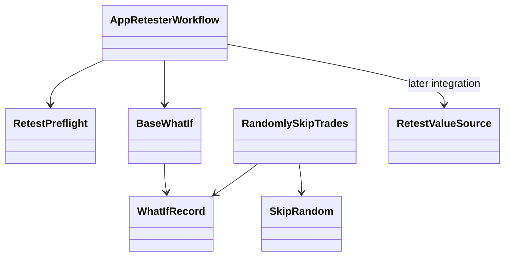

# AppRetester — executable work orders



- **Primary Role:** Retest selected strategies and evaluate the owned robustness checks.
- **Dependencies:** AppCore backtest/optimization/result contracts; AppDataManager data; AppCodeEditor blocks.
- **Outputs / Downstream Role:** Retest and check results preserving input identities.
- **Execution boundary:** each READY work order is one tested commit. A BLOCKED work order authorizes no code, placeholder endpoint, UI success state or feature-completion claim. Source evidence below does not authorize choosing missing behavior.
- **Baseline:** `f5c7d12d5715b8ebee55165b8eddad9068f83cb9`; normative work orders; owner review pending. Implementation status belongs only in the domain README.
- **Shared response contract:** existing legacy API adapters preserve `StandardResponse.success(*, message, metadata, data)` and `StandardResponse.failure(*, message, metadata, error)`, `ResponseMetadata` and `StandardError` from canonical `app/core/lib/responses.py`. New instance envelopes use `StandardResponse[T](request_id: str, data: T, revision: int | None = None)` only where the individual order specifies that contract; structured new errors use `app/core/lib/errors.py::DomainError`. Pure helpers return their declared values. Preserve existing callers and translate envelopes only at an explicitly specified compatibility boundary.
- **Path rule:** CREATE paths are exact. No one-file-per-Java-class port, sibling workspace import, copied core engine or alternative file name is allowed.


## Source reassessment authority — 2026-10-30

The [workspace source review](research/workspaces-03-08-source-review.md) adds exact readable context to every blocked complete-contribution order in this file. Its source paths supplement the old Context to Read lists. Shared libraries are available locally; plugin bodies, UI consumers, templates and per-definition fixtures remain separate evidence. A complete-contribution order retains its status until its exact target contract and acceptance cases are specified. New bounded READY suborders below supersede only their named portion.

## Current-code migration audit and execution order

*Evidence:* `OBS-HARU-RET-REUSE-20261029`. This audit concerns migration suitability; domain README files remain the only implementation-status authority. The source files below are existing code, not permission to regenerate their components. Backend directories `app/workspace/retester/` do not currently exist; a complete backend cannot be marked Direct fit from the React screen.

### Work order RET-M01: move the existing presentation as one revertible commit

*Feature:* Reuse the current workspace and its owned result/settings contributions without inventing a second UI. **READY after the app/web bootstrap and public host/result slot contracts are published.**
*Context to Read:* this order; every current source/test row below; `ui/package.json`; `ui/tsconfig.json`; `ui/vite.config.ts`; `app/web/workspaces/home/public.ts`; `app/web/workspaces/results/public.ts`. For Results itself, CREATE its `public.ts` as an export boundary only; export only the existing ProjectResults contribution types after Home owns their base slot type. Do not create a different shell.
*Implementation Files:* exact MOVE/ADAPT targets in the table; EDIT only the corresponding existing application route import and workspace registration to use the new entry component. No backend calculation code is authorized by this migration order.

| Current HaruQuantAI location | Target proposed location | Fit / action (migration audit) |
|---|---|---|
| `ui/app/workspace/Retester/retesterClient.ts` | `app/web/workspaces/retester/retesterClient.ts` | ADAPT: retain transport/cancellation; replace fixed demo graph, demoInputs and provisional /executions mapping after typed run contract is locked |
| `ui/app/workspace/Retester/retesterFixtures.ts` | `app/web/tests/workspaces/retester/fixtures/retesterFixtures.ts` | TEST-ONLY: move to fixtures; remove production imports during service integration |
| `ui/app/workspace/Retester/RetesterProgress.tsx` | `app/web/workspaces/retester/RetesterProgress.tsx` | ADAPT: reuse layout; replace timer/mock metrics with owned run/result projection |
| `ui/app/workspace/Retester/RetesterSettings.tsx` | `app/web/workspaces/retester/RetesterSettings.tsx` | DIRECT FIT for presentation; move with local imports rewritten; source parity and backend behavior remain separately qualified |
| `ui/app/workspace/Retester/RetesterWorkspace.tsx` | `app/web/workspaces/retester/RetesterWorkspace.tsx` | DIRECT FIT for presentation; move with local imports rewritten; source parity and backend behavior remain separately qualified |
| `ui/app/plugins/project/SettingsCrossChecks/crosscheck/crossCheck.tsx` | `app/web/workspaces/retester/SettingsCrossChecks/crosscheck/crossCheck.tsx` | DIRECT FIT presentation; ADAPT controller services to canonical result/run projection; preserve local relative imports |
| `ui/app/plugins/project/SettingsCrossChecks/crossChecks.tsx` | `app/web/workspaces/retester/SettingsCrossChecks/crossChecks.tsx` | DIRECT FIT presentation; ADAPT controller services to canonical result/run projection; preserve local relative imports |
| `ui/app/plugins/project/SettingsCrossChecks/CrossChecksCtrl.ts` | `app/web/workspaces/retester/SettingsCrossChecks/CrossChecksCtrl.ts` | DIRECT FIT presentation; ADAPT controller services to canonical result/run projection; preserve local relative imports |
| `ui/app/plugins/project/SettingsCrossChecks/crossCheckSettingsDialog.tsx` | `app/web/workspaces/retester/SettingsCrossChecks/crossCheckSettingsDialog.tsx` | DIRECT FIT presentation; ADAPT controller services to canonical result/run projection; preserve local relative imports |
| `ui/app/plugins/project/SettingsCrossChecks/module.ts` | `app/web/workspaces/retester/SettingsCrossChecks/module.ts` | DIRECT FIT presentation; ADAPT controller services to canonical result/run projection; preserve local relative imports |
| `ui/app/plugins/project/SettingsCrossChecks/styles.css` | `app/web/workspaces/retester/SettingsCrossChecks/styles.css` | DIRECT FIT presentation; ADAPT controller services to canonical result/run projection; preserve local relative imports |
| `ui/tests/unit/workspace/Retester/retesterWorkflow.test.ts` | `app/web/tests/workspaces/retester/retesterWorkflow.test.ts` | MOVE existing assertions unchanged; rewrite import paths only; this qualifies current preview behavior, not donor numerical parity |

*Functional Requirements & Implementation:*
- [ ] `RetesterWorkspace()` -> Retain component exports, props, rendered labels, keyboard actions, cancellation/unmount cleanup and CSS behavior from each current source row. Rewrite relative imports to the table targets. Consume shared Home and Results through their `public.ts` exports; do not import another workspace's private module or copy ProjectWorkbench.
- [ ] `RetesterWorkspace()` -> Keep fixture/timer execution explicitly in the existing preview mode until its replacement service work order passes. Moving a screen does not authorize reporting a generated strategy, finished retest, optimized parameter or saved portfolio as a real backend result. The current clients using fixed RSI/demoInputs and `/executions` are adaptation candidates, not verified workspace APIs.
- [ ] `migration import guard` -> Run `rg -n 'ui/app/workspace/Retester|plugins/project/ProjectWorkbench' app/web/workspaces/retester`. Expected exit `1` and no lines. Rewrite migrated tests to their exact target imports; preserve current assertions and test names.
- [ ] `existing tests` -> Before moving, run `npm --prefix ui test -- tests/unit/workspace/Retester` (Portfolio Master uses `tests/unit/workspace/Portfolio/portfolioMaster.test.ts`). After moving run `npm --prefix app/web test -- tests/workspaces/retester` then `npm --prefix app/web run typecheck` then `npm --prefix app/web run build`; all must exit `0`. These commands prove migration behavior only. Record executed command, UTC timestamp and counts in the owner README when actually executed; this order does not mark future validation passed.
*Commit:* `refactor(retester): move owned workspace presentation`. This single commit includes only the listed moves, direct import rewrites and registration change. UI integration work is separate from implementing donor engines.

*Shared results ownership:* ProjectResults and all Results* contribution implementations are owned by AppResults. Builder, Retester, Optimizer and portfolio workspaces register configured contributions; none gets a private copy of trade lists, overview, source-code rendering, correlation or shared engine progress. Shared base workbench remains AppHome.


```json
{
  "id": "OBS-HARU-RET-REUSE-20261029",
  "classification": "observed",
  "confidence": "high",
  "claim": "Current Retester presentation exists and can be relocated; its README and inspected handlers distinguish preview behavior from backend integration.",
  "sources": [
    {
      "path": "ui/app/workspace/Retester/README.md",
      "sha256": "8b5303a08a1df0422d5ea99bac0eccce0f6ebf6abc529a13a84b95d4bfd36841"
    }
  ],
  "target_domain": "app/workspaces/retester",
  "feature_ids": [
    "FEAT-UI-RETESTER_WORKSPACE"
  ],
  "requirement_ids": [],
  "decision_ids": [],
  "registration_gap": "Register missing FR/DEC IDs in the owning domain README before production implementation; this planning task does not edit registries.",
  "limitations": "Passing current UI tests establishes local preview behavior only. This record does not certify complete donor coverage, numerical parity, native archive compatibility or production service integration.",
  "validation": {
    "status": "passed",
    "executed_at": "2026-10-29T10:13:19.769410+00:00",
    "procedure": "Read the existing runtime files, clients and README listed in the migration table. Run the focused current-workspace UI tests in the combined 13-file/72-test command.",
    "expected_observation": "13 focused UI test files, 72 tests passed; Builder/Retester/Optimizer clients and Composer/Master timers still operate on preview inputs.",
    "actual_observation": "13 focused UI test files, 72 tests passed; Builder/Retester/Optimizer clients and Composer/Master timers still operate on preview inputs.",
    "artifacts": [
      "ui/app/workspace/Retester/README.md@sha256:8b5303a08a1df0422d5ea99bac0eccce0f6ebf6abc529a13a84b95d4bfd36841"
    ]
  },
  "repository_commit": "f5c7d12d5715b8ebee55165b8eddad9068f83cb9",
  "review_state": "source-inspected-owner-review-pending",
  "contains_proprietary_source": false,
  "contains_sensitive_data": false,
  "contains_personal_data": false,
  "paraphrased_behavior_only": true,
  "supersedes_records": [],
  "superseded_by": []
}
```

## Phase 1: directly specified behavior

### Work order RET-001: automatic-retest value-source normalization
*Feature:* Adapt legacy value-source flags without changing already named sources. **READY after test bootstrap.** This commit does not implement retesting or data overrides.
*Implementation Files:*
- **Donor:** `DONOR_REFERENCE_ROOT/internal/plugins/SettingsAutoRetestData/AutoRetestDataService.js` (`getUseCustomAttribute`).
- **Backend CREATE:** `app/workspaces/retester/value_source.py`.
- **Frontend:** no file changed; the future request-loading service invokes this backend policy once.
- **Tests CREATE:** `tests/workspaces/retester/test_value_source.py`.
*Context to Read:* this feature text; the donor file above; `pyproject.toml`.
*Evidence ID:* `OBS-145-AUTO-RETEST-SOURCE-001`; Python `None` is the target representation of an absent/null source, not a new source choice.
*Functional Requirements & Implementation:*
- [ ] `RetestValueSource.normalize(value: str | None) -> str | None` -> Return `"custom"` for `"false"`, `"strategy"` for `"true"`, and the unchanged object for every other accepted input. No case folding or whitespace trimming.
- [ ] `RetestValueSource.normalize(value)` -> Raise `TypeError("value must be str or None")` for every other type, including booleans. The typed helper guard is a target decision.
- [ ] `TestRetestValueSource.test_mapping()` -> Assert `"false" -> "custom"`, `"true" -> "strategy"`, `"custom" -> "custom"`, `"strategy" -> "strategy"`, `"False" -> "False"`, `"" -> ""`, and `None -> None`.
- [ ] `TestRetestValueSource.test_type_error()` -> Assert `False` and `1` raise the exact TypeError; no configuration store is read or modified.
*Done command:* `uv run python -m pytest tests/workspaces/retester/test_value_source.py -q` -> exit `0`; seven mapping rows and two invalid rows pass.
*Commit:* `feat(retester): normalize legacy value-source flags`. Only the two CREATE files belong in this commit.

## Phase 2: complete module scope — READY

Each module below is retained in full scope. Its proposed files are reserved names, not permission to fill missing semantics. The senior planner must issue a revised READY order with complete signatures, literals and expected results before an executor starts that module. No acceptance test command can prove an unspecified contract; therefore blocked modules have no implementation commit.

### `AppRetester` — READY

*Source reassessment — 2026-10-30:* [Exact available source and declarations](research/workspaces-03-08-source-review.md#appretester). Readable shared-library context is now available in `DONOR_REFERENCE_ROOT/internal/libs/`; this removes the shared-bytecode-access obstacle, but does not by itself release this complete-workflow order. Located 1 current plugin JavaScript files and decompiled primary Java files recovered in data/reference-donor/internal/plugins/`AppRetester`. The linked review replaces carrier-only lookup as the research starting point; original unresolved target-model and acceptance gates below remain in force.

*Feature:* Full `AppRetester` behavior; this is not completed by the helper commit above.
*Implementation Files (reserved, no code authorized):*
- **Donor:** `DONOR_REFERENCE_ROOT/internal/plugins/AppRetester`.
- **Backend:** `app/workspaces/retester/app_retester.py`.
- **Frontend:** `app/web/workspaces/retester/RetesterWorkspace.tsx`.
- **Backend tests:** `tests/workspaces/retester/test_app_retester.py`.
- **Frontend tests:** `app/web/tests/retester/AppRetester.test.tsx`.
*Context to Read:* `DONOR_REFERENCE_ROOT/internal/plugins/AppRetester/module.js`.
*Evidence and limit:* `OBS-145-AUTO-RETEST-SOURCE-001` establishes only the READY behavior described above, not this module's full workflow. Literal frontend request vocabulary observed during this pass: No literal request action was established by the inspected frontend service declarations.
*Exact unresolved contract:* The full action request/response schema, state transitions, persisted fields/defaults and invalid-operation behavior are not locked to independent fixtures.
*Executor action:* do not create the reserved files, signatures, constants, schemas or test expectations for this module. Report this feature heading and the exact unresolved contract to the senior planner. Do not replace the missing contract with a conventional implementation.
*Release condition:* a later work order cites a verbatim behavior evidence ID for `AppRetester`, fixes every input/output/default/error/persistence transition, provides numerical or state fixtures, and names test commands expected to exit `0`. A source directory or action-name list alone does not meet this condition.

### `CrossCheckMonteCarloManipulation` — READY

*Source reassessment — 2026-10-30:* [Exact available source and declarations](research/workspaces-03-08-source-review.md#crosscheckmontecarlomanipulation). Readable shared-library context is now available in `DONOR_REFERENCE_ROOT/internal/libs/`; this removes the shared-bytecode-access obstacle, but does not by itself release this complete-workflow order. Located 6 current plugin JavaScript files and decompiled primary Java files recovered in data/reference-donor/internal/plugins/`CrossCheckMonteCarloManipulation`. The linked review replaces carrier-only lookup as the research starting point; original unresolved target-model and acceptance gates below remain in force.

*Feature:* Full `CrossCheckMonteCarloManipulation` behavior; this is not completed by the helper commit above.
*Implementation Files (reserved, no code authorized):*
- **Donor:** `DONOR_REFERENCE_ROOT/internal/plugins/CrossCheckMonteCarloManipulation`.
- **Backend:** `app/workspaces/retester/cross_check_monte_carlo_manipulation.py`.
- **Frontend:** `app/web/workspaces/retester/CrossCheckMonteCarloManipulation.tsx`.
- **Backend tests:** `tests/workspaces/retester/test_cross_check_monte_carlo_manipulation.py`.
- **Frontend tests:** `app/web/tests/retester/CrossCheckMonteCarloManipulation.test.tsx`.
*Context to Read:* `DONOR_REFERENCE_ROOT/internal/plugins/CrossCheckMonteCarloManipulation/FitnessFunction/MCManipulationFitnessService.js`; `DONOR_REFERENCE_ROOT/internal/plugins/CrossCheckMonteCarloManipulation/FitnessFunction/module.js`; `DONOR_REFERENCE_ROOT/internal/plugins/CrossCheckMonteCarloManipulation/module.js`; `DONOR_REFERENCE_ROOT/internal/plugins/CrossCheckMonteCarloManipulation/MonteCarloManipulationService.js`.
*Evidence and limit:* `OBS-145-AUTO-RETEST-SOURCE-001` establishes only the READY behavior described above, not this module's full workflow. Literal frontend request vocabulary observed during this pass: `monteCarloManipulation/fitnessList` `monteCarloManipulation/fitnessGetConfidenceLevels` `monteCarloManipulation/list`
*Exact unresolved contract:* Exact parameter/default/bounds schema, perturbation distribution, seed derivation, simulation ordering, percentile/filter conventions and failure semantics are not locked.
*Executor action:* do not create the reserved files, signatures, constants, schemas or test expectations for this module. Report this feature heading and the exact unresolved contract to the senior planner. Do not replace the missing contract with a conventional implementation.
*Release condition:* a later work order cites a verbatim behavior evidence ID for `CrossCheckMonteCarloManipulation`, fixes every input/output/default/error/persistence transition, provides numerical or state fixtures, and names test commands expected to exit `0`. A source directory or action-name list alone does not meet this condition.

### `CrossCheckMonteCarloRetest` — READY

*Source reassessment — 2026-10-30:* [Exact available source and declarations](research/workspaces-03-08-source-review.md#crosscheckmontecarloretest). Readable shared-library context is now available in `DONOR_REFERENCE_ROOT/internal/libs/`; this removes the shared-bytecode-access obstacle, but does not by itself release this complete-workflow order. Located 6 current plugin JavaScript files and decompiled primary Java files recovered in data/reference-donor/internal/plugins/`CrossCheckMonteCarloRetest`. The linked review replaces carrier-only lookup as the research starting point; original unresolved target-model and acceptance gates below remain in force.

*Feature:* Full `CrossCheckMonteCarloRetest` behavior; this is not completed by the helper commit above.
*Implementation Files (reserved, no code authorized):*
- **Donor:** `DONOR_REFERENCE_ROOT/internal/plugins/CrossCheckMonteCarloRetest`.
- **Backend:** `app/workspaces/retester/cross_check_monte_carlo_retest.py`.
- **Frontend:** `app/web/workspaces/retester/CrossCheckMonteCarloRetest.tsx`.
- **Backend tests:** `tests/workspaces/retester/test_cross_check_monte_carlo_retest.py`.
- **Frontend tests:** `app/web/tests/retester/CrossCheckMonteCarloRetest.test.tsx`.
*Context to Read:* `DONOR_REFERENCE_ROOT/internal/plugins/CrossCheckMonteCarloRetest/FitnessFunction/MCRetestFitnessService.js`; `DONOR_REFERENCE_ROOT/internal/plugins/CrossCheckMonteCarloRetest/FitnessFunction/module.js`; `DONOR_REFERENCE_ROOT/internal/plugins/CrossCheckMonteCarloRetest/module.js`; `DONOR_REFERENCE_ROOT/internal/plugins/CrossCheckMonteCarloRetest/MonteCarloRetestService.js`.
*Evidence and limit:* `OBS-145-AUTO-RETEST-SOURCE-001` establishes only the READY behavior described above, not this module's full workflow. Literal frontend request vocabulary observed during this pass: `monteCarloRetest/fitnessList` `monteCarloRetest/fitnessGetConfidenceLevels` `monteCarloRetest/list`
*Exact unresolved contract:* Exact parameter/default/bounds schema, perturbation distribution, seed derivation, simulation ordering, percentile/filter conventions and failure semantics are not locked.
*Executor action:* do not create the reserved files, signatures, constants, schemas or test expectations for this module. Report this feature heading and the exact unresolved contract to the senior planner. Do not replace the missing contract with a conventional implementation.
*Release condition:* a later work order cites a verbatim behavior evidence ID for `CrossCheckMonteCarloRetest`, fixes every input/output/default/error/persistence transition, provides numerical or state fixtures, and names test commands expected to exit `0`. A source directory or action-name list alone does not meet this condition.

### `CrossCheckOptProfileSysParamPermutation` — READY

*Source reassessment — 2026-10-30:* [Exact available source and declarations](research/workspaces-03-08-source-review.md#crosscheckoptprofilesysparampermutation). Readable shared-library context is now available in `DONOR_REFERENCE_ROOT/internal/libs/`; this removes the shared-bytecode-access obstacle, but does not by itself release this complete-workflow order. Located 3 current plugin JavaScript files and decompiled primary Java files recovered in data/reference-donor/internal/plugins/`CrossCheckOptProfileSysParamPermutation`. The linked review replaces carrier-only lookup as the research starting point; original unresolved target-model and acceptance gates below remain in force.

*Feature:* Full `CrossCheckOptProfileSysParamPermutation` behavior; this is not completed by the helper commit above.
*Implementation Files (reserved, no code authorized):*
- **Donor:** `DONOR_REFERENCE_ROOT/internal/plugins/CrossCheckOptProfileSysParamPermutation`.
- **Backend:** `app/workspaces/retester/cross_check_opt_profile_sys_param_permutation.py`.
- **Frontend:** `app/web/workspaces/retester/CrossCheckOptProfileSysParamPermutation.tsx`.
- **Backend tests:** `tests/workspaces/retester/test_cross_check_opt_profile_sys_param_permutation.py`.
- **Frontend tests:** `app/web/tests/retester/CrossCheckOptProfileSysParamPermutation.test.tsx`.
*Context to Read:* `DONOR_REFERENCE_ROOT/internal/plugins/CrossCheckOptProfileSysParamPermutation/module.js`; `DONOR_REFERENCE_ROOT/internal/plugins/CrossCheckOptProfileSysParamPermutation/OptProfileSysParamPermutationService.js`.
*Evidence and limit:* `OBS-145-AUTO-RETEST-SOURCE-001` establishes only the READY behavior described above, not this module's full workflow. Literal frontend request vocabulary observed during this pass: No literal request action was established by the inspected frontend service declarations.
*Exact unresolved contract:* Exact response fields, sample/direction/market filtering, pagination or resampling rules, undefined-value representation and independently calculated expected values are not locked.
*Executor action:* do not create the reserved files, signatures, constants, schemas or test expectations for this module. Report this feature heading and the exact unresolved contract to the senior planner. Do not replace the missing contract with a conventional implementation.
*Release condition:* a later work order cites a verbatim behavior evidence ID for `CrossCheckOptProfileSysParamPermutation`, fixes every input/output/default/error/persistence transition, provides numerical or state fixtures, and names test commands expected to exit `0`. A source directory or action-name list alone does not meet this condition.

### `CrossCheckRetestOnAdditionalMarkets` — READY

*Source reassessment — 2026-10-30:* [Exact available source and declarations](research/workspaces-03-08-source-review.md#crosscheckretestonadditionalmarkets). Readable shared-library context is now available in `DONOR_REFERENCE_ROOT/internal/libs/`; this removes the shared-bytecode-access obstacle, but does not by itself release this complete-workflow order. Located 6 current plugin JavaScript files and decompiled primary Java files recovered in data/reference-donor/internal/plugins/`CrossCheckRetestOnAdditionalMarkets`. The linked review replaces carrier-only lookup as the research starting point; original unresolved target-model and acceptance gates below remain in force.

*Feature:* Full `CrossCheckRetestOnAdditionalMarkets` behavior; this is not completed by the helper commit above.
*Implementation Files (reserved, no code authorized):*
- **Donor:** `DONOR_REFERENCE_ROOT/internal/plugins/CrossCheckRetestOnAdditionalMarkets`.
- **Backend:** `app/workspaces/retester/cross_check_retest_on_additional_markets.py`.
- **Frontend:** `app/web/workspaces/retester/CrossCheckRetestOnAdditionalMarkets.tsx`.
- **Backend tests:** `tests/workspaces/retester/test_cross_check_retest_on_additional_markets.py`.
- **Frontend tests:** `app/web/tests/retester/CrossCheckRetestOnAdditionalMarkets.test.tsx`.
*Context to Read:* `DONOR_REFERENCE_ROOT/internal/plugins/CrossCheckRetestOnAdditionalMarkets/FitnessFunction/module.js`; `DONOR_REFERENCE_ROOT/internal/plugins/CrossCheckRetestOnAdditionalMarkets/FitnessFunction/PortfolioFitnessService.js`; `DONOR_REFERENCE_ROOT/internal/plugins/CrossCheckRetestOnAdditionalMarkets/module.js`; `DONOR_REFERENCE_ROOT/internal/plugins/CrossCheckRetestOnAdditionalMarkets/RetestOnAdditionalMarketsService.js`.
*Evidence and limit:* `OBS-145-AUTO-RETEST-SOURCE-001` establishes only the READY behavior described above, not this module's full workflow. Literal frontend request vocabulary observed during this pass: `retestOnAdditionalMarkets/list`
*Exact unresolved contract:* Exact parameter/default/bounds schema, perturbation distribution, seed derivation, simulation ordering, percentile/filter conventions and failure semantics are not locked.
*Executor action:* do not create the reserved files, signatures, constants, schemas or test expectations for this module. Report this feature heading and the exact unresolved contract to the senior planner. Do not replace the missing contract with a conventional implementation.
*Release condition:* a later work order cites a verbatim behavior evidence ID for `CrossCheckRetestOnAdditionalMarkets`, fixes every input/output/default/error/persistence transition, provides numerical or state fixtures, and names test commands expected to exit `0`. A source directory or action-name list alone does not meet this condition.

### `CrossCheckRetestWithHigherPrecision` — READY

*Source reassessment — 2026-10-30:* [Exact available source and declarations](research/workspaces-03-08-source-review.md#crosscheckretestwithhigherprecision). Readable shared-library context is now available in `DONOR_REFERENCE_ROOT/internal/libs/`; this removes the shared-bytecode-access obstacle, but does not by itself release this complete-workflow order. Located 6 current plugin JavaScript files and decompiled primary Java files recovered in data/reference-donor/internal/plugins/`CrossCheckRetestWithHigherPrecision`. The linked review replaces carrier-only lookup as the research starting point; original unresolved target-model and acceptance gates below remain in force.

*Feature:* Full `CrossCheckRetestWithHigherPrecision` behavior; this is not completed by the helper commit above.
*Implementation Files (reserved, no code authorized):*
- **Donor:** `DONOR_REFERENCE_ROOT/internal/plugins/CrossCheckRetestWithHigherPrecision`.
- **Backend:** `app/workspaces/retester/cross_check_retest_with_higher_precision.py`.
- **Frontend:** `app/web/workspaces/retester/CrossCheckRetestWithHigherPrecision.tsx`.
- **Backend tests:** `tests/workspaces/retester/test_cross_check_retest_with_higher_precision.py`.
- **Frontend tests:** `app/web/tests/retester/CrossCheckRetestWithHigherPrecision.test.tsx`.
*Context to Read:* `DONOR_REFERENCE_ROOT/internal/plugins/CrossCheckRetestWithHigherPrecision/FitnessFunction/CCHigherPrecisionService.js`; `DONOR_REFERENCE_ROOT/internal/plugins/CrossCheckRetestWithHigherPrecision/FitnessFunction/module.js`; `DONOR_REFERENCE_ROOT/internal/plugins/CrossCheckRetestWithHigherPrecision/module.js`; `DONOR_REFERENCE_ROOT/internal/plugins/CrossCheckRetestWithHigherPrecision/RetestWithHigherPrecisionService.js`.
*Evidence and limit:* `OBS-145-AUTO-RETEST-SOURCE-001` establishes only the READY behavior described above, not this module's full workflow. Literal frontend request vocabulary observed during this pass: `retestWithHigherPrecision/list`
*Exact unresolved contract:* Exact parameter/default/bounds schema, perturbation distribution, seed derivation, simulation ordering, percentile/filter conventions and failure semantics are not locked.
*Executor action:* do not create the reserved files, signatures, constants, schemas or test expectations for this module. Report this feature heading and the exact unresolved contract to the senior planner. Do not replace the missing contract with a conventional implementation.
*Release condition:* a later work order cites a verbatim behavior evidence ID for `CrossCheckRetestWithHigherPrecision`, fixes every input/output/default/error/persistence transition, provides numerical or state fixtures, and names test commands expected to exit `0`. A source directory or action-name list alone does not meet this condition.

### `CrossCheckSequentialOptimization` — READY

*Source reassessment — 2026-10-30:* [Exact available source and declarations](research/workspaces-03-08-source-review.md#crosschecksequentialoptimization). Readable shared-library context is now available in `DONOR_REFERENCE_ROOT/internal/libs/`; this removes the shared-bytecode-access obstacle, but does not by itself release this complete-workflow order. Located 3 current plugin JavaScript files and decompiled primary Java files recovered in data/reference-donor/internal/plugins/`CrossCheckSequentialOptimization`. The linked review replaces carrier-only lookup as the research starting point; original unresolved target-model and acceptance gates below remain in force.

*Feature:* Full `CrossCheckSequentialOptimization` behavior; this is not completed by the helper commit above.
*Implementation Files (reserved, no code authorized):*
- **Donor:** `DONOR_REFERENCE_ROOT/internal/plugins/CrossCheckSequentialOptimization`.
- **Backend:** `app/workspaces/retester/cross_check_sequential_optimization.py`.
- **Frontend:** `app/web/workspaces/retester/CrossCheckSequentialOptimization.tsx`.
- **Backend tests:** `tests/workspaces/retester/test_cross_check_sequential_optimization.py`.
- **Frontend tests:** `app/web/tests/retester/CrossCheckSequentialOptimization.test.tsx`.
*Context to Read:* `DONOR_REFERENCE_ROOT/internal/plugins/CrossCheckSequentialOptimization/module.js`; `DONOR_REFERENCE_ROOT/internal/plugins/CrossCheckSequentialOptimization/SequentialOptimizationService.js`.
*Evidence and limit:* `OBS-145-AUTO-RETEST-SOURCE-001` establishes only the READY behavior described above, not this module's full workflow. Literal frontend request vocabulary observed during this pass: No literal request action was established by the inspected frontend service declarations.
*Exact unresolved contract:* Exact parameter/default/bounds schema, perturbation distribution, seed derivation, simulation ordering, percentile/filter conventions and failure semantics are not locked.
*Executor action:* do not create the reserved files, signatures, constants, schemas or test expectations for this module. Report this feature heading and the exact unresolved contract to the senior planner. Do not replace the missing contract with a conventional implementation.
*Release condition:* a later work order cites a verbatim behavior evidence ID for `CrossCheckSequentialOptimization`, fixes every input/output/default/error/persistence transition, provides numerical or state fixtures, and names test commands expected to exit `0`. A source directory or action-name list alone does not meet this condition.

### `CrossCheckWalkForwardMatrix` — READY

*Source reassessment — 2026-10-30:* [Exact available source and declarations](research/workspaces-03-08-source-review.md#crosscheckwalkforwardmatrix). Readable shared-library context is now available in `DONOR_REFERENCE_ROOT/internal/libs/`; this removes the shared-bytecode-access obstacle, but does not by itself release this complete-workflow order. Located 3 current plugin JavaScript files and decompiled primary Java files recovered in data/reference-donor/internal/plugins/`CrossCheckWalkForwardMatrix`. The linked review replaces carrier-only lookup as the research starting point; original unresolved target-model and acceptance gates below remain in force.

*Feature:* Full `CrossCheckWalkForwardMatrix` behavior; this is not completed by the helper commit above.
*Implementation Files (reserved, no code authorized):*
- **Donor:** `DONOR_REFERENCE_ROOT/internal/plugins/CrossCheckWalkForwardMatrix`.
- **Backend:** `app/workspaces/retester/cross_check_walk_forward_matrix.py`.
- **Frontend:** `app/web/workspaces/retester/CrossCheckWalkForwardMatrix.tsx`.
- **Backend tests:** `tests/workspaces/retester/test_cross_check_walk_forward_matrix.py`.
- **Frontend tests:** `app/web/tests/retester/CrossCheckWalkForwardMatrix.test.tsx`.
*Context to Read:* `DONOR_REFERENCE_ROOT/internal/plugins/CrossCheckWalkForwardMatrix/module.js`; `DONOR_REFERENCE_ROOT/internal/plugins/CrossCheckWalkForwardMatrix/WalkForwardMatrixService.js`.
*Evidence and limit:* `OBS-145-AUTO-RETEST-SOURCE-001` establishes only the READY behavior described above, not this module's full workflow. Literal frontend request vocabulary observed during this pass: No literal request action was established by the inspected frontend service declarations.
*Exact unresolved contract:* Exact response fields, sample/direction/market filtering, pagination or resampling rules, undefined-value representation and independently calculated expected values are not locked.
*Executor action:* do not create the reserved files, signatures, constants, schemas or test expectations for this module. Report this feature heading and the exact unresolved contract to the senior planner. Do not replace the missing contract with a conventional implementation.
*Release condition:* a later work order cites a verbatim behavior evidence ID for `CrossCheckWalkForwardMatrix`, fixes every input/output/default/error/persistence transition, provides numerical or state fixtures, and names test commands expected to exit `0`. A source directory or action-name list alone does not meet this condition.

### `CrossCheckWalkForwardOptimization` — READY

*Source reassessment — 2026-10-30:* [Exact available source and declarations](research/workspaces-03-08-source-review.md#crosscheckwalkforwardoptimization). Readable shared-library context is now available in `DONOR_REFERENCE_ROOT/internal/libs/`; this removes the shared-bytecode-access obstacle, but does not by itself release this complete-workflow order. Located 3 current plugin JavaScript files and decompiled primary Java files recovered in data/reference-donor/internal/plugins/`CrossCheckWalkForwardOptimization`. The linked review replaces carrier-only lookup as the research starting point; original unresolved target-model and acceptance gates below remain in force.

*Feature:* Full `CrossCheckWalkForwardOptimization` behavior; this is not completed by the helper commit above.
*Implementation Files (reserved, no code authorized):*
- **Donor:** `DONOR_REFERENCE_ROOT/internal/plugins/CrossCheckWalkForwardOptimization`.
- **Backend:** `app/workspaces/retester/cross_check_walk_forward_optimization.py`.
- **Frontend:** `app/web/workspaces/retester/CrossCheckWalkForwardOptimization.tsx`.
- **Backend tests:** `tests/workspaces/retester/test_cross_check_walk_forward_optimization.py`.
- **Frontend tests:** `app/web/tests/retester/CrossCheckWalkForwardOptimization.test.tsx`.
*Context to Read:* `DONOR_REFERENCE_ROOT/internal/plugins/CrossCheckWalkForwardOptimization/module.js`; `DONOR_REFERENCE_ROOT/internal/plugins/CrossCheckWalkForwardOptimization/WalkForwardOptimizationService.js`.
*Evidence and limit:* `OBS-145-AUTO-RETEST-SOURCE-001` establishes only the READY behavior described above, not this module's full workflow. Literal frontend request vocabulary observed during this pass: No literal request action was established by the inspected frontend service declarations.
*Exact unresolved contract:* Exact response fields, sample/direction/market filtering, pagination or resampling rules, undefined-value representation and independently calculated expected values are not locked.
*Executor action:* do not create the reserved files, signatures, constants, schemas or test expectations for this module. Report this feature heading and the exact unresolved contract to the senior planner. Do not replace the missing contract with a conventional implementation.
*Release condition:* a later work order cites a verbatim behavior evidence ID for `CrossCheckWalkForwardOptimization`, fixes every input/output/default/error/persistence transition, provides numerical or state fixtures, and names test commands expected to exit `0`. A source directory or action-name list alone does not meet this condition.

### `CrossCheckWhatIf` — READY

*Source reassessment — 2026-10-30:* [Exact available source and declarations](research/workspaces-03-08-source-review.md#crosscheckwhatif). Readable shared-library context is now available in `DONOR_REFERENCE_ROOT/internal/libs/`; this removes the shared-bytecode-access obstacle, but does not by itself release this complete-workflow order. Located 3 current plugin JavaScript files and decompiled primary Java files recovered in data/reference-donor/internal/plugins/`CrossCheckWhatIf`. The linked review replaces carrier-only lookup as the research starting point; original unresolved target-model and acceptance gates below remain in force.

*Feature:* Full `CrossCheckWhatIf` behavior; this is not completed by the helper commit above.
*Implementation Files (reserved, no code authorized):*
- **Donor:** `DONOR_REFERENCE_ROOT/internal/plugins/CrossCheckWhatIf`.
- **Backend:** `app/workspaces/retester/cross_check_what_if.py`.
- **Frontend:** `app/web/workspaces/retester/CrossCheckWhatIf.tsx`.
- **Backend tests:** `tests/workspaces/retester/test_cross_check_what_if.py`.
- **Frontend tests:** `app/web/tests/retester/CrossCheckWhatIf.test.tsx`.
*Context to Read:* `DONOR_REFERENCE_ROOT/internal/plugins/CrossCheckWhatIf/module.js`; `DONOR_REFERENCE_ROOT/internal/plugins/CrossCheckWhatIf/WhatIfService.js`.
*Evidence and limit:* `OBS-145-AUTO-RETEST-SOURCE-001` establishes only the READY behavior described above, not this module's full workflow. Literal frontend request vocabulary observed during this pass: `whatIf/list`
*Exact unresolved contract:* Exact parameter/default/bounds schema, perturbation distribution, seed derivation, simulation ordering, percentile/filter conventions and failure semantics are not locked.
*Executor action:* do not create the reserved files, signatures, constants, schemas or test expectations for this module. Report this feature heading and the exact unresolved contract to the senior planner. Do not replace the missing contract with a conventional implementation.
*Release condition:* a later work order cites a verbatim behavior evidence ID for `CrossCheckWhatIf`, fixes every input/output/default/error/persistence transition, provides numerical or state fixtures, and names test commands expected to exit `0`. A source directory or action-name list alone does not meet this condition.

### `ResultsRobustnessTests` — READY

*Source reassessment — 2026-10-30:* [Exact available source and declarations](research/workspaces-03-08-source-review.md#resultsrobustnesstests). Readable shared-library context is now available in `DONOR_REFERENCE_ROOT/internal/libs/`; this removes the shared-bytecode-access obstacle, but does not by itself release this complete-workflow order. Located 8 current plugin JavaScript files and decompiled primary Java files recovered in data/reference-donor/internal/plugins/`ResultsRobustnessTests`. The linked review replaces carrier-only lookup as the research starting point; original unresolved target-model and acceptance gates below remain in force.

*Feature:* Full `ResultsRobustnessTests` behavior; this is not completed by the helper commit above.
*Implementation Files (reserved, no code authorized):*
- **Donor:** `DONOR_REFERENCE_ROOT/internal/plugins/ResultsRobustnessTests`.
- **Backend:** `app/workspaces/retester/results_robustness_tests.py`.
- **Frontend:** `app/web/workspaces/retester/ResultsRobustnessTests.tsx`.
- **Backend tests:** `tests/workspaces/retester/test_results_robustness_tests.py`.
- **Frontend tests:** `app/web/tests/retester/ResultsRobustnessTests.test.tsx`.
*Context to Read:* `DONOR_REFERENCE_ROOT/internal/plugins/ResultsRobustnessTests/directives/manageviews/ManageViewsService.js`; `DONOR_REFERENCE_ROOT/internal/plugins/ResultsRobustnessTests/module.js`; `DONOR_REFERENCE_ROOT/internal/plugins/ResultsRobustnessTests/services/RTService.js`.
*Evidence and limit:* `OBS-145-AUTO-RETEST-SOURCE-001` establishes only the READY behavior described above, not this module's full workflow. Literal frontend request vocabulary observed during this pass: `rtresults/viewsGetViews` `rtresults/viewsRemoveView` `rtresults/viewsAddView` `rtresults/viewsUpdateView` `rtresults/printChart` `rtresults/printConfLevels` `rtresults/getMethods`
*Exact unresolved contract:* Exact response fields, sample/direction/market filtering, pagination or resampling rules, undefined-value representation and independently calculated expected values are not locked.
*Executor action:* do not create the reserved files, signatures, constants, schemas or test expectations for this module. Report this feature heading and the exact unresolved contract to the senior planner. Do not replace the missing contract with a conventional implementation.
*Release condition:* a later work order cites a verbatim behavior evidence ID for `ResultsRobustnessTests`, fixes every input/output/default/error/persistence transition, provides numerical or state fixtures, and names test commands expected to exit `0`. A source directory or action-name list alone does not meet this condition.

### `SettingsAutoRetestData` — READY

*Source reassessment — 2026-10-30:* [Exact available source and declarations](research/workspaces-03-08-source-review.md#settingsautoretestdata). Readable shared-library context is now available in `DONOR_REFERENCE_ROOT/internal/libs/`; this removes the shared-bytecode-access obstacle, but does not by itself release this complete-workflow order. Located 3 current plugin JavaScript files and decompiled primary Java files recovered in data/reference-donor/internal/plugins/`SettingsAutoRetestData`. The linked review replaces carrier-only lookup as the research starting point; original unresolved target-model and acceptance gates below remain in force.

*Feature:* Full `SettingsAutoRetestData` behavior; this is not completed by the helper commit above.
*Implementation Files (reserved, no code authorized):*
- **Donor:** `DONOR_REFERENCE_ROOT/internal/plugins/SettingsAutoRetestData`.
- **Backend:** `app/workspaces/retester/settings_auto_retest_data.py`.
- **Frontend:** `app/web/workspaces/retester/SettingsAutoRetestData.tsx`.
- **Backend tests:** `tests/workspaces/retester/test_settings_auto_retest_data.py`.
- **Frontend tests:** `app/web/tests/retester/SettingsAutoRetestData.test.tsx`.
*Context to Read:* `DONOR_REFERENCE_ROOT/internal/plugins/SettingsAutoRetestData/AutoRetestDataService.js`; `DONOR_REFERENCE_ROOT/internal/plugins/SettingsAutoRetestData/module.js`.
*Evidence and limit:* `OBS-145-AUTO-RETEST-SOURCE-001` establishes only the READY behavior described above, not this module's full workflow. Literal frontend request vocabulary observed during this pass: No literal request action was established by the inspected frontend service declarations.
*Exact unresolved contract:* Complete persisted field/default/bounds schema, inheritance/merge rules, enum values and invalid-write behavior are not locked. The READY helper does not supply this complete request contract.
*Executor action:* do not create the reserved files, signatures, constants, schemas or test expectations for this module. Report this feature heading and the exact unresolved contract to the senior planner. Do not replace the missing contract with a conventional implementation.
*Release condition:* a later work order cites a verbatim behavior evidence ID for `SettingsAutoRetestData`, fixes every input/output/default/error/persistence transition, provides numerical or state fixtures, and names test commands expected to exit `0`. A source directory or action-name list alone does not meet this condition.

### `SettingsCrossChecks` — READY

*Source reassessment — 2026-10-30:* [Exact available source and declarations](research/workspaces-03-08-source-review.md#settingscrosschecks). Readable shared-library context is now available in `DONOR_REFERENCE_ROOT/internal/libs/`; this removes the shared-bytecode-access obstacle, but does not by itself release this complete-workflow order. Located 7 current plugin JavaScript files and decompiled primary Java files recovered in data/reference-donor/internal/plugins/`SettingsCrossChecks`. The linked review replaces carrier-only lookup as the research starting point; original unresolved target-model and acceptance gates below remain in force.

*Feature:* Full `SettingsCrossChecks` behavior; this is not completed by the helper commit above.
*Implementation Files (reserved, no code authorized):*
- **Donor:** `DONOR_REFERENCE_ROOT/internal/plugins/SettingsCrossChecks`.
- **Backend:** `app/workspaces/retester/settings_cross_checks.py`.
- **Frontend:** `app/web/workspaces/retester/SettingsCrossChecks.tsx`.
- **Backend tests:** `tests/workspaces/retester/test_settings_cross_checks.py`.
- **Frontend tests:** `app/web/tests/retester/SettingsCrossChecks.test.tsx`.
*Context to Read:* `DONOR_REFERENCE_ROOT/internal/plugins/SettingsCrossChecks/CrossCheckAcceptanceSettingsService.js`; `DONOR_REFERENCE_ROOT/internal/plugins/SettingsCrossChecks/CrossChecksService.js`; `DONOR_REFERENCE_ROOT/internal/plugins/SettingsCrossChecks/module.js`.
*Evidence and limit:* `OBS-145-AUTO-RETEST-SOURCE-001` establishes only the READY behavior described above, not this module's full workflow. Literal frontend request vocabulary observed during this pass: `rankingsettings/getDefaultWFConditions` `optProfileSysParamPerm/getDefaultSPPConditions`
*Exact unresolved contract:* Exact parameter/default/bounds schema, perturbation distribution, seed derivation, simulation ordering, percentile/filter conventions and failure semantics are not locked.
*Executor action:* do not create the reserved files, signatures, constants, schemas or test expectations for this module. Report this feature heading and the exact unresolved contract to the senior planner. Do not replace the missing contract with a conventional implementation.
*Release condition:* a later work order cites a verbatim behavior evidence ID for `SettingsCrossChecks`, fixes every input/output/default/error/persistence transition, provides numerical or state fixtures, and names test commands expected to exit `0`. A source directory or action-name list alone does not meet this condition.

### `SettingsWhatToRetest` — READY

*Source reassessment — 2026-10-30:* [Exact available source and declarations](research/workspaces-03-08-source-review.md#settingswhattoretest). Readable shared-library context is now available in `DONOR_REFERENCE_ROOT/internal/libs/`; this removes the shared-bytecode-access obstacle, but does not by itself release this complete-workflow order. Located 3 current plugin JavaScript files and decompiled primary Java files recovered in data/reference-donor/internal/plugins/`SettingsWhatToRetest`. The linked review replaces carrier-only lookup as the research starting point; original unresolved target-model and acceptance gates below remain in force.

*Feature:* Full `SettingsWhatToRetest` behavior; this is not completed by the helper commit above.
*Implementation Files (reserved, no code authorized):*
- **Donor:** `DONOR_REFERENCE_ROOT/internal/plugins/SettingsWhatToRetest`.
- **Backend:** `app/workspaces/retester/settings_what_to_retest.py`.
- **Frontend:** `app/web/workspaces/retester/SettingsWhatToRetest.tsx`.
- **Backend tests:** `tests/workspaces/retester/test_settings_what_to_retest.py`.
- **Frontend tests:** `app/web/tests/retester/SettingsWhatToRetest.test.tsx`.
*Context to Read:* `DONOR_REFERENCE_ROOT/internal/plugins/SettingsWhatToRetest/module.js`; `DONOR_REFERENCE_ROOT/internal/plugins/SettingsWhatToRetest/SettingsWhatToRetestService.js`.
*Evidence and limit:* `OBS-145-AUTO-RETEST-SOURCE-001` establishes only the READY behavior described above, not this module's full workflow. Literal frontend request vocabulary observed during this pass: No literal request action was established by the inspected frontend service declarations.
*Exact unresolved contract:* Complete persisted field/default/bounds schema, inheritance/merge rules, enum values and invalid-write behavior are not locked. The READY helper does not supply this complete request contract.
*Executor action:* do not create the reserved files, signatures, constants, schemas or test expectations for this module. Report this feature heading and the exact unresolved contract to the senior planner. Do not replace the missing contract with a conventional implementation.
*Release condition:* a later work order cites a verbatim behavior evidence ID for `SettingsWhatToRetest`, fixes every input/output/default/error/persistence transition, provides numerical or state fixtures, and names test commands expected to exit `0`. A source directory or action-name list alone does not meet this condition.

### `TaskRetest` — READY

*Source reassessment — 2026-10-30:* [Exact available source and declarations](research/workspaces-03-08-source-review.md#taskretest). Readable shared-library context is now available in `DONOR_REFERENCE_ROOT/internal/libs/`; this removes the shared-bytecode-access obstacle, but does not by itself release this complete-workflow order. Located 2 current plugin JavaScript files and 2 previously recovered primary Java files for `TaskRetest`. The linked review replaces carrier-only lookup as the research starting point; original unresolved target-model and acceptance gates below remain in force.

*Feature:* Full `TaskRetest` behavior; this is not completed by the helper commit above.
*Implementation Files (reserved, no code authorized):*
- **Donor:** `DONOR_REFERENCE_ROOT/internal/plugins/TaskRetest`.
- **Backend:** `app/workspaces/retester/task_retest.py`.
- **Frontend:** `app/web/workspaces/retester/TaskRetest.tsx`.
- **Backend tests:** `tests/workspaces/retester/test_task_retest.py`.
- **Frontend tests:** `app/web/tests/retester/TaskRetest.test.tsx`.
*Context to Read:* `DONOR_REFERENCE_ROOT/internal/plugins/TaskRetest/module.js`.
*Evidence and limit:* `OBS-145-AUTO-RETEST-SOURCE-001` establishes only the READY behavior described above, not this module's full workflow. Literal frontend request vocabulary observed during this pass: No literal request action was established by the inspected frontend service declarations.
*Exact unresolved contract:* Exact run-request settings, engine capability selection, candidate/result acceptance, stop/pause/resume transitions and error/partial-result semantics are not locked.
*Executor action:* do not create the reserved files, signatures, constants, schemas or test expectations for this module. Report this feature heading and the exact unresolved contract to the senior planner. Do not replace the missing contract with a conventional implementation.
*Release condition:* a later work order cites a verbatim behavior evidence ID for `TaskRetest`, fixes every input/output/default/error/persistence transition, provides numerical or state fixtures, and names test commands expected to exit `0`. A source directory or action-name list alone does not meet this condition.

## Phase 3: concrete extension definition work orders — READY
*Source reassessment — 2026-10-30:* [Category availability](research/workspaces-03-08-source-review.md#extension-and-export-category-reassessment) verifies primary readable definition paths. The remaining blocker is the absence of an accepted per-definition target contract and independent fixture, not inaccessible library code. Existing RET-003 and RET-004 already release bounded WhatIf reuse and RandomlySkipTrades; exclude those slices from the blanket gate. Source file counts do not establish completion or parity.


### `MonteCarlo`
- **Context:** `DONOR_REFERENCE_ROOT/internal/extend/Snippets/SQ/MonteCarlo`; exact current definition count: 14.
- **Blocked reason:** no complete per-definition mapping of target filename, parameter schema, evaluation signature, formula/ordering, boundary behavior and golden fixture exists in this file. The executor is forbidden to choose these.
- **Senior release artifact required:** one work order per definition, with an exact Python file, `Class.method` signature, field/default/error literals and hand-calculated or independently observed test values. Do not register a stub catalogue or port Java classes mechanically.
- **Definition IDs to account for:** `Manipulation/MACHRBlockRandomization.java`, `Manipulation/RandomizeTradesOrder.java`, `Manipulation/RandomlyDegradeExecution.java`, `Manipulation/RandomlySkipTrades.java`, `Manipulation/SimulateParameterJitter.java`, `Retest/RandomizeHistoryData.java`, `Retest/RandomizeHistoryDataFixedRange.java`, `Retest/RandomizeHistoryDataOHLC.java`, `Retest/RandomizeMinDistance.java`, `Retest/RandomizeSlippage.java`, `Retest/RandomizeSpread.java`, `Retest/RandomizeStartingBar.java`, `Retest/RandomizeStrategyParameters.java`, `Retest/RandomizeStrategyParametersCustomizable.java`.
### `WhatIf`
- **Context:** `DONOR_REFERENCE_ROOT/internal/extend/Snippets/SQ/WhatIf`; exact current definition count: 15.
- **Blocked reason:** no complete per-definition mapping of target filename, parameter schema, evaluation signature, formula/ordering, boundary behavior and golden fixture exists in this file. The executor is forbidden to choose these.
- **Senior release artifact required:** one work order per definition, with an exact Python file, `Class.method` signature, field/default/error literals and hand-calculated or independently observed test values. Do not register a stub catalogue or port Java classes mechanically.
- **Definition IDs to account for:** `ByDays.java`, `ByHours.java`, `ByMonths.java`, `ExcludePctTradesWithBiggestPl.java`, `ExcludePctTradesWithLowestPl.java`, `ExcludeShortTrades.java`, `ExcludeTradesWithBiggestPl.java`, `ExcludeTradesWithLowestPl.java`, `ExludeOverlappingTrades.java`, `RemoveBalanceTransactions.java`, `RemovePendingTrades.java`, `Swap.java`, `TakeEverySecondTrade.java`, `TakeMaxTradesPerDay.java`, `UseFixedLots.java`.
### `Checker`
- **Context:** `DONOR_REFERENCE_ROOT/internal/extend/Snippets/SQ/Checker`; exact current definition count: 3.
- **Blocked reason:** no complete per-definition mapping of target filename, parameter schema, evaluation signature, formula/ordering, boundary behavior and golden fixture exists in this file. The executor is forbidden to choose these.
- **Senior release artifact required:** one work order per definition, with an exact Python file, `Class.method` signature, field/default/error literals and hand-calculated or independently observed test values. Do not register a stub catalogue or port Java classes mechanically.
- **Definition IDs to account for:** `ComparisonChecker.java`, `IndicatorFastSlowChecker.java`, `PropertyChecker.java`.
### `TradeAnalysis`
- **Context:** `DONOR_REFERENCE_ROOT/internal/extend/Snippets/SQ/TradeAnalysis`; exact current definition count: 27.
- **Blocked reason:** no complete per-definition mapping of target filename, parameter schema, evaluation signature, formula/ordering, boundary behavior and golden fixture exists in this file. The executor is forbidden to choose these.
- **Senior release artifact required:** one work order per definition, with an exact Python file, `Class.method` signature, field/default/error literals and hand-calculated or independently observed test values. Do not register a stub catalogue or port Java classes mechanically.
- **Definition IDs to account for:** `LongShortProfitLossChart.java`, `LongShortTradesChart.java`, `PLChart.java`, `PLGrowthByDurationChart.java`, `PLLongChart.java`, `PLShortChart.java`, `PLbyDayChart.java`, `PLbyHourChart.java`, `PLbyMonthChart.java`, `PLbyTradeDurationChart.java`, `PLbyWeekdayChart.java`, `PLbyYearChart.java`, `TradesByCloseTypeChart.java`, `TradesByDayChart.java`, `TradesByDurationChart.java`, `TradesByHourChart.java`, `TradesByMonthChart.java`, `TradesByWeekdayChart.java`, `TradesByYearChart.java`, `WinLossCountByDayChart.java`, `WinLossCountByHourChart.java`, `WinLossCountByMonthChart.java`, `WinLossCountByWeekdayChart.java`, `WinLossPLByDayChart.java`, `WinLossPLByHourChart.java`, `WinLossPLByMonthChart.java`, `WinLossPLByWeekdayChart.java`.

## Source-body resolution: retest selection and reusable extensions

### Work order RET-002: selected-record and backtest-mode policy
*Feature:* Extract the two observed preflight branches without inventing a grid runner. **READY after Python test bootstrap.**
*Implementation Files:* CREATE `app/workspaces/retester/preflight.py`; CREATE `tests/workspaces/retester/test_preflight.py`.
*Context to Read:* this work order; `OBS-145-RETEST-PREFLIGHT-002`; shared core task/result contracts when later integrating. No endpoint is created here.
*Functional Requirements & Implementation:*
- [ ] `RetestPreflight.record_keys(*, databank_keys: tuple[str, ...], selected_keys: tuple[str, ...] | None) -> tuple[str, ...]` -> Return selected_keys when it is not None, even when empty; otherwise return databank_keys. Preserve order and duplicates. No fallback from explicit empty selection to all records. Require a tuple of strings for databank_keys and either None or tuple of strings for selected_keys; otherwise raise `TypeError("record keys must be tuples of strings")`.
- [ ] `RetestPreflight.mode(*, cross_checks_enabled: bool, creates_subjobs: tuple[bool, ...]) -> int` -> Return0 only when cross_checks_enabled is True and any creates_subjobs item is True; return1 otherwise. Require exact bool and tuple of exact bool values; otherwise raise `TypeError("cross-check mode requires booleans")`.
- [ ] `test_preflight` -> `databank_keys=("a","b")` with selection None returns all; selection() returns(); selection("b","b") preserves repeats. Mode(False,(True,))->1; mode(True,(False,True))->0; mode(True,())->1. Test list keys and bool-like integer flags fail with exact errors.
*Done command:* `uv run python -m pytest tests/workspaces/retester/test_preflight.py -q` -> exit0.
*Commit:* `feat(retester): define observed preflight policies`.

**Observed integration ordering:** reject non-startable running status before starting progress; select source and target databanks; load explicit StrategiesToRetest when key is present, otherwise all source keys; empty selection logs `No strategies to retest` and returns false. If source and target are the same databank, clear only selected results when StrategiesToRetest is present, otherwise clear all results. Only then allocate task resources, snapshot settings, initialize checks/backtest data. Do not turn same-databank result clearing into deleting strategy records. These orchestration effects await core repository/task contracts; the exact policy above is independently executable.

### Work order RET-003: migrate existing WhatIf implementation once
*Feature:* Reuse immutable analysis-record/scenario implementation. **READY after extension import/bootstrap ownership is registered.** No scenario copies under workspaces/retester.
*Context to Read:* every source in the table; `tests/include/what_if/test_scenarios.py`; `app/include/README.md`; source-body record `OBS-145-WHATIF-REUSE-003`.
*Implementation Files:*

| Current HaruQuantAI location | Target proposed location | Fit / action |
|---|---|---|
| `app/include/what_if/__init__.py` | `app/extend/what_if/__init__.py` | DIRECT FIT immutable adapter/contract; no algorithm duplication |
| `app/include/what_if/base.py` | `app/extend/what_if/base.py` | DIRECT FIT immutable adapter/contract; no algorithm duplication |
| `app/include/what_if/by_days.py` | `app/extend/what_if/by_days.py` | DIRECT FIT bounded calendar filtering with explicit timezone; donor default-zone parity unverified |
| `app/include/what_if/by_hours.py` | `app/extend/what_if/by_hours.py` | DIRECT FIT bounded calendar filtering with explicit timezone; donor default-zone parity unverified |
| `app/include/what_if/by_months.py` | `app/extend/what_if/by_months.py` | DIRECT FIT bounded calendar filtering with explicit timezone; donor default-zone parity unverified |
| `app/include/what_if/exclude_overlapping_trades.py` | `app/extend/what_if/exclude_overlapping_trades.py` | DIRECT FIT immutable adapter/contract; no algorithm duplication |
| `app/include/what_if/exclude_pct_trades_with_biggest_pl.py` | `app/extend/what_if/exclude_pct_trades_with_biggest_pl.py` | DIRECT FIT immutable adapter/contract; no algorithm duplication |
| `app/include/what_if/exclude_pct_trades_with_lowest_pl.py` | `app/extend/what_if/exclude_pct_trades_with_lowest_pl.py` | DIRECT FIT immutable adapter/contract; no algorithm duplication |
| `app/include/what_if/exclude_short_trades.py` | `app/extend/what_if/exclude_short_trades.py` | DIRECT FIT immutable adapter/contract; no algorithm duplication |
| `app/include/what_if/exclude_trades_with_biggest_pl.py` | `app/extend/what_if/exclude_trades_with_biggest_pl.py` | DIRECT FIT immutable adapter/contract; no algorithm duplication |
| `app/include/what_if/exclude_trades_with_lowest_pl.py` | `app/extend/what_if/exclude_trades_with_lowest_pl.py` | DIRECT FIT immutable adapter/contract; no algorithm duplication |
| `app/include/what_if/remove_balance_transactions.py` | `app/extend/what_if/remove_balance_transactions.py` | DIRECT FIT immutable adapter/contract; no algorithm duplication |
| `app/include/what_if/remove_pending_trades.py` | `app/extend/what_if/remove_pending_trades.py` | DIRECT FIT immutable adapter/contract; no algorithm duplication |
| `app/include/what_if/swap.py` | `app/extend/what_if/swap.py` | ADAPT qualification: donor rollover/timezone/triple-day semantics still require comparative fixture |
| `app/include/what_if/take_every_second_trade.py` | `app/extend/what_if/take_every_second_trade.py` | DIRECT FIT immutable adapter/contract; no algorithm duplication |
| `app/include/what_if/take_max_trades_per_day.py` | `app/extend/what_if/take_max_trades_per_day.py` | DIRECT FIT bounded calendar filtering with explicit timezone; donor default-zone parity unverified |
| `app/include/what_if/use_fixed_lots.py` | `app/extend/what_if/use_fixed_lots.py` | ADAPT qualification: current skips non-trades; donor rescales every record; preserve target safety contract and expose mismatch |
| `tests/include/what_if/test_scenarios.py` | `tests/extend/what_if/test_scenarios.py` | MOVE assertions unchanged; import path rewrite only |

*Functional Requirements & Implementation:*
- [ ] `BaseWhatIf.filter_trades(self, trades: Sequence[WhatIfRecord]) -> list[WhatIfRecord]` -> Preserve current immutable input and detached returned-list contract, current strict Pydantic validation, schemas and exact existing error messages. Change import paths only in this commit, including current consumers found by `rg -n 'app.include.what_if' app tests`. Do not change algorithms while moving.
- [ ] `TakeEverySecondTrade.filter_trades()` -> Preserve sorted-open-time order; toggle only for kind="trade"; retain all pending/balance entries without toggling. This matches primary145. Previous unencrypted version toggles all entries; do not use it to regress the current implementation.
- [ ] `WhatIf qualification` -> Preserve fixed-count profit ranking that includes pending entries but excludes balance; preserve percentage ranking whose removal count is ceiling(completed trade count * percentage/100). Preserve overlap condition: an open exactly equal to last kept close overlaps. Preserve gross-profit ranking; net_profit is a separate projection.
- [ ] `UseFixedLots.filter_trades()` -> Retain its current completed-trade-only behavior during this MOVE commit and retain `volume=2.0,profit=100.0,size=0.5 -> volume0.5,profit25.0` fixture with costs unchanged. Record donor mismatch: source iterates every record and uses float32 order size, including pending/balance zero-volume cases. This migration is not a parity closure. A later compatibility decision must choose record preconditions/IEEE division before expanding this behavior; do not fabricate finite values for division by zero.
- [ ] `WhatIf tests` -> Before move run `uv run python -m pytest tests/include/what_if/test_scenarios.py -q`, after move `uv run python -m pytest tests/extend/what_if/test_scenarios.py -q`; expected42 tests pass both. `rg -n 'app.include.what_if' app tests` must exit1 after import migration. No registry status update is implied by moving files.
*Commit:* `refactor(retester): relocate existing what-if extensions`.

### Work order RET-004: random skip manipulation
*Feature:* Implement observed remove-without-replacement procedure, including non-trade records. **READY after RET-003.**
*Implementation Files:* CREATE `app/extend/monte_carlo/manipulation/randomly_skip_trades.py`; CREATE `tests/extend/monte_carlo/test_randomly_skip_trades.py`. Existing empty monte_carlo __init__ scaffolds move with extension bootstrap, not a second implementation.
*Context to Read:* this order; `app/extend/what_if/base.py`; `OBS-145-MC-SKIP-004`. The source is a deterministic removal count followed by random indexes; it does not independently Bernoulli-test each trade.
*Functional Requirements & Implementation:*
- [ ] `SkipRandom.next_index(self, upper_exclusive: int) -> int` -> Declare Protocol in the same file. Exact RNG fake supplies queued indexes and records requested exclusive bounds.
- [ ] `RandomlySkipTrades.apply(self, records: Sequence[WhatIfRecord], *, rng: SkipRandom) -> list[WhatIfRecord]` -> Define frozen strict Pydantic model with `probability: int = Field(default=10,ge=1,le=100)`, forbid extra fields. Copy records to a list. Compute removal_count=floor(len(records)*probability/100.0+0.5), matching Java positive Math.round. Repeat removal_count times: if result nonempty request next_index(len(result)) and delete that index; include all kinds. Return list without mutating original records/sequence. Injecting RNG and immutability are target adaptations.
- [ ] `RandomlySkipTrades.apply()` -> Reject RNG non-int/bool/out-of-range index with `ValueError("random index outside requested bounds")`; propagate RNG exception unchanged. Empty records returns[] and makes no random call.
- [ ] `test_skip` -> Five records IDs1..5, probability50 and draws0,2,0 produce IDs3,5 and bounds5,4,3; source remains1..5. A pending/balance record can be removed. probability100 removes all; n5 probability10 removes1 (0.5 roundsup); n4 probability10 removes0. Invalid0,101,bool probability rejects with existing Pydantic ValidationError; assert invalid fake draw exact ValueError.
*Done command:* `uv run python -m pytest tests/extend/monte_carlo/test_randomly_skip_trades.py -q` -> exit0.
*Commit:* `feat(retester): implement observed random skip manipulation`.

The original extension inventory remains the full-scope checklist. RET-003 resolves reusable implementation and concrete qualification for all15 WhatIf definitions; it does not assert Swap or UseFixedLots donor parity. RET-004 removes RandomlySkipTrades from the blanket missing-body block. Other MonteCarlo/checker/trade-analysis orders need individual source-derived work orders; their primary Java source is accessible and should be used rather than a conventional replacement formula.

```json
{
  "id": "OBS-145-RETEST-PREFLIGHT-002",
  "classification": "observed",
  "confidence": "high",
  "claim": "Primary TaskRetest selects explicit record keys by presence and switches from mode1 to0 only for enabled crosschecks creating subjobs.",
  "sources": [
    {
      "path": "DONOR_REFERENCE_ROOT/internal/plugins/TaskRetest/TaskRetest.jar",
      "sha256": "a7957f8d46aa6b01be420af5970a63fed5b8ac9600beac6af95a28eab5cb5437"
    }
  ],
  "target_domain": "app/workspaces/retester",
  "feature_ids": [],
  "requirement_ids": [],
  "decision_ids": [],
  "registration_gap": "FR/DEC registration remains a domain README workflow prerequisite; no registry edits authorized in this planning task.",
  "limitations": "Primary static method inspection; core running-status integer mapping and full grid/result orchestration remain dependencies.",
  "validation": {
    "status": "passed",
    "executed_at": "2026-10-29T10:16:11.040169+00:00",
    "procedure": "Read the named source methods or inspect the corresponding decompiled JAR methods; crosscheck boxed array updates with javap where specified. Run current tests only where the observation explicitly names them.",
    "expected_observation": "loadRecordKeys respects explicit empty selection; recognizeBacktestMode defaults1 and switches0 for enabled subjob checks.",
    "actual_observation": "loadRecordKeys respects explicit empty selection; recognizeBacktestMode defaults1 and switches0 for enabled subjob checks.",
    "artifacts": [
      "DONOR_REFERENCE_ROOT/internal/plugins/TaskRetest/TaskRetest.jar@sha256:a7957f8d46aa6b01be420af5970a63fed5b8ac9600beac6af95a28eab5cb5437"
    ]
  },
  "repository_commit": "f5c7d12d5715b8ebee55165b8eddad9068f83cb9",
  "review_state": "source-inspected-owner-review-pending",
  "contains_proprietary_source": false,
  "contains_sensitive_data": false,
  "contains_personal_data": false,
  "paraphrased_behavior_only": true,
  "supersedes_records": [],
  "superseded_by": []
}
```

```json
{
  "id": "OBS-145-WHATIF-REUSE-003",
  "classification": "observed",
  "confidence": "high",
  "claim": "Existing WhatIf classes can be moved and reuse42 passing tests; primary145 confirms trade-only alternating filter, while UseFixedLots has an explicit all-record/float32 mismatch.",
  "sources": [
    {
      "path": "DONOR_REFERENCE_ROOT/internal/extend/Snippets/SQ/WhatIf/ByDays.java",
      "sha256": "019830e673871e9880c856424161966bfc1aaae1db18aa44bf71303a4e55e3ec"
    },
    {
      "path": "DONOR_REFERENCE_ROOT/internal/extend/Snippets/SQ/WhatIf/ByHours.java",
      "sha256": "7876de87d46e034e6cbb81008fe0fba355858879d1cbb40caa189409f00919cc"
    },
    {
      "path": "DONOR_REFERENCE_ROOT/internal/extend/Snippets/SQ/WhatIf/ByMonths.java",
      "sha256": "aa28cd89c3444d7ebf32f38e1f19914512e57b28b8cf8f3b8447512a8ece51c7"
    },
    {
      "path": "DONOR_REFERENCE_ROOT/internal/extend/Snippets/SQ/WhatIf/ExcludePctTradesWithBiggestPl.java",
      "sha256": "1965fd946e7b1434ab99fa4e1467d91b82e52abb5accd52bca38f94ef404e82b"
    },
    {
      "path": "DONOR_REFERENCE_ROOT/internal/extend/Snippets/SQ/WhatIf/ExcludePctTradesWithLowestPl.java",
      "sha256": "c52486974fcf7c370b6dd2aea191031d36ee825d72860f761b812776e3c8b29c"
    },
    {
      "path": "DONOR_REFERENCE_ROOT/internal/extend/Snippets/SQ/WhatIf/ExcludeShortTrades.java",
      "sha256": "92c0a5881c86b501953254063b7caa38273c9709a1e5ed3c278745b0ccd4cbbb"
    },
    {
      "path": "DONOR_REFERENCE_ROOT/internal/extend/Snippets/SQ/WhatIf/ExcludeTradesWithBiggestPl.java",
      "sha256": "377977af13acd1bee5faf19f052a72fa57db50fd4d797420e661311e5d270782"
    },
    {
      "path": "DONOR_REFERENCE_ROOT/internal/extend/Snippets/SQ/WhatIf/ExcludeTradesWithLowestPl.java",
      "sha256": "509af8a920670e2b83694648a354b8a1bf419abcf8ee11d8b6c8924f619af6a8"
    },
    {
      "path": "DONOR_REFERENCE_ROOT/internal/extend/Snippets/SQ/WhatIf/ExludeOverlappingTrades.java",
      "sha256": "77470bd39006bd6efe5db0374b55c1ca8938c8e5c7dc9757f9beb43062905cf0"
    },
    {
      "path": "DONOR_REFERENCE_ROOT/internal/extend/Snippets/SQ/WhatIf/RemoveBalanceTransactions.java",
      "sha256": "3e3f305bbad568539743ccc980693a9a8ea200b80207fe9bb415ef5388c37c2b"
    },
    {
      "path": "DONOR_REFERENCE_ROOT/internal/extend/Snippets/SQ/WhatIf/RemovePendingTrades.java",
      "sha256": "e2d5816e5673742876977536466a542901665f19b451877c0e41d729a7883e04"
    },
    {
      "path": "DONOR_REFERENCE_ROOT/internal/extend/Snippets/SQ/WhatIf/Swap.java",
      "sha256": "796cbaef756fe2c7b4063ca7b3916a5b2a768d6d7787f5cdab5c027b2ebf3d7b"
    },
    {
      "path": "DONOR_REFERENCE_ROOT/internal/extend/Snippets/SQ/WhatIf/TakeEverySecondTrade.java",
      "sha256": "f044b45245770f70eb1485ca1f43d22592d91769074615d727f8df7f3042a65b"
    },
    {
      "path": "DONOR_REFERENCE_ROOT/internal/extend/Snippets/SQ/WhatIf/TakeMaxTradesPerDay.java",
      "sha256": "b3deb315dd5590cd45b56b28d91eb035e8e013d32d6f6da28479f5a780d356cb"
    },
    {
      "path": "DONOR_REFERENCE_ROOT/internal/extend/Snippets/SQ/WhatIf/UseFixedLots.java",
      "sha256": "7e78b7e52d8f056bf1221f26e6eb77ea7662178fe08fa263d2e9901de4c4d487"
    },
    {
      "path": "app/include/what_if/base.py",
      "sha256": "bd2cd0828931593c9086edebd40c4e87b3183fffd7a6c9a6e987a6ccb4865d9c"
    },
    {
      "path": "tests/include/what_if/test_scenarios.py",
      "sha256": "ec8c90541c5cf878a6e5f6f5a91ca80d2abd297d1491bee9f67ed6db91ac8e63"
    }
  ],
  "target_domain": "app/workspaces/retester",
  "feature_ids": [],
  "requirement_ids": [],
  "decision_ids": [],
  "registration_gap": "FR/DEC registration remains a domain README workflow prerequisite; no registry edits authorized in this planning task.",
  "limitations": "Current immutable adapters are normative. Calendar timezone, swap integration, float32 arithmetic, zero-size and complete donor-runtime parity remain unverified. No source copied.",
  "validation": {
    "status": "passed",
    "executed_at": "2026-10-29T10:16:11.040169+00:00",
    "procedure": "Read the named source methods or inspect the corresponding decompiled JAR methods; crosscheck boxed array updates with javap where specified. Run current tests only where the observation explicitly names them.",
    "expected_observation": "Executed current pytest scenario suite:42 passed; static primary source confirms trade-only alternation and fixed-lot all-record iteration.",
    "actual_observation": "Executed current pytest scenario suite:42 passed; static primary source confirms trade-only alternation and fixed-lot all-record iteration.",
    "artifacts": [
      "DONOR_REFERENCE_ROOT/internal/extend/Snippets/SQ/WhatIf/ByDays.java@sha256:019830e673871e9880c856424161966bfc1aaae1db18aa44bf71303a4e55e3ec",
      "DONOR_REFERENCE_ROOT/internal/extend/Snippets/SQ/WhatIf/ByHours.java@sha256:7876de87d46e034e6cbb81008fe0fba355858879d1cbb40caa189409f00919cc",
      "DONOR_REFERENCE_ROOT/internal/extend/Snippets/SQ/WhatIf/ByMonths.java@sha256:aa28cd89c3444d7ebf32f38e1f19914512e57b28b8cf8f3b8447512a8ece51c7",
      "DONOR_REFERENCE_ROOT/internal/extend/Snippets/SQ/WhatIf/ExcludePctTradesWithBiggestPl.java@sha256:1965fd946e7b1434ab99fa4e1467d91b82e52abb5accd52bca38f94ef404e82b",
      "DONOR_REFERENCE_ROOT/internal/extend/Snippets/SQ/WhatIf/ExcludePctTradesWithLowestPl.java@sha256:c52486974fcf7c370b6dd2aea191031d36ee825d72860f761b812776e3c8b29c",
      "DONOR_REFERENCE_ROOT/internal/extend/Snippets/SQ/WhatIf/ExcludeShortTrades.java@sha256:92c0a5881c86b501953254063b7caa38273c9709a1e5ed3c278745b0ccd4cbbb",
      "DONOR_REFERENCE_ROOT/internal/extend/Snippets/SQ/WhatIf/ExcludeTradesWithBiggestPl.java@sha256:377977af13acd1bee5faf19f052a72fa57db50fd4d797420e661311e5d270782",
      "DONOR_REFERENCE_ROOT/internal/extend/Snippets/SQ/WhatIf/ExcludeTradesWithLowestPl.java@sha256:509af8a920670e2b83694648a354b8a1bf419abcf8ee11d8b6c8924f619af6a8",
      "DONOR_REFERENCE_ROOT/internal/extend/Snippets/SQ/WhatIf/ExludeOverlappingTrades.java@sha256:77470bd39006bd6efe5db0374b55c1ca8938c8e5c7dc9757f9beb43062905cf0",
      "DONOR_REFERENCE_ROOT/internal/extend/Snippets/SQ/WhatIf/RemoveBalanceTransactions.java@sha256:3e3f305bbad568539743ccc980693a9a8ea200b80207fe9bb415ef5388c37c2b",
      "DONOR_REFERENCE_ROOT/internal/extend/Snippets/SQ/WhatIf/RemovePendingTrades.java@sha256:e2d5816e5673742876977536466a542901665f19b451877c0e41d729a7883e04",
      "DONOR_REFERENCE_ROOT/internal/extend/Snippets/SQ/WhatIf/Swap.java@sha256:796cbaef756fe2c7b4063ca7b3916a5b2a768d6d7787f5cdab5c027b2ebf3d7b",
      "DONOR_REFERENCE_ROOT/internal/extend/Snippets/SQ/WhatIf/TakeEverySecondTrade.java@sha256:f044b45245770f70eb1485ca1f43d22592d91769074615d727f8df7f3042a65b",
      "DONOR_REFERENCE_ROOT/internal/extend/Snippets/SQ/WhatIf/TakeMaxTradesPerDay.java@sha256:b3deb315dd5590cd45b56b28d91eb035e8e013d32d6f6da28479f5a780d356cb",
      "DONOR_REFERENCE_ROOT/internal/extend/Snippets/SQ/WhatIf/UseFixedLots.java@sha256:7e78b7e52d8f056bf1221f26e6eb77ea7662178fe08fa263d2e9901de4c4d487",
      "app/include/what_if/base.py@sha256:bd2cd0828931593c9086edebd40c4e87b3183fffd7a6c9a6e987a6ccb4865d9c",
      "tests/include/what_if/test_scenarios.py@sha256:ec8c90541c5cf878a6e5f6f5a91ca80d2abd297d1491bee9f67ed6db91ac8e63"
    ]
  },
  "repository_commit": "f5c7d12d5715b8ebee55165b8eddad9068f83cb9",
  "review_state": "source-inspected-owner-review-pending",
  "contains_proprietary_source": false,
  "contains_sensitive_data": false,
  "contains_personal_data": false,
  "paraphrased_behavior_only": true,
  "supersedes_records": [],
  "superseded_by": []
}
```

```json
{
  "id": "OBS-145-MC-SKIP-004",
  "classification": "observed",
  "confidence": "high",
  "claim": "RandomlySkipTrades rounds one removal count from total list size, then deletes uniformly indexed entries without replacement; all order kinds remain eligible.",
  "sources": [
    {
      "path": "DONOR_REFERENCE_ROOT/internal/extend/Snippets/SQ/MonteCarlo/Manipulation/RandomlySkipTrades.java",
      "sha256": "43131ff457f6dd10bd4f6d7ac65d63c0192040d6f435164336ba04b1bff8e2f6"
    }
  ],
  "target_domain": "app/workspaces/retester",
  "feature_ids": [],
  "requirement_ids": [],
  "decision_ids": [],
  "registration_gap": "FR/DEC registration remains a domain README workflow prerequisite; no registry edits authorized in this planning task.",
  "limitations": "Static shipped source inspection only; injected RNG and immutable records are target choices. Random stream parity is not asserted.",
  "validation": {
    "status": "passed",
    "executed_at": "2026-10-29T10:16:11.040169+00:00",
    "procedure": "Read the named source methods or inspect the corresponding decompiled JAR methods; crosscheck boxed array updates with javap where specified. Run current tests only where the observation explicitly names them.",
    "expected_observation": "probability default10 range1..100; Math.round(size*probability/100); repeated rng.nextInt(currentSize) deletions.",
    "actual_observation": "probability default10 range1..100; Math.round(size*probability/100); repeated rng.nextInt(currentSize) deletions.",
    "artifacts": [
      "DONOR_REFERENCE_ROOT/internal/extend/Snippets/SQ/MonteCarlo/Manipulation/RandomlySkipTrades.java@sha256:43131ff457f6dd10bd4f6d7ac65d63c0192040d6f435164336ba04b1bff8e2f6"
    ]
  },
  "repository_commit": "f5c7d12d5715b8ebee55165b8eddad9068f83cb9",
  "review_state": "source-inspected-owner-review-pending",
  "contains_proprietary_source": false,
  "contains_sensitive_data": false,
  "contains_personal_data": false,
  "paraphrased_behavior_only": true,
  "supersedes_records": [],
  "superseded_by": []
}
```

## Embedded evidence

New evidence record; fields are retained verbatim for future supersession:

```json
{
  "id": "OBS-145-AUTO-RETEST-SOURCE-001",
  "classification": "observed",
  "confidence": "high",
  "claim": "Automatic-retest source normalization maps the string false to custom and true to strategy; every other value is returned unchanged.",
  "sources": [
    {
      "path": "DONOR_REFERENCE_ROOT/internal/plugins/SettingsAutoRetestData/AutoRetestDataService.js",
      "sha256": "c8716e98c56e79c1892f423a6640d91b02b2bf502c7433ca23e79b0830891505"
    }
  ],
  "target_domain": "app/workspaces/retester",
  "feature_ids": [],
  "requirement_ids": [],
  "decision_ids": [],
  "registration_gap": "The evidence ID is established here; domain feature/requirement registration remains required before committing production code.",
  "limitations": "Direct current source observation. Helper types/names/type-error guards are target decisions; no underlying numerical or end-to-end workflow parity asserted.",
  "validation": {
    "status": "passed",
    "executed_at": "2026-10-29T09:19:49.839676+00:00",
    "procedure": "Read the named source functions and initial configuration blocks; compare every branch/literal used by the helper work order.",
    "expected_observation": "Automatic-retest source normalization maps the string false to custom and true to strategy; every other value is returned unchanged.",
    "actual_observation": "Automatic-retest source normalization maps the string false to custom and true to strategy; every other value is returned unchanged.",
    "artifacts": [
      "07-AppRetester.md#embedded-evidence"
    ]
  },
  "repository_commit": "f5c7d12d5715b8ebee55165b8eddad9068f83cb9",
  "review_state": "source-inspected-owner-review-pending",
  "contains_proprietary_source": false,
  "contains_sensitive_data": false,
  "contains_personal_data": false,
  "paraphrased_behavior_only": true,
  "supersedes_records": [],
  "superseded_by": []
}
```
