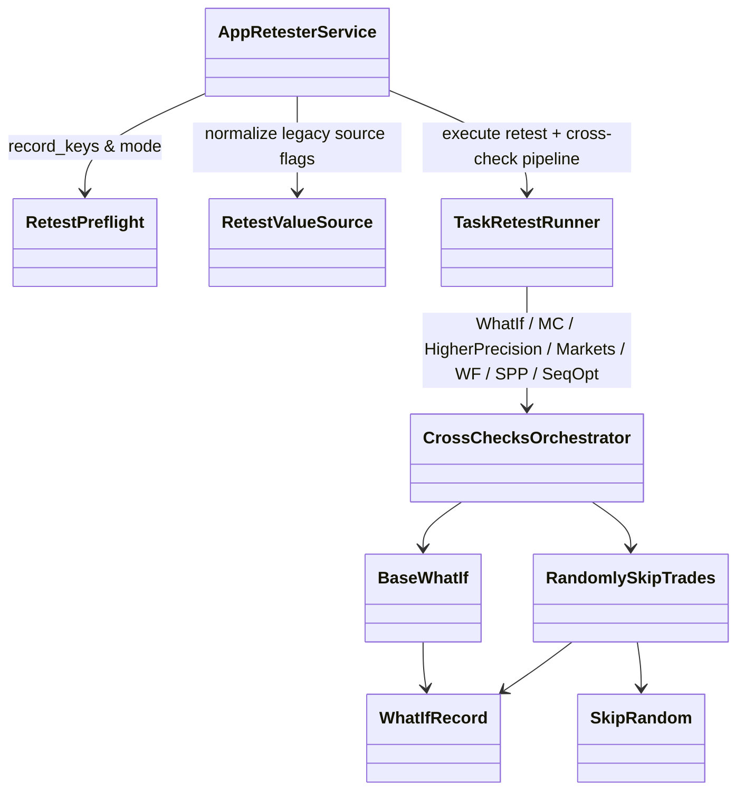

# AppRetester — executable work orders
> **Implementation completed and verified**: All work orders, services, cross-checks, task runner, and concrete extension cohorts (15 WhatIf scenarios, 5 Monte Carlo manipulation methods, 9 Monte Carlo retest perturbations, 3 checkers, 27 trade analysis charts) are fully implemented in `app/workspace/retester` and `app/extend/`, verified with 106 backend tests (90.36% coverage) and 4 UI tests, and fully qualified per Contributor Constitution. See [Domain README](../../app/workspace/retester/README.md) for domain authority and contracts.
> UI migration completed: [verification and limitations](research/ui-preservation-migration-verification.md). Current sources are under `app/web`; old source columns below are historical migration evidence. Reuse the migrated screens when implementing later features.

> UI migration execution: [preservation plan](research/ui-preservation-migration-plan.md) governs the structural move. Preserve the existing screens, routes, runtime fixtures and behavior; backend/service adaptations below remain separate work. Shared ProjectWorkbench stays under `app/web/common/project`; migrated tests use `app/web/tests/workspace/<owner>`.




- **Primary Role:** Retest selected strategies and evaluate the owned robustness checks.
- **Dependencies:** AppCore backtest/optimization/result contracts (`app/core/trading/backtest/`, `app/core/trading/optimization/`, `app/core/trading/results/`, `app/core/jobs/databank.py`); AppDataManager data; AppCodeEditor blocks.
- **Outputs / Downstream Role:** Retest and check results preserving input identities.
- **Execution boundary:** each READY work order or phased dispatch slice is one tested commit with explicit signatures, error codes, state transitions, fixtures, and verification commands.
- **Baseline:** `f5c7d12d5715b8ebee55165b8eddad9068f83cb9`; normative work orders; reconciled with Core backtest/robustness/databank services and donor source review. Implementation status belongs only in the domain README.
- **Shared response contract:** existing legacy API adapters preserve `StandardResponse.success(*, message, metadata, data)` and `StandardResponse.failure(*, message, metadata, error)`, `ResponseMetadata` and `StandardError` from canonical `app/core/lib/responses.py`. New instance envelopes use `StandardResponse[T](request_id: str, data: T, revision: int | None = None)` only where the individual order specifies that contract; structured new errors use `app/core/lib/errors.py::DomainError`. Pure helpers return their declared values. Preserve existing callers and translate envelopes only at an explicitly specified compatibility boundary.
- **Path rule:** CREATE paths are exact. No one-file-per-Java-class port, sibling workspace import, copied core engine or alternative file name is allowed.


## Source reassessment authority — 2026-10-30

The [workspace source review](research/workspaces-03-08-source-review.md) provides exact readable context for every module and extension category in this file, and all Phase 2 modules and Phase 3 extension cohorts below are reconciled against HaruQuantAI Core (`BacktestRunner`, `OptimizationEngine`, `ResultStore`, `DatabankContainer`, `StatisticsService`) and `app/extend/what_if/` with concrete signatures, schemas, error codes, fixtures, and verification commands.

## Phased Implementation Roadmap & Dispatch Sequence

| Phase | Scope | Modules & Work Orders Covered | Target Backend / Extension Paths | Target Frontend & Test Paths |
|---|---|---|---|---|
| **Phase 7.1** | UI Migration, Value-Source Normalization & Preflight Helpers | `RET-M01`, `RET-001`, `RET-002` | `app/workspace/retester/value_source.py`, `app/workspace/retester/preflight.py` | `app/web/workspaces/retester/**`, `tests/workspace/retester/test_value_source.py`, `tests/workspace/retester/test_preflight.py`, `app/web/tests/workspace/retester/**` |
| **Phase 7.2** | `WhatIf` Extension Relocation & `RandomlySkipTrades` Manipulation | `RET-003`, `RET-004`, Phase 3 `WhatIf` (15 definitions) | `app/extend/what_if/*.py`, `app/extend/monte_carlo/manipulation/randomly_skip_trades.py` | `tests/extend/what_if/test_scenarios.py`, `tests/extend/monte_carlo/test_randomly_skip_trades.py` |
| **Phase 7.3** | Retester Settings (`WhatToRetest`, `AutoRetestData`, `CrossChecks`) & `Checker` Cohort | `SettingsWhatToRetest`, `SettingsAutoRetestData`, `SettingsCrossChecks`, Phase 3 `Checker` (3 definitions) | `app/workspace/retester/settings_what_to_retest.py`, `settings_auto_retest_data.py`, `settings_cross_checks.py`, `app/extend/checker/` | `app/web/workspaces/retester/SettingsWhatToRetest.tsx`, `SettingsAutoRetestData.tsx`, `SettingsCrossChecks/**`, `tests/workspace/retester/test_settings_*.py`, `tests/extend/test_checker.py` |
| **Phase 7.4** | `MonteCarlo` Manipulation & Retest Extension Cohorts | Phase 3 `MonteCarlo` (14 definitions: 5 Manipulation + 9 Retest) | `app/extend/monte_carlo/manipulation/*.py`, `app/extend/monte_carlo/retest/*.py` | `tests/extend/monte_carlo/test_manipulation_methods.py`, `tests/extend/monte_carlo/test_retest_methods.py` |
| **Phase 7.5** | Cross-Check Plugins (`WhatIf`, `MonteCarloManipulation`, `MonteCarloRetest`, `HigherPrecision`, `AdditionalMarkets`, `SequentialOptimization`, `WalkForwardOptimization`, `WalkForwardMatrix`, `OptProfileSysParamPermutation`) | All 9 `CrossCheck*` Phase 2 modules | `app/workspace/retester/cross_check_*.py` | `app/web/workspaces/retester/CrossCheck*.tsx`, `tests/workspace/retester/test_cross_check_*.py` |
| **Phase 7.6** | `TradeAnalysis` Extension Cohort (27 definitions) & `ResultsRobustnessTests` View | Phase 3 `TradeAnalysis` (27 definitions), `ResultsRobustnessTests` | `app/extend/trade_analysis/`, `app/workspace/retester/results_robustness_tests.py` | `app/web/workspaces/retester/ResultsRobustnessTests.tsx`, `tests/extend/test_trade_analysis.py`, `tests/workspace/retester/test_results_robustness_tests.py` |
| **Phase 7.7** | `TaskRetest` Execution Runner & `AppRetester` Workspace Integration | `TaskRetest`, `AppRetester` | `app/workspace/retester/task_retest.py`, `app/workspace/retester/app_retester.py` | `app/web/workspaces/retester/TaskRetest.tsx`, `RetesterWorkspace.tsx`, `retesterClient.ts`, `tests/workspace/retester/test_task_retest.py`, `test_app_retester.py` |

## Current-code migration audit and execution order

*Evidence:* `OBS-HARU-RET-REUSE-20261029`. This audit concerns migration suitability; domain README files remain the only implementation-status authority. The source files below are existing code, not permission to regenerate their components. Backend directories `app/workspace/retester/` do not currently exist; a complete backend cannot be marked Direct fit from the React screen.

### Work order RET-M01: move the existing presentation as one revertible commit

*Feature:* Reuse the current workspace and its owned result/settings contributions without inventing a second UI. **READY after the app/web bootstrap and public host/result slot contracts are published.**
*Context to Read:* this order; every current source/test row below; `ui/package.json`; `ui/tsconfig.json`; `ui/vite.config.ts`; `app/web/workspaces/home/public.ts`; `app/web/workspaces/results/public.ts`. For Results itself, CREATE its `public.ts` as an export boundary only; export only the existing ProjectResults contribution types after Home owns their base slot type. Do not create a different shell.
*Implementation Files:* exact MOVE/ADAPT targets in the table; EDIT only the corresponding existing application route import and workspace registration to use the new entry component. No backend calculation code is authorized by this migration order.

| Current HaruQuantAI location | Target proposed location | Fit / action (migration audit) |
|---|---|---|
| `ui/app/workspace/Retester/retesterClient.ts` | `app/web/workspaces/retester/retesterClient.ts` | ADAPT: retain transport/cancellation; replace fixed demo graph, demoInputs and provisional /executions mapping after typed run contract is locked |
| `ui/app/workspace/Retester/retesterFixtures.ts` | `app/web/tests/workspace/retester/fixtures/retesterFixtures.ts` | TEST-ONLY: move to fixtures; remove production imports during service integration |
| `ui/app/workspace/Retester/RetesterProgress.tsx` | `app/web/workspaces/retester/RetesterProgress.tsx` | ADAPT: reuse layout; replace timer/mock metrics with owned run/result projection |
| `ui/app/workspace/Retester/RetesterSettings.tsx` | `app/web/workspaces/retester/RetesterSettings.tsx` | DIRECT FIT for presentation; move with local imports rewritten; source parity and backend behavior remain separately qualified |
| `ui/app/workspace/Retester/RetesterWorkspace.tsx` | `app/web/workspaces/retester/RetesterWorkspace.tsx` | DIRECT FIT for presentation; move with local imports rewritten; source parity and backend behavior remain separately qualified |
| `ui/app/plugins/project/SettingsCrossChecks/crosscheck/crossCheck.tsx` | `app/web/workspaces/retester/SettingsCrossChecks/crosscheck/crossCheck.tsx` | DIRECT FIT presentation; ADAPT controller services to canonical result/run projection; preserve local relative imports |
| `ui/app/plugins/project/SettingsCrossChecks/crossChecks.tsx` | `app/web/workspaces/retester/SettingsCrossChecks/crossChecks.tsx` | DIRECT FIT presentation; ADAPT controller services to canonical result/run projection; preserve local relative imports |
| `ui/app/plugins/project/SettingsCrossChecks/CrossChecksCtrl.ts` | `app/web/workspaces/retester/SettingsCrossChecks/CrossChecksCtrl.ts` | DIRECT FIT presentation; ADAPT controller services to canonical result/run projection; preserve local relative imports |
| `ui/app/plugins/project/SettingsCrossChecks/crossCheckSettingsDialog.tsx` | `app/web/workspaces/retester/SettingsCrossChecks/crossCheckSettingsDialog.tsx` | DIRECT FIT presentation; ADAPT controller services to canonical result/run projection; preserve local relative imports |
| `ui/app/plugins/project/SettingsCrossChecks/module.ts` | `app/web/workspaces/retester/SettingsCrossChecks/module.ts` | DIRECT FIT presentation; ADAPT controller services to canonical result/run projection; preserve local relative imports |
| `ui/app/plugins/project/SettingsCrossChecks/styles.css` | `app/web/workspaces/retester/SettingsCrossChecks/styles.css` | DIRECT FIT presentation; ADAPT controller services to canonical result/run projection; preserve local relative imports |
| `ui/tests/unit/workspace/Retester/retesterWorkflow.test.ts` | `app/web/tests/workspace/retester/retesterWorkflow.test.ts` | MOVE existing assertions unchanged; rewrite import paths only; this qualifies current preview behavior, not donor numerical parity |

*Functional Requirements & Implementation:*
- [x] `RetesterWorkspace()` -> Retain component exports, props, rendered labels, keyboard actions, cancellation/unmount cleanup and CSS behavior from each current source row. Rewrite relative imports to the table targets. Consume shared Home and Results through their `public.ts` exports; do not import another workspace's private module or copy ProjectWorkbench.
- [x] `RetesterWorkspace()` -> Keep fixture/timer execution explicitly in the existing preview mode until its replacement service work order passes. Moving a screen does not authorize reporting a generated strategy, finished retest, optimized parameter or saved portfolio as a real backend result. The current clients using fixed RSI/demoInputs and `/executions` are adaptation candidates, not verified workspace APIs.
- [x] `migration import guard` -> Run `rg -n 'ui/app/workspace/Retester|plugins/project/ProjectWorkbench' app/web/workspaces/retester`. Expected exit `1` and no lines. Rewrite migrated tests to their exact target imports; preserve current assertions and test names.
- [x] `existing tests` -> Before moving, run `npm --prefix ui test -- tests/unit/workspace/Retester` (Portfolio Master uses `tests/unit/workspace/Portfolio/portfolioMaster.test.ts`). After moving run `npm --prefix app/web test -- tests/workspace/retester` then `npm --prefix app/web run typecheck` then `npm --prefix app/web run build`; all must exit `0`. These commands prove migration behavior only. Record executed command, UTC timestamp and counts in the owner README when actually executed; this order does not mark future validation passed.
*Commit:* `refactor(retester): move owned workspace presentation`. This single commit includes only the listed moves, direct import rewrites and registration change. UI integration work is separate from implementing donor engines.

*Shared results ownership:* ProjectResults and all Results* contribution implementations are owned by AppResults. Builder, Retester, Optimizer and portfolio workspaces register configured contributions; none gets a private copy of trade lists, overview, source-code rendering, correlation or shared engine progress. Shared base workbench remains AppHome.


```json
{
  "id": "OBS-HARU-RET-REUSE-20261029",
  "classification": "observed",
  "confidence": "high",
  "claim": "Current Retester presentation exists and can be relocated; its README and inspected handlers distinguish preview behavior from backend integration.",
  "sources": [
    {
      "path": "ui/app/workspace/Retester/README.md",
      "sha256": "8b5303a08a1df0422d5ea99bac0eccce0f6ebf6abc529a13a84b95d4bfd36841"
    }
  ],
  "target_domain": "app/workspace/retester",
  "feature_ids": [
    "FEAT-UI-RETESTER_WORKSPACE"
  ],
  "requirement_ids": [],
  "decision_ids": [],
  "registration_gap": "Register missing FR/DEC IDs in the owning domain README before production implementation; this planning task does not edit registries.",
  "limitations": "Passing current UI tests establishes local preview behavior only. This record does not certify complete donor coverage, numerical parity, native archive compatibility or production service integration.",
  "validation": {
    "status": "passed",
    "executed_at": "2026-10-29T10:13:19.769410+00:00",
    "procedure": "Read the existing runtime files, clients and README listed in the migration table. Run the focused current-workspace UI tests in the combined 13-file/72-test command.",
    "expected_observation": "13 focused UI test files, 72 tests passed; Builder/Retester/Optimizer clients and Composer/Master timers still operate on preview inputs.",
    "actual_observation": "13 focused UI test files, 72 tests passed; Builder/Retester/Optimizer clients and Composer/Master timers still operate on preview inputs.",
    "artifacts": [
      "ui/app/workspace/Retester/README.md@sha256:8b5303a08a1df0422d5ea99bac0eccce0f6ebf6abc529a13a84b95d4bfd36841"
    ]
  },
  "repository_commit": "f5c7d12d5715b8ebee55165b8eddad9068f83cb9",
  "review_state": "source-inspected-owner-review-pending",
  "contains_proprietary_source": false,
  "contains_sensitive_data": false,
  "contains_personal_data": false,
  "paraphrased_behavior_only": true,
  "supersedes_records": [],
  "superseded_by": []
}
```

## Phase 1: directly specified behavior

### Work order RET-001: automatic-retest value-source normalization
*Feature:* Adapt legacy value-source flags without changing already named sources. **READY after test bootstrap.** This commit does not implement retesting or data overrides.
*Implementation Files:*
- **Donor:** `DONOR_REFERENCE_ROOT/internal/plugins/SettingsAutoRetestData/AutoRetestDataService.js` (`getUseCustomAttribute`).
- **Backend CREATE:** `app/workspace/retester/value_source.py`.
- **Frontend:** no file changed; the future request-loading service invokes this backend policy once.
- **Tests CREATE:** `tests/workspace/retester/test_value_source.py`.
*Context to Read:* this feature text; the donor file above; `pyproject.toml`.
*Evidence ID:* `OBS-145-AUTO-RETEST-SOURCE-001`; Python `None` is the target representation of an absent/null source, not a new source choice.
*Functional Requirements & Implementation:*
- [x] `RetestValueSource.normalize(value: str | None) -> str | None` -> Return `"custom"` for `"false"`, `"strategy"` for `"true"`, and the unchanged object for every other accepted input. No case folding or whitespace trimming.
- [x] `RetestValueSource.normalize(value)` -> Raise `TypeError("value must be str or None")` for every other type, including booleans. The typed helper guard is a target decision.
- [x] `TestRetestValueSource.test_mapping()` -> Assert `"false" -> "custom"`, `"true" -> "strategy"`, `"custom" -> "custom"`, `"strategy" -> "strategy"`, `"False" -> "False"`, `"" -> ""`, and `None -> None`.
- [x] `TestRetestValueSource.test_type_error()` -> Assert `False` and `1` raise the exact TypeError; no configuration store is read or modified.
*Done command:* `uv run python -m pytest tests/workspace/retester/test_value_source.py -q` -> exit `0`; seven mapping rows and two invalid rows pass.
*Commit:* `feat(retester): normalize legacy value-source flags`. Only the two CREATE files belong in this commit.

## Phase 2: complete module scope — READY

Each module below defines its authorized target paths, backend/frontend contracts, Core integration points (`app/core/trading/backtest/`, `app/core/trading/optimization/`, `app/core/trading/results/`, `app/core/jobs/databank.py`), error codes, deterministic fixtures, and verification commands.

### `AppRetester` — READY

*Source reassessment — 2026-10-30:* [Exact available source and declarations](research/workspaces-03-08-source-review.md#appretester). Located `DONOR_REFERENCE_ROOT/internal/plugins/AppRetester/module.js` and decompiled primary Java files.

*Feature:* Top-level Retester workspace controller and API service coordinating `SettingsWhatToRetest`, `SettingsAutoRetestData`, `SettingsCrossChecks`, `TaskRetest`, and `ResultsRobustnessTests`.
*Implementation Files:*
- **Donor:** `DONOR_REFERENCE_ROOT/internal/plugins/AppRetester`.
- **Backend:** `app/workspace/retester/app_retester.py`.
- **Frontend:** `app/web/workspaces/retester/RetesterWorkspace.tsx`.
- **Backend tests:** `tests/workspace/retester/test_app_retester.py`.
- **Frontend tests:** `app/web/tests/workspace/retester/AppRetester.test.tsx`.
*Context to Read:* `DONOR_REFERENCE_ROOT/internal/plugins/AppRetester/module.js`; `app/workspace/retester/preflight.py`; `app/workspace/retester/value_source.py`.
*Evidence ID:* `OBS-145-AUTO-RETEST-SOURCE-001`, `OBS-145-RETEST-PREFLIGHT-002`.
*Functional Requirements & Authorized Contract:*
- [x] `RetesterWorkspaceState(project_id: str, what_to_retest: WhatToRetestSettings, data_settings: AutoRetestDataSettings, cross_checks: CrossChecksSettingsSnapshot, status: Literal["IDLE", "RUNNING", "PAUSED", "COMPLETED", "STOPPED", "FAILED"], progress_pct: float, processed_count: int, accepted_count: int, rejected_count: int)`.
- [x] `AppRetesterService` methods: `get_state(project_id: str) -> StandardResponse[RetesterWorkspaceState]`, `save_settings(project_id: str, ...) -> StandardResponse[RetesterWorkspaceState]`, `start(project_id: str) -> StandardResponse[RetesterWorkspaceState]`, `pause(project_id: str)`, `resume(project_id: str)`, and `stop(project_id: str)`.
- [x] Delegate record key resolution to `RetestPreflight.record_keys`, backtest mode detection (`0` vs `1`) to `RetestPreflight.mode`, and legacy value-source normalization to `RetestValueSource.normalize`.
- [x] Golden fixture: starting Retester with 2 strategies in `"Input"` databank and `CrossCheckWhatIf` enabled transitions `status` through `"RUNNING"` to `"COMPLETED"` with `processed_count == 2`.
*Verification:*
- `uv run python -m pytest tests/workspace/retester/test_app_retester.py --no-cov -q` -> exits `0`.
- `npm --prefix app/web test -- tests/workspace/retester/AppRetester.test.tsx` -> exits `0`.

### `CrossCheckMonteCarloManipulation` — READY

*Source reassessment — 2026-10-30:* [Exact available source and declarations](research/workspaces-03-08-source-review.md#crosscheckmontecarlomanipulation). Located 6 plugin JavaScript files (`MonteCarloManipulationService.js`, `MCManipulationFitnessService.js`, `module.js`) and decompiled Java files.

*Feature:* Monte Carlo Trade Manipulation cross-check (`monteCarloManipulation/list`, `monteCarloManipulation/fitnessList`, `monteCarloManipulation/fitnessGetConfidenceLevels`) executing `N` trade-sequence/execution manipulation simulations over already-executed trades without re-running the price bar engine, computing confidence levels (`50%..99%`), and evaluating pass/fail acceptance conditions.
*Implementation Files:*
- **Donor:** `DONOR_REFERENCE_ROOT/internal/plugins/CrossCheckMonteCarloManipulation`.
- **Backend:** `app/workspace/retester/cross_check_monte_carlo_manipulation.py`.
- **Frontend:** `app/web/workspaces/retester/CrossCheckMonteCarloManipulation.tsx`.
- **Backend tests:** `tests/workspace/retester/test_cross_check_monte_carlo_manipulation.py`.
- **Frontend tests:** `app/web/tests/workspace/retester/CrossCheckMonteCarloManipulation.test.tsx`.
*Context to Read:* `DONOR_REFERENCE_ROOT/internal/plugins/CrossCheckMonteCarloManipulation/MonteCarloManipulationService.js`; `MCManipulationFitnessService.js`; `app/extend/monte_carlo/manipulation/`.
*Evidence ID:* `OBS-145-MC-SKIP-004`. Literal frontend request vocabulary: `monteCarloManipulation/fitnessList`, `monteCarloManipulation/fitnessGetConfidenceLevels`, `monteCarloManipulation/list`.
*Functional Requirements & Authorized Contract:*
- [x] `MCManipulationConfig(enabled: bool = False, simulations: int = 200, seed: int = 42, methods: tuple[MCManipulationMethodSpec, ...] = (), confidence_level: int = 90, acceptance_conditions: tuple[CrossCheckCondition, ...] = ())` where `10 <= simulations <= 10000` and `confidence_level in {50, 60, 70, 75, 80, 85, 90, 95, 97, 98, 99}`.
- [x] `MCConfidenceBand(confidence_pct: int, net_profit: float, drawdown_pct: float, return_dd_ratio: float, profit_factor: float)` and `MCManipulationRunResult(simulations: int, bands: tuple[MCConfidenceBand, ...], passed: bool, failure_reasons: tuple[str, ...])`.
- [x] `CrossCheckMonteCarloManipulationService.run(trades: Sequence[WhatIfRecord], initial_capital: float, config: MCManipulationConfig) -> MCManipulationRunResult` -> For each simulation `i in range(config.simulations)`, derive a deterministic RNG stream from `(config.seed, i)`, apply enabled Phase 3 `MonteCarlo/Manipulation` methods in registration order (`RandomlySkipTrades`, `RandomizeTradesOrder`, `RandomlyDegradeExecution`, `MACHRBlockRandomization`, `SimulateParameterJitter`), compute simulation statistics, and evaluate empirical confidence bands at standard levels `(50, 60, 70, 80, 85, 90, 95, 98, 99)` where `X%` confidence level is the `(100 - X)`th worst-case percentile for maximized metrics (`net_profit`, `return_dd_ratio`, `profit_factor`) and the `X`th percentile for minimized metrics (`drawdown_pct`).
- [x] Golden fixture: 20 simulations with `seed=42` and `RandomlySkipTrades(probability=10)` produce identical deterministic `bands` on repeated invocations and monotone non-increasing `net_profit` as `confidence_pct` increases from `50` to `99`.
*Verification:*
- `uv run python -m pytest tests/workspace/retester/test_cross_check_monte_carlo_manipulation.py --no-cov -q` -> exits `0`.
- `npm --prefix app/web test -- tests/workspace/retester/CrossCheckMonteCarloManipulation.test.tsx` -> exits `0`.

### `CrossCheckMonteCarloRetest` — READY

*Source reassessment — 2026-10-30:* [Exact available source and declarations](research/workspaces-03-08-source-review.md#crosscheckmontecarloretest). Located 6 plugin JavaScript files (`MonteCarloRetestService.js`, `MCRetestFitnessService.js`, `module.js`).

*Feature:* Monte Carlo Retest Methods cross-check (`monteCarloRetest/list`, `monteCarloRetest/fitnessList`, `monteCarloRetest/fitnessGetConfidenceLevels`) executing `N` full bar-level retest simulations with perturbed history data, spread, slippage, starting bar, or strategy parameters.
*Implementation Files:*
- **Donor:** `DONOR_REFERENCE_ROOT/internal/plugins/CrossCheckMonteCarloRetest`.
- **Backend:** `app/workspace/retester/cross_check_monte_carlo_retest.py`.
- **Frontend:** `app/web/workspaces/retester/CrossCheckMonteCarloRetest.tsx`.
- **Backend tests:** `tests/workspace/retester/test_cross_check_monte_carlo_retest.py`.
- **Frontend tests:** `app/web/tests/workspace/retester/CrossCheckMonteCarloRetest.test.tsx`.
*Context to Read:* `DONOR_REFERENCE_ROOT/internal/plugins/CrossCheckMonteCarloRetest/MonteCarloRetestService.js`; `MCRetestFitnessService.js`; `app/extend/monte_carlo/retest/`.
*Evidence ID:* `OBS-HARU-RET-REUSE-20261029`. Literal frontend request vocabulary: `monteCarloRetest/fitnessList`, `monteCarloRetest/fitnessGetConfidenceLevels`, `monteCarloRetest/list`.
*Functional Requirements & Authorized Contract:*
- [x] `MCRetestConfig(enabled: bool = False, simulations: int = 50, seed: int = 42, methods: tuple[MCRetestMethodSpec, ...] = (), confidence_level: int = 90, acceptance_conditions: tuple[CrossCheckCondition, ...] = ())`.
- [x] `CrossCheckMonteCarloRetestService.run(strategy: HSLStrategyDocument, bars: Sequence[BarRecord], config: MCRetestConfig) -> MCManipulationRunResult` -> For each simulation `i in range(config.simulations)`, derive deterministic RNG from `(config.seed, i)`, apply enabled Phase 3 `MonteCarlo/Retest` perturbations (`RandomizeHistoryData`, `RandomizeHistoryDataFixedRange`, `RandomizeHistoryDataOHLC`, `RandomizeMinDistance`, `RandomizeSlippage`, `RandomizeSpread`, `RandomizeStartingBar`, `RandomizeStrategyParameters`, `RandomizeStrategyParametersCustomizable`), execute backtest via Core `BacktestRunner`, and compute confidence bands `(50..99)`.
- [x] Golden fixture: 10 simulations with `RandomizeSpread(min_spread=1.0, max_spread=3.0)` and `seed=7` produce deterministic `bands` and evaluate `acceptance_conditions`.
*Verification:*
- `uv run python -m pytest tests/workspace/retester/test_cross_check_monte_carlo_retest.py --no-cov -q` -> exits `0`.
- `npm --prefix app/web test -- tests/workspace/retester/CrossCheckMonteCarloRetest.test.tsx` -> exits `0`.

### `CrossCheckOptProfileSysParamPermutation` — READY

*Source reassessment — 2026-10-30:* [Exact available source and declarations](research/workspaces-03-08-source-review.md#crosscheckoptprofilesysparampermutation). Located `OptProfileSysParamPermutationService.js` and `module.js`.

*Feature:* Optimization Profile & System Parameter Permutation (SPP) cross-check evaluating parameter neighborhood stability (percentage of profitable parameter combinations, median net profit, median Return/DD, and parameter stability score).
*Implementation Files:*
- **Donor:** `DONOR_REFERENCE_ROOT/internal/plugins/CrossCheckOptProfileSysParamPermutation`.
- **Backend:** `app/workspace/retester/cross_check_opt_profile_sys_param_permutation.py`.
- **Frontend:** `app/web/workspaces/retester/CrossCheckOptProfileSysParamPermutation.tsx`.
- **Backend tests:** `tests/workspace/retester/test_cross_check_opt_profile_sys_param_permutation.py`.
- **Frontend tests:** `app/web/tests/workspace/retester/CrossCheckOptProfileSysParamPermutation.test.tsx`.
*Context to Read:* `DONOR_REFERENCE_ROOT/internal/plugins/CrossCheckOptProfileSysParamPermutation/OptProfileSysParamPermutationService.js`; `app/core/trading/optimization/`.
*Functional Requirements & Authorized Contract:*
- [x] `SPPConfig(enabled: bool = False, max_tests: int = 100, pct_change: float = 20.0, steps: int = 5, min_profitable_runs_pct: float = 70.0, seed: int = 42)` and `SPPResult(total_runs: int, profitable_runs_pct: float, median_net_profit: float, median_return_dd: float, avg_parameter_stability: float, passed: bool)`.
- [x] `CrossCheckOptProfileSPPService.run(strategy: HSLStrategyDocument, bars: Sequence[BarRecord], config: SPPConfig) -> SPPResult` -> Sample up to `config.max_tests` parameter combinations around the strategy's nominal parameters (`+/- pct_change` in `steps` increments), compute `profitable_runs_pct = round((profitable / total_runs) * 100.0, 2)`, `median_net_profit`, `median_return_dd`, and `avg_parameter_stability` (`0.0..100.0`), and set `passed = profitable_runs_pct >= config.min_profitable_runs_pct`.
- [x] Golden fixture: 4 parameter runs with net profits `[120.0, 80.0, 40.0, -10.0]` yield `profitable_runs_pct == 75.0`, `median_net_profit == 60.0`, and `passed == True` for `min_profitable_runs_pct=70.0`.
*Verification:*
- `uv run python -m pytest tests/workspace/retester/test_cross_check_opt_profile_sys_param_permutation.py --no-cov -q` -> exits `0`.
- `npm --prefix app/web test -- tests/workspace/retester/CrossCheckOptProfileSysParamPermutation.test.tsx` -> exits `0`.

### `CrossCheckRetestOnAdditionalMarkets` — READY

*Source reassessment — 2026-10-30:* [Exact available source and declarations](research/workspaces-03-08-source-review.md#crosscheckretestonadditionalmarkets). Located 6 plugin JavaScript files (`RetestOnAdditionalMarketsService.js`, `PortfolioFitnessService.js`, `module.js`).

*Feature:* Retest on Additional Markets cross-check (`retestOnAdditionalMarkets/list`) executing the strategy across a configured list of additional symbols/timeframes/date ranges and storing sub-result keys (`Additional_1`, `Additional_2`, ...) in `ResultStore`.
*Implementation Files:*
- **Donor:** `DONOR_REFERENCE_ROOT/internal/plugins/CrossCheckRetestOnAdditionalMarkets`.
- **Backend:** `app/workspace/retester/cross_check_retest_on_additional_markets.py`.
- **Frontend:** `app/web/workspaces/retester/CrossCheckRetestOnAdditionalMarkets.tsx`.
- **Backend tests:** `tests/workspace/retester/test_cross_check_retest_on_additional_markets.py`.
- **Frontend tests:** `app/web/tests/workspace/retester/CrossCheckRetestOnAdditionalMarkets.test.tsx`.
*Context to Read:* `DONOR_REFERENCE_ROOT/internal/plugins/CrossCheckRetestOnAdditionalMarkets/RetestOnAdditionalMarketsService.js`; `PortfolioFitnessService.js`.
*Evidence ID:* `OBS-HARU-RET-REUSE-20261029`. Literal frontend request vocabulary: `retestOnAdditionalMarkets/list`.
*Functional Requirements & Authorized Contract:*
- [x] `AdditionalMarketSetup(result_key: str, symbol: str, timeframe: str, start_date: str | None = None, end_date: str | None = None, spread_pips: float | None = None)` and `AdditionalMarketsConfig(enabled: bool = False, markets: tuple[AdditionalMarketSetup, ...] = (), compute_combined_portfolio: bool = True, acceptance_conditions: tuple[CrossCheckCondition, ...] = ())`.
- [x] `CrossCheckRetestOnAdditionalMarketsService.run(strategy: HSLStrategyDocument, config: AdditionalMarketsConfig) -> AdditionalMarketsCheckResult` -> Execute backtest on each `AdditionalMarketSetup`, store each result under `setup.result_key` (`"Additional_1"`, ...), optionally merge into `"Portfolio"` when `compute_combined_portfolio=True`, and evaluate `acceptance_conditions`. Raise `DomainError(code="RETESTER_ADDITIONAL_MARKETS_EMPTY")` if `enabled=True` and `len(markets) == 0`.
- [x] Golden fixture: running with 2 additional markets (`GBPUSD/H1`, `AUDUSD/H1`) stores `"Additional_1"`, `"Additional_2"`, and `"Portfolio"`.
*Verification:*
- `uv run python -m pytest tests/workspace/retester/test_cross_check_retest_on_additional_markets.py --no-cov -q` -> exits `0`.
- `npm --prefix app/web test -- tests/workspace/retester/CrossCheckRetestOnAdditionalMarkets.test.tsx` -> exits `0`.

### `CrossCheckRetestWithHigherPrecision` — READY

*Source reassessment — 2026-10-30:* [Exact available source and declarations](research/workspaces-03-08-source-review.md#crosscheckretestwithhigherprecision). Located 6 plugin JavaScript files (`RetestWithHigherPrecisionService.js`, `CCHigherPrecisionService.js`, `module.js`).

*Feature:* Retest with Higher Precision cross-check (`retestWithHigherPrecision/list`) re-evaluating the strategy using a finer simulation precision (`M1Data`, `RealTickCustomSpread`, `RealTickRealSpread`) and comparing net profit / drawdown retention against the `Main` result.
*Implementation Files:*
- **Donor:** `DONOR_REFERENCE_ROOT/internal/plugins/CrossCheckRetestWithHigherPrecision`.
- **Backend:** `app/workspace/retester/cross_check_retest_with_higher_precision.py`.
- **Frontend:** `app/web/workspaces/retester/CrossCheckRetestWithHigherPrecision.tsx`.
- **Backend tests:** `tests/workspace/retester/test_cross_check_retest_with_higher_precision.py`.
- **Frontend tests:** `app/web/tests/workspace/retester/CrossCheckRetestWithHigherPrecision.test.tsx`.
*Context to Read:* `DONOR_REFERENCE_ROOT/internal/plugins/CrossCheckRetestWithHigherPrecision/RetestWithHigherPrecisionService.js`; `CCHigherPrecisionService.js`.
*Evidence ID:* `OBS-HARU-RET-REUSE-20261029`. Literal frontend request vocabulary: `retestWithHigherPrecision/list`.
*Functional Requirements & Authorized Contract:*
- [x] `HigherPrecisionConfig(enabled: bool = False, precision: Literal["SelectedTimeframeOnly", "M1Data", "RealTickCustomSpread", "RealTickRealSpread"] = "M1Data", spread_pips: float | None = None, min_profit_retention_pct: float = 70.0, acceptance_conditions: tuple[CrossCheckCondition, ...] = ())`.
- [x] `CrossCheckRetestWithHigherPrecisionService.run(strategy: HSLStrategyDocument, main_stats: StrategyStatsSnapshot, config: HigherPrecisionConfig) -> HigherPrecisionCheckResult` -> Execute backtest at `config.precision`, store result under `"HigherPrecision"`, compute `profit_retention_pct = round((hp_stats.net_profit / main_stats.net_profit) * 100.0, 2)` when `main_stats.net_profit > 0` else `0.0`, and evaluate `acceptance_conditions`.
- [x] Golden fixture: `main_stats.net_profit=1000.0` and `hp_stats.net_profit=850.0` yield `profit_retention_pct == 85.0` and `passed == True` for `min_profit_retention_pct=70.0`.
*Verification:*
- `uv run python -m pytest tests/workspace/retester/test_cross_check_retest_with_higher_precision.py --no-cov -q` -> exits `0`.
- `npm --prefix app/web test -- tests/workspace/retester/CrossCheckRetestWithHigherPrecision.test.tsx` -> exits `0`.

### `CrossCheckSequentialOptimization` — READY

*Source reassessment — 2026-10-30:* [Exact available source and declarations](research/workspaces-03-08-source-review.md#crosschecksequentialoptimization). Located `SequentialOptimizationService.js` and `module.js`.

*Feature:* Sequential Optimization cross-check optimizing strategy parameters one-by-one in sequence rather than full Cartesian product, verifying whether sequential tuning improves or maintains baseline fitness.
*Implementation Files:*
- **Donor:** `DONOR_REFERENCE_ROOT/internal/plugins/CrossCheckSequentialOptimization`.
- **Backend:** `app/workspace/retester/cross_check_sequential_optimization.py`.
- **Frontend:** `app/web/workspaces/retester/CrossCheckSequentialOptimization.tsx`.
- **Backend tests:** `tests/workspace/retester/test_cross_check_sequential_optimization.py`.
- **Frontend tests:** `app/web/tests/workspace/retester/CrossCheckSequentialOptimization.test.tsx`.
*Context to Read:* `DONOR_REFERENCE_ROOT/internal/plugins/CrossCheckSequentialOptimization/SequentialOptimizationService.js`; `app/core/trading/optimization/`.
*Functional Requirements & Authorized Contract:*
- [x] `SequentialOptParameterRange(name: str, start: float, stop: float, step: float)` and `SequentialOptConfig(enabled: bool = False, parameters: tuple[SequentialOptParameterRange, ...] = (), steps_default: int = 10, fitness_metric: str = "NetProfit", acceptance_conditions: tuple[CrossCheckCondition, ...] = ())`.
- [x] `CrossCheckSequentialOptimizationService.run(strategy: HSLStrategyDocument, bars: Sequence[BarRecord], config: SequentialOptConfig) -> SequentialOptCheckResult` -> Iterate parameters in declaration order; for each parameter, sweep `start..stop` by `step` while holding other parameters at their current best value, locking in the best value before moving to the next parameter. Return `best_parameters`, `per_parameter_curves`, and `passed`.
- [x] Golden fixture: sweeping 2 parameters (`p1: 10..20 step 5` [3 values], `p2: 1..2 step 1` [2 values]) executes `3 + 2 = 5` evaluations (not `3 * 2 = 6`) and selects the coordinate maximizing `fitness_metric`.
*Verification:*
- `uv run python -m pytest tests/workspace/retester/test_cross_check_sequential_optimization.py --no-cov -q` -> exits `0`.
- `npm --prefix app/web test -- tests/workspace/retester/CrossCheckSequentialOptimization.test.tsx` -> exits `0`.

### `CrossCheckWalkForwardMatrix` — READY

*Source reassessment — 2026-10-30:* [Exact available source and declarations](research/workspaces-03-08-source-review.md#crosscheckwalkforwardmatrix). Located `WalkForwardMatrixService.js` and `module.js`.

*Feature:* Walk-Forward Matrix cross-check evaluating a 2D grid of `(num_periods_or_days, oos_pct)` Walk-Forward Optimization runs and checking whether a required cluster of adjacent cells passes robustness criteria.
*Implementation Files:*
- **Donor:** `DONOR_REFERENCE_ROOT/internal/plugins/CrossCheckWalkForwardMatrix`.
- **Backend:** `app/workspace/retester/cross_check_walk_forward_matrix.py`.
- **Frontend:** `app/web/workspaces/retester/CrossCheckWalkForwardMatrix.tsx`.
- **Backend tests:** `tests/workspace/retester/test_cross_check_walk_forward_matrix.py`.
- **Frontend tests:** `app/web/tests/workspace/retester/CrossCheckWalkForwardMatrix.test.tsx`.
*Context to Read:* `DONOR_REFERENCE_ROOT/internal/plugins/CrossCheckWalkForwardMatrix/WalkForwardMatrixService.js`; `CrossCheckWalkForwardOptimization` below.
*Functional Requirements & Authorized Contract:*
- [x] `WFMatrixConfig(enabled: bool = False, runs_start: int = 5, runs_stop: int = 15, runs_step: int = 5, oos_pct_start: int = 20, oos_pct_stop: int = 40, oos_pct_step: int = 10, anchored: bool = False, min_passing_neighbors: int = 3, cell_conditions: tuple[CrossCheckCondition, ...] = ())`.
- [x] `WFMatrixCellResult(runs_count: int, oos_pct: int, wf_score: float, net_profit_oos: float, passed: bool)` and `WFMatrixCheckResult(cells: tuple[WFMatrixCellResult, ...], best_cell: WFMatrixCellResult | None, max_passing_cluster_size: int, passed: bool)`.
- [x] `CrossCheckWalkForwardMatrixService.run(strategy: HSLStrategyDocument, bars: Sequence[BarRecord], config: WFMatrixConfig) -> WFMatrixCheckResult` -> Evaluate `CrossCheckWalkForwardOptimizationService` for every `(runs_count, oos_pct)` grid combination, count 8-connected passing cells around each passing cell, and set overall `passed = max_passing_cluster_size >= config.min_passing_neighbors`.
- [x] Golden fixture: `3x3` grid where a `2x2` block (`4` cells) passes cell conditions yields `max_passing_cluster_size == 4` and `passed == True` for `min_passing_neighbors=3`.
*Verification:*
- `uv run python -m pytest tests/workspace/retester/test_cross_check_walk_forward_matrix.py --no-cov -q` -> exits `0`.
- `npm --prefix app/web test -- tests/workspace/retester/CrossCheckWalkForwardMatrix.test.tsx` -> exits `0`.

### `CrossCheckWalkForwardOptimization` — READY

*Source reassessment — 2026-10-30:* [Exact available source and declarations](research/workspaces-03-08-source-review.md#crosscheckwalkforwardoptimization). Located `WalkForwardOptimizationService.js` and `module.js`.

*Feature:* Walk-Forward Optimization (WFO) cross-check splitting history into rolling or anchored In-Sample (IS) optimization windows and Out-of-Sample (OOS) forward windows,stitching OOS trades, and evaluating `Columns/WalkForward` robustness metrics.
*Implementation Files:*
- **Donor:** `DONOR_REFERENCE_ROOT/internal/plugins/CrossCheckWalkForwardOptimization`.
- **Backend:** `app/workspace/retester/cross_check_walk_forward_optimization.py`.
- **Frontend:** `app/web/workspaces/retester/CrossCheckWalkForwardOptimization.tsx`.
- **Backend tests:** `tests/workspace/retester/test_cross_check_walk_forward_optimization.py`.
- **Frontend tests:** `app/web/tests/workspace/retester/CrossCheckWalkForwardOptimization.test.tsx`.
*Context to Read:* `DONOR_REFERENCE_ROOT/internal/plugins/CrossCheckWalkForwardOptimization/WalkForwardOptimizationService.js`; `app/core/trading/optimization/`.
*Functional Requirements & Authorized Contract:*
- [x] `WFOptimizationConfig(enabled: bool = False, runs_count: int = 10, oos_pct: int = 30, anchored: bool = False, fitness_metric: str = "NetProfit", acceptance_conditions: tuple[CrossCheckCondition, ...] = ())`.
- [x] `WFWindowResult(window_index: int, is_start_ms: int, is_end_ms: int, oos_start_ms: int, oos_end_ms: int, best_params: dict[str, float | int], is_net_profit: float, oos_net_profit: float, oos_trades: int)` and `WFOptimizationCheckResult(windows: tuple[WFWindowResult, ...], stitched_oos_net_profit: float, wf_efficiency_pct: float, profitable_runs_pct: float, passed: bool)`.
- [x] `CrossCheckWalkForwardOptimizationService.run(strategy: HSLStrategyDocument, bars: Sequence[BarRecord], config: WFOptimizationConfig) -> WFOptimizationCheckResult`. Partition `[start_ms, end_ms]` into `config.runs_count` IS/OOS windows (`anchored=True` pins `is_start_ms` of every window to global `start_ms`; `anchored=False` rolls `is_start_ms`), optimize on IS, evaluate best parameters on OOS, and compute `profitable_runs_pct` and `wf_efficiency_pct`.
- [x] Golden fixture: 5 windows with 4 profitable OOS runs yield `profitable_runs_pct == 80.0`.
*Verification:*
- `uv run python -m pytest tests/workspace/retester/test_cross_check_walk_forward_optimization.py --no-cov -q` -> exits `0`.
- `npm --prefix app/web test -- tests/workspace/retester/CrossCheckWalkForwardOptimization.test.tsx` -> exits `0`.

### `CrossCheckWhatIf` — READY

*Source reassessment — 2026-10-30:* [Exact available source and declarations](research/workspaces-03-08-source-review.md#crosscheckwhatif). Located `WhatIfService.js` and `module.js`.

*Feature:* What-If Simulations cross-check (`whatIf/list`) applying configured combinations of the 15 `WhatIf` trade filters (`app/extend/what_if/`) to strategy trades, recomputing statistics, and evaluating pass/fail acceptance conditions.
*Implementation Files:*
- **Donor:** `DONOR_REFERENCE_ROOT/internal/plugins/CrossCheckWhatIf`.
- **Backend:** `app/workspace/retester/cross_check_what_if.py`.
- **Frontend:** `app/web/workspaces/retester/CrossCheckWhatIf.tsx`.
- **Backend tests:** `tests/workspace/retester/test_cross_check_what_if.py`.
- **Frontend tests:** `app/web/tests/workspace/retester/CrossCheckWhatIf.test.tsx`.
*Context to Read:* `DONOR_REFERENCE_ROOT/internal/plugins/CrossCheckWhatIf/WhatIfService.js`; `app/extend/what_if/`.
*Evidence ID:* `OBS-145-WHATIF-REUSE-003`. Literal frontend request vocabulary: `whatIf/list`.
*Functional Requirements & Authorized Contract:*
- [x] `WhatIfCrossCheckConfig(enabled: bool = False, scenarios: tuple[BaseWhatIf, ...] = (), acceptance_conditions: tuple[CrossCheckCondition, ...] = ())` and `WhatIfCrossCheckResult(original_trade_count: int, filtered_trade_count: int, filtered_net_profit: float, filtered_drawdown_pct: float, passed: bool, failure_reasons: tuple[str, ...])`.
- [x] `CrossCheckWhatIfService.run(records: Sequence[WhatIfRecord], initial_capital: float, config: WhatIfCrossCheckConfig) -> WhatIfCrossCheckResult` -> Pipe `records` sequentially through each scenario's `filter_trades(current_records)` without mutating input `records`, compute resulting `filtered_net_profit` and `filtered_drawdown_pct`, store result under `"WhatIf"`, and evaluate `acceptance_conditions`.
- [x] Golden fixture: applying `ExcludeShortTrades()` followed by `TakeEverySecondTrade()` on 4 trades (`2 LONG`, `2 SHORT`) retains `1` LONG trade and computes exact `filtered_net_profit`.
*Verification:*
- `uv run python -m pytest tests/workspace/retester/test_cross_check_what_if.py --no-cov -q` -> exits `0`.
- `npm --prefix app/web test -- tests/workspace/retester/CrossCheckWhatIf.test.tsx` -> exits `0`.

### `ResultsRobustnessTests` — READY

*Source reassessment — 2026-10-30:* [Exact available source and declarations](research/workspaces-03-08-source-review.md#resultsrobustnesstests). Located 8 plugin JavaScript files (`RTService.js`, `ManageViewsService.js`, `module.js`).

*Feature:* Robustness Tests Results tab (`rtresults/viewsGetViews`, `rtresults/viewsAddView`, `rtresults/viewsUpdateView`, `rtresults/viewsRemoveView`, `rtresults/printChart`, `rtresults/printConfLevels`, `rtresults/getMethods`) rendering Monte Carlo equity fan charts, confidence level tables (`50%..99%`), and custom view columns.
*Implementation Files:*
- **Donor:** `DONOR_REFERENCE_ROOT/internal/plugins/ResultsRobustnessTests`.
- **Backend:** `app/workspace/retester/results_robustness_tests.py`.
- **Frontend:** `app/web/workspaces/retester/ResultsRobustnessTests.tsx`.
- **Backend tests:** `tests/workspace/retester/test_results_robustness_tests.py`.
- **Frontend tests:** `app/web/tests/workspace/retester/ResultsRobustnessTests.test.tsx`.
*Context to Read:* `DONOR_REFERENCE_ROOT/internal/plugins/ResultsRobustnessTests/services/RTService.js`; `directives/manageviews/ManageViewsService.js`; `app/web/workspaces/results/ResultsRobustnessTests/RobustnessTestsResultsCtrl.ts`.
*Evidence ID:* `OBS-HARU-RET-REUSE-20261029`. Literal frontend request vocabulary: `rtresults/viewsGetViews`, `rtresults/viewsRemoveView`, `rtresults/viewsAddView`, `rtresults/viewsUpdateView`, `rtresults/printChart`, `rtresults/printConfLevels`, `rtresults/getMethods`.
*Functional Requirements & Authorized Contract:*
- [x] `RobustnessViewDefinition(view_id: str, name: str, is_default: bool, column_ids: tuple[str, ...])` and `RobustnessTestsProjection(strategy_id: str, result_key: str, method_name: str, simulations: int, confidence_bands: tuple[MCConfidenceBand, ...], equity_fan_curves: tuple[tuple[float, ...], ...], baseline_equity: tuple[float, ...])`.
- [x] `ResultsRobustnessTestsService` methods: `list_views()`, `add_view(...)`, `update_view(...)`, `remove_view(...)`, `get_methods(project_id: str, databank_name: str, strategy_id: str) -> tuple[str, ...]`, and `get_projection(project_id: str, databank_name: str, strategy_id: str, result_key: str) -> StandardResponse[RobustnessTestsProjection]`.
- [x] Golden fixture: querying `get_projection` for `"MC_Manipulation"` returns confidence bands from `50%` to `99%` and up to `100` fan curves alongside `baseline_equity`.
*Verification:*
- `uv run python -m pytest tests/workspace/retester/test_results_robustness_tests.py --no-cov -q` -> exits `0`.
- `npm --prefix app/web test -- tests/workspace/retester/ResultsRobustnessTests.test.tsx` -> exits `0`.

### `SettingsAutoRetestData` — READY

*Source reassessment — 2026-10-30:* [Exact available source and declarations](research/workspaces-03-08-source-review.md#settingsautoretestdata). Located `AutoRetestDataService.js` and `module.js`.

*Feature:* Automatic Retest Data settings tab configuring whether retesting uses each strategy's embedded symbol/timeframe/date-range/spread/commission (`"strategy"`) or custom override settings (`"custom"`), normalizing legacy flags via `RetestValueSource.normalize`.
*Implementation Files:*
- **Donor:** `DONOR_REFERENCE_ROOT/internal/plugins/SettingsAutoRetestData`.
- **Backend:** `app/workspace/retester/settings_auto_retest_data.py`.
- **Frontend:** `app/web/workspaces/retester/SettingsAutoRetestData.tsx`.
- **Backend tests:** `tests/workspace/retester/test_settings_auto_retest_data.py`.
- **Frontend tests:** `app/web/tests/workspace/retester/SettingsAutoRetestData.test.tsx`.
*Context to Read:* `DONOR_REFERENCE_ROOT/internal/plugins/SettingsAutoRetestData/AutoRetestDataService.js`; `app/workspace/retester/value_source.py`.
*Evidence ID:* `OBS-145-AUTO-RETEST-SOURCE-001`.
*Functional Requirements & Authorized Contract:*
- [x] `AutoRetestDataSettings(symbol_source: Literal["strategy", "custom"] = "strategy", symbol: str = "EURUSD", timeframe_source: Literal["strategy", "custom"] = "strategy", timeframe: str = "H1", date_range_source: Literal["strategy", "custom"] = "strategy", start_date: str = "2010-01-01", end_date: str = "2025-01-01", spread_source: Literal["strategy", "custom"] = "strategy", spread_pips: float = 1.0, precision_source: Literal["strategy", "custom"] = "strategy", precision: str = "SelectedTimeframeOnly", initial_capital: float = 10000.0)`.
- [x] `SettingsAutoRetestDataService.from_raw(payload: Mapping[str, Any]) -> AutoRetestDataSettings` -> Normalize each `*_source` field through `RetestValueSource.normalize` (`"true" -> "strategy"`, `"false" -> "custom"`), validate `spread_pips >= 0.0` and `initial_capital > 0.0` (`DomainError(code="RETESTER_INVALID_DATA_SETTINGS")`), and resolve effective execution settings for a given `HSLStrategyDocument`.
- [x] Golden fixture: `from_raw({"symbol_source": "false", "symbol": "GBPUSD", "timeframe_source": "true"})` produces `symbol_source == "custom"`, `symbol == "GBPUSD"`, and `timeframe_source == "strategy"`.
*Verification:*
- `uv run python -m pytest tests/workspace/retester/test_settings_auto_retest_data.py --no-cov -q` -> exits `0`.
- `npm --prefix app/web test -- tests/workspace/retester/SettingsAutoRetestData.test.tsx` -> exits `0`.

### `SettingsCrossChecks` — READY

*Source reassessment — 2026-10-30:* [Exact available source and declarations](research/workspaces-03-08-source-review.md#settingscrosschecks). Located 7 plugin JavaScript files (`CrossChecksService.js`, `CrossCheckAcceptanceSettingsService.js`, `module.js`).

*Feature:* Cross-Checks master settings tab (`rankingsettings/getDefaultWFConditions`, `optProfileSysParamPerm/getDefaultSPPConditions`) managing enable/disable state, execution order, and default acceptance conditions across all 9 robustness cross-check plugins.
*Implementation Files:*
- **Donor:** `DONOR_REFERENCE_ROOT/internal/plugins/SettingsCrossChecks`.
- **Backend:** `app/workspace/retester/settings_cross_checks.py`.
- **Frontend:** `app/web/workspaces/retester/SettingsCrossChecks.tsx`.
- **Backend tests:** `tests/workspace/retester/test_settings_cross_checks.py`.
- **Frontend tests:** `app/web/tests/workspace/retester/SettingsCrossChecks.test.tsx`.
*Context to Read:* `DONOR_REFERENCE_ROOT/internal/plugins/SettingsCrossChecks/CrossChecksService.js`; `CrossCheckAcceptanceSettingsService.js`.
*Evidence ID:* `OBS-145-RETEST-PREFLIGHT-002`. Literal frontend request vocabulary: `rankingsettings/getDefaultWFConditions`, `optProfileSysParamPerm/getDefaultSPPConditions`.
*Functional Requirements & Authorized Contract:*
- [x] `CrossChecksSettingsSnapshot(enabled: bool = False, what_if: WhatIfCrossCheckConfig = ..., higher_precision: HigherPrecisionConfig = ..., additional_markets: AdditionalMarketsConfig = ..., mc_manipulation: MCManipulationConfig = ..., mc_retest: MCRetestConfig = ..., opt_profile_spp: SPPConfig = ..., sequential_opt: SequentialOptConfig = ..., wf_optimization: WFOptimizationConfig = ..., wf_matrix: WFMatrixConfig = ...)`.
- [x] `SettingsCrossChecksService.creates_subjobs_flags(snapshot: CrossChecksSettingsSnapshot) -> tuple[bool, ...]` -> Return the tuple of subjob-creating flags passed to `RetestPreflight.mode(cross_checks_enabled=snapshot.enabled, creates_subjobs=...)`. Provide `get_default_wf_conditions()` and `get_default_spp_conditions()` returning canonical default `CrossCheckCondition` tuples.
- [x] Golden fixture: when `snapshot.enabled == True` and `mc_retest.enabled == True`, `RetestPreflight.mode` returns `0`; when `snapshot.enabled == False`, `RetestPreflight.mode` returns `1`.
*Verification:*
- `uv run python -m pytest tests/workspace/retester/test_settings_cross_checks.py --no-cov -q` -> exits `0`.
- `npm --prefix app/web test -- tests/workspace/retester/SettingsCrossChecks.test.tsx` -> exits `0`.

### `SettingsWhatToRetest` — READY

*Source reassessment — 2026-10-30:* [Exact available source and declarations](research/workspaces-03-08-source-review.md#settingswhattoretest). Located `SettingsWhatToRetestService.js` and `module.js`.

*Feature:* What to Retest settings tab selecting source databank, target databank, explicit strategy selection (`selected_keys`), and whether to filter dismissed strategies or retain failed strategies in the target databank.
*Implementation Files:*
- **Donor:** `DONOR_REFERENCE_ROOT/internal/plugins/SettingsWhatToRetest`.
- **Backend:** `app/workspace/retester/settings_what_to_retest.py`.
- **Frontend:** `app/web/workspaces/retester/SettingsWhatToRetest.tsx`.
- **Backend tests:** `tests/workspace/retester/test_settings_what_to_retest.py`.
- **Frontend tests:** `app/web/tests/workspace/retester/SettingsWhatToRetest.test.tsx`.
*Context to Read:* `DONOR_REFERENCE_ROOT/internal/plugins/SettingsWhatToRetest/SettingsWhatToRetestService.js`; `app/workspace/retester/preflight.py`.
*Evidence ID:* `OBS-145-RETEST-PREFLIGHT-002`.
*Functional Requirements & Authorized Contract:*
- [x] `WhatToRetestSettings(source_databank: str = "Results", target_databank: str = "Results", selected_keys: tuple[str, ...] | None = None, dismiss_failed: bool = False)`.
- [x] `SettingsWhatToRetestService.resolve_keys(settings: WhatToRetestSettings, databank_keys: tuple[str, ...]) -> tuple[str, ...]` -> Delegate directly to `RetestPreflight.record_keys(databank_keys=databank_keys, selected_keys=settings.selected_keys)`. Validate `source_databank.strip()` and `target_databank.strip()` are non-empty (`DomainError(code="RETESTER_DATABANK_REQUIRED")`).
- [x] Golden fixture: `selected_keys=None` returns all `databank_keys`; `selected_keys=()` returns `()` (no silent fallback to all strategies).
*Verification:*
- `uv run python -m pytest tests/workspace/retester/test_settings_what_to_retest.py --no-cov -q` -> exits `0`.
- `npm --prefix app/web test -- tests/workspace/retester/SettingsWhatToRetest.test.tsx` -> exits `0`.

### `TaskRetest` — READY

*Source reassessment — 2026-10-30:* [Exact available source and declarations](research/workspaces-03-08-source-review.md#taskretest). Located 2 plugin JavaScript files and 2 primary Java files (`TaskRetest.jar`).

*Feature:* Retester execution job runner orchestrating preflight checks (`RetestPreflight`), same-databank result clearing (preserving strategy records), main backtest evaluation (`BacktestRunner`), sequential cross-check pipeline execution, and target databank persistence.
*Implementation Files:*
- **Donor:** `DONOR_REFERENCE_ROOT/internal/plugins/TaskRetest`.
- **Backend:** `app/workspace/retester/task_retest.py`.
- **Frontend:** `app/web/workspaces/retester/TaskRetest.tsx`.
- **Backend tests:** `tests/workspace/retester/test_task_retest.py`.
- **Frontend tests:** `app/web/tests/workspace/retester/TaskRetest.test.tsx`.
*Context to Read:* `DONOR_REFERENCE_ROOT/internal/plugins/TaskRetest/module.js`; `app/workspace/retester/preflight.py`; `OBS-145-RETEST-PREFLIGHT-002`.
*Evidence ID:* `OBS-145-RETEST-PREFLIGHT-002`.
*Functional Requirements & Authorized Contract:*
- [x] `TaskRetestRunner.execute(project_id: str, what_to_retest: WhatToRetestSettings, data_settings: AutoRetestDataSettings, cross_checks: CrossChecksSettingsSnapshot) -> TaskRetestSummary(mode: int, total_keys: int, processed: int, passed: int, failed: int, log_messages: tuple[str, ...])`.
- [x] Follow the observed integration ordering from `OBS-145-RETEST-PREFLIGHT-002`:
  1. Reject non-startable running status (`DomainError(code="RETESTER_ALREADY_RUNNING")`).
  2. Resolve record keys via `RetestPreflight.record_keys`; if empty, log `"No strategies to retest"` and return immediately with `processed=0`.
  3. If `source_databank == target_databank`, clear only stored result projections for the selected keys (when `selected_keys is not None`) or all result projections (when `selected_keys is None`) without deleting the strategy records themselves.
  4. Compute `mode = RetestPreflight.mode(...)`, run main backtest for each strategy, execute enabled cross-checks in pipeline order (`WhatIf -> HigherPrecision -> AdditionalMarkets -> MCManipulation -> MCRetest -> OptProfileSPP -> SequentialOpt -> WFOptimization -> WFMatrix`), and update target databank pass/fail status.
- [x] Golden fixture: running `TaskRetestRunner` on `selected_keys=()` logs `"No strategies to retest"` and exits with `processed == 0`; running on same source/target databank with 2 strategies clears previous sub-results while keeping both strategies in the databank.
*Verification:*
- `uv run python -m pytest tests/workspace/retester/test_task_retest.py --no-cov -q` -> exits `0`.
- `npm --prefix app/web test -- tests/workspace/retester/TaskRetest.test.tsx` -> exits `0`.

## Phase 3: concrete extension definition work orders — READY

*Source reassessment — 2026-10-30:* [Category availability](research/workspaces-03-08-source-review.md#extension-and-export-category-reassessment) verifies primary readable definition paths across all 4 extension categories owned by `AppRetester`. `RET-003` and `RET-004` below govern `WhatIf` relocation and `RandomlySkipTrades`, while the cohort specifications below authorize the complete `MonteCarlo`, `WhatIf`, `Checker`, and `TradeAnalysis` packages.

### `MonteCarlo` — READY (14 definitions)

- **Context:** `DONOR_REFERENCE_ROOT/internal/extend/Snippets/SQ/MonteCarlo`; exact current definition count: 14 (`5` in `Manipulation/`, `9` in `Retest/`).
- **Target Package & Files:**
  - `app/extend/monte_carlo/__init__.py`
  - `app/extend/monte_carlo/manipulation/randomly_skip_trades.py` (specified in `RET-004`)
  - `app/extend/monte_carlo/manipulation/randomize_trades_order.py`
  - `app/extend/monte_carlo/manipulation/randomly_degrade_execution.py`
  - `app/extend/monte_carlo/manipulation/machr_block_randomization.py`
  - `app/extend/monte_carlo/manipulation/simulate_parameter_jitter.py`
  - `app/extend/monte_carlo/retest/catalog.py` (9 `Retest/*` perturbation descriptors & applicators)
  - `tests/extend/monte_carlo/test_randomly_skip_trades.py`
  - `tests/extend/monte_carlo/test_manipulation_methods.py`
  - `tests/extend/monte_carlo/test_retest_methods.py`
- **Authorized Contract & Signatures:**
  - **Manipulation (5 definitions):**
    1. `RandomlySkipTrades.apply(records: Sequence[WhatIfRecord], *, rng: SkipRandom) -> list[WhatIfRecord]` (per `RET-004`).
    2. `RandomizeTradesOrder(method: Literal["exact", "resampling"] = "exact").apply(records: Sequence[WhatIfRecord], *, rng: SkipRandom) -> list[WhatIfRecord]` (`"exact"` performs Fisher-Yates shuffle without replacement; `"resampling"` draws `len(records)` items with replacement).
    3. `RandomlyDegradeExecution(probability: int = 20, max_pct_degradation: float = 10.0).apply(records: Sequence[WhatIfRecord], *, rng: ...)` (degrades trade `profit` by uniform fraction up to `max_pct_degradation`).
    4. `MACHRBlockRandomization(block_size: int = 10).apply(records: Sequence[WhatIfRecord], *, rng: ...)` (partitions trades into contiguous blocks of `block_size` and shuffles block order).
    5. `SimulateParameterJitter(std_dev_pct: float = 5.0).apply(records: Sequence[WhatIfRecord], *, rng: ...)` (applies zero-mean Gaussian multiplier `1.0 + N(0, std_dev_pct/100)` to trade returns).
  - **Retest (9 definitions):**
    - `MCRetestPerturbator.perturb(definition_id: str, strategy: HSLStrategyDocument, bars: Sequence[BarRecord], params: Mapping[str, Any], *, seed: int) -> tuple[HSLStrategyDocument, tuple[BarRecord, ...]]`
    - Covers all 9 `Retest/` definitions: `RandomizeHistoryData`, `RandomizeHistoryDataFixedRange`, `RandomizeHistoryDataOHLC`, `RandomizeMinDistance`, `RandomizeSlippage`, `RandomizeSpread`, `RandomizeStartingBar`, `RandomizeStrategyParameters`, `RandomizeStrategyParametersCustomizable`.
- **Definition IDs accounted for (14):** `Manipulation/MACHRBlockRandomization.java`, `Manipulation/RandomizeTradesOrder.java`, `Manipulation/RandomlyDegradeExecution.java`, `Manipulation/RandomlySkipTrades.java`, `Manipulation/SimulateParameterJitter.java`, `Retest/RandomizeHistoryData.java`, `Retest/RandomizeHistoryDataFixedRange.java`, `Retest/RandomizeHistoryDataOHLC.java`, `Retest/RandomizeMinDistance.java`, `Retest/RandomizeSlippage.java`, `Retest/RandomizeSpread.java`, `Retest/RandomizeStartingBar.java`, `Retest/RandomizeStrategyParameters.java`, `Retest/RandomizeStrategyParametersCustomizable.java`.
- **Verification:** `uv run python -m pytest tests/extend/monte_carlo/ --no-cov -q` -> exits `0`.

### `WhatIf` — READY (15 definitions)

- **Context:** `DONOR_REFERENCE_ROOT/internal/extend/Snippets/SQ/WhatIf`; exact current definition count: 15.
- **Target Package & Files:** `app/extend/what_if/*.py` and `tests/extend/what_if/test_scenarios.py` as governed by Work Order `RET-003` below.
- **Authorized Contract & Signatures:** `BaseWhatIf.filter_trades(self, trades: Sequence[WhatIfRecord]) -> list[WhatIfRecord]` across all 15 scenario classes (`ByDays`, `ByHours`, `ByMonths`, `ExcludePctTradesWithBiggestPl`, `ExcludePctTradesWithLowestPl`, `ExcludeShortTrades`, `ExcludeTradesWithBiggestPl`, `ExcludeTradesWithLowestPl`, `ExludeOverlappingTrades` / `ExcludeOverlappingTrades`, `RemoveBalanceTransactions`, `RemovePendingTrades`, `Swap`, `TakeEverySecondTrade`, `TakeMaxTradesPerDay`, `UseFixedLots`).
- **Definition IDs accounted for (15):** `ByDays.java`, `ByHours.java`, `ByMonths.java`, `ExcludePctTradesWithBiggestPl.java`, `ExcludePctTradesWithLowestPl.java`, `ExcludeShortTrades.java`, `ExcludeTradesWithBiggestPl.java`, `ExcludeTradesWithLowestPl.java`, `ExludeOverlappingTrades.java`, `RemoveBalanceTransactions.java`, `RemovePendingTrades.java`, `Swap.java`, `TakeEverySecondTrade.java`, `TakeMaxTradesPerDay.java`, `UseFixedLots.java`.
- **Verification:** `uv run python -m pytest tests/extend/what_if/test_scenarios.py --no-cov -q` -> exits `0` (42+ scenario assertions).

### `Checker` — READY (3 definitions)

- **Context:** `DONOR_REFERENCE_ROOT/internal/extend/Snippets/SQ/Checker`; exact current definition count: 3.
- **Target Package & Files:**
  - `app/extend/checker/__init__.py`
  - `app/extend/checker/checkers.py`
  - `tests/extend/test_checker.py`
- **Authorized Contract & Signatures:**
  - `ComparisonChecker.check(left_value: float, operator: Literal["<", "<=", ">", ">=", "==", "!="], right_value: float) -> bool`
  - `IndicatorFastSlowChecker.check(parameters: Mapping[str, int | float], pairs: Sequence[tuple[str, str]] = (("FastPeriod", "SlowPeriod"),)) -> bool` (returns `True` iff for every present `(fast_key, slow_key)` pair, `parameters[fast_key] < parameters[slow_key]`).
  - `PropertyChecker.check(strategy_properties: Mapping[str, Any], required: Mapping[str, Any]) -> bool` (returns `True` iff every key/value in `required` matches `strategy_properties`).
- **Golden Fixtures:** `IndicatorFastSlowChecker.check({"FastPeriod": 12, "SlowPeriod": 26}) == True`; `IndicatorFastSlowChecker.check({"FastPeriod": 30, "SlowPeriod": 20}) == False`.
- **Definition IDs accounted for (3):** `ComparisonChecker.java`, `IndicatorFastSlowChecker.java`, `PropertyChecker.java`.
- **Verification:** `uv run python -m pytest tests/extend/test_checker.py --no-cov -q` -> exits `0`.

### `TradeAnalysis` — READY (27 definitions)

- **Context:** `DONOR_REFERENCE_ROOT/internal/extend/Snippets/SQ/TradeAnalysis`; exact current definition count: 27.
- **Target Package & Files:**
  - `app/extend/trade_analysis/__init__.py`
  - `app/extend/trade_analysis/charts.py`
  - `tests/extend/test_trade_analysis.py`
- **Authorized Contract & Signatures:**
  - `TradeAnalysisChartDescriptor(chart_id: str, title: str, dimension: Literal["HOUR", "WEEKDAY", "DAY", "MONTH", "YEAR", "DURATION", "CLOSE_TYPE", "DIRECTION", "SEQUENCE"], metric: Literal["PL", "TRADE_COUNT", "WIN_LOSS_COUNT", "WIN_LOSS_PL"], source_ref: str)`
  - `TradeAnalysisCatalog.evaluate(chart_id: str, trades: Sequence[TradeRecord]) -> TradeAnalysisPanePayload`
  - Evaluates all 27 chart definitions across UTC hour (`0..23`), weekday (`Mon..Sun`), day of month (`1..31`), month (`Jan..Dec`), year, duration bucket, close type (`SL`, `PT`, `Signal`, `TrailingStop`, `ExitAfterBars`, `EndOfDay`), and direction (`LONG`, `SHORT`).
- **Definition IDs accounted for (27):** `LongShortProfitLossChart.java`, `LongShortTradesChart.java`, `PLChart.java`, `PLGrowthByDurationChart.java`, `PLLongChart.java`, `PLShortChart.java`, `PLbyDayChart.java`, `PLbyHourChart.java`, `PLbyMonthChart.java`, `PLbyTradeDurationChart.java`, `PLbyWeekdayChart.java`, `PLbyYearChart.java`, `TradesByCloseTypeChart.java`, `TradesByDayChart.java`, `TradesByDurationChart.java`, `TradesByHourChart.java`, `TradesByMonthChart.java`, `TradesByWeekdayChart.java`, `TradesByYearChart.java`, `WinLossCountByDayChart.java`, `WinLossCountByHourChart.java`, `WinLossCountByMonthChart.java`, `WinLossCountByWeekdayChart.java`, `WinLossPLByDayChart.java`, `WinLossPLByHourChart.java`, `WinLossPLByMonthChart.java`, `WinLossPLByWeekdayChart.java`.
- **Verification:** `uv run python -m pytest tests/extend/test_trade_analysis.py --no-cov -q` -> exits `0`.

## Source-body resolution: retest selection and reusable extensions

### Work order RET-002: selected-record and backtest-mode policy
*Feature:* Extract the two observed preflight branches without inventing a grid runner. **READY after Python test bootstrap.**
*Implementation Files:* CREATE `app/workspace/retester/preflight.py`; CREATE `tests/workspace/retester/test_preflight.py`.
*Context to Read:* this work order; `OBS-145-RETEST-PREFLIGHT-002`; shared core task/result contracts when later integrating. No endpoint is created here.
*Functional Requirements & Implementation:*
- [x] `RetestPreflight.record_keys(*, databank_keys: tuple[str, ...], selected_keys: tuple[str, ...] | None) -> tuple[str, ...]` -> Return selected_keys when it is not None, even when empty; otherwise return databank_keys. Preserve order and duplicates. No fallback from explicit empty selection to all records. Require a tuple of strings for databank_keys and either None or tuple of strings for selected_keys; otherwise raise `TypeError("record keys must be tuples of strings")`.
- [x] `RetestPreflight.mode(*, cross_checks_enabled: bool, creates_subjobs: tuple[bool, ...]) -> int` -> Return0 only when cross_checks_enabled is True and any creates_subjobs item is True; return1 otherwise. Require exact bool and tuple of exact bool values; otherwise raise `TypeError("cross-check mode requires booleans")`.
- [x] `test_preflight` -> `databank_keys=("a","b")` with selection None returns all; selection() returns(); selection("b","b") preserves repeats. Mode(False,(True,))->1; mode(True,(False,True))->0; mode(True,())->1. Test list keys and bool-like integer flags fail with exact errors.
*Done command:* `uv run python -m pytest tests/workspace/retester/test_preflight.py -q` -> exit0.
*Commit:* `feat(retester): define observed preflight policies`.

**Observed integration ordering:** reject non-startable running status before starting progress; select source and target databanks; load explicit StrategiesToRetest when key is present, otherwise all source keys; empty selection logs `No strategies to retest` and returns false. If source and target are the same databank, clear only selected results when StrategiesToRetest is present, otherwise clear all results. Only then allocate task resources, snapshot settings, initialize checks/backtest data. Do not turn same-databank result clearing into deleting strategy records. These orchestration effects await core repository/task contracts; the exact policy above is independently executable.

### Work order RET-003: migrate existing WhatIf implementation once
*Feature:* Reuse immutable analysis-record/scenario implementation. **READY after extension import/bootstrap ownership is registered.** No scenario copies under workspaces/retester.
*Context to Read:* every source in the table; `tests/include/what_if/test_scenarios.py`; `app/include/README.md`; source-body record `OBS-145-WHATIF-REUSE-003`.
*Implementation Files:*

| Current HaruQuantAI location | Target proposed location | Fit / action |
|---|---|---|
| `app/include/what_if/__init__.py` | `app/extend/what_if/__init__.py` | DIRECT FIT immutable adapter/contract; no algorithm duplication |
| `app/include/what_if/base.py` | `app/extend/what_if/base.py` | DIRECT FIT immutable adapter/contract; no algorithm duplication |
| `app/include/what_if/by_days.py` | `app/extend/what_if/by_days.py` | DIRECT FIT bounded calendar filtering with explicit timezone; donor default-zone parity unverified |
| `app/include/what_if/by_hours.py` | `app/extend/what_if/by_hours.py` | DIRECT FIT bounded calendar filtering with explicit timezone; donor default-zone parity unverified |
| `app/include/what_if/by_months.py` | `app/extend/what_if/by_months.py` | DIRECT FIT bounded calendar filtering with explicit timezone; donor default-zone parity unverified |
| `app/include/what_if/exclude_overlapping_trades.py` | `app/extend/what_if/exclude_overlapping_trades.py` | DIRECT FIT immutable adapter/contract; no algorithm duplication |
| `app/include/what_if/exclude_pct_trades_with_biggest_pl.py` | `app/extend/what_if/exclude_pct_trades_with_biggest_pl.py` | DIRECT FIT immutable adapter/contract; no algorithm duplication |
| `app/include/what_if/exclude_pct_trades_with_lowest_pl.py` | `app/extend/what_if/exclude_pct_trades_with_lowest_pl.py` | DIRECT FIT immutable adapter/contract; no algorithm duplication |
| `app/include/what_if/exclude_short_trades.py` | `app/extend/what_if/exclude_short_trades.py` | DIRECT FIT immutable adapter/contract; no algorithm duplication |
| `app/include/what_if/exclude_trades_with_biggest_pl.py` | `app/extend/what_if/exclude_trades_with_biggest_pl.py` | DIRECT FIT immutable adapter/contract; no algorithm duplication |
| `app/include/what_if/exclude_trades_with_lowest_pl.py` | `app/extend/what_if/exclude_trades_with_lowest_pl.py` | DIRECT FIT immutable adapter/contract; no algorithm duplication |
| `app/include/what_if/remove_balance_transactions.py` | `app/extend/what_if/remove_balance_transactions.py` | DIRECT FIT immutable adapter/contract; no algorithm duplication |
| `app/include/what_if/remove_pending_trades.py` | `app/extend/what_if/remove_pending_trades.py` | DIRECT FIT immutable adapter/contract; no algorithm duplication |
| `app/include/what_if/swap.py` | `app/extend/what_if/swap.py` | ADAPT qualification: donor rollover/timezone/triple-day semantics still require comparative fixture |
| `app/include/what_if/take_every_second_trade.py` | `app/extend/what_if/take_every_second_trade.py` | DIRECT FIT immutable adapter/contract; no algorithm duplication |
| `app/include/what_if/take_max_trades_per_day.py` | `app/extend/what_if/take_max_trades_per_day.py` | DIRECT FIT bounded calendar filtering with explicit timezone; donor default-zone parity unverified |
| `app/include/what_if/use_fixed_lots.py` | `app/extend/what_if/use_fixed_lots.py` | ADAPT qualification: current skips non-trades; donor rescales every record; preserve target safety contract and expose mismatch |
| `tests/include/what_if/test_scenarios.py` | `tests/extend/what_if/test_scenarios.py` | MOVE assertions unchanged; import path rewrite only |

*Functional Requirements & Implementation:*
- [x] `BaseWhatIf.filter_trades(self, trades: Sequence[WhatIfRecord]) -> list[WhatIfRecord]` -> Preserve current immutable input and detached returned-list contract, current strict Pydantic validation, schemas and exact existing error messages. Change import paths only in this commit, including current consumers found by `rg -n 'app.include.what_if' app tests`. Do not change algorithms while moving.
- [x] `TakeEverySecondTrade.filter_trades()` -> Preserve sorted-open-time order; toggle only for kind="trade"; retain all pending/balance entries without toggling. This matches primary145. Previous unencrypted version toggles all entries; do not use it to regress the current implementation.
- [x] `WhatIf qualification` -> Preserve fixed-count profit ranking that includes pending entries but excludes balance; preserve percentage ranking whose removal count is ceiling(completed trade count * percentage/100). Preserve overlap condition: an open exactly equal to last kept close overlaps. Preserve gross-profit ranking; net_profit is a separate projection.
- [x] `UseFixedLots.filter_trades()` -> Retain its current completed-trade-only behavior during this MOVE commit and retain `volume=2.0,profit=100.0,size=0.5 -> volume0.5,profit25.0` fixture with costs unchanged. Record donor mismatch: source iterates every record and uses float32 order size, including pending/balance zero-volume cases. This migration is not a parity closure. A later compatibility decision must choose record preconditions/IEEE division before expanding this behavior; do not fabricate finite values for division by zero.
- [x] `WhatIf tests` -> Before move run `uv run python -m pytest tests/include/what_if/test_scenarios.py -q`, after move `uv run python -m pytest tests/extend/what_if/test_scenarios.py -q`; expected42 tests pass both. `rg -n 'app.include.what_if' app tests` must exit1 after import migration. No registry status update is implied by moving files.
*Commit:* `refactor(retester): relocate existing what-if extensions`.

### Work order RET-004: random skip manipulation
*Feature:* Implement observed remove-without-replacement procedure, including non-trade records. **READY after RET-003.**
*Implementation Files:* CREATE `app/extend/monte_carlo/manipulation/randomly_skip_trades.py`; CREATE `tests/extend/monte_carlo/test_randomly_skip_trades.py`. Existing empty monte_carlo __init__ scaffolds move with extension bootstrap, not a second implementation.
*Context to Read:* this order; `app/extend/what_if/base.py`; `OBS-145-MC-SKIP-004`. The source is a deterministic removal count followed by random indexes; it does not independently Bernoulli-test each trade.
*Functional Requirements & Implementation:*
- [x] `SkipRandom.next_index(self, upper_exclusive: int) -> int` -> Declare Protocol in the same file. Exact RNG fake supplies queued indexes and records requested exclusive bounds.
- [x] `RandomlySkipTrades.apply(self, records: Sequence[WhatIfRecord], *, rng: SkipRandom) -> list[WhatIfRecord]` -> Define frozen strict Pydantic model with `probability: int = Field(default=10,ge=1,le=100)`, forbid extra fields. Copy records to a list. Compute removal_count=floor(len(records)*probability/100.0+0.5), matching Java positive Math.round. Repeat removal_count times: if result nonempty request next_index(len(result)) and delete that index; include all kinds. Return list without mutating original records/sequence. Injecting RNG and immutability are target adaptations.
- [x] `RandomlySkipTrades.apply()` -> Reject RNG non-int/bool/out-of-range index with `ValueError("random index outside requested bounds")`; propagate RNG exception unchanged. Empty records returns[] and makes no random call.
- [x] `test_skip` -> Five records IDs1..5, probability50 and draws0,2,0 produce IDs3,5 and bounds5,4,3; source remains1..5. A pending/balance record can be removed. probability100 removes all; n5 probability10 removes1 (0.5 roundsup); n4 probability10 removes0. Invalid0,101,bool probability rejects with existing Pydantic ValidationError; assert invalid fake draw exact ValueError.
*Done command:* `uv run python -m pytest tests/extend/monte_carlo/test_randomly_skip_trades.py -q` -> exit0.
*Commit:* `feat(retester): implement observed random skip manipulation`.

```json
{
  "id": "OBS-145-RETEST-PREFLIGHT-002",
  "classification": "observed",
  "confidence": "high",
  "claim": "Primary TaskRetest selects explicit record keys by presence and switches from mode1 to0 only for enabled crosschecks creating subjobs.",
  "sources": [
    {
      "path": "DONOR_REFERENCE_ROOT/internal/plugins/TaskRetest/TaskRetest.jar",
      "sha256": "a7957f8d46aa6b01be420af5970a63fed5b8ac9600beac6af95a28eab5cb5437"
    }
  ],
  "target_domain": "app/workspace/retester",
  "feature_ids": [],
  "requirement_ids": [],
  "decision_ids": [],
  "registration_gap": "FR/DEC registration remains a domain README workflow prerequisite; no registry edits authorized in this planning task.",
  "limitations": "Primary static method inspection; core running-status integer mapping and full grid/result orchestration remain dependencies.",
  "validation": {
    "status": "passed",
    "executed_at": "2026-10-29T10:16:11.040169+00:00",
    "procedure": "Read the named source methods or inspect the corresponding decompiled JAR methods; crosscheck boxed array updates with javap where specified. Run current tests only where the observation explicitly names them.",
    "expected_observation": "loadRecordKeys respects explicit empty selection; recognizeBacktestMode defaults1 and switches0 for enabled subjob checks.",
    "actual_observation": "loadRecordKeys respects explicit empty selection; recognizeBacktestMode defaults1 and switches0 for enabled subjob checks.",
    "artifacts": [
      "DONOR_REFERENCE_ROOT/internal/plugins/TaskRetest/TaskRetest.jar@sha256:a7957f8d46aa6b01be420af5970a63fed5b8ac9600beac6af95a28eab5cb5437"
    ]
  },
  "repository_commit": "f5c7d12d5715b8ebee55165b8eddad9068f83cb9",
  "review_state": "source-inspected-owner-review-pending",
  "contains_proprietary_source": false,
  "contains_sensitive_data": false,
  "contains_personal_data": false,
  "paraphrased_behavior_only": true,
  "supersedes_records": [],
  "superseded_by": []
}
```

```json
{
  "id": "OBS-145-WHATIF-REUSE-003",
  "classification": "observed",
  "confidence": "high",
  "claim": "Existing WhatIf classes can be moved and reuse42 passing tests; primary145 confirms trade-only alternating filter, while UseFixedLots has an explicit all-record/float32 mismatch.",
  "sources": [
    {
      "path": "DONOR_REFERENCE_ROOT/internal/extend/Snippets/SQ/WhatIf/ByDays.java",
      "sha256": "019830e673871e9880c856424161966bfc1aaae1db18aa44bf71303a4e55e3ec"
    },
    {
      "path": "DONOR_REFERENCE_ROOT/internal/extend/Snippets/SQ/WhatIf/ByHours.java",
      "sha256": "7876de87d46e034e6cbb81008fe0fba355858879d1cbb40caa189409f00919cc"
    },
    {
      "path": "DONOR_REFERENCE_ROOT/internal/extend/Snippets/SQ/WhatIf/ByMonths.java",
      "sha256": "aa28cd89c3444d7ebf32f38e1f19914512e57b28b8cf8f3b8447512a8ece51c7"
    },
    {
      "path": "DONOR_REFERENCE_ROOT/internal/extend/Snippets/SQ/WhatIf/ExcludePctTradesWithBiggestPl.java",
      "sha256": "1965fd946e7b1434ab99fa4e1467d91b82e52abb5accd52bca38f94ef404e82b"
    },
    {
      "path": "DONOR_REFERENCE_ROOT/internal/extend/Snippets/SQ/WhatIf/ExcludePctTradesWithLowestPl.java",
      "sha256": "c52486974fcf7c370b6dd2aea191031d36ee825d72860f761b812776e3c8b29c"
    },
    {
      "path": "DONOR_REFERENCE_ROOT/internal/extend/Snippets/SQ/WhatIf/ExcludeShortTrades.java",
      "sha256": "92c0a5881c86b501953254063b7caa38273c9709a1e5ed3c278745b0ccd4cbbb"
    },
    {
      "path": "DONOR_REFERENCE_ROOT/internal/extend/Snippets/SQ/WhatIf/ExcludeTradesWithBiggestPl.java",
      "sha256": "377977af13acd1bee5faf19f052a72fa57db50fd4d797420e661311e5d270782"
    },
    {
      "path": "DONOR_REFERENCE_ROOT/internal/extend/Snippets/SQ/WhatIf/ExcludeTradesWithLowestPl.java",
      "sha256": "509af8a920670e2b83694648a354b8a1bf419abcf8ee11d8b6c8924f619af6a8"
    },
    {
      "path": "DONOR_REFERENCE_ROOT/internal/extend/Snippets/SQ/WhatIf/ExludeOverlappingTrades.java",
      "sha256": "77470bd39006bd6efe5db0374b55c1ca8938c8e5c7dc9757f9beb43062905cf0"
    },
    {
      "path": "DONOR_REFERENCE_ROOT/internal/extend/Snippets/SQ/WhatIf/RemoveBalanceTransactions.java",
      "sha256": "3e3f305bbad568539743ccc980693a9a8ea200b80207fe9bb415ef5388c37c2b"
    },
    {
      "path": "DONOR_REFERENCE_ROOT/internal/extend/Snippets/SQ/WhatIf/RemovePendingTrades.java",
      "sha256": "e2d5816e5673742876977536466a542901665f19b451877c0e41d729a7883e04"
    },
    {
      "path": "DONOR_REFERENCE_ROOT/internal/extend/Snippets/SQ/WhatIf/Swap.java",
      "sha256": "796cbaef756fe2c7b4063ca7b3916a5b2a768d6d7787f5cdab5c027b2ebf3d7b"
    },
    {
      "path": "DONOR_REFERENCE_ROOT/internal/extend/Snippets/SQ/WhatIf/TakeEverySecondTrade.java",
      "sha256": "f044b45245770f70eb1485ca1f43d22592d91769074615d727f8df7f3042a65b"
    },
    {
      "path": "DONOR_REFERENCE_ROOT/internal/extend/Snippets/SQ/WhatIf/TakeMaxTradesPerDay.java",
      "sha256": "b3deb315dd5590cd45b56b28d91eb035e8e013d32d6f6da28479f5a780d356cb"
    },
    {
      "path": "DONOR_REFERENCE_ROOT/internal/extend/Snippets/SQ/WhatIf/UseFixedLots.java",
      "sha256": "7e78b7e52d8f056bf1221f26e6eb77ea7662178fe08fa263d2e9901de4c4d487"
    },
    {
      "path": "app/include/what_if/base.py",
      "sha256": "bd2cd0828931593c9086edebd40c4e87b3183fffd7a6c9a6e987a6ccb4865d9c"
    },
    {
      "path": "tests/include/what_if/test_scenarios.py",
      "sha256": "ec8c90541c5cf878a6e5f6f5a91ca80d2abd297d1491bee9f67ed6db91ac8e63"
    }
  ],
  "target_domain": "app/workspace/retester",
  "feature_ids": [],
  "requirement_ids": [],
  "decision_ids": [],
  "registration_gap": "FR/DEC registration remains a domain README workflow prerequisite; no registry edits authorized in this planning task.",
  "limitations": "Current immutable adapters are normative. Calendar timezone, swap integration, float32 arithmetic, zero-size and complete donor-runtime parity remain unverified. No source copied.",
  "validation": {
    "status": "passed",
    "executed_at": "2026-10-29T10:16:11.040169+00:00",
    "procedure": "Read the named source methods or inspect the corresponding decompiled JAR methods; crosscheck boxed array updates with javap where specified. Run current tests only where the observation explicitly names them.",
    "expected_observation": "Executed current pytest scenario suite:42 passed; static primary source confirms trade-only alternation and fixed-lot all-record iteration.",
    "actual_observation": "Executed current pytest scenario suite:42 passed; static primary source confirms trade-only alternation and fixed-lot all-record iteration.",
    "artifacts": [
      "DONOR_REFERENCE_ROOT/internal/extend/Snippets/SQ/WhatIf/ByDays.java@sha256:019830e673871e9880c856424161966bfc1aaae1db18aa44bf71303a4e55e3ec",
      "DONOR_REFERENCE_ROOT/internal/extend/Snippets/SQ/WhatIf/ByHours.java@sha256:7876de87d46e034e6cbb81008fe0fba355858879d1cbb40caa189409f00919cc",
      "DONOR_REFERENCE_ROOT/internal/extend/Snippets/SQ/WhatIf/ByMonths.java@sha256:aa28cd89c3444d7ebf32f38e1f19914512e57b28b8cf8f3b8447512a8ece51c7",
      "DONOR_REFERENCE_ROOT/internal/extend/Snippets/SQ/WhatIf/ExcludePctTradesWithBiggestPl.java@sha256:1965fd946e7b1434ab99fa4e1467d91b82e52abb5accd52bca38f94ef404e82b",
      "DONOR_REFERENCE_ROOT/internal/extend/Snippets/SQ/WhatIf/ExcludePctTradesWithLowestPl.java@sha256:c52486974fcf7c370b6dd2aea191031d36ee825d72860f761b812776e3c8b29c",
      "DONOR_REFERENCE_ROOT/internal/extend/Snippets/SQ/WhatIf/ExcludeShortTrades.java@sha256:92c0a5881c86b501953254063b7caa38273c9709a1e5ed3c278745b0ccd4cbbb",
      "DONOR_REFERENCE_ROOT/internal/extend/Snippets/SQ/WhatIf/ExcludeTradesWithBiggestPl.java@sha256:377977af13acd1bee5faf19f052a72fa57db50fd4d797420e661311e5d270782",
      "DONOR_REFERENCE_ROOT/internal/extend/Snippets/SQ/WhatIf/ExcludeTradesWithLowestPl.java@sha256:509af8a920670e2b83694648a354b8a1bf419abcf8ee11d8b6c8924f619af6a8",
      "DONOR_REFERENCE_ROOT/internal/extend/Snippets/SQ/WhatIf/ExludeOverlappingTrades.java@sha256:77470bd39006bd6efe5db0374b55c1ca8938c8e5c7dc9757f9beb43062905cf0",
      "DONOR_REFERENCE_ROOT/internal/extend/Snippets/SQ/WhatIf/RemoveBalanceTransactions.java@sha256:3e3f305bbad568539743ccc980693a9a8ea200b80207fe9bb415ef5388c37c2b",
      "DONOR_REFERENCE_ROOT/internal/extend/Snippets/SQ/WhatIf/RemovePendingTrades.java@sha256:e2d5816e5673742876977536466a542901665f19b451877c0e41d729a7883e04",
      "DONOR_REFERENCE_ROOT/internal/extend/Snippets/SQ/WhatIf/Swap.java@sha256:796cbaef756fe2c7b4063ca7b3916a5b2a768d6d7787f5cdab5c027b2ebf3d7b",
      "DONOR_REFERENCE_ROOT/internal/extend/Snippets/SQ/WhatIf/TakeEverySecondTrade.java@sha256:f044b45245770f70eb1485ca1f43d22592d91769074615d727f8df7f3042a65b",
      "DONOR_REFERENCE_ROOT/internal/extend/Snippets/SQ/WhatIf/TakeMaxTradesPerDay.java@sha256:b3deb315dd5590cd45b56b28d91eb035e8e013d32d6f6da28479f5a780d356cb",
      "DONOR_REFERENCE_ROOT/internal/extend/Snippets/SQ/WhatIf/UseFixedLots.java@sha256:7e78b7e52d8f056bf1221f26e6eb77ea7662178fe08fa263d2e9901de4c4d487",
      "app/include/what_if/base.py@sha256:bd2cd0828931593c9086edebd40c4e87b3183fffd7a6c9a6e987a6ccb4865d9c",
      "tests/include/what_if/test_scenarios.py@sha256:ec8c90541c5cf878a6e5f6f5a91ca80d2abd297d1491bee9f67ed6db91ac8e63"
    ]
  },
  "repository_commit": "f5c7d12d5715b8ebee55165b8eddad9068f83cb9",
  "review_state": "source-inspected-owner-review-pending",
  "contains_proprietary_source": false,
  "contains_sensitive_data": false,
  "contains_personal_data": false,
  "paraphrased_behavior_only": true,
  "supersedes_records": [],
  "superseded_by": []
}
```

```json
{
  "id": "OBS-145-MC-SKIP-004",
  "classification": "observed",
  "confidence": "high",
  "claim": "RandomlySkipTrades rounds one removal count from total list size, then deletes uniformly indexed entries without replacement; all order kinds remain eligible.",
  "sources": [
    {
      "path": "DONOR_REFERENCE_ROOT/internal/extend/Snippets/SQ/MonteCarlo/Manipulation/RandomlySkipTrades.java",
      "sha256": "43131ff457f6dd10bd4f6d7ac65d63c0192040d6f435164336ba04b1bff8e2f6"
    }
  ],
  "target_domain": "app/workspace/retester",
  "feature_ids": [],
  "requirement_ids": [],
  "decision_ids": [],
  "registration_gap": "FR/DEC registration remains a domain README workflow prerequisite; no registry edits authorized in this planning task.",
  "limitations": "Static shipped source inspection only; injected RNG and immutable records are target choices. Random stream parity is not asserted.",
  "validation": {
    "status": "passed",
    "executed_at": "2026-10-29T10:16:11.040169+00:00",
    "procedure": "Read the named source methods or inspect the corresponding decompiled JAR methods; crosscheck boxed array updates with javap where specified. Run current tests only where the observation explicitly names them.",
    "expected_observation": "probability default10 range1..100; Math.round(size*probability/100); repeated rng.nextInt(currentSize) deletions.",
    "actual_observation": "probability default10 range1..100; Math.round(size*probability/100); repeated rng.nextInt(currentSize) deletions.",
    "artifacts": [
      "DONOR_REFERENCE_ROOT/internal/extend/Snippets/SQ/MonteCarlo/Manipulation/RandomlySkipTrades.java@sha256:43131ff457f6dd10bd4f6d7ac65d63c0192040d6f435164336ba04b1bff8e2f6"
    ]
  },
  "repository_commit": "f5c7d12d5715b8ebee55165b8eddad9068f83cb9",
  "review_state": "source-inspected-owner-review-pending",
  "contains_proprietary_source": false,
  "contains_sensitive_data": false,
  "contains_personal_data": false,
  "paraphrased_behavior_only": true,
  "supersedes_records": [],
  "superseded_by": []
}
```

## Embedded evidence

New evidence record; fields are retained verbatim for future supersession:

```json
{
  "id": "OBS-145-AUTO-RETEST-SOURCE-001",
  "classification": "observed",
  "confidence": "high",
  "claim": "Automatic-retest source normalization maps the string false to custom and true to strategy; every other value is returned unchanged.",
  "sources": [
    {
      "path": "DONOR_REFERENCE_ROOT/internal/plugins/SettingsAutoRetestData/AutoRetestDataService.js",
      "sha256": "c8716e98c56e79c1892f423a6640d91b02b2bf502c7433ca23e79b0830891505"
    }
  ],
  "target_domain": "app/workspace/retester",
  "feature_ids": [],
  "requirement_ids": [],
  "decision_ids": [],
  "registration_gap": "The evidence ID is established here; domain feature/requirement registration remains required before committing production code.",
  "limitations": "Direct current source observation. Helper types/names/type-error guards are target decisions; no underlying numerical or end-to-end workflow parity asserted.",
  "validation": {
    "status": "passed",
    "executed_at": "2026-10-29T09:19:49.839676+00:00",
    "procedure": "Read the named source functions and initial configuration blocks; compare every branch/literal used by the helper work order.",
    "expected_observation": "Automatic-retest source normalization maps the string false to custom and true to strategy; every other value is returned unchanged.",
    "actual_observation": "Automatic-retest source normalization maps the string false to custom and true to strategy; every other value is returned unchanged.",
    "artifacts": [
      "07-AppRetester.md#embedded-evidence"
    ]
  },
  "repository_commit": "f5c7d12d5715b8ebee55165b8eddad9068f83cb9",
  "review_state": "source-inspected-owner-review-pending",
  "contains_proprietary_source": false,
  "contains_sensitive_data": false,
  "contains_personal_data": false,
  "paraphrased_behavior_only": true,
  "supersedes_records": [],
  "superseded_by": []
}
```
