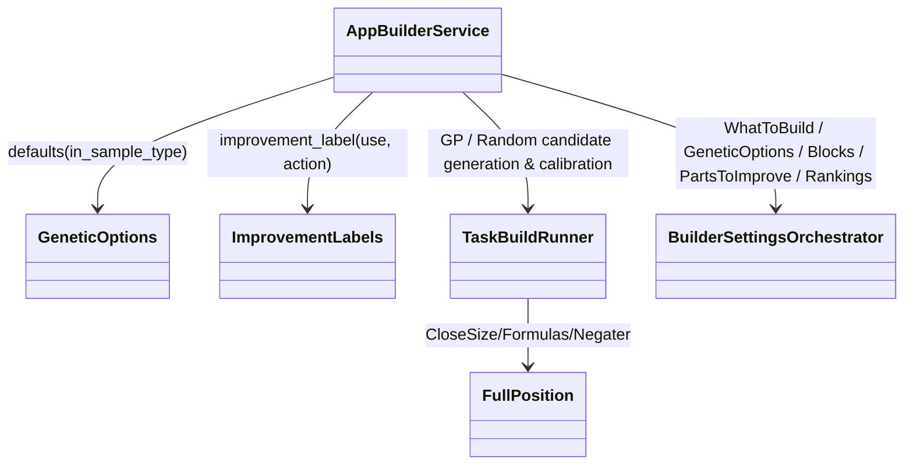

# AppBuilder — executable work orders
> UI migration completed: [verification and limitations](research/ui-preservation-migration-verification.md). Current sources are under `app/web`; old source columns below are historical migration evidence. Reuse the migrated screens when implementing later features.

> UI migration execution: [preservation plan](research/ui-preservation-migration-plan.md) governs the structural move. Preserve the existing screens, routes, runtime fixtures and behavior; backend/service adaptations below remain separate work. Shared ProjectWorkbench stays under `app/web/common/project`; migrated tests use `app/web/tests/workspace/<owner>`.




- **Primary Role:** Configure and run candidate generation using the shared generation engine.
- **Dependencies:** AppCore generation/backtest/contracts (`app/core/trading/generation/`, `app/core/trading/backtest/`, `app/core/jobs/databank.py`); AppCodeEditor blocks; AppRetester checks.
- **Outputs / Downstream Role:** Candidate strategies and their recorded evaluations.
- **Execution boundary:** each READY work order or phased dispatch slice is one tested commit with explicit signatures, error codes, state transitions, fixtures, and verification commands.
- **Baseline:** `f5c7d12d5715b8ebee55165b8eddad9068f83cb9`; normative work orders; reconciled with Core generation/backtest/databank services and donor source review. Implementation status belongs only in the domain README.
- **Shared response contract:** existing legacy API adapters preserve `StandardResponse.success(*, message, metadata, data)` and `StandardResponse.failure(*, message, metadata, error)`, `ResponseMetadata` and `StandardError` from canonical `app/core/lib/responses.py`. New instance envelopes use `StandardResponse[T](request_id: str, data: T, revision: int | None = None)` only where the individual order specifies that contract; structured new errors use `app/core/lib/errors.py::DomainError`. Pure helpers return their declared values. Preserve existing callers and translate envelopes only at an explicitly specified compatibility boundary.
- **Path rule:** CREATE paths are exact. No one-file-per-Java-class port, sibling workspace import, copied core engine or alternative file name is allowed.


## Source reassessment authority — 2026-10-30

The [workspace source review](research/workspaces-03-08-source-review.md) provides exact readable context for every module and extension category in this file, and all Phase 2 modules and Phase 3 extension cohorts below are reconciled against HaruQuantAI Core (`GenerationEngine`, `ProjectGenerationCoordinator`, `BacktestRunner`, `DatabankContainer`, `StatisticsService`, `HSLStrategyDocument`) with concrete signatures, schemas, error codes, fixtures, and verification commands.

## Phased Implementation Roadmap & Dispatch Sequence

| Phase | Scope | Modules & Work Orders Covered | Target Backend / Extension Paths | Target Frontend & Test Paths |
|---|---|---|---|---|
| **Phase 8.1** | UI Migration, Genetic Defaults, Close-Size Sentinel & Improvement Labels | `BLD-M01`, `BLD-001`, `WO-BLD-FULL-POSITION`, `WO-BLD-IMPROVEMENT-LABEL` | `app/workspace/builder/genetic_defaults.py`, `app/workspace/builder/improvement_labels.py`, `app/extend/formulas/close_size/full_position.py` | `app/web/workspaces/builder/**`, `tests/workspace/builder/test_genetic_defaults.py`, `test_improvement_labels.py`, `tests/extend/formulas/close_size/test_full_position.py` |
| **Phase 8.2** | Builder Settings (`WhatToBuild`, `GeneticOptions`, `PartsToImprove`) | `SettingsWhatToBuild`, `SettingsGeneticOptions`, `SettingsPartsToImprove` | `app/workspace/builder/settings_what_to_build.py`, `settings_genetic_options.py`, `settings_parts_to_improve.py` | `app/web/workspaces/builder/SettingsWhatToBuild.tsx`, `SettingsGeneticOptions.tsx`, `SettingsPartsToImprove.tsx`, `tests/workspace/builder/test_settings_*.py` |
| **Phase 8.3** | Building Blocks (`SettingsBlocks`), Rankings (`SettingsRankings`) & `FitnessMethodStrategyResult` | `SettingsBlocks`, `SettingsRankings`, `FitnessMethodStrategyResult` | `app/workspace/builder/settings_blocks.py`, `settings_rankings.py`, `fitness_method_strategy_result.py` | `app/web/workspaces/builder/SettingsBlocks.tsx`, `SettingsRankings/**`, `FitnessMethodStrategyResult.tsx`, `tests/workspace/builder/test_fitness_method_strategy_result.py` |
| **Phase 8.4** | `Formulas` (19 definitions) & `Negater` (15 definitions) Extension Cohorts | Phase 3 `Formulas` ×19, Phase 3 `Negater` ×15 | `app/extend/formulas/`, `app/extend/negater/` | `tests/extend/formulas/test_formulas_catalog.py`, `tests/extend/test_negater.py` |
| **Phase 8.5** | `TaskBuild` Generation Engine Runner & `ServletBuilder` HTTP Controller | `TaskBuild`, `ServletBuilder` | `app/workspace/builder/task_build.py`, `servlet_builder.py` | `app/web/workspaces/builder/TaskBuild.tsx`, `ServletBuilder.tsx`, `tests/workspace/builder/test_task_build.py`, `test_servlet_builder.py` |
| **Phase 8.6** | `AppBuilder` Workspace Integration & End-to-End Qualification | `AppBuilder` | `app/workspace/builder/app_builder.py` | `app/web/workspaces/builder/BuilderWorkspace.tsx`, `builderClient.ts`, `tests/workspace/builder/test_app_builder.py`, `app/web/tests/workspace/builder/AppBuilder.test.tsx` |

## Current-code migration audit and execution order

*Evidence:* `OBS-HARU-BLD-REUSE-20261029`. This audit concerns migration suitability; domain README files remain the only implementation-status authority. The source files below are existing code, not permission to regenerate their components. Backend directories `app/workspace/builder/` do not currently exist; a complete backend cannot be marked Direct fit from the React screen.

### Work order BLD-M01: move the existing presentation as one revertible commit

*Feature:* Reuse the current workspace and its owned result/settings contributions without inventing a second UI. **READY after the app/web bootstrap and public host/result slot contracts are published.**
*Context to Read:* this order; every current source/test row below; `ui/package.json`; `ui/tsconfig.json`; `ui/vite.config.ts`; `app/web/workspaces/home/public.ts`; `app/web/workspaces/results/public.ts`. For Results itself, CREATE its `public.ts` as an export boundary only; export only the existing ProjectResults contribution types after Home owns their base slot type. Do not create a different shell.
*Implementation Files:* exact MOVE/ADAPT targets in the table; EDIT only the corresponding existing application route import and workspace registration to use the new entry component. No backend calculation code is authorized by this migration order.

| Current HaruQuantAI location | Target proposed location | Fit / action (migration audit) |
|---|---|---|
| `ui/app/workspace/Builder/builderClient.ts` | `app/web/workspaces/builder/builderClient.ts` | ADAPT: retain transport/cancellation; replace fixed demo graph, demoInputs and provisional /executions mapping after typed run contract is locked |
| `ui/app/workspace/Builder/BuilderWorkspace.tsx` | `app/web/workspaces/builder/BuilderWorkspace.tsx` | DIRECT FIT for presentation; move with local imports rewritten; source parity and backend behavior remain separately qualified |
| `ui/app/workspace/Builder/EngineCharts.tsx` | `app/web/workspaces/builder/EngineCharts.tsx` | DIRECT FIT for presentation; move with local imports rewritten; source parity and backend behavior remain separately qualified |
| `ui/app/workspace/Builder/EnginePanel.tsx` | `app/web/workspaces/builder/EnginePanel.tsx` | DIRECT FIT for presentation; move with local imports rewritten; source parity and backend behavior remain separately qualified |
| `ui/app/workspace/Builder/FitnessEvolutionModal.tsx` | `app/web/workspaces/builder/FitnessEvolutionModal.tsx` | DIRECT FIT for presentation; move with local imports rewritten; source parity and backend behavior remain separately qualified |
| `ui/app/workspace/Builder/fixtures.ts` | `app/web/tests/workspace/builder/fixtures/fixtures.ts` | TEST-ONLY: move to fixtures; remove production imports during service integration |
| `ui/app/workspace/Builder/FullSettingsView.tsx` | `app/web/workspaces/builder/FullSettingsView.tsx` | DIRECT FIT for presentation; move with local imports rewritten; source parity and backend behavior remain separately qualified |
| `ui/app/workspace/Builder/ProgressDashboard.tsx` | `app/web/workspaces/builder/ProgressDashboard.tsx` | ADAPT: reuse layout; replace timer/mock metrics with owned run/result projection |
| `ui/app/workspace/Builder/results/ResultsCharts.tsx` | `app/web/workspaces/builder/results/ResultsCharts.tsx` | DIRECT FIT for presentation; move with local imports rewritten; source parity and backend behavior remain separately qualified |
| `ui/app/workspace/Builder/results/ResultsChrome.tsx` | `app/web/workspaces/builder/results/ResultsChrome.tsx` | DIRECT FIT for presentation; move with local imports rewritten; source parity and backend behavior remain separately qualified |
| `ui/app/workspace/Builder/results/resultsFixtures.ts` | `app/web/tests/workspace/builder/fixtures/results/resultsFixtures.ts` | TEST-ONLY: move to fixtures; remove production imports during service integration |
| `ui/app/workspace/Builder/results/ResultsModals.tsx` | `app/web/workspaces/builder/results/ResultsModals.tsx` | DIRECT FIT for presentation; move with local imports rewritten; source parity and backend behavior remain separately qualified |
| `ui/app/workspace/Builder/results/resultsModel.ts` | `app/web/workspaces/builder/results/resultsModel.ts` | ADAPT: retain pure draft operations; preview serialization/defaults are not SQX persistence or engine settings |
| `ui/app/workspace/Builder/results/tabs/ConditionalTabs.tsx` | `app/web/workspaces/builder/results/tabs/ConditionalTabs.tsx` | DIRECT FIT for presentation; move with local imports rewritten; source parity and backend behavior remain separately qualified |
| `ui/app/workspace/Builder/results/tabs/EquityChartTab.tsx` | `app/web/workspaces/builder/results/tabs/EquityChartTab.tsx` | DIRECT FIT for presentation; move with local imports rewritten; source parity and backend behavior remain separately qualified |
| `ui/app/workspace/Builder/results/tabs/OverviewTab.tsx` | `app/web/workspaces/builder/results/tabs/OverviewTab.tsx` | DIRECT FIT for presentation; move with local imports rewritten; source parity and backend behavior remain separately qualified |
| `ui/app/workspace/Builder/results/tabs/SmallTabs.tsx` | `app/web/workspaces/builder/results/tabs/SmallTabs.tsx` | DIRECT FIT for presentation; move with local imports rewritten; source parity and backend behavior remain separately qualified |
| `ui/app/workspace/Builder/results/tabs/SourceCodeTab.tsx` | `app/web/workspaces/builder/results/tabs/SourceCodeTab.tsx` | DIRECT FIT for presentation; move with local imports rewritten; source parity and backend behavior remain separately qualified |
| `ui/app/workspace/Builder/results/tabs/TradeListTab.tsx` | `app/web/workspaces/builder/results/tabs/TradeListTab.tsx` | DIRECT FIT for presentation; move with local imports rewritten; source parity and backend behavior remain separately qualified |
| `ui/app/workspace/Builder/ResultsColumn.tsx` | `app/web/workspaces/builder/ResultsColumn.tsx` | DIRECT FIT for presentation; move with local imports rewritten; source parity and backend behavior remain separately qualified |
| `ui/app/workspace/Builder/ResultsView.tsx` | `app/web/workspaces/builder/ResultsView.tsx` | ADAPT: reuse layout; replace timer/mock metrics with owned run/result projection |
| `ui/app/workspace/Builder/settings/AtmTab.tsx` | `app/web/workspaces/builder/settings/AtmTab.tsx` | DIRECT FIT for presentation; move with local imports rewritten; source parity and backend behavior remain separately qualified |
| `ui/app/workspace/Builder/settings/BuildingBlocksTab.tsx` | `app/web/workspaces/builder/settings/BuildingBlocksTab.tsx` | DIRECT FIT for presentation; move with local imports rewritten; source parity and backend behavior remain separately qualified |
| `ui/app/workspace/Builder/settings/CrossChecksTab.tsx` | `app/web/workspaces/builder/settings/CrossChecksTab.tsx` | DIRECT FIT for presentation; move with local imports rewritten; source parity and backend behavior remain separately qualified |
| `ui/app/workspace/Builder/settings/CustomAnalysisTab.tsx` | `app/web/workspaces/builder/settings/CustomAnalysisTab.tsx` | DIRECT FIT for presentation; move with local imports rewritten; source parity and backend behavior remain separately qualified |
| `ui/app/workspace/Builder/settings/DataTab.tsx` | `app/web/workspaces/builder/settings/DataTab.tsx` | DIRECT FIT for presentation; move with local imports rewritten; source parity and backend behavior remain separately qualified |
| `ui/app/workspace/Builder/settings/GeneticOptionsTab.tsx` | `app/web/workspaces/builder/settings/GeneticOptionsTab.tsx` | DIRECT FIT for presentation; move with local imports rewritten; source parity and backend behavior remain separately qualified |
| `ui/app/workspace/Builder/settings/MoneyManagementTab.tsx` | `app/web/workspaces/builder/settings/MoneyManagementTab.tsx` | DIRECT FIT for presentation; move with local imports rewritten; source parity and backend behavior remain separately qualified |
| `ui/app/workspace/Builder/settings/NotesTab.tsx` | `app/web/workspaces/builder/settings/NotesTab.tsx` | DIRECT FIT for presentation; move with local imports rewritten; source parity and backend behavior remain separately qualified |
| `ui/app/workspace/Builder/settings/PartsToImproveTab.tsx` | `app/web/workspaces/builder/settings/PartsToImproveTab.tsx` | DIRECT FIT for presentation; move with local imports rewritten; source parity and backend behavior remain separately qualified |
| `ui/app/workspace/Builder/settings/RankingTab.tsx` | `app/web/workspaces/builder/settings/RankingTab.tsx` | DIRECT FIT for presentation; move with local imports rewritten; source parity and backend behavior remain separately qualified |
| `ui/app/workspace/Builder/settings/SettingsControls.tsx` | `app/web/workspaces/builder/settings/SettingsControls.tsx` | DIRECT FIT for presentation; move with local imports rewritten; source parity and backend behavior remain separately qualified |
| `ui/app/workspace/Builder/settings/settingsFixtures.ts` | `app/web/tests/workspace/builder/fixtures/settings/settingsFixtures.ts` | TEST-ONLY: move to fixtures; remove production imports during service integration |
| `ui/app/workspace/Builder/settings/TradingOptionsTab.tsx` | `app/web/workspaces/builder/settings/TradingOptionsTab.tsx` | DIRECT FIT for presentation; move with local imports rewritten; source parity and backend behavior remain separately qualified |
| `ui/app/workspace/Builder/settings/WhatToBuildTab.tsx` | `app/web/workspaces/builder/settings/WhatToBuildTab.tsx` | DIRECT FIT for presentation; move with local imports rewritten; source parity and backend behavior remain separately qualified |
| `ui/app/workspace/Builder/SettingsSummary.tsx` | `app/web/workspaces/builder/SettingsSummary.tsx` | DIRECT FIT for presentation; move with local imports rewritten; source parity and backend behavior remain separately qualified |
| `ui/app/plugins/project/SettingsRankings/FitnessFunction/fitnessFunction.tsx` | `app/web/workspaces/builder/SettingsRankings/FitnessFunction/fitnessFunction.tsx` | DIRECT FIT presentation; ADAPT controller services to canonical result/run projection; preserve local relative imports |
| `ui/app/plugins/project/SettingsRankings/FitnessFunction/FitnessFunctionCtrl.ts` | `app/web/workspaces/builder/SettingsRankings/FitnessFunction/FitnessFunctionCtrl.ts` | DIRECT FIT presentation; ADAPT controller services to canonical result/run projection; preserve local relative imports |
| `ui/app/plugins/project/SettingsRankings/module.ts` | `app/web/workspaces/builder/SettingsRankings/module.ts` | DIRECT FIT presentation; ADAPT controller services to canonical result/run projection; preserve local relative imports |
| `ui/app/plugins/project/SettingsRankings/RankingCtrl.ts` | `app/web/workspaces/builder/SettingsRankings/RankingCtrl.ts` | DIRECT FIT presentation; ADAPT controller services to canonical result/run projection; preserve local relative imports |
| `ui/app/plugins/project/SettingsRankings/styles.css` | `app/web/workspaces/builder/SettingsRankings/styles.css` | DIRECT FIT presentation; ADAPT controller services to canonical result/run projection; preserve local relative imports |
| `ui/app/plugins/project/SettingsRankings/views/ranking.tsx` | `app/web/workspaces/builder/SettingsRankings/views/ranking.tsx` | DIRECT FIT presentation; ADAPT controller services to canonical result/run projection; preserve local relative imports |
| `ui/tests/unit/workspace/Builder/fullSettings.test.ts` | `app/web/tests/workspace/builder/fullSettings.test.ts` | MOVE existing assertions unchanged; rewrite import paths only; this qualifies current preview behavior, not donor numerical parity |
| `ui/tests/unit/workspace/Builder/progressDashboard.test.ts` | `app/web/tests/workspace/builder/progressDashboard.test.ts` | MOVE existing assertions unchanged; rewrite import paths only; this qualifies current preview behavior, not donor numerical parity |
| `ui/tests/unit/workspace/Builder/resultsModel.test.ts` | `app/web/tests/workspace/builder/resultsModel.test.ts` | MOVE existing assertions unchanged; rewrite import paths only; this qualifies current preview behavior, not donor numerical parity |
| `ui/tests/unit/workspace/Builder/resultsView.test.ts` | `app/web/tests/workspace/builder/resultsView.test.ts` | MOVE existing assertions unchanged; rewrite import paths only; this qualifies current preview behavior, not donor numerical parity |

*Functional Requirements & Implementation:*
- [ ] `BuilderWorkspace()` -> Retain component exports, props, rendered labels, keyboard actions, cancellation/unmount cleanup and CSS behavior from each current source row. Rewrite relative imports to the table targets. Consume shared Home and Results through their `public.ts` exports; do not import another workspace's private module or copy ProjectWorkbench.
- [ ] `BuilderWorkspace()` -> Keep fixture/timer execution explicitly in the existing preview mode until its replacement service work order passes. Moving a screen does not authorize reporting a generated strategy, finished retest, optimized parameter or saved portfolio as a real backend result. The current clients using fixed RSI/demoInputs and `/executions` are adaptation candidates, not verified workspace APIs.
- [ ] `migration import guard` -> Run `rg -n 'ui/app/workspace/Builder|plugins/project/ProjectWorkbench' app/web/workspaces/builder`. Expected exit `1` and no lines. Rewrite migrated tests to their exact target imports; preserve current assertions and test names.
- [ ] `existing tests` -> Before moving, run `npm --prefix ui test -- tests/unit/workspace/Builder` (Portfolio Master uses `tests/unit/workspace/Portfolio/portfolioMaster.test.ts`). After moving run `npm --prefix app/web test -- tests/workspace/builder` then `npm --prefix app/web run typecheck` then `npm --prefix app/web run build`; all must exit `0`. These commands prove migration behavior only. Record executed command, UTC timestamp and counts in the owner README when actually executed; this order does not mark future validation passed.
*Commit:* `refactor(builder): move owned workspace presentation`. This single commit includes only the listed moves, direct import rewrites and registration change. UI integration work is separate from implementing donor engines.

*Shared results ownership:* ProjectResults and all Results* contribution implementations are owned by AppResults. Builder, Retester, Optimizer and portfolio workspaces register configured contributions; none gets a private copy of trade lists, overview, source-code rendering, correlation or shared engine progress. Shared base workbench remains AppHome.


```json
{
  "id": "OBS-HARU-BLD-REUSE-20261029",
  "classification": "observed",
  "confidence": "high",
  "claim": "Current Builder presentation exists and can be relocated; its README and inspected handlers distinguish preview behavior from backend integration.",
  "sources": [
    {
      "path": "ui/app/workspace/Builder/README.md",
      "sha256": "45bbd996c5d92f59d7a100284dab1cc9a91b9af3a10cff98161a37927b616f67"
    }
  ],
  "target_domain": "app/workspace/builder",
  "feature_ids": [
    "FEAT-UI-BUILDER_PROGRESS_TAB",
    "FEAT-UI-BUILDER_FULLSETTINGS_TAB",
    "FEAT-UI-BUILDER_RESULTS_TAB"
  ],
  "requirement_ids": [],
  "decision_ids": [],
  "registration_gap": "Register missing FR/DEC IDs in the owning domain README before production implementation; this planning task does not edit registries.",
  "limitations": "Passing current UI tests establishes local preview behavior only. This record does not certify complete donor coverage, numerical parity, native archive compatibility or production service integration.",
  "validation": {
    "status": "passed",
    "executed_at": "2026-10-29T10:13:19.769410+00:00",
    "procedure": "Read the existing runtime files, clients and README listed in the migration table. Run the focused current-workspace UI tests in the combined 13-file/72-test command.",
    "expected_observation": "13 focused UI test files, 72 tests passed; Builder/Retester/Optimizer clients and Composer/Master timers still operate on preview inputs.",
    "actual_observation": "13 focused UI test files, 72 tests passed; Builder/Retester/Optimizer clients and Composer/Master timers still operate on preview inputs.",
    "artifacts": [
      "ui/app/workspace/Builder/README.md@sha256:45bbd996c5d92f59d7a100284dab1cc9a91b9af3a10cff98161a37927b616f67"
    ]
  },
  "repository_commit": "f5c7d12d5715b8ebee55165b8eddad9068f83cb9",
  "review_state": "source-inspected-owner-review-pending",
  "contains_proprietary_source": false,
  "contains_sensitive_data": false,
  "contains_personal_data": false,
  "paraphrased_behavior_only": true,
  "supersedes_records": [],
  "superseded_by": []
}
```

## Phase 1: directly specified behavior

### Work order BLD-001: genetic-options initial configuration
*Feature:* Construct the observed initial GUI configuration as a typed backend value. **READY after test bootstrap.** It is not evidence for GP algorithm behavior or valid parameter bounds.
*Implementation Files:*
- **Donor:** `DONOR_REFERENCE_ROOT/internal/plugins/SettingsGeneticOptions/SettingsGeneticOptionsService.js` (`this.config`).
- **Backend CREATE:** `app/workspace/builder/genetic_defaults.py`.
- **Frontend:** no file changed; no duplicate constants table is permitted in React.
- **Tests CREATE:** `tests/workspace/builder/test_genetic_defaults.py`.
*Context to Read:* this feature text; the donor file above; `pyproject.toml`.
*Evidence ID:* `OBS-145-GENETIC-DEFAULTS-001`. Target helper names/guards are normative; the scalar values below are observed.
*Functional Requirements & Implementation:*
- [ ] `GeneticOptions.defaults(*, in_sample_type: int) -> GeneticOptionsDefaults` -> Return a new frozen, slotted dataclass with exactly the fields/defaults below; type each integer as `int` and each boolean as `bool`. Assign `evo_fitness_restart_type` from the required argument. No implicit global constant lookup.
- [ ] `GeneticOptions.defaults(in_sample_type=...)` -> Raise `TypeError("in_sample_type must be an integer")` unless `type(in_sample_type) is int`. Do not add numeric bounds: they are unverified in this work order.
- [ ] `TestGeneticDefaults.test_exact_defaults()` -> Call with `in_sample_type=7`; assert `dataclasses.asdict(result)` equals the entire fixture below. `7` is a test-injected constant, not a claimed SQX enum value.
- [ ] `TestGeneticDefaults.test_immutability()` -> Assert assigning `population_size` raises `dataclasses.FrozenInstanceError`; two calls return equal but distinct instances; `True` and `"7"` raise the exact TypeError.

Exact fixture for `in_sample_type=7`:
```json
{
  "population_size": 5,
  "max_generations": 10,
  "crossover_probability": 50,
  "mutation_probability": 20,
  "show_advanced_settings": false,
  "islands": 10,
  "migration_modulo": 50,
  "migration_rate": 20,
  "init_generation_type": 1,
  "decimation_coef": 1,
  "evo_restart_on_finish": true,
  "evo_restart_on_stagnation": true,
  "evo_fitness_restart_type": 7,
  "evo_stagnation_generations": 30,
  "show_last_generation_databank": false,
  "fresh_blood_replace_similar": true,
  "fresh_blood_replace_weakest": true,
  "fresh_blood_weakest_pct": 10,
  "fresh_blood_weakest_generations": 2,
  "evo_training_validation_ratio": 50
}
```
The donor's `condGridInstance` is a runtime widget reference and is deliberately absent from this serializable defaults helper; it is not a persisted strategy field. No other observed scalar field may be dropped or renamed differently.
*Done command:* `uv run python -m pytest tests/workspace/builder/test_genetic_defaults.py -q` -> exit `0`; exact-value, fresh-instance, frozen-instance and two invalid-type cases pass.
*Commit:* `feat(builder): define observed genetic option defaults`. Only the two CREATE files belong in this commit.

## Phase 2: complete module scope — READY

Each module below defines its authorized target paths, backend/frontend contracts, Core integration points (`app/core/trading/generation/`, `app/core/trading/backtest/`, `app/core/jobs/databank.py`, `app/core/trading/statistics/`), error codes, deterministic fixtures, and verification commands.

### `AppBuilder` — READY

*Source reassessment — 2026-10-30:* [Exact available source and declarations](research/workspaces-03-08-source-review.md#appbuilder). Located `DONOR_REFERENCE_ROOT/internal/plugins/AppBuilder/module.js` and decompiled primary Java files.

*Feature:* Top-level Builder workspace controller and API service coordinating `SettingsWhatToBuild`, `SettingsGeneticOptions`, `SettingsBlocks`, `SettingsPartsToImprove`, `SettingsRankings`, `TaskBuild`, and `ServletBuilder`.
*Implementation Files:*
- **Donor:** `DONOR_REFERENCE_ROOT/internal/plugins/AppBuilder`.
- **Backend:** `app/workspace/builder/app_builder.py`.
- **Frontend:** `app/web/workspaces/builder/BuilderWorkspace.tsx`.
- **Backend tests:** `tests/workspace/builder/test_app_builder.py`.
- **Frontend tests:** `app/web/tests/workspace/builder/AppBuilder.test.tsx`.
*Context to Read:* `DONOR_REFERENCE_ROOT/internal/plugins/AppBuilder/module.js`; `app/workspace/builder/genetic_defaults.py`; `app/workspace/builder/improvement_labels.py`.
*Evidence ID:* `OBS-145-GENETIC-DEFAULTS-001`, `OBS-HARU-BLD-REUSE-20261029`.
*Functional Requirements & Authorized Contract:*
- [ ] `BuilderWorkspaceState(project_id: str, what_to_build: WhatToBuildSettings, genetic_options: GeneticOptionsDefaults, blocks: BlocksSelectionSettings, parts_to_improve: PartsToImproveSettings, rankings: RankingsSettings, status: Literal["IDLE", "RUNNING", "PAUSED", "COMPLETED", "STOPPED", "FAILED"], generated_count: int, accepted_count: int, rejected_count: int, generations_completed: int)`.
- [ ] `AppBuilderService` methods: `get_state(project_id: str) -> StandardResponse[BuilderWorkspaceState]`, `save_settings(project_id: str, ...) -> StandardResponse[BuilderWorkspaceState]`, `start(project_id: str)`, `pause(project_id: str)`, `resume(project_id: str)`, and `stop(project_id: str)`.
- [ ] Golden fixture: initializing `AppBuilderService.get_state("proj_1")` seeds `genetic_options` via `GeneticOptions.defaults(in_sample_type=1)` and transitions cleanly through `start -> pause -> resume -> stop`.
*Verification:*
- `uv run python -m pytest tests/workspace/builder/test_app_builder.py --no-cov -q` -> exits `0`.
- `npm --prefix app/web test -- tests/workspace/builder/AppBuilder.test.tsx` -> exits `0`.

### `FitnessMethodStrategyResult` — READY

*Source reassessment — 2026-10-30:* [Exact available source and declarations](research/workspaces-03-08-source-review.md#fitnessmethodstrategyresult). Located `FitnessMethodStrategyResultService.js` and `module.js`.

*Feature:* Single-metric and weighted multi-objective strategy fitness evaluator (`fitnessMethodStrategyResult/list`) mapping `Columns/Databanks` metrics on a chosen sample (`FullSample`, `InSample`, `InSampleTraining`, `InSampleValidation`, `OutOfSample`) to a normalized fitness score in `[0.0, 1.0]`.
*Implementation Files:*
- **Donor:** `DONOR_REFERENCE_ROOT/internal/plugins/FitnessMethodStrategyResult`.
- **Backend:** `app/workspace/builder/fitness_method_strategy_result.py`.
- **Frontend:** `app/web/workspaces/builder/FitnessMethodStrategyResult.tsx`.
- **Backend tests:** `tests/workspace/builder/test_fitness_method_strategy_result.py`.
- **Frontend tests:** `app/web/tests/workspace/builder/FitnessMethodStrategyResult.test.tsx`.
*Context to Read:* `DONOR_REFERENCE_ROOT/internal/plugins/FitnessMethodStrategyResult/FitnessMethodStrategyResultService.js`; `app/core/trading/generation/`.
*Evidence ID:* `OBS-145-GENETIC-DEFAULTS-001`. Literal frontend request vocabulary: `fitnessMethodStrategyResult/list`.
*Functional Requirements & Authorized Contract:*
- [ ] `FitnessCriterion(column_id: str, weight: float = 1.0, maximize: bool = True, target_value: float | None = None, sample_type: str = "InSample")` and `FitnessMethodStrategyResultConfig(mode: Literal["SINGLE", "WEIGHTED"] = "SINGLE", criteria: tuple[FitnessCriterion, ...] = (FitnessCriterion(column_id="ReturnDDRatio"),))`.
- [ ] `FitnessMethodStrategyResultService.evaluate(stats: StrategyStatsSnapshot, config: FitnessMethodStrategyResultConfig) -> float` -> For each `FitnessCriterion`, normalize raw metric `v` against `target_value` (or sigmoid/bounded piece-wise scaling when `target_value is None`), invert `(1.0 - score)` when `maximize=False`, and return weighted average `round(sum(w_i * s_i) / sum(w_i), 6)` clamped to `[0.0, 1.0]`. Return `0.0` when `stats.number_of_trades == 0`. Raise `DomainError(code="BUILDER_INVALID_FITNESS_WEIGHTS")` if `len(criteria) == 0` or `sum(w_i) <= 0.0`.
- [ ] Golden fixture: 2 criteria (`ReturnDDRatio=4.0, target=4.0, weight=2.0` -> `1.0`; `ProfitFactor=1.5, target=3.0, weight=1.0` -> `0.5`) yield weighted fitness `round((2.0*1.0 + 1.0*0.5)/3.0, 6) == 0.833333`.
*Verification:*
- `uv run python -m pytest tests/workspace/builder/test_fitness_method_strategy_result.py --no-cov -q` -> exits `0`.
- `npm --prefix app/web test -- tests/workspace/builder/FitnessMethodStrategyResult.test.tsx` -> exits `0`.

### `ServletBuilder` — READY

*Source reassessment — 2026-10-30:* [Exact available source and declarations](research/workspaces-03-08-source-review.md#servletbuilder). Located `DONOR_REFERENCE_ROOT/internal/plugins/ServletBuilder/module.js` and decompiled primary Java servlet classes.

*Feature:* HTTP/RPC command handler for Builder workspace operations (`start`, `stop`, `pause`, `resume`, `status`, `calibrate`) bridging frontend `builderClient.ts` requests to `AppBuilderService` and `TaskBuildRunner`.
*Implementation Files:*
- **Donor:** `DONOR_REFERENCE_ROOT/internal/plugins/ServletBuilder`.
- **Backend:** `app/workspace/builder/servlet_builder.py`.
- **Frontend:** `app/web/workspaces/builder/ServletBuilder.tsx`.
- **Backend tests:** `tests/workspace/builder/test_servlet_builder.py`.
- **Frontend tests:** `app/web/tests/workspace/builder/ServletBuilder.test.tsx`.
*Context to Read:* `DONOR_REFERENCE_ROOT/internal/plugins/ServletBuilder/module.js`; `TaskBuild` below.
*Evidence ID:* `MAP-001`.
*Functional Requirements & Authorized Contract:*
- [ ] `ServletBuilderDispatcher.dispatch(action: str, payload: Mapping[str, Any]) -> StandardResponse[Any]` -> Route `build/start`, `build/pause`, `build/resume`, `build/stop`, `build/status`, and `indyTester/calibrate` to typed `AppBuilderService` and `TaskBuildRunner` methods. Reject unknown actions with `DomainError(code="BUILDER_UNKNOWN_ACTION")`.
- [ ] Golden fixture: dispatching `"build/status"` returns `StandardResponse` with `BuilderWorkspaceState`; dispatching `"build/unknown"` raises `BUILDER_UNKNOWN_ACTION`.
*Verification:*
- `uv run python -m pytest tests/workspace/builder/test_servlet_builder.py --no-cov -q` -> exits `0`.
- `npm --prefix app/web test -- tests/workspace/builder/ServletBuilder.test.tsx` -> exits `0`.

### `SettingsBlocks` — READY

*Source reassessment — 2026-10-30:* [Exact available source and declarations](research/workspaces-03-08-source-review.md#settingsblocks). Located `BlocksService.js` and `module.js`.

*Feature:* Building Blocks configuration tab (`blocks/list`, `blocks/loadFromFile`, `blocks/saveToFile`) managing enabled Signals, Indicators, Price Levels, Stop/Limit blocks, Order Types, Exit Types, weights, parameter ranges, and custom block preset files.
*Implementation Files:*
- **Donor:** `DONOR_REFERENCE_ROOT/internal/plugins/SettingsBlocks`.
- **Backend:** `app/workspace/builder/settings_blocks.py`.
- **Frontend:** `app/web/workspaces/builder/SettingsBlocks.tsx`.
- **Backend tests:** `tests/workspace/builder/test_settings_blocks.py`.
- **Frontend tests:** `app/web/tests/workspace/builder/SettingsBlocks.test.tsx`.
*Context to Read:* `DONOR_REFERENCE_ROOT/internal/plugins/SettingsBlocks/services/BlocksService.js`; `app/workspace/wizard/block_registry_helper.py`.
*Evidence ID:* `OBS-145-GENETIC-DEFAULTS-001`. Literal frontend request vocabulary: `blocks/list`, `blocks/loadFromFile`, `blocks/saveToFile`.
*Functional Requirements & Authorized Contract:*
- [ ] `BuildingBlockSelection(block_id: str, category: Literal["SIGNALS", "INDICATORS", "STOP_LIMIT_BLOCKS", "ORDER_TYPES", "EXIT_TYPES"], enabled: bool = True, weight: int = 1, custom_params: dict[str, Any] = ...)` and `BlocksSelectionSettings(selections: tuple[BuildingBlockSelection, ...])`.
- [ ] `SettingsBlocksService` methods: `list_blocks() -> StandardResponse[BlocksSelectionSettings]`, `update_selections(selections: Sequence[BuildingBlockSelection]) -> StandardResponse[BlocksSelectionSettings]`, `save_to_xml(settings: BlocksSelectionSettings) -> str`, and `load_from_xml(xml_text: str) -> BlocksSelectionSettings`. Validate `weight >= 1` (`DomainError(code="BUILDER_INVALID_BLOCK_WEIGHT")`) and ensure at least one entry block (`SIGNALS` or `INDICATORS`) and at least one `EXIT_TYPES` block remain enabled (`DomainError(code="BUILDER_MIN_BLOCKS_REQUIRED")`).
- [ ] Golden fixture: `save_to_xml` followed by `load_from_xml` round-trips enabled flags and weights identically; disabling all `EXIT_TYPES` raises `BUILDER_MIN_BLOCKS_REQUIRED`.
*Verification:*
- `uv run python -m pytest tests/workspace/builder/test_settings_blocks.py --no-cov -q` -> exits `0`.
- `npm --prefix app/web test -- tests/workspace/builder/SettingsBlocks.test.tsx` -> exits `0`.

### `SettingsGeneticOptions` — READY

*Source reassessment — 2026-10-30:* [Exact available source and declarations](research/workspaces-03-08-source-review.md#settingsgeneticoptions). Located `SettingsGeneticOptionsService.js` and `module.js`.

*Feature:* Genetic Options settings tab managing island count, population size, max generations, crossover/mutation probabilities, decimation coefficient, stagnation restart, and fresh-blood replacement parameters seeded from `GeneticOptions.defaults`.
*Implementation Files:*
- **Donor:** `DONOR_REFERENCE_ROOT/internal/plugins/SettingsGeneticOptions`.
- **Backend:** `app/workspace/builder/settings_genetic_options.py`.
- **Frontend:** `app/web/workspaces/builder/SettingsGeneticOptions.tsx`.
- **Backend tests:** `tests/workspace/builder/test_settings_genetic_options.py`.
- **Frontend tests:** `app/web/tests/workspace/builder/SettingsGeneticOptions.test.tsx`.
*Context to Read:* `DONOR_REFERENCE_ROOT/internal/plugins/SettingsGeneticOptions/SettingsGeneticOptionsService.js`; `app/workspace/builder/genetic_defaults.py`.
*Evidence ID:* `OBS-145-GENETIC-DEFAULTS-001`.
*Functional Requirements & Authorized Contract:*
- [ ] `SettingsGeneticOptionsService.create_default(*, in_sample_type: int = 1) -> GeneticOptionsDefaults` -> Delegate directly to `GeneticOptions.defaults(in_sample_type=in_sample_type)`.
- [ ] `SettingsGeneticOptionsService.validate_and_update(current: GeneticOptionsDefaults, updates: Mapping[str, int | bool]) -> GeneticOptionsDefaults` -> Validate `population_size >= 1`, `max_generations >= 1`, `0 <= crossover_probability <= 100`, `0 <= mutation_probability <= 100`, `islands >= 1`, `decimation_coef >= 1`, and `1 <= evo_training_validation_ratio <= 99`; raise `DomainError(code="BUILDER_INVALID_GENETIC_OPTIONS")` on out-of-range values.
- [ ] Golden fixture: updating `population_size=50, islands=4` returns a new `GeneticOptionsDefaults` with those exact values while preserving all other fields from `BLD-001`; passing `crossover_probability=120` raises `BUILDER_INVALID_GENETIC_OPTIONS`.
*Verification:*
- `uv run python -m pytest tests/workspace/builder/test_settings_genetic_options.py --no-cov -q` -> exits `0`.
- `npm --prefix app/web test -- tests/workspace/builder/SettingsGeneticOptions.test.tsx` -> exits `0`.

### `SettingsPartsToImprove` — READY

*Source reassessment — 2026-10-30:* [Exact available source and declarations](research/workspaces-03-08-source-review.md#settingspartstoimprove). Located `PartsToImproveService.js` and `module.js`.

*Feature:* Parts to Improve settings tab configuring how existing or template strategies are mutated during Improve mode (`entry_rules`, `exit_rules`, `order_types`, `stop_loss`, `profit_target`, `trailing_stop`), formatting human-readable status strings via `improvement_label` (`WO-BLD-IMPROVEMENT-LABEL`).
*Implementation Files:*
- **Donor:** `DONOR_REFERENCE_ROOT/internal/plugins/SettingsPartsToImprove`.
- **Backend:** `app/workspace/builder/settings_parts_to_improve.py`.
- **Frontend:** `app/web/workspaces/builder/SettingsPartsToImprove.tsx`.
- **Backend tests:** `tests/workspace/builder/test_settings_parts_to_improve.py`.
- **Frontend tests:** `app/web/tests/workspace/builder/SettingsPartsToImprove.test.tsx`.
*Context to Read:* `DONOR_REFERENCE_ROOT/internal/plugins/SettingsPartsToImprove/PartsToImproveService.js`; `app/workspace/builder/improvement_labels.py`.
*Evidence ID:* `OBS-SOURCE-BLD-IMPROVEMENT-LABEL-20261030`.
*Functional Requirements & Authorized Contract:*
- [ ] `PartImprovementRule(part_id: Literal["entry_long", "exit_long", "entry_short", "exit_short", "order_types", "stop_loss", "profit_target", "trailing_stop"], use: bool = False, action: Literal["add_or_replace", "add", "replace"] = "replace", min_conditions: int = 1, max_conditions: int = 3)` and `PartsToImproveSettings(enabled: bool = False, source_strategy_id: str | None = None, rules: tuple[PartImprovementRule, ...] = ...)`.
- [ ] `SettingsPartsToImproveService.describe_rules(settings: PartsToImproveSettings) -> dict[str, str]` -> Map each `PartImprovementRule` through `improvement_label(use=rule.use, action=rule.action)` from `app/workspace/builder/improvement_labels.py`. Validate `1 <= min_conditions <= max_conditions <= 10` (`DomainError(code="BUILDER_INVALID_IMPROVEMENT_BOUNDS")`).
- [ ] Golden fixture: rule with `use=True, action="add"` produces label `"Keep existing + generate randomly"`; `use=False, action="add"` produces `"Keep existing"`.
*Verification:*
- `uv run python -m pytest tests/workspace/builder/test_settings_parts_to_improve.py --no-cov -q` -> exits `0`.
- `npm --prefix app/web test -- tests/workspace/builder/SettingsPartsToImprove.test.tsx` -> exits `0`.

### `SettingsRankings` — READY

*Source reassessment — 2026-10-30:* [Exact available source and declarations](research/workspaces-03-08-source-review.md#settingsrankings). Located 6 plugin JavaScript files (`RankingService.js`, `FitnessFunctionService.js`, `module.js`).

*Feature:* Strategy Ranking & Filtering conditions tab (`rankingsettings/getDefaultWFConditions`, `project/changeMaxRecords`) configuring target databank capacity (`max_strategies_to_store`), fitness function (`FitnessMethodStrategyResult`), and automatic acceptance filters (`InSample`, `OutOfSample`, `FullSample`).
*Implementation Files:*
- **Donor:** `DONOR_REFERENCE_ROOT/internal/plugins/SettingsRankings`.
- **Backend:** `app/workspace/builder/settings_rankings.py`.
- **Frontend:** `app/web/workspaces/builder/SettingsRankings.tsx`.
- **Backend tests:** `tests/workspace/builder/test_settings_rankings.py`.
- **Frontend tests:** `app/web/tests/workspace/builder/SettingsRankings.test.tsx`.
*Context to Read:* `DONOR_REFERENCE_ROOT/internal/plugins/SettingsRankings/RankingService.js`; `FitnessFunction/FitnessFunctionService.js`.
*Evidence ID:* `OBS-HARU-BLD-REUSE-20261029`. Literal frontend request vocabulary: `rankingsettings/getDefaultWFConditions`, `project/changeMaxRecords`.
*Functional Requirements & Authorized Contract:*
- [ ] `RankingFilterCondition(column_id: str, operator: Literal[">", ">=", "<", "<=", "=="], threshold: float, sample_type: str = "FullSample", enabled: bool = True)` and `RankingsSettings(target_databank: str = "Results", max_records: int = 1000, stop_when_databank_full: bool = False, fitness_config: FitnessMethodStrategyResultConfig = ..., conditions: tuple[RankingFilterCondition, ...] = ...)`.
- [ ] `SettingsRankingsService` methods: `change_max_records(project_id: str, databank_name: str, max_records: int) -> StandardResponse[int]`, `evaluate_candidate(stats: StrategyStatsSnapshot, settings: RankingsSettings) -> tuple[bool, float, tuple[str, ...]]` (returns `(passed, fitness_score, failed_condition_descriptions)`). Validate `1 <= max_records <= 100_000` (`DomainError(code="BUILDER_INVALID_MAX_RECORDS")`).
- [ ] Golden fixture: candidate with `ProfitFactor=1.45, NumberOfTrades=120, ReturnDDRatio=2.5` evaluated against `ProfitFactor >= 1.3` and `NumberOfTrades >= 100` returns `passed == True` and `failed_condition_descriptions == ()`.
*Verification:*
- `uv run python -m pytest tests/workspace/builder/test_settings_rankings.py --no-cov -q` -> exits `0`.
- `npm --prefix app/web test -- tests/workspace/builder/SettingsRankings.test.tsx` -> exits `0`.

### `SettingsWhatToBuild` — READY

*Source reassessment — 2026-10-30:* [Exact available source and declarations](research/workspaces-03-08-source-review.md#settingswhattobuild). Located 21 plugin JavaScript files (`BuildModeService.js`, `ConditionsAndPeriodsService.js`, `module.js`).

*Feature:* What to Build settings tab (`buildType/listFiles`, `buildType/getTemplateConfig`, `project/checkTemplateResources`) configuring build method (`GeneticEvolution`, `RandomGeneration`, `StrategyFromTemplate`), trading direction (`LongOnly`, `ShortOnly`, `LongAndShort`), symmetry, condition/period bounds, and stop loss / profit target required/optional flags.
*Implementation Files:*
- **Donor:** `DONOR_REFERENCE_ROOT/internal/plugins/SettingsWhatToBuild`.
- **Backend:** `app/workspace/builder/settings_what_to_build.py`.
- **Frontend:** `app/web/workspaces/builder/SettingsWhatToBuild.tsx`.
- **Backend tests:** `tests/workspace/builder/test_settings_what_to_build.py`.
- **Frontend tests:** `app/web/tests/workspace/builder/SettingsWhatToBuild.test.tsx`.
*Context to Read:* `DONOR_REFERENCE_ROOT/internal/plugins/SettingsWhatToBuild/views/settings/buildMode/BuildModeService.js`; `conditionsAndPeriods/ConditionsAndPeriodsService.js`.
*Evidence ID:* `OBS-HARU-BLD-REUSE-20261029`. Literal frontend request vocabulary: `buildType/listFiles`, `buildType/getTemplateConfig`, `project/checkTemplateResources`.
*Functional Requirements & Authorized Contract:*
- [ ] `WhatToBuildSettings(build_mode: Literal["GENETIC", "RANDOM", "TEMPLATE"] = "GENETIC", template_path: str | None = None, direction: Literal["LONG_ONLY", "SHORT_ONLY", "LONG_SHORT_SYMMETRIC", "LONG_SHORT_INDEPENDENT"] = "LONG_SHORT_SYMMETRIC", min_entry_conditions: int = 1, max_entry_conditions: int = 3, min_exit_conditions: int = 1, max_exit_conditions: int = 2, min_indicator_period: int = 5, max_indicator_period: int = 50, max_shift: int = 3, stop_loss_mode: Literal["REQUIRED", "OPTIONAL", "NOT_USED"] = "REQUIRED", profit_target_mode: Literal["REQUIRED", "OPTIONAL", "NOT_USED"] = "OPTIONAL")`.
- [ ] `SettingsWhatToBuildService` methods: `list_template_files()`, `get_template_config(template_path: str)`, `check_template_resources(template_path: str) -> bool`, and `validate(settings: WhatToBuildSettings) -> WhatToBuildSettings`. Validate `1 <= min_entry_conditions <= max_entry_conditions <= 10` and `2 <= min_indicator_period <= max_indicator_period <= 500` (`DomainError(code="BUILDER_INVALID_WHAT_TO_BUILD")`).
- [ ] Golden fixture: `build_mode="TEMPLATE"` with `template_path=None` raises `DomainError(code="BUILDER_TEMPLATE_PATH_REQUIRED")`; valid `"GENETIC"` config passes validation unchanged.
*Verification:*
- `uv run python -m pytest tests/workspace/builder/test_settings_what_to_build.py --no-cov -q` -> exits `0`.
- `npm --prefix app/web test -- tests/workspace/builder/SettingsWhatToBuild.test.tsx` -> exits `0`.

### `TaskBuild` — READY

*Source reassessment — 2026-10-30:* [Exact available source and declarations](research/workspaces-03-08-source-review.md#taskbuild). Located 4 plugin JavaScript files (`BuildTaskService.js`, `module.js`) and 7 primary Java files (`TaskBuild.jar`).

*Feature:* Builder execution job runner (`indyTester/calibrate`) orchestrating indicator block calibration, random or multi-island genetic candidate generation (`GenerationEngine`), backtest evaluation (`BacktestRunner`), ranking filter qualification (`SettingsRankingsService`), cross-check pipeline execution, and databank storage.
*Implementation Files:*
- **Donor:** `DONOR_REFERENCE_ROOT/internal/plugins/TaskBuild`.
- **Backend:** `app/workspace/builder/task_build.py`.
- **Frontend:** `app/web/workspaces/builder/TaskBuild.tsx`.
- **Backend tests:** `tests/workspace/builder/test_task_build.py`.
- **Frontend tests:** `app/web/tests/workspace/builder/TaskBuild.test.tsx`.
*Context to Read:* `DONOR_REFERENCE_ROOT/internal/plugins/TaskBuild/BuildTaskService.js`; `app/core/trading/generation/`; `MAP-001`.
*Evidence ID:* `MAP-001`. Literal frontend request vocabulary: `indyTester/calibrate`.
*Functional Requirements & Authorized Contract:*
- [ ] `TaskBuildSummary(build_mode: str, generations_completed: int, candidates_evaluated: int, candidates_accepted: int, candidates_rejected: int, best_fitness: float, accepted_strategy_ids: tuple[str, ...])`.
- [ ] `TaskBuildRunner.calibrate_indicators(blocks: BlocksSelectionSettings, bars: Sequence[BarRecord]) -> dict[str, tuple[float, float]]` (computes observed `(min, max)` output ranges for enabled oscillator/level blocks on the calibration bar slice) and `TaskBuildRunner.execute(project_id: str, what_to_build: WhatToBuildSettings, genetic_options: GeneticOptionsDefaults, blocks: BlocksSelectionSettings, parts_to_improve: PartsToImproveSettings, rankings: RankingsSettings, *, seed: int = 42) -> TaskBuildSummary`.
- [ ] Delegate genetic evolution (population initialization, tournament selection, single-point AST crossover, subtree/parameter mutation, island migration every `migration_modulo` generations, stagnation restart after `evo_stagnation_generations`) to Core `GenerationEngine`, storing accepted candidates in `rankings.target_databank` up to `rankings.max_records`.
- [ ] Golden fixture: running `TaskBuildRunner.execute` with `population_size=4, max_generations=2, islands=1, seed=42` evaluates `8` candidates deterministically and records passing candidates in `"Results"` databank.
*Verification:*
- `uv run python -m pytest tests/workspace/builder/test_task_build.py --no-cov -q` -> exits `0`.
- `npm --prefix app/web test -- tests/workspace/builder/TaskBuild.test.tsx` -> exits `0`.

## Phase 3: concrete extension definition work orders — READY

*Source reassessment — 2026-10-30:* [Category availability](research/workspaces-03-08-source-review.md#extension-and-export-category-reassessment) verifies primary readable definition paths for `Formulas` (19 definitions) and `Negater` (15 definitions). `WO-BLD-FULL-POSITION` below governs `CloseSize/FullPosition.java`, while the cohort specifications below authorize the complete `Formulas` and `Negater` packages.

### `Formulas` — READY (19 definitions)

- **Context:** `DONOR_REFERENCE_ROOT/internal/extend/Snippets/SQ/Formulas`; exact current definition count: 19.
- **Target Package & Files:**
  - `app/extend/formulas/__init__.py`
  - `app/extend/formulas/close_size/full_position.py` (specified in `WO-BLD-FULL-POSITION` below)
  - `app/extend/formulas/catalog.py` (remaining 18 `Price`, `Range`, `RangeLevel`, `SLPT`, and `Size` formula evaluators)
  - `tests/extend/formulas/close_size/test_full_position.py`
  - `tests/extend/formulas/test_formulas_catalog.py`
- **Authorized Contract & Signatures:**
  - `CloseSize/FullPosition`: `FullPosition.evaluate_formula(self, strategy: object, symbol: str, price: float, direction: int) -> float` returns `0.0` (per `WO-BLD-FULL-POSITION`).
  - `Price/UseFormula`: evaluates arithmetic combination (`+`, `-`, `*`, `/`) of price/indicator operands.
  - `Range/*` (`ATRBasedValue`, `FixedValue`, `None`, `PriceRange`): computes pip/price range as `coef * atr_value` (`ATRBasedValue`), `fixed_pips * pip_size` (`FixedValue`), `0.0` (`None`), or `abs(high - low)` (`PriceRange`).
  - `RangeLevel/*` (`ATRBasedValue`, `FixedValue`, `None`, `PriceLevel`, `PriceRange`): computes entry stop/limit trigger price from base `price_level` +/- `direction * range_offset`.
  - `SLPT/*` (`ATRBasedValue`, `FixedValue`, `None`, `PctValue`, `PriceLevel`, `ValueFromFormula`): computes Stop Loss / Profit Target distance or price (`0.0` for `None`; `entry_price * (pct / 100.0)` for `PctValue`; `coef * atr_value` for `ATRBasedValue`; `fixed_pips * pip_size` for `FixedValue`).
  - `Size/*` (`DefineOwnSize`, `UseGlobalMM`): returns explicit `lots` (`DefineOwnSize`) or `-1.0` global MM sentinel (`UseGlobalMM`).
- **Definition IDs accounted for (19):** `CloseSize/FullPosition.java`, `Price/UseFormula.java`, `Range/ATRBasedValue.java`, `Range/FixedValue.java`, `Range/None.java`, `Range/PriceRange.java`, `RangeLevel/ATRBasedValue.java`, `RangeLevel/FixedValue.java`, `RangeLevel/None.java`, `RangeLevel/PriceLevel.java`, `RangeLevel/PriceRange.java`, `SLPT/ATRBasedValue.java`, `SLPT/FixedValue.java`, `SLPT/None.java`, `SLPT/PctValue.java`, `SLPT/PriceLevel.java`, `SLPT/ValueFromFormula.java`, `Size/DefineOwnSize.java`, `Size/UseGlobalMM.java`.
- **Verification:** `uv run python -m pytest tests/extend/formulas/ --no-cov -q` -> exits `0`.

### `Negater` — READY (15 definitions)

- **Context:** `DONOR_REFERENCE_ROOT/internal/extend/Snippets/SQ/Negater`; exact current definition count: 15.
- **Target Package & Files:**
  - `app/extend/negater/__init__.py`
  - `app/extend/negater/catalog.py`
  - `tests/extend/test_negater.py`
- **Authorized Contract & Signatures:**
  - `BlockNegaterRegistry.negate_node(negater_id: str, node: HSLBlockNode) -> HSLBlockNode`
  - Implements deterministic opposite-direction / opposite-signal AST transformation for all 15 donor negater classes (used when `direction == "LONG_SHORT_SYMMETRIC"` generates Short rules from Long rules):
    - `ActionsNegater`: swaps `EnterAtMarket(Long) <-> EnterAtMarket(Short)`, `EnterAtStop(Long) <-> EnterAtStop(Short)`, `ExitLong <-> ExitShort`.
    - `AndOrNegater`: preserves `AND` / `OR` boolean conjunction structure while recursively negating children.
    - `ComparisonsNegater` & `OscillatorComparisonsNegater`: swaps `IsGreater <-> IsLower`, `CrossesAbove <-> CrossesBelow`, `IsRising <-> IsFalling`, and mirrors oscillator thresholds around midpoint (`50` for RSI/Stochastic/MFI: `threshold -> 100 - threshold`; `0` for CCI/MACD/Momentum: `threshold -> -threshold`).
    - `CDataIndyNegater`, `ConditionsNegater`, `UpperLowerNegater`, `FiboNegater`, `FractalNegater`, `PivotsNegater`, `UlcerNegater`, `FormulaNegater`, `FunctionsNegater`, `CBlockNegater`, `DefaultNegater`: swap `Open/Close` directional extremes (`High <-> Low`, `UpperBand <-> LowerBand`, `UpFractal <-> DownFractal`, `Resistance <-> Support`, `+ <-> -` offset signs).
- **Golden Fixtures:**
  - Negating `RSI(14) > 70` via `OscillatorComparisonsNegater` produces `RSI(14) < 30`.
  - Negating `Close[1] CrossesAbove BollingerBands.Upper(20, 2)` produces `Close[1] CrossesBelow BollingerBands.Lower(20, 2)`.
- **Definition IDs accounted for (15):** `ActionsNegater.java`, `AndOrNegater.java`, `CBlockNegater.java`, `CDataIndyNegater.java`, `ComparisonsNegater.java`, `ConditionsNegater.java`, `DefaultNegater.java`, `FiboNegater.java`, `FormulaNegater.java`, `FractalNegater.java`, `FunctionsNegater.java`, `OscillatorComparisonsNegater.java`, `PivotsNegater.java`, `UlcerNegater.java`, `UpperLowerNegater.java`.
- **Verification:** `uv run python -m pytest tests/extend/test_negater.py --no-cov -q` -> exits `0`.

## Source-backed release: full-position close-size sentinel — WO-BLD-FULL-POSITION — READY

*Evidence:* source-body inspection `OBS-SOURCE-BLD-FULL-POSITION-20261030`. Context: `DONOR_REFERENCE_ROOT/internal/extend/Snippets/SQ/Formulas/CloseSize/FullPosition.java` and `DONOR_REFERENCE_ROOT/internal/extend/Snippets/SQ/Internal/FormulaBlock.java`. The observed formula returns numeric zero regardless of strategy, symbol, price or direction. Zero is a formula sentinel; this order does not authorize a zero-volume order. This releases only this definition from the Formulas category gate.

*Create only:* `app/extend/formulas/close_size/full_position.py`; `tests/extend/formulas/close_size/test_full_position.py`. Local helper has no prerequisite on an unimplemented trading engine. Define class `FullPosition` with `evaluate_formula(self, strategy: object, symbol: str, price: float, direction: int) -> float` returning `0.0`; it must not inspect or mutate strategy or validate/use the other arguments. These Python type annotations are the target adaptation of the observed evaluation signature. No registry descriptor or execution adapter in this commit.

- [ ] `test_returns_zero_for_both_directions` evaluates direction -1 and 1, each yielding float 0.0.
- [ ] `test_does_not_access_strategy` passes an object whose attribute access raises and verifies successful evaluation.
- [ ] `test_has_no_state` calls one instance for two symbols/prices and verifies the same result.

*Acceptance:* `uv run python -m pytest tests/extend/formulas/close_size/test_full_position.py -q` exits 0 with the three named tests. One commit: `feat(formulas): define full-position close-size sentinel`. Full order sizing semantics and all other formulas remain outside this release.

## Source-backed release: PartsToImprove condition labels — WO-BLD-IMPROVEMENT-LABEL — READY

*Evidence:* source-body inspection `OBS-SOURCE-BLD-IMPROVEMENT-LABEL-20261030`; Context: `DONOR_REFERENCE_ROOT/internal/plugins/SettingsPartsToImprove/PartsToImproveService.js#getConditionText`. This releases only pure label selection, not the XML writer or improvement engine.

*Create only:* `app/workspace/builder/improvement_labels.py`; `tests/workspace/builder/test_improvement_labels.py`. Define `improvement_label(*, use: bool, action: str | None) -> str`; normalized target action IDs are `add_or_replace`, `add`, `replace` (a target decision; do not equate these strings with donor numeric constants). Do not localize in this helper.

- [ ] When use is false return `Keep existing` for every action.
- [ ] Otherwise `add_or_replace` returns `Keep existing or generate randomly`; `add` returns `Keep existing + generate randomly`; `replace`, None, an empty string and unrecognized actions return `Generate randomly`.
- [ ] Tests `test_disabled_keeps_existing`, `test_add_or_replace`, `test_add`, `test_other_actions_generate` assert these exact strings, with the last test parameterized over replace/None/empty/unknown.

*Acceptance:* `uv run python -m pytest tests/workspace/builder/test_improvement_labels.py -q` exits 0 and collects seven cases across the four named test functions. One commit: `feat(builder): define improvement condition labels`.

## Embedded evidence

New evidence record; fields are retained verbatim for future supersession:

```json
{
  "id": "OBS-145-GENETIC-DEFAULTS-001",
  "classification": "observed",
  "confidence": "high",
  "claim": "Genetic options service declares the listed scalar initial configuration values; the restart fitness type is taken from the in-sample constant rather than a literal number.",
  "sources": [
    {
      "path": "DONOR_REFERENCE_ROOT/internal/plugins/SettingsGeneticOptions/SettingsGeneticOptionsService.js",
      "sha256": "2368c266a4530174fd25896efa96a9ee598892121344db34836fb481beb1a72c"
    }
  ],
  "target_domain": "app/workspace/builder",
  "feature_ids": [],
  "requirement_ids": [],
  "decision_ids": [],
  "registration_gap": "The evidence ID is established here; domain feature/requirement registration remains required before committing production code.",
  "limitations": "Direct current source observation. Helper types/names/type-error guards are target decisions; no underlying numerical or end-to-end workflow parity asserted.",
  "validation": {
    "status": "passed",
    "executed_at": "2026-10-29T09:19:49.839676+00:00",
    "procedure": "Read the named source functions and initial configuration blocks; compare every branch/literal used by the helper work order.",
    "expected_observation": "Genetic options service declares the listed scalar initial configuration values; the restart fitness type is taken from the in-sample constant rather than a literal number.",
    "actual_observation": "Genetic options service declares the listed scalar initial configuration values; the restart fitness type is taken from the in-sample constant rather than a literal number.",
    "artifacts": [
      "08-AppBuilder.md#embedded-evidence"
    ]
  },
  "repository_commit": "f5c7d12d5715b8ebee55165b8eddad9068f83cb9",
  "review_state": "source-inspected-owner-review-pending",
  "contains_proprietary_source": false,
  "contains_sensitive_data": false,
  "contains_personal_data": false,
  "paraphrased_behavior_only": true,
  "supersedes_records": [],
  "superseded_by": []
}
```

## Preserved historical finding records

```json
{
  "id": "MAP-001",
  "classification": "observed",
  "confidence": "high",
  "claim": "TaskBuild defines concrete build jobs and GeneticBuildEngine; TaskRetest defines retest task/job classes; TaskOptimize defines optimize task and configuration verifier.",
  "sources": [
    "DONOR_REFERENCE_ROOT/internal/plugins/TaskBuild/TaskBuild.jar",
    "DONOR_REFERENCE_ROOT/internal/plugins/TaskRetest/TaskRetest.jar",
    "DONOR_REFERENCE_ROOT/internal/plugins/TaskOptimize/TaskOptimize.jar"
  ],
  "target_domain": "app/workspace/builder; app/workspace/retester; app/workspace/optimizer",
  "feature_ids": [
    "FEAT-UI-BUILDER_PROGRESS_TAB"
  ],
  "requirement_ids": [],
  "decision_ids": [],
  "related_existing_owners": [
    "ui/app/workspace/Builder/README.md"
  ],
  "registration_gap": "No registered owning feature under proposed architecture; propose domain README registration before implementation.",
  "limitations": "Class definitions and signatures establish placement, not full algorithms or runtime semantics. Shared GP internals remain unresolved.",
  "validation": {
    "status": "passed",
    "procedure": "List archive classes with jar; inspect GeneticBuildEngine signatures with javap.",
    "expected_observation": "Named classes are defined in plugin archives; build engine references shared GP/project interfaces.",
    "executed_at": "2026-10-29T06:23:54.532477+00:00",
    "actual_observation": "TaskBuild defines concrete build jobs and GeneticBuildEngine; TaskRetest defines retest task/job classes; TaskOptimize defines optimize task and configuration verifier.",
    "artifacts": "artifact-manifest.json"
  },
  "repository_commit": "f5c7d12d5715b8ebee55165b8eddad9068f83cb9",
  "review_state": "preliminary-owner-review-pending",
  "contains_proprietary_source": false,
  "contains_sensitive_data": false,
  "contains_personal_data": false,
  "paraphrased_behavior_only": true,
  "supersedes_records": [
    "CHAT-2026-10-29-all-execution-core-proposal"
  ],
  "superseded_by": []
}
```
