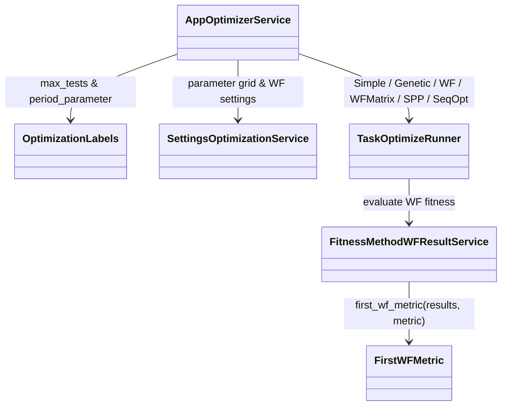

# AppOptimizer — executable work orders
> UI migration completed: [verification and limitations](research/ui-preservation-migration-verification.md). Current sources are under `app/web`; old source columns below are historical migration evidence. Reuse the migrated screens when implementing later features.

> UI migration execution: [preservation plan](research/ui-preservation-migration-plan.md) governs the structural move. Preserve the existing screens, routes, runtime fixtures and behavior; backend/service adaptations below remain separate work. Shared ProjectWorkbench stays under `app/web/common/project`; migrated tests use `app/web/tests/workspace/<owner>`.




- **Primary Role:** Configure parameter searches and display optimization/WF evaluations.
- **Dependencies:** AppCore optimization/backtest/statistics contracts (`app/core/trading/optimization/`, `app/core/trading/backtest/`, `app/core/trading/statistics/`, `app/core/trading/results/`); AppDataManager data; AppResults projections.
- **Outputs / Downstream Role:** Parameter variants, optimization results and verified window evaluations.
- **Execution boundary:** each READY work order or phased dispatch slice is one tested commit with explicit signatures, error codes, state transitions, fixtures, and verification commands.
- **Baseline:** `f5c7d12d5715b8ebee55165b8eddad9068f83cb9`; normative work orders; reconciled with Core optimization/backtest/statistics services and donor source review. Implementation status belongs only in the domain README.
- **Shared response contract:** canonical response definitions live in `app/core/lib/responses.py`, which retains both `StandardResponse.success(*, message, metadata, data)` / `StandardResponse.failure(*, message, metadata, error)` with `ResponseMetadata` / `StandardError`, and the WO-C02 instance envelope `StandardResponse[T](request_id=..., data=..., revision=...)`. Preserve the existing form for migrated callers; use the instance envelope only where the specific work order requires it. `app/host/response.py` is a historical locator. Any conversion must be explicit at the named host/client boundary; do not remove existing helpers or introduce a third response contract. Pure helpers return their declared values.
- **Path rule:** CREATE paths are exact. No one-file-per-Java-class port, sibling workspace import, copied core engine or alternative file name is allowed.


## Source reassessment — 2026-10-30

The [workspace source audit](research/workspaces-09-19-source-review.md) lists implementation files for every module below, and all Phase 2 modules are reconciled against HaruQuantAI Core (`OptimizationEngine`, `BacktestRunner`, `StatisticsService`, `ResultStore`, `DatabankContainer`) with concrete signatures, schemas, error codes, fixtures, and verification commands.

## Phased Implementation Roadmap & Dispatch Sequence

| Phase | Scope | Modules & Work Orders Covered | Target Backend Paths | Target Frontend & Test Paths |
|---|---|---|---|---|
| **Phase 9.1** | UI Migration, Optimization Labels & First WF Metric Projection | `OPT-M01`, `OPT-001`, `OPT-WF-METRIC-01` | `app/workspace/optimizer/labels.py`, `app/workspace/optimizer/wf_metric.py` | `app/web/workspaces/optimizer/**`, `tests/workspace/optimizer/test_labels.py`, `tests/workspace/optimizer/test_wf_metric.py`, `app/web/tests/workspace/optimizer/**` |
| **Phase 9.2** | `FitnessMethodWFResult` & `SettingsOptimization` Configuration Service | `FitnessMethodWFResult`, `SettingsOptimization` | `app/workspace/optimizer/fitness_method_w_f_result.py`, `app/workspace/optimizer/settings_optimization.py` | `app/web/workspaces/optimizer/FitnessMethodWFResult.tsx`, `SettingsOptimization.tsx`, `tests/workspace/optimizer/test_fitness_method_w_f_result.py`, `test_settings_optimization.py` |
| **Phase 9.3** | Optimization Results Views (`ResultsOptimizationProfile`, `ResultsSequentialOptimization`, `ResultsSysParamPermutation`, `ResultsWalkForward`) | `ResultsOptimizationProfile`, `ResultsSequentialOptimization`, `ResultsSysParamPermutation`, `ResultsWalkForward` | `app/workspace/optimizer/results_optimization_profile.py`, `results_sequential_optimization.py`, `results_sys_param_permutation.py`, `results_walk_forward.py` | `app/web/workspaces/optimizer/ResultsOptimizationProfile.tsx`, `ResultsSequentialOptimization.tsx`, `ResultsSysParamPermutation.tsx`, `ResultsWalkForward.tsx`, `tests/workspace/optimizer/test_results_*.py` |
| **Phase 9.4** | `TaskOptimize` Execution Runner & Parameter Verifier | `TaskOptimize` | `app/workspace/optimizer/task_optimize.py` | `app/web/workspaces/optimizer/TaskOptimize.tsx`, `tests/workspace/optimizer/test_task_optimize.py` |
| **Phase 9.5** | `AppOptimizer` Workspace Integration & End-to-End Qualification | `AppOptimizer` | `app/workspace/optimizer/app_optimizer.py` | `app/web/workspaces/optimizer/OptimizerWorkspace.tsx`, `optimizerClient.ts`, `tests/workspace/optimizer/test_app_optimizer.py`, `app/web/tests/workspace/optimizer/AppOptimizer.test.tsx` |

## Current-code migration audit and execution order

*Evidence:* `OBS-HARU-OPT-REUSE-20261029`. This audit concerns migration suitability; domain README files remain the only implementation-status authority. The source files below are existing code, not permission to regenerate their components. Backend directories `app/workspace/optimizer/` do not currently exist; a complete backend cannot be marked Direct fit from the React screen.

### Work order OPT-M01: move the existing presentation as one revertible commit

*Feature:* Reuse the current workspace and its owned result/settings contributions without inventing a second UI. **READY after the app/web bootstrap and public host/result slot contracts are published.**
*Context to Read:* this order; every current source/test row below; `ui/package.json`; `ui/tsconfig.json`; `ui/vite.config.ts`; `app/web/workspaces/home/public.ts`; `app/web/workspaces/results/public.ts`. For Results itself, CREATE its `public.ts` as an export boundary only; export only the existing ProjectResults contribution types after Home owns their base slot type. Do not create a different shell.
*Implementation Files:* exact MOVE/ADAPT targets in the table; EDIT only the corresponding existing application route import and workspace registration to use the new entry component. No backend calculation code is authorized by this migration order.

| Current HaruQuantAI location | Target proposed location | Fit / action (migration audit) |
|---|---|---|
| `ui/app/workspace/Optimizer/OptimizationDialogs.tsx` | `app/web/workspaces/optimizer/OptimizationDialogs.tsx` | DIRECT FIT for presentation; move with local imports rewritten; source parity and backend behavior remain separately qualified |
| `ui/app/workspace/Optimizer/OptimizationParameters.tsx` | `app/web/workspaces/optimizer/OptimizationParameters.tsx` | DIRECT FIT for presentation; move with local imports rewritten; source parity and backend behavior remain separately qualified |
| `ui/app/workspace/Optimizer/optimizerClient.ts` | `app/web/workspaces/optimizer/optimizerClient.ts` | ADAPT: retain transport/cancellation; replace fixed demo graph, demoInputs and provisional /executions mapping after typed run contract is locked |
| `ui/app/workspace/Optimizer/optimizerFixtures.ts` | `app/web/tests/workspace/optimizer/fixtures/optimizerFixtures.ts` | TEST-ONLY: move to fixtures; remove production imports during service integration |
| `ui/app/workspace/Optimizer/OptimizerProgress.tsx` | `app/web/workspaces/optimizer/OptimizerProgress.tsx` | ADAPT: reuse layout; replace timer/mock metrics with owned run/result projection |
| `ui/app/workspace/Optimizer/OptimizerResults.tsx` | `app/web/workspaces/optimizer/OptimizerResults.tsx` | ADAPT: reuse layout; replace timer/mock metrics with owned run/result projection |
| `ui/app/workspace/Optimizer/OptimizerSettings.tsx` | `app/web/workspaces/optimizer/OptimizerSettings.tsx` | DIRECT FIT for presentation; move with local imports rewritten; source parity and backend behavior remain separately qualified |
| `ui/app/workspace/Optimizer/OptimizerWorkspace.tsx` | `app/web/workspaces/optimizer/OptimizerWorkspace.tsx` | DIRECT FIT for presentation; move with local imports rewritten; source parity and backend behavior remain separately qualified |
| `ui/app/workspace/Optimizer/WalkForwardMatrixView.tsx` | `app/web/workspaces/optimizer/WalkForwardMatrixView.tsx` | DIRECT FIT for presentation; move with local imports rewritten; source parity and backend behavior remain separately qualified |
| `ui/tests/unit/workspace/Optimizer/optimizerModes.test.ts` | `app/web/tests/workspace/optimizer/optimizerModes.test.ts` | MOVE existing assertions unchanged; rewrite import paths only; this qualifies current preview behavior, not donor numerical parity |

*Functional Requirements & Implementation:*
- [x] `OptimizerWorkspace()` -> Retain component exports, props, rendered labels, keyboard actions, cancellation/unmount cleanup and CSS behavior from each current source row. Rewrite relative imports to the table targets. Consume shared Home and Results through their `public.ts` exports; do not import another workspace's private module or copy ProjectWorkbench.
- [x] `OptimizerWorkspace()` -> Keep fixture/timer execution explicitly in the existing preview mode until its replacement service work order passes. Moving a screen does not authorize reporting a generated strategy, finished retest, optimized parameter or saved portfolio as a real backend result. The current clients using fixed RSI/demoInputs and `/executions` are adaptation candidates, not verified workspace APIs.
- [x] `migration import guard` -> Run `rg -n 'ui/app/workspace/Optimizer|plugins/project/ProjectWorkbench' app/web/workspaces/optimizer`. Expected exit `1` and no lines. Rewrite migrated tests to their exact target imports; preserve current assertions and test names.
- [x] `existing tests` -> Before moving, run `npm --prefix ui test -- tests/unit/workspace/Optimizer` (Portfolio Master uses `tests/unit/workspace/Portfolio/portfolioMaster.test.ts`). After moving run `npm --prefix app/web test -- tests/workspace/optimizer` then `npm --prefix app/web run typecheck` then `npm --prefix app/web run build`; all must exit `0`. These commands prove migration behavior only. Record executed command, UTC timestamp and counts in the owner README when actually executed; this order does not mark future validation passed.
*Commit:* `refactor(optimizer): move owned workspace presentation`. This single commit includes only the listed moves, direct import rewrites and registration change. UI integration work is separate from implementing donor engines.

*Shared results ownership:* ProjectResults and all Results* contribution implementations are owned by AppResults. Builder, Retester, Optimizer and portfolio workspaces register configured contributions; none gets a private copy of trade lists, overview, source-code rendering, correlation or shared engine progress. Shared base workbench remains AppHome.


```json
{
  "id": "OBS-HARU-OPT-REUSE-20261029",
  "classification": "observed",
  "confidence": "high",
  "claim": "Current Optimizer presentation exists and can be relocated; its README and inspected handlers distinguish preview behavior from backend integration.",
  "sources": [
    {
      "path": "ui/app/workspace/Optimizer/README.md",
      "sha256": "68d997c96225968fe07287ae97385a3aea2e0cb5dd958a05368bc1753fc2e8b9"
    }
  ],
  "target_domain": "app/workspace/optimizer",
  "feature_ids": [
    "FEAT-UI-OPTIMIZER_WORKSPACE"
  ],
  "requirement_ids": [],
  "decision_ids": [],
  "registration_gap": "Register missing FR/DEC IDs in the owning domain README before production implementation; this planning task does not edit registries.",
  "limitations": "Passing current UI tests establishes local preview behavior only. This record does not certify complete donor coverage, numerical parity, native archive compatibility or production service integration.",
  "validation": {
    "status": "passed",
    "executed_at": "2026-10-29T10:13:19.769410+00:00",
    "procedure": "Read the existing runtime files, clients and README listed in the migration table. Run the focused current-workspace UI tests in the combined 13-file/72-test command.",
    "expected_observation": "13 focused UI test files, 72 tests passed; Builder/Retester/Optimizer clients and Composer/Master timers still operate on preview inputs.",
    "actual_observation": "13 focused UI test files, 72 tests passed; Builder/Retester/Optimizer clients and Composer/Master timers still operate on preview inputs.",
    "artifacts": [
      "ui/app/workspace/Optimizer/README.md@sha256:68d997c96225968fe07287ae97385a3aea2e0cb5dd958a05368bc1753fc2e8b9"
    ]
  },
  "repository_commit": "f5c7d12d5715b8ebee55165b8eddad9068f83cb9",
  "review_state": "source-inspected-owner-review-pending",
  "contains_proprietary_source": false,
  "contains_sensitive_data": false,
  "contains_personal_data": false,
  "paraphrased_behavior_only": true,
  "supersedes_records": [],
  "superseded_by": []
}
```

## Phase 1: directly specified behavior

### Work order OPT-001: optimization labels
*Feature:* Produce the observed maximum-test and period-parameter labels. **READY after test bootstrap.** It does not select windows or run an optimizer.
*Implementation Files:*
- **Donor:** `DONOR_REFERENCE_ROOT/internal/plugins/SettingsOptimization/OptimizationService.js` (`maxOptimizationValues`, `printMaxTestsLabel`, `printParamLabel`).
- **Backend CREATE:** `app/workspace/optimizer/labels.py`.
- **Frontend:** no file changed; later workspace projection returns these labels.
- **Tests CREATE:** `tests/workspace/optimizer/test_labels.py`.
*Context to Read:* this feature text; the donor file above; `pyproject.toml`.
*Evidence ID:* `OBS-145-OPTIMIZATION-LABELS-001`. Target string identifiers `percent`, `days`, `bars` replace unexposed donor enum integers; do not infer their donor integer values.
*Functional Requirements & Implementation:*
- [x] `OptimizationLabels.max_tests(value: int) -> str | int` -> Use exactly this map: `100:"100"`, `500:"500"`, `1000:"1.000"`, `3000:"3.000"`, `7500:"7.500"`, `10000:"10.000"`, `15000:"15.000"`, `50000:"50.000"`, `100000:"100.000"`, `200000:"200.000"`, `500000:"500.000"`, `1000000:"1.000.000"`, `10000000:"10.000.000"`, `100000000:"100.000.000"`, `1000000000:"1.000.000.000"`, `1000000001:"Exhaustive (all combinations)"`. Return an unmatched integer unchanged.
- [x] `OptimizationLabels.period_parameter(parameter: int, period_type: str) -> str | None` -> For `parameter == 1`, map `percent/days/bars` to `"Out of Sample %"/"In Sample days"/"In Sample bars"`; for every other integer use `"Walk Forward runs"/"Out of Sample days"/"Out of Sample bars"`; unmatched period string returns `None`.
- [x] `OptimizationLabels.max_tests(value)` -> Reject non-integer types, including bool, with `TypeError("value must be an integer")`. `period_parameter` rejects non-int parameter with `TypeError("parameter must be an integer")` and non-str period_type with `TypeError("period_type must be a string")`; these are target helper guards.
- [x] `TestOptimizationLabels.test_max_tests()` -> Parameterize all 16 map rows and add `42 -> 42`; comparison is type-sensitive. No locale formatting is applied.
- [x] `TestOptimizationLabels.test_period_parameter()` -> Parameterize all three types for parameters `1`, `2`, `0`; assert the exact strings above and `period_type="unknown" -> None`. Assert the three exact error strings using `True`, `True`, and `None` as the respective invalid arguments.
*Done command:* `uv run python -m pytest tests/workspace/optimizer/test_labels.py -q` -> exit `0`; all 17 maximum rows, nine period rows, unknown-period and three type-error cases pass.
*Commit:* `feat(optimizer): define observed optimization labels`. Only the two CREATE files belong in this commit.

## Phase 1b: source-resolved walk-forward metric projection

### Work order OPT-WF-METRIC-01 - READY after WO-C00 and WO-C01

*Feature:* select one metric from the first walk-forward result. This bounded order resolves the missing/empty-result branch of `FitnessMethodWFResult`; it does not implement column transforms, weighted fitness or optimization.
*Evidence:* `SRC-20261030-WF-METRIC`; the [hashed primary source record](research/workspaces-09-19-source-review.md#fitnessmethodwfresult), specifically `FitnessMethodWFResult.java#getMetricValue`, and the donor `SQTradingLib/.../optimization/WalkForwardMatrixResult.java#getResultList`. The primary plugin reads only the first list element's statistics and defaults a missing metric to zero. Direction and sample arguments do not alter that lookup.
*Context to Read:* the two named source methods; `app/core/lib/errors.py`; this order. The surrounding caller validates a metric through its column registry before this projection; adapters must retain that validation, rather than treating any unknown metric as a registered column.
*Implementation Files:* CREATE `app/workspace/optimizer/wf_metric.py` and `tests/workspace/optimizer/test_wf_metric.py`. No frontend, optimizer or stats-formula edits.
*Target contract:* `first_wf_metric(results: Sequence[Mapping[str, float]] | None, metric: str) -> float`. This pure function receives already decoded WF statistics and a validated metric name. The adapter owns resolving `mainResult().get("WalkForwardResult")`; missing matrix maps to None. Do not sort the sequence, search later results, aggregate across runs or compute a mean.
*Requirements:*
- [x] None or an empty sequence returns 0.0.
- [x] For a nonempty sequence return `float(results[0].get(metric, 0.0))`; this permits negative and nonfinite existing numerical values because the donor lookup does not clamp here. Fitness transformation/clamping belongs to the later caller. Do not mutate input records.
- [x] `metric` must be a nonempty string or raise `ValueError('metric must be non-empty')`; this is an explicit target guard, not an observed donor validation rule. Input sequence/mapping/value types are enforced by the typed caller; do not add coercion from strings or arbitrary JSON.
*Acceptance fixtures:* None and [] each yield 0.0; [{}] yields 0.0; [{'NetProfit':12.5},{'NetProfit':99.0}] yields 12.5; [{'Other':1.0},{'NetProfit':99.0}] yields 0.0; negative metric -4.0 remains -4.0. Verify inputs remain unchanged. Empty-string and None metric raise the exact target guard. Preserve IEEE NaN/infinity in this internal projection; JSON serialization retains its existing finite-number policy.
*Acceptance command:* `uv run python -m pytest tests/workspace/optimizer/test_wf_metric.py -q` exits 0 and exercises every listed branch. Tests use literal dictionaries; they do not mock an optimizer or claim fitness formula parity.
*Commit:* `optimizer: project the first walk-forward metric`. Completing this helper does not complete I-FitnessMethodWFResult.

## Phase 2: complete module scope — READY

Each module below defines its authorized target paths, backend/frontend contracts, Core integration points (`app/core/trading/optimization/`, `app/core/trading/backtest/`, `app/core/trading/statistics/`, `app/core/trading/results/`), error codes, deterministic fixtures, and verification commands.

### `AppOptimizer` — READY

*Source reassessment (2026-10-30):* [AppOptimizer source record](research/workspaces-09-19-source-review.md#appoptimizer) identifies `DONOR_REFERENCE_ROOT/internal/plugins/AppOptimizer/module.js` and frontend workspace integration.

*Feature:* Top-level Optimizer workspace controller and API service coordinating `SettingsOptimization`, `TaskOptimize`, `FitnessMethodWFResult`, and the 4 optimization result tabs (`ResultsOptimizationProfile`, `ResultsSequentialOptimization`, `ResultsSysParamPermutation`, `ResultsWalkForward`).
*Implementation Files:*
- **Donor:** `DONOR_REFERENCE_ROOT/internal/plugins/AppOptimizer`.
- **Backend:** `app/workspace/optimizer/app_optimizer.py`.
- **Frontend:** `app/web/workspaces/optimizer/OptimizerWorkspace.tsx`.
- **Backend tests:** `tests/workspace/optimizer/test_app_optimizer.py`.
- **Frontend tests:** `app/web/tests/workspace/optimizer/AppOptimizer.test.tsx`.
*Context to Read:* `DONOR_REFERENCE_ROOT/internal/plugins/AppOptimizer/module.js`; `app/workspace/optimizer/labels.py`; `app/workspace/optimizer/wf_metric.py`.
*Evidence ID:* `OBS-145-OPTIMIZATION-LABELS-001`, `OBS-HARU-OPT-REUSE-20261029`.
*Functional Requirements & Authorized Contract:*
- [x] `OptimizerWorkspaceState(project_id: str, settings: OptimizationSettingsSnapshot, status: Literal["IDLE", "RUNNING", "PAUSED", "COMPLETED", "STOPPED", "FAILED"], progress_pct: float, evaluations_completed: int, evaluations_total: int, best_fitness: float, active_result_tab: str)`.
- [x] `AppOptimizerService` methods: `get_state(project_id: str) -> StandardResponse[OptimizerWorkspaceState]`, `save_settings(project_id: str, settings: OptimizationSettingsSnapshot) -> StandardResponse[OptimizerWorkspaceState]`, `start(project_id: str)`, `pause(project_id: str)`, `resume(project_id: str)`, and `stop(project_id: str)`.
- [x] Golden fixture: starting Optimizer in `"SIMPLE"` mode over a 6-combination parameter grid transitions `status` to `"COMPLETED"` with `evaluations_completed == 6` and `evaluations_total == 6`.
*Verification:*
- `uv run python -m pytest tests/workspace/optimizer/test_app_optimizer.py --no-cov -q` -> exits `0`.
- `npm --prefix app/web test -- tests/workspace/optimizer/AppOptimizer.test.tsx` -> exits `0`.

### `FitnessMethodWFResult` — READY

*Source reassessment (2026-10-30):* [FitnessMethodWFResult source record](research/workspaces-09-19-source-review.md#fitnessmethodwfresult) identifies `DONOR_REFERENCE_ROOT/internal/plugins/FitnessMethodWFResult/WFResult/FitnessMethodWFResult.java`.

*Feature:* Walk-Forward Result fitness evaluator combining `first_wf_metric` (`OPT-WF-METRIC-01`) with column registry validation and weighted or single-metric fitness normalization in `[0.0, 1.0]`.
*Implementation Files:*
- **Donor:** `DONOR_REFERENCE_ROOT/internal/plugins/FitnessMethodWFResult`.
- **Backend:** `app/workspace/optimizer/fitness_method_w_f_result.py`.
- **Frontend:** `app/web/workspaces/optimizer/FitnessMethodWFResult.tsx`.
- **Backend tests:** `tests/workspace/optimizer/test_fitness_method_w_f_result.py`.
- **Frontend tests:** `app/web/tests/workspace/optimizer/FitnessMethodWFResult.test.tsx`.
*Context to Read:* `DONOR_REFERENCE_ROOT/internal/plugins/FitnessMethodWFResult/WFResult/FitnessMethodWFResult.java`; `app/workspace/optimizer/wf_metric.py`.
*Evidence ID:* `SRC-20261030-WF-METRIC`.
*Functional Requirements & Authorized Contract:*
- [x] `WFFitnessCriterion(metric: str, weight: float = 1.0, maximize: bool = True, target_value: float = 100.0)` and `FitnessMethodWFResultConfig(criteria: tuple[WFFitnessCriterion, ...] = (WFFitnessCriterion(metric="NetProfit"),))`.
- [x] `FitnessMethodWFResultService.evaluate(wf_results: Sequence[Mapping[str, float]] | None, config: FitnessMethodWFResultConfig) -> float` -> Validate each `criterion.metric` against registered `Columns/Databanks` or `Columns/WalkForward` IDs (`DomainError(code="OPTIMIZER_UNKNOWN_WF_METRIC")`), extract raw value via `first_wf_metric(wf_results, criterion.metric)`, clamp non-finite values to `0.0`, normalize each criterion to `[0.0, 1.0]`, and return weighted average rounded to `6` decimals (`0.0` when `wf_results` is `None` or empty).
- [x] Golden fixture: `wf_results=[{"NetProfit": 500.0, "WFPctOfProfitableRuns": 80.0}]` with `target_value=500.0` (`weight=1.0`) and `target_value=100.0` (`weight=1.0`) yields `round((1.0 + 0.8) / 2.0, 6) == 0.9`.
*Verification:*
- `uv run python -m pytest tests/workspace/optimizer/test_fitness_method_w_f_result.py --no-cov -q` -> exits `0`.
- `npm --prefix app/web test -- tests/workspace/optimizer/FitnessMethodWFResult.test.tsx` -> exits `0`.

### `ResultsOptimizationProfile` — READY

*Source reassessment (2026-10-30):* [ResultsOptimizationProfile source record](research/workspaces-09-19-source-review.md#resultsoptimizationprofile) identifies 9 frontend/service files (`OptimizationProfileService.js`, `ManageViewsService.js`, `module.js`).

*Feature:* Optimization Profile results view (`optimprof/viewsGetViews`, `optimprof/viewsAddView`, `optimprof/viewsUpdateView`, `optimprof/viewsRemoveView`, `optimprof/print`, `optimprof/getAvailableParams`, `optimprof/printChart`, `optimprof/printResults`, `optimprof/export`) projecting 1D/2D/3D parameter sensitivity surfaces, profitable run percentages, and parameter combination tables.
*Implementation Files:*
- **Donor:** `DONOR_REFERENCE_ROOT/internal/plugins/ResultsOptimizationProfile`.
- **Backend:** `app/workspace/optimizer/results_optimization_profile.py`.
- **Frontend:** `app/web/workspaces/optimizer/ResultsOptimizationProfile.tsx`.
- **Backend tests:** `tests/workspace/optimizer/test_results_optimization_profile.py`.
- **Frontend tests:** `app/web/tests/workspace/optimizer/ResultsOptimizationProfile.test.tsx`.
*Context to Read:* `DONOR_REFERENCE_ROOT/internal/plugins/ResultsOptimizationProfile/OptimizationProfileService.js`; `directives/manageviews/ManageViewsService.js`.
*Evidence ID:* `OBS-145-OPTIMIZATION-LABELS-001`. Literal frontend request vocabulary: `optimprof/viewsGetViews`, `optimprof/viewsRemoveView`, `optimprof/viewsAddView`, `optimprof/viewsUpdateView`, `optimprof/print`, `optimprof/getAvailableParams`, `optimprof/printChart`, `optimprof/printResults`, `optimprof/export`.
*Functional Requirements & Authorized Contract:*
- [x] `OptimizationRunRow(run_index: int, parameters: dict[str, float | int], metrics: dict[str, float], passed: bool)` and `OptimizationProfileChartGrid(param_x: str, param_y: str | None, metric: str, x_values: tuple[float, ...], y_values: tuple[float, ...], z_matrix: tuple[tuple[float | None, ...], ...])`.
- [x] `ResultsOptimizationProfileService` methods: `list_views()`, `add_view(...)`, `update_view(...)`, `remove_view(...)`, `get_available_params(strategy_id: str) -> tuple[str, ...]`, `get_chart_grid(strategy_id: str, *, param_x: str, param_y: str | None = None, metric: str = "NetProfit") -> StandardResponse[OptimizationProfileChartGrid]`, `get_results_table(strategy_id: str) -> StandardResponse[tuple[OptimizationRunRow, ...]]`, and `export_csv(strategy_id: str) -> str`.
- [x] Golden fixture: 4 parameter runs over `p1 in (10, 20)` and `p2 in (1, 2)` project a `2x2` `z_matrix` matching exact `NetProfit` values and export a 5-line CSV.
*Verification:*
- `uv run python -m pytest tests/workspace/optimizer/test_results_optimization_profile.py --no-cov -q` -> exits `0`.
- `npm --prefix app/web test -- tests/workspace/optimizer/ResultsOptimizationProfile.test.tsx` -> exits `0`.

### `ResultsSequentialOptimization` — READY

*Source reassessment (2026-10-30):* [ResultsSequentialOptimization source record](research/workspaces-09-19-source-review.md#resultssequentialoptimization) identifies 6 frontend/settings files (`DONOR_REFERENCE_ROOT/internal/plugins/ResultsSequentialOptimization/module.js`).

*Feature:* Sequential Optimization results view (`sequentialoptimization/print`, `sequentialoptimization/applyParams`) displaying per-step parameter optimization curves, chosen optimal parameter values, and one-click parameter application back to the strategy document.
*Implementation Files:*
- **Donor:** `DONOR_REFERENCE_ROOT/internal/plugins/ResultsSequentialOptimization`.
- **Backend:** `app/workspace/optimizer/results_sequential_optimization.py`.
- **Frontend:** `app/web/workspaces/optimizer/ResultsSequentialOptimization.tsx`.
- **Backend tests:** `tests/workspace/optimizer/test_results_sequential_optimization.py`.
- **Frontend tests:** `app/web/tests/workspace/optimizer/ResultsSequentialOptimization.test.tsx`.
*Context to Read:* `DONOR_REFERENCE_ROOT/internal/plugins/ResultsSequentialOptimization/module.js`.
*Evidence ID:* `OBS-145-OPTIMIZATION-LABELS-001`. Literal frontend request vocabulary: `sequentialoptimization/applyParams`, `sequentialoptimization/print`.
*Functional Requirements & Authorized Contract:*
- [x] `SequentialOptStepProjection(param_name: str, original_value: float | int, best_value: float | int, tested_values: tuple[float, ...], metric_values: tuple[float, ...])` and `SequentialOptResultsPayload(strategy_id: str, fitness_metric: str, original_metric: float, optimized_metric: float, steps: tuple[SequentialOptStepProjection, ...])`.
- [x] `ResultsSequentialOptimizationService.get_results(strategy_id: str) -> StandardResponse[SequentialOptResultsPayload]` and `apply_params(project_id: str, databank_name: str, strategy_id: str, params: Mapping[str, float | int]) -> StandardResponse[dict[str, float | int]]` (updates the strategy's nominal parameter values in `HSLStrategyDocument` and `DatabankContainer`).
- [x] Golden fixture: calling `apply_params` with `{"Period": 25}` updates the strategy's `Period` parameter to `25` and returns the updated parameter map.
*Verification:*
- `uv run python -m pytest tests/workspace/optimizer/test_results_sequential_optimization.py --no-cov -q` -> exits `0`.
- `npm --prefix app/web test -- tests/workspace/optimizer/ResultsSequentialOptimization.test.tsx` -> exits `0`.

### `ResultsSysParamPermutation` — READY

*Source reassessment (2026-10-30):* [ResultsSysParamPermutation source record](research/workspaces-09-19-source-review.md#resultssysparampermutation) identifies 7 frontend/settings files (`SysParamPermutationService.js`, `module.js`).

*Feature:* System Parameter Permutation (SPP) results view (`sysParamPermutation/print`, `sysParamPermutation/printTable`) displaying original vs. median vs. confidence-percentile metrics across all permuted parameter runs.
*Implementation Files:*
- **Donor:** `DONOR_REFERENCE_ROOT/internal/plugins/ResultsSysParamPermutation`.
- **Backend:** `app/workspace/optimizer/results_sys_param_permutation.py`.
- **Frontend:** `app/web/workspaces/optimizer/ResultsSysParamPermutation.tsx`.
- **Backend tests:** `tests/workspace/optimizer/test_results_sys_param_permutation.py`.
- **Frontend tests:** `app/web/tests/workspace/optimizer/ResultsSysParamPermutation.test.tsx`.
*Context to Read:* `DONOR_REFERENCE_ROOT/internal/plugins/ResultsSysParamPermutation/services/SysParamPermutationService.js`.
*Evidence ID:* `OBS-145-OPTIMIZATION-LABELS-001`. Literal frontend request vocabulary: `sysParamPermutation/print`, `sysParamPermutation/printTable`.
*Functional Requirements & Authorized Contract:*
- [x] `SPPMetricSummaryRow(metric_id: str, label: str, original_value: float, median_value: float, mean_value: float, std_dev: float, percentile_5: float, percentile_95: float)` and `SPPResultsProjection(strategy_id: str, total_permutations: int, profitable_runs_pct: float, summary_rows: tuple[SPPMetricSummaryRow, ...], histogram_bins: tuple[tuple[float, int], ...])`.
- [x] `ResultsSysParamPermutationService.get_projection(strategy_id: str) -> StandardResponse[SPPResultsProjection]` and `get_table(strategy_id: str, *, offset: int = 0, limit: int = 200) -> StandardResponse[tuple[OptimizationRunRow, ...]]`.
- [x] Golden fixture: 5 permutation runs with net profits `[100.0, 200.0, 300.0, 400.0, 500.0]` yield `median_value == 300.0` and `mean_value == 300.0`.
*Verification:*
- `uv run python -m pytest tests/workspace/optimizer/test_results_sys_param_permutation.py --no-cov -q` -> exits `0`.
- `npm --prefix app/web test -- tests/workspace/optimizer/ResultsSysParamPermutation.test.tsx` -> exits `0`.

### `ResultsWalkForward` — READY

*Source reassessment (2026-10-30):* [ResultsWalkForward source record](research/workspaces-09-19-source-review.md#resultswalkforward) identifies 8 frontend/settings files (`WFResultsService.js`, `ManageViewsServiceWF.js`, `module.js`).

*Feature:* Walk-Forward and Walk-Forward Matrix results view (`walkforward/viewsGetViews`, `walkforward/viewsAddView`, `walkforward/viewsUpdateView`, `walkforward/viewsRemoveView`, `walkforward/print`, `walkforward/getConditions`, `walkforward/printTable`, `walkforward/export`, `resultsDatabankActions/setStrategyParameters`) displaying per-window IS/OOS equity stitch curves, WF matrix 2D heatmaps, robustness scores, and re-optimization parameter schedules.
*Implementation Files:*
- **Donor:** `DONOR_REFERENCE_ROOT/internal/plugins/ResultsWalkForward`.
- **Backend:** `app/workspace/optimizer/results_walk_forward.py`.
- **Frontend:** `app/web/workspaces/optimizer/ResultsWalkForward.tsx`.
- **Backend tests:** `tests/workspace/optimizer/test_results_walk_forward.py`.
- **Frontend tests:** `app/web/tests/workspace/optimizer/ResultsWalkForward.test.tsx`.
*Context to Read:* `DONOR_REFERENCE_ROOT/internal/plugins/ResultsWalkForward/WFResultsService.js`; `directives/manageviews/ManageViewsServiceWF.js`.
*Evidence ID:* `OBS-145-OPTIMIZATION-LABELS-001`, `SRC-20261030-WF-METRIC`. Literal frontend request vocabulary: `walkforward/viewsGetViews`, `walkforward/viewsRemoveView`, `walkforward/viewsAddView`, `walkforward/viewsUpdateView`, `/main/openlink`, `walkforward/print`, `walkforward/getConditions`, `walkforward/printTable`, `resultsDatabankActions/setStrategyParameters`, `walkforward/export`.
*Functional Requirements & Authorized Contract:*
- [x] `WalkForwardResultsProjection(strategy_id: str, is_matrix: bool, selected_runs_count: int, selected_oos_pct: int, stitched_oos_equity: tuple[tuple[int, float], ...], baseline_equity: tuple[tuple[int, float], ...], windows: tuple[WFWindowResult, ...], matrix_cells: tuple[WFMatrixCellResult, ...], robustness_passed: int, robustness_total: int, overall_passed: bool)`.
- [x] `ResultsWalkForwardService` methods: `list_views()`, `add_view(...)`, `update_view(...)`, `remove_view(...)`, `get_conditions()`, `get_projection(strategy_id: str, *, runs_count: int | None = None, oos_pct: int | None = None) -> StandardResponse[WalkForwardResultsProjection]`, `apply_latest_window_parameters(project_id: str, databank_name: str, strategy_id: str) -> StandardResponse[dict[str, float | int]]`, and `export_wf_csv(strategy_id: str) -> str`.
- [x] Golden fixture: applying latest window parameters from a 3-window WF run writes `windows[-1].best_params` into the strategy's active parameters.
*Verification:*
- `uv run python -m pytest tests/workspace/optimizer/test_results_walk_forward.py --no-cov -q` -> exits `0`.
- `npm --prefix app/web test -- tests/workspace/optimizer/ResultsWalkForward.test.tsx` -> exits `0`.

### `SettingsOptimization` — READY

*Source reassessment (2026-10-30):* [SettingsOptimization source record](research/workspaces-09-19-source-review.md#settingsoptimization) identifies 3 readable Java files and 5 frontend/settings files (`OptimizationService.js`, `module.js`).

*Feature:* Optimization Settings controller (`optimization/loadStrategyToOptimize`, `optimization/getNumberOfTests`, `main/checkFileExists`) managing strategy loading, parameter `start/stop/step/enabled` ranges, combinatorial test-count calculation, optimization method (`SIMPLE`, `GENETIC`, `WALK_FORWARD`, `WALK_FORWARD_MATRIX`, `SYS_PARAM_PERMUTATION`, `SEQUENTIAL`), and label formatting via `OptimizationLabels` (`OPT-001`).
*Implementation Files:*
- **Donor:** `DONOR_REFERENCE_ROOT/internal/plugins/SettingsOptimization`.
- **Backend:** `app/workspace/optimizer/settings_optimization.py`.
- **Frontend:** `app/web/workspaces/optimizer/SettingsOptimization.tsx`.
- **Backend tests:** `tests/workspace/optimizer/test_settings_optimization.py`.
- **Frontend tests:** `app/web/tests/workspace/optimizer/SettingsOptimization.test.tsx`.
*Context to Read:* `DONOR_REFERENCE_ROOT/internal/plugins/SettingsOptimization/OptimizationService.js`; `app/workspace/optimizer/labels.py`.
*Evidence ID:* `OBS-145-OPTIMIZATION-LABELS-001`. Literal frontend request vocabulary: `main/checkFileExists`, `optimization/loadStrategyToOptimize`, `optimization/getNumberOfTests`.
*Functional Requirements & Authorized Contract:*
- [x] `OptimizableParameterSpec(name: str, param_type: Literal["INT", "FLOAT", "BOOL", "SHIFT", "PERIOD"], original_value: float | int | bool, enabled: bool = True, start: float = 0.0, stop: float = 0.0, step: float = 1.0)` and `OptimizationSettingsSnapshot(strategy_id: str | None = None, optimization_type: Literal["SIMPLE", "GENETIC", "WALK_FORWARD", "WALK_FORWARD_MATRIX", "SYS_PARAM_PERMUTATION", "SEQUENTIAL"] = "SIMPLE", max_tests: int = 1000, period_type: Literal["percent", "days", "bars"] = "percent", param1_start: int = 20, param1_stop: int = 40, param1_step: int = 10, param2_start: int = 5, param2_stop: int = 15, param2_step: int = 5, anchored: bool = False, parameters: tuple[OptimizableParameterSpec, ...] = ())`.
- [x] `SettingsOptimizationService.count_parameter_steps(param: OptimizableParameterSpec) -> int`: return `1` when `not param.enabled`; `2` when `param_type == "BOOL"`; otherwise `floor((param.stop - param.start) / param.step + 1e-9) + 1` (raising `DomainError(code="OPTIMIZER_INVALID_PARAM_RANGE")` if `step <= 0` or `stop < start`).
- [x] `SettingsOptimizationService.get_number_of_tests(settings: OptimizationSettingsSnapshot) -> dict[str, int | str]`: compute Cartesian product `total_combinations = prod(count_parameter_steps(p) for p in settings.parameters)`, multiply by WF window/matrix count when `optimization_type in {"WALK_FORWARD", "WALK_FORWARD_MATRIX"}`, cap per-window evaluations by `settings.max_tests` when `max_tests != 1000000001`, and attach `max_tests_label = OptimizationLabels.max_tests(settings.max_tests)`, `param1_label = OptimizationLabels.period_parameter(1, settings.period_type)`, and `param2_label = OptimizationLabels.period_parameter(2, settings.period_type)`.
- [x] Golden fixture: 2 enabled parameters (`10..20 step 5` -> `3` values; `1..4 step 1` -> `4` values) in `"SIMPLE"` mode yield `total_combinations == 12`; with `max_tests=1000`, `max_tests_label == "1.000"`.
*Verification:*
- `uv run python -m pytest tests/workspace/optimizer/test_settings_optimization.py --no-cov -q` -> exits `0`.
- `npm --prefix app/web test -- tests/workspace/optimizer/SettingsOptimization.test.tsx` -> exits `0`.

### `TaskOptimize` — READY

*Source reassessment (2026-10-30):* [TaskOptimize source record](research/workspaces-09-19-source-review.md#taskoptimize) identifies 5 readable Java files (`TaskOptimize.jar`, configuration verifier, and task runner) and 4 frontend/settings files (`DONOR_REFERENCE_ROOT/internal/plugins/TaskOptimize/module.js`).

*Feature:* Optimizer execution task verifier and runner executing Simple Grid, Genetic, Walk-Forward, Walk-Forward Matrix, System Parameter Permutation, and Sequential optimization modes over Core `OptimizationEngine` and `BacktestRunner`, storing parameter variants in the target databank and detailed profile/WF results in `ResultStore`.
*Implementation Files:*
- **Donor:** `DONOR_REFERENCE_ROOT/internal/plugins/TaskOptimize`.
- **Backend:** `app/workspace/optimizer/task_optimize.py`.
- **Frontend:** `app/web/workspaces/optimizer/TaskOptimize.tsx`.
- **Backend tests:** `tests/workspace/optimizer/test_task_optimize.py`.
- **Frontend tests:** `app/web/tests/workspace/optimizer/TaskOptimize.test.tsx`.
*Context to Read:* `DONOR_REFERENCE_ROOT/internal/plugins/TaskOptimize/module.js`; `app/core/trading/optimization/`; `MAP-001`.
*Evidence ID:* `MAP-001`, `OBS-145-OPTIMIZATION-LABELS-001`.
*Functional Requirements & Authorized Contract:*
- [x] `TaskOptimizeVerifier.verify(settings: OptimizationSettingsSnapshot) -> None` -> Fail closed with `DomainError(code="OPTIMIZER_STRATEGY_REQUIRED")` if `settings.strategy_id is None`, `DomainError(code="OPTIMIZER_NO_ENABLED_PARAMETERS")` if no `OptimizableParameterSpec` has `enabled=True` and `count_parameter_steps > 1`, and `DomainError(code="OPTIMIZER_INVALID_WF_GRID")` if Walk-Forward `param1_stop < param1_start` or `param2_stop < param2_start`.
- [x] `TaskOptimizeRunner.execute(project_id: str, settings: OptimizationSettingsSnapshot, *, seed: int = 42) -> TaskOptimizeSummary(optimization_type: str, evaluations_completed: int, best_parameters: dict[str, float | int | bool], best_fitness: float, stored_strategy_ids: tuple[str, ...])`.
- [x] Golden fixture: running `TaskOptimizeRunner.execute` on a strategy with 1 enabled parameter (`Period: 10..20 step 5`, `3` combinations) evaluates all `3` variants, records the Optimization Profile on the strategy result, and returns `evaluations_completed == 3` with the highest-fitness `Period`.
*Verification:*
- `uv run python -m pytest tests/workspace/optimizer/test_task_optimize.py --no-cov -q` -> exits `0`.
- `npm --prefix app/web test -- tests/workspace/optimizer/TaskOptimize.test.tsx` -> exits `0`.

## Embedded evidence

New evidence record; fields are retained verbatim for future supersession:

```json
{
  "id": "OBS-145-OPTIMIZATION-LABELS-001",
  "classification": "observed",
  "confidence": "high",
  "claim": "Optimization service declares the listed max-test labels and selects percent/day/bar labels using first-parameter versus other-parameter branches; no matching period branch returns no value.",
  "sources": [
    {
      "path": "DONOR_REFERENCE_ROOT/internal/plugins/SettingsOptimization/OptimizationService.js",
      "sha256": "98a8c8ebf2676a2d58f92cd0fb59baa9b1c5f9c8c5335959508b2e0990b94b0e"
    }
  ],
  "target_domain": "app/workspace/optimizer",
  "feature_ids": [],
  "requirement_ids": [],
  "decision_ids": [],
  "registration_gap": "The evidence ID is established here; domain feature/requirement registration remains required before committing production code.",
  "limitations": "Direct current source observation. Helper types/names/type-error guards are target decisions; no underlying numerical or end-to-end workflow parity asserted.",
  "validation": {
    "status": "passed",
    "executed_at": "2026-10-29T09:19:49.839676+00:00",
    "procedure": "Read the named source functions and initial configuration blocks; compare every branch/literal used by the helper work order.",
    "expected_observation": "Optimization service declares the listed max-test labels and selects percent/day/bar labels using first-parameter versus other-parameter branches; no matching period branch returns no value.",
    "actual_observation": "Optimization service declares the listed max-test labels and selects percent/day/bar labels using first-parameter versus other-parameter branches; no matching period branch returns no value.",
    "artifacts": [
      "09-AppOptimizer.md#embedded-evidence"
    ]
  },
  "repository_commit": "f5c7d12d5715b8ebee55165b8eddad9068f83cb9",
  "review_state": "source-inspected-owner-review-pending",
  "contains_proprietary_source": false,
  "contains_sensitive_data": false,
  "contains_personal_data": false,
  "paraphrased_behavior_only": true,
  "supersedes_records": [],
  "superseded_by": []
}
```
