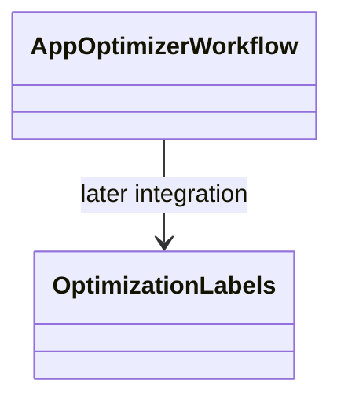

# AppOptimizer — executable work orders



- **Primary Role:** Configure parameter searches and display optimization/WF evaluations.
- **Dependencies:** AppCore optimization/backtest/statistics contracts; AppDataManager data; AppResults projections.
- **Outputs / Downstream Role:** Parameter variants, optimization results and verified window evaluations.
- **Execution boundary:** each READY work order is one tested commit. A BLOCKED work order authorizes no code, placeholder endpoint, UI success state or feature-completion claim. Source evidence below does not authorize choosing missing behavior.
- **Baseline:** `f5c7d12d5715b8ebee55165b8eddad9068f83cb9`; normative work orders; owner review pending. Implementation status belongs only in the domain README.
- **Shared response contract:** API adapters preserve `StandardResponse.success(*, message, metadata, data)` and `StandardResponse.failure(*, message, metadata, error)` from the current `app/host/response.py`, including `ResponseMetadata` and `StandardError`. The host phase owns its exact migration target. Pure helpers return their declared values. Do not introduce a second generic response envelope; adapt legacy UI transport at its client boundary.
- **Path rule:** CREATE paths are exact. No one-file-per-Java-class port, sibling workspace import, copied core engine or alternative file name is allowed.


## Current-code migration audit and execution order

*Evidence:* `OBS-HARU-OPT-REUSE-20261029`. This audit concerns migration suitability; domain README files remain the only implementation-status authority. The source files below are existing code, not permission to regenerate their components. Backend directories `app/workspace/optimizer/` do not currently exist; a complete backend cannot be marked Direct fit from the React screen.

### Work order OPT-M01: move the existing presentation as one revertible commit

*Feature:* Reuse the current workspace and its owned result/settings contributions without inventing a second UI. **READY after the app/web bootstrap and public host/result slot contracts are published.**
*Context to Read:* this order; every current source/test row below; `ui/package.json`; `ui/tsconfig.json`; `ui/vite.config.ts`; `app/web/workspaces/home/public.ts`; `app/web/workspaces/results/public.ts`. For Results itself, CREATE its `public.ts` as an export boundary only; export only the existing ProjectResults contribution types after Home owns their base slot type. Do not create a different shell.
*Implementation Files:* exact MOVE/ADAPT targets in the table; EDIT only the corresponding existing application route import and workspace registration to use the new entry component. No backend calculation code is authorized by this migration order.

| Current HaruQuantAI location | Target proposed location | Fit / action (migration audit) |
|---|---|---|
| `ui/app/workspace/Optimizer/OptimizationDialogs.tsx` | `app/web/workspaces/optimizer/OptimizationDialogs.tsx` | DIRECT FIT for presentation; move with local imports rewritten; source parity and backend behavior remain separately qualified |
| `ui/app/workspace/Optimizer/OptimizationParameters.tsx` | `app/web/workspaces/optimizer/OptimizationParameters.tsx` | DIRECT FIT for presentation; move with local imports rewritten; source parity and backend behavior remain separately qualified |
| `ui/app/workspace/Optimizer/optimizerClient.ts` | `app/web/workspaces/optimizer/optimizerClient.ts` | ADAPT: retain transport/cancellation; replace fixed demo graph, demoInputs and provisional /executions mapping after typed run contract is locked |
| `ui/app/workspace/Optimizer/optimizerFixtures.ts` | `app/web/tests/workspaces/optimizer/fixtures/optimizerFixtures.ts` | TEST-ONLY: move to fixtures; remove production imports during service integration |
| `ui/app/workspace/Optimizer/OptimizerProgress.tsx` | `app/web/workspaces/optimizer/OptimizerProgress.tsx` | ADAPT: reuse layout; replace timer/mock metrics with owned run/result projection |
| `ui/app/workspace/Optimizer/OptimizerResults.tsx` | `app/web/workspaces/optimizer/OptimizerResults.tsx` | ADAPT: reuse layout; replace timer/mock metrics with owned run/result projection |
| `ui/app/workspace/Optimizer/OptimizerSettings.tsx` | `app/web/workspaces/optimizer/OptimizerSettings.tsx` | DIRECT FIT for presentation; move with local imports rewritten; source parity and backend behavior remain separately qualified |
| `ui/app/workspace/Optimizer/OptimizerWorkspace.tsx` | `app/web/workspaces/optimizer/OptimizerWorkspace.tsx` | DIRECT FIT for presentation; move with local imports rewritten; source parity and backend behavior remain separately qualified |
| `ui/app/workspace/Optimizer/WalkForwardMatrixView.tsx` | `app/web/workspaces/optimizer/WalkForwardMatrixView.tsx` | DIRECT FIT for presentation; move with local imports rewritten; source parity and backend behavior remain separately qualified |
| `ui/tests/unit/workspace/Optimizer/optimizerModes.test.ts` | `app/web/tests/workspaces/optimizer/optimizerModes.test.ts` | MOVE existing assertions unchanged; rewrite import paths only; this qualifies current preview behavior, not donor numerical parity |

*Functional Requirements & Implementation:*
- [ ] `OptimizerWorkspace()` -> Retain component exports, props, rendered labels, keyboard actions, cancellation/unmount cleanup and CSS behavior from each current source row. Rewrite relative imports to the table targets. Consume shared Home and Results through their `public.ts` exports; do not import another workspace's private module or copy ProjectWorkbench.
- [ ] `OptimizerWorkspace()` -> Keep fixture/timer execution explicitly in the existing preview mode until its replacement service work order passes. Moving a screen does not authorize reporting a generated strategy, finished retest, optimized parameter or saved portfolio as a real backend result. The current clients using fixed RSI/demoInputs and `/executions` are adaptation candidates, not verified workspace APIs.
- [ ] `migration import guard` -> Run `rg -n 'ui/app/workspace/Optimizer|plugins/project/ProjectWorkbench' app/web/workspaces/optimizer`. Expected exit `1` and no lines. Rewrite migrated tests to their exact target imports; preserve current assertions and test names.
- [ ] `existing tests` -> Before moving, run `npm --prefix ui test -- tests/unit/workspace/Optimizer` (Portfolio Master uses `tests/unit/workspace/Portfolio/portfolioMaster.test.ts`). After moving run `npm --prefix app/web test -- tests/workspaces/optimizer` then `npm --prefix app/web run typecheck` then `npm --prefix app/web run build`; all must exit `0`. These commands prove migration behavior only. Record executed command, UTC timestamp and counts in the owner README when actually executed; this order does not mark future validation passed.
*Commit:* `refactor(optimizer): move owned workspace presentation`. This single commit includes only the listed moves, direct import rewrites and registration change. UI integration work is separate from implementing donor engines.

*Shared results ownership:* ProjectResults and all Results* contribution implementations are owned by AppResults. Builder, Retester, Optimizer and portfolio workspaces register configured contributions; none gets a private copy of trade lists, overview, source-code rendering, correlation or shared engine progress. Shared base workbench remains AppHome.


```json
{
  "id": "OBS-HARU-OPT-REUSE-20261029",
  "classification": "observed",
  "confidence": "high",
  "claim": "Current Optimizer presentation exists and can be relocated; its README and inspected handlers distinguish preview behavior from backend integration.",
  "sources": [
    {
      "path": "ui/app/workspace/Optimizer/README.md",
      "sha256": "68d997c96225968fe07287ae97385a3aea2e0cb5dd958a05368bc1753fc2e8b9"
    }
  ],
  "target_domain": "app/workspaces/optimizer",
  "feature_ids": [
    "FEAT-UI-OPTIMIZER_WORKSPACE"
  ],
  "requirement_ids": [],
  "decision_ids": [],
  "registration_gap": "Register missing FR/DEC IDs in the owning domain README before production implementation; this planning task does not edit registries.",
  "limitations": "Passing current UI tests establishes local preview behavior only. This record does not certify complete donor coverage, numerical parity, native archive compatibility or production service integration.",
  "validation": {
    "status": "passed",
    "executed_at": "2026-10-29T10:13:19.769410+00:00",
    "procedure": "Read the existing runtime files, clients and README listed in the migration table. Run the focused current-workspace UI tests in the combined 13-file/72-test command.",
    "expected_observation": "13 focused UI test files, 72 tests passed; Builder/Retester/Optimizer clients and Composer/Master timers still operate on preview inputs.",
    "actual_observation": "13 focused UI test files, 72 tests passed; Builder/Retester/Optimizer clients and Composer/Master timers still operate on preview inputs.",
    "artifacts": [
      "ui/app/workspace/Optimizer/README.md@sha256:68d997c96225968fe07287ae97385a3aea2e0cb5dd958a05368bc1753fc2e8b9"
    ]
  },
  "repository_commit": "f5c7d12d5715b8ebee55165b8eddad9068f83cb9",
  "review_state": "source-inspected-owner-review-pending",
  "contains_proprietary_source": false,
  "contains_sensitive_data": false,
  "contains_personal_data": false,
  "paraphrased_behavior_only": true,
  "supersedes_records": [],
  "superseded_by": []
}
```

## Phase 1: directly specified behavior

### Work order OPT-001: optimization labels
*Feature:* Produce the observed maximum-test and period-parameter labels. **READY after test bootstrap.** It does not select windows or run an optimizer.
*Implementation Files:*
- **Donor:** `SQX_REFERENCE_ROOT/internal/plugins/SettingsOptimization/OptimizationService.js` (`maxOptimizationValues`, `printMaxTestsLabel`, `printParamLabel`).
- **Backend CREATE:** `app/workspaces/optimizer/labels.py`.
- **Frontend:** no file changed; later workspace projection returns these labels.
- **Tests CREATE:** `tests/workspaces/optimizer/test_labels.py`.
*Context to Read:* this feature text; the donor file above; `pyproject.toml`.
*Evidence ID:* `OBS-145-OPTIMIZATION-LABELS-001`. Target string identifiers `percent`, `days`, `bars` replace unexposed donor enum integers; do not infer their donor integer values.
*Functional Requirements & Implementation:*
- [ ] `OptimizationLabels.max_tests(value: int) -> str | int` -> Use exactly this map: `100:"100"`, `500:"500"`, `1000:"1.000"`, `3000:"3.000"`, `7500:"7.500"`, `10000:"10.000"`, `15000:"15.000"`, `50000:"50.000"`, `100000:"100.000"`, `200000:"200.000"`, `500000:"500.000"`, `1000000:"1.000.000"`, `10000000:"10.000.000"`, `100000000:"100.000.000"`, `1000000000:"1.000.000.000"`, `1000000001:"Exhaustive (all combinations)"`. Return an unmatched integer unchanged.
- [ ] `OptimizationLabels.period_parameter(parameter: int, period_type: str) -> str | None` -> For `parameter == 1`, map `percent/days/bars` to `"Out of Sample %"/"In Sample days"/"In Sample bars"`; for every other integer use `"Walk Forward runs"/"Out of Sample days"/"Out of Sample bars"`; unmatched period string returns `None`.
- [ ] `OptimizationLabels.max_tests(value)` -> Reject non-integer types, including bool, with `TypeError("value must be an integer")`. `period_parameter` rejects non-int parameter with `TypeError("parameter must be an integer")` and non-str period_type with `TypeError("period_type must be a string")`; these are target helper guards.
- [ ] `TestOptimizationLabels.test_max_tests()` -> Parameterize all 16 map rows and add `42 -> 42`; comparison is type-sensitive. No locale formatting is applied.
- [ ] `TestOptimizationLabels.test_period_parameter()` -> Parameterize all three types for parameters `1`, `2`, `0`; assert the exact strings above and `period_type="unknown" -> None`. Assert the three exact error strings using `True`, `True`, and `None` as the respective invalid arguments.
*Done command:* `uv run python -m pytest tests/workspaces/optimizer/test_labels.py -q` -> exit `0`; all 17 maximum rows, nine period rows, unknown-period and three type-error cases pass.
*Commit:* `feat(optimizer): define observed optimization labels`. Only the two CREATE files belong in this commit.

## Phase 2: complete module scope not yet executable

Each module below is retained in full scope. Its proposed files are reserved names, not permission to fill missing semantics. The senior planner must issue a revised READY order with complete signatures, literals and expected results before an executor starts that module. No acceptance test command can prove an unspecified contract; therefore blocked modules have no implementation commit.

### `AppOptimizer` — BLOCKED-NOT-EXECUTABLE
*Feature:* Full `AppOptimizer` behavior; this is not completed by the helper commit above.
*Implementation Files (reserved, no code authorized):*
- **Donor:** `SQX_REFERENCE_ROOT/internal/plugins/AppOptimizer/`.
- **Backend:** `app/workspaces/optimizer/app_optimizer.py`.
- **Frontend:** `app/web/workspaces/optimizer/OptimizerWorkspace.tsx`.
- **Backend tests:** `tests/workspaces/optimizer/test_app_optimizer.py`.
- **Frontend tests:** `app/web/tests/optimizer/AppOptimizer.test.tsx`.
*Context to Read:* `SQX_REFERENCE_ROOT/internal/plugins/AppOptimizer/module.js`.
*Evidence and limit:* `OBS-145-OPTIMIZATION-LABELS-001` establishes only the READY behavior described above, not this module's full workflow. Literal frontend request vocabulary observed during this pass: No literal request action was established by the inspected frontend service declarations.
*Exact unresolved contract:* The full action request/response schema, state transitions, persisted fields/defaults and invalid-operation behavior are not locked to independent fixtures.
*Executor action:* do not create the reserved files, signatures, constants, schemas or test expectations for this module. Report this feature heading and the exact unresolved contract to the senior planner. Do not replace the missing contract with a conventional implementation.
*Release condition:* a later work order cites a verbatim behavior evidence ID for `AppOptimizer`, fixes every input/output/default/error/persistence transition, provides numerical or state fixtures, and names test commands expected to exit `0`. A source directory or action-name list alone does not meet this condition.

### `FitnessMethodWFResult` — BLOCKED-NOT-EXECUTABLE
*Feature:* Full `FitnessMethodWFResult` behavior; this is not completed by the helper commit above.
*Implementation Files (reserved, no code authorized):*
- **Donor:** `SQX_REFERENCE_ROOT/internal/plugins/FitnessMethodWFResult/`.
- **Backend:** `app/workspaces/optimizer/fitness_method_w_f_result.py`.
- **Frontend:** `app/web/workspaces/optimizer/FitnessMethodWFResult.tsx`.
- **Backend tests:** `tests/workspaces/optimizer/test_fitness_method_w_f_result.py`.
- **Frontend tests:** `app/web/tests/optimizer/FitnessMethodWFResult.test.tsx`.
*Context to Read:* `SQX_REFERENCE_ROOT/internal/plugins/FitnessMethodWFResult/FitnessMethodWFResult.jar`.
*Evidence and limit:* `OBS-145-OPTIMIZATION-LABELS-001` establishes only the READY behavior described above, not this module's full workflow. Literal frontend request vocabulary observed during this pass: No literal request action was established by the inspected frontend service declarations.
*Exact unresolved contract:* Exact metric expression, value-type mapping, weight normalization, missing-value policy and independently computed expected scores are not locked.
*Executor action:* do not create the reserved files, signatures, constants, schemas or test expectations for this module. Report this feature heading and the exact unresolved contract to the senior planner. Do not replace the missing contract with a conventional implementation.
*Release condition:* a later work order cites a verbatim behavior evidence ID for `FitnessMethodWFResult`, fixes every input/output/default/error/persistence transition, provides numerical or state fixtures, and names test commands expected to exit `0`. A source directory or action-name list alone does not meet this condition.

### `ResultsOptimizationProfile` — BLOCKED-NOT-EXECUTABLE
*Feature:* Full `ResultsOptimizationProfile` behavior; this is not completed by the helper commit above.
*Implementation Files (reserved, no code authorized):*
- **Donor:** `SQX_REFERENCE_ROOT/internal/plugins/ResultsOptimizationProfile/`.
- **Backend:** `app/workspaces/optimizer/results_optimization_profile.py`.
- **Frontend:** `app/web/workspaces/optimizer/ResultsOptimizationProfile.tsx`.
- **Backend tests:** `tests/workspaces/optimizer/test_results_optimization_profile.py`.
- **Frontend tests:** `app/web/tests/optimizer/ResultsOptimizationProfile.test.tsx`.
*Context to Read:* `SQX_REFERENCE_ROOT/internal/plugins/ResultsOptimizationProfile/directives/manageviews/ManageViewsService.js`; `SQX_REFERENCE_ROOT/internal/plugins/ResultsOptimizationProfile/module.js`; `SQX_REFERENCE_ROOT/internal/plugins/ResultsOptimizationProfile/OptimizationProfileService.js`.
*Evidence and limit:* `OBS-145-OPTIMIZATION-LABELS-001` establishes only the READY behavior described above, not this module's full workflow. Literal frontend request vocabulary observed during this pass: `optimprof/viewsGetViews` `optimprof/viewsRemoveView` `optimprof/viewsAddView` `optimprof/viewsUpdateView` `optimprof/print` `optimprof/getAvailableParams` `optimprof/printChart` `optimprof/printResults` `optimprof/export`
*Exact unresolved contract:* Exact response fields, sample/direction/market filtering, pagination or resampling rules, undefined-value representation and independently calculated expected values are not locked.
*Executor action:* do not create the reserved files, signatures, constants, schemas or test expectations for this module. Report this feature heading and the exact unresolved contract to the senior planner. Do not replace the missing contract with a conventional implementation.
*Release condition:* a later work order cites a verbatim behavior evidence ID for `ResultsOptimizationProfile`, fixes every input/output/default/error/persistence transition, provides numerical or state fixtures, and names test commands expected to exit `0`. A source directory or action-name list alone does not meet this condition.

### `ResultsSequentialOptimization` — BLOCKED-NOT-EXECUTABLE
*Feature:* Full `ResultsSequentialOptimization` behavior; this is not completed by the helper commit above.
*Implementation Files (reserved, no code authorized):*
- **Donor:** `SQX_REFERENCE_ROOT/internal/plugins/ResultsSequentialOptimization/`.
- **Backend:** `app/workspaces/optimizer/results_sequential_optimization.py`.
- **Frontend:** `app/web/workspaces/optimizer/ResultsSequentialOptimization.tsx`.
- **Backend tests:** `tests/workspaces/optimizer/test_results_sequential_optimization.py`.
- **Frontend tests:** `app/web/tests/optimizer/ResultsSequentialOptimization.test.tsx`.
*Context to Read:* `SQX_REFERENCE_ROOT/internal/plugins/ResultsSequentialOptimization/module.js`.
*Evidence and limit:* `OBS-145-OPTIMIZATION-LABELS-001` establishes only the READY behavior described above, not this module's full workflow. Literal frontend request vocabulary observed during this pass: `sequentialoptimization/applyParams` `sequentialoptimization/print`
*Exact unresolved contract:* Exact response fields, sample/direction/market filtering, pagination or resampling rules, undefined-value representation and independently calculated expected values are not locked.
*Executor action:* do not create the reserved files, signatures, constants, schemas or test expectations for this module. Report this feature heading and the exact unresolved contract to the senior planner. Do not replace the missing contract with a conventional implementation.
*Release condition:* a later work order cites a verbatim behavior evidence ID for `ResultsSequentialOptimization`, fixes every input/output/default/error/persistence transition, provides numerical or state fixtures, and names test commands expected to exit `0`. A source directory or action-name list alone does not meet this condition.

### `ResultsSysParamPermutation` — BLOCKED-NOT-EXECUTABLE
*Feature:* Full `ResultsSysParamPermutation` behavior; this is not completed by the helper commit above.
*Implementation Files (reserved, no code authorized):*
- **Donor:** `SQX_REFERENCE_ROOT/internal/plugins/ResultsSysParamPermutation/`.
- **Backend:** `app/workspaces/optimizer/results_sys_param_permutation.py`.
- **Frontend:** `app/web/workspaces/optimizer/ResultsSysParamPermutation.tsx`.
- **Backend tests:** `tests/workspaces/optimizer/test_results_sys_param_permutation.py`.
- **Frontend tests:** `app/web/tests/optimizer/ResultsSysParamPermutation.test.tsx`.
*Context to Read:* `SQX_REFERENCE_ROOT/internal/plugins/ResultsSysParamPermutation/module.js`; `SQX_REFERENCE_ROOT/internal/plugins/ResultsSysParamPermutation/services/SysParamPermutationService.js`.
*Evidence and limit:* `OBS-145-OPTIMIZATION-LABELS-001` establishes only the READY behavior described above, not this module's full workflow. Literal frontend request vocabulary observed during this pass: `sysParamPermutation/print` `sysParamPermutation/printTable`
*Exact unresolved contract:* Exact response fields, sample/direction/market filtering, pagination or resampling rules, undefined-value representation and independently calculated expected values are not locked.
*Executor action:* do not create the reserved files, signatures, constants, schemas or test expectations for this module. Report this feature heading and the exact unresolved contract to the senior planner. Do not replace the missing contract with a conventional implementation.
*Release condition:* a later work order cites a verbatim behavior evidence ID for `ResultsSysParamPermutation`, fixes every input/output/default/error/persistence transition, provides numerical or state fixtures, and names test commands expected to exit `0`. A source directory or action-name list alone does not meet this condition.

### `ResultsWalkForward` — BLOCKED-NOT-EXECUTABLE
*Feature:* Full `ResultsWalkForward` behavior; this is not completed by the helper commit above.
*Implementation Files (reserved, no code authorized):*
- **Donor:** `SQX_REFERENCE_ROOT/internal/plugins/ResultsWalkForward/`.
- **Backend:** `app/workspaces/optimizer/results_walk_forward.py`.
- **Frontend:** `app/web/workspaces/optimizer/ResultsWalkForward.tsx`.
- **Backend tests:** `tests/workspaces/optimizer/test_results_walk_forward.py`.
- **Frontend tests:** `app/web/tests/optimizer/ResultsWalkForward.test.tsx`.
*Context to Read:* `SQX_REFERENCE_ROOT/internal/plugins/ResultsWalkForward/directives/manageviews/ManageViewsServiceWF.js`; `SQX_REFERENCE_ROOT/internal/plugins/ResultsWalkForward/module.js`; `SQX_REFERENCE_ROOT/internal/plugins/ResultsWalkForward/WFResultsService.js`.
*Evidence and limit:* `OBS-145-OPTIMIZATION-LABELS-001` establishes only the READY behavior described above, not this module's full workflow. Literal frontend request vocabulary observed during this pass: `walkforward/viewsGetViews` `walkforward/viewsRemoveView` `walkforward/viewsAddView` `walkforward/viewsUpdateView` `/main/openlink` `walkforward/print` `walkforward/getConditions` `walkforward/printTable` `resultsDatabankActions/setStrategyParameters` `walkforward/export`
*Exact unresolved contract:* Exact response fields, sample/direction/market filtering, pagination or resampling rules, undefined-value representation and independently calculated expected values are not locked.
*Executor action:* do not create the reserved files, signatures, constants, schemas or test expectations for this module. Report this feature heading and the exact unresolved contract to the senior planner. Do not replace the missing contract with a conventional implementation.
*Release condition:* a later work order cites a verbatim behavior evidence ID for `ResultsWalkForward`, fixes every input/output/default/error/persistence transition, provides numerical or state fixtures, and names test commands expected to exit `0`. A source directory or action-name list alone does not meet this condition.

### `SettingsOptimization` — BLOCKED-NOT-EXECUTABLE
*Feature:* Full `SettingsOptimization` behavior; this is not completed by the helper commit above.
*Implementation Files (reserved, no code authorized):*
- **Donor:** `SQX_REFERENCE_ROOT/internal/plugins/SettingsOptimization/`.
- **Backend:** `app/workspaces/optimizer/settings_optimization.py`.
- **Frontend:** `app/web/workspaces/optimizer/SettingsOptimization.tsx`.
- **Backend tests:** `tests/workspaces/optimizer/test_settings_optimization.py`.
- **Frontend tests:** `app/web/tests/optimizer/SettingsOptimization.test.tsx`.
*Context to Read:* `SQX_REFERENCE_ROOT/internal/plugins/SettingsOptimization/module.js`; `SQX_REFERENCE_ROOT/internal/plugins/SettingsOptimization/OptimizationService.js`.
*Evidence and limit:* `OBS-145-OPTIMIZATION-LABELS-001` establishes only the READY behavior described above, not this module's full workflow. Literal frontend request vocabulary observed during this pass: `main/checkFileExists` `optimization/loadStrategyToOptimize` `optimization/getNumberOfTests`
*Exact unresolved contract:* Complete persisted field/default/bounds schema, inheritance/merge rules, enum values and invalid-write behavior are not locked. The READY helper does not supply this complete request contract.
*Executor action:* do not create the reserved files, signatures, constants, schemas or test expectations for this module. Report this feature heading and the exact unresolved contract to the senior planner. Do not replace the missing contract with a conventional implementation.
*Release condition:* a later work order cites a verbatim behavior evidence ID for `SettingsOptimization`, fixes every input/output/default/error/persistence transition, provides numerical or state fixtures, and names test commands expected to exit `0`. A source directory or action-name list alone does not meet this condition.

### `TaskOptimize` — BLOCKED-NOT-EXECUTABLE
*Feature:* Full `TaskOptimize` behavior; this is not completed by the helper commit above.
*Implementation Files (reserved, no code authorized):*
- **Donor:** `SQX_REFERENCE_ROOT/internal/plugins/TaskOptimize/`.
- **Backend:** `app/workspaces/optimizer/task_optimize.py`.
- **Frontend:** `app/web/workspaces/optimizer/TaskOptimize.tsx`.
- **Backend tests:** `tests/workspaces/optimizer/test_task_optimize.py`.
- **Frontend tests:** `app/web/tests/optimizer/TaskOptimize.test.tsx`.
*Context to Read:* `SQX_REFERENCE_ROOT/internal/plugins/TaskOptimize/module.js`.
*Evidence and limit:* `OBS-145-OPTIMIZATION-LABELS-001` establishes only the READY behavior described above, not this module's full workflow. Literal frontend request vocabulary observed during this pass: No literal request action was established by the inspected frontend service declarations.
*Exact unresolved contract:* Exact run-request settings, engine capability selection, candidate/result acceptance, stop/pause/resume transitions and error/partial-result semantics are not locked.
*Executor action:* do not create the reserved files, signatures, constants, schemas or test expectations for this module. Report this feature heading and the exact unresolved contract to the senior planner. Do not replace the missing contract with a conventional implementation.
*Release condition:* a later work order cites a verbatim behavior evidence ID for `TaskOptimize`, fixes every input/output/default/error/persistence transition, provides numerical or state fixtures, and names test commands expected to exit `0`. A source directory or action-name list alone does not meet this condition.

## Embedded evidence

New evidence record; fields are retained verbatim for future supersession:

```json
{
  "id": "OBS-145-OPTIMIZATION-LABELS-001",
  "classification": "observed",
  "confidence": "high",
  "claim": "Optimization service declares the listed max-test labels and selects percent/day/bar labels using first-parameter versus other-parameter branches; no matching period branch returns no value.",
  "sources": [
    {
      "path": "SQX_REFERENCE_ROOT/internal/plugins/SettingsOptimization/OptimizationService.js",
      "sha256": "98a8c8ebf2676a2d58f92cd0fb59baa9b1c5f9c8c5335959508b2e0990b94b0e"
    }
  ],
  "target_domain": "app/workspaces/optimizer",
  "feature_ids": [],
  "requirement_ids": [],
  "decision_ids": [],
  "registration_gap": "The evidence ID is established here; domain feature/requirement registration remains required before committing production code.",
  "limitations": "Direct current source observation. Helper types/names/type-error guards are target decisions; no underlying numerical or end-to-end workflow parity asserted.",
  "validation": {
    "status": "passed",
    "executed_at": "2026-10-29T09:19:49.839676+00:00",
    "procedure": "Read the named source functions and initial configuration blocks; compare every branch/literal used by the helper work order.",
    "expected_observation": "Optimization service declares the listed max-test labels and selects percent/day/bar labels using first-parameter versus other-parameter branches; no matching period branch returns no value.",
    "actual_observation": "Optimization service declares the listed max-test labels and selects percent/day/bar labels using first-parameter versus other-parameter branches; no matching period branch returns no value.",
    "artifacts": [
      "09-AppOptimizer.md#embedded-evidence"
    ]
  },
  "repository_commit": "f5c7d12d5715b8ebee55165b8eddad9068f83cb9",
  "review_state": "source-inspected-owner-review-pending",
  "contains_proprietary_source": false,
  "contains_sensitive_data": false,
  "contains_personal_data": false,
  "paraphrased_behavior_only": true,
  "supersedes_records": [],
  "superseded_by": []
}
```
