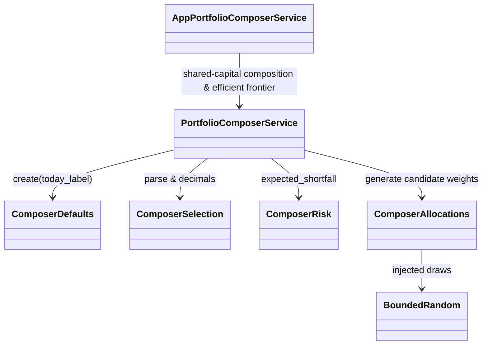

# AppPortfolioComposer — executable work orders
> UI migration completed: [verification and limitations](research/ui-preservation-migration-verification.md). Current sources are under `app/web`; old source columns below are historical migration evidence. Reuse the migrated screens when implementing later features.

> UI migration execution: [preservation plan](research/ui-preservation-migration-plan.md) governs the structural move. Preserve the existing screens, routes, runtime fixtures and behavior; backend/service adaptations below remain separate work. Shared ProjectWorkbench stays under `app/web/common/project`; migrated tests use `app/web/tests/workspace/<owner>`.




- **Primary Role:** Configure composition, source strategies and shared-capital evaluation.
- **Dependencies:** AppCore PortfolioEngine/ResultStore (`app/core/trading/portfolio/`, `app/core/trading/results/`, `app/core/trading/statistics/`); AppDataManager data; AppResults projections.
- **Outputs / Downstream Role:** Composition specifications and portfolio evaluation results.
- **Execution boundary:** each READY work order or phased dispatch slice is one tested commit with explicit signatures, error codes, state transitions, fixtures, and verification commands.
- **Baseline:** `f5c7d12d5715b8ebee55165b8eddad9068f83cb9`; normative work orders; reconciled with Core portfolio/result/statistics services and donor source review. Implementation status belongs only in the domain README.
- **Shared response contract:** canonical response definitions live in `app/core/lib/responses.py`, which retains both `StandardResponse.success(*, message, metadata, data)` / `StandardResponse.failure(*, message, metadata, error)` with `ResponseMetadata` / `StandardError`, and the WO-C02 instance envelope `StandardResponse[T](request_id=..., data=..., revision=...)`. Preserve the existing form for migrated callers; use the instance envelope only where the specific work order requires it. `app/host/response.py` is a historical locator. Any conversion must be explicit at the named host/client boundary; do not remove existing helpers or introduce a third response contract. Pure helpers return their declared values.
- **Path rule:** CREATE paths are exact. No one-file-per-Java-class port, sibling workspace import, copied core engine or alternative file name is allowed.


## Source reassessment — 2026-10-30

The [workspace source audit](research/workspaces-09-19-source-review.md) lists implementation files for every module below, and all Phase 2 modules are reconciled against `PC-001` through `PC-004` and HaruQuantAI Core (`PortfolioMerger`, `ResultStore`, `StatisticsService`, `DatabankContainer`) with concrete signatures, schemas, error codes, fixtures, and verification commands.

## Phased Implementation Roadmap & Dispatch Sequence

| Phase | Scope | Modules & Work Orders Covered | Target Backend Paths | Target Frontend & Test Paths |
|---|---|---|---|---|
| **Phase 10.1** | UI Migration & Pure Composition Helpers (`defaults`, `selection`, `risk`, `allocations`) | `PC-M01`, `PC-001`, `PC-002`, `PC-003`, `PC-004` | `app/workspace/portfolio_composer/defaults.py`, `selection.py`, `risk.py`, `allocations.py` | `app/web/workspaces/portfolio_composer/**`, `tests/workspace/portfolio_composer/test_defaults.py`, `test_selection.py`, `test_risk.py`, `test_allocations.py`, `app/web/tests/workspace/portfolio_composer/**` |
| **Phase 10.2** | `PortfolioComposer` Core Composition Engine & Buy-and-Hold Synthesis | `PortfolioComposer` | `app/workspace/portfolio_composer/portfolio_composer.py` | `app/web/workspaces/portfolio_composer/PortfolioComposer.tsx`, `tests/workspace/portfolio_composer/test_portfolio_composer.py` |
| **Phase 10.3** | `ResultsPortfolioComposerChart` Efficient Frontier & Equity Projection | `ResultsPortfolioComposerChart` | `app/workspace/portfolio_composer/results_portfolio_composer_chart.py` | `app/web/workspaces/portfolio_composer/ResultsPortfolioComposerChart.tsx`, `tests/workspace/portfolio_composer/test_results_portfolio_composer_chart.py` |
| **Phase 10.4** | `ResultsPortfolioComposerLog` Execution & Margin Reject Log Projection | `ResultsPortfolioComposerLog` | `app/workspace/portfolio_composer/results_portfolio_composer_log.py` | `app/web/workspaces/portfolio_composer/ResultsPortfolioComposerLog.tsx`, `tests/workspace/portfolio_composer/test_results_portfolio_composer_log.py` |
| **Phase 10.5** | `AppPortfolioComposer` Workspace Integration & End-to-End Qualification | `AppPortfolioComposer` | `app/workspace/portfolio_composer/app_portfolio_composer.py` | `app/web/workspaces/portfolio_composer/PortfolioComposerWorkspace.tsx`, `tests/workspace/portfolio_composer/test_app_portfolio_composer.py`, `app/web/tests/workspace/portfolio_composer/AppPortfolioComposer.test.tsx` |

## Current-code migration audit and execution order

*Evidence:* `OBS-HARU-PC-REUSE-20261029`. This audit concerns migration suitability; domain README files remain the only implementation-status authority. The source files below are existing code, not permission to regenerate their components. Backend directories `app/workspace/portfolio_composer/` do not currently exist; a complete backend cannot be marked Direct fit from the React screen.

### Work order PC-M01: move the existing presentation as one revertible commit

*Feature:* Reuse the current workspace and its owned result/settings contributions without inventing a second UI. **READY after the app/web bootstrap and public host/result slot contracts are published.**
*Context to Read:* this order; every current source/test row below; `ui/package.json`; `ui/tsconfig.json`; `ui/vite.config.ts`; `app/web/workspaces/home/public.ts`; `app/web/workspaces/results/public.ts`. For Results itself, CREATE its `public.ts` as an export boundary only; export only the existing ProjectResults contribution types after Home owns their base slot type. Do not create a different shell.
*Implementation Files:* exact MOVE/ADAPT targets in the table; EDIT only the corresponding existing application route import and workspace registration to use the new entry component. No backend calculation code is authorized by this migration order.

| Current HaruQuantAI location | Target proposed location | Fit / action (migration audit) |
|---|---|---|
| `ui/app/workspace/PortfolioComposer/composerModel.ts` | `app/web/workspaces/portfolio_composer/composerModel.ts` | ADAPT: retain pure draft operations; preview serialization/defaults are not SQX persistence or engine settings |
| `ui/app/workspace/PortfolioComposer/fixtures.ts` | `app/web/tests/workspace/portfolio_composer/fixtures/fixtures.ts` | TEST-ONLY: move to fixtures; remove production imports during service integration |
| `ui/app/workspace/PortfolioComposer/PortfolioAutocomputation.tsx` | `app/web/workspaces/portfolio_composer/PortfolioAutocomputation.tsx` | DIRECT FIT for presentation; move with local imports rewritten; source parity and backend behavior remain separately qualified |
| `ui/app/workspace/PortfolioComposer/PortfolioCandidatesModal.tsx` | `app/web/workspaces/portfolio_composer/PortfolioCandidatesModal.tsx` | DIRECT FIT for presentation; move with local imports rewritten; source parity and backend behavior remain separately qualified |
| `ui/app/workspace/PortfolioComposer/PortfolioComposerDialogs.tsx` | `app/web/workspaces/portfolio_composer/PortfolioComposerDialogs.tsx` | DIRECT FIT for presentation; move with local imports rewritten; source parity and backend behavior remain separately qualified |
| `ui/app/workspace/PortfolioComposer/PortfolioComposerResults.tsx` | `app/web/workspaces/portfolio_composer/PortfolioComposerResults.tsx` | ADAPT: reuse layout; replace timer/mock metrics with owned run/result projection |
| `ui/app/workspace/PortfolioComposer/PortfolioComposerWorkspace.tsx` | `app/web/workspaces/portfolio_composer/PortfolioComposerWorkspace.tsx` | DIRECT FIT for presentation; move with local imports rewritten; source parity and backend behavior remain separately qualified |
| `ui/app/workspace/PortfolioComposer/PortfolioComposition.tsx` | `app/web/workspaces/portfolio_composer/PortfolioComposition.tsx` | DIRECT FIT for presentation; move with local imports rewritten; source parity and backend behavior remain separately qualified |
| `ui/app/workspace/PortfolioComposer/PortfolioConfiguration.tsx` | `app/web/workspaces/portfolio_composer/PortfolioConfiguration.tsx` | DIRECT FIT for presentation; move with local imports rewritten; source parity and backend behavior remain separately qualified |
| `ui/app/workspace/PortfolioComposer/portfolioOptimization.ts` | `app/web/workspaces/portfolio_composer/portfolioOptimization.ts` | RETIRE after import-reference guard; approximate preview algorithms are not donor formulas |
| `ui/tests/unit/workspace/PortfolioComposer/composerDraft.test.ts` | `app/web/tests/workspace/portfolio_composer/composerDraft.test.ts` | MOVE existing assertions unchanged; rewrite import paths only; this qualifies current preview behavior, not donor numerical parity |
| `ui/tests/unit/workspace/PortfolioComposer/portfolioMembers.test.ts` | `app/web/tests/workspace/portfolio_composer/portfolioMembers.test.ts` | MOVE existing assertions unchanged; rewrite import paths only; this qualifies current preview behavior, not donor numerical parity |
| `ui/tests/unit/workspace/Portfolio/portfolioComposer.test.ts` | `app/web/tests/workspace/portfolio_composer/portfolioComposer.test.ts` | MOVE existing assertions unchanged; rewrite import paths only; this qualifies current preview behavior, not donor numerical parity |

*Functional Requirements & Implementation:*
- [ ] `PortfolioComposerWorkspace()` -> Retain component exports, props, rendered labels, keyboard actions, cancellation/unmount cleanup and CSS behavior from each current source row. Rewrite relative imports to the table targets. Consume shared Home and Results through their `public.ts` exports; do not import another workspace's private module or copy ProjectWorkbench.
- [ ] `PortfolioComposerWorkspace()` -> Keep fixture/timer execution explicitly in the existing preview mode until its replacement service work order passes. Moving a screen does not authorize reporting a generated strategy, finished retest, optimized parameter or saved portfolio as a real backend result. The current clients using fixed RSI/demoInputs and `/executions` are adaptation candidates, not verified workspace APIs.
- [ ] `migration import guard` -> Run `rg -n 'ui/app/workspace/PortfolioComposer|plugins/project/ProjectWorkbench' app/web/workspaces/portfolio_composer`. Expected exit `1` and no lines. Rewrite migrated tests to their exact target imports; preserve current assertions and test names.
- [ ] `existing tests` -> Before moving, run `npm --prefix ui test -- tests/unit/workspace/PortfolioComposer` (Portfolio Master uses `tests/unit/workspace/Portfolio/portfolioMaster.test.ts`). After moving run `npm --prefix app/web test -- tests/workspace/portfolio_composer` then `npm --prefix app/web run typecheck` then `npm --prefix app/web run build`; all must exit `0`. These commands prove migration behavior only. Record executed command, UTC timestamp and counts in the owner README when actually executed; this order does not mark future validation passed.
*Commit:* `refactor(portfolio-composer): move owned workspace presentation`. This single commit includes only the listed moves, direct import rewrites and registration change. UI integration work is separate from implementing donor engines.

*Shared results ownership:* ProjectResults and all Results* contribution implementations are owned by AppResults. Builder, Retester, Optimizer and portfolio workspaces register configured contributions; none gets a private copy of trade lists, overview, source-code rendering, correlation or shared engine progress. Shared base workbench remains AppHome.


```json
{
  "id": "OBS-HARU-PC-REUSE-20261029",
  "classification": "observed",
  "confidence": "high",
  "claim": "Current PortfolioComposer presentation exists and can be relocated; its README and inspected handlers distinguish preview behavior from backend integration.",
  "sources": [
    {
      "path": "ui/app/workspace/PortfolioComposer/README.md",
      "sha256": "537e58cd603e7f1907e83fbbd93a9db7788dbae05e9dbb03db14d4ace11aca1c"
    }
  ],
  "target_domain": "app/workspace/portfolio_composer",
  "feature_ids": [
    "FEAT-UI-PORTFOLIO_COMPOSER_WORKSPACE"
  ],
  "requirement_ids": [],
  "decision_ids": [],
  "registration_gap": "Register missing FR/DEC IDs in the owning domain README before production implementation; this planning task does not edit registries.",
  "limitations": "Passing current UI tests establishes local preview behavior only. This record does not certify complete donor coverage, numerical parity, native archive compatibility or production service integration.",
  "validation": {
    "status": "passed",
    "executed_at": "2026-10-29T10:13:19.769410+00:00",
    "procedure": "Read the existing runtime files, clients and README listed in the migration table. Run the focused current-workspace UI tests in the combined 13-file/72-test command.",
    "expected_observation": "13 focused UI test files, 72 tests passed; Builder/Retester/Optimizer clients and Composer/Master timers still operate on preview inputs.",
    "actual_observation": "13 focused UI test files, 72 tests passed; Builder/Retester/Optimizer clients and Composer/Master timers still operate on preview inputs.",
    "artifacts": [
      "ui/app/workspace/PortfolioComposer/README.md@sha256:537e58cd603e7f1907e83fbbd93a9db7788dbae05e9dbb03db14d4ace11aca1c"
    ]
  },
  "repository_commit": "f5c7d12d5715b8ebee55165b8eddad9068f83cb9",
  "review_state": "source-inspected-owner-review-pending",
  "contains_proprietary_source": false,
  "contains_sensitive_data": false,
  "contains_personal_data": false,
  "paraphrased_behavior_only": true,
  "supersedes_records": [],
  "superseded_by": []
}
```

## Phase 1: directly specified behavior

### Work order PC-001: composition initial configuration
*Feature:* Construct the observed composition view's initial settings. **READY after test bootstrap.** This helper does not decide allocation, return aggregation or model formulas.
*Implementation Files:*
- **Donor:** `DONOR_REFERENCE_ROOT/internal/plugins/PortfolioComposer/PortfolioComposerService.js` (`instance.config`).
- **Backend CREATE:** `app/workspace/portfolio_composer/defaults.py`.
- **Frontend:** no file changed; later state-loading service supplies this object to React.
- **Tests CREATE:** `tests/workspace/portfolio_composer/test_defaults.py`.
*Context to Read:* this feature text; the donor file above; `pyproject.toml`.
*Evidence ID:* `OBS-145-COMPOSER-DEFAULTS-001`. The helper takes a preformatted date label so this task cannot invent the donor date formatter or clock timezone.
*Functional Requirements & Implementation:*
- [ ] `ComposerDefaults.create(*, today_label: str) -> ComposerViewDefaults` -> Define `ComposerViewDefaults` as a TypedDict in the same file with exactly the keys below. Create a fresh dictionary and fresh empty lists on every call; assign both date labels verbatim from the argument. Declare scalar fields as `str`, `int`, `float`, `bool` or `str | None` matching the literal fixture; declare the three empty collection fields as `list[object]` because this initial-state task does not establish their later item schemas.
- [ ] `ComposerDefaults.create(today_label=...)` -> Raise `TypeError("today_label must be a string")` for non-str input. Do not parse/validate a string date; date formatting belongs to the supplying clock/format contract, not this helper.
- [ ] `TestComposerDefaults.test_exact_defaults()` -> Call with `today_label="injected-day"`; assert the complete dictionary equals the fixture below, including the identifier `"SharpRatio"` and risk-free value `0.7` without percentage conversion.
- [ ] `TestComposerDefaults.test_fresh_lists()` -> Append an object to the first result's `results` list; a second result's `results`, `weights` and `mm_methods` remain empty. The first dictionary's three list identities are distinct. `None` raises the exact TypeError.

Exact fixture:
```json
{
  "date_range": "full",
  "start_day": "injected-day",
  "end_day": "injected-day",
  "initial_capital": 100000,
  "leverage": 1,
  "results": [],
  "weights": [],
  "mm_methods": [],
  "mm_methods_different": false,
  "portfolio_name": null,
  "model_type": "markowitz",
  "selection_type": "SharpRatio",
  "max_simulations": 10,
  "conf_level": 95,
  "risk_free_rate": 0.7,
  "req_std_dev": -1
}
```
`initial_capital` here is a GUI initialization number, not an AccountSpec money serialization rule. A future typed request adapter must perform the approved account conversion; do not introduce it in this commit.
*Done command:* `uv run python -m pytest tests/workspace/portfolio_composer/test_defaults.py -q` -> exit `0`; full fixture, independent mutable collections and invalid-type cases pass.
*Commit:* `feat(portfolio-composer): define observed view defaults`. Only the two CREATE files belong in this commit.

## Phase 2: complete module scope — READY

Each module below defines its authorized target paths, backend/frontend contracts, Core integration points (`app/core/trading/portfolio/`, `app/core/trading/results/`, `app/core/trading/statistics/`), error codes, deterministic fixtures, and verification commands.

### `AppPortfolioComposer` — READY

*Source reassessment (2026-10-30):* [AppPortfolioComposer source record](research/workspaces-09-19-source-review.md#appportfoliocomposer) identifies `DONOR_REFERENCE_ROOT/internal/plugins/AppPortfolioComposer/module.js`.

*Feature:* Top-level Portfolio Composer workspace controller and state coordinator binding `ComposerDefaults.create` (`PC-001`), `PortfolioComposerService`, `ResultsPortfolioComposerChart`, and `ResultsPortfolioComposerLog`.
*Implementation Files:*
- **Donor:** `DONOR_REFERENCE_ROOT/internal/plugins/AppPortfolioComposer`.
- **Backend:** `app/workspace/portfolio_composer/app_portfolio_composer.py`.
- **Frontend:** `app/web/workspaces/portfolio_composer/PortfolioComposerWorkspace.tsx`.
- **Backend tests:** `tests/workspace/portfolio_composer/test_app_portfolio_composer.py`.
- **Frontend tests:** `app/web/tests/workspace/portfolio_composer/AppPortfolioComposer.test.tsx`.
*Context to Read:* `DONOR_REFERENCE_ROOT/internal/plugins/AppPortfolioComposer/module.js`; `app/workspace/portfolio_composer/defaults.py`.
*Evidence ID:* `OBS-145-COMPOSER-DEFAULTS-001`, `OBS-HARU-PC-REUSE-20261029`.
*Functional Requirements & Authorized Contract:*
- [ ] `AppPortfolioComposerService.get_workspace_state(project_id: str, *, today_label: str = "2026-01-01") -> StandardResponse[ComposerWorkspaceState]` -> Initialize default settings via `ComposerDefaults.create(today_label=today_label)` when no saved state exists, and coordinate candidate member rows, active computation status, and composed portfolio result projections.
- [ ] Golden fixture: initializing a fresh workspace state with `today_label="2026-10-30"` returns `initial_capital == 100000`, `leverage == 1`, `model_type == "markowitz"`, `selection_type == "SharpRatio"`, `conf_level == 95`, and `risk_free_rate == 0.7`.
*Verification:*
- `uv run python -m pytest tests/workspace/portfolio_composer/test_app_portfolio_composer.py --no-cov -q` -> exits `0`.
- `npm --prefix app/web test -- tests/workspace/portfolio_composer/AppPortfolioComposer.test.tsx` -> exits `0`.

### `PortfolioComposer` — READY

*Source reassessment (2026-10-30):* [PortfolioComposer source record](research/workspaces-09-19-source-review.md#portfoliocomposer) identifies 9 readable Java files (`PortfolioComposer.jar`) and 16 frontend/settings files (`PortfolioComposerService.js`).

*Feature:* Core Portfolio Composer engine (`/portfoliocomposer/addBuyHoldStrategy`, `/portfoliocomposer/recompute`, `/portfoliocomposer/stop`, `/portfoliocomposer/loadFiles`, `/project/saveReports`, `/portfoliocomposer/savePortfolio`, `/portfoliocomposer/loadGridData`, `/portfoliocomposer/removeAllReports`, `/portfoliocomposer/removeReports`) performing chronological shared-capital order merging, margin/leverage enforcement, Buy-and-Hold strategy synthesis, and Markowitz / CVaR (`expected_shortfall`) automatic weight search.
*Implementation Files:*
- **Donor:** `DONOR_REFERENCE_ROOT/internal/plugins/PortfolioComposer`.
- **Backend:** `app/workspace/portfolio_composer/portfolio_composer.py`.
- **Frontend:** `app/web/workspaces/portfolio_composer/PortfolioComposer.tsx`.
- **Backend tests:** `tests/workspace/portfolio_composer/test_portfolio_composer.py`.
- **Frontend tests:** `app/web/tests/workspace/portfolio_composer/PortfolioComposer.test.tsx`.
*Context to Read:* `DONOR_REFERENCE_ROOT/internal/plugins/PortfolioComposer/PortfolioComposerService.js`; `app/workspace/portfolio_composer/selection.py`; `risk.py`; `allocations.py`.
*Evidence ID:* `OBS-145-COMPOSER-DEFAULTS-001`, `OBS-145-COMPOSER-MATH-002`. Literal frontend request vocabulary: `/portfoliocomposer/addBuyHoldStrategy`, `/portfoliocomposer/recompute`, `/portfoliocomposer/stop`, `/portfoliocomposer/loadFiles`, `/project/saveReports`, `/portfoliocomposer/savePortfolio`, `/portfoliocomposer/loadGridData`, `/portfoliocomposer/removeAllReports`, `/portfoliocomposer/removeReports`.
*Functional Requirements & Authorized Contract:*
- [ ] `ComposerMemberSpec(strategy_id: str, name: str, enabled: bool = True, weight_pct: float = 100.0, mm_method: str = "UseStrategyMM")` and `ComposerRunConfig(date_range: Literal["full", "custom"] = "full", start_day: str = "2010-01-01", end_day: str = "2026-01-01", initial_capital: float = 100000.0, leverage: int = 1, model_type: Literal["manual", "markowitz", "cvar"] = "markowitz", selection_type: str = "SharpRatio", max_simulations: int = 10, conf_level: int = 95, risk_free_rate: float = 0.7, req_std_dev: float = -1.0, members: tuple[ComposerMemberSpec, ...] = ())`.
- [ ] `PortfolioComposerService` methods:
  - `add_buy_hold_strategy(symbol: str, start_day: str, end_day: str, initial_capital: float) -> ComposerMemberSpec` (synthesizes a single long trade entering on the first bar open in `[start_day, end_day]` and closing on the final bar close).
  - `recompute(config: ComposerRunConfig, *, rng: BoundedRandom) -> ComposerRunReceipt`:
    1. Parse `selection = ComposerSelection.parse(config.selection_type)`.
    2. When `config.model_type == "manual"`, evaluate the user's explicit `weight_pct` vector directly without normalizing to `100`.
    3. When `config.model_type in {"markowitz", "cvar"}`, generate integer candidate weight vectors summing to `100` via `ComposerAllocations.generate(member_count=len(enabled_members), simulations=config.max_simulations, rng=rng)`.
    4. For each candidate weight vector, scale each member's trade sizes/P&L by `weight_i / 100.0`, merge orders chronologically by `(open_time_ms, close_time_ms, strategy_index, ticket)`, enforce shared-capital margin (`required_margin = notional / config.leverage`; if `required_margin > available_free_margin`, reject the order and append a structured entry to `ResultsPortfolioComposerLog`), and compute selection score (`SharpRatio`, `ReturnDrawdownRatio`, `CAGRMaxDrawdownRatio`, `CAGRMeanDrawdownRatio`, `NetProfit`) plus risk metric (`standard_deviation` for `"markowitz"` or `-ComposerRisk.expected_shortfall(mean=..., standard_deviation=..., confidence=config.conf_level / 100.0)` for `"cvar"`).
    5. Select the candidate maximizing the `ComposerSelection` criterion (subject to `std_dev <= req_std_dev` when `req_std_dev > 0`), round selection score to `selection.decimals()`, and return `ComposerRunReceipt`.
  - `save_portfolio(project_id: str, databank_name: str, portfolio_name: str, receipt: ComposerRunReceipt) -> str`.
- [ ] Golden fixture: 2 members with `max_simulations=3` and injected `BoundedRandom` draws evaluate all 3 allocation candidates, record any margin-rejected orders in the log, and select the highest `SharpRatio` candidate rounded to `3` decimals.
*Verification:*
- `uv run python -m pytest tests/workspace/portfolio_composer/test_portfolio_composer.py --no-cov -q` -> exits `0`.
- `npm --prefix app/web test -- tests/workspace/portfolio_composer/PortfolioComposer.test.tsx` -> exits `0`.

### `ResultsPortfolioComposerChart` — READY

*Source reassessment (2026-10-30):* [ResultsPortfolioComposerChart source record](research/workspaces-09-19-source-review.md#resultsportfoliocomposerchart) identifies 4 frontend/settings files (`PortfolioComposerChartService.js`, `module.js`).

*Feature:* Portfolio Composer Chart view (`portfoliocomposerchart/print`) projecting the simulated risk-return scatter cloud (Markowitz / CVaR efficient frontier candidates), the selected optimal portfolio point, and the composed portfolio equity curve vs. individual member equity curves.
*Implementation Files:*
- **Donor:** `DONOR_REFERENCE_ROOT/internal/plugins/ResultsPortfolioComposerChart`.
- **Backend:** `app/workspace/portfolio_composer/results_portfolio_composer_chart.py`.
- **Frontend:** `app/web/workspaces/portfolio_composer/ResultsPortfolioComposerChart.tsx`.
- **Backend tests:** `tests/workspace/portfolio_composer/test_results_portfolio_composer_chart.py`.
- **Frontend tests:** `app/web/tests/workspace/portfolio_composer/ResultsPortfolioComposerChart.test.tsx`.
*Context to Read:* `DONOR_REFERENCE_ROOT/internal/plugins/ResultsPortfolioComposerChart/PortfolioComposerChartService.js`; `module.js`.
*Evidence ID:* `OBS-145-COMPOSER-MATH-002`. Literal frontend request vocabulary: `portfoliocomposerchart/print`.
*Functional Requirements & Authorized Contract:*
- [ ] `FrontierSimulationPoint(simulation_index: int, weights: tuple[int, ...], risk_x: float, return_y: float, selection_score: float, is_selected: bool)` and `PortfolioComposerChartPayload(model_type: str, selection_type: str, frontier_points: tuple[FrontierSimulationPoint, ...], portfolio_equity: tuple[tuple[int, float], ...], member_equities: dict[str, tuple[tuple[int, float], ...]])`.
- [ ] `ResultsPortfolioComposerChartService.get_chart(receipt: ComposerRunReceipt) -> StandardResponse[PortfolioComposerChartPayload]` -> Project all evaluated simulation points with `selection_score` rounded to `ComposerSelection.parse(receipt.selection_type).decimals()`, marking the winning simulation with `is_selected=True`.
- [ ] Golden fixture: a 3-simulation run produces 3 `FrontierSimulationPoint`s with exactly one `is_selected == True` and non-empty `portfolio_equity`.
*Verification:*
- `uv run python -m pytest tests/workspace/portfolio_composer/test_results_portfolio_composer_chart.py --no-cov -q` -> exits `0`.
- `npm --prefix app/web test -- tests/workspace/portfolio_composer/ResultsPortfolioComposerChart.test.tsx` -> exits `0`.

### `ResultsPortfolioComposerLog` — READY

*Source reassessment (2026-10-30):* [ResultsPortfolioComposerLog source record](research/workspaces-09-19-source-review.md#resultsportfoliocomposerlog) identifies 4 frontend/settings files (`PortfolioComposerLogService.js`, `module.js`).

*Feature:* Portfolio Composer execution log view (`portfoliocomposerlog/print`) listing chronological composition diagnostics, member weight assignments, and orders skipped due to insufficient free margin or date-window filtering.
*Implementation Files:*
- **Donor:** `DONOR_REFERENCE_ROOT/internal/plugins/ResultsPortfolioComposerLog`.
- **Backend:** `app/workspace/portfolio_composer/results_portfolio_composer_log.py`.
- **Frontend:** `app/web/workspaces/portfolio_composer/ResultsPortfolioComposerLog.tsx`.
- **Backend tests:** `tests/workspace/portfolio_composer/test_results_portfolio_composer_log.py`.
- **Frontend tests:** `app/web/tests/workspace/portfolio_composer/ResultsPortfolioComposerLog.test.tsx`.
*Context to Read:* `DONOR_REFERENCE_ROOT/internal/plugins/ResultsPortfolioComposerLog/PortfolioComposerLogService.js`; `module.js`.
*Evidence ID:* `OBS-145-COMPOSER-DEFAULTS-001`. Literal frontend request vocabulary: `portfoliocomposerlog/print`.
*Functional Requirements & Authorized Contract:*
- [ ] `ComposerLogEntry(timestamp_ms: int, level: Literal["INFO", "WARNING", "REJECTED"], strategy_id: str | None, message: str)` and `PortfolioComposerLogPayload(entries: tuple[ComposerLogEntry, ...], total_orders_evaluated: int, rejected_margin_orders: int)`.
- [ ] `ResultsPortfolioComposerLogService.get_log(receipt: ComposerRunReceipt) -> StandardResponse[PortfolioComposerLogPayload]`.
- [ ] Golden fixture: when 1 order of 10 exceeds free margin under `leverage=1`, `get_log` returns `total_orders_evaluated == 10`, `rejected_margin_orders == 1`, and a `"REJECTED"` entry naming the strategy and order timestamp.
*Verification:*
- `uv run python -m pytest tests/workspace/portfolio_composer/test_results_portfolio_composer_log.py --no-cov -q` -> exits `0`.
- `npm --prefix app/web test -- tests/workspace/portfolio_composer/ResultsPortfolioComposerLog.test.tsx` -> exits `0`.

## Source-body resolution: concrete composition algorithms

The primary `PortfolioComposer.jar` is readable; encryption of core libraries does not block these methods. Concrete composition/simulation belongs here because its defining artifact is a plugin. Shared core result/statistics primitives are dependencies, not an alternative owner.

### Work order PC-002: selection identifiers and output precision
*Feature:* Parse the five observed selection IDs without silently accepting a corrected spelling. **READY after Python test bootstrap.**
*Implementation Files:* CREATE `app/workspace/portfolio_composer/selection.py`; CREATE `tests/workspace/portfolio_composer/test_selection.py`. No React changes.
*Context to Read:* this order only; the Composer source-body evidence record below; `pyproject.toml`.
*Evidence:* `OBS-145-COMPOSER-MATH-002`. Target class/function names and ValueError type are normative adaptation; accepted strings and decimal counts are observed.
*Functional Requirements & Implementation:*
- [ ] `ComposerSelection.parse(value: str) -> ComposerSelection` -> Define `ComposerSelection` as `StrEnum` with members `SHARPE="SharpRatio"`, `RETURN_DRAWDOWN="ReturnDrawdownRatio"`, `CAGR_MAX_DRAWDOWN="CAGRMaxDrawdownRatio"`, `CAGR_MEAN_DRAWDOWN="CAGRMeanDrawdownRatio"`, `NET_PROFIT="NetProfit"`. Accept only exact values. For every other string raise `ValueError("Invalid PortfolioSelectionType: " + value)`. Reject non-string with `TypeError("selection_type must be a string")`; do not trim or fix spelling.
- [ ] `ComposerSelection.decimals(self) -> int` -> Return `3` for SHARPE; `2` for either CAGR member; `0` for RETURN_DRAWDOWN and NET_PROFIT.
- [ ] `test_selection` -> Parameterize all five accepted values and exact decimal counts; assert `SharpeRatio`, `sharpratio` and empty string raise exact ValueError messages; `None` raises the TypeError. No fallback to NetProfit.
*Done command:* `uv run python -m pytest tests/workspace/portfolio_composer/test_selection.py -q` -> exit `0`.
*Commit:* `feat(portfolio-composer): define observed selection identifiers`.

### Work order PC-003: expected-shortfall calculation
*Feature:* Implement only the inspected scalar calculation. **READY after Python test bootstrap.**
*Implementation Files:* CREATE `app/workspace/portfolio_composer/risk.py`; CREATE `tests/workspace/portfolio_composer/test_risk.py`. No core or frontend copies.
*Context to Read:* this order; `OBS-145-COMPOSER-MATH-002`; Python standard-library `statistics.NormalDist` already available in the configured runtime.
*Functional Requirements & Implementation:*
- [ ] `ComposerRisk.expected_shortfall(*, mean: float, standard_deviation: float, confidence: float) -> float` -> Set `z = NormalDist().inv_cdf(confidence)`, then return `mean - standard_deviation * NormalDist().pdf(z) / (1.0 - confidence)`. Preserve units from input. Do not multiply by 100, annualize, negate or take absolute value.
- [ ] `ComposerRisk.expected_shortfall(...)` -> Target helper boundary: each argument must be `type(value) is float` and finite; otherwise raise `ValueError("risk inputs must be finite floats")`. Require `0.0 < confidence < 1.0`, otherwise raise `ValueError("confidence must be between 0 and 1")`. Negative standard_deviation is not rejected by this scalar helper because donor body contains no such guard; a settings validator owns allowed economic inputs.
- [ ] `test_expected_shortfall` -> Assert `(mean=0.0,standard_deviation=1.0,confidence=0.5)` equals `-0.7978845608028654` within absolute tolerance `1e-14`; `(0.01,0.02,0.95)` equals `-0.031254256150148575` within `1e-12`; `(0.25,0.0,0.95)` equals `0.25`. Assert 0/1 confidence failures and NaN/inf/int/bool input failures with exact messages. These validate the paraphrased formula, not a donor end-to-end portfolio run.
*Done command:* `uv run python -m pytest tests/workspace/portfolio_composer/test_risk.py -q` -> exit `0`.
*Commit:* `feat(portfolio-composer): implement observed expected shortfall`.

### Work order PC-004: automatic-search allocation candidates
*Feature:* Generate the observed integer allocation vectors with an injected random boundary. **READY after Python test bootstrap.** This does not change manual independent Weight % semantics.
*Implementation Files:* CREATE `app/workspace/portfolio_composer/allocations.py`; CREATE `tests/workspace/portfolio_composer/test_allocations.py`.
*Context to Read:* this order; `OBS-145-COMPOSER-MATH-002`; PC-001 defaults. No current approximate `portfolioOptimization.ts` algorithm is an implementation reference.
*Functional Requirements & Implementation:*
- [ ] `BoundedRandom.next_index(self, upper_exclusive: int) -> int` -> Declare a Protocol in `allocations.py`; an application-supplied cryptographic RNG adapter returns an integer in `[0,upper_exclusive)`. The generator never seeds a process-global RNG. A fixture fake records bounds and returns queued values.
- [ ] `ComposerAllocations.generate(*, member_count: int, simulations: int, rng: BoundedRandom) -> tuple[tuple[int, ...], ...]` -> Require exact int member_count >=1 and simulations >=0, excluding bool; otherwise raise `ValueError("member_count must be positive and simulations non-negative integers")`. This target guard prevents donor's empty-member last-index error. Set minimum=1 when member_count<80 else0. For each simulation initialize all members to minimum and remaining=100-minimum*member_count. Visit indexes0 through member_count-2 in order; request `rng.next_index(max(0,remaining)+1)`, add the returned step to that member and subtract it from remaining. Add all remaining units to the final member. Append immutable tuple; retain duplicate candidates and generation order. Never normalize manually entered portfolio weights.
- [ ] `ComposerAllocations.generate(...)` -> For a fake draw outside `[0,bound)` or non-int/bool raise `ValueError("random index outside requested bounds")`; stop at the first invalid draw. RNG exceptions propagate unchanged. No random calls for simulations=0 or member_count=1.
- [ ] `test_allocations` -> member_count3, simulations1, fake draws20,30 produces `((21,31,48),)` with requested bounds98,78. member_count1, simulations2 produces `((100,),(100,))` and no draws. member_count80, simulations1, fake79 zero draws produces tuple79 zeros then100; requested bound101 each time. member_count79 with78 zero draws produces78 ones then22; each bound22. Test invalid counts, zero simulations and invalid fake draw exactly. Every returned row sums100.
*Done command:* `uv run python -m pytest tests/workspace/portfolio_composer/test_allocations.py -q` -> exit `0`.
*Commit:* `feat(portfolio-composer): generate observed search allocations`.

**Decompiler limitation resolved:** CFR omitted the visible assignment for two boxed-array additions. `javap -p -c` independently shows `aastore` at method offsets224 and280; allocation updates are real. Treating the displayed discarded expressions as no-ops would be wrong. SecureRandom stream identity is not portable; injected exact draw sequences validate algorithm structure, not Java/Python random-stream parity.

```json
{
  "id": "OBS-145-COMPOSER-MATH-002",
  "classification": "observed",
  "confidence": "high",
  "claim": "Primary plugin owns selection parsing, expected-shortfall arithmetic and integer automatic-search allocation; manual weights and automatic-search allocations have different semantics.",
  "sources": [
    {
      "path": "DONOR_REFERENCE_ROOT/internal/plugins/PortfolioComposer/PortfolioComposer.jar",
      "sha256": "46998223c28fb3ddce99dcf44bb5009fef53a8c7df0d09889a455b4aac0a1e16"
    }
  ],
  "target_domain": "app/workspace/portfolio_composer",
  "feature_ids": [],
  "requirement_ids": [],
  "decision_ids": [],
  "registration_gap": "FR/DEC registration remains a domain README workflow prerequisite; no registry edits authorized in this planning task.",
  "limitations": "Static source/body inspection, with javap crosscheck for CFR array-assignment loss. No running licensed donor portfolio fixture was executed. Target types/guards are normative, not donor error parity.",
  "validation": {
    "status": "passed",
    "executed_at": "2026-10-29T10:16:11.040169+00:00",
    "procedure": "Read the named source methods or inspect the corresponding decompiled JAR methods; crosscheck boxed array updates with javap where specified. Run current tests only where the observation explicitly names them.",
    "expected_observation": "Five literal selection IDs and decimal counts; mean-sigma*normal_pdf(normal_quantile(confidence))/(1-confidence); min weight1 for fewer than80 members else0; integer candidates sum100.",
    "actual_observation": "Five literal selection IDs and decimal counts; mean-sigma*normal_pdf(normal_quantile(confidence))/(1-confidence); min weight1 for fewer than80 members else0; integer candidates sum100.",
    "artifacts": [
      "DONOR_REFERENCE_ROOT/internal/plugins/PortfolioComposer/PortfolioComposer.jar@sha256:46998223c28fb3ddce99dcf44bb5009fef53a8c7df0d09889a455b4aac0a1e16"
    ]
  },
  "repository_commit": "f5c7d12d5715b8ebee55165b8eddad9068f83cb9",
  "review_state": "source-inspected-owner-review-pending",
  "contains_proprietary_source": false,
  "contains_sensitive_data": false,
  "contains_personal_data": false,
  "paraphrased_behavior_only": true,
  "supersedes_records": [],
  "superseded_by": []
}
```

## Embedded evidence

New evidence record; fields are retained verbatim for future supersession:

```json
{
  "id": "OBS-145-COMPOSER-DEFAULTS-001",
  "classification": "observed",
  "confidence": "high",
  "claim": "Composer service initializes the listed configuration values; its two date labels are supplied by a date-formatting helper. The selection-type identifier is the literal SharpRatio.",
  "sources": [
    {
      "path": "DONOR_REFERENCE_ROOT/internal/plugins/PortfolioComposer/PortfolioComposerService.js",
      "sha256": "da13beb5619f3993db54ae0a3e359da52f7b022a4a779e7d4c81d81b993d84ff"
    }
  ],
  "target_domain": "app/workspace/portfolio_composer",
  "feature_ids": [],
  "requirement_ids": [],
  "decision_ids": [],
  "registration_gap": "The evidence ID is established here; domain feature/requirement registration remains required before committing production code.",
  "limitations": "Direct current source observation. Helper types/names/type-error guards are target decisions; no underlying numerical or end-to-end workflow parity asserted.",
  "validation": {
    "status": "passed",
    "executed_at": "2026-10-29T09:19:49.839676+00:00",
    "procedure": "Read the named source functions and initial configuration blocks; compare every branch/literal used by the helper work order.",
    "expected_observation": "Composer service initializes the listed configuration values; its two date labels are supplied by a date-formatting helper. The selection-type identifier is the literal SharpRatio.",
    "actual_observation": "Composer service initializes the listed configuration values; its two date labels are supplied by a date-formatting helper. The selection-type identifier is the literal SharpRatio.",
    "artifacts": [
      "10-AppPortfolioComposer.md#embedded-evidence"
    ]
  },
  "repository_commit": "f5c7d12d5715b8ebee55165b8eddad9068f83cb9",
  "review_state": "source-inspected-owner-review-pending",
  "contains_proprietary_source": false,
  "contains_sensitive_data": false,
  "contains_personal_data": false,
  "paraphrased_behavior_only": true,
  "supersedes_records": [],
  "superseded_by": []
}
```
