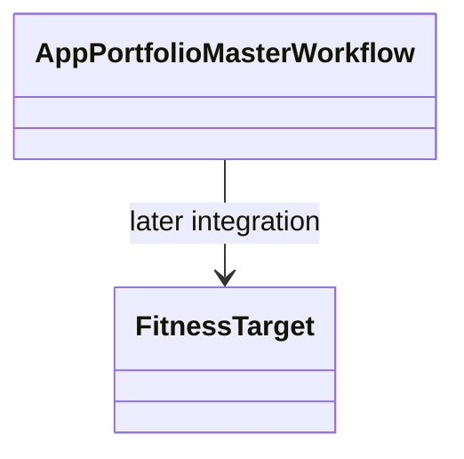

# AppPortfolioMaster — executable work orders



- **Primary Role:** Configure portfolio fitness/search using shared portfolio calculations.
- **Dependencies:** AppCore portfolio/correlation contracts; AppDataManager data; AppPortfolioComposer outputs.
- **Outputs / Downstream Role:** Search candidates, selected portfolios and recorded fitness decisions.
- **Execution boundary:** each READY work order is one tested commit. A BLOCKED work order authorizes no code, placeholder endpoint, UI success state or feature-completion claim. Source evidence below does not authorize choosing missing behavior.
- **Baseline:** `f5c7d12d5715b8ebee55165b8eddad9068f83cb9`; normative work orders; owner review pending. Implementation status belongs only in the domain README.
- **Shared response contract:** canonical response definitions live in `app/core/lib/responses.py`, which retains both `StandardResponse.success(*, message, metadata, data)` / `StandardResponse.failure(*, message, metadata, error)` with `ResponseMetadata` / `StandardError`, and the WO-C02 instance envelope `StandardResponse[T](request_id=..., data=..., revision=...)`. Preserve the existing form for migrated callers; use the instance envelope only where the specific work order requires it. `app/host/response.py` is a historical locator. Any conversion must be explicit at the named host/client boundary; do not remove existing helpers or introduce a third response contract. Pure helpers return their declared values.
- **Path rule:** CREATE paths are exact. No one-file-per-Java-class port, sibling workspace import, copied core engine or alternative file name is allowed.


## Source reassessment — 2026-10-30

The [workspace source audit](research/workspaces-09-19-source-review.md) lists newly available implementation files for every blocked feature below. Read that module record with the order. Library availability does not supply missing plugin routes, target integration contracts or numerical fixtures. The original execution boundary remains in effect except for explicitly revised bounded orders.

## Current-code migration audit and execution order

*Evidence:* `OBS-HARU-PM-REUSE-20261029`. This audit concerns migration suitability; domain README files remain the only implementation-status authority. The source files below are existing code, not permission to regenerate their components. Backend directories `app/workspace/portfolio_master/` do not currently exist; a complete backend cannot be marked Direct fit from the React screen.

### Work order PM-M01: move the existing presentation as one revertible commit

*Feature:* Reuse the current workspace and its owned result/settings contributions without inventing a second UI. **READY after the app/web bootstrap and public host/result slot contracts are published.**
*Context to Read:* this order; every current source/test row below; `ui/package.json`; `ui/tsconfig.json`; `ui/vite.config.ts`; `app/web/workspaces/home/public.ts`; `app/web/workspaces/results/public.ts`. For Results itself, CREATE its `public.ts` as an export boundary only; export only the existing ProjectResults contribution types after Home owns their base slot type. Do not create a different shell.
*Implementation Files:* exact MOVE/ADAPT targets in the table; EDIT only the corresponding existing application route import and workspace registration to use the new entry component. No backend calculation code is authorized by this migration order.

| Current HaruQuantAI location | Target proposed location | Fit / action (migration audit) |
|---|---|---|
| `ui/app/workspace/PortfolioMaster/PortfolioMasterDialogs.tsx` | `app/web/workspaces/portfolio_master/PortfolioMasterDialogs.tsx` | DIRECT FIT for presentation; move with local imports rewritten; source parity and backend behavior remain separately qualified |
| `ui/app/workspace/PortfolioMaster/portfolioMasterFixtures.ts` | `app/web/tests/workspaces/portfolio_master/fixtures/portfolioMasterFixtures.ts` | TEST-ONLY: move to fixtures; remove production imports during service integration |
| `ui/app/workspace/PortfolioMaster/portfolioMasterModel.ts` | `app/web/workspaces/portfolio_master/portfolioMasterModel.ts` | ADAPT: retain pure draft operations; preview serialization/defaults are not SQX persistence or engine settings |
| `ui/app/workspace/PortfolioMaster/PortfolioMasterProgress.tsx` | `app/web/workspaces/portfolio_master/PortfolioMasterProgress.tsx` | ADAPT: reuse layout; replace timer/mock metrics with owned run/result projection |
| `ui/app/workspace/PortfolioMaster/PortfolioMasterSettings.tsx` | `app/web/workspaces/portfolio_master/PortfolioMasterSettings.tsx` | DIRECT FIT for presentation; move with local imports rewritten; source parity and backend behavior remain separately qualified |
| `ui/app/workspace/PortfolioMaster/PortfolioMasterWorkspace.tsx` | `app/web/workspaces/portfolio_master/PortfolioMasterWorkspace.tsx` | DIRECT FIT for presentation; move with local imports rewritten; source parity and backend behavior remain separately qualified |
| `ui/tests/unit/workspace/Portfolio/portfolioMaster.test.ts` | `app/web/tests/workspaces/portfolio_master/portfolioMaster.test.ts` | MOVE existing assertions unchanged; rewrite import paths only; this qualifies current preview behavior, not donor numerical parity |

*Functional Requirements & Implementation:*
- [ ] `PortfolioMasterWorkspace()` -> Retain component exports, props, rendered labels, keyboard actions, cancellation/unmount cleanup and CSS behavior from each current source row. Rewrite relative imports to the table targets. Consume shared Home and Results through their `public.ts` exports; do not import another workspace's private module or copy ProjectWorkbench.
- [ ] `PortfolioMasterWorkspace()` -> Keep fixture/timer execution explicitly in the existing preview mode until its replacement service work order passes. Moving a screen does not authorize reporting a generated strategy, finished retest, optimized parameter or saved portfolio as a real backend result. The current clients using fixed RSI/demoInputs and `/executions` are adaptation candidates, not verified workspace APIs.
- [ ] `migration import guard` -> Run `rg -n 'ui/app/workspace/PortfolioMaster|plugins/project/ProjectWorkbench' app/web/workspaces/portfolio_master`. Expected exit `1` and no lines. Rewrite migrated tests to their exact target imports; preserve current assertions and test names.
- [ ] `existing tests` -> Before moving, run `npm --prefix ui test -- tests/unit/workspace/PortfolioMaster` (Portfolio Master uses `tests/unit/workspace/Portfolio/portfolioMaster.test.ts`). After moving run `npm --prefix app/web test -- tests/workspaces/portfolio_master` then `npm --prefix app/web run typecheck` then `npm --prefix app/web run build`; all must exit `0`. These commands prove migration behavior only. Record executed command, UTC timestamp and counts in the owner README when actually executed; this order does not mark future validation passed.
*Commit:* `refactor(portfolio-master): move owned workspace presentation`. This single commit includes only the listed moves, direct import rewrites and registration change. UI integration work is separate from implementing donor engines.

*Shared results ownership:* ProjectResults and all Results* contribution implementations are owned by AppResults. Builder, Retester, Optimizer and portfolio workspaces register configured contributions; none gets a private copy of trade lists, overview, source-code rendering, correlation or shared engine progress. Shared base workbench remains AppHome.


```json
{
  "id": "OBS-HARU-PM-REUSE-20261029",
  "classification": "observed",
  "confidence": "high",
  "claim": "Current PortfolioMaster presentation exists and can be relocated; its README and inspected handlers distinguish preview behavior from backend integration.",
  "sources": [
    {
      "path": "ui/app/workspace/PortfolioMaster/README.md",
      "sha256": "afbb3193d68a41b700b574e88ef455d67ee42c377226011578113767381782f4"
    }
  ],
  "target_domain": "app/workspaces/portfolio_master",
  "feature_ids": [
    "FEAT-UI-PORTFOLIO_MASTER_WORKSPACE"
  ],
  "requirement_ids": [],
  "decision_ids": [],
  "registration_gap": "Register missing FR/DEC IDs in the owning domain README before production implementation; this planning task does not edit registries.",
  "limitations": "Passing current UI tests establishes local preview behavior only. This record does not certify complete donor coverage, numerical parity, native archive compatibility or production service integration.",
  "validation": {
    "status": "passed",
    "executed_at": "2026-10-29T10:13:19.769410+00:00",
    "procedure": "Read the existing runtime files, clients and README listed in the migration table. Run the focused current-workspace UI tests in the combined 13-file/72-test command.",
    "expected_observation": "13 focused UI test files, 72 tests passed; Builder/Retester/Optimizer clients and Composer/Master timers still operate on preview inputs.",
    "actual_observation": "13 focused UI test files, 72 tests passed; Builder/Retester/Optimizer clients and Composer/Master timers still operate on preview inputs.",
    "artifacts": [
      "ui/app/workspace/PortfolioMaster/README.md@sha256:afbb3193d68a41b700b574e88ef455d67ee42c377226011578113767381782f4"
    ]
  },
  "repository_commit": "f5c7d12d5715b8ebee55165b8eddad9068f83cb9",
  "review_state": "source-inspected-owner-review-pending",
  "contains_proprietary_source": false,
  "contains_sensitive_data": false,
  "contains_personal_data": false,
  "paraphrased_behavior_only": true,
  "supersedes_records": [],
  "superseded_by": []
}
```

## Phase 1: directly specified behavior

### Work order PM-001: existing-portfolio fitness target state
*Feature:* Enable/disable the target field with the observed reset-to-zero behavior. **READY after test bootstrap.** This helper does not calculate fitness or optimize weights.
*Implementation Files:*
- **Donor:** `DONOR_REFERENCE_ROOT/internal/plugins/FitnessMethodExistingPortfolio/FitnessMethodExistingPortfolioCtrl.js` (`checkColumns`).
- **Backend CREATE:** `app/workspaces/portfolio_master/fitness_target.py`.
- **Frontend:** no file changed; the future fitness view model consumes the resulting target state.
- **Tests CREATE:** `tests/workspaces/portfolio_master/test_fitness_target.py`.
*Context to Read:* this feature text; the donor file above; `pyproject.toml`.
*Evidence ID:* `OBS-145-FITNESS-TARGET-001`. The approximate-type integer is injected; this task makes no assumption about its numeric donor value.
*Functional Requirements & Implementation:*
- [ ] `FitnessTarget.apply(*, value_type: int, approximate_type: int, target: float) -> TargetFieldState` -> Define a frozen/slotted dataclass with `enabled: bool` and `target: float`. Equal type integers produce `TargetFieldState(True, target)`; different integers produce `TargetFieldState(False, 0.0)`.
- [ ] `FitnessTarget.apply(...)` -> Require exact int types for the first two arguments, excluding bool, otherwise raise `TypeError("value_type and approximate_type must be integers")`; require `type(target) is float` otherwise raise `TypeError("target must be a float")`. These guards apply only to the typed helper boundary, not claimed donor validation.
- [ ] `TestFitnessTarget.test_target_state()` -> Assert `(value_type=7, approximate_type=7,target=12.5) -> (True,12.5)` and `(value_type=8,approximate_type=7,target=12.5) -> (False,0.0)`. The integer `7` is a fixture-injected constant. A second call after disabled state can re-enable with target `4.0` and returns a new state.
- [ ] `TestFitnessTarget.test_type_errors()` -> Assert `value_type=True` raises the first exact TypeError and `target=1` raises the second. Do not add fitness-score or weight validations in this helper.
*Done command:* `uv run python -m pytest tests/workspaces/portfolio_master/test_fitness_target.py -q` -> exit `0`; equal/different/re-enabled and two type-error cases pass.
*Commit:* `feat(portfolio-master): define fitness target-field state`. Only the two CREATE files belong in this commit.

## Phase 2: complete module scope — READY

Each module below is retained in full scope. Its proposed files are reserved names, not permission to fill missing semantics. The senior planner must issue a revised READY order with complete signatures, literals and expected results before an executor starts that module. No acceptance test command can prove an unspecified contract; therefore blocked modules have no implementation commit.

### `AppPortfolioMaster` — READY
*Feature:* Full `AppPortfolioMaster` behavior; this is not completed by the helper commit above.
*Implementation Files (reserved, no code authorized):*
- **Donor:** `DONOR_REFERENCE_ROOT/internal/plugins/AppPortfolioMaster`.
- **Backend:** `app/workspaces/portfolio_master/app_portfolio_master.py`.
- **Frontend:** `app/web/workspaces/portfolio_master/PortfolioMasterWorkspace.tsx`.
- **Backend tests:** `tests/workspaces/portfolio_master/test_app_portfolio_master.py`.
- **Frontend tests:** `app/web/tests/portfolio_master/AppPortfolioMaster.test.tsx`.
*Context to Read:* `DONOR_REFERENCE_ROOT/internal/plugins/AppPortfolioMaster/module.js`.
*Evidence and limit:* `OBS-145-FITNESS-TARGET-001` establishes only the READY behavior described above, not this module's full workflow. Literal frontend request vocabulary observed during this pass: No literal request action was established by the inspected frontend service declarations.
*Exact unresolved contract:* Complete settings/result schemas, model equations, capital/allocation/correlation semantics and independently calculated outputs are not locked; naming a conventional portfolio model does not establish its donor formula.
*Executor action:* do not create the reserved files, signatures, constants, schemas or test expectations for this module. Report this feature heading and the exact unresolved contract to the senior planner. Do not replace the missing contract with a conventional implementation.
*Release condition:* a later work order cites a verbatim behavior evidence ID for `AppPortfolioMaster`, fixes every input/output/default/error/persistence transition, provides numerical or state fixtures, and names test commands expected to exit `0`. A source directory or action-name list alone does not meet this condition.


*Source reassessment (2026-10-30):* [AppPortfolioMaster source record](research/workspaces-09-19-source-review.md#appportfoliomaster) identifies 1 matching readable Java files and 1 primary frontend/settings files. The record identifies readable plugin or explicitly related library sources; inspect their named methods instead of repeating source discovery. Matching a class name alone does not establish the complete plugin implementation. The remaining full-workflow contract and test prerequisites above still apply.

### `FitnessMethodExistingPortfolio` — READY
*Feature:* Full `FitnessMethodExistingPortfolio` behavior; this is not completed by the helper commit above.
*Implementation Files (reserved, no code authorized):*
- **Donor:** `DONOR_REFERENCE_ROOT/internal/plugins/FitnessMethodExistingPortfolio`.
- **Backend:** `app/workspaces/portfolio_master/fitness_method_existing_portfolio.py`.
- **Frontend:** `app/web/workspaces/portfolio_master/FitnessMethodExistingPortfolio.tsx`.
- **Backend tests:** `tests/workspaces/portfolio_master/test_fitness_method_existing_portfolio.py`.
- **Frontend tests:** `app/web/tests/portfolio_master/FitnessMethodExistingPortfolio.test.tsx`.
*Context to Read:* `DONOR_REFERENCE_ROOT/internal/plugins/FitnessMethodExistingPortfolio/FitnessMethodExistingPortfolioService.js`; `DONOR_REFERENCE_ROOT/internal/plugins/FitnessMethodExistingPortfolio/module.js`.
*Evidence and limit:* `OBS-145-FITNESS-TARGET-001` establishes only the READY behavior described above, not this module's full workflow. Literal frontend request vocabulary observed during this pass: `fitnessExistingPortfolio/list`
*Exact unresolved contract:* Exact metric expression, value-type mapping, weight normalization, missing-value policy and independently computed expected scores are not locked.
*Executor action:* do not create the reserved files, signatures, constants, schemas or test expectations for this module. Report this feature heading and the exact unresolved contract to the senior planner. Do not replace the missing contract with a conventional implementation.
*Release condition:* a later work order cites a verbatim behavior evidence ID for `FitnessMethodExistingPortfolio`, fixes every input/output/default/error/persistence transition, provides numerical or state fixtures, and names test commands expected to exit `0`. A source directory or action-name list alone does not meet this condition.


*Source reassessment (2026-10-30):* [FitnessMethodExistingPortfolio source record](research/workspaces-09-19-source-review.md#fitnessmethodexistingportfolio) identifies 2 matching readable Java files and 4 primary frontend/settings files. The record identifies readable plugin or explicitly related library sources; inspect their named methods instead of repeating source discovery. Matching a class name alone does not establish the complete plugin implementation. The remaining full-workflow contract and test prerequisites above still apply.

## Phase 3: concrete extension definition work orders — READY

### `PortfolioMasterFitness`

*Source reassessment (2026-10-30):* all three primary snippet bodies are readable at `DONOR_REFERENCE_ROOT/internal/extend/Snippets/SQ/PortfolioMasterFitness`. Their compute methods select precomputed portfolio statistics; they do not calculate NetProfit, stagnation or drawdown themselves. The bounded projection orders below resolve those selectors. Fitness normalization/formatting and integration remain separate from compute projection.
- **Context:** `DONOR_REFERENCE_ROOT/internal/extend/Snippets/SQ/PortfolioMasterFitness`; exact current definition count: 3.
- **Blocked reason:** no complete per-definition mapping of target filename, parameter schema, evaluation signature, formula/ordering, boundary behavior and golden fixture exists in this file. The executor is forbidden to choose these.
- **Senior release artifact required:** one work order per definition, with an exact Python file, `Class.method` signature, field/default/error literals and hand-calculated or independently observed test values. Do not register a stub catalogue or port Java classes mechanically.
- **Definition IDs to account for:** `NetProfit.java`, `PctStagnation.java`, `ReturnDD.java`.
### `CorrelationOf`

*Source reassessment (2026-10-30):* all six primary bodies are readable at `DONOR_REFERENCE_ROOT/internal/extend/Snippets/SQ/CorrelationOf`. `Loss.computePeriods` skips canceled orders, buckets by close time, requires an existing period and adds order.PL; its skip predicate is true only when both period values are nonnegative. Do not infer that it sums only negative trades from its name. Full category remains blocked on period/cancellation contracts and per-definition fixtures. This source gap is therefore contract integration, not encryption.
- **Context:** `DONOR_REFERENCE_ROOT/internal/extend/Snippets/SQ/CorrelationOf`; exact current definition count: 6.
- **Blocked reason:** no complete per-definition mapping of target filename, parameter schema, evaluation signature, formula/ordering, boundary behavior and golden fixture exists in this file. The executor is forbidden to choose these.
- **Senior release artifact required:** one work order per definition, with an exact Python file, `Class.method` signature, field/default/error literals and hand-calculated or independently observed test values. Do not register a stub catalogue or port Java classes mechanically.
- **Definition IDs to account for:** `Loss.java`, `NumberOfClosedPositions.java`, `NumberOfClosedTrades.java`, `NumberOfOpenPositions.java`, `NumberOfOpenTrades.java`, `ProfitLoss.java`.

## Source-resolved portfolio metric selectors

The following three independent helper orders are READY after WO-C00. They specify compute projection only; normalization, display formatting, extension registration and portfolio construction are excluded. Each order is one commit. The target adapter supplies the already selected portfolio/Both/Money statistics for the requested sample. Missing-statistic lookup returns 0.0, matching `SQStats.getDouble`; no aggregation or division occurs in these selectors. The typed input is `Mapping[str, float]`, and the helper never mutates it.

### PM-METRIC-NetProfit - READY

*Source:* `DONOR_REFERENCE_ROOT/internal/extend/Snippets/SQ/PortfolioMasterFitness/NetProfit.java`; SHA-256 `4a415cb99cb056b97567fdace21bd5309c88c04db28e022875f537f85ffe8f66`. Also read `DONOR_REFERENCE_ROOT/internal/libs/tradinglib/StatsKey.java` and `SQStats.java#getDouble`.
*Create:* `app/extend/portfolio_master_fitness/net_profit.py`; `tests/extend/portfolio_master_fitness/test_net_profit.py`. The first selector commit may CREATE the empty package initializer; later commits reuse it.
*Contract:* `NetProfit.compute(stats: Mapping[str, float]) -> float` is a static method returning the numerical value of `NetProfit`, or 0.0 when that key is absent. Metadata and normalization are not instantiated here. Observed donor constructor metadata is name `Net Profit (Return)`, goal maximize, target 0, average range -10000..10000; these values are evidence for later registration, not invented clipping bounds on compute.
*Literal fixtures:* stats `{"NetProfit": 12.5}` returns 12.5; `{"NetProfit": -4.0}` returns -4.0; an empty mapping returns 0.0; another metric with value 99.0 does not substitute for the missing key. Assert the mapping remains unchanged. Preserve existing numeric nonfinite values internally; serialization retains its existing finite-value validation. No money/percent string formatting is tested or authorized.
*Acceptance:* `uv run python -m pytest tests/extend/portfolio_master_fitness/test_net_profit.py -q` exits 0 with all literal cases above. No actual portfolio or broker connection is needed.
*Commit:* `portfolio-master: select NetProfit fitness metric`. This is not acceptance of full I-FitnessMethodExistingPortfolio.

### PM-METRIC-PctStagnation - READY

*Source:* `DONOR_REFERENCE_ROOT/internal/extend/Snippets/SQ/PortfolioMasterFitness/PctStagnation.java`; SHA-256 `34bf2dafc2176904403658335ab5f23c6fbdb17a716e279cc3ffb22cb62d7713`. Also read `DONOR_REFERENCE_ROOT/internal/libs/tradinglib/StatsKey.java` and `SQStats.java#getDouble`.
*Create:* `app/extend/portfolio_master_fitness/pct_stagnation.py`; `tests/extend/portfolio_master_fitness/test_pct_stagnation.py`. The first selector commit may CREATE the empty package initializer; later commits reuse it.
*Contract:* `PctStagnation.compute(stats: Mapping[str, float]) -> float` is a static method returning the numerical value of `StagnationPct`, or 0.0 when that key is absent. Metadata and normalization are not instantiated here. Observed donor constructor metadata is name `% Stagnation`, goal minimize, target 0, average range 0..100; these values are evidence for later registration, not invented clipping bounds on compute.
*Literal fixtures:* stats `{"StagnationPct": 12.5}` returns 12.5; `{"StagnationPct": -4.0}` returns -4.0; an empty mapping returns 0.0; another metric with value 99.0 does not substitute for the missing key. Assert the mapping remains unchanged. Preserve existing numeric nonfinite values internally; serialization retains its existing finite-value validation. No money/percent string formatting is tested or authorized.
*Acceptance:* `uv run python -m pytest tests/extend/portfolio_master_fitness/test_pct_stagnation.py -q` exits 0 with all literal cases above. No actual portfolio or broker connection is needed.
*Commit:* `portfolio-master: select StagnationPct fitness metric`. This is not acceptance of full I-FitnessMethodExistingPortfolio.

### PM-METRIC-ReturnDD - READY

*Source:* `DONOR_REFERENCE_ROOT/internal/extend/Snippets/SQ/PortfolioMasterFitness/ReturnDD.java`; SHA-256 `975da2d4f520a8f653cec54dc10a554f0c85e4b3be7aec5a5c1c716e5e958f07`. Also read `DONOR_REFERENCE_ROOT/internal/libs/tradinglib/StatsKey.java` and `SQStats.java#getDouble`.
*Create:* `app/extend/portfolio_master_fitness/return_dd.py`; `tests/extend/portfolio_master_fitness/test_return_dd.py`. The first selector commit may CREATE the empty package initializer; later commits reuse it.
*Contract:* `ReturnDD.compute(stats: Mapping[str, float]) -> float` is a static method returning the numerical value of `ReturnDDRatio`, or 0.0 when that key is absent. Metadata and normalization are not instantiated here. Observed donor constructor metadata is name `Return / Drawdown ratio`, goal maximize, target 0, average range -20..20; these values are evidence for later registration, not invented clipping bounds on compute.
*Literal fixtures:* stats `{"ReturnDDRatio": 12.5}` returns 12.5; `{"ReturnDDRatio": -4.0}` returns -4.0; an empty mapping returns 0.0; another metric with value 99.0 does not substitute for the missing key. Assert the mapping remains unchanged. Preserve existing numeric nonfinite values internally; serialization retains its existing finite-value validation. No money/percent string formatting is tested or authorized.
*Acceptance:* `uv run python -m pytest tests/extend/portfolio_master_fitness/test_return_dd.py -q` exits 0 with all literal cases above. No actual portfolio or broker connection is needed.
*Commit:* `portfolio-master: select ReturnDDRatio fitness metric`. This is not acceptance of full I-FitnessMethodExistingPortfolio.

## Embedded evidence

New evidence record; fields are retained verbatim for future supersession:

```json
{
  "id": "OBS-145-FITNESS-TARGET-001",
  "classification": "observed",
  "confidence": "high",
  "claim": "Existing-portfolio fitness controller enables target editing only for the approximate type; changing a row to another type disables target editing and sets its value to zero.",
  "sources": [
    {
      "path": "DONOR_REFERENCE_ROOT/internal/plugins/FitnessMethodExistingPortfolio/FitnessMethodExistingPortfolioCtrl.js",
      "sha256": "6fd8bdb5719e302bb8946ac6cb2d6553b51313870d172e21fe3798810251cef3"
    }
  ],
  "target_domain": "app/workspaces/portfolio_master",
  "feature_ids": [],
  "requirement_ids": [],
  "decision_ids": [],
  "registration_gap": "The evidence ID is established here; domain feature/requirement registration remains required before committing production code.",
  "limitations": "Direct current source observation. Helper types/names/type-error guards are target decisions; no underlying numerical or end-to-end workflow parity asserted.",
  "validation": {
    "status": "passed",
    "executed_at": "2026-10-29T09:19:49.839676+00:00",
    "procedure": "Read the named source functions and initial configuration blocks; compare every branch/literal used by the helper work order.",
    "expected_observation": "Existing-portfolio fitness controller enables target editing only for the approximate type; changing a row to another type disables target editing and sets its value to zero.",
    "actual_observation": "Existing-portfolio fitness controller enables target editing only for the approximate type; changing a row to another type disables target editing and sets its value to zero.",
    "artifacts": [
      "11-AppPortfolioMaster.md#embedded-evidence"
    ]
  },
  "repository_commit": "f5c7d12d5715b8ebee55165b8eddad9068f83cb9",
  "review_state": "source-inspected-owner-review-pending",
  "contains_proprietary_source": false,
  "contains_sensitive_data": false,
  "contains_personal_data": false,
  "paraphrased_behavior_only": true,
  "supersedes_records": [],
  "superseded_by": []
}
```
