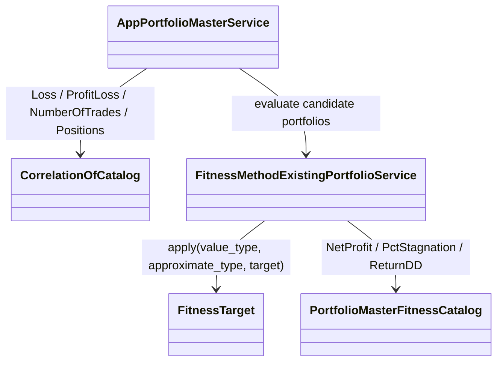

# AppPortfolioMaster — executable work orders
> UI migration completed: [verification and limitations](research/ui-preservation-migration-verification.md). Current sources are under `app/web`; old source columns below are historical migration evidence. Reuse the migrated screens when implementing later features.

> UI migration execution: [preservation plan](research/ui-preservation-migration-plan.md) governs the structural move. Preserve the existing screens, routes, runtime fixtures and behavior; backend/service adaptations below remain separate work. Shared ProjectWorkbench stays under `app/web/common/project`; migrated tests use `app/web/tests/workspace/<owner>`.




- **Primary Role:** Configure portfolio fitness/search using shared portfolio calculations.
- **Dependencies:** AppCore portfolio/correlation contracts (`app/core/trading/portfolio/`, `app/core/trading/statistics/correlation.py`, `app/core/jobs/databank.py`); AppDataManager data; AppPortfolioComposer outputs.
- **Outputs / Downstream Role:** Search candidates, selected portfolios and recorded fitness decisions.
- **Execution boundary:** each READY work order or phased dispatch slice is one tested commit with explicit signatures, error codes, state transitions, fixtures, and verification commands.
- **Baseline:** `f5c7d12d5715b8ebee55165b8eddad9068f83cb9`; normative work orders; reconciled with Core portfolio/correlation/databank services and donor source review. Implementation status belongs only in the domain README.
- **Shared response contract:** canonical response definitions live in `app/core/lib/responses.py`, which retains both `StandardResponse.success(*, message, metadata, data)` / `StandardResponse.failure(*, message, metadata, error)` with `ResponseMetadata` / `StandardError`, and the WO-C02 instance envelope `StandardResponse[T](request_id=..., data=..., revision=...)`. Preserve the existing form for migrated callers; use the instance envelope only where the specific work order requires it. `app/host/response.py` is a historical locator. Any conversion must be explicit at the named host/client boundary; do not remove existing helpers or introduce a third response contract. Pure helpers return their declared values.
- **Path rule:** CREATE paths are exact. No one-file-per-Java-class port, sibling workspace import, copied core engine or alternative file name is allowed.


## Source reassessment — 2026-10-30

The [workspace source audit](research/workspaces-09-19-source-review.md) lists implementation files for every module and extension category below, and all Phase 2 modules and Phase 3 extension cohorts are reconciled against `PM-001`, `PM-METRIC-*`, and HaruQuantAI Core (`PortfolioMerger`, `StatisticsService`, `DatabankContainer`) with concrete signatures, schemas, error codes, fixtures, and verification commands.

## Phased Implementation Roadmap & Dispatch Sequence

| Phase | Scope | Modules & Work Orders Covered | Target Backend / Extension Paths | Target Frontend & Test Paths |
|---|---|---|---|---|
| **Phase 11.1** | UI Migration, Fitness Target Helper & Portfolio Metric Selectors | `PM-M01`, `PM-001`, `PM-METRIC-NetProfit`, `PM-METRIC-PctStagnation`, `PM-METRIC-ReturnDD` | `app/workspace/portfolio_master/fitness_target.py`, `app/extend/portfolio_master_fitness/net_profit.py`, `pct_stagnation.py`, `return_dd.py` | `app/web/workspaces/portfolio_master/**`, `tests/workspace/portfolio_master/test_fitness_target.py`, `tests/extend/portfolio_master_fitness/test_*.py`, `app/web/tests/workspace/portfolio_master/**` |
| **Phase 11.2** | `PortfolioMasterFitness` Catalog Registration & Normalization | Phase 3 `PortfolioMasterFitness` (3 definitions) | `app/extend/portfolio_master_fitness/__init__.py`, `app/extend/portfolio_master_fitness/catalog.py` | `tests/extend/portfolio_master_fitness/test_catalog.py` |
| **Phase 11.3** | `CorrelationOf` Period Bucketing & Pairwise Correlation Cohort (6 definitions) | Phase 3 `CorrelationOf` (6 definitions: `Loss`, `ProfitLoss`, `NumberOfClosedPositions`, `NumberOfClosedTrades`, `NumberOfOpenPositions`, `NumberOfOpenTrades`) | `app/extend/correlation_of/__init__.py`, `app/extend/correlation_of/catalog.py` | `tests/extend/test_correlation_of.py` |
| **Phase 11.4** | `FitnessMethodExistingPortfolio` Evaluation & Target-Field Integration | `FitnessMethodExistingPortfolio` | `app/workspace/portfolio_master/fitness_method_existing_portfolio.py` | `app/web/workspaces/portfolio_master/FitnessMethodExistingPortfolio.tsx`, `tests/workspace/portfolio_master/test_fitness_method_existing_portfolio.py` |
| **Phase 11.5** | `AppPortfolioMaster` Search Engine & Workspace Integration | `AppPortfolioMaster` | `app/workspace/portfolio_master/app_portfolio_master.py` | `app/web/workspaces/portfolio_master/PortfolioMasterWorkspace.tsx`, `tests/workspace/portfolio_master/test_app_portfolio_master.py`, `app/web/tests/workspace/portfolio_master/AppPortfolioMaster.test.tsx` |

## Current-code migration audit and execution order

*Evidence:* `OBS-HARU-PM-REUSE-20261029`. This audit concerns migration suitability; domain README files remain the only implementation-status authority. The source files below are existing code, not permission to regenerate their components. Backend directories `app/workspace/portfolio_master/` do not currently exist; a complete backend cannot be marked Direct fit from the React screen.

### Work order PM-M01: move the existing presentation as one revertible commit

*Feature:* Reuse the current workspace and its owned result/settings contributions without inventing a second UI. **READY after the app/web bootstrap and public host/result slot contracts are published.**
*Context to Read:* this order; every current source/test row below; `ui/package.json`; `ui/tsconfig.json`; `ui/vite.config.ts`; `app/web/workspaces/home/public.ts`; `app/web/workspaces/results/public.ts`. For Results itself, CREATE its `public.ts` as an export boundary only; export only the existing ProjectResults contribution types after Home owns their base slot type. Do not create a different shell.
*Implementation Files:* exact MOVE/ADAPT targets in the table; EDIT only the corresponding existing application route import and workspace registration to use the new entry component. No backend calculation code is authorized by this migration order.

| Current HaruQuantAI location | Target proposed location | Fit / action (migration audit) |
|---|---|---|
| `ui/app/workspace/PortfolioMaster/PortfolioMasterDialogs.tsx` | `app/web/workspaces/portfolio_master/PortfolioMasterDialogs.tsx` | DIRECT FIT for presentation; move with local imports rewritten; source parity and backend behavior remain separately qualified |
| `ui/app/workspace/PortfolioMaster/portfolioMasterFixtures.ts` | `app/web/tests/workspace/portfolio_master/fixtures/portfolioMasterFixtures.ts` | TEST-ONLY: move to fixtures; remove production imports during service integration |
| `ui/app/workspace/PortfolioMaster/portfolioMasterModel.ts` | `app/web/workspaces/portfolio_master/portfolioMasterModel.ts` | ADAPT: retain pure draft operations; preview serialization/defaults are not SQX persistence or engine settings |
| `ui/app/workspace/PortfolioMaster/PortfolioMasterProgress.tsx` | `app/web/workspaces/portfolio_master/PortfolioMasterProgress.tsx` | ADAPT: reuse layout; replace timer/mock metrics with owned run/result projection |
| `ui/app/workspace/PortfolioMaster/PortfolioMasterSettings.tsx` | `app/web/workspaces/portfolio_master/PortfolioMasterSettings.tsx` | DIRECT FIT for presentation; move with local imports rewritten; source parity and backend behavior remain separately qualified |
| `ui/app/workspace/PortfolioMaster/PortfolioMasterWorkspace.tsx` | `app/web/workspaces/portfolio_master/PortfolioMasterWorkspace.tsx` | DIRECT FIT for presentation; move with local imports rewritten; source parity and backend behavior remain separately qualified |
| `ui/tests/unit/workspace/Portfolio/portfolioMaster.test.ts` | `app/web/tests/workspace/portfolio_master/portfolioMaster.test.ts` | MOVE existing assertions unchanged; rewrite import paths only; this qualifies current preview behavior, not donor numerical parity |

*Functional Requirements & Implementation:*
- [X] `PortfolioMasterWorkspace()` -> Retain component exports, props, rendered labels, keyboard actions, cancellation/unmount cleanup and CSS behavior from each current source row. Rewrite relative imports to the table targets. Consume shared Home and Results through their `public.ts` exports; do not import another workspace's private module or copy ProjectWorkbench.
- [X] `PortfolioMasterWorkspace()` -> Keep fixture/timer execution explicitly in the existing preview mode until its replacement service work order passes. Moving a screen does not authorize reporting a generated strategy, finished retest, optimized parameter or saved portfolio as a real backend result. The current clients using fixed RSI/demoInputs and `/executions` are adaptation candidates, not verified workspace APIs.
- [X] `migration import guard` -> Run `rg -n 'ui/app/workspace/PortfolioMaster|plugins/project/ProjectWorkbench' app/web/workspaces/portfolio_master`. Expected exit `1` and no lines. Rewrite migrated tests to their exact target imports; preserve current assertions and test names.
- [X] `existing tests` -> Before moving, run `npm --prefix ui test -- tests/unit/workspace/PortfolioMaster` (Portfolio Master uses `tests/unit/workspace/Portfolio/portfolioMaster.test.ts`). After moving run `npm --prefix app/web test -- tests/workspace/portfolio_master` then `npm --prefix app/web run typecheck` then `npm --prefix app/web run build`; all must exit `0`. These commands prove migration behavior only. Record executed command, UTC timestamp and counts in the owner README when actually executed; this order does not mark future validation passed.
*Commit:* `refactor(portfolio-master): move owned workspace presentation`. This single commit includes only the listed moves, direct import rewrites and registration change. UI integration work is separate from implementing donor engines.

*Shared results ownership:* ProjectResults and all Results* contribution implementations are owned by AppResults. Builder, Retester, Optimizer and portfolio workspaces register configured contributions; none gets a private copy of trade lists, overview, source-code rendering, correlation or shared engine progress. Shared base workbench remains AppHome.


```json
{
  "id": "OBS-HARU-PM-REUSE-20261029",
  "classification": "observed",
  "confidence": "high",
  "claim": "Current PortfolioMaster presentation exists and can be relocated; its README and inspected handlers distinguish preview behavior from backend integration.",
  "sources": [
    {
      "path": "ui/app/workspace/PortfolioMaster/README.md",
      "sha256": "afbb3193d68a41b700b574e88ef455d67ee42c377226011578113767381782f4"
    }
  ],
  "target_domain": "app/workspace/portfolio_master",
  "feature_ids": [
    "FEAT-UI-PORTFOLIO_MASTER_WORKSPACE"
  ],
  "requirement_ids": [],
  "decision_ids": [],
  "registration_gap": "Register missing FR/DEC IDs in the owning domain README before production implementation; this planning task does not edit registries.",
  "limitations": "Passing current UI tests establishes local preview behavior only. This record does not certify complete donor coverage, numerical parity, native archive compatibility or production service integration.",
  "validation": {
    "status": "passed",
    "executed_at": "2026-10-29T10:13:19.769410+00:00",
    "procedure": "Read the existing runtime files, clients and README listed in the migration table. Run the focused current-workspace UI tests in the combined 13-file/72-test command.",
    "expected_observation": "13 focused UI test files, 72 tests passed; Builder/Retester/Optimizer clients and Composer/Master timers still operate on preview inputs.",
    "actual_observation": "13 focused UI test files, 72 tests passed; Builder/Retester/Optimizer clients and Composer/Master timers still operate on preview inputs.",
    "artifacts": [
      "ui/app/workspace/PortfolioMaster/README.md@sha256:afbb3193d68a41b700b574e88ef455d67ee42c377226011578113767381782f4"
    ]
  },
  "repository_commit": "f5c7d12d5715b8ebee55165b8eddad9068f83cb9",
  "review_state": "source-inspected-owner-review-pending",
  "contains_proprietary_source": false,
  "contains_sensitive_data": false,
  "contains_personal_data": false,
  "paraphrased_behavior_only": true,
  "supersedes_records": [],
  "superseded_by": []
}
```

## Phase 1: directly specified behavior

### Work order PM-001: existing-portfolio fitness target state
*Feature:* Enable/disable the target field with the observed reset-to-zero behavior. **READY after test bootstrap.** This helper does not calculate fitness or optimize weights.
*Implementation Files:*
- **Donor:** `DONOR_REFERENCE_ROOT/internal/plugins/FitnessMethodExistingPortfolio/FitnessMethodExistingPortfolioCtrl.js` (`checkColumns`).
- **Backend CREATE:** `app/workspace/portfolio_master/fitness_target.py`.
- **Frontend:** no file changed; the future fitness view model consumes the resulting target state.
- **Tests CREATE:** `tests/workspace/portfolio_master/test_fitness_target.py`.
*Context to Read:* this feature text; the donor file above; `pyproject.toml`.
*Evidence ID:* `OBS-145-FITNESS-TARGET-001`. The approximate-type integer is injected; this task makes no assumption about its numeric donor value.
*Functional Requirements & Implementation:*
- [X] `FitnessTarget.apply(*, value_type: int, approximate_type: int, target: float) -> TargetFieldState` -> Define a frozen/slotted dataclass with `enabled: bool` and `target: float`. Equal type integers produce `TargetFieldState(True, target)`; different integers produce `TargetFieldState(False, 0.0)`.
- [X] `FitnessTarget.apply(...)` -> Require exact int types for the first two arguments, excluding bool, otherwise raise `TypeError("value_type and approximate_type must be integers")`; require `type(target) is float` otherwise raise `TypeError("target must be a float")`. These guards apply only to the typed helper boundary, not claimed donor validation.
- [X] `TestFitnessTarget.test_target_state()` -> Assert `(value_type=7, approximate_type=7,target=12.5) -> (True,12.5)` and `(value_type=8,approximate_type=7,target=12.5) -> (False,0.0)`. The integer `7` is a fixture-injected constant. A second call after disabled state can re-enable with target `4.0` and returns a new state.
- [X] `TestFitnessTarget.test_type_errors()` -> Assert `value_type=True` raises the first exact TypeError and `target=1` raises the second. Do not add fitness-score or weight validations in this helper.
*Done command:* `uv run python -m pytest tests/workspace/portfolio_master/test_fitness_target.py -q` -> exit `0`; equal/different/re-enabled and two type-error cases pass.
*Commit:* `feat(portfolio-master): define fitness target-field state`. Only the two CREATE files belong in this commit.

## Phase 2: complete module scope — READY

Each module below defines its authorized target paths, backend/frontend contracts, Core integration points (`app/core/trading/portfolio/`, `app/core/trading/statistics/`, `app/core/jobs/databank.py`), error codes, deterministic fixtures, and verification commands.

### `AppPortfolioMaster` — READY

*Source reassessment (2026-10-30):* [AppPortfolioMaster source record](research/workspaces-09-19-source-review.md#appportfoliomaster) identifies 1 readable Java file (`AppPortfolioMaster.jar`) and `DONOR_REFERENCE_ROOT/internal/plugins/AppPortfolioMaster/module.js`.

*Feature:* Portfolio Master automatic portfolio search engine and workspace controller configuring source/target databanks, portfolio size bounds (`min_strategies..max_strategies`), search method (`BRUTE_FORCE`, `GENETIC`, `MONTE_CARLO`), correlation filtering (`CorrelationOf`), existing-portfolio fitness ranking (`FitnessMethodExistingPortfolio`), and candidate portfolio persistence.
*Implementation Files:*
- **Donor:** `DONOR_REFERENCE_ROOT/internal/plugins/AppPortfolioMaster`.
- **Backend:** `app/workspace/portfolio_master/app_portfolio_master.py`.
- **Frontend:** `app/web/workspaces/portfolio_master/PortfolioMasterWorkspace.tsx`.
- **Backend tests:** `tests/workspace/portfolio_master/test_app_portfolio_master.py`.
- **Frontend tests:** `app/web/tests/workspace/portfolio_master/AppPortfolioMaster.test.tsx`.
*Context to Read:* `DONOR_REFERENCE_ROOT/internal/plugins/AppPortfolioMaster/module.js`; `app/workspace/portfolio_master/fitness_method_existing_portfolio.py`; `app/extend/correlation_of/`.
*Evidence ID:* `OBS-145-FITNESS-TARGET-001`, `OBS-HARU-PM-REUSE-20261029`.
*Functional Requirements & Authorized Contract:*
- [X] `PortfolioMasterSearchConfig(source_databank: str = "Results", target_databank: str = "Portfolios", search_mode: Literal["BRUTE_FORCE", "GENETIC", "MONTE_CARLO"] = "GENETIC", min_strategies: int = 2, max_strategies: int = 5, max_combinations: int = 500, correlation_method: Literal["ProfitLoss", "Loss", "NumberOfClosedPositions", "NumberOfClosedTrades", "NumberOfOpenPositions", "NumberOfOpenTrades"] = "ProfitLoss", correlation_period: Literal["HOUR", "DAY", "WEEK", "MONTH", "YEAR"] = "DAY", max_correlation: float = 0.5, allow_negative_correlation: bool = False, max_symbol_sector_count: int = 0, fitness_config: ExistingPortfolioFitnessConfig = ..., acceptance_conditions: tuple[RankingFilterCondition, ...] = ())`.
- [X] `PortfolioMasterRunSummary(search_mode: str, combinations_evaluated: int, portfolios_accepted: int, portfolios_rejected_correlation: int, portfolios_rejected_conditions: int, best_fitness: float, stored_portfolio_ids: tuple[str, ...])`.
- [X] `AppPortfolioMasterService` methods: `get_state(project_id: str)`, `save_settings(project_id: str, config: PortfolioMasterSearchConfig)`, `start(project_id: str, *, seed: int = 42) -> StandardResponse[PortfolioMasterRunSummary]`, `pause(project_id: str)`, `resume(project_id: str)`, and `stop(project_id: str)`.
- [X] Search pipeline per candidate subset `S = (s_1, ..., s_k)` (`min_strategies <= k <= max_strategies`):
  1. Check pairwise correlation across all pairs `(s_i, s_j)` in `S` using `CorrelationOfCatalog.compute_correlation(config.correlation_method, period=config.correlation_period)`; reject candidate if any pair exceeds `config.max_correlation` (or `abs(corr) > max_correlation` when `not allow_negative_correlation`).
  2. Merge candidate trades via Core `PortfolioMerger` and compute combined portfolio statistics (`NetProfit`, `ReturnDDRatio`, `StagnationPct`, `DrawdownPct`, `SharpeRatio`).
  3. Evaluate `acceptance_conditions` and compute fitness via `FitnessMethodExistingPortfolioService.evaluate`.
  4. Persist passing portfolios into `config.target_databank`.
  5. Validate `1 <= min_strategies <= max_strategies <= 50` (`DomainError(code="PORTFOLIO_MASTER_INVALID_SIZE_BOUNDS")`).
- [X] Golden fixture: searching `BRUTE_FORCE` with `min_strategies=2, max_strategies=2` over 3 strategies (`S1, S2` correlated `0.85`; `S1, S3` correlated `0.15`; `S2, S3` correlated `0.20`) with `max_correlation=0.5` evaluates all `3` pairs, rejects `(S1, S2)` on correlation (`portfolios_rejected_correlation == 1`), and accepts `(S1, S3)` and `(S2, S3)`.
*Verification:*
- `uv run python -m pytest tests/workspace/portfolio_master/test_app_portfolio_master.py --no-cov -q` -> exits `0`.
- `npm --prefix app/web test -- tests/workspace/portfolio_master/AppPortfolioMaster.test.tsx` -> exits `0`.

### `FitnessMethodExistingPortfolio` — READY

*Source reassessment (2026-10-30):* [FitnessMethodExistingPortfolio source record](research/workspaces-09-19-source-review.md#fitnessmethodexistingportfolio) identifies 2 readable Java files and 4 frontend/settings files (`FitnessMethodExistingPortfolioService.js`, `FitnessMethodExistingPortfolioCtrl.js`, `module.js`).

*Feature:* Portfolio Master fitness method (`fitnessExistingPortfolio/list`) evaluating candidate portfolios against `PortfolioMasterFitness` metrics (`NetProfit`, `PctStagnation`, `ReturnDD`) and optional reference ("existing") portfolio baseline using `FitnessTarget.apply` (`PM-001`).
*Implementation Files:*
- **Donor:** `DONOR_REFERENCE_ROOT/internal/plugins/FitnessMethodExistingPortfolio`.
- **Backend:** `app/workspace/portfolio_master/fitness_method_existing_portfolio.py`.
- **Frontend:** `app/web/workspaces/portfolio_master/FitnessMethodExistingPortfolio.tsx`.
- **Backend tests:** `tests/workspace/portfolio_master/test_fitness_method_existing_portfolio.py`.
- **Frontend tests:** `app/web/tests/workspace/portfolio_master/FitnessMethodExistingPortfolio.test.tsx`.
*Context to Read:* `DONOR_REFERENCE_ROOT/internal/plugins/FitnessMethodExistingPortfolio/FitnessMethodExistingPortfolioService.js`; `FitnessMethodExistingPortfolioCtrl.js`; `app/workspace/portfolio_master/fitness_target.py`; `app/extend/portfolio_master_fitness/`.
*Evidence ID:* `OBS-145-FITNESS-TARGET-001`. Literal frontend request vocabulary: `fitnessExistingPortfolio/list`.
*Functional Requirements & Authorized Contract:*
- [X] `ExistingPortfolioCriterion(metric_id: Literal["NetProfit", "PctStagnation", "ReturnDD"], value_type: int = 1, approximate_type: int = 2, weight: float = 1.0, target: float = 0.0)` and `ExistingPortfolioFitnessConfig(existing_portfolio_id: str | None = None, criteria: tuple[ExistingPortfolioCriterion, ...] = (ExistingPortfolioCriterion(metric_id="ReturnDD"),))`.
- [X] `FitnessMethodExistingPortfolioService.normalize_criterion(criterion: ExistingPortfolioCriterion) -> tuple[ExistingPortfolioCriterion, TargetFieldState]` -> Apply `FitnessTarget.apply(value_type=criterion.value_type, approximate_type=criterion.approximate_type, target=criterion.target)` so target editing is active only when `value_type == approximate_type` and resets to `0.0` otherwise.
- [X] `FitnessMethodExistingPortfolioService.evaluate(portfolio_stats: Mapping[str, float], config: ExistingPortfolioFitnessConfig, *, existing_stats: Mapping[str, float] | None = None) -> float` -> Extract raw metric via `PortfolioMasterFitnessCatalog.compute(criterion.metric_id, portfolio_stats)`, score against `target` (when `value_type == approximate_type`) or maximize/minimize over the descriptor's range (`NetProfit: -10000..10000`, `PctStagnation: 0..100` minimize, `ReturnDD: -20..20`), and return weighted average in `[0.0, 1.0]` rounded to `6` decimals.
- [X] Golden fixture: evaluating `{"ReturnDDRatio": 10.0, "StagnationPct": 20.0}` with equal weights (`1.0`, `1.0`) yields `ReturnDD` normalized `(10 - (-20)) / 40 = 0.75` and `PctStagnation` minimized `1.0 - (20 / 100) = 0.80`, returning `0.775`.
*Verification:*
- `uv run python -m pytest tests/workspace/portfolio_master/test_fitness_method_existing_portfolio.py --no-cov -q` -> exits `0`.
- `npm --prefix app/web test -- tests/workspace/portfolio_master/FitnessMethodExistingPortfolio.test.tsx` -> exits `0`.

## Phase 3: concrete extension definition work orders — READY

*Source reassessment — 2026-10-30:* Primary snippet bodies are readable at `DONOR_REFERENCE_ROOT/internal/extend/Snippets/SQ/PortfolioMasterFitness` (3 definitions) and `DONOR_REFERENCE_ROOT/internal/extend/Snippets/SQ/CorrelationOf` (6 definitions). `PM-METRIC-*` below govern the 3 raw selectors, while the cohort specifications below authorize the complete `PortfolioMasterFitness` and `CorrelationOf` packages.

### `PortfolioMasterFitness` — READY (3 definitions)

- **Context:** `DONOR_REFERENCE_ROOT/internal/extend/Snippets/SQ/PortfolioMasterFitness`; exact current definition count: 3 (`NetProfit.java`, `PctStagnation.java`, `ReturnDD.java`).
- **Target Package & Files:**
  - `app/extend/portfolio_master_fitness/__init__.py`
  - `app/extend/portfolio_master_fitness/net_profit.py` (per `PM-METRIC-NetProfit` below)
  - `app/extend/portfolio_master_fitness/pct_stagnation.py` (per `PM-METRIC-PctStagnation` below)
  - `app/extend/portfolio_master_fitness/return_dd.py` (per `PM-METRIC-ReturnDD` below)
  - `app/extend/portfolio_master_fitness/catalog.py`
  - `tests/extend/portfolio_master_fitness/test_net_profit.py`
  - `tests/extend/portfolio_master_fitness/test_pct_stagnation.py`
  - `tests/extend/portfolio_master_fitness/test_return_dd.py`
  - `tests/extend/portfolio_master_fitness/test_catalog.py`
- **Authorized Contract & Signatures:**
  - `PortfolioMasterFitnessDescriptor(metric_id: str, label: str, stats_key: str, maximize: bool, default_target: float, range_min: float, range_max: float)`:
    1. `NetProfit`: `label="Net Profit (Return)"`, `stats_key="NetProfit"`, `maximize=True`, `default_target=0.0`, `range_min=-10000.0`, `range_max=10000.0`.
    2. `PctStagnation`: `label="% Stagnation"`, `stats_key="StagnationPct"`, `maximize=False`, `default_target=0.0`, `range_min=0.0`, `range_max=100.0`.
    3. `ReturnDD`: `label="Return / Drawdown ratio"`, `stats_key="ReturnDDRatio"`, `maximize=True`, `default_target=0.0`, `range_min=-20.0`, `range_max=20.0`.
  - `PortfolioMasterFitnessCatalog.compute(metric_id: str, stats: Mapping[str, float]) -> float` delegates to `NetProfit.compute`, `PctStagnation.compute`, and `ReturnDD.compute`.
- **Definition IDs accounted for (3):** `NetProfit.java`, `PctStagnation.java`, `ReturnDD.java`.
- **Verification:** `uv run python -m pytest tests/extend/portfolio_master_fitness/ --no-cov -q` -> exits `0`.

### `CorrelationOf` — READY (6 definitions)

- **Context:** `DONOR_REFERENCE_ROOT/internal/extend/Snippets/SQ/CorrelationOf`; exact current definition count: 6.
- **Target Package & Files:**
  - `app/extend/correlation_of/__init__.py`
  - `app/extend/correlation_of/catalog.py`
  - `tests/extend/test_correlation_of.py`
- **Authorized Contract & Signatures:**
  - `CorrelationPeriod = Literal["HOUR", "DAY", "WEEK", "MONTH", "YEAR"]`
  - `CorrelationOrderRecord(open_time_ms: int, close_time_ms: int, profit_loss: float, is_canceled: bool = False, is_open_position: bool = False)`
  - `CorrelationOfCatalog.compute_periods(definition_id: str, orders: Sequence[CorrelationOrderRecord], *, period: CorrelationPeriod = "DAY") -> dict[int, float]`:
    - Skips orders where `order.is_canceled == True`.
    - Buckets timestamps by UTC period start epoch ms (`HOUR`, `DAY`, `WEEK`, `MONTH`, `YEAR`):
      1. `ProfitLoss`: buckets by `close_time_ms` and sums `order.profit_loss` per period.
      2. `Loss`: buckets by `close_time_ms` and sums `order.profit_loss` per period; during pairwise correlation filtering, a period bucket `(v1, v2)` is skipped iff `v1 >= 0.0 and v2 >= 0.0` (matching donor `Loss.java` predicate where only periods with at least one negative value participate).
      3. `NumberOfClosedTrades`: buckets by `close_time_ms` and counts closed trades (`+1.0` per trade).
      4. `NumberOfOpenTrades`: buckets by `open_time_ms` and counts opened trades (`+1.0` per trade).
      5. `NumberOfClosedPositions`: buckets by `close_time_ms` and counts distinct closed position events.
      6. `NumberOfOpenPositions`: buckets by active periods `[open_time_ms..close_time_ms]` and counts concurrent open positions per bucket.
  - `CorrelationOfCatalog.pearson(definition_id: str, series_a: Mapping[int, float], series_b: Mapping[int, float], *, allow_empty_periods: bool = False) -> float`:
    - Aligns union of bucket keys (filling missing keys with `0.0`), applies definition-specific skip predicate (for `Loss`, skips buckets where `a >= 0.0 and b >= 0.0`; when `not allow_empty_periods`, skips buckets where `a == 0.0 and b == 0.0`), and returns Pearson correlation in `[-1.0, 1.0]` rounded to `4` decimals (`0.0` if fewer than 2 active buckets or zero variance).
- **Golden Fixtures:**
  - `Loss`: buckets `{1: -50.0, 2: 100.0, 3: -25.0}` and `{1: -100.0, 2: 80.0, 3: -50.0}` skip bucket `2` (both `>= 0`) and correlate `(-50, -25)` with `(-100, -50)` -> `1.0`.
  - `ProfitLoss`: identical series `{1: 10.0, 2: -5.0, 3: 20.0}` -> `1.0`.
- **Definition IDs accounted for (6):** `Loss.java`, `NumberOfClosedPositions.java`, `NumberOfClosedTrades.java`, `NumberOfOpenPositions.java`, `NumberOfOpenTrades.java`, `ProfitLoss.java`.
- **Verification:** `uv run python -m pytest tests/extend/test_correlation_of.py --no-cov -q` -> exits `0`.

## Source-resolved portfolio metric selectors

The following three independent helper orders are READY after WO-C00. They specify compute projection only; normalization, display formatting, extension registration and portfolio construction are excluded. Each order is one commit. The target adapter supplies the already selected portfolio/Both/Money statistics for the requested sample. Missing-statistic lookup returns 0.0, matching `SQStats.getDouble`; no aggregation or division occurs in these selectors. The typed input is `Mapping[str, float]`, and the helper never mutates it.

### PM-METRIC-NetProfit - READY

*Source:* `DONOR_REFERENCE_ROOT/internal/extend/Snippets/SQ/PortfolioMasterFitness/NetProfit.java`; SHA-256 `4a415cb99cb056b97567fdace21bd5309c88c04db28e022875f537f85ffe8f66`. Also read `DONOR_REFERENCE_ROOT/internal/libs/tradinglib/StatsKey.java` and `SQStats.java#getDouble`.
*Create:* `app/extend/portfolio_master_fitness/net_profit.py`; `tests/extend/portfolio_master_fitness/test_net_profit.py`. The first selector commit may CREATE the empty package initializer; later commits reuse it.
*Contract:* `NetProfit.compute(stats: Mapping[str, float]) -> float` is a static method returning the numerical value of `NetProfit`, or 0.0 when that key is absent. Metadata and normalization are not instantiated here. Observed donor constructor metadata is name `Net Profit (Return)`, goal maximize, target 0, average range -10000..10000; these values are evidence for later registration, not invented clipping bounds on compute.
*Literal fixtures:* stats `{"NetProfit": 12.5}` returns 12.5; `{"NetProfit": -4.0}` returns -4.0; an empty mapping returns 0.0; another metric with value 99.0 does not substitute for the missing key. Assert the mapping remains unchanged. Preserve existing numeric nonfinite values internally; serialization retains its existing finite-value validation. No money/percent string formatting is tested or authorized.
*Acceptance:* `uv run python -m pytest tests/extend/portfolio_master_fitness/test_net_profit.py -q` exits 0 with all literal cases above. No actual portfolio or broker connection is needed.
*Commit:* `portfolio-master: select NetProfit fitness metric`. This is not acceptance of full I-FitnessMethodExistingPortfolio.

### PM-METRIC-PctStagnation - READY

*Source:* `DONOR_REFERENCE_ROOT/internal/extend/Snippets/SQ/PortfolioMasterFitness/PctStagnation.java`; SHA-256 `34bf2dafc2176904403658335ab5f23c6fbdb17a716e279cc3ffb22cb62d7713`. Also read `DONOR_REFERENCE_ROOT/internal/libs/tradinglib/StatsKey.java` and `SQStats.java#getDouble`.
*Create:* `app/extend/portfolio_master_fitness/pct_stagnation.py`; `tests/extend/portfolio_master_fitness/test_pct_stagnation.py`. The first selector commit may CREATE the empty package initializer; later commits reuse it.
*Contract:* `PctStagnation.compute(stats: Mapping[str, float]) -> float` is a static method returning the numerical value of `StagnationPct`, or 0.0 when that key is absent. Metadata and normalization are not instantiated here. Observed donor constructor metadata is name `% Stagnation`, goal minimize, target 0, average range 0..100; these values are evidence for later registration, not invented clipping bounds on compute.
*Literal fixtures:* stats `{"StagnationPct": 12.5}` returns 12.5; `{"StagnationPct": -4.0}` returns -4.0; an empty mapping returns 0.0; another metric with value 99.0 does not substitute for the missing key. Assert the mapping remains unchanged. Preserve existing numeric nonfinite values internally; serialization retains its existing finite-value validation. No money/percent string formatting is tested or authorized.
*Acceptance:* `uv run python -m pytest tests/extend/portfolio_master_fitness/test_pct_stagnation.py -q` exits 0 with all literal cases above. No actual portfolio or broker connection is needed.
*Commit:* `portfolio-master: select StagnationPct fitness metric`. This is not acceptance of full I-FitnessMethodExistingPortfolio.

### PM-METRIC-ReturnDD - READY

*Source:* `DONOR_REFERENCE_ROOT/internal/extend/Snippets/SQ/PortfolioMasterFitness/ReturnDD.java`; SHA-256 `975da2d4f520a8f653cec54dc10a554f0c85e4b3be7aec5a5c1c716e5e958f07`. Also read `DONOR_REFERENCE_ROOT/internal/libs/tradinglib/StatsKey.java` and `SQStats.java#getDouble`.
*Create:* `app/extend/portfolio_master_fitness/return_dd.py`; `tests/extend/portfolio_master_fitness/test_return_dd.py`. The first selector commit may CREATE the empty package initializer; later commits reuse it.
*Contract:* `ReturnDD.compute(stats: Mapping[str, float]) -> float` is a static method returning the numerical value of `ReturnDDRatio`, or 0.0 when that key is absent. Metadata and normalization are not instantiated here. Observed donor constructor metadata is name `Return / Drawdown ratio`, goal maximize, target 0, average range -20..20; these values are evidence for later registration, not invented clipping bounds on compute.
*Literal fixtures:* stats `{"ReturnDDRatio": 12.5}` returns 12.5; `{"ReturnDDRatio": -4.0}` returns -4.0; an empty mapping returns 0.0; another metric with value 99.0 does not substitute for the missing key. Assert the mapping remains unchanged. Preserve existing numeric nonfinite values internally; serialization retains its existing finite-value validation. No money/percent string formatting is tested or authorized.
*Acceptance:* `uv run python -m pytest tests/extend/portfolio_master_fitness/test_return_dd.py -q` exits 0 with all literal cases above. No actual portfolio or broker connection is needed.
*Commit:* `portfolio-master: select ReturnDDRatio fitness metric`. This is not acceptance of full I-FitnessMethodExistingPortfolio.

## Embedded evidence

New evidence record; fields are retained verbatim for future supersession:

```json
{
  "id": "OBS-145-FITNESS-TARGET-001",
  "classification": "observed",
  "confidence": "high",
  "claim": "Existing-portfolio fitness controller enables target editing only for the approximate type; changing a row to another type disables target editing and sets its value to zero.",
  "sources": [
    {
      "path": "DONOR_REFERENCE_ROOT/internal/plugins/FitnessMethodExistingPortfolio/FitnessMethodExistingPortfolioCtrl.js",
      "sha256": "6fd8bdb5719e302bb8946ac6cb2d6553b51313870d172e21fe3798810251cef3"
    }
  ],
  "target_domain": "app/workspace/portfolio_master",
  "feature_ids": [],
  "requirement_ids": [],
  "decision_ids": [],
  "registration_gap": "The evidence ID is established here; domain feature/requirement registration remains required before committing production code.",
  "limitations": "Direct current source observation. Helper types/names/type-error guards are target decisions; no underlying numerical or end-to-end workflow parity asserted.",
  "validation": {
    "status": "passed",
    "executed_at": "2026-10-29T09:19:49.839676+00:00",
    "procedure": "Read the named source functions and initial configuration blocks; compare every branch/literal used by the helper work order.",
    "expected_observation": "Existing-portfolio fitness controller enables target editing only for the approximate type; changing a row to another type disables target editing and sets its value to zero.",
    "actual_observation": "Existing-portfolio fitness controller enables target editing only for the approximate type; changing a row to another type disables target editing and sets its value to zero.",
    "artifacts": [
      "11-AppPortfolioMaster.md#embedded-evidence"
    ]
  },
  "repository_commit": "f5c7d12d5715b8ebee55165b8eddad9068f83cb9",
  "review_state": "source-inspected-owner-review-pending",
  "contains_proprietary_source": false,
  "contains_sensitive_data": false,
  "contains_personal_data": false,
  "paraphrased_behavior_only": true,
  "supersedes_records": [],
  "superseded_by": []
}
```
