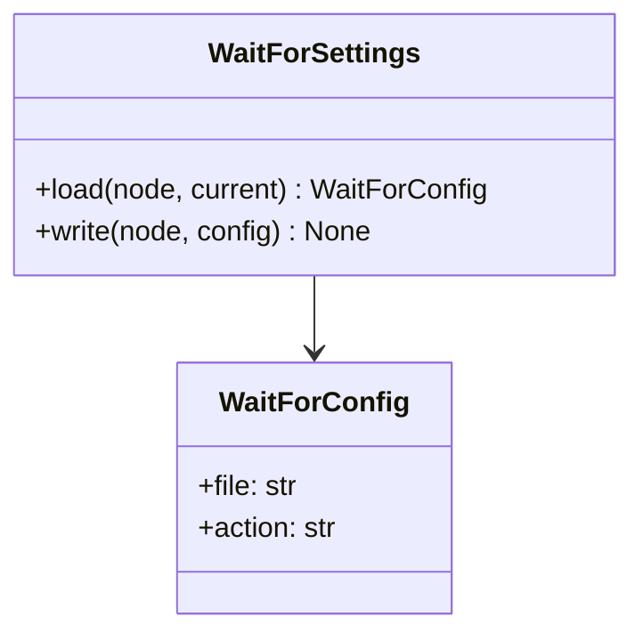

# AppTaskManager - feature work orders



- **Primary Role:** task graph composition and automation settings.
- **Dependencies:** each ready feature names its exact prerequisite order and files; no undeclared workspace import.
- **Outputs / Downstream Role:** the specified helper output only until the full workflow contracts below are made executable.
- **Commit rule:** one READY feature, one commit, only listed files. Blocked rows authorize no code or placeholder tests.

## Source reassessment — 2026-10-30

The [workspace source audit](research/workspaces-09-19-source-review.md) lists newly available implementation files for every blocked feature below. Read that module record with the order. Library availability does not supply missing plugin routes, target integration contracts or numerical fixtures. The original execution boundary remains in effect except for explicitly revised bounded orders.

## Phase 12.1: observed deterministic behavior

### `WaitForSettings` - WO-12-01 - READY after its named prerequisites

*Evidence IDs:* `OBS145-AppTaskManager-HELPER-001` (retained below).
*Context to Read:* `DONOR_REFERENCE_ROOT/internal/plugins/SettingsWaitFor/SettingsWaitForService.js`, `DONOR_REFERENCE_ROOT/internal/web/common` (resource folder; originally named `libs.js` is not present). Read only these donor files and the completed prerequisite files named in this order.

*Feature:* read/write the WaitFor settings element only; do not execute waits, poll a filesystem or schedule projects.
*Dependencies:* WO-C00 Python package foundation.
*Implementation Files:*
- **Backend Create:** `app/workspaces/task_manager/__init__.py` (empty), `app/workspaces/task_manager/wait_for_settings.py`.
- **Test Create:** `tests/workspaces/task_manager/test_wait_for_settings.py`.
- **Frontend:** none in this order; watcher/task integration is blocked.
*Types:* frozen/slotted `WaitForConfig(file: str = '', action: str = 'user')`; `Element` is xml.etree.ElementTree.Element. No enum coercion, stripping or filesystem access.
*Functional Requirements & Implementation:*
- [ ] `WaitForSettings.load(node: Element | None, current: WaitForConfig) -> WaitForConfig` -> static method. None returns current by identity. Otherwise read the first direct File and Action children; absent child or parsed empty child uses defaults `''` and `'user'`. Other text, including spaces/unknown action, is returned unchanged. Node tag itself is not validated here; caller supplies the WaitFor element.
- [ ] `WaitForSettings.write(node: Element, config: WaitForConfig) -> None` -> static method. In File-then-Action order update first matching direct child, or append if absent. Preserve existing child attributes and unrelated siblings, remove that child's nested children, and set text to the config string. No whole-element clear, XML string concatenation or new validation rule. A second duplicate named child is not modified.
- [ ] `test_wait_defaults_and_missing_parent()` -> parse `<WaitFor/>`, expect `WaitForConfig('', 'user')`; load None with current `WaitForConfig('old','file')` returns identical current object.
- [ ] `test_wait_preserves_text()` -> `<WaitFor><File> a&amp;b </File><Action>custom</Action></WaitFor>` produces file `' a&b '` and action `'custom'` without path normalization.
- [ ] `test_wait_write_preserves_attributes_and_siblings()` -> parse `<WaitFor><File unit="x"><Nested/></File><Extra>keep</Extra></WaitFor>`; write file `a&b`, action `file`; File retains unit x, has no child elements and text `a&b`; Extra remains keep; Action text file. After serialization/reparse load yields `WaitForConfig('a&b','file')`.
*Acceptance:* `uv run python -m pytest tests/workspaces/task_manager/test_wait_for_settings.py -q` exits 0 and collects three tests.
*Commit:* `task-manager: preserve WaitFor settings XML semantics`.

## Phase 12.2: complete workspace contribution - BLOCKED-NOT-EXECUTABLE

All 43 assigned plugin modules remain in scope. The helper above is not acceptance of these complete features. Reserved paths below are exact; do not create service stubs or infer signatures while a row is blocked.

### `AppTaskManager` - I-AppTaskManager - BLOCKED-NOT-EXECUTABLE

*Feature:* complete AppTaskManager workflow.
*Evidence IDs:* `OBS145-AppTaskManager-SCOPE-001` establishes source presence only; `OBS145-AppTaskManager-HELPER-001` establishes only the separately scoped helper.
*Implementation Files (reserved, no creation while blocked):*
- **Backend:** `app/workspaces/task_manager/app_task_manager.py`.
- **Models:** `app/workspaces/task_manager/app_task_manager_models.py`.
- **Frontend:** `app/web/workspaces/task_manager/TaskManagerWorkspace.tsx`.
- **Backend test:** `tests/workspaces/task_manager/test_app_task_manager.py`.
- **Frontend test:** `app/web/tests/workspaces/task_manager/AppTaskManagerPanel.test.tsx`.
- **Context to Read:** `DONOR_REFERENCE_ROOT/internal/plugins/AppTaskManager`, `DONOR_REFERENCE_ROOT/internal/plugins/AppTaskManager/module.js`.
*Observed action names (not a payload specification):* No literal client action extracted from this module; the specified class/view context must establish operations.
*Missing contract:* Complete project/task graph schemas, transition priority/loop semantics, storage/transaction/error contracts, and each user action mapping.
*Function/signature authorization:* none. No generic `execute(payload: dict)` or invented CRUD surface.
*Acceptance:* not yet executable. A revised order must name literal fixtures and methods before `uv run python -m pytest tests/workspaces/task_manager/test_app_task_manager.py -q` or `npm --prefix app/web test -- tests/workspaces/task_manager/AppTaskManagerPanel.test.tsx` can be acceptance. A zero-test/no-assertion pass is invalid.
*Commit boundary:* this one feature only after its order is READY; do not combine with the helper commit.


*Source reassessment (2026-10-30):* [AppTaskManager source record](research/workspaces-09-19-source-review.md#apptaskmanager) identifies 0 matching readable Java files and 1 primary frontend/settings files. No matching plugin Java body was found in the bounded library/recovered-source search. This may be a frontend-only contribution; review the listed UI handlers and actual backend dependencies before declaring a missing server.

### `ProjectConditionCyclesCount` - TM-COND-01 - BACKEND CONTRACT RESOLVED

*Feature:* evaluate this concrete project condition against an injected project/task counter snapshot; do not build another comparator or query browser state.
*Evidence ID:* `OBS145-TASK-CONDITIONS-002`. Defaults below are the primary UI field-descriptor defaults; source constructors alone do not seed them. Typed scalar snapshots are the Python adapter boundary. Serializing arbitrary incomplete donor XML is not part of this condition evaluator commit.
*Dependencies:* Core `ConditionComparator.validate` in `app/core/trading/conditions.py`; TM-COND-01 for subsequent orders; Core `format_duration_seconds` in `app/core/lib/time.py` for RuntimeCondition only.
*Implementation Files:*
- **Current HaruQuantAI Location:** no condition Python source exists under `app/workspace/custom_projects`; **Fit / Action:** Missing - create, not a move from bytecode cache.
- **Backend create:** `app/workspaces/task_manager/conditions/cycles.py`. Create `app/workspaces/task_manager/conditions/models.py` with frozen/slotted `ConditionCheck(met: bool, last_checked_value: str)`; subsequent condition orders reuse it.
- **Frontend:** no separate panel. Shared condition editor consumes the field descriptor; do not create five duplicate editors.
- **Backend test create:** `tests/workspaces/task_manager/conditions/test_cycles.py`.
- **Context to Read:** `DONOR_REFERENCE_ROOT/internal/plugins/ProjectConditionCyclesCount/CyclesCount/CyclesCountConditionPlugin.java` named condition class; `app/core/trading/conditions.py`; `app/workspaces/task_manager/conditions/models.py` when already created. Runtime also reads `app/core/lib/time.py`.
*Functional Requirements & Implementation:*
- [ ] `RunCyclesCondition.evaluate(run_cycles: int, *, comparator: str = '<', number: int = 100) -> ConditionCheck` -> static method; obtain actual value from the named argument, compute delta exactly as `((run_cycles - number + 2**31) % 2**32) - 2**31`, then call `ConditionComparator.validate(float(delta), comparator)` exactly once. Do not use Python eval, a second operator table or absolute tolerances.
- [ ] `RunCyclesCondition.evaluate(...)` -> return ConditionCheck with the comparator boolean and last_checked_value exactly `str(run_cycles)`. Counts supplied by the project engine are nonnegative signed32 counters; Runtime uses nonnegative signed64 elapsed milliseconds. Thresholds retain parsed signed32 values; do not clamp negative thresholds or use Python floor division for a negative elapsed input outside the declared contract.
- [ ] `TestRunCyclesCondition.test_boundaries()` -> run_cycles=99 -> True; 100 -> False; 101 -> False at defaults. Overflow fixture run_cycles=2147483647, number=-2147483648, comparator='>' -> False because wrapped delta is -1.
- [ ] `TestRunCyclesCondition.test_comparator_error()` -> comparator `!=` is delegated to the shared comparator and raises its exact `ValueError("Unknown comparator '!='")`; do not rewrite the message or convert it to a successful false value.
*Acceptance:* `uv run python -m pytest tests/workspaces/task_manager/conditions/test_cycles.py -q` exits0 with the listed boundary/display/error cases collected. No SQX application, database or wall clock is required.
*Commit:* `task-manager: implement cycles project condition`. Only named files belong to this one feature commit.

### `ProjectConditionGoToActivated` - TM-COND-02 - BACKEND CONTRACT RESOLVED

*Feature:* evaluate this concrete project condition against an injected project/task counter snapshot; do not build another comparator or query browser state.
*Evidence ID:* `OBS145-TASK-CONDITIONS-002`. Defaults below are the primary UI field-descriptor defaults; source constructors alone do not seed them. Typed scalar snapshots are the Python adapter boundary. Serializing arbitrary incomplete donor XML is not part of this condition evaluator commit.
*Dependencies:* Core `ConditionComparator.validate` in `app/core/trading/conditions.py`; TM-COND-01 for subsequent orders; Core `format_duration_seconds` in `app/core/lib/time.py` for RuntimeCondition only.
*Implementation Files:*
- **Current HaruQuantAI Location:** no condition Python source exists under `app/workspace/custom_projects`; **Fit / Action:** Missing - create, not a move from bytecode cache.
- **Backend create:** `app/workspaces/task_manager/conditions/go_to_activated.py`. Reuse ConditionCheck from the completed TM-COND-01 order; do not redeclare it.
- **Frontend:** no separate panel. Shared condition editor consumes the field descriptor; do not create five duplicate editors.
- **Backend test create:** `tests/workspaces/task_manager/conditions/test_go_to_activated.py`.
- **Context to Read:** `DONOR_REFERENCE_ROOT/internal/plugins/ProjectConditionGoToActivated/GoToActivated/GoToActivatedConditionPlugin.java` named condition class; `app/core/trading/conditions.py`; `app/workspaces/task_manager/conditions/models.py` when already created. Runtime also reads `app/core/lib/time.py`.
*Functional Requirements & Implementation:*
- [ ] `GoToActivatedCondition.evaluate(activated_cycles: int, *, comparator: str = '<', number: int = 100) -> ConditionCheck` -> static method; obtain actual value from the named argument, compute delta exactly as `float(activated_cycles) - float(number)`, then call `ConditionComparator.validate(float(delta), comparator)` exactly once. Do not use Python eval, a second operator table or absolute tolerances.
- [ ] `GoToActivatedCondition.evaluate(...)` -> return ConditionCheck with the comparator boolean and last_checked_value exactly `str(activated_cycles)`. Counts supplied by the project engine are nonnegative signed32 counters; Runtime uses nonnegative signed64 elapsed milliseconds. Thresholds retain parsed signed32 values; do not clamp negative thresholds or use Python floor division for a negative elapsed input outside the declared contract.
- [ ] `TestGoToActivatedCondition.test_boundaries()` -> activated_cycles=99 -> True; 100 -> False at defaults. At activated_cycles=2147483647, number=-2147483648, comparator='>' -> True because the subtraction is double precision, not int32 wrapping.
- [ ] `TestGoToActivatedCondition.test_comparator_error()` -> comparator `!=` is delegated to the shared comparator and raises its exact `ValueError("Unknown comparator '!='")`; do not rewrite the message or convert it to a successful false value.
*Acceptance:* `uv run python -m pytest tests/workspaces/task_manager/conditions/test_go_to_activated.py -q` exits0 with the listed boundary/display/error cases collected. No SQX application, database or wall clock is required.
*Commit:* `task-manager: implement go_to_activated project condition`. Only named files belong to this one feature commit.

### `ProjectConditionGoToEvaluated` - TM-COND-03 - BACKEND CONTRACT RESOLVED

*Feature:* evaluate this concrete project condition against an injected project/task counter snapshot; do not build another comparator or query browser state.
*Evidence ID:* `OBS145-TASK-CONDITIONS-002`. Defaults below are the primary UI field-descriptor defaults; source constructors alone do not seed them. Typed scalar snapshots are the Python adapter boundary. Serializing arbitrary incomplete donor XML is not part of this condition evaluator commit.
*Dependencies:* Core `ConditionComparator.validate` in `app/core/trading/conditions.py`; TM-COND-01 for subsequent orders; Core `format_duration_seconds` in `app/core/lib/time.py` for RuntimeCondition only.
*Implementation Files:*
- **Current HaruQuantAI Location:** no condition Python source exists under `app/workspace/custom_projects`; **Fit / Action:** Missing - create, not a move from bytecode cache.
- **Backend create:** `app/workspaces/task_manager/conditions/go_to_evaluated.py`. Reuse ConditionCheck from the completed TM-COND-01 order; do not redeclare it.
- **Frontend:** no separate panel. Shared condition editor consumes the field descriptor; do not create five duplicate editors.
- **Backend test create:** `tests/workspaces/task_manager/conditions/test_go_to_evaluated.py`.
- **Context to Read:** `DONOR_REFERENCE_ROOT/internal/plugins/ProjectConditionGoToEvaluated/GoToEvaluated/GoToEvaluatedConditionPlugin.java` named condition class; `app/core/trading/conditions.py`; `app/workspaces/task_manager/conditions/models.py` when already created. Runtime also reads `app/core/lib/time.py`.
*Functional Requirements & Implementation:*
- [ ] `GoToEvaluatedCondition.evaluate(evaluated_cycles: int, *, comparator: str = '<', number: int = 100) -> ConditionCheck` -> static method; obtain actual value from the named argument, compute delta exactly as `float(evaluated_cycles) - float(number)`, then call `ConditionComparator.validate(float(delta), comparator)` exactly once. Do not use Python eval, a second operator table or absolute tolerances.
- [ ] `GoToEvaluatedCondition.evaluate(...)` -> return ConditionCheck with the comparator boolean and last_checked_value exactly `str(evaluated_cycles)`. Counts supplied by the project engine are nonnegative signed32 counters; Runtime uses nonnegative signed64 elapsed milliseconds. Thresholds retain parsed signed32 values; do not clamp negative thresholds or use Python floor division for a negative elapsed input outside the declared contract.
- [ ] `TestGoToEvaluatedCondition.test_boundaries()` -> evaluated_cycles=99 -> True; 100 -> False at defaults. At evaluated_cycles=2147483647, number=-2147483648, comparator='>' -> True; no int32 delta wrapping.
- [ ] `TestGoToEvaluatedCondition.test_comparator_error()` -> comparator `!=` is delegated to the shared comparator and raises its exact `ValueError("Unknown comparator '!='")`; do not rewrite the message or convert it to a successful false value.
*Acceptance:* `uv run python -m pytest tests/workspaces/task_manager/conditions/test_go_to_evaluated.py -q` exits0 with the listed boundary/display/error cases collected. No SQX application, database or wall clock is required.
*Commit:* `task-manager: implement go_to_evaluated project condition`. Only named files belong to this one feature commit.

### `ProjectConditionResultsCount` - TM-COND-04 - BACKEND CONTRACT RESOLVED

*Feature:* evaluate this concrete project condition against an injected project/task counter snapshot; do not build another comparator or query browser state.
*Evidence ID:* `OBS145-TASK-CONDITIONS-002`. Defaults below are the primary UI field-descriptor defaults; source constructors alone do not seed them. Typed scalar snapshots are the Python adapter boundary. Serializing arbitrary incomplete donor XML is not part of this condition evaluator commit.
*Dependencies:* Core `ConditionComparator.validate` in `app/core/trading/conditions.py`; TM-COND-01 for subsequent orders; Core `format_duration_seconds` in `app/core/lib/time.py` for RuntimeCondition only.
*Implementation Files:*
- **Current HaruQuantAI Location:** no condition Python source exists under `app/workspace/custom_projects`; **Fit / Action:** Missing - create, not a move from bytecode cache.
- **Backend create:** `app/workspaces/task_manager/conditions/results.py`. Reuse ConditionCheck from the completed TM-COND-01 order; do not redeclare it.
- **Frontend:** no separate panel. Shared condition editor consumes the field descriptor; do not create five duplicate editors.
- **Backend test create:** `tests/workspaces/task_manager/conditions/test_results.py`.
- **Context to Read:** `DONOR_REFERENCE_ROOT/internal/plugins/ProjectConditionResultsCount/ResultsCount/ResultsCountConditionPlugin.java` named condition class; `app/core/trading/conditions.py`; `app/workspaces/task_manager/conditions/models.py` when already created. Runtime also reads `app/core/lib/time.py`.
*Functional Requirements & Implementation:*
- [ ] `ResultsCountCondition.evaluate(databank_counts: Mapping[str, int], *, comparator: str = '<', number: int = 100, databank: str = 'Results') -> ConditionCheck` -> static method; obtain actual value from the named argument, compute delta exactly as `((databank_counts[databank] - number + 2**31) % 2**32) - 2**31`, then call `ConditionComparator.validate(float(delta), comparator)` exactly once. Do not use Python eval, a second operator table or absolute tolerances.
- [ ] `ResultsCountCondition.evaluate(...)` -> return ConditionCheck with the comparator boolean and last_checked_value exactly `str(databank_counts[databank])`. Counts supplied by the project engine are nonnegative signed32 counters; Runtime uses nonnegative signed64 elapsed milliseconds. Thresholds retain parsed signed32 values; do not clamp negative thresholds or use Python floor division for a negative elapsed input outside the declared contract.
- [ ] `ResultsCountCondition.evaluate(...)` -> before accessing the count, reject an absent databank key with `ValueError("Databank <name> doesn't exist")`, substituting the exact name without quotes. Other dictionaries are not mutated. This is a Python exception-class adaptation of the observed source exception/message.
- [ ] `TestResultsCountCondition.test_boundaries()` -> databank_counts={'Results':99} -> True; 100 -> False at defaults. Missing databank M raises ValueError("Databank M doesn't exist"). With Results=2147483647, number=-2147483648, comparator='>' -> False.
- [ ] `TestResultsCountCondition.test_comparator_error()` -> comparator `!=` is delegated to the shared comparator and raises its exact `ValueError("Unknown comparator '!='")`; do not rewrite the message or convert it to a successful false value.
*Acceptance:* `uv run python -m pytest tests/workspaces/task_manager/conditions/test_results.py -q` exits0 with the listed boundary/display/error cases collected. No SQX application, database or wall clock is required.
*Commit:* `task-manager: implement results project condition`. Only named files belong to this one feature commit.

### `ProjectConditionRunTime` - TM-COND-05 - BACKEND CONTRACT RESOLVED

*Feature:* evaluate this concrete project condition against an injected project/task counter snapshot; do not build another comparator or query browser state.
*Evidence ID:* `OBS145-TASK-CONDITIONS-002`. Defaults below are the primary UI field-descriptor defaults; source constructors alone do not seed them. Typed scalar snapshots are the Python adapter boundary. Serializing arbitrary incomplete donor XML is not part of this condition evaluator commit.
*Dependencies:* Core `ConditionComparator.validate` in `app/core/trading/conditions.py`; TM-COND-01 for subsequent orders; Core `format_duration_seconds` in `app/core/lib/time.py` for RuntimeCondition only.
*Implementation Files:*
- **Current HaruQuantAI Location:** no condition Python source exists under `app/workspace/custom_projects`; **Fit / Action:** Missing - create, not a move from bytecode cache.
- **Backend create:** `app/workspaces/task_manager/conditions/runtime.py`. Reuse ConditionCheck from the completed TM-COND-01 order; do not redeclare it.
- **Frontend:** no separate panel. Shared condition editor consumes the field descriptor; do not create five duplicate editors.
- **Backend test create:** `tests/workspaces/task_manager/conditions/test_runtime.py`.
- **Context to Read:** `DONOR_REFERENCE_ROOT/internal/plugins/ProjectConditionRunTime/RunTime/RuntimeConditionPlugin.java` named condition class; `app/core/trading/conditions.py`; `app/workspaces/task_manager/conditions/models.py` when already created. Runtime also reads `app/core/lib/time.py`.
*Functional Requirements & Implementation:*
- [ ] `RuntimeCondition.evaluate(running_ms: int, *, comparator: str = '<', minutes: int = 120) -> ConditionCheck` -> static method; obtain actual value from the named argument, compute delta exactly as `((running_ms - minutes * 60000 + 2**63) % 2**64) - 2**63`, then call `ConditionComparator.validate(float(delta), comparator)` exactly once. Do not use Python eval, a second operator table or absolute tolerances.
- [ ] `RuntimeCondition.evaluate(...)` -> return ConditionCheck with the comparator boolean and last_checked_value exactly `format_duration_seconds(running_ms // 1000)`. Counts supplied by the project engine are nonnegative signed32 counters; Runtime uses nonnegative signed64 elapsed milliseconds. Thresholds retain parsed signed32 values; do not clamp negative thresholds or use Python floor division for a negative elapsed input outside the declared contract.
- [ ] `TestRuntimeCondition.test_boundaries()` -> running_ms=7199999 -> True; 7200000 -> False; 7200001 -> False at defaults. Displays: 0 -> '0s';59000 -> '59s';60000 -> '1m 0s';3600000 -> '1h 0m';86400000 -> '1d 0h 0m'.
- [ ] `TestRuntimeCondition.test_comparator_error()` -> comparator `!=` is delegated to the shared comparator and raises its exact `ValueError("Unknown comparator '!='")`; do not rewrite the message or convert it to a successful false value.
*Acceptance:* `uv run python -m pytest tests/workspaces/task_manager/conditions/test_runtime.py -q` exits0 with the listed boundary/display/error cases collected. No SQX application, database or wall clock is required.
*Commit:* `task-manager: implement runtime project condition`. Only named files belong to this one feature commit.

### `SettingsAdvancedTM` - I-SettingsAdvancedTM - BLOCKED-NOT-EXECUTABLE

*Feature:* complete SettingsAdvancedTM workflow.
*Evidence IDs:* `OBS145-AppTaskManager-SCOPE-001` establishes source presence only; `OBS145-AppTaskManager-HELPER-001` establishes only the separately scoped helper.
*Implementation Files (reserved, no creation while blocked):*
- **Backend:** `app/workspaces/task_manager/settings_advancedtm.py`.
- **Models:** `app/workspaces/task_manager/settings_advancedtm_models.py`.
- **Frontend:** `app/web/workspaces/task_manager/SettingsAdvancedTMPanel.tsx`.
- **Backend test:** `tests/workspaces/task_manager/test_settings_advancedtm.py`.
- **Frontend test:** `app/web/tests/workspaces/task_manager/SettingsAdvancedTMPanel.test.tsx`.
- **Context to Read:** `DONOR_REFERENCE_ROOT/internal/plugins/SettingsAdvancedTM/addNewExitPopup.html`, `DONOR_REFERENCE_ROOT/internal/plugins/SettingsAdvancedTM/advancedTM.html`, `DONOR_REFERENCE_ROOT/internal/plugins/SettingsAdvancedTM/AdvancedTMCtrl.js`.
*Observed action names (not a payload specification):* No literal client action extracted from this module; the specified class/view context must establish operations.
*Missing contract:* Every persisted field/default/type/bound, missing/empty rule, writer side effect and exact failure string for this settings editor; a module registration does not define its whole schema.
*Function/signature authorization:* none. No generic `execute(payload: dict)` or invented CRUD surface.
*Acceptance:* not yet executable. A revised order must name literal fixtures and methods before `uv run python -m pytest tests/workspaces/task_manager/test_settings_advancedtm.py -q` or `npm --prefix app/web test -- tests/workspaces/task_manager/SettingsAdvancedTMPanel.test.tsx` can be acceptance. A zero-test/no-assertion pass is invalid.
*Commit boundary:* this one feature only after its order is READY; do not combine with the helper commit.


*Source reassessment (2026-10-30):* [SettingsAdvancedTM source record](research/workspaces-09-19-source-review.md#settingsadvancedtm) identifies 0 matching readable Java files and 5 primary frontend/settings files. No matching plugin Java body was found in the bounded library/recovered-source search. This may be a frontend-only contribution; review the listed UI handlers and actual backend dependencies before declaring a missing server.

### `SettingsApplyMassConfig` - I-SettingsApplyMassConfig - BLOCKED-NOT-EXECUTABLE

*Feature:* complete SettingsApplyMassConfig workflow.
*Evidence IDs:* `OBS145-AppTaskManager-SCOPE-001` establishes source presence only; `OBS145-AppTaskManager-HELPER-001` establishes only the separately scoped helper.
*Implementation Files (reserved, no creation while blocked):*
- **Backend:** `app/workspaces/task_manager/settings_apply_mass_config.py`.
- **Models:** `app/workspaces/task_manager/settings_apply_mass_config_models.py`.
- **Frontend:** `app/web/workspaces/task_manager/SettingsApplyMassConfigPanel.tsx`.
- **Backend test:** `tests/workspaces/task_manager/test_settings_apply_mass_config.py`.
- **Frontend test:** `app/web/tests/workspaces/task_manager/SettingsApplyMassConfigPanel.test.tsx`.
- **Context to Read:** `DONOR_REFERENCE_ROOT/internal/plugins/SettingsApplyMassConfig/applyMassConfig.html`, `DONOR_REFERENCE_ROOT/internal/plugins/SettingsApplyMassConfig/ApplyMassConfigCtrl.js`, `DONOR_REFERENCE_ROOT/internal/plugins/SettingsApplyMassConfig/ApplyMassConfigService.js`.
*Observed action names (not a payload specification):* No literal client action extracted from this module; the specified class/view context must establish operations.
*Missing contract:* Every persisted field/default/type/bound, missing/empty rule, writer side effect and exact failure string for this settings editor; a module registration does not define its whole schema.
*Function/signature authorization:* none. No generic `execute(payload: dict)` or invented CRUD surface.
*Acceptance:* not yet executable. A revised order must name literal fixtures and methods before `uv run python -m pytest tests/workspaces/task_manager/test_settings_apply_mass_config.py -q` or `npm --prefix app/web test -- tests/workspaces/task_manager/SettingsApplyMassConfigPanel.test.tsx` can be acceptance. A zero-test/no-assertion pass is invalid.
*Commit boundary:* this one feature only after its order is READY; do not combine with the helper commit.


*Source reassessment (2026-10-30):* [SettingsApplyMassConfig source record](research/workspaces-09-19-source-review.md#settingsapplymassconfig) identifies 0 matching readable Java files and 4 primary frontend/settings files. No matching plugin Java body was found in the bounded library/recovered-source search. This may be a frontend-only contribution; review the listed UI handlers and actual backend dependencies before declaring a missing server.

### `SettingsAutomaticPortfolioBuilder` - I-SettingsAutomaticPortfolioBuilder - BLOCKED-NOT-EXECUTABLE

*Feature:* complete SettingsAutomaticPortfolioBuilder workflow.
*Evidence IDs:* `OBS145-AppTaskManager-SCOPE-001` establishes source presence only; `OBS145-AppTaskManager-HELPER-001` establishes only the separately scoped helper.
*Implementation Files (reserved, no creation while blocked):*
- **Backend:** `app/workspaces/task_manager/settings_automatic_portfolio_builder.py`.
- **Models:** `app/workspaces/task_manager/settings_automatic_portfolio_builder_models.py`.
- **Frontend:** `app/web/workspaces/task_manager/SettingsAutomaticPortfolioBuilderPanel.tsx`.
- **Backend test:** `tests/workspaces/task_manager/test_settings_automatic_portfolio_builder.py`.
- **Frontend test:** `app/web/tests/workspaces/task_manager/SettingsAutomaticPortfolioBuilderPanel.test.tsx`.
- **Context to Read:** `DONOR_REFERENCE_ROOT/internal/plugins/SettingsAutomaticPortfolioBuilder/automaticPortfolioBuilder.html`, `DONOR_REFERENCE_ROOT/internal/plugins/SettingsAutomaticPortfolioBuilder/AutomaticPortfolioBuilderCtrl.js`, `DONOR_REFERENCE_ROOT/internal/plugins/SettingsAutomaticPortfolioBuilder/AutomaticPortfolioBuilderService.js`.
*Observed action names (not a payload specification):* `/pmsettings/getNumberOfPossiblePortfolios`
*Missing contract:* Every persisted field/default/type/bound, missing/empty rule, writer side effect and exact failure string for this settings editor; a module registration does not define its whole schema.
*Function/signature authorization:* none. No generic `execute(payload: dict)` or invented CRUD surface.
*Acceptance:* not yet executable. A revised order must name literal fixtures and methods before `uv run python -m pytest tests/workspaces/task_manager/test_settings_automatic_portfolio_builder.py -q` or `npm --prefix app/web test -- tests/workspaces/task_manager/SettingsAutomaticPortfolioBuilderPanel.test.tsx` can be acceptance. A zero-test/no-assertion pass is invalid.
*Commit boundary:* this one feature only after its order is READY; do not combine with the helper commit.


*Source reassessment (2026-10-30):* [SettingsAutomaticPortfolioBuilder source record](research/workspaces-09-19-source-review.md#settingsautomaticportfoliobuilder) identifies 0 matching readable Java files and 6 primary frontend/settings files. No matching plugin Java body was found in the bounded library/recovered-source search. This may be a frontend-only contribution; review the listed UI handlers and actual backend dependencies before declaring a missing server.

### `SettingsAutomaticRetest` - I-SettingsAutomaticRetest - BLOCKED-NOT-EXECUTABLE

*Feature:* complete SettingsAutomaticRetest workflow.
*Evidence IDs:* `OBS145-AppTaskManager-SCOPE-001` establishes source presence only; `OBS145-AppTaskManager-HELPER-001` establishes only the separately scoped helper.
*Implementation Files (reserved, no creation while blocked):*
- **Backend:** `app/workspaces/task_manager/settings_automatic_retest.py`.
- **Models:** `app/workspaces/task_manager/settings_automatic_retest_models.py`.
- **Frontend:** `app/web/workspaces/task_manager/SettingsAutomaticRetestPanel.tsx`.
- **Backend test:** `tests/workspaces/task_manager/test_settings_automatic_retest.py`.
- **Frontend test:** `app/web/tests/workspaces/task_manager/SettingsAutomaticRetestPanel.test.tsx`.
- **Context to Read:** `DONOR_REFERENCE_ROOT/internal/plugins/SettingsAutomaticRetest/automaticRetest.html`, `DONOR_REFERENCE_ROOT/internal/plugins/SettingsAutomaticRetest/module.js`, `DONOR_REFERENCE_ROOT/internal/plugins/SettingsAutomaticRetest/SettingsAutomaticRetestCtrl.js`.
*Observed action names (not a payload specification):* No literal client action extracted from this module; the specified class/view context must establish operations.
*Missing contract:* Every persisted field/default/type/bound, missing/empty rule, writer side effect and exact failure string for this settings editor; a module registration does not define its whole schema.
*Function/signature authorization:* none. No generic `execute(payload: dict)` or invented CRUD surface.
*Acceptance:* not yet executable. A revised order must name literal fixtures and methods before `uv run python -m pytest tests/workspaces/task_manager/test_settings_automatic_retest.py -q` or `npm --prefix app/web test -- tests/workspaces/task_manager/SettingsAutomaticRetestPanel.test.tsx` can be acceptance. A zero-test/no-assertion pass is invalid.
*Commit boundary:* this one feature only after its order is READY; do not combine with the helper commit.


*Source reassessment (2026-10-30):* [SettingsAutomaticRetest source record](research/workspaces-09-19-source-review.md#settingsautomaticretest) identifies 0 matching readable Java files and 3 primary frontend/settings files. No matching plugin Java body was found in the bounded library/recovered-source search. This may be a frontend-only contribution; review the listed UI handlers and actual backend dependencies before declaring a missing server.

### `SettingsCallExternalScript` - I-SettingsCallExternalScript - BLOCKED-NOT-EXECUTABLE

*Feature:* complete SettingsCallExternalScript workflow.
*Evidence IDs:* `OBS145-AppTaskManager-SCOPE-001` establishes source presence only; `OBS145-AppTaskManager-HELPER-001` establishes only the separately scoped helper.
*Implementation Files (reserved, no creation while blocked):*
- **Backend:** `app/workspaces/task_manager/settings_call_external_script.py`.
- **Models:** `app/workspaces/task_manager/settings_call_external_script_models.py`.
- **Frontend:** `app/web/workspaces/task_manager/SettingsCallExternalScriptPanel.tsx`.
- **Backend test:** `tests/workspaces/task_manager/test_settings_call_external_script.py`.
- **Frontend test:** `app/web/tests/workspaces/task_manager/SettingsCallExternalScriptPanel.test.tsx`.
- **Context to Read:** `DONOR_REFERENCE_ROOT/internal/plugins/SettingsCallExternalScript/module.js`, `DONOR_REFERENCE_ROOT/internal/plugins/SettingsCallExternalScript/settingsCallExternalScript.html`, `DONOR_REFERENCE_ROOT/internal/plugins/SettingsCallExternalScript/CallExternalScript/SettingsCallExternalScript.java`.
*Observed action names (not a payload specification):* No literal client action extracted from this module; the specified class/view context must establish operations.
*Missing contract:* Every persisted field/default/type/bound, missing/empty rule, writer side effect and exact failure string for this settings editor; a module registration does not define its whole schema.
*Function/signature authorization:* none. No generic `execute(payload: dict)` or invented CRUD surface.
*Acceptance:* not yet executable. A revised order must name literal fixtures and methods before `uv run python -m pytest tests/workspaces/task_manager/test_settings_call_external_script.py -q` or `npm --prefix app/web test -- tests/workspaces/task_manager/SettingsCallExternalScriptPanel.test.tsx` can be acceptance. A zero-test/no-assertion pass is invalid.
*Commit boundary:* this one feature only after its order is READY; do not combine with the helper commit.


*Source reassessment (2026-10-30):* [SettingsCallExternalScript source record](research/workspaces-09-19-source-review.md#settingscallexternalscript) identifies 0 matching readable Java files and 4 primary frontend/settings files. No matching plugin Java body was found in the bounded library/recovered-source search. This may be a frontend-only contribution; review the listed UI handlers and actual backend dependencies before declaring a missing server.

### `SettingsClearDatabanks` - I-SettingsClearDatabanks - BLOCKED-NOT-EXECUTABLE

*Feature:* complete SettingsClearDatabanks workflow.
*Evidence IDs:* `OBS145-AppTaskManager-SCOPE-001` establishes source presence only; `OBS145-AppTaskManager-HELPER-001` establishes only the separately scoped helper.
*Implementation Files (reserved, no creation while blocked):*
- **Backend:** `app/workspaces/task_manager/settings_clear_databanks.py`.
- **Models:** `app/workspaces/task_manager/settings_clear_databanks_models.py`.
- **Frontend:** `app/web/workspaces/task_manager/SettingsClearDatabanksPanel.tsx`.
- **Backend test:** `tests/workspaces/task_manager/test_settings_clear_databanks.py`.
- **Frontend test:** `app/web/tests/workspaces/task_manager/SettingsClearDatabanksPanel.test.tsx`.
- **Context to Read:** `DONOR_REFERENCE_ROOT/internal/plugins/SettingsClearDatabanks/clearDatabanks.html`, `DONOR_REFERENCE_ROOT/internal/plugins/SettingsClearDatabanks/module.js`, `DONOR_REFERENCE_ROOT/internal/plugins/SettingsClearDatabanks/ClearDatabanks/SettingsFilteringPlugin.java`.
*Observed action names (not a payload specification):* No literal client action extracted from this module; the specified class/view context must establish operations.
*Missing contract:* Every persisted field/default/type/bound, missing/empty rule, writer side effect and exact failure string for this settings editor; a module registration does not define its whole schema.
*Function/signature authorization:* none. No generic `execute(payload: dict)` or invented CRUD surface.
*Acceptance:* not yet executable. A revised order must name literal fixtures and methods before `uv run python -m pytest tests/workspaces/task_manager/test_settings_clear_databanks.py -q` or `npm --prefix app/web test -- tests/workspaces/task_manager/SettingsClearDatabanksPanel.test.tsx` can be acceptance. A zero-test/no-assertion pass is invalid.
*Commit boundary:* this one feature only after its order is READY; do not combine with the helper commit.


*Source reassessment (2026-10-30):* [SettingsClearDatabanks source record](research/workspaces-09-19-source-review.md#settingscleardatabanks) identifies 0 matching readable Java files and 3 primary frontend/settings files. No matching plugin Java body was found in the bounded library/recovered-source search. This may be a frontend-only contribution; review the listed UI handlers and actual backend dependencies before declaring a missing server.

### `SettingsCreatePortfolio` - I-SettingsCreatePortfolio - BLOCKED-NOT-EXECUTABLE

*Feature:* complete SettingsCreatePortfolio workflow.
*Evidence IDs:* `OBS145-AppTaskManager-SCOPE-001` establishes source presence only; `OBS145-AppTaskManager-HELPER-001` establishes only the separately scoped helper.
*Implementation Files (reserved, no creation while blocked):*
- **Backend:** `app/workspaces/task_manager/settings_create_portfolio.py`.
- **Models:** `app/workspaces/task_manager/settings_create_portfolio_models.py`.
- **Frontend:** `app/web/workspaces/task_manager/SettingsCreatePortfolioPanel.tsx`.
- **Backend test:** `tests/workspaces/task_manager/test_settings_create_portfolio.py`.
- **Frontend test:** `app/web/tests/workspaces/task_manager/SettingsCreatePortfolioPanel.test.tsx`.
- **Context to Read:** `DONOR_REFERENCE_ROOT/internal/plugins/SettingsCreatePortfolio/module.js`, `DONOR_REFERENCE_ROOT/internal/plugins/SettingsCreatePortfolio/settingsCreatePortfolio.html`, `DONOR_REFERENCE_ROOT/internal/plugins/SettingsCreatePortfolio/CreatePortfolio/SettingsCreatePortfolio.java`.
*Observed action names (not a payload specification):* No literal client action extracted from this module; the specified class/view context must establish operations.
*Missing contract:* Every persisted field/default/type/bound, missing/empty rule, writer side effect and exact failure string for this settings editor; a module registration does not define its whole schema.
*Function/signature authorization:* none. No generic `execute(payload: dict)` or invented CRUD surface.
*Acceptance:* not yet executable. A revised order must name literal fixtures and methods before `uv run python -m pytest tests/workspaces/task_manager/test_settings_create_portfolio.py -q` or `npm --prefix app/web test -- tests/workspaces/task_manager/SettingsCreatePortfolioPanel.test.tsx` can be acceptance. A zero-test/no-assertion pass is invalid.
*Commit boundary:* this one feature only after its order is READY; do not combine with the helper commit.


*Source reassessment (2026-10-30):* [SettingsCreatePortfolio source record](research/workspaces-09-19-source-review.md#settingscreateportfolio) identifies 0 matching readable Java files and 4 primary frontend/settings files. No matching plugin Java body was found in the bounded library/recovered-source search. This may be a frontend-only contribution; review the listed UI handlers and actual backend dependencies before declaring a missing server.

### `SettingsCustomAnalysis` - I-SettingsCustomAnalysis - BLOCKED-NOT-EXECUTABLE

*Feature:* complete SettingsCustomAnalysis workflow.
*Evidence IDs:* `OBS145-AppTaskManager-SCOPE-001` establishes source presence only; `OBS145-AppTaskManager-HELPER-001` establishes only the separately scoped helper.
*Implementation Files (reserved, no creation while blocked):*
- **Backend:** `app/workspaces/task_manager/settings_custom_analysis.py`.
- **Models:** `app/workspaces/task_manager/settings_custom_analysis_models.py`.
- **Frontend:** `app/web/workspaces/task_manager/SettingsCustomAnalysisPanel.tsx`.
- **Backend test:** `tests/workspaces/task_manager/test_settings_custom_analysis.py`.
- **Frontend test:** `app/web/tests/workspaces/task_manager/SettingsCustomAnalysisPanel.test.tsx`.
- **Context to Read:** `DONOR_REFERENCE_ROOT/internal/plugins/SettingsCustomAnalysis/module.js`, `DONOR_REFERENCE_ROOT/internal/plugins/SettingsCustomAnalysis/settingsCustomAnalysis.html`, `DONOR_REFERENCE_ROOT/internal/plugins/SettingsCustomAnalysis/CustomAnalysis/CustomAnalysisPlugin.java`.
*Observed action names (not a payload specification):* No literal client action extracted from this module; the specified class/view context must establish operations.
*Missing contract:* Every persisted field/default/type/bound, missing/empty rule, writer side effect and exact failure string for this settings editor; a module registration does not define its whole schema.
*Function/signature authorization:* none. No generic `execute(payload: dict)` or invented CRUD surface.
*Acceptance:* not yet executable. A revised order must name literal fixtures and methods before `uv run python -m pytest tests/workspaces/task_manager/test_settings_custom_analysis.py -q` or `npm --prefix app/web test -- tests/workspaces/task_manager/SettingsCustomAnalysisPanel.test.tsx` can be acceptance. A zero-test/no-assertion pass is invalid.
*Commit boundary:* this one feature only after its order is READY; do not combine with the helper commit.


*Source reassessment (2026-10-30):* [SettingsCustomAnalysis source record](research/workspaces-09-19-source-review.md#settingscustomanalysis) identifies 0 matching readable Java files and 4 primary frontend/settings files. No matching plugin Java body was found in the bounded library/recovered-source search. This may be a frontend-only contribution; review the listed UI handlers and actual backend dependencies before declaring a missing server.

### `SettingsDeleteFile` - I-SettingsDeleteFile - BLOCKED-NOT-EXECUTABLE

*Feature:* complete SettingsDeleteFile workflow.
*Evidence IDs:* `OBS145-AppTaskManager-SCOPE-001` establishes source presence only; `OBS145-AppTaskManager-HELPER-001` establishes only the separately scoped helper.
*Implementation Files (reserved, no creation while blocked):*
- **Backend:** `app/workspaces/task_manager/settings_delete_file.py`.
- **Models:** `app/workspaces/task_manager/settings_delete_file_models.py`.
- **Frontend:** `app/web/workspaces/task_manager/SettingsDeleteFilePanel.tsx`.
- **Backend test:** `tests/workspaces/task_manager/test_settings_delete_file.py`.
- **Frontend test:** `app/web/tests/workspaces/task_manager/SettingsDeleteFilePanel.test.tsx`.
- **Context to Read:** `DONOR_REFERENCE_ROOT/internal/plugins/SettingsDeleteFile/module.js`, `DONOR_REFERENCE_ROOT/internal/plugins/SettingsDeleteFile/settingsDeleteFile.html`, `DONOR_REFERENCE_ROOT/internal/plugins/SettingsDeleteFile/DeleteFile/SettingsDeleteFile.java`.
*Observed action names (not a payload specification):* No literal client action extracted from this module; the specified class/view context must establish operations.
*Missing contract:* Every persisted field/default/type/bound, missing/empty rule, writer side effect and exact failure string for this settings editor; a module registration does not define its whole schema.
*Function/signature authorization:* none. No generic `execute(payload: dict)` or invented CRUD surface.
*Acceptance:* not yet executable. A revised order must name literal fixtures and methods before `uv run python -m pytest tests/workspaces/task_manager/test_settings_delete_file.py -q` or `npm --prefix app/web test -- tests/workspaces/task_manager/SettingsDeleteFilePanel.test.tsx` can be acceptance. A zero-test/no-assertion pass is invalid.
*Commit boundary:* this one feature only after its order is READY; do not combine with the helper commit.


*Source reassessment (2026-10-30):* [SettingsDeleteFile source record](research/workspaces-09-19-source-review.md#settingsdeletefile) identifies 0 matching readable Java files and 4 primary frontend/settings files. No matching plugin Java body was found in the bounded library/recovered-source search. This may be a frontend-only contribution; review the listed UI handlers and actual backend dependencies before declaring a missing server.

### `SettingsFiltering` - I-SettingsFiltering - BLOCKED-NOT-EXECUTABLE

*Feature:* complete SettingsFiltering workflow.
*Evidence IDs:* `OBS145-AppTaskManager-SCOPE-001` establishes source presence only; `OBS145-AppTaskManager-HELPER-001` establishes only the separately scoped helper.
*Implementation Files (reserved, no creation while blocked):*
- **Backend:** `app/workspaces/task_manager/settings_filtering.py`.
- **Models:** `app/workspaces/task_manager/settings_filtering_models.py`.
- **Frontend:** `app/web/workspaces/task_manager/SettingsFilteringPanel.tsx`.
- **Backend test:** `tests/workspaces/task_manager/test_settings_filtering.py`.
- **Frontend test:** `app/web/tests/workspaces/task_manager/SettingsFilteringPanel.test.tsx`.
- **Context to Read:** `DONOR_REFERENCE_ROOT/internal/plugins/SettingsFiltering/module.js`, `DONOR_REFERENCE_ROOT/internal/plugins/SettingsFiltering/settingsFiltering.html`, `DONOR_REFERENCE_ROOT/internal/plugins/SettingsFiltering/Filtering/SettingsFilteringPlugin.java`.
*Observed action names (not a payload specification):* No literal client action extracted from this module; the specified class/view context must establish operations.
*Missing contract:* Every persisted field/default/type/bound, missing/empty rule, writer side effect and exact failure string for this settings editor; a module registration does not define its whole schema.
*Function/signature authorization:* none. No generic `execute(payload: dict)` or invented CRUD surface.
*Acceptance:* not yet executable. A revised order must name literal fixtures and methods before `uv run python -m pytest tests/workspaces/task_manager/test_settings_filtering.py -q` or `npm --prefix app/web test -- tests/workspaces/task_manager/SettingsFilteringPanel.test.tsx` can be acceptance. A zero-test/no-assertion pass is invalid.
*Commit boundary:* this one feature only after its order is READY; do not combine with the helper commit.


*Source reassessment (2026-10-30):* [SettingsFiltering source record](research/workspaces-09-19-source-review.md#settingsfiltering) identifies 0 matching readable Java files and 4 primary frontend/settings files. No matching plugin Java body was found in the bounded library/recovered-source search. This may be a frontend-only contribution; review the listed UI handlers and actual backend dependencies before declaring a missing server.

### `SettingsGoToTask` - I-SettingsGoToTask - BLOCKED-NOT-EXECUTABLE

*Feature:* complete SettingsGoToTask workflow.
*Evidence IDs:* `OBS145-AppTaskManager-SCOPE-001` establishes source presence only; `OBS145-AppTaskManager-HELPER-001` establishes only the separately scoped helper.
*Implementation Files (reserved, no creation while blocked):*
- **Backend:** `app/workspaces/task_manager/settings_go_to_task.py`.
- **Models:** `app/workspaces/task_manager/settings_go_to_task_models.py`.
- **Frontend:** `app/web/workspaces/task_manager/SettingsGoToTaskPanel.tsx`.
- **Backend test:** `tests/workspaces/task_manager/test_settings_go_to_task.py`.
- **Frontend test:** `app/web/tests/workspaces/task_manager/SettingsGoToTaskPanel.test.tsx`.
- **Context to Read:** `DONOR_REFERENCE_ROOT/internal/plugins/SettingsGoToTask/module.js`, `DONOR_REFERENCE_ROOT/internal/plugins/SettingsGoToTask/settingsGoToTask.html`, `DONOR_REFERENCE_ROOT/internal/plugins/SettingsGoToTask/GoToTask/SettingsGoToTaskPlugin.java`.
*Observed action names (not a payload specification):* No literal client action extracted from this module; the specified class/view context must establish operations.
*Missing contract:* Every persisted field/default/type/bound, missing/empty rule, writer side effect and exact failure string for this settings editor; a module registration does not define its whole schema.
*Function/signature authorization:* none. No generic `execute(payload: dict)` or invented CRUD surface.
*Acceptance:* not yet executable. A revised order must name literal fixtures and methods before `uv run python -m pytest tests/workspaces/task_manager/test_settings_go_to_task.py -q` or `npm --prefix app/web test -- tests/workspaces/task_manager/SettingsGoToTaskPanel.test.tsx` can be acceptance. A zero-test/no-assertion pass is invalid.
*Commit boundary:* this one feature only after its order is READY; do not combine with the helper commit.


*Source reassessment (2026-10-30):* [SettingsGoToTask source record](research/workspaces-09-19-source-review.md#settingsgototask) identifies 0 matching readable Java files and 4 primary frontend/settings files. No matching plugin Java body was found in the bounded library/recovered-source search. This may be a frontend-only contribution; review the listed UI handlers and actual backend dependencies before declaring a missing server.

### `SettingsLoadFromFiles` - I-SettingsLoadFromFiles - BLOCKED-NOT-EXECUTABLE

*Feature:* complete SettingsLoadFromFiles workflow.
*Evidence IDs:* `OBS145-AppTaskManager-SCOPE-001` establishes source presence only; `OBS145-AppTaskManager-HELPER-001` establishes only the separately scoped helper.
*Implementation Files (reserved, no creation while blocked):*
- **Backend:** `app/workspaces/task_manager/settings_load_from_files.py`.
- **Models:** `app/workspaces/task_manager/settings_load_from_files_models.py`.
- **Frontend:** `app/web/workspaces/task_manager/SettingsLoadFromFilesPanel.tsx`.
- **Backend test:** `tests/workspaces/task_manager/test_settings_load_from_files.py`.
- **Frontend test:** `app/web/tests/workspaces/task_manager/SettingsLoadFromFilesPanel.test.tsx`.
- **Context to Read:** `DONOR_REFERENCE_ROOT/internal/plugins/SettingsLoadFromFiles/module.js`, `DONOR_REFERENCE_ROOT/internal/plugins/SettingsLoadFromFiles/settingsLoadFromFiles.html`, `DONOR_REFERENCE_ROOT/internal/plugins/SettingsLoadFromFiles/LoadFromFiles/SettingsLoadFromFiles.java`.
*Observed action names (not a payload specification):* No literal client action extracted from this module; the specified class/view context must establish operations.
*Missing contract:* Every persisted field/default/type/bound, missing/empty rule, writer side effect and exact failure string for this settings editor; a module registration does not define its whole schema.
*Function/signature authorization:* none. No generic `execute(payload: dict)` or invented CRUD surface.
*Acceptance:* not yet executable. A revised order must name literal fixtures and methods before `uv run python -m pytest tests/workspaces/task_manager/test_settings_load_from_files.py -q` or `npm --prefix app/web test -- tests/workspaces/task_manager/SettingsLoadFromFilesPanel.test.tsx` can be acceptance. A zero-test/no-assertion pass is invalid.
*Commit boundary:* this one feature only after its order is READY; do not combine with the helper commit.


*Source reassessment (2026-10-30):* [SettingsLoadFromFiles source record](research/workspaces-09-19-source-review.md#settingsloadfromfiles) identifies 0 matching readable Java files and 4 primary frontend/settings files. No matching plugin Java body was found in the bounded library/recovered-source search. This may be a frontend-only contribution; review the listed UI handlers and actual backend dependencies before declaring a missing server.

### `SettingsLogDatabankStats` - I-SettingsLogDatabankStats - BLOCKED-NOT-EXECUTABLE

*Feature:* complete SettingsLogDatabankStats workflow.
*Evidence IDs:* `OBS145-AppTaskManager-SCOPE-001` establishes source presence only; `OBS145-AppTaskManager-HELPER-001` establishes only the separately scoped helper.
*Implementation Files (reserved, no creation while blocked):*
- **Backend:** `app/workspaces/task_manager/settings_log_databank_stats.py`.
- **Models:** `app/workspaces/task_manager/settings_log_databank_stats_models.py`.
- **Frontend:** `app/web/workspaces/task_manager/SettingsLogDatabankStatsPanel.tsx`.
- **Backend test:** `tests/workspaces/task_manager/test_settings_log_databank_stats.py`.
- **Frontend test:** `app/web/tests/workspaces/task_manager/SettingsLogDatabankStatsPanel.test.tsx`.
- **Context to Read:** `DONOR_REFERENCE_ROOT/internal/plugins/SettingsLogDatabankStats/directives/logDatabankStatsType.html`, `DONOR_REFERENCE_ROOT/internal/plugins/SettingsLogDatabankStats/directives/LogDatabankStatsType.js`, `DONOR_REFERENCE_ROOT/internal/plugins/SettingsLogDatabankStats/directives/LogDatabankStatsTypeCtrl.js`.
*Observed action names (not a payload specification):* No literal client action extracted from this module; the specified class/view context must establish operations.
*Missing contract:* Every persisted field/default/type/bound, missing/empty rule, writer side effect and exact failure string for this settings editor; a module registration does not define its whole schema.
*Function/signature authorization:* none. No generic `execute(payload: dict)` or invented CRUD surface.
*Acceptance:* not yet executable. A revised order must name literal fixtures and methods before `uv run python -m pytest tests/workspaces/task_manager/test_settings_log_databank_stats.py -q` or `npm --prefix app/web test -- tests/workspaces/task_manager/SettingsLogDatabankStatsPanel.test.tsx` can be acceptance. A zero-test/no-assertion pass is invalid.
*Commit boundary:* this one feature only after its order is READY; do not combine with the helper commit.


*Source reassessment (2026-10-30):* [SettingsLogDatabankStats source record](research/workspaces-09-19-source-review.md#settingslogdatabankstats) identifies 0 matching readable Java files and 8 primary frontend/settings files. No matching plugin Java body was found in the bounded library/recovered-source search. This may be a frontend-only contribution; review the listed UI handlers and actual backend dependencies before declaring a missing server.

### `SettingsNotification` - I-SettingsNotification - BLOCKED-NOT-EXECUTABLE

*Feature:* complete SettingsNotification workflow.
*Evidence IDs:* `OBS145-AppTaskManager-SCOPE-001` establishes source presence only; `OBS145-AppTaskManager-HELPER-001` establishes only the separately scoped helper.
*Implementation Files (reserved, no creation while blocked):*
- **Backend:** `app/workspaces/task_manager/settings_notification.py`.
- **Models:** `app/workspaces/task_manager/settings_notification_models.py`.
- **Frontend:** `app/web/workspaces/task_manager/SettingsNotificationPanel.tsx`.
- **Backend test:** `tests/workspaces/task_manager/test_settings_notification.py`.
- **Frontend test:** `app/web/tests/workspaces/task_manager/SettingsNotificationPanel.test.tsx`.
- **Context to Read:** `DONOR_REFERENCE_ROOT/internal/plugins/SettingsNotification/module.js`, `DONOR_REFERENCE_ROOT/internal/plugins/SettingsNotification/settingsNotification.html`, `DONOR_REFERENCE_ROOT/internal/plugins/SettingsNotification`.
*Observed action names (not a payload specification):* No literal client action extracted from this module; the specified class/view context must establish operations.
*Missing contract:* Every persisted field/default/type/bound, missing/empty rule, writer side effect and exact failure string for this settings editor; a module registration does not define its whole schema.
*Function/signature authorization:* none. No generic `execute(payload: dict)` or invented CRUD surface.
*Acceptance:* not yet executable. A revised order must name literal fixtures and methods before `uv run python -m pytest tests/workspaces/task_manager/test_settings_notification.py -q` or `npm --prefix app/web test -- tests/workspaces/task_manager/SettingsNotificationPanel.test.tsx` can be acceptance. A zero-test/no-assertion pass is invalid.
*Commit boundary:* this one feature only after its order is READY; do not combine with the helper commit.


*Source reassessment (2026-10-30):* [SettingsNotification source record](research/workspaces-09-19-source-review.md#settingsnotification) identifies 0 matching readable Java files and 4 primary frontend/settings files. No matching plugin Java body was found in the bounded library/recovered-source search. This may be a frontend-only contribution; review the listed UI handlers and actual backend dependencies before declaring a missing server.

### `SettingsSaveToFiles` - I-SettingsSaveToFiles - BLOCKED-NOT-EXECUTABLE

*Feature:* complete SettingsSaveToFiles workflow.
*Evidence IDs:* `OBS145-AppTaskManager-SCOPE-001` establishes source presence only; `OBS145-AppTaskManager-HELPER-001` establishes only the separately scoped helper.
*Implementation Files (reserved, no creation while blocked):*
- **Backend:** `app/workspaces/task_manager/settings_save_to_files.py`.
- **Models:** `app/workspaces/task_manager/settings_save_to_files_models.py`.
- **Frontend:** `app/web/workspaces/task_manager/SettingsSaveToFilesPanel.tsx`.
- **Backend test:** `tests/workspaces/task_manager/test_settings_save_to_files.py`.
- **Frontend test:** `app/web/tests/workspaces/task_manager/SettingsSaveToFilesPanel.test.tsx`.
- **Context to Read:** `DONOR_REFERENCE_ROOT/internal/plugins/SettingsSaveToFiles/module.js`, `DONOR_REFERENCE_ROOT/internal/plugins/SettingsSaveToFiles/settingsSaveToFiles.html`, `DONOR_REFERENCE_ROOT/internal/plugins/SettingsSaveToFiles/SaveToFiles/SettingsSaveToFiles.java`.
*Observed action names (not a payload specification):* No literal client action extracted from this module; the specified class/view context must establish operations.
*Missing contract:* Every persisted field/default/type/bound, missing/empty rule, writer side effect and exact failure string for this settings editor; a module registration does not define its whole schema.
*Function/signature authorization:* none. No generic `execute(payload: dict)` or invented CRUD surface.
*Acceptance:* not yet executable. A revised order must name literal fixtures and methods before `uv run python -m pytest tests/workspaces/task_manager/test_settings_save_to_files.py -q` or `npm --prefix app/web test -- tests/workspaces/task_manager/SettingsSaveToFilesPanel.test.tsx` can be acceptance. A zero-test/no-assertion pass is invalid.
*Commit boundary:* this one feature only after its order is READY; do not combine with the helper commit.


*Source reassessment (2026-10-30):* [SettingsSaveToFiles source record](research/workspaces-09-19-source-review.md#settingssavetofiles) identifies 0 matching readable Java files and 4 primary frontend/settings files. No matching plugin Java body was found in the bounded library/recovered-source search. This may be a frontend-only contribution; review the listed UI handlers and actual backend dependencies before declaring a missing server.

### `SettingsStopAndStart` - I-SettingsStopAndStart - BLOCKED-NOT-EXECUTABLE

*Feature:* complete SettingsStopAndStart workflow.
*Evidence IDs:* `OBS145-AppTaskManager-SCOPE-001` establishes source presence only; `OBS145-AppTaskManager-HELPER-001` establishes only the separately scoped helper.
*Implementation Files (reserved, no creation while blocked):*
- **Backend:** `app/workspaces/task_manager/settings_stop_and_start.py`.
- **Models:** `app/workspaces/task_manager/settings_stop_and_start_models.py`.
- **Frontend:** `app/web/workspaces/task_manager/SettingsStopAndStartPanel.tsx`.
- **Backend test:** `tests/workspaces/task_manager/test_settings_stop_and_start.py`.
- **Frontend test:** `app/web/tests/workspaces/task_manager/SettingsStopAndStartPanel.test.tsx`.
- **Context to Read:** `DONOR_REFERENCE_ROOT/internal/plugins/SettingsStopAndStart/module.js`, `DONOR_REFERENCE_ROOT/internal/plugins/SettingsStopAndStart/settingsStopAndStart.html`, `DONOR_REFERENCE_ROOT/internal/plugins/SettingsStopAndStart/StopAndStart/SettingsStopAndStartPlugin.java`.
*Observed action names (not a payload specification):* No literal client action extracted from this module; the specified class/view context must establish operations.
*Missing contract:* Every persisted field/default/type/bound, missing/empty rule, writer side effect and exact failure string for this settings editor; a module registration does not define its whole schema.
*Function/signature authorization:* none. No generic `execute(payload: dict)` or invented CRUD surface.
*Acceptance:* not yet executable. A revised order must name literal fixtures and methods before `uv run python -m pytest tests/workspaces/task_manager/test_settings_stop_and_start.py -q` or `npm --prefix app/web test -- tests/workspaces/task_manager/SettingsStopAndStartPanel.test.tsx` can be acceptance. A zero-test/no-assertion pass is invalid.
*Commit boundary:* this one feature only after its order is READY; do not combine with the helper commit.


*Source reassessment (2026-10-30):* [SettingsStopAndStart source record](research/workspaces-09-19-source-review.md#settingsstopandstart) identifies 0 matching readable Java files and 4 primary frontend/settings files. No matching plugin Java body was found in the bounded library/recovered-source search. This may be a frontend-only contribution; review the listed UI handlers and actual backend dependencies before declaring a missing server.

### `SettingsUpdateData` - I-SettingsUpdateData - BLOCKED-NOT-EXECUTABLE

*Feature:* complete SettingsUpdateData workflow.
*Evidence IDs:* `OBS145-AppTaskManager-SCOPE-001` establishes source presence only; `OBS145-AppTaskManager-HELPER-001` establishes only the separately scoped helper.
*Implementation Files (reserved, no creation while blocked):*
- **Backend:** `app/workspaces/task_manager/settings_update_data.py`.
- **Models:** `app/workspaces/task_manager/settings_update_data_models.py`.
- **Frontend:** `app/web/workspaces/task_manager/SettingsUpdateDataPanel.tsx`.
- **Backend test:** `tests/workspaces/task_manager/test_settings_update_data.py`.
- **Frontend test:** `app/web/tests/workspaces/task_manager/SettingsUpdateDataPanel.test.tsx`.
- **Context to Read:** `DONOR_REFERENCE_ROOT/internal/plugins/SettingsUpdateData/module.js`, `DONOR_REFERENCE_ROOT/internal/plugins/SettingsUpdateData/settingsUpdateData.html`, `DONOR_REFERENCE_ROOT/internal/plugins/SettingsUpdateData/UpdateData/SettingsUpdateData.java`.
*Observed action names (not a payload specification):* No literal client action extracted from this module; the specified class/view context must establish operations.
*Missing contract:* Every persisted field/default/type/bound, missing/empty rule, writer side effect and exact failure string for this settings editor; a module registration does not define its whole schema.
*Function/signature authorization:* none. No generic `execute(payload: dict)` or invented CRUD surface.
*Acceptance:* not yet executable. A revised order must name literal fixtures and methods before `uv run python -m pytest tests/workspaces/task_manager/test_settings_update_data.py -q` or `npm --prefix app/web test -- tests/workspaces/task_manager/SettingsUpdateDataPanel.test.tsx` can be acceptance. A zero-test/no-assertion pass is invalid.
*Commit boundary:* this one feature only after its order is READY; do not combine with the helper commit.


*Source reassessment (2026-10-30):* [SettingsUpdateData source record](research/workspaces-09-19-source-review.md#settingsupdatedata) identifies 0 matching readable Java files and 4 primary frontend/settings files. No matching plugin Java body was found in the bounded library/recovered-source search. This may be a frontend-only contribution; review the listed UI handlers and actual backend dependencies before declaring a missing server.

### `SettingsWaitFor` - I-SettingsWaitFor - BLOCKED-NOT-EXECUTABLE

*Feature:* complete SettingsWaitFor workflow.
*Evidence IDs:* `OBS145-AppTaskManager-SCOPE-001` establishes source presence only; `OBS145-AppTaskManager-HELPER-001` establishes only the separately scoped helper.
*Implementation Files (reserved, no creation while blocked):*
- **Backend:** `app/workspaces/task_manager/settings_wait_for.py`.
- **Models:** `app/workspaces/task_manager/settings_wait_for_models.py`.
- **Frontend:** `app/web/workspaces/task_manager/SettingsWaitForPanel.tsx`.
- **Backend test:** `tests/workspaces/task_manager/test_settings_wait_for.py`.
- **Frontend test:** `app/web/tests/workspaces/task_manager/SettingsWaitForPanel.test.tsx`.
- **Context to Read:** `DONOR_REFERENCE_ROOT/internal/plugins/SettingsWaitFor/module.js`, `DONOR_REFERENCE_ROOT/internal/plugins/SettingsWaitFor/settingsWaitFor.html`, `DONOR_REFERENCE_ROOT/internal/plugins/SettingsWaitFor/WaitFor/SettingsWaitFor.java`.
*Observed action names (not a payload specification):* No literal client action extracted from this module; the specified class/view context must establish operations.
*Missing contract:* Every persisted field/default/type/bound, missing/empty rule, writer side effect and exact failure string for this settings editor; a module registration does not define its whole schema.
*Function/signature authorization:* none. No generic `execute(payload: dict)` or invented CRUD surface.
*Acceptance:* not yet executable. A revised order must name literal fixtures and methods before `uv run python -m pytest tests/workspaces/task_manager/test_settings_wait_for.py -q` or `npm --prefix app/web test -- tests/workspaces/task_manager/SettingsWaitForPanel.test.tsx` can be acceptance. A zero-test/no-assertion pass is invalid.
*Commit boundary:* this one feature only after its order is READY; do not combine with the helper commit.


*Source reassessment (2026-10-30):* [SettingsWaitFor source record](research/workspaces-09-19-source-review.md#settingswaitfor) identifies 0 matching readable Java files and 4 primary frontend/settings files. No matching plugin Java body was found in the bounded library/recovered-source search. This may be a frontend-only contribution; review the listed UI handlers and actual backend dependencies before declaring a missing server.

### `TaskApplyMassConfig` - I-TaskApplyMassConfig - BLOCKED-NOT-EXECUTABLE

*Feature:* complete TaskApplyMassConfig workflow.
*Evidence IDs:* `OBS145-AppTaskManager-SCOPE-001` establishes source presence only; `OBS145-AppTaskManager-HELPER-001` establishes only the separately scoped helper.
*Implementation Files (reserved, no creation while blocked):*
- **Backend:** `app/workspaces/task_manager/task_apply_mass_config.py`.
- **Models:** `app/workspaces/task_manager/task_apply_mass_config_models.py`.
- **Frontend:** `app/web/workspaces/task_manager/TaskApplyMassConfigPanel.tsx`.
- **Backend test:** `tests/workspaces/task_manager/test_task_apply_mass_config.py`.
- **Frontend test:** `app/web/tests/workspaces/task_manager/TaskApplyMassConfigPanel.test.tsx`.
- **Context to Read:** `DONOR_REFERENCE_ROOT/internal/plugins/TaskApplyMassConfig/module.js`, `DONOR_REFERENCE_ROOT/internal/plugins/TaskApplyMassConfig/simpleSettings/SimpleApplyMassConfigCtrl.js`, `DONOR_REFERENCE_ROOT/internal/plugins/TaskApplyMassConfig/simpleSettings/simpleSettings.html`.
*Observed action names (not a payload specification):* No literal client action extracted from this module; the specified class/view context must establish operations.
*Missing contract:* Complete input DTO, prerequisite resources, result schema, per-item failure/transaction policy, cancellation/retry/restart behavior and exact golden outcomes for this concrete task.
*Function/signature authorization:* none. No generic `execute(payload: dict)` or invented CRUD surface.
*Acceptance:* not yet executable. A revised order must name literal fixtures and methods before `uv run python -m pytest tests/workspaces/task_manager/test_task_apply_mass_config.py -q` or `npm --prefix app/web test -- tests/workspaces/task_manager/TaskApplyMassConfigPanel.test.tsx` can be acceptance. A zero-test/no-assertion pass is invalid.
*Commit boundary:* this one feature only after its order is READY; do not combine with the helper commit.


*Source reassessment (2026-10-30):* [TaskApplyMassConfig source record](research/workspaces-09-19-source-review.md#taskapplymassconfig) identifies 1 matching readable Java files and 4 primary frontend/settings files. The record identifies readable plugin or explicitly related library sources; inspect their named methods instead of repeating source discovery. Matching a class name alone does not establish the complete plugin implementation. The remaining full-workflow contract and test prerequisites above still apply.

### `TaskAutomaticPortfolioBuilder` - I-TaskAutomaticPortfolioBuilder - BLOCKED-NOT-EXECUTABLE

*Feature:* complete TaskAutomaticPortfolioBuilder workflow.
*Evidence IDs:* `OBS145-AppTaskManager-SCOPE-001` establishes source presence only; `OBS145-AppTaskManager-HELPER-001` establishes only the separately scoped helper.
*Implementation Files (reserved, no creation while blocked):*
- **Backend:** `app/workspaces/task_manager/task_automatic_portfolio_builder.py`.
- **Models:** `app/workspaces/task_manager/task_automatic_portfolio_builder_models.py`.
- **Frontend:** `app/web/workspaces/task_manager/TaskAutomaticPortfolioBuilderPanel.tsx`.
- **Backend test:** `tests/workspaces/task_manager/test_task_automatic_portfolio_builder.py`.
- **Frontend test:** `app/web/tests/workspaces/task_manager/TaskAutomaticPortfolioBuilderPanel.test.tsx`.
- **Context to Read:** `DONOR_REFERENCE_ROOT/internal/plugins/TaskAutomaticPortfolioBuilder/module.js`, `DONOR_REFERENCE_ROOT/internal/plugins/TaskAutomaticPortfolioBuilder/simpleSettings/SimpleAutoPortfolioBuilderCtrl.js`, `DONOR_REFERENCE_ROOT/internal/plugins/TaskAutomaticPortfolioBuilder/simpleSettings/simpleSettings.html`.
*Observed action names (not a payload specification):* No literal client action extracted from this module; the specified class/view context must establish operations.
*Missing contract:* Complete input DTO, prerequisite resources, result schema, per-item failure/transaction policy, cancellation/retry/restart behavior and exact golden outcomes for this concrete task.
*Function/signature authorization:* none. No generic `execute(payload: dict)` or invented CRUD surface.
*Acceptance:* not yet executable. A revised order must name literal fixtures and methods before `uv run python -m pytest tests/workspaces/task_manager/test_task_automatic_portfolio_builder.py -q` or `npm --prefix app/web test -- tests/workspaces/task_manager/TaskAutomaticPortfolioBuilderPanel.test.tsx` can be acceptance. A zero-test/no-assertion pass is invalid.
*Commit boundary:* this one feature only after its order is READY; do not combine with the helper commit.


*Source reassessment (2026-10-30):* [TaskAutomaticPortfolioBuilder source record](research/workspaces-09-19-source-review.md#taskautomaticportfoliobuilder) identifies 2 matching readable Java files and 4 primary frontend/settings files. The record identifies readable plugin or explicitly related library sources; inspect their named methods instead of repeating source discovery. Matching a class name alone does not establish the complete plugin implementation. The remaining full-workflow contract and test prerequisites above still apply.

### `TaskAutomaticRetest` - I-TaskAutomaticRetest - BLOCKED-NOT-EXECUTABLE

*Feature:* complete TaskAutomaticRetest workflow.
*Evidence IDs:* `OBS145-AppTaskManager-SCOPE-001` establishes source presence only; `OBS145-AppTaskManager-HELPER-001` establishes only the separately scoped helper.
*Implementation Files (reserved, no creation while blocked):*
- **Backend:** `app/workspaces/task_manager/task_automatic_retest.py`.
- **Models:** `app/workspaces/task_manager/task_automatic_retest_models.py`.
- **Frontend:** `app/web/workspaces/task_manager/TaskAutomaticRetestPanel.tsx`.
- **Backend test:** `tests/workspaces/task_manager/test_task_automatic_retest.py`.
- **Frontend test:** `app/web/tests/workspaces/task_manager/TaskAutomaticRetestPanel.test.tsx`.
- **Context to Read:** `DONOR_REFERENCE_ROOT/internal/plugins/TaskAutomaticRetest/module.js`, `DONOR_REFERENCE_ROOT/internal/plugins/TaskAutomaticRetest/simpleSettings/SimpleAutoRetestSettingsCtrl.js`, `DONOR_REFERENCE_ROOT/internal/plugins/TaskAutomaticRetest/simpleSettings/simpleSettings.html`.
*Observed action names (not a payload specification):* No literal client action extracted from this module; the specified class/view context must establish operations.
*Missing contract:* Complete input DTO, prerequisite resources, result schema, per-item failure/transaction policy, cancellation/retry/restart behavior and exact golden outcomes for this concrete task.
*Function/signature authorization:* none. No generic `execute(payload: dict)` or invented CRUD surface.
*Acceptance:* not yet executable. A revised order must name literal fixtures and methods before `uv run python -m pytest tests/workspaces/task_manager/test_task_automatic_retest.py -q` or `npm --prefix app/web test -- tests/workspaces/task_manager/TaskAutomaticRetestPanel.test.tsx` can be acceptance. A zero-test/no-assertion pass is invalid.
*Commit boundary:* this one feature only after its order is READY; do not combine with the helper commit.


*Source reassessment (2026-10-30):* [TaskAutomaticRetest source record](research/workspaces-09-19-source-review.md#taskautomaticretest) identifies 2 matching readable Java files and 5 primary frontend/settings files. The record identifies readable plugin or explicitly related library sources; inspect their named methods instead of repeating source discovery. Matching a class name alone does not establish the complete plugin implementation. The remaining full-workflow contract and test prerequisites above still apply.

### `TaskCallExternalScript` - I-TaskCallExternalScript - BLOCKED-NOT-EXECUTABLE

*Feature:* complete TaskCallExternalScript workflow.
*Evidence IDs:* `OBS145-AppTaskManager-SCOPE-001` establishes source presence only; `OBS145-AppTaskManager-HELPER-001` establishes only the separately scoped helper.
*Implementation Files (reserved, no creation while blocked):*
- **Backend:** `app/workspaces/task_manager/task_call_external_script.py`.
- **Models:** `app/workspaces/task_manager/task_call_external_script_models.py`.
- **Frontend:** `app/web/workspaces/task_manager/TaskCallExternalScriptPanel.tsx`.
- **Backend test:** `tests/workspaces/task_manager/test_task_call_external_script.py`.
- **Frontend test:** `app/web/tests/workspaces/task_manager/TaskCallExternalScriptPanel.test.tsx`.
- **Context to Read:** `DONOR_REFERENCE_ROOT/internal/plugins/TaskCallExternalScript/module.js`, `DONOR_REFERENCE_ROOT/internal/plugins/TaskCallExternalScript/simpleSettings/SimpleCallExternalScriptSettingsCtrl.js`, `DONOR_REFERENCE_ROOT/internal/plugins/TaskCallExternalScript/simpleSettings/simpleSettings.html`.
*Observed action names (not a payload specification):* No literal client action extracted from this module; the specified class/view context must establish operations.
*Missing contract:* Complete input DTO, prerequisite resources, result schema, per-item failure/transaction policy, cancellation/retry/restart behavior and exact golden outcomes for this concrete task.
*Function/signature authorization:* none. No generic `execute(payload: dict)` or invented CRUD surface.
*Acceptance:* not yet executable. A revised order must name literal fixtures and methods before `uv run python -m pytest tests/workspaces/task_manager/test_task_call_external_script.py -q` or `npm --prefix app/web test -- tests/workspaces/task_manager/TaskCallExternalScriptPanel.test.tsx` can be acceptance. A zero-test/no-assertion pass is invalid.
*Commit boundary:* this one feature only after its order is READY; do not combine with the helper commit.


*Source reassessment (2026-10-30):* [TaskCallExternalScript source record](research/workspaces-09-19-source-review.md#taskcallexternalscript) identifies 1 matching readable Java files and 4 primary frontend/settings files. The record identifies readable plugin or explicitly related library sources; inspect their named methods instead of repeating source discovery. Matching a class name alone does not establish the complete plugin implementation. The remaining full-workflow contract and test prerequisites above still apply.

### `TaskClearDatabanks` - TM-CLEAR-01 - EXECUTABLE COORDINATOR

*Feature:* clear the observed selected/all databanks using the single core store adapter; preserve missing-bank continuation and exception policy.
*Evidence ID:* `OBS145-AUTOMATION-FILE-BANK-003`.
*Current HaruQuantAI Location:* current CustomProjects browser claims this task completed through a timer; no Python source exists. **Fit / Action:** Replace browser simulation; create coordinator.
*Implementation Files:*
- **Backend create:** `app/workspaces/task_manager/tasks/clear_databanks.py`.
- **Backend test create:** `tests/workspaces/task_manager/tasks/test_clear_databanks.py`.
- **Frontend:** no new panel; shared task catalogue/settings UI consumes the source-resolved operation.
- **Context to Read:** `DONOR_REFERENCE_ROOT/internal/plugins/TaskClearDatabanks/ClearDatabanks/ClearDatabanksTask.java#start`; `DONOR_REFERENCE_ROOT/internal/plugins/TaskClearDatabanks/task.xml`; `pyproject.toml`.
*Exact local contracts:* `ClearBank` Protocol has `name: str` and `clear_records(reset_view: bool, notify: bool, reason: str)->None`; `ClearProject` has `list_banks()->Sequence[ClearBank]`, `get_bank(name: str)->ClearBank|None`, `on_memory_error(error: MemoryError)->None`; `ClearProgress` has set_log_prefix/log/start/finish as in the delete coordinator. Ports are local typed adapters, not a second ResultStore implementation.
*Functional Requirements & Implementation:*
- [ ] `ClearDatabanksTask.run(names: Sequence[str], *, project_name: str, task_title: str, task_log_prefix: str, project: ClearProject, progress: ClearProgress) -> None` -> static method; set prefix, log `Clearing databanks...`, start. Do not strip/normalize/deduplicate names.
- [ ] `ClearDatabanksTask.run(...)` -> if exact `all` occurs anywhere in names, list all banks once and clear each in supplied order with positional `(True,True,reason)`; reason is `'Clear databanks task' <project>/<title>, clear all databanks - databank <project>/<bank>`. After all clears log `Cleared all databanks`. Other names in the request are ignored in this branch.
- [ ] `ClearDatabanksTask.run(...)` -> otherwise iterate names in original order. Missing bank logs `Error: Databank <name> not found` and continues. Existing bank clears with `(True,True,reason)` using `clear selected databanks` in the reason, then logs `Cleared databank '<name>'`. Repeated names repeat the clear; do not invent idempotency/deduplication here.
- [ ] `ClearDatabanksTask.run(...)` -> catch MemoryError only around the branch loop and call project.on_memory_error(error). After a normal or handled-memory path call finish once. Other exceptions propagate and do not invoke finish; do not add a finally-finish policy different from the donor.
- [ ] `TestClearDatabanksTask.test_all_precedence()` -> names ['Missing','all','A'], project list [A,B]; only list is used, each cleared once with exact all reason, then final all log and finish.
- [ ] `TestClearDatabanksTask.test_selected_missing_duplicate()` -> names ['A','Missing','A']; get called three times; A cleared twice; missing logs and does not prevent the second clear; exact per-bank logs/selected reasons are asserted.
- [ ] `TestClearDatabanksTask.test_exception_policies()` -> bank clear RuntimeError propagates with no finish; MemoryError calls on_memory_error once and then finish if that handler returns. No rollback across previously cleared banks is added.
*Acceptance:* `uv run python -m pytest tests/workspaces/task_manager/tasks/test_clear_databanks.py -q` exits0 with every listed fake-port branch. No production databank is opened.
*Commit:* `task-manager: implement source-backed databank clearing`.

### `TaskCreatePortfolio` - I-TaskCreatePortfolio - BLOCKED-NOT-EXECUTABLE

*Feature:* complete TaskCreatePortfolio workflow.
*Evidence IDs:* `OBS145-AppTaskManager-SCOPE-001` establishes source presence only; `OBS145-AppTaskManager-HELPER-001` establishes only the separately scoped helper.
*Implementation Files (reserved, no creation while blocked):*
- **Backend:** `app/workspaces/task_manager/task_create_portfolio.py`.
- **Models:** `app/workspaces/task_manager/task_create_portfolio_models.py`.
- **Frontend:** `app/web/workspaces/task_manager/TaskCreatePortfolioPanel.tsx`.
- **Backend test:** `tests/workspaces/task_manager/test_task_create_portfolio.py`.
- **Frontend test:** `app/web/tests/workspaces/task_manager/TaskCreatePortfolioPanel.test.tsx`.
- **Context to Read:** `DONOR_REFERENCE_ROOT/internal/plugins/TaskCreatePortfolio/module.js`, `DONOR_REFERENCE_ROOT/internal/plugins/TaskCreatePortfolio/simpleSettings/SimpleCreatePortfolioSettingsCtrl.js`, `DONOR_REFERENCE_ROOT/internal/plugins/TaskCreatePortfolio/simpleSettings/simpleSettings.html`.
*Observed action names (not a payload specification):* No literal client action extracted from this module; the specified class/view context must establish operations.
*Missing contract:* Complete input DTO, prerequisite resources, result schema, per-item failure/transaction policy, cancellation/retry/restart behavior and exact golden outcomes for this concrete task.
*Function/signature authorization:* none. No generic `execute(payload: dict)` or invented CRUD surface.
*Acceptance:* not yet executable. A revised order must name literal fixtures and methods before `uv run python -m pytest tests/workspaces/task_manager/test_task_create_portfolio.py -q` or `npm --prefix app/web test -- tests/workspaces/task_manager/TaskCreatePortfolioPanel.test.tsx` can be acceptance. A zero-test/no-assertion pass is invalid.
*Commit boundary:* this one feature only after its order is READY; do not combine with the helper commit.


*Source reassessment (2026-10-30):* [TaskCreatePortfolio source record](research/workspaces-09-19-source-review.md#taskcreateportfolio) identifies 1 matching readable Java files and 4 primary frontend/settings files. The record identifies readable plugin or explicitly related library sources; inspect their named methods instead of repeating source discovery. Matching a class name alone does not establish the complete plugin implementation. The remaining full-workflow contract and test prerequisites above still apply.

### `TaskCustomAnalysis` - I-TaskCustomAnalysis - BLOCKED-NOT-EXECUTABLE

*Feature:* complete TaskCustomAnalysis workflow.
*Evidence IDs:* `OBS145-AppTaskManager-SCOPE-001` establishes source presence only; `OBS145-AppTaskManager-HELPER-001` establishes only the separately scoped helper.
*Implementation Files (reserved, no creation while blocked):*
- **Backend:** `app/workspaces/task_manager/task_custom_analysis.py`.
- **Models:** `app/workspaces/task_manager/task_custom_analysis_models.py`.
- **Frontend:** `app/web/workspaces/task_manager/TaskCustomAnalysisPanel.tsx`.
- **Backend test:** `tests/workspaces/task_manager/test_task_custom_analysis.py`.
- **Frontend test:** `app/web/tests/workspaces/task_manager/TaskCustomAnalysisPanel.test.tsx`.
- **Context to Read:** `DONOR_REFERENCE_ROOT/internal/plugins/TaskCustomAnalysis/module.js`, `DONOR_REFERENCE_ROOT/internal/plugins/TaskCustomAnalysis/simpleSettings/simpleSettings.html`, `DONOR_REFERENCE_ROOT/internal/plugins/TaskCustomAnalysis/simpleSettings/SimpleSettingsCACtrl.js`.
*Observed action names (not a payload specification):* No literal client action extracted from this module; the specified class/view context must establish operations.
*Missing contract:* Complete input DTO, prerequisite resources, result schema, per-item failure/transaction policy, cancellation/retry/restart behavior and exact golden outcomes for this concrete task.
*Function/signature authorization:* none. No generic `execute(payload: dict)` or invented CRUD surface.
*Acceptance:* not yet executable. A revised order must name literal fixtures and methods before `uv run python -m pytest tests/workspaces/task_manager/test_task_custom_analysis.py -q` or `npm --prefix app/web test -- tests/workspaces/task_manager/TaskCustomAnalysisPanel.test.tsx` can be acceptance. A zero-test/no-assertion pass is invalid.
*Commit boundary:* this one feature only after its order is READY; do not combine with the helper commit.


*Source reassessment (2026-10-30):* [TaskCustomAnalysis source record](research/workspaces-09-19-source-review.md#taskcustomanalysis) identifies 1 matching readable Java files and 4 primary frontend/settings files. The record identifies readable plugin or explicitly related library sources; inspect their named methods instead of repeating source discovery. Matching a class name alone does not establish the complete plugin implementation. The remaining full-workflow contract and test prerequisites above still apply.

### `TaskDeleteFile` - TM-DELETE-01 - EXECUTABLE COORDINATOR

*Feature:* preserve the observed delete task's result/logging behavior, including its catch-and-finish policy. The file adapter owns scoped path resolution; this coordinator never calls a shell.
*Evidence ID:* `OBS145-AUTOMATION-FILE-BANK-003`.
*Current HaruQuantAI Location:* no corresponding Python implementation; **Fit / Action:** Missing - create.
*Implementation Files:*
- **Backend create:** `app/workspaces/task_manager/tasks/delete_file.py`.
- **Backend test create:** `tests/workspaces/task_manager/tasks/test_delete_file.py`.
- **Frontend:** none; consume the shared task editor/log UI after this policy is accepted.
- **Context to Read:** `DONOR_REFERENCE_ROOT/internal/plugins/TaskDeleteFile/DeleteFile/DeleteFileTask.java#start`; `pyproject.toml`.
*Exact local contracts:* frozen/slotted `TaskLogResult(message: str)`. `FileOperations` Protocol declares `exists(path: str)->bool`, `delete(path: str)->bool`, `basename(path: str)->str`; `DeleteProgress` declares `set_log_prefix(prefix: str)->None`, `log(message: str)->None`, `start()->None`, `finish()->None`. Inject ports; do not instantiate a database/filesystem/network client.
*Functional Requirements & Implementation:*
- [ ] `DeleteFileTask.run(file_path: str, *, task_log_prefix: str, files: FileOperations, progress: DeleteProgress) -> TaskLogResult` -> static method; call set_log_prefix, log literal `Deleting file...`, start, in that order before the guarded file operation.
- [ ] `DeleteFileTask.run(...)` -> inside try call exists(file_path). If false, raise RuntimeError with `File '<basename>' not found.`; if true call delete once. True logs `File '<basename>' deleted.` and selects that message; false raises RuntimeError `File '<basename>' cannot be deleted.`. Basename comes only from files.basename; do not expose full paths in these messages.
- [ ] `DeleteFileTask.run(...)` -> catch Exception only for the guarded exists/delete/basename/success-log section. Log ERROR through `haruquant.task_manager.delete_file` with literal `Error while loading strategies. Exc.` and exc_info=True, call progress.log(str(exception)), and select that message. Do not rethrow that file-operation failure, and do not create an application success claim about the file actually being deleted.
- [ ] `DeleteFileTask.run(...)` -> after the guarded section call finish exactly once and return TaskLogResult(selected message). Prefix/start/failure-log/finish failures are not swallowed. Do not catch BaseException or clear source files during a test.
- [ ] `TestDeleteFileTask.test_success()` -> fake files path `p/a.txt`, existsTrue/deleteTrue; assert ordered prefix/log/start/exists/delete/log/finish calls and message `File 'a.txt' deleted.`.
- [ ] `TestDeleteFileTask.test_missing_and_denied()` -> existsFalse gives `File 'a.txt' not found.` with no delete; existsTrue/deleteFalse gives `File 'a.txt' cannot be deleted.`. Both log their error and finish; neither raises the internal RuntimeError outward.
- [ ] `TestDeleteFileTask.test_adapter_exception()` -> exists raises RuntimeError('disk unavailable'); outcome.message is `disk unavailable`, error log preserves cause and finish executes. A progress.start exception propagates and no file operation runs.
*Acceptance:* `uv run python -m pytest tests/workspaces/task_manager/tasks/test_delete_file.py -q` exits0; all specified fake-port branches pass. No real file deletion occurs.
*Commit:* `task-manager: preserve delete-file task failure policy`.

### `TaskFiltering` - I-TaskFiltering - BLOCKED-NOT-EXECUTABLE

*Feature:* complete TaskFiltering workflow.
*Evidence IDs:* `OBS145-AppTaskManager-SCOPE-001` establishes source presence only; `OBS145-AppTaskManager-HELPER-001` establishes only the separately scoped helper.
*Implementation Files (reserved, no creation while blocked):*
- **Backend:** `app/workspaces/task_manager/task_filtering.py`.
- **Models:** `app/workspaces/task_manager/task_filtering_models.py`.
- **Frontend:** `app/web/workspaces/task_manager/TaskFilteringPanel.tsx`.
- **Backend test:** `tests/workspaces/task_manager/test_task_filtering.py`.
- **Frontend test:** `app/web/tests/workspaces/task_manager/TaskFilteringPanel.test.tsx`.
- **Context to Read:** `DONOR_REFERENCE_ROOT/internal/plugins/TaskFiltering/module.js`, `DONOR_REFERENCE_ROOT/internal/plugins/TaskFiltering/simpleSettings/SimpleFilteringSettingsCtrl.js`, `DONOR_REFERENCE_ROOT/internal/plugins/TaskFiltering/simpleSettings/simpleSettings.html`.
*Observed action names (not a payload specification):* No literal client action extracted from this module; the specified class/view context must establish operations.
*Missing contract:* Complete input DTO, prerequisite resources, result schema, per-item failure/transaction policy, cancellation/retry/restart behavior and exact golden outcomes for this concrete task.
*Function/signature authorization:* none. No generic `execute(payload: dict)` or invented CRUD surface.
*Acceptance:* not yet executable. A revised order must name literal fixtures and methods before `uv run python -m pytest tests/workspaces/task_manager/test_task_filtering.py -q` or `npm --prefix app/web test -- tests/workspaces/task_manager/TaskFilteringPanel.test.tsx` can be acceptance. A zero-test/no-assertion pass is invalid.
*Commit boundary:* this one feature only after its order is READY; do not combine with the helper commit.


*Source reassessment (2026-10-30):* [TaskFiltering source record](research/workspaces-09-19-source-review.md#taskfiltering) identifies 1 matching readable Java files and 4 primary frontend/settings files. The record identifies readable plugin or explicitly related library sources; inspect their named methods instead of repeating source discovery. Matching a class name alone does not establish the complete plugin implementation. The remaining full-workflow contract and test prerequisites above still apply.

### `TaskGoToTask` - I-TaskGoToTask - BLOCKED-NOT-EXECUTABLE

*Feature:* complete TaskGoToTask workflow.
*Evidence IDs:* `OBS145-AppTaskManager-SCOPE-001` establishes source presence only; `OBS145-AppTaskManager-HELPER-001` establishes only the separately scoped helper.
*Implementation Files (reserved, no creation while blocked):*
- **Backend:** `app/workspaces/task_manager/task_go_to_task.py`.
- **Models:** `app/workspaces/task_manager/task_go_to_task_models.py`.
- **Frontend:** `app/web/workspaces/task_manager/TaskGoToTaskPanel.tsx`.
- **Backend test:** `tests/workspaces/task_manager/test_task_go_to_task.py`.
- **Frontend test:** `app/web/tests/workspaces/task_manager/TaskGoToTaskPanel.test.tsx`.
- **Context to Read:** `DONOR_REFERENCE_ROOT/internal/plugins/TaskGoToTask/module.js`, `DONOR_REFERENCE_ROOT/internal/plugins/TaskGoToTask/simpleSettings/SimpleGoToTaskSettingsCtrl.js`, `DONOR_REFERENCE_ROOT/internal/plugins/TaskGoToTask/simpleSettings/simpleSettings.html`.
*Observed action names (not a payload specification):* No literal client action extracted from this module; the specified class/view context must establish operations.
*Missing contract:* Complete input DTO, prerequisite resources, result schema, per-item failure/transaction policy, cancellation/retry/restart behavior and exact golden outcomes for this concrete task.
*Function/signature authorization:* none. No generic `execute(payload: dict)` or invented CRUD surface.
*Acceptance:* not yet executable. A revised order must name literal fixtures and methods before `uv run python -m pytest tests/workspaces/task_manager/test_task_go_to_task.py -q` or `npm --prefix app/web test -- tests/workspaces/task_manager/TaskGoToTaskPanel.test.tsx` can be acceptance. A zero-test/no-assertion pass is invalid.
*Commit boundary:* this one feature only after its order is READY; do not combine with the helper commit.


*Source reassessment (2026-10-30):* [TaskGoToTask source record](research/workspaces-09-19-source-review.md#taskgototask) identifies 1 matching readable Java files and 4 primary frontend/settings files. The record identifies readable plugin or explicitly related library sources; inspect their named methods instead of repeating source discovery. Matching a class name alone does not establish the complete plugin implementation. The remaining full-workflow contract and test prerequisites above still apply.

### `TaskLoadFromFiles` - I-TaskLoadFromFiles - BLOCKED-NOT-EXECUTABLE

*Feature:* complete TaskLoadFromFiles workflow.
*Evidence IDs:* `OBS145-AppTaskManager-SCOPE-001` establishes source presence only; `OBS145-AppTaskManager-HELPER-001` establishes only the separately scoped helper.
*Implementation Files (reserved, no creation while blocked):*
- **Backend:** `app/workspaces/task_manager/task_load_from_files.py`.
- **Models:** `app/workspaces/task_manager/task_load_from_files_models.py`.
- **Frontend:** `app/web/workspaces/task_manager/TaskLoadFromFilesPanel.tsx`.
- **Backend test:** `tests/workspaces/task_manager/test_task_load_from_files.py`.
- **Frontend test:** `app/web/tests/workspaces/task_manager/TaskLoadFromFilesPanel.test.tsx`.
- **Context to Read:** `DONOR_REFERENCE_ROOT/internal/plugins/TaskLoadFromFiles/module.js`, `DONOR_REFERENCE_ROOT/internal/plugins/TaskLoadFromFiles/simpleSettings/SimpleLoadFromFilesSettingsCtrl.js`, `DONOR_REFERENCE_ROOT/internal/plugins/TaskLoadFromFiles/simpleSettings/simpleSettings.html`.
*Observed action names (not a payload specification):* No literal client action extracted from this module; the specified class/view context must establish operations.
*Missing contract:* Complete input DTO, prerequisite resources, result schema, per-item failure/transaction policy, cancellation/retry/restart behavior and exact golden outcomes for this concrete task.
*Function/signature authorization:* none. No generic `execute(payload: dict)` or invented CRUD surface.
*Acceptance:* not yet executable. A revised order must name literal fixtures and methods before `uv run python -m pytest tests/workspaces/task_manager/test_task_load_from_files.py -q` or `npm --prefix app/web test -- tests/workspaces/task_manager/TaskLoadFromFilesPanel.test.tsx` can be acceptance. A zero-test/no-assertion pass is invalid.
*Commit boundary:* this one feature only after its order is READY; do not combine with the helper commit.


*Source reassessment (2026-10-30):* [TaskLoadFromFiles source record](research/workspaces-09-19-source-review.md#taskloadfromfiles) identifies 1 matching readable Java files and 4 primary frontend/settings files. The record identifies readable plugin or explicitly related library sources; inspect their named methods instead of repeating source discovery. Matching a class name alone does not establish the complete plugin implementation. The remaining full-workflow contract and test prerequisites above still apply.

### `TaskLogDatabankStats` - I-TaskLogDatabankStats - BLOCKED-NOT-EXECUTABLE

*Feature:* complete TaskLogDatabankStats workflow.
*Evidence IDs:* `OBS145-AppTaskManager-SCOPE-001` establishes source presence only; `OBS145-AppTaskManager-HELPER-001` establishes only the separately scoped helper.
*Implementation Files (reserved, no creation while blocked):*
- **Backend:** `app/workspaces/task_manager/task_log_databank_stats.py`.
- **Models:** `app/workspaces/task_manager/task_log_databank_stats_models.py`.
- **Frontend:** `app/web/workspaces/task_manager/TaskLogDatabankStatsPanel.tsx`.
- **Backend test:** `tests/workspaces/task_manager/test_task_log_databank_stats.py`.
- **Frontend test:** `app/web/tests/workspaces/task_manager/TaskLogDatabankStatsPanel.test.tsx`.
- **Context to Read:** `DONOR_REFERENCE_ROOT/internal/plugins/TaskLogDatabankStats/module.js`, `DONOR_REFERENCE_ROOT/internal/plugins/TaskLogDatabankStats/simpleSettings/SimpleLogDatabankStatsSettingsCtrl.js`, `DONOR_REFERENCE_ROOT/internal/plugins/TaskLogDatabankStats/simpleSettings/simpleSettings.html`.
*Observed action names (not a payload specification):* No literal client action extracted from this module; the specified class/view context must establish operations.
*Missing contract:* Complete input DTO, prerequisite resources, result schema, per-item failure/transaction policy, cancellation/retry/restart behavior and exact golden outcomes for this concrete task.
*Function/signature authorization:* none. No generic `execute(payload: dict)` or invented CRUD surface.
*Acceptance:* not yet executable. A revised order must name literal fixtures and methods before `uv run python -m pytest tests/workspaces/task_manager/test_task_log_databank_stats.py -q` or `npm --prefix app/web test -- tests/workspaces/task_manager/TaskLogDatabankStatsPanel.test.tsx` can be acceptance. A zero-test/no-assertion pass is invalid.
*Commit boundary:* this one feature only after its order is READY; do not combine with the helper commit.


*Source reassessment (2026-10-30):* [TaskLogDatabankStats source record](research/workspaces-09-19-source-review.md#tasklogdatabankstats) identifies 1 matching readable Java files and 4 primary frontend/settings files. The record identifies readable plugin or explicitly related library sources; inspect their named methods instead of repeating source discovery. Matching a class name alone does not establish the complete plugin implementation. The remaining full-workflow contract and test prerequisites above still apply.

### `TaskManagerProjects` - I-TaskManagerProjects - BLOCKED-NOT-EXECUTABLE

*Feature:* complete TaskManagerProjects workflow.
*Evidence IDs:* `OBS145-AppTaskManager-SCOPE-001` establishes source presence only; `OBS145-AppTaskManager-HELPER-001` establishes only the separately scoped helper.
*Implementation Files (reserved, no creation while blocked):*
- **Backend:** `app/workspaces/task_manager/task_manager_projects.py`.
- **Models:** `app/workspaces/task_manager/task_manager_projects_models.py`.
- **Frontend:** `app/web/workspaces/task_manager/TaskManagerProjectsPanel.tsx`.
- **Backend test:** `tests/workspaces/task_manager/test_task_manager_projects.py`.
- **Frontend test:** `app/web/tests/workspaces/task_manager/TaskManagerProjectsPanel.test.tsx`.
- **Context to Read:** `DONOR_REFERENCE_ROOT/internal/plugins/TaskManagerProjects/directives/tmProjectControl.html`, `DONOR_REFERENCE_ROOT/internal/plugins/TaskManagerProjects/directives/TMProjectControl.js`, `DONOR_REFERENCE_ROOT/internal/plugins/TaskManagerProjects/directives/TMProjectControlCtrl.js`.
*Observed action names (not a payload specification):* `/project/checkResources`, `/project/getXMLConfig`, `taskmanager/cloneProject`, `taskmanager/createProject`, `taskmanager/listProjects`, `taskmanager/modifySymbols`, `taskmanager/modifySymbolsList`, `taskmanager/openProject`, `taskmanager/removeProject`, `taskmanager/renameProject`, `taskmanager/saveProject`
*Missing contract:* Complete input DTO, prerequisite resources, result schema, per-item failure/transaction policy, cancellation/retry/restart behavior and exact golden outcomes for this concrete task.
*Function/signature authorization:* none. No generic `execute(payload: dict)` or invented CRUD surface.
*Acceptance:* not yet executable. A revised order must name literal fixtures and methods before `uv run python -m pytest tests/workspaces/task_manager/test_task_manager_projects.py -q` or `npm --prefix app/web test -- tests/workspaces/task_manager/TaskManagerProjectsPanel.test.tsx` can be acceptance. A zero-test/no-assertion pass is invalid.
*Commit boundary:* this one feature only after its order is READY; do not combine with the helper commit.


*Source reassessment (2026-10-30):* [TaskManagerProjects source record](research/workspaces-09-19-source-review.md#taskmanagerprojects) identifies 2 matching readable Java files and 10 primary frontend/settings files. The record identifies readable plugin or explicitly related library sources; inspect their named methods instead of repeating source discovery. Matching a class name alone does not establish the complete plugin implementation. The remaining full-workflow contract and test prerequisites above still apply.

### `TaskManagerTasks` - I-TaskManagerTasks - BLOCKED-NOT-EXECUTABLE

*Feature:* complete TaskManagerTasks workflow.
*Evidence IDs:* `OBS145-AppTaskManager-SCOPE-001` establishes source presence only; `OBS145-AppTaskManager-HELPER-001` establishes only the separately scoped helper.
*Implementation Files (reserved, no creation while blocked):*
- **Backend:** `app/workspaces/task_manager/task_manager_tasks.py`.
- **Models:** `app/workspaces/task_manager/task_manager_tasks_models.py`.
- **Frontend:** `app/web/workspaces/task_manager/TaskManagerTasksPanel.tsx`.
- **Backend test:** `tests/workspaces/task_manager/test_task_manager_tasks.py`.
- **Frontend test:** `app/web/tests/workspaces/task_manager/TaskManagerTasksPanel.test.tsx`.
- **Context to Read:** `DONOR_REFERENCE_ROOT/internal/plugins/TaskManagerTasks/copyFromTaskPopup.html`, `DONOR_REFERENCE_ROOT/internal/plugins/TaskManagerTasks/copyToTasksPopup.html`, `DONOR_REFERENCE_ROOT/internal/plugins/TaskManagerTasks/directives/tmtask/tmtask.html`.
*Observed action names (not a payload specification):* `taskmanager/activateTask`, `taskmanager/addTask`, `taskmanager/cloneTask`, `taskmanager/getAvailableTasks`, `taskmanager/moveTask`, `taskmanager/removeTask`, `taskmanager/renameTask`
*Missing contract:* Complete input DTO, prerequisite resources, result schema, per-item failure/transaction policy, cancellation/retry/restart behavior and exact golden outcomes for this concrete task.
*Function/signature authorization:* none. No generic `execute(payload: dict)` or invented CRUD surface.
*Acceptance:* not yet executable. A revised order must name literal fixtures and methods before `uv run python -m pytest tests/workspaces/task_manager/test_task_manager_tasks.py -q` or `npm --prefix app/web test -- tests/workspaces/task_manager/TaskManagerTasksPanel.test.tsx` can be acceptance. A zero-test/no-assertion pass is invalid.
*Commit boundary:* this one feature only after its order is READY; do not combine with the helper commit.


*Source reassessment (2026-10-30):* [TaskManagerTasks source record](research/workspaces-09-19-source-review.md#taskmanagertasks) identifies 1 matching readable Java files and 11 primary frontend/settings files. The record identifies readable plugin or explicitly related library sources; inspect their named methods instead of repeating source discovery. Matching a class name alone does not establish the complete plugin implementation. The remaining full-workflow contract and test prerequisites above still apply.

### `TaskNotification` - I-TaskNotification - BLOCKED-NOT-EXECUTABLE

*Feature:* complete TaskNotification workflow.
*Evidence IDs:* `OBS145-AppTaskManager-SCOPE-001` establishes source presence only; `OBS145-AppTaskManager-HELPER-001` establishes only the separately scoped helper.
*Implementation Files (reserved, no creation while blocked):*
- **Backend:** `app/workspaces/task_manager/task_notification.py`.
- **Models:** `app/workspaces/task_manager/task_notification_models.py`.
- **Frontend:** `app/web/workspaces/task_manager/TaskNotificationPanel.tsx`.
- **Backend test:** `tests/workspaces/task_manager/test_task_notification.py`.
- **Frontend test:** `app/web/tests/workspaces/task_manager/TaskNotificationPanel.test.tsx`.
- **Context to Read:** `DONOR_REFERENCE_ROOT/internal/plugins/TaskNotification/module.js`, `DONOR_REFERENCE_ROOT/internal/plugins/TaskNotification/simpleSettings/SimpleNotificationSettingsCtrl.js`, `DONOR_REFERENCE_ROOT/internal/plugins/TaskNotification/simpleSettings/simpleSettings.html`.
*Observed action names (not a payload specification):* No literal client action extracted from this module; the specified class/view context must establish operations.
*Missing contract:* Complete input DTO, prerequisite resources, result schema, per-item failure/transaction policy, cancellation/retry/restart behavior and exact golden outcomes for this concrete task.
*Function/signature authorization:* none. No generic `execute(payload: dict)` or invented CRUD surface.
*Acceptance:* not yet executable. A revised order must name literal fixtures and methods before `uv run python -m pytest tests/workspaces/task_manager/test_task_notification.py -q` or `npm --prefix app/web test -- tests/workspaces/task_manager/TaskNotificationPanel.test.tsx` can be acceptance. A zero-test/no-assertion pass is invalid.
*Commit boundary:* this one feature only after its order is READY; do not combine with the helper commit.


*Source reassessment (2026-10-30):* [TaskNotification source record](research/workspaces-09-19-source-review.md#tasknotification) identifies 1 matching readable Java files and 5 primary frontend/settings files. The record identifies readable plugin or explicitly related library sources; inspect their named methods instead of repeating source discovery. Matching a class name alone does not establish the complete plugin implementation. The remaining full-workflow contract and test prerequisites above still apply.

### `TaskSaveToFiles` - I-TaskSaveToFiles - BLOCKED-NOT-EXECUTABLE

*Feature:* complete TaskSaveToFiles workflow.
*Evidence IDs:* `OBS145-AppTaskManager-SCOPE-001` establishes source presence only; `OBS145-AppTaskManager-HELPER-001` establishes only the separately scoped helper.
*Implementation Files (reserved, no creation while blocked):*
- **Backend:** `app/workspaces/task_manager/task_save_to_files.py`.
- **Models:** `app/workspaces/task_manager/task_save_to_files_models.py`.
- **Frontend:** `app/web/workspaces/task_manager/TaskSaveToFilesPanel.tsx`.
- **Backend test:** `tests/workspaces/task_manager/test_task_save_to_files.py`.
- **Frontend test:** `app/web/tests/workspaces/task_manager/TaskSaveToFilesPanel.test.tsx`.
- **Context to Read:** `DONOR_REFERENCE_ROOT/internal/plugins/TaskSaveToFiles/module.js`, `DONOR_REFERENCE_ROOT/internal/plugins/TaskSaveToFiles/simpleSettings/SimpleSaveToFilesSettingsCtrl.js`, `DONOR_REFERENCE_ROOT/internal/plugins/TaskSaveToFiles/simpleSettings/simpleSettings.html`.
*Observed action names (not a payload specification):* No literal client action extracted from this module; the specified class/view context must establish operations.
*Missing contract:* Complete input DTO, prerequisite resources, result schema, per-item failure/transaction policy, cancellation/retry/restart behavior and exact golden outcomes for this concrete task.
*Function/signature authorization:* none. No generic `execute(payload: dict)` or invented CRUD surface.
*Acceptance:* not yet executable. A revised order must name literal fixtures and methods before `uv run python -m pytest tests/workspaces/task_manager/test_task_save_to_files.py -q` or `npm --prefix app/web test -- tests/workspaces/task_manager/TaskSaveToFilesPanel.test.tsx` can be acceptance. A zero-test/no-assertion pass is invalid.
*Commit boundary:* this one feature only after its order is READY; do not combine with the helper commit.


*Source reassessment (2026-10-30):* [TaskSaveToFiles source record](research/workspaces-09-19-source-review.md#tasksavetofiles) identifies 1 matching readable Java files and 4 primary frontend/settings files. The record identifies readable plugin or explicitly related library sources; inspect their named methods instead of repeating source discovery. Matching a class name alone does not establish the complete plugin implementation. The remaining full-workflow contract and test prerequisites above still apply.

### `TaskStopAndStart` - I-TaskStopAndStart - BLOCKED-NOT-EXECUTABLE

*Feature:* complete TaskStopAndStart workflow.
*Evidence IDs:* `OBS145-AppTaskManager-SCOPE-001` establishes source presence only; `OBS145-AppTaskManager-HELPER-001` establishes only the separately scoped helper.
*Implementation Files (reserved, no creation while blocked):*
- **Backend:** `app/workspaces/task_manager/task_stop_and_start.py`.
- **Models:** `app/workspaces/task_manager/task_stop_and_start_models.py`.
- **Frontend:** `app/web/workspaces/task_manager/TaskStopAndStartPanel.tsx`.
- **Backend test:** `tests/workspaces/task_manager/test_task_stop_and_start.py`.
- **Frontend test:** `app/web/tests/workspaces/task_manager/TaskStopAndStartPanel.test.tsx`.
- **Context to Read:** `DONOR_REFERENCE_ROOT/internal/plugins/TaskStopAndStart/module.js`, `DONOR_REFERENCE_ROOT/internal/plugins/TaskStopAndStart/simpleSettings/simpleSettings.html`, `DONOR_REFERENCE_ROOT/internal/plugins/TaskStopAndStart/simpleSettings/SimpleStopAndStartSettingsCtrl.js`.
*Observed action names (not a payload specification):* No literal client action extracted from this module; the specified class/view context must establish operations.
*Missing contract:* Complete input DTO, prerequisite resources, result schema, per-item failure/transaction policy, cancellation/retry/restart behavior and exact golden outcomes for this concrete task.
*Function/signature authorization:* none. No generic `execute(payload: dict)` or invented CRUD surface.
*Acceptance:* not yet executable. A revised order must name literal fixtures and methods before `uv run python -m pytest tests/workspaces/task_manager/test_task_stop_and_start.py -q` or `npm --prefix app/web test -- tests/workspaces/task_manager/TaskStopAndStartPanel.test.tsx` can be acceptance. A zero-test/no-assertion pass is invalid.
*Commit boundary:* this one feature only after its order is READY; do not combine with the helper commit.


*Source reassessment (2026-10-30):* [TaskStopAndStart source record](research/workspaces-09-19-source-review.md#taskstopandstart) identifies 1 matching readable Java files and 4 primary frontend/settings files. The record identifies readable plugin or explicitly related library sources; inspect their named methods instead of repeating source discovery. Matching a class name alone does not establish the complete plugin implementation. The remaining full-workflow contract and test prerequisites above still apply.

### `TaskUpdateData` - I-TaskUpdateData - BLOCKED-NOT-EXECUTABLE

*Feature:* complete TaskUpdateData workflow.
*Evidence IDs:* `OBS145-AppTaskManager-SCOPE-001` establishes source presence only; `OBS145-AppTaskManager-HELPER-001` establishes only the separately scoped helper.
*Implementation Files (reserved, no creation while blocked):*
- **Backend:** `app/workspaces/task_manager/task_update_data.py`.
- **Models:** `app/workspaces/task_manager/task_update_data_models.py`.
- **Frontend:** `app/web/workspaces/task_manager/TaskUpdateDataPanel.tsx`.
- **Backend test:** `tests/workspaces/task_manager/test_task_update_data.py`.
- **Frontend test:** `app/web/tests/workspaces/task_manager/TaskUpdateDataPanel.test.tsx`.
- **Context to Read:** `DONOR_REFERENCE_ROOT/internal/plugins/TaskUpdateData/module.js`, `DONOR_REFERENCE_ROOT/internal/plugins/TaskUpdateData/simpleSettings/simpleSettings.html`, `DONOR_REFERENCE_ROOT/internal/plugins/TaskUpdateData/simpleSettings/SimpleUpdateDataSettingsCtrl.js`.
*Observed action names (not a payload specification):* No literal client action extracted from this module; the specified class/view context must establish operations.
*Missing contract:* Complete input DTO, prerequisite resources, result schema, per-item failure/transaction policy, cancellation/retry/restart behavior and exact golden outcomes for this concrete task.
*Function/signature authorization:* none. No generic `execute(payload: dict)` or invented CRUD surface.
*Acceptance:* not yet executable. A revised order must name literal fixtures and methods before `uv run python -m pytest tests/workspaces/task_manager/test_task_update_data.py -q` or `npm --prefix app/web test -- tests/workspaces/task_manager/TaskUpdateDataPanel.test.tsx` can be acceptance. A zero-test/no-assertion pass is invalid.
*Commit boundary:* this one feature only after its order is READY; do not combine with the helper commit.


*Source reassessment (2026-10-30):* [TaskUpdateData source record](research/workspaces-09-19-source-review.md#taskupdatedata) identifies 1 matching readable Java files and 4 primary frontend/settings files. The record identifies readable plugin or explicitly related library sources; inspect their named methods instead of repeating source discovery. Matching a class name alone does not establish the complete plugin implementation. The remaining full-workflow contract and test prerequisites above still apply.

### `TaskWaitFor` - I-TaskWaitFor - BLOCKED-NOT-EXECUTABLE

*Feature:* complete TaskWaitFor workflow.
*Evidence IDs:* `OBS145-AppTaskManager-SCOPE-001` establishes source presence only; `OBS145-AppTaskManager-HELPER-001` establishes only the separately scoped helper.
*Implementation Files (reserved, no creation while blocked):*
- **Backend:** `app/workspaces/task_manager/task_wait_for.py`.
- **Models:** `app/workspaces/task_manager/task_wait_for_models.py`.
- **Frontend:** `app/web/workspaces/task_manager/TaskWaitForPanel.tsx`.
- **Backend test:** `tests/workspaces/task_manager/test_task_wait_for.py`.
- **Frontend test:** `app/web/tests/workspaces/task_manager/TaskWaitForPanel.test.tsx`.
- **Context to Read:** `DONOR_REFERENCE_ROOT/internal/plugins/TaskWaitFor/module.js`, `DONOR_REFERENCE_ROOT/internal/plugins/TaskWaitFor/simpleSettings/simpleSettings.html`, `DONOR_REFERENCE_ROOT/internal/plugins/TaskWaitFor/simpleSettings/SimpleWaitForSettingsCtrl.js`.
*Observed action names (not a payload specification):* No literal client action extracted from this module; the specified class/view context must establish operations.
*Missing contract:* Complete input DTO, prerequisite resources, result schema, per-item failure/transaction policy, cancellation/retry/restart behavior and exact golden outcomes for this concrete task.
*Function/signature authorization:* none. No generic `execute(payload: dict)` or invented CRUD surface.
*Acceptance:* not yet executable. A revised order must name literal fixtures and methods before `uv run python -m pytest tests/workspaces/task_manager/test_task_wait_for.py -q` or `npm --prefix app/web test -- tests/workspaces/task_manager/TaskWaitForPanel.test.tsx` can be acceptance. A zero-test/no-assertion pass is invalid.
*Commit boundary:* this one feature only after its order is READY; do not combine with the helper commit.


*Source reassessment (2026-10-30):* [TaskWaitFor source record](research/workspaces-09-19-source-review.md#taskwaitfor) identifies 1 matching readable Java files and 4 primary frontend/settings files. The record identifies readable plugin or explicitly related library sources; inspect their named methods instead of repeating source discovery. Matching a class name alone does not establish the complete plugin implementation. The remaining full-workflow contract and test prerequisites above still apply.

## Work-order evidence

```json
{
  "id": "OBS145-AppTaskManager-HELPER-001",
  "classification": "observed",
  "confidence": "high",
  "claim": "The WaitFor editor starts with file empty/action user, leaves current configuration untouched when its element is absent, reads File/Action with defaults, and writes these two child values.",
  "sources": [
    "DONOR_REFERENCE_ROOT/internal/plugins/SettingsWaitFor/SettingsWaitForService.js",
    "DONOR_REFERENCE_ROOT/internal/web/common/Batch1/libs.js"
  ],
  "target_domain": "app/workspaces/task_manager; app/web/workspaces/task_manager",
  "feature_ids": [],
  "requirement_ids": [],
  "decision_ids": [],
  "registration_gap": "Work-order labels are planning IDs, not ratified domain feature IDs.",
  "limitations": "Static primary source inspection. Helper acceptance is not full workspace, algorithm, vendor protocol or runtime parity.",
  "validation": {
    "status": "passed",
    "executed_at": "2026-10-29T09:38:19.613785+00:00",
    "procedure": "Read named primary source files and directory entries; identify explicit scalar rules and literal action names.",
    "actual_observation": "The WaitFor editor starts with file empty/action user, leaves current configuration untouched when its element is absent, reads File/Action with defaults, and writes these two child values.",
    "expected_observation": "The WaitFor editor starts with file empty/action user, leaves current configuration untouched when its element is absent, reads File/Action with defaults, and writes these two child values.",
    "artifacts": [
      {
        "path": "DONOR_REFERENCE_ROOT/internal/plugins/SettingsWaitFor/SettingsWaitForService.js",
        "sha256": "e664394ac401d458556cea70db52a0f26ba63ac8042c958db8c9c88b555fe288"
      },
      {
        "path": "DONOR_REFERENCE_ROOT/internal/web/common/Batch1/libs.js",
        "sha256": "51274ed7dac393997b786967e41475392fb494d975f74ebc3e2ba5adad1882a6"
      }
    ]
  },
  "repository_commit": "f5c7d12d5715b8ebee55165b8eddad9068f83cb9",
  "review_state": "owner-review-pending",
  "contains_proprietary_source": false,
  "contains_sensitive_data": false,
  "contains_personal_data": false,
  "paraphrased_behavior_only": true,
  "supersedes_records": [],
  "superseded_by": []
}
```

```json
{
  "id": "OBS145-AppTaskManager-SCOPE-001",
  "classification": "observed",
  "confidence": "high",
  "claim": "Named primary plugin modules and readable files exist; declarations/action names do not establish complete request/response behavior.",
  "sources": [
    "DONOR_REFERENCE_ROOT/internal/plugins/AppTaskManager",
    "DONOR_REFERENCE_ROOT/internal/plugins/ProjectConditionCyclesCount",
    "DONOR_REFERENCE_ROOT/internal/plugins/ProjectConditionGoToActivated",
    "DONOR_REFERENCE_ROOT/internal/plugins/ProjectConditionGoToEvaluated",
    "DONOR_REFERENCE_ROOT/internal/plugins/ProjectConditionResultsCount",
    "DONOR_REFERENCE_ROOT/internal/plugins/ProjectConditionRunTime",
    "DONOR_REFERENCE_ROOT/internal/plugins/SettingsAdvancedTM",
    "DONOR_REFERENCE_ROOT/internal/plugins/SettingsApplyMassConfig",
    "DONOR_REFERENCE_ROOT/internal/plugins/SettingsAutomaticPortfolioBuilder",
    "DONOR_REFERENCE_ROOT/internal/plugins/SettingsAutomaticRetest",
    "DONOR_REFERENCE_ROOT/internal/plugins/SettingsCallExternalScript",
    "DONOR_REFERENCE_ROOT/internal/plugins/SettingsClearDatabanks",
    "DONOR_REFERENCE_ROOT/internal/plugins/SettingsCreatePortfolio",
    "DONOR_REFERENCE_ROOT/internal/plugins/SettingsCustomAnalysis",
    "DONOR_REFERENCE_ROOT/internal/plugins/SettingsDeleteFile",
    "DONOR_REFERENCE_ROOT/internal/plugins/SettingsFiltering",
    "DONOR_REFERENCE_ROOT/internal/plugins/SettingsGoToTask",
    "DONOR_REFERENCE_ROOT/internal/plugins/SettingsLoadFromFiles",
    "DONOR_REFERENCE_ROOT/internal/plugins/SettingsLogDatabankStats",
    "DONOR_REFERENCE_ROOT/internal/plugins/SettingsNotification",
    "DONOR_REFERENCE_ROOT/internal/plugins/SettingsSaveToFiles",
    "DONOR_REFERENCE_ROOT/internal/plugins/SettingsStopAndStart",
    "DONOR_REFERENCE_ROOT/internal/plugins/SettingsUpdateData",
    "DONOR_REFERENCE_ROOT/internal/plugins/SettingsWaitFor",
    "DONOR_REFERENCE_ROOT/internal/plugins/TaskApplyMassConfig",
    "DONOR_REFERENCE_ROOT/internal/plugins/TaskAutomaticPortfolioBuilder",
    "DONOR_REFERENCE_ROOT/internal/plugins/TaskAutomaticRetest",
    "DONOR_REFERENCE_ROOT/internal/plugins/TaskCallExternalScript",
    "DONOR_REFERENCE_ROOT/internal/plugins/TaskClearDatabanks",
    "DONOR_REFERENCE_ROOT/internal/plugins/TaskCreatePortfolio",
    "DONOR_REFERENCE_ROOT/internal/plugins/TaskCustomAnalysis",
    "DONOR_REFERENCE_ROOT/internal/plugins/TaskDeleteFile",
    "DONOR_REFERENCE_ROOT/internal/plugins/TaskFiltering",
    "DONOR_REFERENCE_ROOT/internal/plugins/TaskGoToTask",
    "DONOR_REFERENCE_ROOT/internal/plugins/TaskLoadFromFiles",
    "DONOR_REFERENCE_ROOT/internal/plugins/TaskLogDatabankStats",
    "DONOR_REFERENCE_ROOT/internal/plugins/TaskManagerProjects",
    "DONOR_REFERENCE_ROOT/internal/plugins/TaskManagerTasks",
    "DONOR_REFERENCE_ROOT/internal/plugins/TaskNotification",
    "DONOR_REFERENCE_ROOT/internal/plugins/TaskSaveToFiles",
    "DONOR_REFERENCE_ROOT/internal/plugins/TaskStopAndStart",
    "DONOR_REFERENCE_ROOT/internal/plugins/TaskUpdateData",
    "DONOR_REFERENCE_ROOT/internal/plugins/TaskWaitFor"
  ],
  "target_domain": "app/workspaces/task_manager; app/web/workspaces/task_manager",
  "feature_ids": [],
  "requirement_ids": [],
  "decision_ids": [],
  "registration_gap": "Work-order labels are planning IDs, not ratified domain feature IDs.",
  "limitations": "Static primary source inspection. Helper acceptance is not full workspace, algorithm, vendor protocol or runtime parity.",
  "validation": {
    "status": "passed",
    "executed_at": "2026-10-29T09:38:19.613785+00:00",
    "procedure": "Read named primary source files and directory entries; identify explicit scalar rules and literal action names.",
    "actual_observation": "Named primary plugin modules and readable files exist; declarations/action names do not establish complete request/response behavior.",
    "expected_observation": "Named primary plugin modules and readable files exist; declarations/action names do not establish complete request/response behavior.",
    "artifacts": [
      "DONOR_REFERENCE_ROOT/internal/plugins"
    ]
  },
  "repository_commit": "f5c7d12d5715b8ebee55165b8eddad9068f83cb9",
  "review_state": "owner-review-pending",
  "contains_proprietary_source": false,
  "contains_sensitive_data": false,
  "contains_personal_data": false,
  "paraphrased_behavior_only": true,
  "supersedes_records": [],
  "superseded_by": []
}
```


## Current-code migration assessment

Migration fit is separate from implementation status. Direct fit below means the inspected presentation/data can be retained; it does not establish backend or donor parity. Existing domain READMEs continue to own implementation status. No code moves are performed by this planning change.

| Current HaruQuantAI location | Exact target proposed location | Fit / action | Required change and verification boundary |
| --- | --- | --- | --- |
| `ui/app/workspace/CustomProjects/CustomProjectsWorkspace.tsx` | `app/web/workspaces/task_manager/TaskManagerWorkspace.tsx` | Move + adapt | Retain project/task selection and modal layout. Remove runPipeline setTimeout15/65/100 simulation and random duration; bind run/stop to the accepted Python project executor and canonical events. |
| `ui/app/workspace/CustomProjects/NewTaskModal.tsx` | `app/web/workspaces/task_manager/NewTaskModal.tsx` | Move + adapt | Keep modal interaction; replace the hard-coded16-task catalogue and unverified defaultConfig records with the complete donor-backed21-task registry, delegated tasks included. |
| `ui/app/workspace/CustomProjects/fixtures.ts` | `app/web/tests/workspaces/task_manager/fixtures.ts` | Test-only retention | Move fixtures out of production imports. Replace unsupported default rules with named acceptance fixtures; do not use sample projects as persisted user state. |
| `ui/tests/unit/workspace/CustomProjects/customProjects.test.ts` | `app/web/tests/workspaces/task_manager/customProjects.test.ts` | Move + revise assertions | Retain project edit/reorder cases. Replace the source assertion that only16 task types exist with the donor-backed catalogue; tests of fake store execution are not engine acceptance. |
| `app/workspace/custom_projects (no Python source; only ignored cache)` | `app/workspaces/task_manager/workspace.py` | Missing - create | No backend exists to move. Implement task/project orchestration from the source-resolved work orders; do not interpret a stale pyc as source. |
| `ui/app/host/store.ts (project/task UI slices)` | `app/web/workspaces/task_manager/taskManagerStore.ts` | Extract presentation state | Keep active selection/drafts locally. Persisted project definitions and run state come from Python; eliminate an independent browser task runner. |

### Reorganization work order - MIG-AppTaskManager

*Evidence:* `OBS-CURRENT-AppTaskManager-MIGRATION-001`.
*Context to Read:* every existing current file in the table, its named test and the existing `ui/app/host/App.tsx` route/import entries; no donor runtime is required for the relocation itself.
*Execution order:* move retained presentation files first, change their relative UI/host imports to the published target owner, move/revise the listed tests, then switch route imports in the target shell. Keep one current-to-target owner per table row. Do not leave forwarding copies in old workspace folders; keep source history through Git moves. Do not move application state from a shared browser store into another mock runner.
*Behavior changes:* only those explicitly listed in accepted work orders may replace the fixture behavior. A physical move cannot make a mock engine/service a direct fit. Missing backend rows require production implementation; pyc/cache directories are not source to recover or migrate.
*Exact baseline / target commands (each exit0; revised donor-backed assertions are specified by the feature orders):*
- Baseline: `npm --prefix ui test -- tests/unit/workspace/CustomProjects/customProjects.test.ts`. Target: `npm --prefix app/web test -- tests/workspaces/task_manager/customProjects.test.ts`.
No other path substitution is authorized. Passing the current fixture tests is not donor acceptance.
*Commit boundary:* one cohesive workspace file reorganization with its import/test updates; algorithm/service replacements are separate feature commits. If a source is split between GridControl and SQAI, the owning phase migrates its exact extracted section once; SQXBusiness never keeps a duplicate.

```json
{
  "id": "OBS-CURRENT-AppTaskManager-MIGRATION-001",
  "classification": "observed",
  "confidence": "high",
  "claim": "Inspected current source/test files distinguish reusable presentation and local editing state from mock execution, fixture-only history and missing Python workspace implementations. The table assigns exact target owners as normative migration decisions.",
  "sources": [
    "HARUQUANTAI_ROOT/ui/app/workspace/CustomProjects/CustomProjectsWorkspace.tsx",
    "HARUQUANTAI_ROOT/ui/app/workspace/CustomProjects/NewTaskModal.tsx",
    "HARUQUANTAI_ROOT/ui/app/workspace/CustomProjects/fixtures.ts",
    "HARUQUANTAI_ROOT/ui/tests/unit/workspace/CustomProjects/customProjects.test.ts",
    "HARUQUANTAI_ROOT/ui/app/host/store.ts"
  ],
  "target_domain": "AppTaskManager",
  "feature_ids": [],
  "requirement_ids": [],
  "decision_ids": [],
  "registration_gap": "Register migration decisions through the owning domain README; this table does not duplicate implementation status.",
  "limitations": "Static source/import audit. Six existing current frontend test files passed20tests; those assertions cover current stores/helpers, not donor algorithms or absent provider services. AI presentation source was statically inspected; no AI backend or external service was executed.",
  "validation": {
    "status": "passed",
    "executed_at": "2026-10-29T10:08:10.884105+00:00",
    "procedure": "Inspect current imports, state/fixture generation, service call absence and existing tests; run targeted current Vitest cohort.",
    "actual_observation": {
      "command": "npm --prefix ui test -- tests/unit/workspace/CustomProjects/customProjects.test.ts tests/unit/workspace/NeuralNetwork/neuralNet.test.ts tests/unit/workspace/GridControl/gridControl.test.ts tests/unit/workspace/GridTest/gridTest.test.ts tests/unit/workspace/DebugConsole/debugConsole.test.ts tests/unit/workspace/Business/business.test.ts",
      "exit_code": 0,
      "test_files_passed": 6,
      "tests_passed": 20
    },
    "expected_observation": "Current tests pass without implying donor parity; source evidence establishes which functions are fixture-driven.",
    "artifacts": [
      {
        "path": "HARUQUANTAI_ROOT/ui/app/workspace/CustomProjects/CustomProjectsWorkspace.tsx",
        "sha256": "8f83ea7923cb05f606514c640c126f99c822d6da7b0cbc088704e1942b584b91"
      },
      {
        "path": "HARUQUANTAI_ROOT/ui/app/workspace/CustomProjects/NewTaskModal.tsx",
        "sha256": "329ef8a7167bf0eab38de5c804239cb2a6a529b7acdf3368777486cb89c0a7fe"
      },
      {
        "path": "HARUQUANTAI_ROOT/ui/app/workspace/CustomProjects/fixtures.ts",
        "sha256": "45c682a9fe5694c66e591ad0ad3c4e6a51454346f82fcd12a04b3d31b05a226e"
      },
      {
        "path": "HARUQUANTAI_ROOT/ui/tests/unit/workspace/CustomProjects/customProjects.test.ts",
        "sha256": "a54005af5fb68c511eca8c871dd868f71e14e3ee44dfb1ecd576647de2eb2eea"
      },
      {
        "path": "HARUQUANTAI_ROOT/ui/app/host/store.ts",
        "sha256": "5434f140ce3e8950c9b0fccf78dc7a563e9ff7cedd7bf50eb899ba5432f27d5f"
      }
    ]
  },
  "repository_commit": "f5c7d12d5715b8ebee55165b8eddad9068f83cb9",
  "review_state": "owner-review-pending",
  "contains_proprietary_source": false,
  "contains_sensitive_data": false,
  "contains_personal_data": false,
  "paraphrased_behavior_only": true,
  "supersedes_records": [],
  "superseded_by": []
}
```

## Resolved condition investigation

```json
{
  "id": "OBS145-TASK-CONDITIONS-002",
  "classification": "observed",
  "confidence": "high",
  "claim": "Primary condition bodies select project run cycles, current GoTo activated/evaluated cycles, selected databank record count and elapsed project milliseconds. Counters compare actual-minus-threshold; Runtime converts minute threshold to milliseconds. UI defaults are comparator <, count100, Runtime120 minutes, Results databank Results. Cycles/Results subtract int32; GoTo counters subtract doubles.",
  "sources": [
    "DONOR_REFERENCE_ROOT/internal/plugins/ProjectConditionCyclesCount/ProjectConditionCyclesCount.jar",
    "DONOR_REFERENCE_ROOT/internal/plugins/ProjectConditionGoToActivated/ProjectConditionGoToActivated.jar",
    "DONOR_REFERENCE_ROOT/internal/plugins/ProjectConditionGoToEvaluated/ProjectConditionGoToEvaluated.jar",
    "DONOR_REFERENCE_ROOT/internal/plugins/ProjectConditionResultsCount/ProjectConditionResultsCount.jar",
    "DONOR_REFERENCE_ROOT/internal/plugins/ProjectConditionRunTime/ProjectConditionRunTime.jar"
  ],
  "target_domain": "app/workspaces/task_manager/conditions",
  "feature_ids": [],
  "requirement_ids": [],
  "decision_ids": [],
  "registration_gap": "Condition work-order labels need domain registration; no registry edit performed.",
  "limitations": "Primary static bytecode/CFR inspection only; complete project scheduler execution was not run. Shared comparator behavior is owned by the independent Core probe; these orders do not reproduce a comparator. Scalar snapshot signatures are explicit Python adapter decisions.",
  "validation": {
    "status": "passed",
    "executed_at": "2026-10-29T10:13:23.977245+00:00",
    "procedure": "Inventory primary condition class declarations, inspect javap isMet/readSettings/static field descriptors and CFR method bodies.",
    "expected_observation": "Counter extraction, units, defaults and subtraction opcodes are explicit.",
    "actual_observation": "getRunCycles/getCustomValue(activatedCycles/evaluatedCycles)/Databank.getRecords.size/getProjectRunningTime feed Condition.validate; Runtime threshold multiplies60000; UI metadata sets stated defaults.",
    "artifacts": [
      {
        "path": "DONOR_REFERENCE_ROOT/internal/plugins/ProjectConditionCyclesCount/ProjectConditionCyclesCount.jar",
        "sha256": "73105bf7c747bc010b92e5141ab59d3b5140bf3285834f6eccd47210d819b9cf"
      },
      {
        "path": "DONOR_REFERENCE_ROOT/internal/plugins/ProjectConditionGoToActivated/ProjectConditionGoToActivated.jar",
        "sha256": "c33c5c93ee9ed6790eebd354ea632699431b77d5708305e196af8432582acdfe"
      },
      {
        "path": "DONOR_REFERENCE_ROOT/internal/plugins/ProjectConditionGoToEvaluated/ProjectConditionGoToEvaluated.jar",
        "sha256": "519f150819c222c443ffef6678eeb201a5114579db0aaf8c4dfda88cc058def8"
      },
      {
        "path": "DONOR_REFERENCE_ROOT/internal/plugins/ProjectConditionResultsCount/ProjectConditionResultsCount.jar",
        "sha256": "d2dd220f69c28409deec1c210b910f716eee3033ad47b49d55b278e6f644d60e"
      },
      {
        "path": "DONOR_REFERENCE_ROOT/internal/plugins/ProjectConditionRunTime/ProjectConditionRunTime.jar",
        "sha256": "9886a4ee0450601cbebbe68cd1ff3bff426cb095e02d0fe0201907eab197dad9"
      }
    ]
  },
  "repository_commit": "f5c7d12d5715b8ebee55165b8eddad9068f83cb9",
  "review_state": "owner-review-pending",
  "contains_proprietary_source": false,
  "contains_sensitive_data": false,
  "contains_personal_data": false,
  "paraphrased_behavior_only": true,
  "supersedes_records": [],
  "superseded_by": []
}
```

```json
{
  "id": "OBS-PREVIOUS-RUNTIME-FORMAT-001",
  "classification": "observed",
  "confidence": "high",
  "claim": "Recovered previous SQTime.formatDateTime(long seconds) selects days/hours/minutes/seconds forms and omits seconds from days/hours forms.",
  "sources": [
    "DONOR_REFERENCE_ROOT/sqcli.exe!embedded-resource-1/com/strategyquant/lib/SQTime.class#formatDateTime(long)"
  ],
  "target_domain": "app/core/lib/time",
  "feature_ids": [],
  "requirement_ids": [],
  "decision_ids": [],
  "registration_gap": "Condition work-order labels need domain registration; no registry edit performed.",
  "limitations": "Static inspection of the user-authorized previous embedded shared runtime. It establishes the formatter body, not build145 archive membership.",
  "validation": {
    "status": "passed",
    "executed_at": "2026-10-29T10:13:23.977245+00:00",
    "procedure": "javap -p -c on recovered previous mapped SQTime.class; inspect all four formatting branches.",
    "actual_observation": "Positive day quotient returns d/h/m, else positive hour quotient h/m, else positive minute quotient m/s, else seconds remainder; formatter uses spaces and Java integer division/remainder.",
    "expected_observation": "Known unit boundaries map to0s,59s,1m0s,1h0m,1d0h0m with spaces.",
    "artifacts": [
      "DONOR_REFERENCE_ROOT/sqcli.exe!embedded-resource-1"
    ]
  },
  "repository_commit": "f5c7d12d5715b8ebee55165b8eddad9068f83cb9",
  "review_state": "owner-review-pending",
  "contains_proprietary_source": false,
  "contains_sensitive_data": false,
  "contains_personal_data": false,
  "paraphrased_behavior_only": true,
  "supersedes_records": [],
  "superseded_by": []
}
```

## Resolved file/databank task investigation

```json
{
  "id": "OBS145-AUTOMATION-FILE-BANK-003",
  "classification": "observed",
  "confidence": "high",
  "claim": "Primary DeleteFile catches file-operation exceptions, logs the message and finishes. ClearDatabanks lets all override selection, skips missing selected banks with a log, preserves selected order/duplicates, and catches only out-of-memory failure before finish.",
  "sources": [
    "DONOR_REFERENCE_ROOT/internal/plugins/TaskDeleteFile/TaskDeleteFile.jar",
    "DONOR_REFERENCE_ROOT/internal/plugins/TaskClearDatabanks/TaskClearDatabanks.jar"
  ],
  "target_domain": "app/workspaces/task_manager/tasks",
  "feature_ids": [],
  "requirement_ids": [],
  "decision_ids": [],
  "registration_gap": "Register concrete task features through domain workflow; no registry changes by this plan.",
  "limitations": "Static method-body inspection. Typed injectable Python ports isolate the accepted orchestration from core file/store integration; no production files or databanks were modified during investigation.",
  "validation": {
    "status": "passed",
    "executed_at": "2026-10-29T10:15:21.980491+00:00",
    "procedure": "Inspect primary task start methods with javap -p -c and CFR0.152; corroborate exception tables and call order.",
    "actual_observation": "DeleteFile try/catch joins progress.finish after caught Exception; ClearDatabanks only catches OutOfMemoryError, treats all as list override, logs/continues missing bank and otherwise preserves sequence.",
    "expected_observation": "Exact error and continuation policies are visible in method branches.",
    "artifacts": [
      {
        "path": "DONOR_REFERENCE_ROOT/internal/plugins/TaskDeleteFile/TaskDeleteFile.jar",
        "sha256": "a82d1c7287df6f5802679862c54a1dc5bd0c37640e1dc178d0ca995439fc904f"
      },
      {
        "path": "DONOR_REFERENCE_ROOT/internal/plugins/TaskClearDatabanks/TaskClearDatabanks.jar",
        "sha256": "3b1927921286adac455ac77748534af0299f8bc1f928b32e4b817bed700657f2"
      }
    ]
  },
  "repository_commit": "f5c7d12d5715b8ebee55165b8eddad9068f83cb9",
  "review_state": "owner-review-pending",
  "contains_proprietary_source": false,
  "contains_sensitive_data": false,
  "contains_personal_data": false,
  "paraphrased_behavior_only": true,
  "supersedes_records": [],
  "superseded_by": []
}
```
