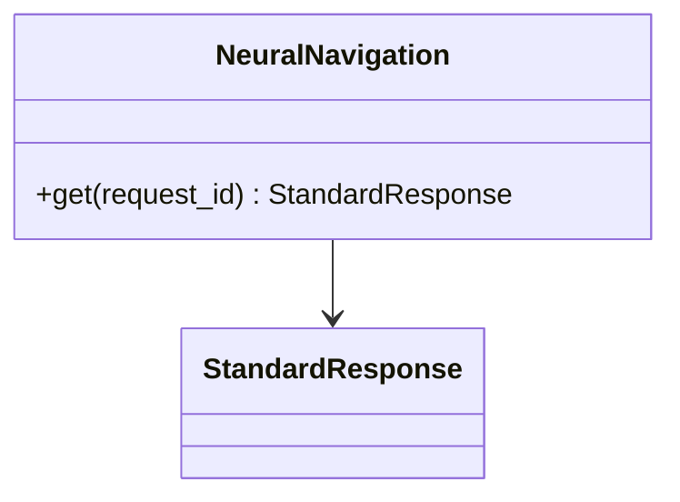

# AppNeuralNetwork - feature work orders



- **Primary Role:** observed neural training surfaces.
- **Dependencies:** each ready feature names its exact prerequisite order and files; no undeclared workspace import.
- **Outputs / Downstream Role:** the specified helper output only until the full workflow contracts below are made executable.
- **Commit rule:** one READY feature, one commit, only listed files. Blocked rows authorize no code or placeholder tests.

## Phase 13.1: observed deterministic behavior

### `NeuralNavigation` - WO-13-01 - READY after its named prerequisites

*Evidence IDs:* `OBS145-AppNeuralNetwork-HELPER-001` (retained below).
*Context to Read:* `SQX_REFERENCE_ROOT/internal/plugins/AppNeuralNetwork/module.js`. Read only these donor files and the completed prerequisite files named in this order.

*Feature:* expose observed navigation metadata only, without inventing a training algorithm.
*Dependencies:* WO-C02 StandardResponse.
*Implementation Files:*
- **Backend Create:** `app/workspaces/neural_network/__init__.py` (empty), `app/workspaces/neural_network/navigation.py`.
- **Test Create:** `tests/workspaces/neural_network/test_navigation.py`.
- **Frontend:** none; no trainer page or model IO is authorized by this order.
*Functional Requirements & Implementation:*
- [ ] `NeuralNavigation.get(self, *, request_id: str) -> StandardResponse[dict[str, JSONValue]]` -> constructor has no args; return exactly `{'app_code':'NEURALNETWORK','title':'Neural Network Trainer','order':50,'section':0,'hidden':True}` and revision None. Do not expose hidden=False or add unobserved train/evaluate endpoints.
- [ ] `test_hidden_navigation()` -> request_id n1; assert exact to_dict payload above with wrapper request_id n1 and revision None.
- [ ] `test_navigation_detached()` -> mutate one returned descriptor, call again and assert hidden True/order50 remain unchanged.
*Acceptance:* `uv run python -m pytest tests/workspaces/neural_network/test_navigation.py -q` exits 0, two tests.
*Commit:* `neural-network: expose observed hidden navigation metadata`.

## Phase 13.2: complete workspace contribution - BLOCKED-NOT-EXECUTABLE

All 2 assigned plugin modules remain in scope. The helper above is not acceptance of these complete features. Reserved paths below are exact; do not create service stubs or infer signatures while a row is blocked.

### `AppNeuralNetwork` - I-AppNeuralNetwork - BLOCKED-NOT-EXECUTABLE

*Feature:* complete AppNeuralNetwork workflow.
*Evidence IDs:* `OBS145-AppNeuralNetwork-SCOPE-001` establishes source presence only; `OBS145-AppNeuralNetwork-HELPER-001` establishes only the separately scoped helper.
*Implementation Files (reserved, no creation while blocked):*
- **Backend:** `app/workspaces/neural_network/app_neural_network.py`.
- **Models:** `app/workspaces/neural_network/app_neural_network_models.py`.
- **Frontend:** `app/web/workspaces/neural_network/NeuralNetworkWorkspace.tsx`.
- **Backend test:** `tests/workspaces/neural_network/test_app_neural_network.py`.
- **Frontend test:** `app/web/tests/workspaces/neural_network/AppNeuralNetworkPanel.test.tsx`.
- **Context to Read:** `SQX_REFERENCE_ROOT/internal/plugins/AppNeuralNetwork/AppNeuralNetwork.jar`, `SQX_REFERENCE_ROOT/internal/plugins/AppNeuralNetwork/module.js`.
*Observed action names (not a payload specification):* No literal client action extracted from this module; the specified class/view context must establish operations.
*Missing contract:* Training method/model topology/features/target/split/defaults, model artifact format, scheduler contract and independent expected outputs; the hidden navigation registration does not specify these.
*Function/signature authorization:* none. No generic `execute(payload: dict)` or invented CRUD surface.
*Acceptance:* not yet executable. A revised order must name literal fixtures and methods before `uv run python -m pytest tests/workspaces/neural_network/test_app_neural_network.py -q` or `npm --prefix app/web test -- tests/workspaces/neural_network/AppNeuralNetworkPanel.test.tsx` can be acceptance. A zero-test/no-assertion pass is invalid.
*Commit boundary:* this one feature only after its order is READY; do not combine with the helper commit.

### `TaskNeuralNetworkTrainer` - I-TaskNeuralNetworkTrainer - BLOCKED-NOT-EXECUTABLE

*Feature:* complete TaskNeuralNetworkTrainer workflow.
*Evidence IDs:* `OBS145-AppNeuralNetwork-SCOPE-001` establishes source presence only; `OBS145-AppNeuralNetwork-HELPER-001` establishes only the separately scoped helper.
*Implementation Files (reserved, no creation while blocked):*
- **Backend:** `app/workspaces/neural_network/task_neural_network_trainer.py`.
- **Models:** `app/workspaces/neural_network/task_neural_network_trainer_models.py`.
- **Frontend:** `app/web/workspaces/neural_network/TaskNeuralNetworkTrainerPanel.tsx`.
- **Backend test:** `tests/workspaces/neural_network/test_task_neural_network_trainer.py`.
- **Frontend test:** `app/web/tests/workspaces/neural_network/TaskNeuralNetworkTrainerPanel.test.tsx`.
- **Context to Read:** `SQX_REFERENCE_ROOT/internal/plugins/TaskNeuralNetworkTrainer/TaskNeuralNetworkTrainer.jar`.
*Observed action names (not a payload specification):* No literal client action extracted from this module; the specified class/view context must establish operations.
*Missing contract:* Complete input DTO, prerequisite resources, result schema, per-item failure/transaction policy, cancellation/retry/restart behavior and exact golden outcomes for this concrete task.
*Function/signature authorization:* none. No generic `execute(payload: dict)` or invented CRUD surface.
*Acceptance:* not yet executable. A revised order must name literal fixtures and methods before `uv run python -m pytest tests/workspaces/neural_network/test_task_neural_network_trainer.py -q` or `npm --prefix app/web test -- tests/workspaces/neural_network/TaskNeuralNetworkTrainerPanel.test.tsx` can be acceptance. A zero-test/no-assertion pass is invalid.
*Commit boundary:* this one feature only after its order is READY; do not combine with the helper commit.

## Work-order evidence

```json
{
  "id": "OBS145-AppNeuralNetwork-HELPER-001",
  "classification": "observed",
  "confidence": "high",
  "claim": "The primary neural navigation registration has title Neural Network Trainer, appCode NEURALNETWORK, order 50, section 0 and hidden true.",
  "sources": [
    "SQX_REFERENCE_ROOT/internal/plugins/AppNeuralNetwork/module.js"
  ],
  "target_domain": "app/workspaces/neural_network; app/web/workspaces/neural_network",
  "feature_ids": [],
  "requirement_ids": [],
  "decision_ids": [],
  "registration_gap": "Work-order labels are planning IDs, not ratified domain feature IDs.",
  "limitations": "Static primary source inspection. Helper acceptance is not full workspace, algorithm, vendor protocol or runtime parity.",
  "validation": {
    "status": "passed",
    "executed_at": "2026-10-29T09:38:19.613785+00:00",
    "procedure": "Read named primary source files and directory entries; identify explicit scalar rules and literal action names.",
    "actual_observation": "The primary neural navigation registration has title Neural Network Trainer, appCode NEURALNETWORK, order 50, section 0 and hidden true.",
    "expected_observation": "The primary neural navigation registration has title Neural Network Trainer, appCode NEURALNETWORK, order 50, section 0 and hidden true.",
    "artifacts": [
      {
        "path": "SQX_REFERENCE_ROOT/internal/plugins/AppNeuralNetwork/module.js",
        "sha256": "f6583b2e635bbb7bb4b5d93967443003f4bf0bb81c32ba25c295a3cb1c0dc08d"
      }
    ]
  },
  "repository_commit": "f5c7d12d5715b8ebee55165b8eddad9068f83cb9",
  "review_state": "owner-review-pending",
  "contains_proprietary_source": false,
  "contains_sensitive_data": false,
  "contains_personal_data": false,
  "paraphrased_behavior_only": true,
  "supersedes_records": [],
  "superseded_by": []
}
```

```json
{
  "id": "OBS145-AppNeuralNetwork-SCOPE-001",
  "classification": "observed",
  "confidence": "high",
  "claim": "Named primary plugin modules and readable files exist; declarations/action names do not establish complete request/response behavior.",
  "sources": [
    "SQX_REFERENCE_ROOT/internal/plugins/AppNeuralNetwork",
    "SQX_REFERENCE_ROOT/internal/plugins/TaskNeuralNetworkTrainer"
  ],
  "target_domain": "app/workspaces/neural_network; app/web/workspaces/neural_network",
  "feature_ids": [],
  "requirement_ids": [],
  "decision_ids": [],
  "registration_gap": "Work-order labels are planning IDs, not ratified domain feature IDs.",
  "limitations": "Static primary source inspection. Helper acceptance is not full workspace, algorithm, vendor protocol or runtime parity.",
  "validation": {
    "status": "passed",
    "executed_at": "2026-10-29T09:38:19.613785+00:00",
    "procedure": "Read named primary source files and directory entries; identify explicit scalar rules and literal action names.",
    "actual_observation": "Named primary plugin modules and readable files exist; declarations/action names do not establish complete request/response behavior.",
    "expected_observation": "Named primary plugin modules and readable files exist; declarations/action names do not establish complete request/response behavior.",
    "artifacts": [
      "SQX_REFERENCE_ROOT/internal/plugins"
    ]
  },
  "repository_commit": "f5c7d12d5715b8ebee55165b8eddad9068f83cb9",
  "review_state": "owner-review-pending",
  "contains_proprietary_source": false,
  "contains_sensitive_data": false,
  "contains_personal_data": false,
  "paraphrased_behavior_only": true,
  "supersedes_records": [],
  "superseded_by": []
}
```


## Current-code migration assessment

Migration fit is separate from implementation status. Direct fit below means the inspected presentation/data can be retained; it does not establish backend or donor parity. Existing domain READMEs continue to own implementation status. No code moves are performed by this planning change.

| Current HaruQuantAI location | Exact target proposed location | Fit / action | Required change and verification boundary |
| --- | --- | --- | --- |
| `ui/app/workspace/NeuralNetwork/NeuralNetworkTrainer.tsx` | `app/web/workspaces/neural_network/NeuralNetworkWorkspace.tsx` | Move + adapt | Retain layout/forms as presentation candidates; remove the120ms training simulation loop. Component function becomes NeuralNetworkWorkspace, called by the workspace route. |
| `ui/app/workspace/NeuralNetwork/neuralNetStore.ts` | `app/web/workspaces/neural_network/neuralNetStore.ts` | Retain editing state; replace computation | Keep typed editor actions only after schema matching. Replace synthetic loss/accuracy, hardcoded confusion matrix and generated Java strategy text with real backend receipts and Wizard export capability. |
| `ui/tests/unit/workspace/NeuralNetwork/neuralNet.test.ts` | `app/web/tests/workspaces/neural_network/neuralNet.test.ts` | Move + revise | Keep explicit config editing tests; remove fake-training-success as parity evidence and test job-driven states once backend training is source-specified. |
| `No current neural Python service` | `app/workspaces/neural_network/training.py` | Missing - create | Provider/model/split/training implementation is absent; frontend layers and epochs do not prove a donor neural algorithm. |

### Reorganization work order - MIG-AppNeuralNetwork

*Evidence:* `OBS-CURRENT-AppNeuralNetwork-MIGRATION-001`.
*Context to Read:* every existing current file in the table, its named test and the existing `ui/app/host/App.tsx` route/import entries; no donor runtime is required for the relocation itself.
*Execution order:* move retained presentation files first, change their relative UI/host imports to the published target owner, move/revise the listed tests, then switch route imports in the target shell. Keep one current-to-target owner per table row. Do not leave forwarding copies in old workspace folders; keep source history through Git moves. Do not move application state from a shared browser store into another mock runner.
*Behavior changes:* only those explicitly listed in accepted work orders may replace the fixture behavior. A physical move cannot make a mock engine/service a direct fit. Missing backend rows require production implementation; pyc/cache directories are not source to recover or migrate.
*Exact baseline / target commands (each exit0; revised donor-backed assertions are specified by the feature orders):*
- Baseline: `npm --prefix ui test -- tests/unit/workspace/NeuralNetwork/neuralNet.test.ts`. Target: `npm --prefix app/web test -- tests/workspaces/neural_network/neuralNet.test.ts`.
No other path substitution is authorized. Passing the current fixture tests is not donor acceptance.
*Commit boundary:* one cohesive workspace file reorganization with its import/test updates; algorithm/service replacements are separate feature commits. If a source is split between GridControl and SQAI, the owning phase migrates its exact extracted section once; SQXBusiness never keeps a duplicate.

```json
{
  "id": "OBS-CURRENT-AppNeuralNetwork-MIGRATION-001",
  "classification": "observed",
  "confidence": "high",
  "claim": "Inspected current source/test files distinguish reusable presentation and local editing state from mock execution, fixture-only history and missing Python workspace implementations. The table assigns exact target owners as normative migration decisions.",
  "sources": [
    "HARUQUANTAI_ROOT/ui/app/workspace/NeuralNetwork/NeuralNetworkTrainer.tsx",
    "HARUQUANTAI_ROOT/ui/app/workspace/NeuralNetwork/neuralNetStore.ts",
    "HARUQUANTAI_ROOT/ui/tests/unit/workspace/NeuralNetwork/neuralNet.test.ts"
  ],
  "target_domain": "AppNeuralNetwork",
  "feature_ids": [],
  "requirement_ids": [],
  "decision_ids": [],
  "registration_gap": "Register migration decisions through the owning domain README; this table does not duplicate implementation status.",
  "limitations": "Static source/import audit. Six existing current frontend test files passed20tests; those assertions cover current stores/helpers, not donor algorithms or absent provider services. AI presentation source was statically inspected; no AI backend or external service was executed.",
  "validation": {
    "status": "passed",
    "executed_at": "2026-10-29T10:08:10.884105+00:00",
    "procedure": "Inspect current imports, state/fixture generation, service call absence and existing tests; run targeted current Vitest cohort.",
    "actual_observation": {
      "command": "npm --prefix ui test -- tests/unit/workspace/CustomProjects/customProjects.test.ts tests/unit/workspace/NeuralNetwork/neuralNet.test.ts tests/unit/workspace/GridControl/gridControl.test.ts tests/unit/workspace/GridTest/gridTest.test.ts tests/unit/workspace/DebugConsole/debugConsole.test.ts tests/unit/workspace/Business/business.test.ts",
      "exit_code": 0,
      "test_files_passed": 6,
      "tests_passed": 20
    },
    "expected_observation": "Current tests pass without implying donor parity; source evidence establishes which functions are fixture-driven.",
    "artifacts": [
      {
        "path": "HARUQUANTAI_ROOT/ui/app/workspace/NeuralNetwork/NeuralNetworkTrainer.tsx",
        "sha256": "73274463f824a518ef4c24335863f27be74619d96e264349fb15ad1c38993a77"
      },
      {
        "path": "HARUQUANTAI_ROOT/ui/app/workspace/NeuralNetwork/neuralNetStore.ts",
        "sha256": "8370b20bf035cdbfdc23ce2a6488e9990c6b645be19498004048cd54e26906c3"
      },
      {
        "path": "HARUQUANTAI_ROOT/ui/tests/unit/workspace/NeuralNetwork/neuralNet.test.ts",
        "sha256": "da407eb9bbca4f7ffec907492e80e4e1e1a4737deff923244100a8327b1a28b2"
      }
    ]
  },
  "repository_commit": "f5c7d12d5715b8ebee55165b8eddad9068f83cb9",
  "review_state": "owner-review-pending",
  "contains_proprietary_source": false,
  "contains_sensitive_data": false,
  "contains_personal_data": false,
  "paraphrased_behavior_only": true,
  "supersedes_records": [],
  "superseded_by": []
}
```
