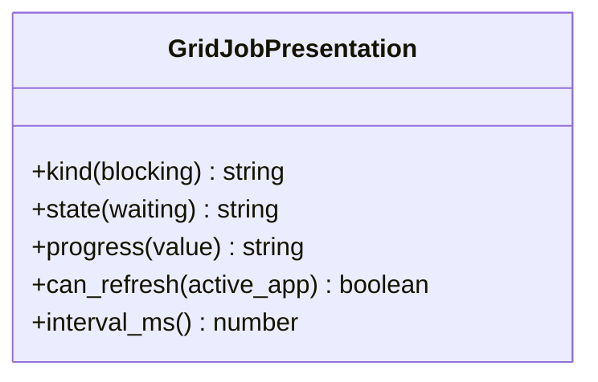

# AppGridControl - feature work orders
> UI migration completed: [verification and limitations](research/ui-preservation-migration-verification.md). Current sources are under `app/web`; old source columns below are historical migration evidence. Reuse the migrated screens when implementing later features.

> UI migration execution: [preservation plan](research/ui-preservation-migration-plan.md) governs the structural move. Preserve the existing screens, routes, runtime fixtures and behavior; backend/service adaptations below remain separate work. Shared ProjectWorkbench stays under `app/web/common/project`; migrated tests use `app/web/tests/workspace/<owner>`.




- **Primary Role:** local/remote compute management.
- **Dependencies:** each ready feature names its exact prerequisite order and files; no undeclared workspace import.
- **Outputs / Downstream Role:** the specified helper output only until the full workflow contracts below are made executable.
- **Commit rule:** one READY feature, one commit, only listed files. Blocked rows authorize no code or placeholder tests.

## Source reassessment — 2026-10-30

The [workspace source audit](research/workspaces-09-19-source-review.md) lists newly available implementation files for every blocked feature below. Read that module record with the order. Library availability does not supply missing plugin routes, target integration contracts or numerical fixtures. The original execution boundary remains in effect except for explicitly revised bounded orders.

## Phase 14.1: observed deterministic behavior

### `GridJobPresentation` - WO-14-01 - READY after its named prerequisites

*Evidence IDs:* `OBS145-AppGridControl-HELPER-001` (retained below).
*Context to Read:* `DONOR_REFERENCE_ROOT/internal/web/GRIDCONTROL/layout` (resource folder; originally named `LayoutCtrl.js` is not present). Read only these donor files and the completed prerequisite files named in this order.

*Feature:* deterministic English label/refresh predicate helpers, not remote job management.
*Dependencies:* WO-C00 frontend runner.
*Implementation Files:*
- **Backend:** none. Do not add a fabricated gridControl/getData endpoint.
- **Frontend Create:** `app/web/workspaces/grid_control/jobPresentation.ts`.
- **Test Create:** `app/web/tests/workspace/grid_control/jobPresentation.test.ts`.
*Types:* exported class GridJobPresentation with static methods; inputs are typed scalar values, not unvalidated provider responses.
*Functional Requirements & Implementation:*
- [ ] `GridJobPresentation.kind(blocking: boolean): 'Continuous' | 'One time'` -> true returns Continuous; false One time.
- [ ] `GridJobPresentation.state(waiting: boolean): 'Waiting' | 'Running'` -> true Waiting; false Running.
- [ ] `GridJobPresentation.progress(value: number): string` -> value exactly -1 gives N/A; otherwise native JavaScript string conversion plus `%`. Do not clamp, round or treat negative numbers other than -1 as N/A.
- [ ] `GridJobPresentation.can_refresh(active_app: string): boolean` -> exact equality with GRIDCONTROL.
- [ ] `GridJobPresentation.interval_ms(): 3000` -> literal 3000; do not create a timer in this pure helper.
- [ ] `test('grid labels')` -> kind(true/false) = Continuous/One time; state(true/false)=Waiting/Running; progress(-1/0/12.5/-2)=N/A/0%/12.5%/-2%.
- [ ] `test('active-only refresh metadata')` -> GRIDCONTROL true; gridcontrol and BUILDER false; interval_ms=3000.
*Acceptance:* `npm --prefix app/web test -- tests/workspace/grid_control/jobPresentation.test.ts` exits 0, two tests.
*Commit:* `grid-control: preserve job labels and refresh predicate`.

## Phase 14.2: complete workspace contribution - READY

All 2 assigned plugin modules remain in scope. The helper above is not acceptance of these complete features. Reserved paths below are exact; do not create service stubs or infer signatures while a row is blocked.

### `AppGridControl` - I-AppGridControl - READY

*Feature:* complete AppGridControl workflow.
*Evidence IDs:* `OBS145-AppGridControl-SCOPE-001` establishes source presence only; `OBS145-AppGridControl-HELPER-001` establishes only the separately scoped helper.
*Implementation Files (reserved, no creation while blocked):*
- **Backend:** `app/workspace/grid_control/app_grid_control.py`.
- **Models:** `app/workspace/grid_control/app_grid_control_models.py`.
- **Frontend:** `app/web/workspaces/grid_control/GridControlWorkspace.tsx`.
- **Backend test:** `tests/workspace/grid_control/test_app_grid_control.py`.
- **Frontend test:** `app/web/tests/workspace/grid_control/AppGridControlPanel.test.tsx`.
- **Context to Read:** `DONOR_REFERENCE_ROOT/internal/plugins/AppGridControl/GridControl/GridControlAppPlugin.java`, `DONOR_REFERENCE_ROOT/internal/plugins/AppGridControl/module.js`.
*Observed action names (not a payload specification):* No literal client action extracted from this module; the specified class/view context must establish operations.
*Missing contract:* Complete getData response, worker/node states, identity/time/size units, remote protocol/authorization and job lifecycle error contracts.
*Function/signature authorization:* none. No generic `execute(payload: dict)` or invented CRUD surface.
*Acceptance:* not yet executable. A revised order must name literal fixtures and methods before `uv run python -m pytest tests/workspace/grid_control/test_app_grid_control.py -q` or `npm --prefix app/web test -- tests/workspace/grid_control/AppGridControlPanel.test.tsx` can be acceptance. A zero-test/no-assertion pass is invalid.
*Commit boundary:* this one feature only after its order is READY; do not combine with the helper commit.


*Source reassessment (2026-10-30):* [AppGridControl source record](research/workspaces-09-19-source-review.md#appgridcontrol) identifies 1 matching readable Java files and 1 primary frontend/settings files. The record identifies readable plugin or explicitly related library sources; inspect their named methods instead of repeating source discovery. Matching a class name alone does not establish the complete plugin implementation. The remaining full-workflow contract and test prerequisites above still apply.

### `ServletGridControl` - I-ServletGridControl - READY

*Feature:* complete ServletGridControl workflow.
*Evidence IDs:* `OBS145-AppGridControl-SCOPE-001` establishes source presence only; `OBS145-AppGridControl-HELPER-001` establishes only the separately scoped helper.
*Implementation Files (reserved, no creation while blocked):*
- **Backend:** `app/workspace/grid_control/servlet_grid_control.py`.
- **Models:** `app/workspace/grid_control/servlet_grid_control_models.py`.
- **Frontend:** `app/web/workspaces/grid_control/ServletGridControlPanel.tsx`.
- **Backend test:** `tests/workspace/grid_control/test_servlet_grid_control.py`.
- **Frontend test:** `app/web/tests/workspace/grid_control/ServletGridControlPanel.test.tsx`.
- **Context to Read:** `DONOR_REFERENCE_ROOT/internal/plugins/ServletGridControl`.
*Observed action names (not a payload specification):* No literal client action extracted from this module; the specified class/view context must establish operations.
*Missing contract:* Every servlet action payload/result/error and shared grid call side effect, including unavailable workers and partial results.
*Function/signature authorization:* none. No generic `execute(payload: dict)` or invented CRUD surface.
*Acceptance:* not yet executable. A revised order must name literal fixtures and methods before `uv run python -m pytest tests/workspace/grid_control/test_servlet_grid_control.py -q` or `npm --prefix app/web test -- tests/workspace/grid_control/ServletGridControlPanel.test.tsx` can be acceptance. A zero-test/no-assertion pass is invalid.
*Commit boundary:* this one feature only after its order is READY; do not combine with the helper commit.


*Source reassessment (2026-10-30):* [ServletGridControl source record](research/workspaces-09-19-source-review.md#servletgridcontrol) identifies 0 matching readable Java files and 0 primary frontend/settings files. No matching plugin Java body was found in the bounded library/recovered-source search. This may be a frontend-only contribution; review the listed UI handlers and actual backend dependencies before declaring a missing server.

## Work-order evidence

```json
{
  "id": "OBS145-AppGridControl-HELPER-001",
  "classification": "observed",
  "confidence": "high",
  "claim": "Grid-control uses a 3000ms refresh interval gated by active application; displays Continuous/One time, Waiting/Running, and N/A for progress exactly -1.",
  "sources": [
    "DONOR_REFERENCE_ROOT/internal/web/GRIDCONTROL/layout/LayoutCtrl.js"
  ],
  "target_domain": "app/workspace/grid_control; app/web/workspaces/grid_control",
  "feature_ids": [],
  "requirement_ids": [],
  "decision_ids": [],
  "registration_gap": "Work-order labels are planning IDs, not ratified domain feature IDs.",
  "limitations": "Static primary source inspection. Helper acceptance is not full workspace, algorithm, vendor protocol or runtime parity.",
  "validation": {
    "status": "passed",
    "executed_at": "2026-10-29T09:38:19.613785+00:00",
    "procedure": "Read named primary source files and directory entries; identify explicit scalar rules and literal action names.",
    "actual_observation": "Grid-control uses a 3000ms refresh interval gated by active application; displays Continuous/One time, Waiting/Running, and N/A for progress exactly -1.",
    "expected_observation": "Grid-control uses a 3000ms refresh interval gated by active application; displays Continuous/One time, Waiting/Running, and N/A for progress exactly -1.",
    "artifacts": [
      {
        "path": "DONOR_REFERENCE_ROOT/internal/web/GRIDCONTROL/layout/LayoutCtrl.js",
        "sha256": "e5c4647abc646fdc32f86cab3aafd9aa7b14be9a2c05e667963480d2776e3d5c"
      }
    ]
  },
  "repository_commit": "f5c7d12d5715b8ebee55165b8eddad9068f83cb9",
  "review_state": "owner-review-pending",
  "contains_proprietary_source": false,
  "contains_sensitive_data": false,
  "contains_personal_data": false,
  "paraphrased_behavior_only": true,
  "supersedes_records": [],
  "superseded_by": []
}
```

```json
{
  "id": "OBS145-AppGridControl-SCOPE-001",
  "classification": "observed",
  "confidence": "high",
  "claim": "Named primary plugin modules and readable files exist; declarations/action names do not establish complete request/response behavior.",
  "sources": [
    "DONOR_REFERENCE_ROOT/internal/plugins/AppGridControl",
    "DONOR_REFERENCE_ROOT/internal/plugins/ServletGridControl"
  ],
  "target_domain": "app/workspace/grid_control; app/web/workspaces/grid_control",
  "feature_ids": [],
  "requirement_ids": [],
  "decision_ids": [],
  "registration_gap": "Work-order labels are planning IDs, not ratified domain feature IDs.",
  "limitations": "Static primary source inspection. Helper acceptance is not full workspace, algorithm, vendor protocol or runtime parity.",
  "validation": {
    "status": "passed",
    "executed_at": "2026-10-29T09:38:19.613785+00:00",
    "procedure": "Read named primary source files and directory entries; identify explicit scalar rules and literal action names.",
    "actual_observation": "Named primary plugin modules and readable files exist; declarations/action names do not establish complete request/response behavior.",
    "expected_observation": "Named primary plugin modules and readable files exist; declarations/action names do not establish complete request/response behavior.",
    "artifacts": [
      "DONOR_REFERENCE_ROOT/internal/plugins"
    ]
  },
  "repository_commit": "f5c7d12d5715b8ebee55165b8eddad9068f83cb9",
  "review_state": "owner-review-pending",
  "contains_proprietary_source": false,
  "contains_sensitive_data": false,
  "contains_personal_data": false,
  "paraphrased_behavior_only": true,
  "supersedes_records": [],
  "superseded_by": []
}
```


## Current-code migration assessment

Migration fit is separate from implementation status. Direct fit below means the inspected presentation/data can be retained; it does not establish backend or donor parity. Existing domain READMEs continue to own implementation status. No code moves are performed by this planning change.

| Current HaruQuantAI location | Exact target proposed location | Fit / action | Required change and verification boundary |
| --- | --- | --- | --- |
| `ui/app/workspace/GridControl/GridControlWorkspace.tsx` | `app/web/workspaces/grid_control/GridControlWorkspace.tsx` | Move + adapt | Retain table columns/empty/error-dialog composition. Remove FINISHED_FIXTURES, fixed00:00:12 duration and rounded progress; use actual running/waiting/finished server projection and observed no-rounding display. |
| `ui/app/workspace/Business/AddNodeModal.tsx` | `app/web/workspaces/grid_control/AddNodeModal.tsx` | Reassign + replace fake handshake | Node UI belongs with grid backend. Remove fake600ms success, invented node host/port/hardware defaults and Date.now identity assignment; display server capabilities/identity. |
| `ui/app/workspace/Business/BusinessWorkspace.tsx (compute-node section only)` | `app/web/workspaces/grid_control/ClusterPanel.tsx` | Extract + adapt | Move only node/cluster controls. Delete hardcoded All4nodes/18ms success claim; network metrics come from actual backend probes. Do not retain duplicate cluster management under SQXBusiness. |
| `ui/tests/unit/workspace/GridControl/gridControl.test.ts` | `app/web/tests/workspace/grid_control/gridControl.test.ts` | Move + revise | Replace mock-history expectations with explicit canonical job snapshots and donor label fixtures. |
| `No current grid Python service` | `app/workspace/grid_control/workspace.py` | Missing - create | Consume the one core local/remote performer registry; do not implement another scheduler. |

### Reorganization work order - MIG-AppGridControl

*Evidence:* `OBS-CURRENT-AppGridControl-MIGRATION-001`.
*Context to Read:* every existing current file in the table, its named test and the existing `ui/app/host/App.tsx` route/import entries; no donor runtime is required for the relocation itself.
*Execution order:* move retained presentation files first, change their relative UI/host imports to the published target owner, move/revise the listed tests, then switch route imports in the target shell. Keep one current-to-target owner per table row. Do not leave forwarding copies in old workspace folders; keep source history through Git moves. Do not move application state from a shared browser store into another mock runner.
*Behavior changes:* only those explicitly listed in accepted work orders may replace the fixture behavior. A physical move cannot make a mock engine/service a direct fit. Missing backend rows require production implementation; pyc/cache directories are not source to recover or migrate.
*Exact baseline / target commands (each exit0; revised donor-backed assertions are specified by the feature orders):*
- Baseline: `npm --prefix ui test -- tests/unit/workspace/GridControl/gridControl.test.ts`. Target: `npm --prefix app/web test -- tests/workspace/grid_control/gridControl.test.ts`.
No other path substitution is authorized. Passing the current fixture tests is not donor acceptance.
*Commit boundary:* one cohesive workspace file reorganization with its import/test updates; algorithm/service replacements are separate feature commits. If a source is split between GridControl and SQAI, the owning phase migrates its exact extracted section once; SQXBusiness never keeps a duplicate.

```json
{
  "id": "OBS-CURRENT-AppGridControl-MIGRATION-001",
  "classification": "observed",
  "confidence": "high",
  "claim": "Inspected current source/test files distinguish reusable presentation and local editing state from mock execution, fixture-only history and missing Python workspace implementations. The table assigns exact target owners as normative migration decisions.",
  "sources": [
    "HARUQUANTAI_ROOT/ui/app/workspace/GridControl/GridControlWorkspace.tsx",
    "HARUQUANTAI_ROOT/ui/app/workspace/Business/AddNodeModal.tsx",
    "HARUQUANTAI_ROOT/ui/app/workspace/Business/BusinessWorkspace.tsx",
    "HARUQUANTAI_ROOT/ui/tests/unit/workspace/GridControl/gridControl.test.ts"
  ],
  "target_domain": "AppGridControl",
  "feature_ids": [],
  "requirement_ids": [],
  "decision_ids": [],
  "registration_gap": "Register migration decisions through the owning domain README; this table does not duplicate implementation status.",
  "limitations": "Static source/import audit. Six existing current frontend test files passed20tests; those assertions cover current stores/helpers, not donor algorithms or absent provider services. AI presentation source was statically inspected; no AI backend or external service was executed.",
  "validation": {
    "status": "passed",
    "executed_at": "2026-10-29T10:08:10.884105+00:00",
    "procedure": "Inspect current imports, state/fixture generation, service call absence and existing tests; run targeted current Vitest cohort.",
    "actual_observation": {
      "command": "npm --prefix ui test -- tests/unit/workspace/CustomProjects/customProjects.test.ts tests/unit/workspace/NeuralNetwork/neuralNet.test.ts tests/unit/workspace/GridControl/gridControl.test.ts tests/unit/workspace/GridTest/gridTest.test.ts tests/unit/workspace/DebugConsole/debugConsole.test.ts tests/unit/workspace/Business/business.test.ts",
      "exit_code": 0,
      "test_files_passed": 6,
      "tests_passed": 20
    },
    "expected_observation": "Current tests pass without implying donor parity; source evidence establishes which functions are fixture-driven.",
    "artifacts": [
      {
        "path": "HARUQUANTAI_ROOT/ui/app/workspace/GridControl/GridControlWorkspace.tsx",
        "sha256": "f5d4fbe246eb5675a399f832df49feb8877529ed0e1a466c6a93f72c861d90db"
      },
      {
        "path": "HARUQUANTAI_ROOT/ui/app/workspace/Business/AddNodeModal.tsx",
        "sha256": "8f203c7f922ebc0f90a0393aa743d26cb863aadcebf9df519990bf8249e88d8a"
      },
      {
        "path": "HARUQUANTAI_ROOT/ui/app/workspace/Business/BusinessWorkspace.tsx",
        "sha256": "2855a06cd207747d730bdafd1b40d38170b2ae75a919162f1cd115a033133798"
      },
      {
        "path": "HARUQUANTAI_ROOT/ui/tests/unit/workspace/GridControl/gridControl.test.ts",
        "sha256": "cecdcc6b17ac36a329a1399bed5a5d3ed65a5ae1d0e510562e3d81a589c5c89d"
      }
    ]
  },
  "repository_commit": "f5c7d12d5715b8ebee55165b8eddad9068f83cb9",
  "review_state": "owner-review-pending",
  "contains_proprietary_source": false,
  "contains_sensitive_data": false,
  "contains_personal_data": false,
  "paraphrased_behavior_only": true,
  "supersedes_records": [],
  "superseded_by": []
}
```
