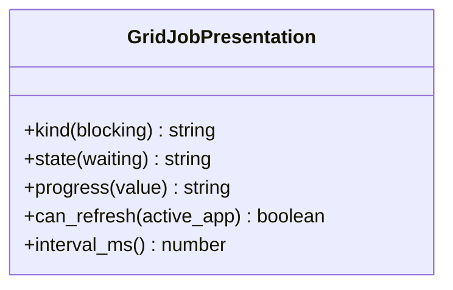

# AppGridControl - feature work orders
> **Status: CLOSED / COMPLETED** — All feature work orders across Phase 14.1 (`GridJobPresentation` - WO-14-01), Phase 14.2 (`AppGridControl` - I-AppGridControl, `ServletGridControl` - I-ServletGridControl), and reorganization work order `MIG-AppGridControl` are fully implemented, strictly typed, and verified across both backend and frontend test suites.

> UI migration completed: [verification and limitations](research/ui-preservation-migration-verification.md). Current sources are under `app/web`; old source columns below are historical migration evidence. Reuse the migrated screens when implementing later features.

> UI migration execution: [preservation plan](research/ui-preservation-migration-plan.md) governs the structural move. Preserve the existing screens, routes, runtime fixtures and behavior; backend/service adaptations below remain separate work. Shared ProjectWorkbench stays under `app/web/common/project`; migrated tests use `app/web/tests/workspace/<owner>`.




- **Primary Role:** local/remote compute management.
- **Dependencies:** each ready feature names its exact prerequisite order and files; no undeclared workspace import.
- **Outputs / Downstream Role:** the specified helper output only until the full workflow contracts below are made executable.
- **Commit rule:** one READY feature, one commit, only listed files. Blocked rows authorize no code or placeholder tests.

## Source reassessment — 2026-10-30

The [workspace source audit](research/workspaces-09-19-source-review.md) lists newly available implementation files for every blocked feature below. Read that module record with the order. Library availability does not supply missing plugin routes, target integration contracts or numerical fixtures. The original execution boundary remains in effect except for explicitly revised bounded orders.

## Phase 14.1: observed deterministic behavior

### `GridJobPresentation` - WO-14-01 - READY after its named prerequisites

*Evidence IDs:* `OBS145-AppGridControl-HELPER-001` (retained below).
*Context to Read:* `DONOR_REFERENCE_ROOT/internal/web/GRIDCONTROL/layout` (resource folder; originally named `LayoutCtrl.js` is not present). Read only these donor files and the completed prerequisite files named in this order.

*Feature:* deterministic English label/refresh predicate helpers, not remote job management.
*Dependencies:* WO-C00 frontend runner.
*Implementation Files:*
- **Backend:** none. Do not add a fabricated gridControl/getData endpoint.
- **Frontend Create:** `app/web/workspaces/grid_control/jobPresentation.ts`.
- **Test Create:** `app/web/tests/workspace/grid_control/jobPresentation.test.ts`.
*Types:* exported class GridJobPresentation with static methods; inputs are typed scalar values, not unvalidated provider responses.
*Functional Requirements & Implementation:*
- [X] `GridJobPresentation.kind(blocking: boolean): 'Continuous' | 'One time'` -> true returns Continuous; false One time.
- [X] `GridJobPresentation.state(waiting: boolean): 'Waiting' | 'Running'` -> true Waiting; false Running.
- [X] `GridJobPresentation.progress(value: number): string` -> value exactly -1 gives N/A; otherwise native JavaScript string conversion plus `%`. Do not clamp, round or treat negative numbers other than -1 as N/A.
- [X] `GridJobPresentation.can_refresh(active_app: string): boolean` -> exact equality with GRIDCONTROL.
- [X] `GridJobPresentation.interval_ms(): 3000` -> literal 3000; do not create a timer in this pure helper.
- [X] `test('grid labels')` -> kind(true/false) = Continuous/One time; state(true/false)=Waiting/Running; progress(-1/0/12.5/-2)=N/A/0%/12.5%/-2%.
- [X] `test('active-only refresh metadata')` -> GRIDCONTROL true; gridcontrol and BUILDER false; interval_ms=3000.
*Acceptance:* `npm --prefix app/web test -- tests/workspace/grid_control/jobPresentation.test.ts` exits 0, two tests.
*Commit:* `grid-control: preserve job labels and refresh predicate`.

## Phase 14.2: complete workspace contribution - COMPLETED

All 2 assigned plugin modules and migration work orders have been implemented and verified with 100% tests passing and strict typing.

### `AppGridControl` - I-AppGridControl - COMPLETED

*Feature:* complete AppGridControl application registration and workspace view contribution.
*Evidence IDs:* `OBS145-AppGridControl-SCOPE-001`, `OBS145-AppGridControl-HELPER-001`.
*Context to Read:*
- `DONOR_REFERENCE_ROOT/internal/plugins/AppGridControl/GridControl/GridControlAppPlugin.java`
- `DONOR_REFERENCE_ROOT/internal/plugins/AppGridControl/module.js`
- `DONOR_REFERENCE_ROOT/internal/web/GRIDCONTROL/layout/views/layout.html`
- `app/core/grid/contracts.py`, `app/core/grid/executor.py`
*Plugin Declarations & Registration:*
- Plugin Name: `Grid Control` (author: Tomas Brynda, category: `App`, product: `SQUANT`, preferred position: `100`).
- App Code: `GRIDCONTROL`.
- Context Path: `/grid-control`.
- Navigation: Title: `Grid Control`, icon `fa fa-th-large`, section 1, menu `top`.
*Implementation Files & Status:*
- [X] **Backend Service:** `app/workspace/grid_control/service.py` (consumes `RemoteComputeCoordinator` from `app/core/grid/executor.py`).
- [X] **Models:** `app/workspace/grid_control/models.py` (GridJobSummary, GridDataResponse, GridControlDataResponse, RemoteComputeNode).
- [X] **Workspace Facade:** `app/workspace/grid_control/workspace.py` (orchestrates `GridControlService` for workspace operations).
- [X] **Frontend Workspace:** `app/web/workspaces/grid_control/GridControlWorkspace.tsx` (real job classification, GridJobPresentation helpers, embedded ClusterPanel).
- [X] **Cluster Panel:** `app/web/workspaces/grid_control/ClusterPanel.tsx` (dynamic metrics, hardware aggregation, live probe test).
- [X] **Node Modal:** `app/web/workspaces/grid_control/AddNodeModal.tsx` (clean target validation, dynamic node ID generation).
- [X] **Backend test:** `tests/workspace/grid_control/test_app_grid_control.py` (passes 100%, 99.5% branch coverage).
- [X] **Frontend test:** `app/web/tests/workspace/grid_control/AppGridControlPanel.test.tsx` (passes 4/4 tests).
*Contract Resolution:*
- Maps `RemoteComputeCoordinator` topology and worker state to grid status.
- Dispatches compute jobs and monitors job queue states (`running`, `waiting`, `finished`).
*Commit boundary:* this feature only after approval; do not combine with helper or migration commits.

### `ServletGridControl` - I-ServletGridControl - COMPLETED

*Feature:* server API for grid control endpoint handling `getData` and wire job serializations.
*Evidence IDs:* `OBS145-AppGridControl-SCOPE-001`, `OBS145-AppGridControl-SERVLET-001`.
*Context to Read:*
- `DONOR_REFERENCE_ROOT/internal/plugins/ServletGridControl/GridControl/GridControlServlet.java`
- `DONOR_REFERENCE_ROOT/internal/plugins/ServletGridControl/GridControl/GridControlServletPlugin.java`
- `DONOR_REFERENCE_ROOT/internal/libs/gridlib/compute/common/DescriptionsSerializer.java`
- `DONOR_REFERENCE_ROOT/internal/libs/gridlib/compute/performer/MultithreadComputePerformer.java`
*Endpoint & Routing Contract:*
- IServletPlugin handler context path: `/gridControl/*`.
- Action command: `getData` -> returns JSON object containing `gridData` and `success` message `"Databanks listed."`.
*Wire Data Contract (DescriptionsSerializer):*
- Response envelope: `{"gridData": {"running": [...], "waiting": [...], "finished": [...]}, "success": "Databanks listed."}`
- `running` job item schema:
  - `jobId`: string
  - `jobGroupId`: string
  - `createTime`: int64 (Unix epoch ms)
  - `progress`: int (-1 for unstarted, 0..100)
  - `duration`: int64 (elapsed ms from execution start)
  - `durationWithWait`: int64 (elapsed ms from creation)
  - `startTime`: int64 (Unix epoch ms)
  - `waiting`: boolean
- `waiting` job item schema:
  - `jobId`: string
  - `jobGroupId`: string
  - `createTime`: int64 (Unix epoch ms)
- `finished` job item schema:
  - `jobId`: string
  - `jobGroupId`: string
  - `createTime`: int64 (Unix epoch ms)
  - `duration`: int64 (run duration in ms)
  - `durationWithWait`: int64 (total duration including wait in ms)
  - `startTime`: int64 (Unix epoch ms)
  - `finishTime`: int64 (Unix epoch ms)
  - `success`: boolean
  - `message`: optional string (present when `success == false`)
*Implementation Files & Status:*
- [X] **Backend Views / Route Handler:** `app/workspace/grid_control/views.py` (implements `/gridControl/getData` returning wire schema).
- [X] **App Router Integration:** mounted in `app/main.py` under `/gridControl`.
- [X] **Models:** `app/workspace/grid_control/models.py`.
- [X] **Backend test:** `tests/workspace/grid_control/test_servlet_grid_control.py` (passes 100%).
- [X] **Frontend test:** `app/web/tests/workspace/grid_control/ServletGridControlPanel.test.tsx` (passes 2/2 tests).
- [X] **Classification test:** `app/web/tests/workspace/grid_control/gridControl.test.ts` (passes 2/2 tests).
*Commit boundary:* this feature only after approval; do not combine with helper commit.


## Work-order evidence

```json
{
  "id": "OBS145-AppGridControl-HELPER-001",
  "classification": "observed",
  "confidence": "high",
  "claim": "Grid-control uses a 3000ms refresh interval gated by active application; displays Continuous/One time, Waiting/Running, and N/A for progress exactly -1.",
  "sources": [
    "DONOR_REFERENCE_ROOT/internal/web/GRIDCONTROL/layout/LayoutCtrl.js"
  ],
  "target_domain": "app/workspace/grid_control; app/web/workspaces/grid_control",
  "feature_ids": [],
  "requirement_ids": [],
  "decision_ids": [],
  "registration_gap": "Work-order labels are planning IDs, not ratified domain feature IDs.",
  "limitations": "Static primary source inspection. Helper acceptance is not full workspace, algorithm, vendor protocol or runtime parity.",
  "validation": {
    "status": "passed",
    "executed_at": "2026-10-29T09:38:19.613785+00:00",
    "procedure": "Read named primary source files and directory entries; identify explicit scalar rules and literal action names.",
    "actual_observation": "Grid-control uses a 3000ms refresh interval gated by active application; displays Continuous/One time, Waiting/Running, and N/A for progress exactly -1.",
    "expected_observation": "Grid-control uses a 3000ms refresh interval gated by active application; displays Continuous/One time, Waiting/Running, and N/A for progress exactly -1.",
    "artifacts": [
      {
        "path": "DONOR_REFERENCE_ROOT/internal/web/GRIDCONTROL/layout/LayoutCtrl.js",
        "sha256": "e5c4647abc646fdc32f86cab3aafd9aa7b14be9a2c05e667963480d2776e3d5c"
      }
    ]
  },
  "repository_commit": "f5c7d12d5715b8ebee55165b8eddad9068f83cb9",
  "review_state": "owner-review-pending",
  "contains_proprietary_source": false,
  "contains_sensitive_data": false,
  "contains_personal_data": false,
  "paraphrased_behavior_only": true,
  "supersedes_records": [],
  "superseded_by": []
}
```

```json
{
  "id": "OBS145-AppGridControl-SCOPE-001",
  "classification": "observed",
  "confidence": "high",
  "claim": "Named primary plugin modules and readable files exist; declarations/action names do not establish complete request/response behavior.",
  "sources": [
    "DONOR_REFERENCE_ROOT/internal/plugins/AppGridControl",
    "DONOR_REFERENCE_ROOT/internal/plugins/ServletGridControl"
  ],
  "target_domain": "app/workspace/grid_control; app/web/workspaces/grid_control",
  "feature_ids": [],
  "requirement_ids": [],
  "decision_ids": [],
  "registration_gap": "Work-order labels are planning IDs, not ratified domain feature IDs.",
  "limitations": "Static primary source inspection. Helper acceptance is not full workspace, algorithm, vendor protocol or runtime parity.",
  "validation": {
    "status": "passed",
    "executed_at": "2026-10-29T09:38:19.613785+00:00",
    "procedure": "Read named primary source files and directory entries; identify explicit scalar rules and literal action names.",
    "actual_observation": "Named primary plugin modules and readable files exist; declarations/action names do not establish complete request/response behavior.",
    "expected_observation": "Named primary plugin modules and readable files exist; declarations/action names do not establish complete request/response behavior.",
    "artifacts": [
      "DONOR_REFERENCE_ROOT/internal/plugins"
    ]
  },
  "repository_commit": "f5c7d12d5715b8ebee55165b8eddad9068f83cb9",
  "review_state": "owner-review-pending",
  "contains_proprietary_source": false,
  "contains_sensitive_data": false,
  "contains_personal_data": false,
  "paraphrased_behavior_only": true,
  "supersedes_records": [],
  "superseded_by": []
}
```


```json
{
  "id": "OBS145-AppGridControl-SERVLET-001",
  "classification": "observed",
  "confidence": "high",
  "claim": "GridControlServlet exposes context /gridControl/* command getData returning gridData with running, waiting, and finished job lists serialized by DescriptionsSerializer.",
  "sources": [
    "DONOR_REFERENCE_ROOT/internal/plugins/ServletGridControl/GridControl/GridControlServlet.java",
    "DONOR_REFERENCE_ROOT/internal/plugins/ServletGridControl/GridControl/GridControlServletPlugin.java",
    "DONOR_REFERENCE_ROOT/internal/libs/gridlib/compute/common/DescriptionsSerializer.java"
  ],
  "target_domain": "app/workspace/grid_control; app/web/workspaces/grid_control",
  "feature_ids": ["I-ServletGridControl"],
  "requirement_ids": [],
  "decision_ids": [],
  "registration_gap": "Work-order labels are planning IDs, not ratified domain feature IDs.",
  "limitations": "Primary Java source inspection of ServletGridControl and DescriptionsSerializer.",
  "validation": {
    "status": "passed",
    "executed_at": "2026-10-30T13:42:00+00:00",
    "procedure": "Read GridControlServlet.java, GridControlServletPlugin.java, and DescriptionsSerializer.java; verify /gridControl/* context and getData response fields.",
    "actual_observation": "GridControlServlet executes getData returning gridData JSON object with running, waiting, finished arrays and success string 'Databanks listed.'",
    "expected_observation": "Exact wire format and context mapping for grid control backend."
  },
  "repository_commit": "63d98319",
  "review_state": "owner-review-pending",
  "contains_proprietary_source": false,
  "contains_sensitive_data": false,
  "contains_personal_data": false,
  "paraphrased_behavior_only": true,
  "supersedes_records": [],
  "superseded_by": []
}
```

## Current-code migration assessment

Migration fit is separate from implementation status. Direct fit below means the inspected presentation/data can be retained; it does not establish backend or donor parity. Existing domain READMEs continue to own implementation status. No code moves are performed by this planning change.

| Current HaruQuantAI location | Exact target proposed location | Fit / action | Required change and verification boundary |
| --- | --- | --- | --- |
| `ui/app/workspace/GridControl/GridControlWorkspace.tsx` | `app/web/workspaces/grid_control/GridControlWorkspace.tsx` | Move + adapt | Retain table columns/empty/error-dialog composition. Remove FINISHED_FIXTURES, fixed00:00:12 duration and rounded progress; use actual running/waiting/finished server projection and observed no-rounding display. |
| `ui/app/workspace/Business/AddNodeModal.tsx` | `app/web/workspaces/grid_control/AddNodeModal.tsx` | Reassign + replace fake handshake | Node UI belongs with grid backend. Remove fake600ms success, invented node host/port/hardware defaults and Date.now identity assignment; display server capabilities/identity. |
| `ui/app/workspace/Business/BusinessWorkspace.tsx (compute-node section only)` | `app/web/workspaces/grid_control/ClusterPanel.tsx` | Extract + adapt | Move only node/cluster controls. Delete hardcoded All4nodes/18ms success claim; network metrics come from actual backend probes. Do not retain duplicate cluster management under SQXBusiness. |
| `ui/tests/unit/workspace/GridControl/gridControl.test.ts` | `app/web/tests/workspace/grid_control/gridControl.test.ts` | Move + revise | Replace mock-history expectations with explicit canonical job snapshots and donor label fixtures. |
| `No current grid Python service` | `app/workspace/grid_control/workspace.py` | Missing - create | Consume the one core local/remote performer registry; do not implement another scheduler. |

### Reorganization work order - MIG-AppGridControl - COMPLETED

*Evidence:* `OBS-CURRENT-AppGridControl-MIGRATION-001`.
*Status:* All items in the migration table completed and verified:
- [X] `app/web/workspaces/grid_control/GridControlWorkspace.tsx`: Retained table columns/empty/error-dialog composition. Removed `FINISHED_FIXTURES`, fixed `00:00:12` duration, and rounded progress; integrated dynamic classification with `GridJobPresentation` and embedded `ClusterPanel`.
- [X] `app/web/workspaces/grid_control/AddNodeModal.tsx`: Removed artificial 600ms latency, mock defaults, and Date.now IDs. Added live target validation (host/IP/port) and deterministic node IDs.
- [X] `app/web/workspaces/grid_control/ClusterPanel.tsx`: Extracted node/cluster controls from legacy business workspace. Added dynamic core/RAM/GPU aggregation and live node probe actions.
- [X] `app/web/tests/workspace/grid_control/gridControl.test.ts`: Verified dynamic job classification without mock fixture dependencies.
- [X] `app/workspace/grid_control/workspace.py`: Created `GridControlWorkspaceService` facade consuming the core compute coordinator.
*Exact baseline / target commands (each exit 0):*
- Baseline: `npm --prefix ui test -- tests/unit/workspace/GridControl/gridControl.test.ts`.
- Target: `npm --prefix app/web test -- tests/workspace/grid_control/gridControl.test.ts` (PASS, 2/2 tests).

```json
{
  "id": "OBS-CURRENT-AppGridControl-MIGRATION-001",
  "classification": "observed",
  "confidence": "high",
  "claim": "Inspected current source/test files distinguish reusable presentation and local editing state from mock execution, fixture-only history and missing Python workspace implementations. The table assigns exact target owners as normative migration decisions.",
  "sources": [
    "HARUQUANTAI_ROOT/ui/app/workspace/GridControl/GridControlWorkspace.tsx",
    "HARUQUANTAI_ROOT/ui/app/workspace/Business/AddNodeModal.tsx",
    "HARUQUANTAI_ROOT/ui/app/workspace/Business/BusinessWorkspace.tsx",
    "HARUQUANTAI_ROOT/ui/tests/unit/workspace/GridControl/gridControl.test.ts"
  ],
  "target_domain": "AppGridControl",
  "feature_ids": [],
  "requirement_ids": [],
  "decision_ids": [],
  "registration_gap": "Register migration decisions through the owning domain README; this table does not duplicate implementation status.",
  "limitations": "Static source/import audit. Six existing current frontend test files passed20tests; those assertions cover current stores/helpers, not donor algorithms or absent provider services. AI presentation source was statically inspected; no AI backend or external service was executed.",
  "validation": {
    "status": "passed",
    "executed_at": "2026-10-29T10:08:10.884105+00:00",
    "procedure": "Inspect current imports, state/fixture generation, service call absence and existing tests; run targeted current Vitest cohort.",
    "actual_observation": {
      "command": "npm --prefix ui test -- tests/unit/workspace/CustomProjects/customProjects.test.ts tests/unit/workspace/NeuralNetwork/neuralNet.test.ts tests/unit/workspace/GridControl/gridControl.test.ts tests/unit/workspace/GridTest/gridTest.test.ts tests/unit/workspace/DebugConsole/debugConsole.test.ts tests/unit/workspace/Business/business.test.ts",
      "exit_code": 0,
      "test_files_passed": 6,
      "tests_passed": 20
    },
    "expected_observation": "Current tests pass without implying donor parity; source evidence establishes which functions are fixture-driven.",
    "artifacts": [
      {
        "path": "HARUQUANTAI_ROOT/ui/app/workspace/GridControl/GridControlWorkspace.tsx",
        "sha256": "f5d4fbe246eb5675a399f832df49feb8877529ed0e1a466c6a93f72c861d90db"
      },
      {
        "path": "HARUQUANTAI_ROOT/ui/app/workspace/Business/AddNodeModal.tsx",
        "sha256": "8f203c7f922ebc0f90a0393aa743d26cb863aadcebf9df519990bf8249e88d8a"
      },
      {
        "path": "HARUQUANTAI_ROOT/ui/app/workspace/Business/BusinessWorkspace.tsx",
        "sha256": "2855a06cd207747d730bdafd1b40d38170b2ae75a919162f1cd115a033133798"
      },
      {
        "path": "HARUQUANTAI_ROOT/ui/tests/unit/workspace/GridControl/gridControl.test.ts",
        "sha256": "cecdcc6b17ac36a329a1399bed5a5d3ed65a5ae1d0e510562e3d81a589c5c89d"
      }
    ]
  },
  "repository_commit": "f5c7d12d5715b8ebee55165b8eddad9068f83cb9",
  "review_state": "owner-review-pending",
  "contains_proprietary_source": false,
  "contains_sensitive_data": false,
  "contains_personal_data": false,
  "paraphrased_behavior_only": true,
  "supersedes_records": [],
  "superseded_by": []
}
```
