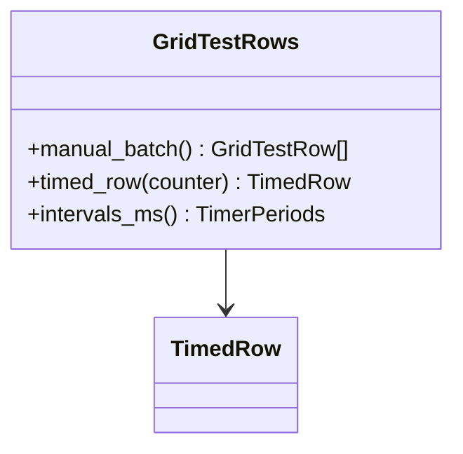

# AppGridTest - feature work orders



- **Primary Role:** UI data-grid exercise harness.
- **Dependencies:** each ready feature names its exact prerequisite order and files; no undeclared workspace import.
- **Outputs / Downstream Role:** the specified helper output only until the full workflow contracts below are made executable.
- **Commit rule:** one READY feature, one commit, only listed files. Blocked rows authorize no code or placeholder tests.

## Source reassessment — 2026-10-30

The [workspace source audit](research/workspaces-09-19-source-review.md) lists newly available implementation files for every blocked feature below. Read that module record with the order. Library availability does not supply missing plugin routes, target integration contracts or numerical fixtures. The original execution boundary remains in effect except for explicitly revised bounded orders.

## Phase 15.1: observed deterministic behavior

### `GridTestRows` - WO-15-01 - READY after its named prerequisites

*Evidence IDs:* `OBS145-AppGridTest-HELPER-001` (retained below).
*Context to Read:* `DONOR_REFERENCE_ROOT/internal/web/GRIDTEST/layout` (resource folder; originally named `LayoutCtrl.js` is not present). Read only these donor files and the completed prerequisite files named in this order.

*Feature:* exact row generation/timer metadata for the UI grid harness; no distributed computation or random scheduler.
*Dependencies:* WO-C00 frontend runner.
*Implementation Files:*
- **Backend:** none. No server or worker endpoint is required by this row helper.
- **Frontend Create:** `app/web/workspaces/grid_test/rows.ts`.
- **Test Create:** `app/web/tests/workspaces/grid_test/rows.test.ts`.
*Types:* `GridTestRow = readonly [number, number, string]`; `TimedRow = {row: GridTestRow; next_counter: number; change_count: 0}`. Methods below are exported static methods of GridTestRows.
*Functional Requirements & Implementation:*
- [ ] `GridTestRows.manual_batch(): GridTestRow[]` -> create exactly 100 fresh triples `[i, i*2, String(i)+'-text']` for i 0..99. It takes no global counter and does not initialize user metadata.
- [ ] `GridTestRows.timed_row(counter: number): TimedRow` -> return row `[counter,counter*2,String(counter)+'-text']`, next_counter counter+1 and change_count 0. Caller owns the counter; no random call or timer is created. The harness's initial timed counter is 1, independently of manual_batch.
- [ ] `GridTestRows.intervals_ms(): {add:20;remove:30;change:40;count:50}` -> fresh object with these exact values.
- [ ] `test('manual row boundaries')` -> length100, first `[0,0,'0-text']`, last `[99,198,'99-text']`; mutating one returned batch does not affect another.
- [ ] `test('timed counter independent of manual rows')` -> timed_row(1) gives `[1,2,'1-text']`, next2, change_count0; calling manual_batch then timed_row(1) produces the same object values.
- [ ] `test('timer metadata')` -> exact periods20/30/40/50.
*Acceptance:* `npm --prefix app/web test -- tests/workspaces/grid_test/rows.test.ts` exits 0, three tests.
*Commit:* `grid-test: preserve deterministic row generation`.
*Remaining blockers:* full sqGrid user-data defaults, random removal/change, selection and rendering are not closed by this order.

## Phase 15.2: complete workspace contribution - READY

All 1 assigned plugin modules remain in scope. The helper above is not acceptance of these complete features. Reserved paths below are exact; do not create service stubs or infer signatures while a row is blocked.

### `AppGridTest` - I-AppGridTest - READY

*Feature:* complete AppGridTest workflow.
*Evidence IDs:* `OBS145-AppGridTest-SCOPE-001` establishes source presence only; `OBS145-AppGridTest-HELPER-001` establishes only the separately scoped helper.
*Implementation Files (reserved, no creation while blocked):*
- **Backend:** `app/workspaces/grid_test/app_grid_test.py`.
- **Models:** `app/workspaces/grid_test/app_grid_test_models.py`.
- **Frontend:** `app/web/workspaces/grid_test/GridTestWorkspace.tsx`.
- **Backend test:** `tests/workspaces/grid_test/test_app_grid_test.py`.
- **Frontend test:** `app/web/tests/workspaces/grid_test/AppGridTestPanel.test.tsx`.
- **Context to Read:** `DONOR_REFERENCE_ROOT/internal/plugins/AppGridTest/GridTest/GridTestAppPlugin.java`, `DONOR_REFERENCE_ROOT/internal/plugins/AppGridTest/module.js`.
*Observed action names (not a payload specification):* No literal client action extracted from this module; the specified class/view context must establish operations.
*Missing contract:* Full grid row identity/user-data defaults, random selection scheduling, selection/cell-event semantics and renderer/DOM tests.
*Function/signature authorization:* none. No generic `execute(payload: dict)` or invented CRUD surface.
*Acceptance:* not yet executable. A revised order must name literal fixtures and methods before `uv run python -m pytest tests/workspaces/grid_test/test_app_grid_test.py -q` or `npm --prefix app/web test -- tests/workspaces/grid_test/AppGridTestPanel.test.tsx` can be acceptance. A zero-test/no-assertion pass is invalid.
*Commit boundary:* this one feature only after its order is READY; do not combine with the helper commit.


*Source reassessment (2026-10-30):* [AppGridTest source record](research/workspaces-09-19-source-review.md#appgridtest) identifies 1 matching readable Java files and 1 primary frontend/settings files. The record identifies readable plugin or explicitly related library sources; inspect their named methods instead of repeating source discovery. Matching a class name alone does not establish the complete plugin implementation. The remaining full-workflow contract and test prerequisites above still apply.

## Work-order evidence

```json
{
  "id": "OBS145-AppGridTest-HELPER-001",
  "classification": "observed",
  "confidence": "high",
  "claim": "Grid-test manual add-100 generates rows for indices 0 through 99; timed insertion uses its separate counter and initializes changeCount to zero. Timer periods are 20/30/40ms and row-count refresh is 50ms.",
  "sources": [
    "DONOR_REFERENCE_ROOT/internal/web/GRIDTEST/layout/LayoutCtrl.js"
  ],
  "target_domain": "app/workspaces/grid_test; app/web/workspaces/grid_test",
  "feature_ids": [],
  "requirement_ids": [],
  "decision_ids": [],
  "registration_gap": "Work-order labels are planning IDs, not ratified domain feature IDs.",
  "limitations": "Static primary source inspection. Helper acceptance is not full workspace, algorithm, vendor protocol or runtime parity.",
  "validation": {
    "status": "passed",
    "executed_at": "2026-10-29T09:38:19.613785+00:00",
    "procedure": "Read named primary source files and directory entries; identify explicit scalar rules and literal action names.",
    "actual_observation": "Grid-test manual add-100 generates rows for indices 0 through 99; timed insertion uses its separate counter and initializes changeCount to zero. Timer periods are 20/30/40ms and row-count refresh is 50ms.",
    "expected_observation": "Grid-test manual add-100 generates rows for indices 0 through 99; timed insertion uses its separate counter and initializes changeCount to zero. Timer periods are 20/30/40ms and row-count refresh is 50ms.",
    "artifacts": [
      {
        "path": "DONOR_REFERENCE_ROOT/internal/web/GRIDTEST/layout/LayoutCtrl.js",
        "sha256": "088321305fbb46ec225d9f9749140d06e2cccefbaab9284013795aa6df696cdf"
      }
    ]
  },
  "repository_commit": "f5c7d12d5715b8ebee55165b8eddad9068f83cb9",
  "review_state": "owner-review-pending",
  "contains_proprietary_source": false,
  "contains_sensitive_data": false,
  "contains_personal_data": false,
  "paraphrased_behavior_only": true,
  "supersedes_records": [],
  "superseded_by": []
}
```

```json
{
  "id": "OBS145-AppGridTest-SCOPE-001",
  "classification": "observed",
  "confidence": "high",
  "claim": "Named primary plugin modules and readable files exist; declarations/action names do not establish complete request/response behavior.",
  "sources": [
    "DONOR_REFERENCE_ROOT/internal/plugins/AppGridTest"
  ],
  "target_domain": "app/workspaces/grid_test; app/web/workspaces/grid_test",
  "feature_ids": [],
  "requirement_ids": [],
  "decision_ids": [],
  "registration_gap": "Work-order labels are planning IDs, not ratified domain feature IDs.",
  "limitations": "Static primary source inspection. Helper acceptance is not full workspace, algorithm, vendor protocol or runtime parity.",
  "validation": {
    "status": "passed",
    "executed_at": "2026-10-29T09:38:19.613785+00:00",
    "procedure": "Read named primary source files and directory entries; identify explicit scalar rules and literal action names.",
    "actual_observation": "Named primary plugin modules and readable files exist; declarations/action names do not establish complete request/response behavior.",
    "expected_observation": "Named primary plugin modules and readable files exist; declarations/action names do not establish complete request/response behavior.",
    "artifacts": [
      "DONOR_REFERENCE_ROOT/internal/plugins"
    ]
  },
  "repository_commit": "f5c7d12d5715b8ebee55165b8eddad9068f83cb9",
  "review_state": "owner-review-pending",
  "contains_proprietary_source": false,
  "contains_sensitive_data": false,
  "contains_personal_data": false,
  "paraphrased_behavior_only": true,
  "supersedes_records": [],
  "superseded_by": []
}
```


## Current-code migration assessment

Migration fit is separate from implementation status. Direct fit below means the inspected presentation/data can be retained; it does not establish backend or donor parity. Existing domain READMEs continue to own implementation status. No code moves are performed by this planning change.

| Current HaruQuantAI location | Exact target proposed location | Fit / action | Required change and verification boundary |
| --- | --- | --- | --- |
| `ui/app/workspace/GridTest/GridTestWorkspace.tsx` | `app/web/workspaces/grid_test/GridTestWorkspace.tsx` | Replace row model; retain table primitives | Current8-column forex quote fixture with LCG seed42/max1000 differs from donor3-column add/remove/change harness. Reuse common React table primitives, not buildGridTestRows algorithm/columns. |
| `ui/tests/unit/workspace/GridTest/gridTest.test.ts` | `app/web/tests/workspaces/grid_test/gridTest.test.ts` | Replace incompatible assertions | Replace8-column/seeded quote tests with the exact3-column/manual100/timed-counter/selection fixtures specified by this phase. |
| `No backend required for donor local table harness` | `app/web/workspaces/grid_test/rows.ts` | Frontend-only owner | Do not create a grid_test Python scheduler just to mirror the folder; the local table harness has no proven backend operation. |

### Reorganization work order - MIG-AppGridTest

*Evidence:* `OBS-CURRENT-AppGridTest-MIGRATION-001`.
*Context to Read:* every existing current file in the table, its named test and the existing `ui/app/host/App.tsx` route/import entries; no donor runtime is required for the relocation itself.
*Execution order:* move retained presentation files first, change their relative UI/host imports to the published target owner, move/revise the listed tests, then switch route imports in the target shell. Keep one current-to-target owner per table row. Do not leave forwarding copies in old workspace folders; keep source history through Git moves. Do not move application state from a shared browser store into another mock runner.
*Behavior changes:* only those explicitly listed in accepted work orders may replace the fixture behavior. A physical move cannot make a mock engine/service a direct fit. Missing backend rows require production implementation; pyc/cache directories are not source to recover or migrate.
*Exact baseline / target commands (each exit0; revised donor-backed assertions are specified by the feature orders):*
- Baseline: `npm --prefix ui test -- tests/unit/workspace/GridTest/gridTest.test.ts`. Target: `npm --prefix app/web test -- tests/workspaces/grid_test/gridTest.test.ts`.
No other path substitution is authorized. Passing the current fixture tests is not donor acceptance.
*Commit boundary:* one cohesive workspace file reorganization with its import/test updates; algorithm/service replacements are separate feature commits. If a source is split between GridControl and SQAI, the owning phase migrates its exact extracted section once; SQXBusiness never keeps a duplicate.

```json
{
  "id": "OBS-CURRENT-AppGridTest-MIGRATION-001",
  "classification": "observed",
  "confidence": "high",
  "claim": "Inspected current source/test files distinguish reusable presentation and local editing state from mock execution, fixture-only history and missing Python workspace implementations. The table assigns exact target owners as normative migration decisions.",
  "sources": [
    "HARUQUANTAI_ROOT/ui/app/workspace/GridTest/GridTestWorkspace.tsx",
    "HARUQUANTAI_ROOT/ui/tests/unit/workspace/GridTest/gridTest.test.ts"
  ],
  "target_domain": "AppGridTest",
  "feature_ids": [],
  "requirement_ids": [],
  "decision_ids": [],
  "registration_gap": "Register migration decisions through the owning domain README; this table does not duplicate implementation status.",
  "limitations": "Static source/import audit. Six existing current frontend test files passed20tests; those assertions cover current stores/helpers, not donor algorithms or absent provider services. AI presentation source was statically inspected; no AI backend or external service was executed.",
  "validation": {
    "status": "passed",
    "executed_at": "2026-10-29T10:08:10.884105+00:00",
    "procedure": "Inspect current imports, state/fixture generation, service call absence and existing tests; run targeted current Vitest cohort.",
    "actual_observation": {
      "command": "npm --prefix ui test -- tests/unit/workspace/CustomProjects/customProjects.test.ts tests/unit/workspace/NeuralNetwork/neuralNet.test.ts tests/unit/workspace/GridControl/gridControl.test.ts tests/unit/workspace/GridTest/gridTest.test.ts tests/unit/workspace/DebugConsole/debugConsole.test.ts tests/unit/workspace/Business/business.test.ts",
      "exit_code": 0,
      "test_files_passed": 6,
      "tests_passed": 20
    },
    "expected_observation": "Current tests pass without implying donor parity; source evidence establishes which functions are fixture-driven.",
    "artifacts": [
      {
        "path": "HARUQUANTAI_ROOT/ui/app/workspace/GridTest/GridTestWorkspace.tsx",
        "sha256": "5556ef6331a0eec7b0ee603110a051863bab6d28fff27968d1851ef72c48c4f0"
      },
      {
        "path": "HARUQUANTAI_ROOT/ui/tests/unit/workspace/GridTest/gridTest.test.ts",
        "sha256": "4a5891a7db709f4ab49d4e2d812f34624f675b3ecc0db5855d4800176a9c18fa"
      }
    ]
  },
  "repository_commit": "f5c7d12d5715b8ebee55165b8eddad9068f83cb9",
  "review_state": "owner-review-pending",
  "contains_proprietary_source": false,
  "contains_sensitive_data": false,
  "contains_personal_data": false,
  "paraphrased_behavior_only": true,
  "supersedes_records": [],
  "superseded_by": []
}
```
