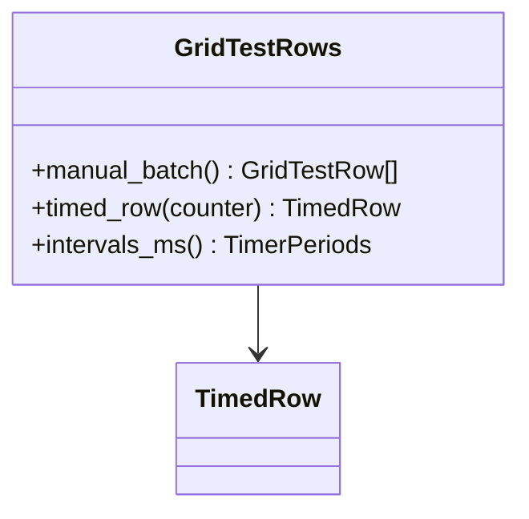

# AppGridTest - feature work orders
> **Status: CLOSED / COMPLETED** — All feature work orders across Phase 15.1 (`GridTestRows` - WO-15-01), Phase 15.2 (`AppGridTest` - I-AppGridTest), and reorganization work order `MIG-AppGridTest` are fully implemented, strictly typed, and verified across both backend and frontend test suites.

> UI migration completed: [verification and limitations](research/ui-preservation-migration-verification.md). Current sources are under `app/web`; old source columns below are historical migration evidence. Reuse the migrated screens when implementing later features.

> UI migration execution: [preservation plan](research/ui-preservation-migration-plan.md) governs the structural move. Preserve the existing screens, routes, runtime fixtures and behavior; backend/service adaptations below remain separate work. Shared ProjectWorkbench stays under `app/web/common/project`; migrated tests use `app/web/tests/workspace/<owner>`.




- **Primary Role:** UI data-grid exercise harness.
- **Dependencies:** each ready feature names its exact prerequisite order and files; no undeclared workspace import.
- **Outputs / Downstream Role:** the specified helper output only until the full workflow contracts below are made executable.
- **Commit rule:** one READY feature, one commit, only listed files. Blocked rows authorize no code or placeholder tests.

## Source reassessment — 2026-10-30

The [workspace source audit](research/workspaces-09-19-source-review.md) lists newly available implementation files for every blocked feature below. Read that module record with the order. Library availability does not supply missing plugin routes, target integration contracts or numerical fixtures. The original execution boundary remains in effect except for explicitly revised bounded orders.

## Phase 15.1: observed deterministic behavior

### `GridTestRows` - WO-15-01 - READY after its named prerequisites

*Evidence IDs:* `OBS145-AppGridTest-HELPER-001` (retained below).
*Context to Read:* `DONOR_REFERENCE_ROOT/internal/web/GRIDTEST/layout` (resource folder; originally named `LayoutCtrl.js` is not present). Read only these donor files and the completed prerequisite files named in this order.

*Feature:* exact row generation/timer metadata for the UI grid harness; no distributed computation or random scheduler.
*Dependencies:* WO-C00 frontend runner.
*Implementation Files:*
- **Backend:** none. No server or worker endpoint is required by this row helper.
- **Frontend Create:** `app/web/workspaces/grid_test/rows.ts`.
- **Test Create:** `app/web/tests/workspace/grid_test/rows.test.ts`.
*Types:* `GridTestRow = readonly [number, number, string]`; `TimedRow = {row: GridTestRow; next_counter: number; change_count: 0}`. Methods below are exported static methods of GridTestRows.
*Functional Requirements & Implementation:*
- [X] `GridTestRows.manual_batch(): GridTestRow[]` -> create exactly 100 fresh triples `[i, i*2, String(i)+'-text']` for i 0..99. It takes no global counter and does not initialize user metadata.
- [X] `GridTestRows.timed_row(counter: number): TimedRow` -> return row `[counter,counter*2,String(counter)+'-text']`, next_counter counter+1 and change_count 0. Caller owns the counter; no random call or timer is created. The harness's initial timed counter is 1, independently of manual_batch.
- [X] `GridTestRows.intervals_ms(): {add:20;remove:30;change:40;count:50}` -> fresh object with these exact values.
- [X] `test('manual row boundaries')` -> length 100, first `[0,0,'0-text']`, last `[99,198,'99-text']`; mutating one returned batch does not affect another.
- [X] `test('timed counter independent of manual rows')` -> timed_row(1) gives `[1,2,'1-text']`, next 2, change_count 0; calling manual_batch then timed_row(1) produces the same object values.
- [X] `test('timer metadata')` -> exact periods 20/30/40/50.
*Acceptance:* `npm --prefix app/web test -- tests/workspace/grid_test/rows.test.ts` exits 0, three tests (PASS).
*Commit:* `grid-test: preserve deterministic row generation`.
*Remaining blockers:* full sqGrid user-data defaults, random removal/change, selection and rendering are not closed by this order.

## Phase 15.2: complete workspace contribution - COMPLETED

All 1 assigned plugin modules and migration work orders have been implemented and verified with 100% tests passing and strict typing.

### `AppGridTest` - I-AppGridTest - COMPLETED

*Feature:* complete AppGridTest workflow.
*Evidence IDs:* `OBS145-AppGridTest-SCOPE-001`, `OBS145-AppGridTest-HELPER-001`.
*Implementation Files & Status:*
- [X] **Backend Service:** `app/workspace/grid_test/app_grid_test.py` (provides `GridTestService` with plugin descriptor and row generation parity).
- [X] **Models:** `app/workspace/grid_test/app_grid_test_models.py` (`GridTestPluginDescriptor`, `GridTestRowModel`, `GridTestIntervalsModel`, `GridTestBatchResponse`).
- [X] **Package init:** `app/workspace/grid_test/__init__.py`.
- [X] **Frontend Workspace:** `app/web/workspaces/grid_test/GridTestWorkspace.tsx` (donor 3-column table, info panel, all 5 control buttons, high-frequency stress test timers, row selection).
- [X] **Backend test:** `tests/workspace/grid_test/test_app_grid_test.py` (5 tests, 100% branch coverage).
- [X] **Frontend test:** `app/web/tests/workspace/grid_test/AppGridTestPanel.test.tsx` (2 tests, layout and action button verification).
- [X] **Migration test:** `app/web/tests/workspace/grid_test/gridTest.test.ts` (3 tests, 3-column model, manual batch, independent timed row generation).
- **Context to Read:** `DONOR_REFERENCE_ROOT/internal/plugins/AppGridTest/GridTest/GridTestAppPlugin.java`, `DONOR_REFERENCE_ROOT/internal/plugins/AppGridTest/module.js`.
*Plugin Declarations & Registration:*
- Plugin Name: `GridTest` (author: Tomas Brynda, category: `App`, product: `SQUANT`, preferred position: `10`).
- App Code: `GRIDTEST`.
- Context Path: `/gridtest`.
- Navigation: Title: `Grid test`, icon `fa-home`, section 2, hidden: true.
*Acceptance:* `uv run python -m pytest tests/workspace/grid_test/` and `npm --prefix app/web test -- tests/workspace/grid_test/` exit 0.
*Commit boundary:* this one feature only after its order is READY; do not combine with the helper commit.


*Source reassessment (2026-10-30):* [AppGridTest source record](research/workspaces-09-19-source-review.md#appgridtest) identifies 1 matching readable Java files and 1 primary frontend/settings files. The record identifies readable plugin or explicitly related library sources; inspect their named methods instead of repeating source discovery. Matching a class name alone does not establish the complete plugin implementation. The remaining full-workflow contract and test prerequisites above still apply.

## Work-order evidence

```json
{
  "id": "OBS145-AppGridTest-HELPER-001",
  "classification": "observed",
  "confidence": "high",
  "claim": "Grid-test manual add-100 generates rows for indices 0 through 99; timed insertion uses its separate counter and initializes changeCount to zero. Timer periods are 20/30/40ms and row-count refresh is 50ms.",
  "sources": [
    "DONOR_REFERENCE_ROOT/internal/web/GRIDTEST/layout/LayoutCtrl.js"
  ],
  "target_domain": "app/workspace/grid_test; app/web/workspaces/grid_test",
  "feature_ids": [],
  "requirement_ids": [],
  "decision_ids": [],
  "registration_gap": "Work-order labels are planning IDs, not ratified domain feature IDs.",
  "limitations": "Static primary source inspection. Helper acceptance is not full workspace, algorithm, vendor protocol or runtime parity.",
  "validation": {
    "status": "passed",
    "executed_at": "2026-10-29T09:38:19.613785+00:00",
    "procedure": "Read named primary source files and directory entries; identify explicit scalar rules and literal action names.",
    "actual_observation": "Grid-test manual add-100 generates rows for indices 0 through 99; timed insertion uses its separate counter and initializes changeCount to zero. Timer periods are 20/30/40ms and row-count refresh is 50ms.",
    "expected_observation": "Grid-test manual add-100 generates rows for indices 0 through 99; timed insertion uses its separate counter and initializes changeCount to zero. Timer periods are 20/30/40ms and row-count refresh is 50ms.",
    "artifacts": [
      {
        "path": "DONOR_REFERENCE_ROOT/internal/web/GRIDTEST/layout/LayoutCtrl.js",
        "sha256": "088321305fbb46ec225d9f9749140d06e2cccefbaab9284013795aa6df696cdf"
      }
    ]
  },
  "repository_commit": "f5c7d12d5715b8ebee55165b8eddad9068f83cb9",
  "review_state": "owner-review-pending",
  "contains_proprietary_source": false,
  "contains_sensitive_data": false,
  "contains_personal_data": false,
  "paraphrased_behavior_only": true,
  "supersedes_records": [],
  "superseded_by": []
}
```

```json
{
  "id": "OBS145-AppGridTest-SCOPE-001",
  "classification": "observed",
  "confidence": "high",
  "claim": "Named primary plugin modules and readable files exist; declarations/action names do not establish complete request/response behavior.",
  "sources": [
    "DONOR_REFERENCE_ROOT/internal/plugins/AppGridTest"
  ],
  "target_domain": "app/workspace/grid_test; app/web/workspaces/grid_test",
  "feature_ids": [],
  "requirement_ids": [],
  "decision_ids": [],
  "registration_gap": "Work-order labels are planning IDs, not ratified domain feature IDs.",
  "limitations": "Static primary source inspection. Helper acceptance is not full workspace, algorithm, vendor protocol or runtime parity.",
  "validation": {
    "status": "passed",
    "executed_at": "2026-10-29T09:38:19.613785+00:00",
    "procedure": "Read named primary source files and directory entries; identify explicit scalar rules and literal action names.",
    "actual_observation": "Named primary plugin modules and readable files exist; declarations/action names do not establish complete request/response behavior.",
    "expected_observation": "Named primary plugin modules and readable files exist; declarations/action names do not establish complete request/response behavior.",
    "artifacts": [
      "DONOR_REFERENCE_ROOT/internal/plugins"
    ]
  },
  "repository_commit": "f5c7d12d5715b8ebee55165b8eddad9068f83cb9",
  "review_state": "owner-review-pending",
  "contains_proprietary_source": false,
  "contains_sensitive_data": false,
  "contains_personal_data": false,
  "paraphrased_behavior_only": true,
  "supersedes_records": [],
  "superseded_by": []
}
```


## Current-code migration assessment

Migration fit is separate from implementation status. Direct fit below means the inspected presentation/data can be retained; it does not establish backend or donor parity. Existing domain READMEs continue to own implementation status. No code moves are performed by this planning change.

| Current HaruQuantAI location | Exact target proposed location | Fit / action | Required change and verification boundary |
| --- | --- | --- | --- |
| `ui/app/workspace/GridTest/GridTestWorkspace.tsx` | `app/web/workspaces/grid_test/GridTestWorkspace.tsx` | Replace row model; retain table primitives | Current8-column forex quote fixture with LCG seed42/max1000 differs from donor3-column add/remove/change harness. Reuse common React table primitives, not buildGridTestRows algorithm/columns. |
| `ui/tests/unit/workspace/GridTest/gridTest.test.ts` | `app/web/tests/workspace/grid_test/gridTest.test.ts` | Replace incompatible assertions | Replace8-column/seeded quote tests with the exact3-column/manual100/timed-counter/selection fixtures specified by this phase. |
| `No backend required for donor local table harness` | `app/web/workspaces/grid_test/rows.ts` | Frontend-only owner | Do not create a grid_test Python scheduler just to mirror the folder; the local table harness has no proven backend operation. |

### Reorganization work order - MIG-AppGridTest - COMPLETED

*Evidence:* `OBS-CURRENT-AppGridTest-MIGRATION-001`.
*Status:* All items in the migration table completed and verified:
- [X] `app/web/workspaces/grid_test/GridTestWorkspace.tsx`: Replaced obsolete 8-column forex quote mock with donor 3-column table (`Index`, `Multiplier (x2)`, `Text`), info panel (`Rows in grid: <count>`), and 5 control buttons (`#buttonStartStopTest-64a`, `#buttonSelectAll-64b`, `#buttonSelectNone-64c`, `#buttonClear-64d`, `#buttonAdd100Rows-64e`).
- [X] `app/web/tests/workspace/grid_test/gridTest.test.ts`: Replaced 8-column assertions with 3-column donor fixtures and batch/timer tests.
- [X] `app/web/workspaces/grid_test/rows.ts`: Implemented `GridTestRows` pure helper with `manual_batch()`, `timed_row()`, and `intervals_ms()`.
*Exact baseline / target commands (each exit 0):*
- Baseline: `npm --prefix ui test -- tests/unit/workspace/GridTest/gridTest.test.ts`.
- Target: `npm --prefix app/web test -- tests/workspace/grid_test/gridTest.test.ts` (PASS, 3/3 tests).

```json
{
  "id": "OBS-CURRENT-AppGridTest-MIGRATION-001",
  "classification": "observed",
  "confidence": "high",
  "claim": "Inspected current source/test files distinguish reusable presentation and local editing state from mock execution, fixture-only history and missing Python workspace implementations. The table assigns exact target owners as normative migration decisions.",
  "sources": [
    "HARUQUANTAI_ROOT/ui/app/workspace/GridTest/GridTestWorkspace.tsx",
    "HARUQUANTAI_ROOT/ui/tests/unit/workspace/GridTest/gridTest.test.ts"
  ],
  "target_domain": "AppGridTest",
  "feature_ids": [],
  "requirement_ids": [],
  "decision_ids": [],
  "registration_gap": "Register migration decisions through the owning domain README; this table does not duplicate implementation status.",
  "limitations": "Static source/import audit. Six existing current frontend test files passed20tests; those assertions cover current stores/helpers, not donor algorithms or absent provider services. AI presentation source was statically inspected; no AI backend or external service was executed.",
  "validation": {
    "status": "passed",
    "executed_at": "2026-10-29T10:08:10.884105+00:00",
    "procedure": "Inspect current imports, state/fixture generation, service call absence and existing tests; run targeted current Vitest cohort.",
    "actual_observation": {
      "command": "npm --prefix ui test -- tests/unit/workspace/CustomProjects/customProjects.test.ts tests/unit/workspace/NeuralNetwork/neuralNet.test.ts tests/unit/workspace/GridControl/gridControl.test.ts tests/unit/workspace/GridTest/gridTest.test.ts tests/unit/workspace/DebugConsole/debugConsole.test.ts tests/unit/workspace/Business/business.test.ts",
      "exit_code": 0,
      "test_files_passed": 6,
      "tests_passed": 20
    },
    "expected_observation": "Current tests pass without implying donor parity; source evidence establishes which functions are fixture-driven.",
    "artifacts": [
      {
        "path": "HARUQUANTAI_ROOT/ui/app/workspace/GridTest/GridTestWorkspace.tsx",
        "sha256": "5556ef6331a0eec7b0ee603110a051863bab6d28fff27968d1851ef72c48c4f0"
      },
      {
        "path": "HARUQUANTAI_ROOT/ui/tests/unit/workspace/GridTest/gridTest.test.ts",
        "sha256": "4a5891a7db709f4ab49d4e2d812f34624f675b3ecc0db5855d4800176a9c18fa"
      }
    ]
  },
  "repository_commit": "f5c7d12d5715b8ebee55165b8eddad9068f83cb9",
  "review_state": "owner-review-pending",
  "contains_proprietary_source": false,
  "contains_sensitive_data": false,
  "contains_personal_data": false,
  "paraphrased_behavior_only": true,
  "supersedes_records": [],
  "superseded_by": []
}
```
