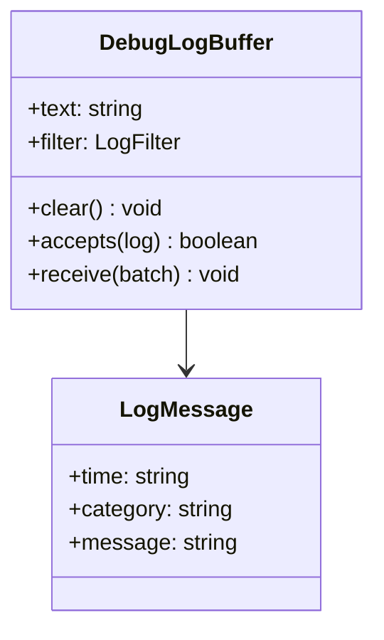

# AppDebugConsole - feature work orders



- **Primary Role:** log filtering and inspection.
- **Dependencies:** each ready feature names its exact prerequisite order and files; no undeclared workspace import.
- **Outputs / Downstream Role:** the specified helper output only until the full workflow contracts below are made executable.
- **Commit rule:** one READY feature, one commit, only listed files. Blocked rows authorize no code or placeholder tests.

## Source reassessment — 2026-10-30

The [workspace source audit](research/workspaces-09-19-source-review.md) lists newly available implementation files for every blocked feature below. Read that module record with the order. Library availability does not supply missing plugin routes, target integration contracts or numerical fixtures. The original execution boundary remains in effect except for explicitly revised bounded orders.

## Phase 16.1: observed deterministic behavior

### `DebugLogBuffer` - WO-16-01 - READY after its named prerequisites

*Evidence IDs:* `OBS145-AppDebugConsole-HELPER-001` (retained below).
*Context to Read:* `DONOR_REFERENCE_ROOT/internal/web/DEBUGCONSOLE/debugconsole` (resource folder; originally named `DebugConsole.vue` is not present). Read only these donor files and the completed prerequisite files named in this order.

*Feature:* reproduce the observed log-buffer state transitions, including early batch return; no websocket/auth/HTML renderer.
*Dependencies:* WO-C00 frontend runner.
*Implementation Files:*
- **Backend:** none; log transport/schema producer remains blocked.
- **Frontend Create:** `app/web/workspaces/debug_console/buffer.ts`.
- **Test Create:** `app/web/tests/workspaces/debug_console/buffer.test.ts`.
*Types:* `LogMessage={time:string;category:string;message:string}`. Export class DebugLogBuffer with public text initialized `''` and public filter initialized `{category:'all',text:''}` per new instance. Inputs are complete typed messages; no coercion/schema validation.
*Functional Requirements & Implementation:*
- [ ] `DebugLogBuffer.clear(): void` -> assign empty string to text, preserve filter.
- [ ] `DebugLogBuffer.accepts(log: LogMessage): boolean` -> reject when filter.category is not all and differs from log.category; otherwise return log.message.includes(filter.text). Text matching is case-sensitive and does not inspect time/category.
- [ ] `DebugLogBuffer.receive(batch: readonly LogMessage[]): void` -> iterate in order. At the first rejected message RETURN from the entire method; do not continue. For each accepted message set text to `time+' '+category+' - '+message+'</br>'+old_text.substring(0,10000)`. This may exceed 10000 total code units. Do not strip/escape/interpret message HTML here; creating an HTML rendering sink is explicitly outside this commit.
- [ ] `test('defaults and prepend order')` -> receive [{time:'1',category:'A',message:'a'},{time:'2',category:'B',message:'b'}]; text equals `2 B - b</br>1 A - a</br>`.
- [ ] `test('first rejected message aborts batch')` -> filter all/ok; receive messages ok,no,ok2 at times1,2,3; final text `1 A - ok</br>`; ok2 never appears. Category A is used by all three fixtures.
- [ ] `test('case-sensitive filter and clear')` -> filter A/ok accepts A/ok and rejects A/OK,B/ok; after clear text empty and filter unchanged.
- [ ] `test('truncate previous buffer before prefix')` -> text='x'.repeat(10001), receive [{time:'1',category:'A',message:'a'}]; text exactly `1 A - a</br>` plus 10000 x characters.
*Acceptance:* `npm --prefix app/web test -- tests/workspaces/debug_console/buffer.test.ts` exits 0, four tests.
*Commit:* `debug-console: preserve observed log-buffer transitions`.

## Phase 16.2: complete workspace contribution - BLOCKED-NOT-EXECUTABLE

All 1 assigned plugin modules remain in scope. The helper above is not acceptance of these complete features. Reserved paths below are exact; do not create service stubs or infer signatures while a row is blocked.

### `AppDebugConsole` - I-AppDebugConsole - BLOCKED-NOT-EXECUTABLE

*Feature:* complete AppDebugConsole workflow.
*Evidence IDs:* `OBS145-AppDebugConsole-SCOPE-001` establishes source presence only; `OBS145-AppDebugConsole-HELPER-001` establishes only the separately scoped helper.
*Implementation Files (reserved, no creation while blocked):*
- **Backend:** `app/workspaces/debug_console/app_debug_console.py`.
- **Models:** `app/workspaces/debug_console/app_debug_console_models.py`.
- **Frontend:** `app/web/workspaces/debug_console/DebugConsoleWorkspace.tsx`.
- **Backend test:** `tests/workspaces/debug_console/test_app_debug_console.py`.
- **Frontend test:** `app/web/tests/workspaces/debug_console/AppDebugConsolePanel.test.tsx`.
- **Context to Read:** `DONOR_REFERENCE_ROOT/internal/plugins/AppDebugConsole/DebugConsole/DebugConsoleAppPlugin.java`, `DONOR_REFERENCE_ROOT/internal/plugins/AppDebugConsole/module.js`.
*Observed action names (not a payload specification):* No literal client action extracted from this module; the specified class/view context must establish operations.
*Missing contract:* Backend event schema/subscription/reconnect, category-registration and safe HTML rendering policies. The buffer helper does not authorize an HTML sink.
*Function/signature authorization:* none. No generic `execute(payload: dict)` or invented CRUD surface.
*Acceptance:* not yet executable. A revised order must name literal fixtures and methods before `uv run python -m pytest tests/workspaces/debug_console/test_app_debug_console.py -q` or `npm --prefix app/web test -- tests/workspaces/debug_console/AppDebugConsolePanel.test.tsx` can be acceptance. A zero-test/no-assertion pass is invalid.
*Commit boundary:* this one feature only after its order is READY; do not combine with the helper commit.


*Source reassessment (2026-10-30):* [AppDebugConsole source record](research/workspaces-09-19-source-review.md#appdebugconsole) identifies 0 matching readable Java files and 1 primary frontend/settings files. No matching plugin Java body was found in the bounded library/recovered-source search. This may be a frontend-only contribution; review the listed UI handlers and actual backend dependencies before declaring a missing server.

## Work-order evidence

```json
{
  "id": "OBS145-AppDebugConsole-HELPER-001",
  "classification": "observed",
  "confidence": "high",
  "claim": "DebugConsole filters by exact category unless all, uses case-sensitive message includes, aborts the batch on the first rejected message, and prepends a line to the first 10000 prior code units.",
  "sources": [
    "DONOR_REFERENCE_ROOT/internal/web/DEBUGCONSOLE/debugconsole/src/components/DebugConsole.vue"
  ],
  "target_domain": "app/workspaces/debug_console; app/web/workspaces/debug_console",
  "feature_ids": [],
  "requirement_ids": [],
  "decision_ids": [],
  "registration_gap": "Work-order labels are planning IDs, not ratified domain feature IDs.",
  "limitations": "Static primary source inspection. Helper acceptance is not full workspace, algorithm, vendor protocol or runtime parity.",
  "validation": {
    "status": "passed",
    "executed_at": "2026-10-29T09:38:19.613785+00:00",
    "procedure": "Read named primary source files and directory entries; identify explicit scalar rules and literal action names.",
    "actual_observation": "DebugConsole filters by exact category unless all, uses case-sensitive message includes, aborts the batch on the first rejected message, and prepends a line to the first 10000 prior code units.",
    "expected_observation": "DebugConsole filters by exact category unless all, uses case-sensitive message includes, aborts the batch on the first rejected message, and prepends a line to the first 10000 prior code units.",
    "artifacts": [
      {
        "path": "DONOR_REFERENCE_ROOT/internal/web/DEBUGCONSOLE/debugconsole/src/components/DebugConsole.vue",
        "sha256": "7eec81fe6f3e73fd73e9bf806914f40c5dd25b058ed50fcc3231f3fe33510da5"
      }
    ]
  },
  "repository_commit": "f5c7d12d5715b8ebee55165b8eddad9068f83cb9",
  "review_state": "owner-review-pending",
  "contains_proprietary_source": false,
  "contains_sensitive_data": false,
  "contains_personal_data": false,
  "paraphrased_behavior_only": true,
  "supersedes_records": [],
  "superseded_by": []
}
```

```json
{
  "id": "OBS145-AppDebugConsole-SCOPE-001",
  "classification": "observed",
  "confidence": "high",
  "claim": "Named primary plugin modules and readable files exist; declarations/action names do not establish complete request/response behavior.",
  "sources": [
    "DONOR_REFERENCE_ROOT/internal/plugins/AppDebugConsole"
  ],
  "target_domain": "app/workspaces/debug_console; app/web/workspaces/debug_console",
  "feature_ids": [],
  "requirement_ids": [],
  "decision_ids": [],
  "registration_gap": "Work-order labels are planning IDs, not ratified domain feature IDs.",
  "limitations": "Static primary source inspection. Helper acceptance is not full workspace, algorithm, vendor protocol or runtime parity.",
  "validation": {
    "status": "passed",
    "executed_at": "2026-10-29T09:38:19.613785+00:00",
    "procedure": "Read named primary source files and directory entries; identify explicit scalar rules and literal action names.",
    "actual_observation": "Named primary plugin modules and readable files exist; declarations/action names do not establish complete request/response behavior.",
    "expected_observation": "Named primary plugin modules and readable files exist; declarations/action names do not establish complete request/response behavior.",
    "artifacts": [
      "DONOR_REFERENCE_ROOT/internal/plugins"
    ]
  },
  "repository_commit": "f5c7d12d5715b8ebee55165b8eddad9068f83cb9",
  "review_state": "owner-review-pending",
  "contains_proprietary_source": false,
  "contains_sensitive_data": false,
  "contains_personal_data": false,
  "paraphrased_behavior_only": true,
  "supersedes_records": [],
  "superseded_by": []
}
```


## Current-code migration assessment

Migration fit is separate from implementation status. Direct fit below means the inspected presentation/data can be retained; it does not establish backend or donor parity. Existing domain READMEs continue to own implementation status. No code moves are performed by this planning change.

| Current HaruQuantAI location | Exact target proposed location | Fit / action | Required change and verification boundary |
| --- | --- | --- | --- |
| `ui/app/workspace/DebugConsole/DebugConsoleWorkspace.tsx` | `app/web/workspaces/debug_console/DebugConsoleWorkspace.tsx` | Move renderer + adapt controls | Keep React text rendering and empty state. Replace deriveDebugLog job/notification fixtures and trimmed lowercase matching with accepted server events and case-sensitive donor filtering. |
| `ui/tests/unit/workspace/DebugConsole/debugConsole.test.ts` | `app/web/tests/workspaces/debug_console/debugConsole.test.ts` | Move + revise | Current filtering tests validate target lowercase behavior, not donor behavior. Replace expectations with case-sensitive matching, first-rejection batch return and exact clear behavior. |
| `No current debug event Python source` | `app/workspaces/debug_console/events.py` | Missing - create | Subscribe to core diagnostic events rather than manufacturing Engine-ready log lines from browser state. |

### Reorganization work order - MIG-AppDebugConsole

*Evidence:* `OBS-CURRENT-AppDebugConsole-MIGRATION-001`.
*Context to Read:* every existing current file in the table, its named test and the existing `ui/app/host/App.tsx` route/import entries; no donor runtime is required for the relocation itself.
*Execution order:* move retained presentation files first, change their relative UI/host imports to the published target owner, move/revise the listed tests, then switch route imports in the target shell. Keep one current-to-target owner per table row. Do not leave forwarding copies in old workspace folders; keep source history through Git moves. Do not move application state from a shared browser store into another mock runner.
*Behavior changes:* only those explicitly listed in accepted work orders may replace the fixture behavior. A physical move cannot make a mock engine/service a direct fit. Missing backend rows require production implementation; pyc/cache directories are not source to recover or migrate.
*Exact baseline / target commands (each exit0; revised donor-backed assertions are specified by the feature orders):*
- Baseline: `npm --prefix ui test -- tests/unit/workspace/DebugConsole/debugConsole.test.ts`. Target: `npm --prefix app/web test -- tests/workspaces/debug_console/debugConsole.test.ts`.
No other path substitution is authorized. Passing the current fixture tests is not donor acceptance.
*Commit boundary:* one cohesive workspace file reorganization with its import/test updates; algorithm/service replacements are separate feature commits. If a source is split between GridControl and SQAI, the owning phase migrates its exact extracted section once; SQXBusiness never keeps a duplicate.

```json
{
  "id": "OBS-CURRENT-AppDebugConsole-MIGRATION-001",
  "classification": "observed",
  "confidence": "high",
  "claim": "Inspected current source/test files distinguish reusable presentation and local editing state from mock execution, fixture-only history and missing Python workspace implementations. The table assigns exact target owners as normative migration decisions.",
  "sources": [
    "HARUQUANTAI_ROOT/ui/app/workspace/DebugConsole/DebugConsoleWorkspace.tsx",
    "HARUQUANTAI_ROOT/ui/tests/unit/workspace/DebugConsole/debugConsole.test.ts"
  ],
  "target_domain": "AppDebugConsole",
  "feature_ids": [],
  "requirement_ids": [],
  "decision_ids": [],
  "registration_gap": "Register migration decisions through the owning domain README; this table does not duplicate implementation status.",
  "limitations": "Static source/import audit. Six existing current frontend test files passed20tests; those assertions cover current stores/helpers, not donor algorithms or absent provider services. AI presentation source was statically inspected; no AI backend or external service was executed.",
  "validation": {
    "status": "passed",
    "executed_at": "2026-10-29T10:08:10.884105+00:00",
    "procedure": "Inspect current imports, state/fixture generation, service call absence and existing tests; run targeted current Vitest cohort.",
    "actual_observation": {
      "command": "npm --prefix ui test -- tests/unit/workspace/CustomProjects/customProjects.test.ts tests/unit/workspace/NeuralNetwork/neuralNet.test.ts tests/unit/workspace/GridControl/gridControl.test.ts tests/unit/workspace/GridTest/gridTest.test.ts tests/unit/workspace/DebugConsole/debugConsole.test.ts tests/unit/workspace/Business/business.test.ts",
      "exit_code": 0,
      "test_files_passed": 6,
      "tests_passed": 20
    },
    "expected_observation": "Current tests pass without implying donor parity; source evidence establishes which functions are fixture-driven.",
    "artifacts": [
      {
        "path": "HARUQUANTAI_ROOT/ui/app/workspace/DebugConsole/DebugConsoleWorkspace.tsx",
        "sha256": "fe72b616db879660736dff4b6b0c04ebf17e6025ddddd43947ff687c290caf84"
      },
      {
        "path": "HARUQUANTAI_ROOT/ui/tests/unit/workspace/DebugConsole/debugConsole.test.ts",
        "sha256": "f5d6701a98011386c97da01335379a5c7060a4632d20283adc79ece19be0ed84"
      }
    ]
  },
  "repository_commit": "f5c7d12d5715b8ebee55165b8eddad9068f83cb9",
  "review_state": "owner-review-pending",
  "contains_proprietary_source": false,
  "contains_sensitive_data": false,
  "contains_personal_data": false,
  "paraphrased_behavior_only": true,
  "supersedes_records": [],
  "superseded_by": []
}
```
