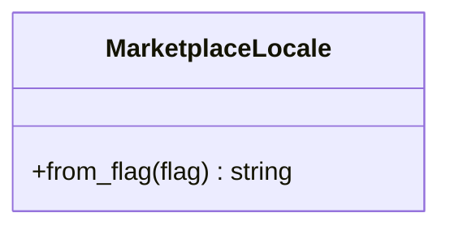

# AppMarketplace - feature work orders



- **Primary Role:** package/service bridge workflows.
- **Dependencies:** each ready feature names its exact prerequisite order and files; no undeclared workspace import.
- **Outputs / Downstream Role:** the specified helper output only until the full workflow contracts below are made executable.
- **Commit rule:** one READY feature, one commit, only listed files. Blocked rows authorize no code or placeholder tests.

## Phase 17.1: observed deterministic behavior

### `MarketplaceLocale` - WO-17-01 - READY after its named prerequisites

*Evidence IDs:* `OBS145-AppMarketplace-HELPER-001` (retained below).
*Context to Read:* `SQX_REFERENCE_ROOT/internal/web/MARKETPLACE/layout/LayoutCtrl.js`. Read only these donor files and the completed prerequisite files named in this order.

*Feature:* locale-code normalization for the marketplace bridge only; no package install/payment/backend protocol.
*Dependencies:* WO-C00 frontend runner.
*Implementation Files:*
- **Backend:** none; install/share/upload require their own verified contracts.
- **Frontend Create:** `app/web/workspaces/marketplace/locale.ts`.
- **Test Create:** `app/web/tests/workspaces/marketplace/locale.test.ts`.
*Functional Requirements & Implementation:*
- [ ] `MarketplaceLocale.from_flag(flag: string | null): string` -> exported static method; null -> en, trim strings, trimmed empty -> en, case-insensitive cz -> cs, otherwise return trimmed original case. No list of supported languages or language guessing.
- [ ] `test('marketplace language normalization')` -> null,'' and '  ' produce en; 'cz','CZ',' cz ' produce cs; ' EN ' produces EN; 'fr' produces fr.
*Acceptance:* `npm --prefix app/web test -- tests/workspaces/marketplace/locale.test.ts` exits 0, one parameterized test group with eight rows.
*Commit:* `marketplace: preserve bridge locale normalization`.

## Phase 17.2: complete workspace contribution - BLOCKED-NOT-EXECUTABLE

All 1 assigned plugin modules remain in scope. The helper above is not acceptance of these complete features. Reserved paths below are exact; do not create service stubs or infer signatures while a row is blocked.

### `AppMarketplace` - I-AppMarketplace - BLOCKED-NOT-EXECUTABLE

*Feature:* complete AppMarketplace workflow.
*Evidence IDs:* `OBS145-AppMarketplace-SCOPE-001` establishes source presence only; `OBS145-AppMarketplace-HELPER-001` establishes only the separately scoped helper.
*Implementation Files (reserved, no creation while blocked):*
- **Backend:** `app/workspaces/marketplace/app_marketplace.py`.
- **Models:** `app/workspaces/marketplace/app_marketplace_models.py`.
- **Frontend:** `app/web/workspaces/marketplace/MarketplaceWorkspace.tsx`.
- **Backend test:** `tests/workspaces/marketplace/test_app_marketplace.py`.
- **Frontend test:** `app/web/tests/workspaces/marketplace/AppMarketplacePanel.test.tsx`.
- **Context to Read:** `SQX_REFERENCE_ROOT/internal/plugins/AppMarketplace/AppMarketplace.jar`, `SQX_REFERENCE_ROOT/internal/plugins/AppMarketplace/module.js`.
*Observed action names (not a payload specification):* No literal client action extracted from this module; the specified class/view context must establish operations.
*Missing contract:* Every versioned bridge action/response, package manifest/path/hash/conflict/update/rollback rule and authorized vendor service behavior.
*Function/signature authorization:* none. No generic `execute(payload: dict)` or invented CRUD surface.
*Acceptance:* not yet executable. A revised order must name literal fixtures and methods before `uv run python -m pytest tests/workspaces/marketplace/test_app_marketplace.py -q` or `npm --prefix app/web test -- tests/workspaces/marketplace/AppMarketplacePanel.test.tsx` can be acceptance. A zero-test/no-assertion pass is invalid.
*Commit boundary:* this one feature only after its order is READY; do not combine with the helper commit.

External vendor protocols/account data are not inferred from client action names. A legitimate provider/toolchain or a source-established protocol is required; a fake success response cannot close an external integration.

## Work-order evidence

```json
{
  "id": "OBS145-AppMarketplace-HELPER-001",
  "classification": "observed",
  "confidence": "high",
  "claim": "Marketplace language projection trims the selected flag, defaults missing/empty to en, maps case-insensitive cz to cs and otherwise retains the supplied case.",
  "sources": [
    "SQX_REFERENCE_ROOT/internal/web/MARKETPLACE/layout/LayoutCtrl.js"
  ],
  "target_domain": "app/workspaces/marketplace; app/web/workspaces/marketplace",
  "feature_ids": [],
  "requirement_ids": [],
  "decision_ids": [],
  "registration_gap": "Work-order labels are planning IDs, not ratified domain feature IDs.",
  "limitations": "Static primary source inspection. Helper acceptance is not full workspace, algorithm, vendor protocol or runtime parity.",
  "validation": {
    "status": "passed",
    "executed_at": "2026-10-29T09:38:19.613785+00:00",
    "procedure": "Read named primary source files and directory entries; identify explicit scalar rules and literal action names.",
    "actual_observation": "Marketplace language projection trims the selected flag, defaults missing/empty to en, maps case-insensitive cz to cs and otherwise retains the supplied case.",
    "expected_observation": "Marketplace language projection trims the selected flag, defaults missing/empty to en, maps case-insensitive cz to cs and otherwise retains the supplied case.",
    "artifacts": [
      {
        "path": "SQX_REFERENCE_ROOT/internal/web/MARKETPLACE/layout/LayoutCtrl.js",
        "sha256": "068d46fb3e74df293c3bd6f8c5226ba97d8364e168385c5aaf163a08d9014a75"
      }
    ]
  },
  "repository_commit": "f5c7d12d5715b8ebee55165b8eddad9068f83cb9",
  "review_state": "owner-review-pending",
  "contains_proprietary_source": false,
  "contains_sensitive_data": false,
  "contains_personal_data": false,
  "paraphrased_behavior_only": true,
  "supersedes_records": [],
  "superseded_by": []
}
```

```json
{
  "id": "OBS145-AppMarketplace-SCOPE-001",
  "classification": "observed",
  "confidence": "high",
  "claim": "Named primary plugin modules and readable files exist; declarations/action names do not establish complete request/response behavior.",
  "sources": [
    "SQX_REFERENCE_ROOT/internal/plugins/AppMarketplace"
  ],
  "target_domain": "app/workspaces/marketplace; app/web/workspaces/marketplace",
  "feature_ids": [],
  "requirement_ids": [],
  "decision_ids": [],
  "registration_gap": "Work-order labels are planning IDs, not ratified domain feature IDs.",
  "limitations": "Static primary source inspection. Helper acceptance is not full workspace, algorithm, vendor protocol or runtime parity.",
  "validation": {
    "status": "passed",
    "executed_at": "2026-10-29T09:38:19.613785+00:00",
    "procedure": "Read named primary source files and directory entries; identify explicit scalar rules and literal action names.",
    "actual_observation": "Named primary plugin modules and readable files exist; declarations/action names do not establish complete request/response behavior.",
    "expected_observation": "Named primary plugin modules and readable files exist; declarations/action names do not establish complete request/response behavior.",
    "artifacts": [
      "SQX_REFERENCE_ROOT/internal/plugins"
    ]
  },
  "repository_commit": "f5c7d12d5715b8ebee55165b8eddad9068f83cb9",
  "review_state": "owner-review-pending",
  "contains_proprietary_source": false,
  "contains_sensitive_data": false,
  "contains_personal_data": false,
  "paraphrased_behavior_only": true,
  "supersedes_records": [],
  "superseded_by": []
}
```


## Current-code migration assessment

Migration fit is separate from implementation status. Direct fit below means the inspected presentation/data can be retained; it does not establish backend or donor parity. Existing domain READMEs continue to own implementation status. No code moves are performed by this planning change.

| Current HaruQuantAI location | Exact target proposed location | Fit / action | Required change and verification boundary |
| --- | --- | --- | --- |
| `ui/app/workspace/Catalog (directory exists, no source files)` | `app/web/workspaces/marketplace/MarketplaceWorkspace.tsx` | Missing - create | No React marketplace implementation exists to relocate; derive complete browser bridge/package views from primary source. |
| `No current marketplace Python source` | `app/workspaces/marketplace/packages.py` | Missing - create | Implement authorized package install/share/remove workflows against explicit file/hash/manifest contracts; no fabricated vendor success. |

### Reorganization work order - MIG-AppMarketplace

*Evidence:* `OBS-CURRENT-AppMarketplace-MIGRATION-001`.
*Context to Read:* every existing current file in the table, its named test and the existing `ui/app/host/App.tsx` route/import entries; no donor runtime is required for the relocation itself.
*Execution order:* move retained presentation files first, change their relative UI/host imports to the published target owner, move/revise the listed tests, then switch route imports in the target shell. Keep one current-to-target owner per table row. Do not leave forwarding copies in old workspace folders; keep source history through Git moves. Do not move application state from a shared browser store into another mock runner.
*Behavior changes:* only those explicitly listed in accepted work orders may replace the fixture behavior. A physical move cannot make a mock engine/service a direct fit. Missing backend rows require production implementation; pyc/cache directories are not source to recover or migrate.
*Acceptance:* no current unit-test file establishes this complete migration. It is not a READY code order until the concrete feature orders provide their exact tests; do not invent a zero-test command or treat missing current tests as passing.
*Commit boundary:* one cohesive workspace file reorganization with its import/test updates; algorithm/service replacements are separate feature commits. If a source is split between GridControl and SQAI, the owning phase migrates its exact extracted section once; SQXBusiness never keeps a duplicate.

```json
{
  "id": "OBS-CURRENT-AppMarketplace-MIGRATION-001",
  "classification": "observed",
  "confidence": "high",
  "claim": "Inspected current source/test files distinguish reusable presentation and local editing state from mock execution, fixture-only history and missing Python workspace implementations. The table assigns exact target owners as normative migration decisions.",
  "sources": [],
  "target_domain": "AppMarketplace",
  "feature_ids": [],
  "requirement_ids": [],
  "decision_ids": [],
  "registration_gap": "Register migration decisions through the owning domain README; this table does not duplicate implementation status.",
  "limitations": "Static source/import audit. Six existing current frontend test files passed20tests; those assertions cover current stores/helpers, not donor algorithms or absent provider services. AI presentation source was statically inspected; no AI backend or external service was executed.",
  "validation": {
    "status": "passed",
    "executed_at": "2026-10-29T10:08:10.884105+00:00",
    "procedure": "Inspect current imports, state/fixture generation, service call absence and existing tests; run targeted current Vitest cohort.",
    "actual_observation": {
      "command": "npm --prefix ui test -- tests/unit/workspace/CustomProjects/customProjects.test.ts tests/unit/workspace/NeuralNetwork/neuralNet.test.ts tests/unit/workspace/GridControl/gridControl.test.ts tests/unit/workspace/GridTest/gridTest.test.ts tests/unit/workspace/DebugConsole/debugConsole.test.ts tests/unit/workspace/Business/business.test.ts",
      "exit_code": 0,
      "test_files_passed": 6,
      "tests_passed": 20
    },
    "expected_observation": "Current tests pass without implying donor parity; source evidence establishes which functions are fixture-driven.",
    "artifacts": []
  },
  "repository_commit": "f5c7d12d5715b8ebee55165b8eddad9068f83cb9",
  "review_state": "owner-review-pending",
  "contains_proprietary_source": false,
  "contains_sensitive_data": false,
  "contains_personal_data": false,
  "paraphrased_behavior_only": true,
  "supersedes_records": [],
  "superseded_by": []
}
```
