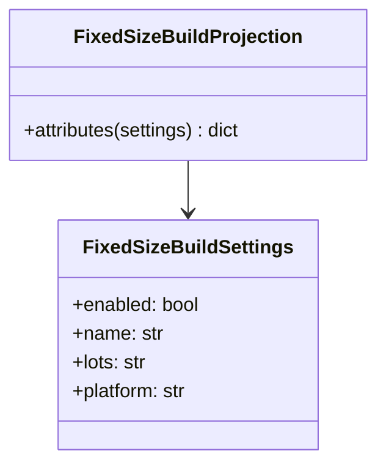

# AppBusiness - feature work orders



- **Primary Role:** strategy product-build workflows.
- **Dependencies:** each ready feature names its exact prerequisite order and files; no undeclared workspace import.
- **Outputs / Downstream Role:** the specified helper output only until the full workflow contracts below are made executable.
- **Commit rule:** one READY feature, one commit, only listed files. Blocked rows authorize no code or placeholder tests.

## Source reassessment — 2026-10-30

The [workspace source audit](research/workspaces-09-19-source-review.md) lists newly available implementation files for every blocked feature below. Read that module record with the order. Library availability does not supply missing plugin routes, target integration contracts or numerical fixtures. The original execution boundary remains in effect except for explicitly revised bounded orders.

## Phase 18.1: observed deterministic behavior

### `FixedSizeBuildProjection` - WO-18-01 - READY after its named prerequisites

*Evidence IDs:* `OBS145-AppSQXBusiness-HELPER-001` (retained below).
*Context to Read:* `DONOR_REFERENCE_ROOT/internal/web/SQXBUSINESS` (resource folder; originally named `XMLUtil.js` is not present). Read only these donor files and the completed prerequisite files named in this order.

*Feature:* fixed-size build attribute projection only, not generation/compilation or license enforcement.
*Dependencies:* WO-C00 Python package foundation.
*Implementation Files:*
- **Backend Create:** `app/workspaces/business/__init__.py` (empty), `app/workspaces/business/build_defaults.py`.
- **Test Create:** `tests/workspaces/business/test_build_defaults.py`.
- **Frontend:** none for this projection; editor/persistence workflows remain blocked.
*Types:* frozen/slotted `FixedSizeBuildSettings(enabled:bool,name:str,lots:str,platform:str)` with no field defaults. All fields are mandatory when settings exists; the caller contract must validate untyped input separately. Output is a new dict[str,str] for the LockedToFixedSize node's attributes.
*Functional Requirements & Implementation:*
- [ ] `FixedSizeBuildProjection.attributes(settings: FixedSizeBuildSettings | None) -> dict[str,str]` -> exported static method. None gives exactly `{'use':'false','name':'-fixedSize','lots':'0.01','platform':'mql4'}`. Present settings gives use true/false as lowercase strings and unchanged name/lots/platform. Do not parse lots, clamp values, replace blank names or choose another platform.
- [ ] `test('absent settings defaults')` -> exact default dictionary above; mutate returned dictionary and call again to prove no shared mutation.
- [ ] `test('provided attributes remain literal')` -> enabledTrue,name ' custom ',lots '0.20',platform 'mql5' yields use 'true', name ' custom ',lots '0.20',platform 'mql5'.
*Acceptance:* `uv run python -m pytest tests/workspaces/business/test_build_defaults.py -q` exits 0, two tests.
*Commit:* `business: preserve fixed-size build attributes`.

## Phase 18.2: complete workspace contribution - READY

All 1 assigned plugin modules remain in scope. The helper above is not acceptance of these complete features. Reserved paths below are exact; do not create service stubs or infer signatures while a row is blocked.

### `AppSQXBusiness` - I-AppSQXBusiness - READY

*Feature:* complete AppSQXBusiness workflow.
*Evidence IDs:* `OBS145-AppSQXBusiness-SCOPE-001` establishes source presence only; `OBS145-AppSQXBusiness-HELPER-001` establishes only the separately scoped helper.
*Implementation Files (reserved, no creation while blocked):*
- **Backend:** `app/workspaces/business/business.py`.
- **Models:** `app/workspaces/business/business_models.py`.
- **Frontend:** `app/web/workspaces/business/BusinessWorkspace.tsx`.
- **Backend test:** `tests/workspaces/business/test_business.py`.
- **Frontend test:** `app/web/tests/workspaces/business/BusinessWorkspacePanel.test.tsx`.
- **Context to Read:** `DONOR_REFERENCE_ROOT/internal/plugins/AppSQXBusiness`, `DONOR_REFERENCE_ROOT/internal/plugins/AppSQXBusiness/module.js`.
*Observed action names (not a payload specification):* No literal client action extracted from this module; the specified class/view context must establish operations.
*Missing contract:* Complete project/input/settings schema, target build variants, lock/export/compile behavior, allowed platform mappings and error fixtures.
*Function/signature authorization:* none. No generic `execute(payload: dict)` or invented CRUD surface.
*Acceptance:* not yet executable. A revised order must name literal fixtures and methods before `uv run python -m pytest tests/workspaces/business/test_business.py -q` or `npm --prefix app/web test -- tests/workspaces/business/BusinessWorkspacePanel.test.tsx` can be acceptance. A zero-test/no-assertion pass is invalid.
*Commit boundary:* this one feature only after its order is READY; do not combine with the helper commit.

External vendor protocols/account data are not inferred from client action names. A legitimate provider/toolchain or a source-established protocol is required; a fake success response cannot close an external integration.


*Source reassessment (2026-10-30):* [AppSQXBusiness source record](research/workspaces-09-19-source-review.md#appsqxbusiness) identifies 0 matching readable Java files and 1 primary frontend/settings files. No matching plugin Java body was found in the bounded library/recovered-source search. This may be a frontend-only contribution; review the listed UI handlers and actual backend dependencies before declaring a missing server.

## Work-order evidence

```json
{
  "id": "OBS145-AppSQXBusiness-HELPER-001",
  "classification": "observed",
  "confidence": "high",
  "claim": "The fixed-size locked build XML attributes default to use false, name -fixedSize, lots 0.01 and platform mql4 when build settings are absent; otherwise source values supply these attributes.",
  "sources": [
    "DONOR_REFERENCE_ROOT/internal/web/SQXBUSINESS/src/components/XMLUtil.js"
  ],
  "target_domain": "app/workspaces/business; app/web/workspaces/business",
  "feature_ids": [],
  "requirement_ids": [],
  "decision_ids": [],
  "registration_gap": "Work-order labels are planning IDs, not ratified domain feature IDs.",
  "limitations": "Static primary source inspection. Helper acceptance is not full workspace, algorithm, vendor protocol or runtime parity.",
  "validation": {
    "status": "passed",
    "executed_at": "2026-10-29T09:38:19.613785+00:00",
    "procedure": "Read named primary source files and directory entries; identify explicit scalar rules and literal action names.",
    "actual_observation": "The fixed-size locked build XML attributes default to use false, name -fixedSize, lots 0.01 and platform mql4 when build settings are absent; otherwise source values supply these attributes.",
    "expected_observation": "The fixed-size locked build XML attributes default to use false, name -fixedSize, lots 0.01 and platform mql4 when build settings are absent; otherwise source values supply these attributes.",
    "artifacts": [
      {
        "path": "DONOR_REFERENCE_ROOT/internal/web/SQXBUSINESS/src/components/XMLUtil.js",
        "sha256": "cff88604ec6c8e02ec273fb1dcc446ce922eb0f3bbfd6d88b5dd3b8985f38a57"
      }
    ]
  },
  "repository_commit": "f5c7d12d5715b8ebee55165b8eddad9068f83cb9",
  "review_state": "owner-review-pending",
  "contains_proprietary_source": false,
  "contains_sensitive_data": false,
  "contains_personal_data": false,
  "paraphrased_behavior_only": true,
  "supersedes_records": [],
  "superseded_by": []
}
```

```json
{
  "id": "OBS145-AppSQXBusiness-SCOPE-001",
  "classification": "observed",
  "confidence": "high",
  "claim": "Named primary plugin modules and readable files exist; declarations/action names do not establish complete request/response behavior.",
  "sources": [
    "DONOR_REFERENCE_ROOT/internal/plugins/AppSQXBusiness"
  ],
  "target_domain": "app/workspaces/business; app/web/workspaces/business",
  "feature_ids": [],
  "requirement_ids": [],
  "decision_ids": [],
  "registration_gap": "Work-order labels are planning IDs, not ratified domain feature IDs.",
  "limitations": "Static primary source inspection. Helper acceptance is not full workspace, algorithm, vendor protocol or runtime parity.",
  "validation": {
    "status": "passed",
    "executed_at": "2026-10-29T09:38:19.613785+00:00",
    "procedure": "Read named primary source files and directory entries; identify explicit scalar rules and literal action names.",
    "actual_observation": "Named primary plugin modules and readable files exist; declarations/action names do not establish complete request/response behavior.",
    "expected_observation": "Named primary plugin modules and readable files exist; declarations/action names do not establish complete request/response behavior.",
    "artifacts": [
      "DONOR_REFERENCE_ROOT/internal/plugins"
    ]
  },
  "repository_commit": "f5c7d12d5715b8ebee55165b8eddad9068f83cb9",
  "review_state": "owner-review-pending",
  "contains_proprietary_source": false,
  "contains_sensitive_data": false,
  "contains_personal_data": false,
  "paraphrased_behavior_only": true,
  "supersedes_records": [],
  "superseded_by": []
}
```


## Current-code migration assessment

Migration fit is separate from implementation status. Direct fit below means the inspected presentation/data can be retained; it does not establish backend or donor parity. Existing domain READMEs continue to own implementation status. No code moves are performed by this planning change.

| Current HaruQuantAI location | Exact target proposed location | Fit / action | Required change and verification boundary |
| --- | --- | --- | --- |
| `ui/app/workspace/Business/BusinessWorkspace.tsx` | `app/web/workspaces/business/BusinessWorkspace.tsx` | Replace donor-mismatched feature surface | Current component is node/user/MCP management; primary SQXBusiness is product/project/EA options/resources/build. Do not call current Business component a direct-fit donor workspace. |
| `ui/app/workspace/Business/AddNodeModal.tsx` | `app/web/workspaces/grid_control/AddNodeModal.tsx` | Reassign - owned by AppGridControl | No second copy under sqx_business. See GridControl migration order for source changes. |
| `ui/app/workspace/Business/ConfigureMcpModal.tsx` | `app/web/workspaces/sqai/ConfigureMcpModal.tsx` | Reassign - owned by AppSQAI | No second copy under sqx_business; replace fake connected/authenticated responses through the accepted service contract. |
| `ui/app/workspace/Business/fixtures.ts` | `app/web/tests/workspaces/business/fixtures.ts` | Retire production fixtures | Current4node/user/MCP fixtures are not SQXBusiness product-build examples. Keep only test cases assigned to the actual owner; create product-build fixtures from inspected XML. |
| `ui/tests/unit/workspace/Business/business.test.ts` | `app/web/tests/workspaces/grid_control/cluster.test.ts` | Split test ownership | Compute aggregation/node-state assertions belong GridControl; MCP settings cases move to app/web/tests/workspaces/sqai/mcpConnections.test.ts. Do not duplicate source tests under Business. |
| `No current product-build Python source` | `app/workspaces/business/build.py` | Missing - create | Target product-build orchestration consumes Wizard exporters. Current cluster UI is not an implementation of product locking/export/compilation. |

### Reorganization work order - MIG-AppSQXBusiness

*Evidence:* `OBS-CURRENT-AppSQXBusiness-MIGRATION-001`.
*Context to Read:* every existing current file in the table, its named test and the existing `ui/app/host/App.tsx` route/import entries; no donor runtime is required for the relocation itself.
*Execution order:* move retained presentation files first, change their relative UI/host imports to the published target owner, move/revise the listed tests, then switch route imports in the target shell. Keep one current-to-target owner per table row. Do not leave forwarding copies in old workspace folders; keep source history through Git moves. Do not move application state from a shared browser store into another mock runner.
*Behavior changes:* only those explicitly listed in accepted work orders may replace the fixture behavior. A physical move cannot make a mock engine/service a direct fit. Missing backend rows require production implementation; pyc/cache directories are not source to recover or migrate.
*Exact baseline / target commands (each exit0; revised donor-backed assertions are specified by the feature orders):*
- Baseline: `npm --prefix ui test -- tests/unit/workspace/Business/business.test.ts`. Target: `npm --prefix app/web test -- tests/workspaces/grid_control/cluster.test.ts`.
No other path substitution is authorized. Passing the current fixture tests is not donor acceptance.
*Commit boundary:* one cohesive workspace file reorganization with its import/test updates; algorithm/service replacements are separate feature commits. If a source is split between GridControl and SQAI, the owning phase migrates its exact extracted section once; Business never keeps a duplicate.

```json
{
  "id": "OBS-CURRENT-AppSQXBusiness-MIGRATION-001",
  "classification": "observed",
  "confidence": "high",
  "claim": "Inspected current source/test files distinguish reusable presentation and local editing state from mock execution, fixture-only history and missing Python workspace implementations. The table assigns exact target owners as normative migration decisions.",
  "sources": [
    "HARUQUANTAI_ROOT/ui/app/workspace/Business/BusinessWorkspace.tsx",
    "HARUQUANTAI_ROOT/ui/app/workspace/Business/AddNodeModal.tsx",
    "HARUQUANTAI_ROOT/ui/app/workspace/Business/ConfigureMcpModal.tsx",
    "HARUQUANTAI_ROOT/ui/app/workspace/Business/fixtures.ts",
    "HARUQUANTAI_ROOT/ui/tests/unit/workspace/Business/business.test.ts"
  ],
  "target_domain": "AppSQXBusiness",
  "feature_ids": [],
  "requirement_ids": [],
  "decision_ids": [],
  "registration_gap": "Register migration decisions through the owning domain README; this table does not duplicate implementation status.",
  "limitations": "Static source/import audit. Six existing current frontend test files passed20tests; those assertions cover current stores/helpers, not donor algorithms or absent provider services. AI presentation source was statically inspected; no AI backend or external service was executed.",
  "validation": {
    "status": "passed",
    "executed_at": "2026-10-29T10:08:10.884105+00:00",
    "procedure": "Inspect current imports, state/fixture generation, service call absence and existing tests; run targeted current Vitest cohort.",
    "actual_observation": {
      "command": "npm --prefix ui test -- tests/unit/workspace/CustomProjects/customProjects.test.ts tests/unit/workspace/NeuralNetwork/neuralNet.test.ts tests/unit/workspace/GridControl/gridControl.test.ts tests/unit/workspace/GridTest/gridTest.test.ts tests/unit/workspace/DebugConsole/debugConsole.test.ts tests/unit/workspace/Business/business.test.ts",
      "exit_code": 0,
      "test_files_passed": 6,
      "tests_passed": 20
    },
    "expected_observation": "Current tests pass without implying donor parity; source evidence establishes which functions are fixture-driven.",
    "artifacts": [
      {
        "path": "HARUQUANTAI_ROOT/ui/app/workspace/Business/BusinessWorkspace.tsx",
        "sha256": "2855a06cd207747d730bdafd1b40d38170b2ae75a919162f1cd115a033133798"
      },
      {
        "path": "HARUQUANTAI_ROOT/ui/app/workspace/Business/AddNodeModal.tsx",
        "sha256": "8f203c7f922ebc0f90a0393aa743d26cb863aadcebf9df519990bf8249e88d8a"
      },
      {
        "path": "HARUQUANTAI_ROOT/ui/app/workspace/Business/ConfigureMcpModal.tsx",
        "sha256": "25c1c603efcc67206d66527b18931c9cb03022f36dd9b1bd8dcca468b09c885a"
      },
      {
        "path": "HARUQUANTAI_ROOT/ui/app/workspace/Business/fixtures.ts",
        "sha256": "b49cc83e65aa540d4b91f345b51f0e60a3372d95075bfea10b00d86d4cb5e26f"
      },
      {
        "path": "HARUQUANTAI_ROOT/ui/tests/unit/workspace/Business/business.test.ts",
        "sha256": "551450a54af61451e26a7950afcdc523eca2e6586e858412dc22c43ae0bb8f18"
      }
    ]
  },
  "repository_commit": "f5c7d12d5715b8ebee55165b8eddad9068f83cb9",
  "review_state": "owner-review-pending",
  "contains_proprietary_source": false,
  "contains_sensitive_data": false,
  "contains_personal_data": false,
  "paraphrased_behavior_only": true,
  "supersedes_records": [],
  "superseded_by": []
}
```
