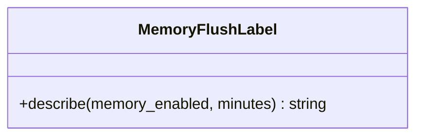

# AppAI - feature work orders



- **Primary Role:** AI, memory and MCP integration.
- **Dependencies:** each ready feature names its exact prerequisite order and files; no undeclared workspace import.
- **Outputs / Downstream Role:** the specified helper output only until the full workflow contracts below are made executable.
- **Commit rule:** one READY feature, one commit, only listed files. Blocked rows authorize no code or placeholder tests.

## Source reassessment — 2026-10-30

The [workspace source audit](research/workspaces-09-19-source-review.md) lists newly available implementation files for every blocked feature below. Read that module record with the order. Library availability does not supply missing plugin routes, target integration contracts or numerical fixtures. The original execution boundary remains in effect except for explicitly revised bounded orders.

## Phase 19.1: observed deterministic behavior

### `MemoryFlushLabel` - WO-19-01 - READY after its named prerequisites

*Evidence IDs:* `OBS145-AppSQAI-HELPER-001` (retained below).
*Context to Read:* `DONOR_REFERENCE_ROOT/internal/web/SQAI` (resource folder; originally named `workspace-panel.js` is not present). Read only these donor files and the completed prerequisite files named in this order.

*Feature:* exact memory-flush description helper only, not memory scheduling, model invocation or MCP execution.
*Dependencies:* WO-C00 frontend runner.
*Implementation Files:*
- **Backend:** none; memory provider/persistence and tool execution remain blocked.
- **Frontend Create:** `app/web/workspaces/ai/memoryFlushLabel.ts`.
- **Test Create:** `app/web/tests/workspace/ai/memoryFlushLabel.test.ts`.
*Functional Requirements & Implementation:*
- [ ] `MemoryFlushLabel.describe(memory_enabled: boolean, minutes: number): string` -> exported static method; false or negative minutes gives off; enabled+zero gives after every turn; all other values use native JavaScript string conversion in `every <minutes> min at most`. Do not substitute a default, round fractional values or start a timer.
- [ ] `test('memory flush labels')` -> (false,5)=off; (true,-1)=off; (true,0)=after every turn; (true,5)=every 5 min at most; (true,1.5)=every 1.5 min at most; (true,NaN)=every NaN min at most. NaN case preserves this display helper's source behavior, not a valid backend scheduling interval.
*Acceptance:* `npm --prefix app/web test -- tests/workspace/ai/memoryFlushLabel.test.ts` exits 0, six parameter rows.
*Commit:* `ai: preserve memory-flush description text`.

## Phase 19.2: complete workspace contribution - READY

All 2 assigned plugin modules remain in scope. The helper above is not acceptance of these complete features. Reserved paths below are exact; do not create service stubs or infer signatures while a row is blocked.

### `ServletMCP` - I-ServletMCP - READY

*Feature:* complete ServletMCP workflow.
*Evidence IDs:* `OBS145-AppSQAI-SCOPE-001` establishes source presence only; `OBS145-AppSQAI-HELPER-001` establishes only the separately scoped helper.
*Implementation Files (reserved, no creation while blocked):*
- **Backend:** `app/workspace/ai/mcp.py`.
- **Models:** `app/workspace/ai/mcp_models.py`.
- **Frontend:** `app/web/workspaces/ai/AIAssistantWorkspace.tsx`.
- **Backend test:** `tests/workspace/ai/test_mcp.py`.
- **Frontend test:** `app/web/tests/workspace/ai/MCPPanel.test.tsx`.
- **Context to Read:** `DONOR_REFERENCE_ROOT/internal/web/SQAI`. (copied AI resource context; original ServletMCP Java body is not present in this donor tree).
*Observed action names (not a payload specification):* No literal client action extracted from this module; the specified class/view context must establish operations.
*Missing contract:* Negotiated protocol/version/capability schemas, tool catalogue/arguments/result/errors, auth/session/resource policy and fixture wire messages.
*Function/signature authorization:* none. No generic `execute(payload: dict)` or invented CRUD surface.
*Acceptance:* not yet executable. A revised order must name literal fixtures and methods before `uv run python -m pytest tests/workspace/ai/test_mcp.py -q` or `npm --prefix app/web test -- tests/workspace/ai/MCPPanel.test.tsx` can be acceptance. A zero-test/no-assertion pass is invalid.
*Commit boundary:* this one feature only after its order is READY; do not combine with the helper commit.


*Source reassessment (2026-10-30):* [ServletMCP source record](research/workspaces-09-19-source-review.md#servletmcp) identifies 0 matching readable Java files and 0 primary frontend/settings files. No matching plugin Java body was found in the bounded library/recovered-source search. This may be a frontend-only contribution; review the listed UI handlers and actual backend dependencies before declaring a missing server.

### `ServletSQAI` - I-ServletSQAI - READY

*Feature:* complete ServletSQAI workflow.
*Evidence IDs:* `OBS145-AppSQAI-SCOPE-001` establishes source presence only; `OBS145-AppSQAI-HELPER-001` establishes only the separately scoped helper.
*Implementation Files (reserved, no creation while blocked):*
- **Backend:** `app/workspace/ai/assistant.py`.
- **Models:** `app/workspace/ai/assistant_models.py`.
- **Frontend:** `app/web/workspaces/ai/AIAssistantWorkspace.tsx`.
- **Backend test:** `tests/workspace/ai/test_assistant.py`.
- **Frontend test:** `app/web/tests/workspace/ai/AssistantPanel.test.tsx`.
- **Context to Read:** `DONOR_REFERENCE_ROOT/internal/plugins/ServletSQAI/module.js`, `DONOR_REFERENCE_ROOT/internal/plugins/ServletSQAI`, `DONOR_REFERENCE_ROOT/internal/plugins/ServletSQAI/SQAIChatService.js`.
*Observed action names (not a payload specification):* No literal client action extracted from this module; the specified class/view context must establish operations.
*Missing contract:* Model/provider request/result/stream/tool/memory schemas, cancellation/recovery/error behavior, authorization and exact fixture events.
*Function/signature authorization:* none. No generic `execute(payload: dict)` or invented CRUD surface.
*Acceptance:* not yet executable. A revised order must name literal fixtures and methods before `uv run python -m pytest tests/workspace/ai/test_assistant.py -q` or `npm --prefix app/web test -- tests/workspace/ai/AssistantPanel.test.tsx` can be acceptance. A zero-test/no-assertion pass is invalid.
*Commit boundary:* this one feature only after its order is READY; do not combine with the helper commit.

External vendor protocols/account data are not inferred from client action names. A legitimate provider/toolchain or a source-established protocol is required; a fake success response cannot close an external integration.


*Source reassessment (2026-10-30):* [ServletSQAI source record](research/workspaces-09-19-source-review.md#servletsqai) identifies 0 matching readable Java files and 2 primary frontend/settings files. No matching plugin Java body was found in the bounded library/recovered-source search. This may be a frontend-only contribution; review the listed UI handlers and actual backend dependencies before declaring a missing server.

## Work-order evidence

```json
{
  "id": "OBS145-AppSQAI-HELPER-001",
  "classification": "observed",
  "confidence": "high",
  "claim": "AI memory UI displays off when memory disabled or interval negative, after every turn when interval is zero, otherwise every N min at most.",
  "sources": [
    "DONOR_REFERENCE_ROOT/internal/web/SQAI/workspace-panel.js"
  ],
  "target_domain": "app/workspace/ai; app/web/workspaces/ai",
  "feature_ids": [],
  "requirement_ids": [],
  "decision_ids": [],
  "registration_gap": "Work-order labels are planning IDs, not ratified domain feature IDs.",
  "limitations": "Static primary source inspection. Helper acceptance is not full workspace, algorithm, vendor protocol or runtime parity.",
  "validation": {
    "status": "passed",
    "executed_at": "2026-10-29T09:38:19.613785+00:00",
    "procedure": "Read named primary source files and directory entries; identify explicit scalar rules and literal action names.",
    "actual_observation": "AI memory UI displays off when memory disabled or interval negative, after every turn when interval is zero, otherwise every N min at most.",
    "expected_observation": "AI memory UI displays off when memory disabled or interval negative, after every turn when interval is zero, otherwise every N min at most.",
    "artifacts": [
      {
        "path": "DONOR_REFERENCE_ROOT/internal/web/SQAI/workspace-panel.js",
        "sha256": "179be7c795f13ec1ada7dfde892ec900e0d459c12f287e0e7007d21247333ec6"
      }
    ]
  },
  "repository_commit": "f5c7d12d5715b8ebee55165b8eddad9068f83cb9",
  "review_state": "owner-review-pending",
  "contains_proprietary_source": false,
  "contains_sensitive_data": false,
  "contains_personal_data": false,
  "paraphrased_behavior_only": true,
  "supersedes_records": [],
  "superseded_by": []
}
```

```json
{
  "id": "OBS145-AppSQAI-SCOPE-001",
  "classification": "observed",
  "confidence": "high",
  "claim": "Named primary plugin modules and readable files exist; declarations/action names do not establish complete request/response behavior.",
  "sources": [
    "DONOR_REFERENCE_ROOT/internal/plugins/ServletMCP",
    "DONOR_REFERENCE_ROOT/internal/plugins/ServletSQAI"
  ],
  "target_domain": "app/workspace/ai; app/web/workspaces/ai",
  "feature_ids": [],
  "requirement_ids": [],
  "decision_ids": [],
  "registration_gap": "Work-order labels are planning IDs, not ratified domain feature IDs.",
  "limitations": "Static primary source inspection. Helper acceptance is not full workspace, algorithm, vendor protocol or runtime parity.",
  "validation": {
    "status": "passed",
    "executed_at": "2026-10-29T09:38:19.613785+00:00",
    "procedure": "Read named primary source files and directory entries; identify explicit scalar rules and literal action names.",
    "actual_observation": "Named primary plugin modules and readable files exist; declarations/action names do not establish complete request/response behavior.",
    "expected_observation": "Named primary plugin modules and readable files exist; declarations/action names do not establish complete request/response behavior.",
    "artifacts": [
      "DONOR_REFERENCE_ROOT/internal/plugins"
    ]
  },
  "repository_commit": "f5c7d12d5715b8ebee55165b8eddad9068f83cb9",
  "review_state": "owner-review-pending",
  "contains_proprietary_source": false,
  "contains_sensitive_data": false,
  "contains_personal_data": false,
  "paraphrased_behavior_only": true,
  "supersedes_records": [],
  "superseded_by": []
}
```


## Current-code migration assessment

Migration fit is separate from implementation status. Direct fit below means the inspected presentation/data can be retained; it does not establish backend or donor parity. Existing domain READMEs continue to own implementation status. No code moves are performed by this planning change.

| Current HaruQuantAI location | Exact target proposed location | Fit / action | Required change and verification boundary |
| --- | --- | --- | --- |
| `ui/app/workspace/AIAssistant/AIAssistantWorkspace.tsx` | `app/web/workspaces/ai/AIAssistantWorkspace.tsx` | Direct fit for presentation; move + bind accepted services | Component is locally self-contained with catalog/CSS and no network calls. Preserve conversation/draft/pin/project presentation; backend send/usage/memory/tool capabilities are still missing. |
| `ui/app/workspace/AIAssistant/AIAssistant.css` | `app/web/workspaces/ai/AIAssistant.css` | Direct fit presentation - move | Keep scoped rules and relative import; donor/native shell differences remain explicit in the existing provenance. |
| `ui/app/workspace/AIAssistant/catalog.ts` | `app/web/workspaces/ai/catalog.ts` | Direct fit presentation - move | Keep typed eight-tile catalogue, local starters and explicit unavailable-service projections; do not turn unavailable into simulated success. |
| `ui/app/workspace/AIAssistant/capabilities.json` | `app/web/workspaces/ai/capabilities.json` | Direct fit presentation data - move | Keep eight entries and IDs; no copied provider credentials or mutable donor memory. |
| `ui/app/workspace/AIAssistant/source-map.json` | `app/web/workspaces/ai/source-map.json` | Move provenance | Retain donor hashes/logical-root mapping; do not claim this source map verifies backend behavior. |
| `ui/app/workspace/AIAssistant/README.md` | `app/web/workspaces/ai/README.md` | Move + update owner links | Retain authoritative scope/status and existing decisions; update target paths after actual migration rather than copying a second status registry into this plan. |
| `ui/app/workspace/Business/ConfigureMcpModal.tsx` | `app/web/workspaces/ai/ConfigureMcpModal.tsx` | Reassign + adapt | Reuse form layout; replace fake test/Connected status and hardcoded capabilities. Runtime/session/auth data comes from the MCP backend. |
| `ui/tests/e2e/ai-assistant-parity.spec.ts` | `app/web/tests/e2e/ai-assistant-parity.spec.ts` | Move + revise route setup | Retain browser presentation tests, change route harness to the new shell; provider/message execution assertions need separate real service fixtures. |
| `No current AI/MCP Python workspace source` | `app/workspace/ai/assistant.py; app/workspace/ai/mcp.py` | Missing - create | Implement one server tool registry and assistant service; avoid duplicating core project/run operations in tool handlers. |

### Reorganization work order - MIG-AppSQAI

*Evidence:* `OBS-CURRENT-AppSQAI-MIGRATION-001`.
*Context to Read:* every existing current file in the table, its named test and the existing `ui/app/host/App.tsx` route/import entries; no donor runtime is required for the relocation itself.
*Execution order:* move retained presentation files first, change their relative UI/host imports to the published target owner, move/revise the listed tests, then switch route imports in the target shell. Keep one current-to-target owner per table row. Do not leave forwarding copies in old workspace folders; keep source history through Git moves. Do not move application state from a shared browser store into another mock runner.
*Behavior changes:* only those explicitly listed in accepted work orders may replace the fixture behavior. A physical move cannot make a mock engine/service a direct fit. Missing backend rows require production implementation; pyc/cache directories are not source to recover or migrate.
*Acceptance:* no current unit-test file establishes this complete migration. It is not a READY code order until the concrete feature orders provide their exact tests; do not invent a zero-test command or treat missing current tests as passing.
*Commit boundary:* one cohesive workspace file reorganization with its import/test updates; algorithm/service replacements are separate feature commits. If a source is split between GridControl and AI, the owning phase migrates its exact extracted section once; Business never keeps a duplicate.

```json
{
  "id": "OBS-CURRENT-AppSQAI-MIGRATION-001",
  "classification": "observed",
  "confidence": "high",
  "claim": "Inspected current source/test files distinguish reusable presentation and local editing state from mock execution, fixture-only history and missing Python workspace implementations. The table assigns exact target owners as normative migration decisions.",
  "sources": [
    "HARUQUANTAI_ROOT/ui/app/workspace/AIAssistant/AIAssistantWorkspace.tsx",
    "HARUQUANTAI_ROOT/ui/app/workspace/AIAssistant/AIAssistant.css",
    "HARUQUANTAI_ROOT/ui/app/workspace/AIAssistant/catalog.ts",
    "HARUQUANTAI_ROOT/ui/app/workspace/AIAssistant/capabilities.json",
    "HARUQUANTAI_ROOT/ui/app/workspace/AIAssistant/source-map.json",
    "HARUQUANTAI_ROOT/ui/app/workspace/AIAssistant/README.md",
    "HARUQUANTAI_ROOT/ui/app/workspace/Business/ConfigureMcpModal.tsx",
    "HARUQUANTAI_ROOT/ui/tests/e2e/ai-assistant-parity.spec.ts"
  ],
  "target_domain": "AppSQAI",
  "feature_ids": [],
  "requirement_ids": [],
  "decision_ids": [],
  "registration_gap": "Register migration decisions through the owning domain README; this table does not duplicate implementation status.",
  "limitations": "Static source/import audit. Six existing current frontend test files passed20tests; those assertions cover current stores/helpers, not donor algorithms or absent provider services. AI presentation source was statically inspected; no AI backend or external service was executed.",
  "validation": {
    "status": "passed",
    "executed_at": "2026-10-29T10:08:10.884105+00:00",
    "procedure": "Inspect current imports, state/fixture generation, service call absence and existing tests; run targeted current Vitest cohort.",
    "actual_observation": {
      "command": "npm --prefix ui test -- tests/unit/workspace/CustomProjects/customProjects.test.ts tests/unit/workspace/NeuralNetwork/neuralNet.test.ts tests/unit/workspace/GridControl/gridControl.test.ts tests/unit/workspace/GridTest/gridTest.test.ts tests/unit/workspace/DebugConsole/debugConsole.test.ts tests/unit/workspace/Business/business.test.ts",
      "exit_code": 0,
      "test_files_passed": 6,
      "tests_passed": 20
    },
    "expected_observation": "Current tests pass without implying donor parity; source evidence establishes which functions are fixture-driven.",
    "artifacts": [
      {
        "path": "HARUQUANTAI_ROOT/ui/app/workspace/AIAssistant/AIAssistantWorkspace.tsx",
        "sha256": "b7a449ca6a9b641288d071bc86b607fe30297a5efcac293f330ff4d1d4282497"
      },
      {
        "path": "HARUQUANTAI_ROOT/ui/app/workspace/AIAssistant/AIAssistant.css",
        "sha256": "bd8652386bd089de9e25f32f22cf2371fbd2c287adc45b7915869375639e5fbc"
      },
      {
        "path": "HARUQUANTAI_ROOT/ui/app/workspace/AIAssistant/catalog.ts",
        "sha256": "90d57fc5ea8ffba3e05d34c2d676d692b0e449e3449d68eef9fec3752334cc99"
      },
      {
        "path": "HARUQUANTAI_ROOT/ui/app/workspace/AIAssistant/capabilities.json",
        "sha256": "8794c25b49304b63e8585fdc7b3a4fffe945ceec00e505476fe8867be4746e1d"
      },
      {
        "path": "HARUQUANTAI_ROOT/ui/app/workspace/AIAssistant/source-map.json",
        "sha256": "5b1707ffb4a13b0c78bb0dbe678734930d456919783e579d90cc8c3dc4765430"
      },
      {
        "path": "HARUQUANTAI_ROOT/ui/app/workspace/AIAssistant/README.md",
        "sha256": "3bedaf25edbff0029231c0bd636bb28c4c958fb24189101cf6964dc38dd8bcd9"
      },
      {
        "path": "HARUQUANTAI_ROOT/ui/app/workspace/Business/ConfigureMcpModal.tsx",
        "sha256": "25c1c603efcc67206d66527b18931c9cb03022f36dd9b1bd8dcca468b09c885a"
      },
      {
        "path": "HARUQUANTAI_ROOT/ui/tests/e2e/ai-assistant-parity.spec.ts",
        "sha256": "d81d35322387130d171e6d757f2ec7a2d66c976fc88034c35605509d9393154b"
      }
    ]
  },
  "repository_commit": "f5c7d12d5715b8ebee55165b8eddad9068f83cb9",
  "review_state": "owner-review-pending",
  "contains_proprietary_source": false,
  "contains_sensitive_data": false,
  "contains_personal_data": false,
  "paraphrased_behavior_only": true,
  "supersedes_records": [],
  "superseded_by": []
}
```
