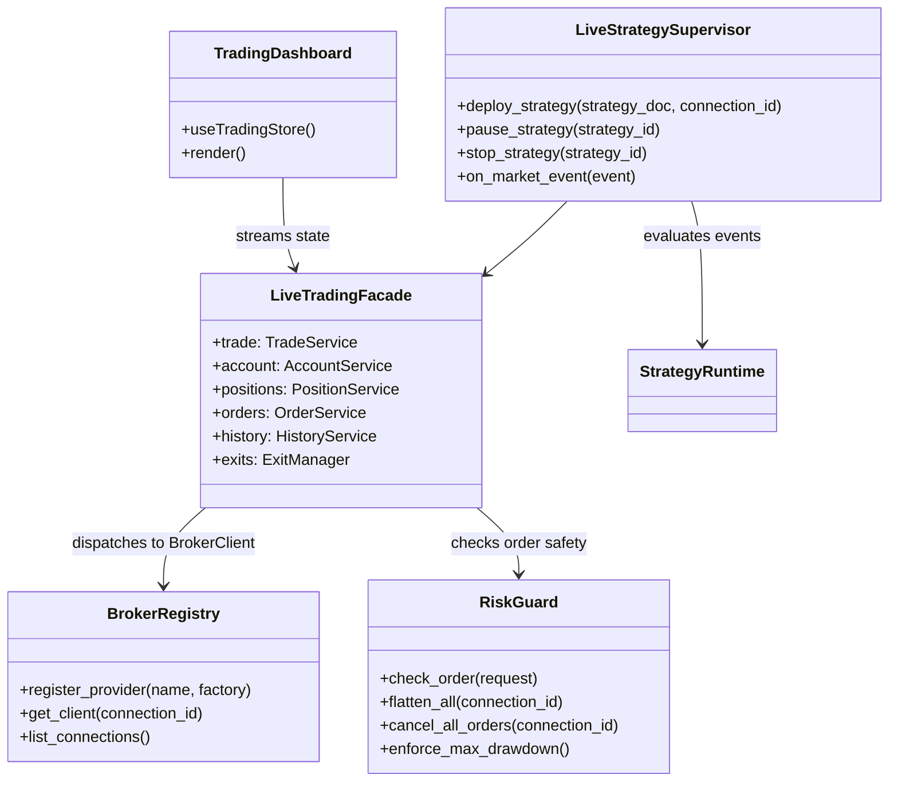

# AppLiveTrading — executable work orders
> UI migration completed: [verification and limitations](research/ui-preservation-migration-verification.md). Current sources are under `app/web`; old source columns below are historical migration evidence. Reuse the migrated screens when implementing later features.

> UI migration execution: [preservation plan](research/ui-preservation-migration-plan.md) governs the structural move. Preserve the existing screens, routes, runtime fixtures and behavior; backend/service adaptations below remain separate work. Shared ProjectWorkbench stays under `app/web/common/project`; migrated tests use `app/web/tests/workspace/<owner>`.

- **Primary Role:** Unified live trading execution workspace, broker connector management (MetaTrader, cTrader, Binance/Crypto), real-time strategy deployment, automated position supervision, and emergency risk controls.
- **Dependencies:** `app/core/trading` (`StrategyRuntime`, `DomainContracts`, `BrokerClient`), `app/core/data` (`MarketStorage`), `app/core/host` (`HostTransport`, `HostPersistence`).
- **Outputs / Downstream Role:** Live order execution receipts, real-time position state, account equity streaming, and strategy telemetry.
- **Unified Architecture Invariant:** Strategy logic, order models, and exit bracket calculations are 100% identical between backtest simulation (`SimulatorClient`) and live trading (`BrokerClient`). A strategy evaluated by `StrategyRuntime` runs in live trading without modification or code generation.
- **Execution boundary:** Each `READY` work order is one independently tested commit. One numbered ready work order is one commit.

---

## Workspace Architecture & Clean-Room Boundaries

StrategyQuant X does not have an integrated live trading engine—it delegates execution to third-party platforms via MQL/EasyLanguage code export or auxiliary bridge DLLs. In HaruQuantAI, **Live Trading is a first-class workspace** designed around a pure execution engine:

1. **Shared Foundation (`app/core/trading`)**:
   - `DomainContracts`: `MarketBar`, `MarketTick`, `OrderInfo`, `PositionInfo`, `TradeRequest`, `TradeResult`.
   - `BrokerClient` interface: Abstract protocol implemented by both `SimulatorClient` (backtests) and live brokers.
   - `StrategyRuntime`: Evaluates incoming market events against strategy documents and returns `StrategyEffects`.
2. **Workspace Orchestration (`app/workspace/trading`)**:
   - `Trading`: Unified facade composing trade, account, order, position, symbol, history, and exit management.
   - `LiveStrategySupervisor`: Receives live WebSocket/ZMQ ticks, feeds them to `StrategyRuntime`, and dispatches orders to the connected `BrokerClient`.
   - `RiskGuard`: Real-time circuit breaker (max daily loss, margin guard, emergency "Flatten All").
   - `Brokers`: Live connectors for MetaTrader 4/5, cTrader, and Crypto exchanges (Binance, Bybit).
3. **Frontend Dashboard (`app/web/workspaces/trading`)**:
   - Real-time trading terminal with live tick charts, positions table, open orders, equity meter, and one-click panic controls.

---

## Current-Code Migration Audit

*Evidence:* `OBS-HARU-LIVE-TRADING-20261030`. HaruQuantAI already has an established live trading and broker infrastructure in `app/workspace/trading/`, `app/workspace/brokers/`, and `ui/app/workspace/Trading/`. This audit maps them to their canonical locations under `app/workspace/trading/` and `app/web/workspaces/trading/`.

### Migration Mapping

| Current Haru location | Target location | Status / Action |
|---|---|---|
| `app/workspace/trading/api.py` | `app/workspace/trading/api.py` | MOVE: Unified trading facade composing sub-services |
| `app/workspace/trading/trade.py` | `app/workspace/trading/trade.py` | MOVE: Order preparation, checked sending, modification |
| `app/workspace/trading/account.py` | `app/workspace/trading/account.py` | MOVE: Account balance, equity, leverage, margin queries |
| `app/workspace/trading/orders.py` | `app/workspace/trading/orders.py` | MOVE: Working order queries, order cancellation |
| `app/workspace/trading/positions.py` | `app/workspace/trading/positions.py` | MOVE: Open position tracking, partial and full closing |
| `app/workspace/trading/history.py` | `app/workspace/trading/history.py` | MOVE: Historical deals, closed orders, receipts |
| `app/workspace/trading/terminal.py` | `app/workspace/trading/terminal.py` | MOVE: Connection heartbeat, server info, ping |
| `app/workspace/trading/symbol.py` | `app/workspace/trading/symbol.py` | MOVE: Symbol specification, tick size, lot step |
| `app/workspace/trading/exits.py` | `app/workspace/trading/exits.py` | MOVE: Dynamic exit manager (StopLoss, TrailingStop, MoveSL2BE) |
| `app/workspace/trading/base.py` | `app/workspace/trading/base.py` | MOVE: Typed execution results, proxy wrappers |
| `app/workspace/brokers/registry.py` | `app/workspace/trading/brokers/registry.py` | MOVE: Live broker connection provider registry |
| `app/workspace/brokers/metatrader.py` | `app/workspace/trading/brokers/metatrader.py` | MOVE: MetaTrader 4/5 ZeroMQ/IPC connector |
| `app/workspace/brokers/ctrader.py` | `app/workspace/trading/brokers/ctrader.py` | MOVE: cTrader Open API FIX/Protobuf connector |
| `app/workspace/brokers/crypto.py` | `app/workspace/trading/brokers/crypto.py` | MOVE: Binance/Crypto REST & WebSocket connector |
| `ui/app/workspace/Trading/TradingDashboard.tsx` | `app/web/workspaces/trading/TradingDashboard.tsx` | MOVE: Live trading React dashboard |
| `ui/app/workspace/Trading/tradingStore.ts` | `app/web/workspaces/trading/tradingStore.ts` | MOVE: Zustand live trading state store |
| `tests/workspace/trading/test_operations.py` | `tests/workspace/trading/test_operations.py` | MOVE: Trading operation unit tests |
| `tests/workspace/trading/test_exits.py` | `tests/workspace/trading/test_exits.py` | MOVE: Exit manager and bracket tests |
| `tests/workspace/trading/test_strategy_control.py` | `tests/workspace/trading/test_strategy_control.py` | MOVE: Live strategy control tests |

---

## Phase LT.1: Core Trading Facade Migration

### `TradingFacade` — WO-LT01 — READY

*Feature:* Relocate the canonical `Trading` facade and its sub-interfaces (`Trade`, `Account`, `Orders`, `Positions`, `History`, `Symbol`, `Terminal`, `Exits`) into `app/workspace/trading/`.
*Evidence IDs:* `OBS-HARU-LIVE-TRADING-20261030`, `DEC-CORE-MIGRATION-20261029`.
*Dependencies:* WO-C06.01 (`DomainContracts`), WO-C09.01 (`SimulationReuseBoundary`).
*Implementation Files:*
- **Context to Read:** `app/workspace/trading/README.md`, `app/workspace/trading/api.py`, `app/workspace/trading/trade.py`, `app/workspace/trading/exits.py`, `tests/workspace/trading/test_operations.py`, `tests/workspace/trading/test_exits.py`.
- **Create:** `app/workspace/trading/__init__.py`, `app/workspace/trading/api.py`, `app/workspace/trading/trade.py`, `app/workspace/trading/account.py`, `app/workspace/trading/orders.py`, `app/workspace/trading/positions.py`, `app/workspace/trading/history.py`, `app/workspace/trading/symbol.py`, `app/workspace/trading/terminal.py`, `app/workspace/trading/exits.py`, `app/workspace/trading/base.py`.
- **Tests Create:** `tests/workspace/trading/test_facade.py`, `tests/workspace/trading/test_exits.py`.
- **Edit:** `app/workspace/trading/__init__.py` into a temporary backwards-compatibility bridge.

*Functional Requirements & Implementation:*
- [ ] `Trading(backend: TradingBackend)`: Structurally implements the `TradingRuntime` protocol. Composes sub-services with lazy proxy creation and isolated state.
- [ ] `Trade`: Implements `send_checked()`, `prepare_entry_request()`, `close()`, `cancel()`, and `modify_protection()`. Enforces arming checks, volume step quantization, and slippage guards.
- [ ] `ExitManager`: Implements `attach()`, `detach()`, and dynamic evaluation of `StopLoss`, `ProfitTarget`, `TrailingStop`, `MoveSL2BE`, and `ExitAfterBars`.
- [ ] Account & State queries: Async typed collection getters for positions, open orders, and account balance.
*Acceptance:* `uv run python -m pytest tests/workspace/trading/test_facade.py tests/workspace/trading/test_exits.py -q` exits 0.
*Commit:* `feat(trading): centralize trading facade and exit manager in live trading workspace`.

---

## Phase LT.2: Live Broker Connectors

### `BrokerConnectors` — WO-LT02 — READY

*Feature:* Centralize live broker connector adapters (MetaTrader, cTrader, Binance/Crypto) in `app/workspace/trading/brokers/` adhering strictly to the `BrokerClient` protocol.
*Evidence IDs:* `OBS-HARU-LIVE-TRADING-20261030`.
*Dependencies:* WO-LT01, WO-C09.01 (`BrokerClient`).
*Implementation Files:*
- **Context to Read:** `app/workspace/brokers/metatrader.py`, `app/workspace/brokers/ctrader.py`, `app/workspace/brokers/crypto.py`, `app/workspace/brokers/registry.py`.
- **Create:** `app/workspace/trading/brokers/__init__.py`, `app/workspace/trading/brokers/registry.py`, `app/workspace/trading/brokers/metatrader.py`, `app/workspace/trading/brokers/ctrader.py`, `app/workspace/trading/brokers/crypto.py`.
- **Tests Create:** `tests/workspace/trading/test_broker_registry.py`, `tests/workspace/trading/test_broker_contracts.py`.

*Functional Requirements & Implementation:*
- [ ] `BrokerRegistry`: Thread-safe registry mapping connection IDs and broker types to instantiated `BrokerClient` adapters.
- [ ] `MetaTraderClient`: ZeroMQ/IPC transport implementing `connect()`, `disconnect()`, `subscribe_ticks()`, `order_send()`, `order_check()`, `get_positions()`.
- [ ] `CryptoBrokerClient`: REST and WebSocket client for Binance Spot and Futures with automatic signature generation and reconnect backoff.
- [ ] Invariant: Each broker adapter returns canonical `OrderInfo`, `PositionInfo`, and `TradeResult` domain types defined in `app/core/enums.py` and `app/core/data/contracts.py`.
*Acceptance:* `uv run python -m pytest tests/workspace/trading/test_broker_registry.py tests/workspace/trading/test_broker_contracts.py -q` exits 0.
*Commit:* `feat(trading): implement broker connection registry and live adapters`.

---

## Phase LT.3: Live Strategy Supervisor & Risk Guard

### `LiveStrategySupervisor` — WO-LT03 — READY

*Feature:* Background execution supervisor that receives real-time market data ticks, feeds them to `StrategyRuntime.evaluate()`, and safely dispatches the generated `StrategyEffects` to the active `BrokerClient`.
*Evidence IDs:* `OBS-HARU-LIVE-TRADING-20261030`.
*Dependencies:* WO-LT01, WO-LT02, WO-C08.02 (`StrategyRuntime`).
*Implementation Files:*
- **Create:** `app/workspace/trading/supervisor.py`, `app/workspace/trading/risk_guard.py`, `tests/workspace/trading/test_supervisor.py`, `tests/workspace/trading/test_risk_guard.py`.

*Contract & Type Specifications:*
- `LiveStrategySession`: Slotted dataclass with `session_id: str`, `strategy_doc: StrategyDocument`, `symbol: str`, `connection_id: str`, `status: Literal['RUNNING', 'PAUSED', 'STOPPED']`.
- `LiveStrategySupervisor`:
  - `start_strategy(spec: StrategyDeploySpec) -> LiveStrategySession`: Initializes runtime context, warms up indicator buffers, and subscribes to symbol ticks.
  - `on_tick(tick: MarketTick) -> None`: Dispatches `TickUpdateEvent` to `StrategyRuntime.evaluate()`, collects `StrategyEffects`, passes them through `RiskGuard`, and executes approved orders via `Trading.trade`.
  - `pause_strategy(session_id: str) -> None`: Temporarily suspends new order generation while maintaining position tracking.
  - `stop_strategy(session_id: str, *, close_positions: bool = False) -> None`: Unsubscribes feeds, cancels pending orders, and optionally closes open positions.
- `RiskGuard`:
  - Circuit breakers: Maximum drawdown percentage reached $\rightarrow$ immediately stops all strategies and sends emergency alert.
  - Order sanity checks: Max volume limit per order, max open positions per symbol, and allowable slippage tolerance.
  - Emergency actions: `flatten_all(connection_id: str)` closes all active market positions in parallel; `cancel_all(connection_id: str)` purges working pending orders.
*Acceptance:* `uv run python -m pytest tests/workspace/trading/test_supervisor.py tests/workspace/trading/test_risk_guard.py -q` exits 0. Deterministic mock tests assert tick ingestion, effect execution, and risk cut-off triggering.
*Commit:* `feat(trading): implement live strategy supervisor and risk guard circuit breakers`.

---

## Phase LT.4: Live Trading HTTP & WebSocket API

### `LiveTradingRoutes` — WO-LT04 — READY

*Feature:* FastAPI endpoints and real-time streaming WebSocket/SSE endpoints for live dashboard monitoring and manual trade interventions.
*Evidence IDs:* `OBS-HARU-LIVE-TRADING-20261030`.
*Dependencies:* WO-LT03, WO-C14 (`HostTransport`).
*Implementation Files:*
- **Create:** `app/workspace/trading/routes.py`, `tests/workspace/trading/test_routes.py`.

*API Endpoints:*
- `GET /api/v1/trading/accounts`: Lists active broker connections and real-time account balances/margins.
- `GET /api/v1/trading/positions`: Lists all open positions across all active connections.
- `GET /api/v1/trading/orders`: Lists working pending orders.
- `POST /api/v1/trading/orders/market`: Manual market order submission (protected by session guard).
- `POST /api/v1/trading/orders/close`: Close specific position by ticket.
- `POST /api/v1/trading/emergency/flatten`: One-click panic button to flatten all open positions.
- `POST /api/v1/trading/strategies/deploy`: Deploys a candidate strategy from a databank to live execution.
- `WS /api/v1/trading/stream`: WebSocket channel broadcasting tick events, order execution receipts, and balance adjustments.
*Acceptance:* `uv run python -m pytest tests/workspace/trading/test_routes.py -q` exits 0. TestClient asserts authenticated endpoints, validation errors, and WebSocket message serialization.
*Commit:* `feat(trading): implement live trading API and real-time streaming routes`.

---

## Phase LT.5: Frontend Live Trading Dashboard

### `LiveTradingDashboard` — WO-LT05 — READY

*Feature:* Relocate and enhance the React trading workspace in `app/web/workspaces/trading/` with real-time streaming, positions table, manual trading ticket, and emergency controls.
*Evidence IDs:* `OBS-HARU-LIVE-TRADING-20261030`.
*Dependencies:* WO-LT04, WO-C00 (web bootstrap).
*Implementation Files:*
- **Context to Read:** `ui/app/workspace/Trading/TradingDashboard.tsx`, `ui/app/workspace/Trading/tradingStore.ts`.
- **Create:** `app/web/workspaces/trading/TradingWorkspace.tsx`, `app/web/workspaces/trading/TradingDashboard.tsx`, `app/web/workspaces/trading/tradingStore.ts`, `app/web/workspaces/trading/components/PositionsTable.tsx`, `app/web/workspaces/trading/components/OrdersTable.tsx`, `app/web/workspaces/trading/components/OrderEntryModal.tsx`, `app/web/workspaces/trading/components/EmergencyControls.tsx`.
- **Tests Create:** `app/web/tests/workspace/trading/TradingWorkspace.test.tsx`, `app/web/tests/workspace/trading/tradingStore.test.ts`.

*Functional Requirements & Implementation:*
- [ ] `TradingWorkspace`: Primary layout containing Account summary header, Live Chart panel, Positions/Orders tabbed table, and Active Strategies monitor.
- [ ] `tradingStore`: Zustand store managing WebSocket connection, optimistic order state, and live tick updates.
- [ ] `EmergencyControls`: Prominent, confirmation-gated "Flatten All" and "Cancel All" buttons with instant visual feedback.
- [ ] `OrderEntryModal`: Manual trade execution modal with automatic lot-size calculation based on risk percentage and stop-loss distance.
*Acceptance:* `npm --prefix app/web test -- tests/workspace/trading/TradingWorkspace.test.tsx tests/workspace/trading/tradingStore.test.ts` exits 0.
*Commit:* `feat(web): implement live trading dashboard and real-time execution UI`.
