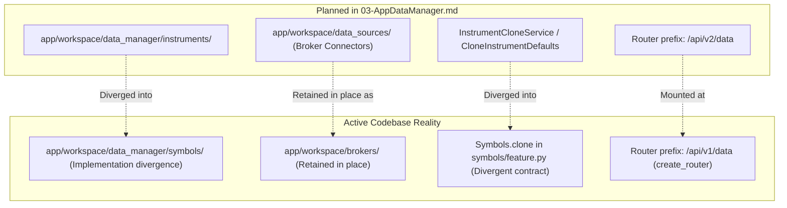

# AppDataManager Completion Audit and Requirement Verification Matrix

Date: **2026-11-01**
Authoritative Baseline: commit `e30ef9af814ad0e2432c9b725f78b14761f926c1`
Repository: `HaruQuantAI`
Governing Document: `docs/dev/full-reimplementation/03-AppDataManager.md`
Status: **Active / Retained** (Work order retained; completion audit records qualified baseline, verified gaps, and retirement blockers).

---

## 1. Executive Summary and Scope Reconciliation

This audit provides an authoritative, requirement-level inventory of all work orders, migration targets, and coordinator specifications in `03-AppDataManager.md`. It reconciles historical migration records and StrategyQuant X (SQX-145) donor orders with active codebase reality.

### Critical Audit Findings

1. **Non-Retirement / Retention of `03-AppDataManager.md`:**
   `03-AppDataManager.md` is **not fully complete and must remain active**. While HaruQuantAI possesses a functional, tested Data Manager implementation (**403 backend tests** passing across `tests/workspace/data_manager/` and `tests/workspace/brokers/`, and **291 frontend tests across 40 files** passing in `app/web/tests/workspace/data_manager/`), these suites verify current behavior. They do not close outstanding work order specifications or establish full donor parity.

2. **Clone Defaults, Phase 3.1 (`CloneInstrumentDefaults`):**
   The specified helper `CloneInstrumentDefaults` and its six acceptance tests (`test_strips_one_matching_postfix`, `test_multiple_instrument_matches_keep_suffix`, `test_nonmatching_or_empty_postfix_keeps_name`, `test_uses_first_selection`, `test_excludes_unusable_broker_from_choices`, `test_empty_selection_error`) are **absent**. The frontend UI appends `Clone`, but does not establish the specified broker-suffix stripping and selection behavior.

3. **Clone Coordinator, Phase 3.2 (`InstrumentCloneService`):**
   `Symbols.clone` in [`app/workspace/data_manager/symbols/feature.py:396`](file:///c:/Users/rharu/AppDev/HaruQuantAI/app/workspace/data_manager/symbols/feature.py#L396) exists, but requires names, trims whitespace, checks source existence first against `datamgr_symbols`, and returns a different response contract. It does not satisfy the exact work order specification (target-first existence check, preserved casing/whitespace, standalone Protocol adapter, `StandardResponse[CloneInstrumentReceipt]`). This is an implementation divergence, not an approved supersession.

4. **Migration Reality, DM-M01:**
   The DM-M01 migration plan proposed moving broker connectors from `app/workspace/brokers/` to `app/workspace/data_sources/`. In active production code, connectors and their tests remain consolidated under `app/workspace/brokers/` and `tests/workspace/brokers/`. The proposed directory `app/workspace/data_sources/` was not created. UI migration to `app/web/workspaces/data_manager/` is verified.

5. **Phase 03.9 Work Orders (31 Contribution Orders):**
   All 31 contribution orders in Phase 03.9 (`I-AppDataManager`, `I-ConnectionLiveTest`, through `I-ServletConnection`) carry explicit contractual clauses stating that exact public operations, request/response models, and persistence effects remain unestablished (`Function/signature authorization: none`). Existing feature subpackages and passing tests implement current component functionality, but do not close these formal orders.

6. **TickDownloader Identity (`DataSourceTD`):**
   `DataSourceTD` represents StrategyQuant's **TickDownloader** ([`app/web/workspaces/data_manager/plugins/TickDownloader/README.md:11`](file:///c:/Users/rharu/AppDev/HaruQuantAI/app/web/workspaces/data_manager/plugins/TickDownloader/README.md#L11)), not TD Ameritrade. `TickDownloaderClient` ([`app/workspace/brokers/tick_downloader.py`](file:///c:/Users/rharu/AppDev/HaruQuantAI/app/workspace/brokers/tick_downloader.py)) provides local tick file reading and `DataSourceTDService.ts` provides UI adaptation, but real directory parsing, TickDownloader execution, and SQX donor parity remain unverified.

7. **HTTP Router Mounting:**
   The Data Manager REST endpoints are assembled via `create_router()` in `app/workspace/data_manager/__init__.py` and mounted under prefix `/api/v1/data` (governed by session scope checks), which conflicts with historical or general `/api/v2/<domain>/...` references.

---

## 2. Requirement Verification Matrix

Status definitions:
- **`verified`**: Implemented with typed contracts, active routes/handlers, and passing automated test suites for current behavior.
- **`divergent`**: Active implementation exists but differs materially from the exact work-order specification; requires formal supersession or alignment.
- **`absent`**: Specified helper, coordinator, or dedicated test suite was not created.
- **`partial`**: Active core logic exists, but planned structural relocation or donor execution parity remains incomplete.
- **`unclosed`**: Feature subpackage operational, but underlying contribution work order retains unestablished public contracts (`Function/signature authorization: none`).
- **`dropped`**: Permanently retired from project scope by architectural mandate; will not be implemented.

| Work Order / Capability | Primary Donor Source | Target Implementation Files | Test Evidence | Status | Owning Domain & Notes |
| :--- | :--- | :--- | :--- | :--- | :--- |
| **DM-M01** (Data Manager Migration) | SQX Donor DataManager | `app/workspace/data_manager/`, `app/workspace/brokers/`, `app/web/` | 402 backend tests; 290 frontend tests | `partial` | UI migrated to `app/web/workspaces/data_manager/`. Broker connectors and tests retained in `app/workspace/brokers/` rather than `data_sources/`. |
| **Phase 3.1** (`CloneInstrumentDefaults`) | `CloneInstrumentCtrl.js` | None (`instrument_clone_defaults.py` absent) | None (6 acceptance tests absent) | `absent` | Helper and 6 acceptance tests absent. UI appends `Clone` but suffix-stripping logic is not implemented. |
| **Phase 3.2** (`InstrumentCloneService`) | `InstrumentsServlet.java#onClone` | `app/workspace/data_manager/symbols/feature.py` | `test_symbols.py::test_clone_symbol` | `divergent` | `Symbols.clone` requires names, trims whitespace, checks source existence first, and returns domain dict instead of `StandardResponse`. |
| **I-AppDataManager** | `AppDataManagerAppPlugin.java` | `app/workspace/data_manager/__init__.py` | `test_cli.py`, `test_catalogs.py` | `unclosed` | Router assembly (`create_router`) at `/api/v1/data` and CLI dispatch active; contract models remain unestablished. |
| **I-ConnectionLiveTest** | `ConnectionLiveTest` | `app/workspace/data_manager/brokers/feature.py` | `test_connections.py` (2 passed) | `unclosed` | Broker credential/connection testing active; external rate/cancellation contracts remain unestablished. |
| **I-ConnectionMT4** | `ConnectionMT4` | None | None | `dropped` | Out of Scope: MT4 permanently removed project-wide by architectural mandate. MT5 is the sole MetaTrader platform supported. |
| **I-ConnectionTest** | `ConnectionTest` | `app/workspace/data_manager/brokers/` | `test_connections.py` | `unclosed` | Connection test endpoints active; exact request/response models unestablished. |
| **I-CryptoExchangeBinance** | `CryptoExchangeBinance` | `app/workspace/brokers/crypto.py` | `test_sources.py` | `unclosed` | Binance spot connector active; contribution order contract unclosed. |
| **I-CryptoExchangeBinanceCoinM** | `CryptoExchangeBinanceCoinM` | `app/workspace/brokers/crypto.py` | `test_sources.py` | `unclosed` | Binance Coin-M futures connector active; contribution order contract unclosed. |
| **I-CryptoExchangeBinanceUsdtM** | `CryptoExchangeBinanceUsdtM` | `app/workspace/brokers/crypto.py` | `test_sources.py` | `unclosed` | Binance USDT-M futures connector active; contribution order contract unclosed. |
| **I-CryptoExchangeBitfinex** | `CryptoExchangeBitfinex` | `app/workspace/brokers/crypto.py` | `test_sources.py` | `unclosed` | Bitfinex market data connector active; contribution order contract unclosed. |
| **I-CryptoExchangeCoinbasePro** | `CryptoExchangeCoinbasePro` | `app/workspace/brokers/crypto.py` | `test_sources.py` | `unclosed` | Coinbase Pro connector active; contribution order contract unclosed. |
| **I-CryptoExchangePoloniex** | `CryptoExchangePoloniex` | `app/workspace/brokers/crypto.py` | `test_sources.py` | `unclosed` | Poloniex market data connector active; contribution order contract unclosed. |
| **I-DataManagerActions** | `DataManagerActions` | `app/workspace/data_manager/data/` (`review.py`, `transforms.py`, `exports.py`) | `test_data_review.py`, `test_data_transforms.py`, `test_data_exports.py` | `unclosed` | Quality review, resampling transforms, and exports active; order request literals unestablished. |
| **I-DataManagerBasket** | `DataManagerBasket` | `app/workspace/data_manager/baskets/` | `test_baskets.py` (14 passed) | `unclosed` | Symbol basket management and batch operations active; order request literals unestablished. |
| **I-DataManagerBroker** | `DataManagerBroker` | `app/workspace/data_manager/brokers/` | `test_brokers.py`, `test_broker_imports.py` | `unclosed` | Broker profiles, commissions, and spread models active; order request literals unestablished. |
| **I-DataManagerConnections** | `DataManagerConnections` | `app/workspace/data_manager/brokers/`, `app/workspace/brokers/` | `test_connections.py` | `unclosed` | Provider registry and connection status tracking active; order request literals unestablished. |
| **I-DataManagerCustomData** | `DataManagerCustomData` | `app/workspace/data_manager/custom/` | `test_custom.py`, `test_custom_http.py`, `test_custom_cli.py` | `unclosed` | Custom series and macroeconomic data active; order request literals unestablished. |
| **I-DataManagerData** | `DataManagerData` | `app/workspace/data_manager/data/` | `test_data.py`, `test_history.py` | `unclosed` | Historical tick/bar catalog and partition file storage active; order request literals unestablished. |
| **I-DataManagerHelp** | `DataManagerHelp` | `app/workspace/data_manager/help/` | `test_help.py`, `test_help_http.py`, `test_help_cli.py` | `unclosed` | Contextual help registry active; order request literals unestablished. |
| **I-DataManagerHome** | `DataManagerHome` | `app/workspace/data_manager/data/` | `test_catalogs.py` | `unclosed` | Storage inventory and overview metrics active; order request literals unestablished. |
| **I-DataManagerInstruments** | `DataManagerInstruments` | `app/workspace/data_manager/symbols/` | `test_symbols.py` (22 passed) | `divergent` | Substituted by `Symbols` package; contract specs, tick sizing, and margins active. Standalone instrument order unclosed. |
| **I-DataManagerLog** | `DataManagerLog` | `app/workspace/data_manager/logs/` | `test_logs.py` (10 passed) | `unclosed` | Operation logging and import auditing active; order request literals unestablished. |
| **I-DataManagerSessions** | `DataManagerSessions` | `app/workspace/data_manager/sessions/` | `test_sessions.py` (19 passed) | `unclosed` | Trading sessions and holiday calendars active; order request literals unestablished. |
| **I-DataSourceCrypto** | `DataSourceCrypto` | `app/workspace/brokers/crypto.py` | `test_sources.py` | `unclosed` | Cryptocurrency feed active; order request literals unestablished. |
| **I-DataSourceDarwinex** | `DataSourceDarwinex` | `app/workspace/brokers/darwinex.py` | `test_sources.py` | `unclosed` | Darwinex feed active; order request literals unestablished. |
| **I-DataSourceDukascopy** | `DataSourceDukascopy` | `app/workspace/data_manager/sources/dukascopy.py`, `app/workspace/brokers/dukascopy.py` | `test_dukascopy.py`, `test_dukascopy_http.py`, `test_dukascopy_cli.py` | `unclosed` | Dukascopy downloader and parser active; order request literals unestablished. |
| **I-DataSourceFiles** | `DataSourceFiles` | `app/workspace/data_manager/sources/files.py`, `app/workspace/brokers/files.py` | `test_file_imports.py` | `unclosed` | CSV and history importer active; order request literals unestablished. |
| **I-DataSourceMt5Api** | `DataSourceMt5Api` | `app/workspace/brokers/metatrader.py` | `test_mt5_symbols.py` | `unclosed` | MetaTrader 5 IPC bridge active; order request literals unestablished. |
| **I-DataSourceSQEquityData** | `DataSourceSQEquityData` | `app/workspace/brokers/sq_equity.py` | `test_sources.py` | `unclosed` | SQ historical equity data feed active; order request literals unestablished. |
| **I-DataSourceSQFuturesData** | `DataSourceSQFuturesData` | `app/workspace/brokers/sq_futures.py` | `test_sources.py` | `unclosed` | SQ continuous futures data feed active; order request literals unestablished. |
| **I-DataSourceTD** | `DataSourceTD` | `app/workspace/brokers/tick_downloader.py`, `app/web/workspaces/data_manager/plugins/TickDownloader/` | `test_sources.py`, Vitest `tickDownloader.test.ts` | `partial` | StrategyQuant TickDownloader (`README.md:11`). Client and UI active; donor execution parity unverified. |
| **I-DataSourceYahoo** | `DataSourceYahoo` | `app/workspace/brokers/yahoo.py` | `test_sources.py` | `unclosed` | Yahoo Finance ingest active; order request literals unestablished. |
| **I-ServletConnection** | `ServletConnection` | `app/workspace/data_manager/brokers/http.py`, `app/core/host/transport.py` | `test_connections.py` | `unclosed` | HTTP connection test endpoints active; exact models unestablished. |

---

## 3. Structural Topology Comparison

---

## 4. Retirement Blockers for `03-AppDataManager.md`

`03-AppDataManager.md` must **not be deleted** until the following conditions are formally resolved:

1. **Resolution of Phase 3.1 (`CloneInstrumentDefaults`):** Either implement the specified `CloneInstrumentDefaults` helper with its 6 acceptance tests, or record an explicit, owner-ratified architectural decision superseding the requirement.
2. **Resolution of Phase 3.2 (`InstrumentCloneService`):** Either align `Symbols.clone` / create `InstrumentCloneService` to satisfy the exact contract (target-first check, whitespace preservation, standard envelope), or record an explicit, owner-ratified supersession decision.
3. **Resolution of Broker Connector Location (DM-M01):** Formally decide whether to complete the migration of broker connectors to `app/workspace/data_sources/` or ratify `app/workspace/brokers/` as the permanent architectural home and update all roadmap references accordingly.
4. **Resolution of Contribution Orders (Phase 03.9):** Establish typed request/response contracts for the 31 contribution orders or define an approved milestone closure policy.
5. **Resolution of TickDownloader Donor Parity:** Verify TickDownloader directory parsing and execution parity or document explicit limitations in the roadmap.
6. **Documentation Synchronization:** Ensure `ARCHITECTURE.md` and `PROJECT.md` consistently reflect `/api/v1/data`, `app/workspace/brokers/`, and the active feature subpackages of `app/workspace/data_manager/`.
