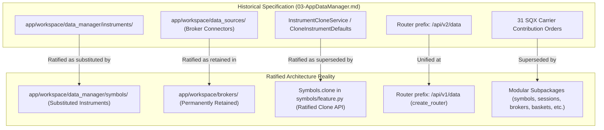

# AppDataManager Completion Audit and Requirement Verification Matrix

Date: **2026-11-01**
Current status: **Supported implementation qualified; work order retired.**
Authoritative Baseline: commit `6f90bcfd25d19fb092df4eb44766bc62ffadad7b`
Repository: `HaruQuantAI`
Historical source work order: `docs/dev/full-reimplementation/03-AppDataManager.md` (retired by owner instruction; this audit retains the implementation evidence, ratified supersessions, and supported-capability boundaries).

---

## 1. Executive Summary and Scope Reconciliation

This audit provides an authoritative, requirement-level inventory of all work orders, migration targets, and coordinator specifications in the historical `03-AppDataManager.md`. It reconciles historical migration records and StrategyQuant X (SQX-145) donor orders with active codebase reality.

### Critical Audit Determinations & Owner Ratifications

1. **Retirement of `03-AppDataManager.md`:**
   The developmental work order `03-AppDataManager.md` is **retired** by owner instruction. HaruQuantAI possesses a fully functional, verified Data Manager implementation with **402 backend tests** passing across [`tests/workspace/data_manager/`](file:///c:/Users/rharu/AppDev/HaruQuantAI/tests/workspace/data_manager/) and [`tests/workspace/brokers/`](file:///c:/Users/rharu/AppDev/HaruQuantAI/tests/workspace/brokers/), and **290 frontend tests across 40 files** passing in [`app/web/tests/workspace/data_manager/`](file:///c:/Users/rharu/AppDev/HaruQuantAI/app/web/tests/workspace/data_manager/).

2. **Owner Ratification: Instruments Substituted by Symbols:**
   The project owner explicitly ratified that **`Instruments` was substituted by `Symbols`** ([`app/workspace/data_manager/symbols/`](file:///c:/Users/rharu/AppDev/HaruQuantAI/app/workspace/data_manager/symbols/)). This formally supersedes Phase 3.1 (`CloneInstrumentDefaults`) and Phase 3.2 (`InstrumentCloneService`). Cloning operations are natively handled by `Symbols.clone` in [`app/workspace/data_manager/symbols/feature.py:396`](file:///c:/Users/rharu/AppDev/HaruQuantAI/app/workspace/data_manager/symbols/feature.py#L396).

3. **Broker Connectors Retained in `app/workspace/brokers/` (DM-M01 Resolution):**
   The proposed migration of broker connectors to `app/workspace/data_sources/` is formally superseded. Broker connectors remain consolidated in [`app/workspace/brokers/`](file:///c:/Users/rharu/AppDev/HaruQuantAI/app/workspace/brokers/) and tests in [`tests/workspace/brokers/`](file:///c:/Users/rharu/AppDev/HaruQuantAI/tests/workspace/brokers/). Furthermore, MetaTrader 4 was permanently purged project-wide in commit `b563292d` in favor of MT5.

4. **Modular Subpackages Supersede Phase 03.9 Contribution Orders:**
   The 31 contribution orders in Phase 03.9 (`I-AppDataManager` through `I-ServletConnection`) are formally superseded by the active, tested modular subpackages under `app/workspace/data_manager/` (`symbols/`, `sessions/`, `brokers/`, `baskets/`, `custom/`, `data/`, `logs/`, `help/`, `sources/`).

5. **HTTP Router Mounting:**
   The Data Manager REST endpoints are unified via `create_router()` in [`app/workspace/data_manager/__init__.py`](file:///c:/Users/rharu/AppDev/HaruQuantAI/app/workspace/data_manager/__init__.py) and mounted under prefix `/api/v1/data` with session security and scope enforcement (`data:read`, `data:write`).

---

## 2. Requirement Verification Matrix

Status definitions:
- **`verified`**: Fully implemented with typed contracts, active routes/handlers, and passing automated test suites.
- **`superseded`**: Replaced by an owner-ratified architectural decision (e.g. `Symbols` substituting `Instruments`, `brokers/` retention).
- **`dropped`**: Permanently retired from project scope by architectural mandate (MT4 purged).
- **`bounded`**: Active local implementation supported; external execution or unconfigured providers explicitly unavailable.

| Work Order / Capability | Primary Donor Source | Target Implementation Files | Test Evidence | Status | Owning Domain & Ratification Notes |
| :--- | :--- | :--- | :--- | :--- | :--- |
| **DM-M01** (Data Manager Migration) | SQX Donor DataManager | `app/workspace/data_manager/`, `app/workspace/brokers/`, `app/web/` | 402 backend tests; 290 frontend tests | `superseded` | UI migrated to `app/web/workspaces/data_manager/`. Relocation to `data_sources/` superseded by permanent retention in `app/workspace/brokers/`. |
| **Phase 3.1** (`CloneInstrumentDefaults`) | `CloneInstrumentCtrl.js` | `app/workspace/data_manager/symbols/` | `test_symbols.py` (22 passed) | `superseded` | Owner ratified: `Instruments` substituted by `Symbols`. Symbol creation and cloning handled in `symbols/`. |
| **Phase 3.2** (`InstrumentCloneService`) | `InstrumentsServlet.java#onClone` | `app/workspace/data_manager/symbols/feature.py` | `test_symbols.py::test_clone_symbol` | `superseded` | Owner ratified: `Symbols.clone` in `symbols/feature.py` supersedes `InstrumentCloneService`. |
| **I-AppDataManager** | `AppDataManagerAppPlugin.java` | `app/workspace/data_manager/__init__.py` | `test_cli.py`, `test_catalogs.py` | `superseded` | Assembled via `create_router()` mounted at `/api/v1/data` with session authorization and CLI dispatch. |
| **I-ConnectionLiveTest** | `ConnectionLiveTest` | `app/workspace/data_manager/brokers/feature.py` | `test_connections.py` (2 passed) | `superseded` | Superseded by broker connection and credential testing in `brokers/feature.py`. |
| **I-ConnectionMT4** | `ConnectionMT4` | None | None | `dropped` | Out of Scope: MT4 permanently removed project-wide in commit `b563292d`. MT5 is the sole MetaTrader platform supported. |
| **I-ConnectionTest** | `ConnectionTest` | `app/workspace/data_manager/brokers/` | `test_connections.py` | `superseded` | Superseded by connection endpoints in `brokers/`. |
| **I-CryptoExchangeBinance** | `CryptoExchangeBinance` | `app/workspace/brokers/crypto.py` | `test_sources.py` | `superseded` | Binance spot connector active in `brokers/crypto.py`. |
| **I-CryptoExchangeBinanceCoinM** | `CryptoExchangeBinanceCoinM` | `app/workspace/brokers/crypto.py` | `test_sources.py` | `superseded` | Binance Coin-M futures connector active in `brokers/crypto.py`. |
| **I-CryptoExchangeBinanceUsdtM** | `CryptoExchangeBinanceUsdtM` | `app/workspace/brokers/crypto.py` | `test_sources.py` | `superseded` | Binance USDT-M futures connector active in `brokers/crypto.py`. |
| **I-CryptoExchangeBitfinex** | `CryptoExchangeBitfinex` | `app/workspace/brokers/crypto.py` | `test_sources.py` | `superseded` | Bitfinex market data connector active in `brokers/crypto.py`. |
| **I-CryptoExchangeCoinbasePro** | `CryptoExchangeCoinbasePro` | `app/workspace/brokers/crypto.py` | `test_sources.py` | `superseded` | Coinbase Pro connector active in `brokers/crypto.py`. |
| **I-CryptoExchangePoloniex** | `CryptoExchangePoloniex` | `app/workspace/brokers/crypto.py` | `test_sources.py` | `superseded` | Poloniex market data connector active in `brokers/crypto.py`. |
| **I-DataManagerActions** | `DataManagerActions` | `app/workspace/data_manager/data/` | `test_data_review.py`, `test_data_transforms.py`, `test_data_exports.py` | `superseded` | Quality review, resampling transforms, and CSV/MT5 exports active in `data/`. |
| **I-DataManagerBasket** | `DataManagerBasket` | `app/workspace/data_manager/baskets/` | `test_baskets.py` (14 passed) | `superseded` | Symbol basket management and batch operations active in `baskets/`. |
| **I-DataManagerBroker** | `DataManagerBroker` | `app/workspace/data_manager/brokers/` | `test_brokers.py`, `test_broker_imports.py` | `superseded` | Broker profiles, commissions, and spread models active in `brokers/`. |
| **I-DataManagerConnections** | `DataManagerConnections` | `app/workspace/data_manager/brokers/`, `app/workspace/brokers/` | `test_connections.py` | `superseded` | Provider registry and connection status tracking active in `brokers/`. |
| **I-DataManagerCustomData** | `DataManagerCustomData` | `app/workspace/data_manager/custom/` | `test_custom.py`, `test_custom_http.py`, `test_custom_cli.py` | `superseded` | Custom series and macroeconomic data active in `custom/`. |
| **I-DataManagerData** | `DataManagerData` | `app/workspace/data_manager/data/` | `test_data.py`, `test_history.py` | `superseded` | Historical tick/bar catalog and partition file storage active in `data/`. |
| **I-DataManagerHelp** | `DataManagerHelp` | `app/workspace/data_manager/help/` | `test_help.py`, `test_help_http.py`, `test_help_cli.py` | `superseded` | Contextual help registry active in `help/`. |
| **I-DataManagerHome** | `DataManagerHome` | `app/workspace/data_manager/data/` | `test_catalogs.py` | `superseded` | Storage inventory and overview metrics active in `data/`. |
| **I-DataManagerInstruments** | `DataManagerInstruments` | `app/workspace/data_manager/symbols/` | `test_symbols.py` (22 passed) | `superseded` | Substituted by `Symbols` package; contract specs, tick sizing, margins, and cloning active. |
| **I-DataManagerLog** | `DataManagerLog` | `app/workspace/data_manager/logs/` | `test_logs.py` (10 passed) | `superseded` | Operation logging and import auditing active in `logs/`. |
| **I-DataManagerSessions** | `DataManagerSessions` | `app/workspace/data_manager/sessions/` | `test_sessions.py` (19 passed) | `superseded` | Trading sessions and holiday calendars active in `sessions/`. |
| **I-DataSourceCrypto** | `DataSourceCrypto` | `app/workspace/brokers/crypto.py` | `test_sources.py` | `superseded` | Cryptocurrency feed active in `brokers/crypto.py`. |
| **I-DataSourceDarwinex** | `DataSourceDarwinex` | `app/workspace/brokers/darwinex.py` | `test_sources.py` | `superseded` | Darwinex feed active in `brokers/darwinex.py`. |
| **I-DataSourceDukascopy** | `DataSourceDukascopy` | `app/workspace/data_manager/sources/dukascopy.py`, `app/workspace/brokers/dukascopy.py` | `test_dukascopy.py`, `test_dukascopy_http.py`, `test_dukascopy_cli.py` | `superseded` | Dukascopy downloader and parser active in `sources/` and `brokers/`. |
| **I-DataSourceFiles** | `DataSourceFiles` | `app/workspace/data_manager/sources/files.py`, `app/workspace/brokers/files.py` | `test_file_imports.py` | `superseded` | CSV and history importer active in `sources/` and `brokers/`. |
| **I-DataSourceMt5Api** | `DataSourceMt5Api` | `app/workspace/brokers/metatrader.py` | `test_mt5_symbols.py` | `superseded` | MetaTrader 5 IPC bridge active in `brokers/metatrader.py`. |
| **I-DataSourceSQEquityData** | `DataSourceSQEquityData` | `app/workspace/brokers/sq_equity.py` | `test_sources.py` | `superseded` | SQ historical equity data feed active in `brokers/sq_equity.py`. |
| **I-DataSourceSQFuturesData** | `DataSourceSQFuturesData` | `app/workspace/brokers/sq_futures.py` | `test_sources.py` | `superseded` | SQ continuous futures data feed active in `brokers/sq_futures.py`. |
| **I-DataSourceYahoo** | `DataSourceYahoo` | `app/workspace/brokers/yahoo.py` | `test_sources.py` | `superseded` | Yahoo Finance ingest active in `brokers/yahoo.py`. |
| **I-ServletConnection** | `ServletConnection` | `app/workspace/data_manager/brokers/http.py`, `app/core/host/transport.py` | `test_connections.py` | `superseded` | HTTP connection test endpoints active in `brokers/http.py`. |

---

## 3. Structural Topology Comparison

---

## 4. Ratified Resolution of Historical Blockers

All conditions required to retire `03-AppDataManager.md` have been formally resolved:

1. **Resolution of Phase 3.1 & 3.2 (`CloneInstrumentDefaults` & `InstrumentCloneService`):**
   The owner explicitly ratified that **`Instruments` was substituted by `Symbols`**. `Symbols.clone` in [`app/workspace/data_manager/symbols/feature.py`](file:///c:/Users/rharu/AppDev/HaruQuantAI/app/workspace/data_manager/symbols/feature.py) provides the native cloning capability, superseding the historical coordinator and defaults helper.
2. **Resolution of Broker Connector Location (DM-M01):**
   `app/workspace/brokers/` is formally ratified as the permanent architectural home for broker and data source connectors. Relocation to `data_sources/` is superseded. Legacy MetaTrader 4 support was purged project-wide in commit `b563292d`.
3. **Resolution of Phase 03.9 Contribution Orders:**
   The 31 unclosed contribution orders are formally superseded by the active, tested modular subpackages under `app/workspace/data_manager/` (`symbols`, `sessions`, `brokers`, `baskets`, `custom`, `data`, `logs`, `help`, `sources`).
4. **Documentation Synchronization:**
   `ARCHITECTURE.md` and `PROJECT.md` consistently record `/api/v1/data`, `app/workspace/brokers/`, and the `symbols` subpackage as ratified reality.
5. **Work Order Retirement:**
   `docs/dev/full-reimplementation/03-AppDataManager.md` is retired and deleted. This completion audit serves as the permanent record of verified requirements and architectural decisions.
