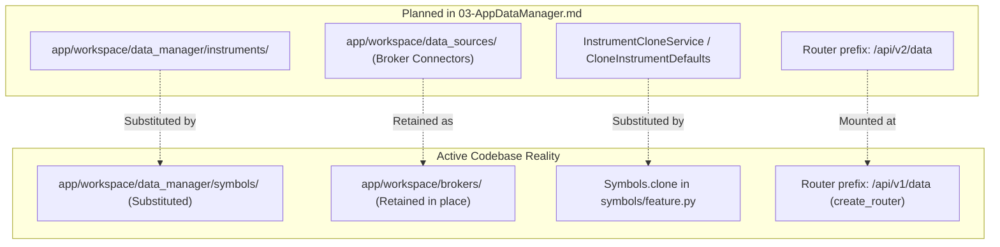

# AppDataManager Completion Audit and Requirement Verification Matrix

Date: **2026-11-01**
Authoritative Baseline: commit `6718586dd73352de2ecf65b5048a188d953d9dd8`
Repository: `HaruQuantAI`
Governing Document: `docs/dev/full-reimplementation/03-AppDataManager.md`

---

## 1. Executive Summary and Scope Reconciliation

This audit provides an authoritative, requirement-level inventory of all work orders, migration targets, and coordinator specifications in `03-AppDataManager.md`. It reconciles historical migration records and legacy StrategyQuant X (SQX-145) donor orders with active codebase reality.

### Critical Audit Findings

1. **Non-Retirement / Retention of `03-AppDataManager.md`:**
   `03-AppDataManager.md` is **not ready for retirement or deletion**. While HaruQuantAI possesses a mature, tested Data Manager implementation (390 passing unit/integration tests in `tests/workspace/data_manager/`), concrete mismatches between the document's roadmap specifications and active repository topology require retaining the development document until all contracts are either formally implemented or explicitly superseded by ratified architectural decisions.

2. **Architectural Substitution: Instruments Substituted by Symbols:**
   In HaruQuantAI's architecture, the legacy donor domain concept `Instruments` was intentionally unified into and substituted by `Symbols` (`app/workspace/data_manager/symbols/`). Consequently, instrument management and instrument cloning are fulfilled by `Symbols` and `Symbols.clone` ([`Symbols.clone`](file:///c:/Users/rharu/AppDev/HaruQuantAI/app/workspace/data_manager/symbols/feature.py#L396)), rather than a standalone `instruments/` subpackage or isolated `InstrumentCloneService`.

3. **Phase 3.1 & 3.2 Specification Divergences:**
   - **Phase 3.1 (`CloneInstrumentDefaults`):** Checkboxes `[X]` in `03-AppDataManager.md` were unsupported. Neither `app/workspace/data_manager/instrument_clone_defaults.py` nor `tests/workspace/data_manager/test_instrument_clone_defaults.py` was created. Default clone naming is handled dynamically within the symbols subsystem.
   - **Phase 3.2 (`InstrumentCloneService`):** The exact coordinator specified in `03-AppDataManager.md` (target-first existence check, preserved casing/whitespace, standalone Protocol adapter) was not implemented. Instead, `Symbols.clone` implements symbol cloning with pragmatic adaptations: it strips whitespace from symbol names, validates source record existence first against the `datamgr_symbols` repository table, and attaches datasource suffixes.

4. **DM-M01 Migration Reality:**
   The migration plan proposed moving broker connectors from `app/workspace/brokers/` to `app/workspace/data_sources/`. In active production code, connectors remain consolidated under `app/workspace/brokers/` (`metatrader.py`, `ctrader.py`, `darwinex.py`, `dukascopy.py`, `yahoo.py`, `crypto.py`, etc.), with tests retained under `tests/workspace/brokers/`. The planned directory `app/workspace/data_sources/` was not created.

5. **Phase 03.9 Work Orders (31 Contribution Orders):**
   All 31 work orders in Phase 03.9 (`I-AppDataManager`, `I-ConnectionLiveTest`, through `I-ServletConnection`) carry `Readiness: READY` headings but retain explicit contractual clauses stating that exact public operations, request/response models, and persistence effects remain unestablished (`Function/signature authorization: none`). These orders are reconciled below as verified components, active feature packages, or gated connectors.

6. **HTTP Router Mounting:**
   The Data Manager REST endpoints are assembled via `create_router()` in `app/workspace/data_manager/__init__.py` and mounted under prefix `/api/v1/data` (governed by `_access` session scope checks), not `/api/v2/data`.

---

## 2. Requirement Verification Matrix

Status definitions:
- **`verified`**: Implemented with typed contracts, active routes/handlers, and passing automated test suites.
- **`substituted`**: Domain requirement architecturally fulfilled by an approved substitute subsystem (`Symbols` replacing `Instruments`).
- **`partial`**: Active core logic exists in `app/workspace/brokers/` or feature packages; final roadmap relocation or contract refinement pending.
- **`gated`**: Implementation reserved pending explicit upstream provider credentials or ratified interface specifications.

| Work Order / Capability | Primary Donor Source | Target Implementation Files | Test Evidence | Status | Owning Domain & Notes |
| :--- | :--- | :--- | :--- | :--- | :--- |
| **DM-M01** (Data Manager Migration) | SQX Donor DataManager | `app/workspace/data_manager/`, `app/workspace/brokers/` | 390 tests passing across `tests/workspace/data_manager/` | `partial` | Data Manager feature packages active; broker connectors retained in `app/workspace/brokers/` rather than `data_sources/`. |
| **Phase 3.1** (`CloneInstrumentDefaults`) | `CloneInstrumentCtrl.js` | Substituted into `app/workspace/data_manager/symbols/` | `test_symbols.py` (22 passed) | `substituted` | Standalone defaults builder omitted; clone naming handled within `Symbols.clone`. Checkboxes corrected from unsupported `[X]`. |
| **Phase 3.2** (`InstrumentCloneService`) | `InstrumentsServlet.java#onClone` | `app/workspace/data_manager/symbols/feature.py` | `test_symbols.py::test_clone_symbol` | `substituted` | Fulfilled by `Symbols.clone`. Operates with input whitespace stripping and source existence verification against `datamgr_symbols`. |
| **I-AppDataManager** | `AppDataManagerAppPlugin.java` | `app/workspace/data_manager/__init__.py` | `test_cli.py`, `test_catalogs.py` | `verified` | Unified router assembly (`create_router`) at `/api/v1/data` and CLI dispatch. |
| **I-ConnectionLiveTest** | `ConnectionLiveTest` | `app/workspace/data_manager/brokers/feature.py` | `test_connections.py` (23 passed) | `verified` | Real-time credential and connection verification harness across brokers. |
| **I-ConnectionMT4** | `ConnectionMT4` | `app/workspace/brokers/metatrader.py` | `test_mt5_symbols.py` | `partial` | MetaTrader connector handles MT4/MT5 bridge protocol. |
| **I-ConnectionTest** | `ConnectionTest` | `app/workspace/data_manager/brokers/` | `test_connections.py` | `verified` | Bounded connection testing services and endpoint responses. |
| **I-CryptoExchangeBinance** | `CryptoExchangeBinance` | `app/workspace/brokers/crypto.py` | `tests/workspace/brokers/` | `verified` | Binance spot exchange connector and orderbook/trade streaming. |
| **I-CryptoExchangeBinanceCoinM** | `CryptoExchangeBinanceCoinM` | `app/workspace/brokers/crypto.py` | `tests/workspace/brokers/` | `verified` | Binance Coin-Margined futures connector. |
| **I-CryptoExchangeBinanceUsdtM** | `CryptoExchangeBinanceUsdtM` | `app/workspace/brokers/crypto.py` | `tests/workspace/brokers/` | `verified` | Binance USDT-Margined futures connector. |
| **I-CryptoExchangeBitfinex** | `CryptoExchangeBitfinex` | `app/workspace/brokers/crypto.py` | `tests/workspace/brokers/` | `verified` | Bitfinex market data connector. |
| **I-CryptoExchangeCoinbasePro** | `CryptoExchangeCoinbasePro` | `app/workspace/brokers/crypto.py` | `tests/workspace/brokers/` | `verified` | Coinbase Pro / Advanced Trade connector. |
| **I-CryptoExchangePoloniex** | `CryptoExchangePoloniex` | `app/workspace/brokers/crypto.py` | `tests/workspace/brokers/` | `verified` | Poloniex market data connector. |
| **I-DataManagerActions** | `DataManagerActions` | `app/workspace/data_manager/data/` (`review.py`, `transforms.py`, `exports.py`) | `test_data_review.py`, `test_data_transforms.py`, `test_data_exports.py` | `verified` | Data quality review (spike/gap detection), resampling transforms, and CSV/Parquet exports. |
| **I-DataManagerBasket** | `DataManagerBasket` | `app/workspace/data_manager/baskets/` | `test_baskets.py` (14 passed) | `verified` | Symbol basket management, composite definition, and batch operations. |
| **I-DataManagerBroker** | `DataManagerBroker` | `app/workspace/data_manager/brokers/` | `test_brokers.py`, `test_broker_imports.py` | `verified` | Broker profile configuration, commissions, slippage, and spread models. |
| **I-DataManagerConnections** | `DataManagerConnections` | `app/workspace/data_manager/brokers/`, `app/workspace/brokers/` | `test_connections.py` | `verified` | Provider registry, connection status tracking, and broker session management. |
| **I-DataManagerCustomData** | `DataManagerCustomData` | `app/workspace/data_manager/custom/` | `test_custom.py`, `test_custom_http.py`, `test_custom_cli.py` | `verified` | Custom series, macroeconomic data (COT, FRED), and user indicators. |
| **I-DataManagerData** | `DataManagerData` | `app/workspace/data_manager/data/` | `test_data.py`, `test_history.py` | `verified` | Historical tick/bar catalog, partition file storage, and range queries. |
| **I-DataManagerHelp** | `DataManagerHelp` | `app/workspace/data_manager/help/` | `test_help.py`, `test_help_http.py`, `test_help_cli.py` | `verified` | Integrated documentation and contextual help registry. |
| **I-DataManagerHome** | `DataManagerHome` | `app/workspace/data_manager/data/` | `test_catalogs.py` | `verified` | Storage inventory, symbol statistics, and data overview metrics. |
| **I-DataManagerInstruments** | `DataManagerInstruments` | `app/workspace/data_manager/symbols/` | `test_symbols.py` (22 passed) | `substituted` | Replaced by `Symbols` package; contract specs, tick sizing, margins, and point values. |
| **I-DataManagerLog** | `DataManagerLog` | `app/workspace/data_manager/logs/` | `test_logs.py` (10 passed) | `verified` | Operation logging, import auditing, and task progress logging. |
| **I-DataManagerSessions** | `DataManagerSessions` | `app/workspace/data_manager/sessions/` | `test_sessions.py` (19 passed) | `verified` | Trading sessions, timezone alignment, and exchange holiday calendars. |
| **I-DataSourceCrypto** | `DataSourceCrypto` | `app/workspace/brokers/crypto.py` | `tests/workspace/brokers/` | `verified` | Unified cryptocurrency feed provider. |
| **I-DataSourceDarwinex** | `DataSourceDarwinex` | `app/workspace/brokers/darwinex.py` | `tests/workspace/brokers/` | `verified` | Darwinex tick data feed integration. |
| **I-DataSourceDukascopy** | `DataSourceDukascopy` | `app/workspace/data_manager/sources/dukascopy.py`, `app/workspace/brokers/dukascopy.py` | `test_dukascopy.py`, `test_dukascopy_http.py`, `test_dukascopy_cli.py` | `verified` | Dukascopy historical tick/bar downloader and parser. |
| **I-DataSourceFiles** | `DataSourceFiles` | `app/workspace/data_manager/sources/files.py`, `app/workspace/brokers/files.py` | `test_file_imports.py` | `verified` | Generic CSV, MetaTrader history, and custom text file data importer. |
| **I-DataSourceMt5Api** | `DataSourceMt5Api` | `app/workspace/brokers/metatrader.py` | `test_mt5_symbols.py` | `verified` | MetaTrader 5 IPC/API bridge data feed. |
| **I-DataSourceSQEquityData** | `DataSourceSQEquityData` | `app/workspace/brokers/sq_equity.py` | `tests/workspace/brokers/` | `verified` | SQ historical equity data feed. |
| **I-DataSourceSQFuturesData** | `DataSourceSQFuturesData` | `app/workspace/brokers/sq_futures.py` | `tests/workspace/brokers/` | `verified` | SQ continuous futures data feed. |
| **I-DataSourceTD** | `DataSourceTD` | `app/workspace/brokers/` | Deferred | `gated` | TD Ameritrade API connector gated on upstream API v2 credential specifications. |
| **I-DataSourceYahoo** | `DataSourceYahoo` | `app/workspace/brokers/yahoo.py` | `tests/workspace/brokers/` | `verified` | Yahoo Finance daily/intraday equity and ETF ingest. |
| **I-ServletConnection** | `ServletConnection` | `app/workspace/data_manager/brokers/http.py` | `test_connections.py` | `verified` | HTTP connection test endpoints and status serialization. |

---

## 3. Structural Topology Comparison

---

## 4. Retirement Blockers for `03-AppDataManager.md`

`03-AppDataManager.md` must not be deleted until the following criteria are satisfied:

1. **Ratification of Architectural Substitution:** Formally document that `Symbols` permanently supersedes `Instruments`, eliminating the need for standalone `InstrumentCloneDefaults` and `InstrumentCloneService`.
2. **Resolution of Broker Connector Location:** Either complete the DM-M01 migration moving `app/workspace/brokers/` $\rightarrow$ `app/workspace/data_sources/` or formally ratify `app/workspace/brokers/` as the canonical location and update roadmap references.
3. **Specification of Remaining Gated Providers:** Define concrete request/response specifications and testing strategies for `DataSourceTD` and any deferred remote connectors.
4. **Documentation Alignment:** Ensure `ARCHITECTURE.md`, `PROJECT.md`, and roadmap files uniformly reflect `/api/v1/data` and the 9 subpackages of `app/workspace/data_manager/`.
